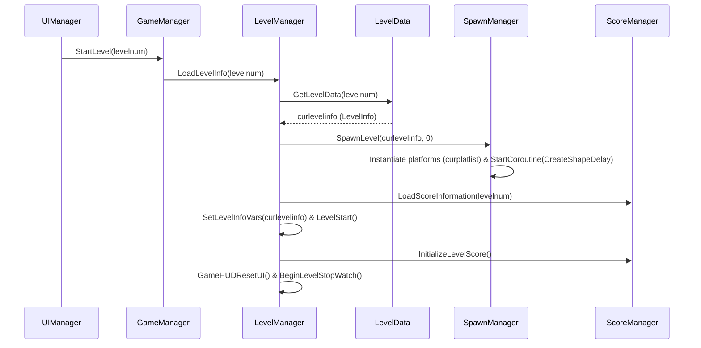
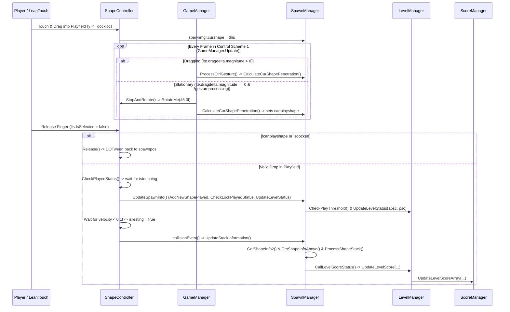
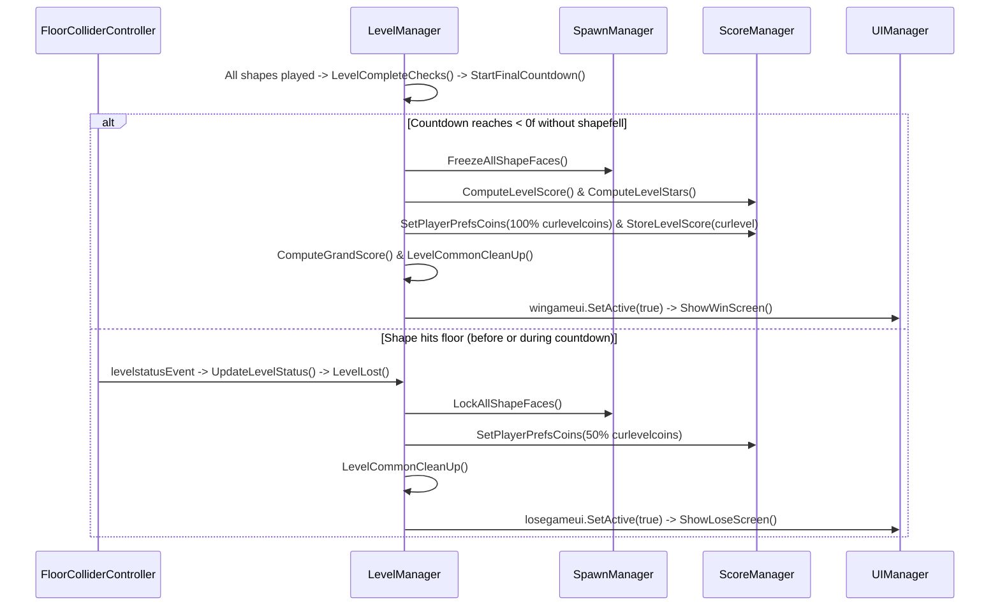

# Balance Stack Hero 2026 — Scripts Master Index & Codebase Architecture Atlas

## 1. Title and Scope

| Attribute | Value |
|---|---|
| **Document Title** | Balance Stack Hero 2026 — Master Script Index & Architectural Reference |
| **Analyzed Root Path** | `Assets/Scripts/` (`d:\Unity Projects\Balance Stack Hero 2026[Gemini4Argon]\Assets\Scripts\`) |
| **Documentation Output Path** | `Assets/Scripts/Docs/` (`d:\Unity Projects\Balance Stack Hero 2026[Gemini4Argon]\Assets\Scripts\Docs\`) |
| **Target Engine Version** | `Unity 2023.1.6f1` (**Confirmed from ProjectSettings/ProjectVersion.txt**) |
| **Total C# Scripts Analyzed** | **27** `.cs` files (`22` in `Assets/Scripts/`, `5` in `Assets/Scripts/Game/`) |
| **Total Primary & Helper Types** | **29** types (`27` primary classes + `ShapeInfo` and `PlatformInfo` declared in `SpawnManager.cs`) |
| **Total Lines of C# Code** | **6,168** lines |
| **Namespace Coverage** | 100% `<global>` namespace (no explicit `namespace` blocks in any of the 27 scripts) |

---

## 2. Executive Overview

**Balance Stack Hero 2026** is a 3D physics-based block-stacking puzzle game inspired by *Art of Balance* and *Super Stacker*, built in Unity (`2023.1.6f1`) using 3D `Rigidbody` / `Collider` physics constrained to a 2D play plane, `LeanTouch` for touch selection and rotation, `DOTween` (`DG.Tweening`) for UI and transform tweening, `EPOOutline` (`Outlinable`) for shape status outlines, `MeshExploder` (`Exploder.Utils`) for shape destruction, `CircularGravityForce` (`CGF`) for customizable gravity, and `TextMeshPro` (`TMPro`) for HUD/UI text.

Architecturally, the codebase is organized around five core scene-level manager components—**`GameManager`**, **`LevelManager`**, **`SpawnManager`**, **`ScoreManager`**, and **`UIManager`**—supported by per-entity physics controllers (**`ShapeController`**, **`PlatformController`**, **`DockColliderController`**, **`FloorColliderController`**), in-memory level/world data catalogs (**`LevelData`**, **`LevelInfo`**, **`LevelStatus`**, **`LevelMakerData`**, **`WorldData`**, **`WorldInfo`**), and a reusable `Game/` service layer (**`SoundManager`**, **`Sound`**, **`AppInfo`**, **`EffectManager`**, **`RdWUtilities`**).

---

## 3. Folder and Namespace Map

```text
Assets/Scripts/ (Namespace: <global> across all 27 scripts)
├── AnimatedButton.cs              [UI / Animation Button Component]
├── CameraController.cs            [Camera Follow & Shake Controller]
├── DamagePopup.cs                 [Floating 3D/TMP Text Popup]
├── DockColliderController.cs      [Dock Boundary Trigger Handler]
├── DurationScale.cs               [DOTween Scale & Rotation Tween Component]
├── FloorColliderController.cs     [Floor Loss Trigger, VFX & Event Publisher]
├── GameManager.cs                 [Touch/Keyboard Rotation & Session Controller]
├── LevelData.cs                   [Hardcoded Catalog of Levels 1..40]
├── LevelInfo.cs                   [Per-Level Configuration & Shape/Platform Lists]
├── LevelMakerData.cs              [Inspector-Driven Custom Level 0 Builder]
├── LevelManager.cs                [Level State Machine, Timers & Progression Hub]
├── LevelStatus.cs                 [Per-Level Lock, High Score, Stars & Mode Data]
├── Loader.cs                      [Async Scene Loader & Progress Bar]
├── PlatformController.cs          [Platform Material & Last-Shape Collision Handler]
├── RdWAnalytics.cs                [Unity Analytics Event Dispatcher]
├── ScoreEffect.cs                 [UI Score Counter Tween Component]
├── ScoreManager.cs                [Score/Star Calculation & Coin Persistence]
├── ShapeController.cs             [Per-Shape Physics, Selection, Outline & State Machine]
├── SpawnManager.cs                [Spawner, Stack Graph Analyzer, Special Rules & Level Maker]
│   ├── class ShapeInfo            [Serializable Shape Spawn Record]
│   ├── class PlatformInfo         [Serializable Platform Spawn Record]
│   └── class SpawnManager         [Primary Spawner & Stack Engine MonoBehaviour]
├── UIManager.cs                   [Screen Navigation, Level Select Grid & Win/Lose Modals]
├── WorldData.cs                   [Hardcoded Catalog of Worlds 1..3]
├── WorldInfo.cs                   [Per-World Metadata Record]
├── Game/
│   ├── AppInfo.cs                 [Persistent Singleton for Store & Social URLs]
│   ├── EffectManager.cs           [Scene Singleton for Particle VFX Arrays (Unreferenced)]
│   ├── RdWUtilities.cs            [Static Utility Library: Audio, Links, Shuffle, Time]
│   ├── Sound.cs                   [Serializable AudioClip + Concurrency Counter]
│   └── SoundManager.cs            [Persistent Audio Singleton for BGM & Polyphonic SFX]
└── Docs/                          [Generated Documentation Suite]
    ├── Scripts_Master_Index.md    [This Master Index Document]
    ├── <22 Root Companion .cs.md Files>
    └── Game/
        └── <5 Game/ Companion .cs.md Files>
```

---

## 4. Script Inventory Table

| # | Script Name | Relative Path | Primary Type(s) | Base Class | LOC | Architectural Role | Risk | Companion Doc |
|---|---|---|---|---|---|---|---|---|
| 1 | `AnimatedButton.cs` | `Assets/Scripts/AnimatedButton.cs` | `AnimatedButton` | `UIBehaviour`, `IPointerDownHandler` | 100 | Animated UI button with Animator press trigger & `onClick` event | Low | [AnimatedButton.cs.md](file:///d:/Unity%20Projects/Balance%20Stack%20Hero%202026[Gemini4Argon]/Assets/Scripts/Docs/AnimatedButton.cs.md) |
| 2 | `CameraController.cs` | `Assets/Scripts/CameraController.cs` | `CameraController` | `MonoBehaviour` | 164 | Smooth vertical camera tracking & trauma/perlin shake coroutines | Low | [CameraController.cs.md](file:///d:/Unity%20Projects/Balance%20Stack%20Hero%202026[Gemini4Argon]/Assets/Scripts/Docs/CameraController.cs.md) |
| 3 | `DamagePopup.cs` | `Assets/Scripts/DamagePopup.cs` | `DamagePopup` | `MonoBehaviour` | 53 | Floating TMP text popup with DOTween fade/move and self-destroy | Low | [DamagePopup.cs.md](file:///d:/Unity%20Projects/Balance%20Stack%20Hero%202026[Gemini4Argon]/Assets/Scripts/Docs/DamagePopup.cs.md) |
| 4 | `DockColliderController.cs` | `Assets/Scripts/DockColliderController.cs` | `DockColliderController` | `MonoBehaviour` | 45 | Trigger boundary toggling `ShapeController` dock/playfield flags | Medium | [DockColliderController.cs.md](file:///d:/Unity%20Projects/Balance%20Stack%20Hero%202026[Gemini4Argon]/Assets/Scripts/Docs/DockColliderController.cs.md) |
| 5 | `DurationScale.cs` | `Assets/Scripts/DurationScale.cs` | `DurationScale` | `MonoBehaviour` | 46 | DOTween scale & rotation tween helper on `Start()` | Low | [DurationScale.cs.md](file:///d:/Unity%20Projects/Balance%20Stack%20Hero%202026[Gemini4Argon]/Assets/Scripts/Docs/DurationScale.cs.md) |
| 6 | `FloorColliderController.cs` | `Assets/Scripts/FloorColliderController.cs` | `FloorColliderController` | `MonoBehaviour` | 58 | Floor trigger detecting fallen shapes, spawning explosion VFX & firing `levelstatusEvent` | High | [FloorColliderController.cs.md](file:///d:/Unity%20Projects/Balance%20Stack%20Hero%202026[Gemini4Argon]/Assets/Scripts/Docs/FloorColliderController.cs.md) |
| 7 | `GameManager.cs` | `Assets/Scripts/GameManager.cs` | `GameManager` | `MonoBehaviour` | 430 | Control scheme 1 step-rotation (`StopAndRotate`), keyboard controls & session counters | High | [GameManager.cs.md](file:///d:/Unity%20Projects/Balance%20Stack%20Hero%202026[Gemini4Argon]/Assets/Scripts/Docs/GameManager.cs.md) |
| 8 | `LevelData.cs` | `Assets/Scripts/LevelData.cs` | `LevelData` | `System.Object` | 1,105 | Hardcoded constructor defining `LevelInfo` for levels `1..40` | Medium | [LevelData.cs.md](file:///d:/Unity%20Projects/Balance%20Stack%20Hero%202026[Gemini4Argon]/Assets/Scripts/Docs/LevelData.cs.md) |
| 9 | `LevelInfo.cs` | `Assets/Scripts/LevelInfo.cs` | `LevelInfo` | `System.Object` | 35 | Serializable level definition holding `shapelist`, `platlist`, thresholds & `lvlstat` | Medium | [LevelInfo.cs.md](file:///d:/Unity%20Projects/Balance%20Stack%20Hero%202026[Gemini4Argon]/Assets/Scripts/Docs/LevelInfo.cs.md) |
| 10 | `LevelMakerData.cs` | `Assets/Scripts/LevelMakerData.cs` | `LevelMakerData` | `MonoBehaviour` | 150 | Inspector authoring bridge populating custom level `ld.li[0]` | Low | [LevelMakerData.cs.md](file:///d:/Unity%20Projects/Balance%20Stack%20Hero%202026[Gemini4Argon]/Assets/Scripts/Docs/LevelMakerData.cs.md) |
| 11 | `LevelManager.cs` | `Assets/Scripts/LevelManager.cs` | `LevelManager` | `MonoBehaviour` | 725 | Central level orchestrator, game clock, stability countdown, win/loss & `PlayerPrefs` hub | High | [LevelManager.cs.md](file:///d:/Unity%20Projects/Balance%20Stack%20Hero%202026[Gemini4Argon]/Assets/Scripts/Docs/LevelManager.cs.md) |
| 12 | `LevelStatus.cs` | `Assets/Scripts/LevelStatus.cs` | `LevelStatus` | `System.Object` | 26 | Serializable per-level progression (`levelhiscore`, `levelhistars`, `islocked`) & mode record | Low | [LevelStatus.cs.md](file:///d:/Unity%20Projects/Balance%20Stack%20Hero%202026[Gemini4Argon]/Assets/Scripts/Docs/LevelStatus.cs.md) |
| 13 | `Loader.cs` | `Assets/Scripts/Loader.cs` | `Loader` | `MonoBehaviour` | 67 | Async scene loader coroutine with UI progress slider | Low | [Loader.cs.md](file:///d:/Unity%20Projects/Balance%20Stack%20Hero%202026[Gemini4Argon]/Assets/Scripts/Docs/Loader.cs.md) |
| 14 | `PlatformController.cs` | `Assets/Scripts/PlatformController.cs` | `PlatformController` | `MonoBehaviour` | 88 | Platform material setter & collision handler setting `istouching` / `islsts` on shapes | Medium | [PlatformController.cs.md](file:///d:/Unity%20Projects/Balance%20Stack%20Hero%202026[Gemini4Argon]/Assets/Scripts/Docs/PlatformController.cs.md) |
| 15 | `RdWAnalytics.cs` | `Assets/Scripts/RdWAnalytics.cs` | `RdWAnalytics` | `MonoBehaviour` | 78 | Unity Analytics custom event wrapper (currently unreferenced) | Low | [RdWAnalytics.cs.md](file:///d:/Unity%20Projects/Balance%20Stack%20Hero%202026[Gemini4Argon]/Assets/Scripts/Docs/RdWAnalytics.cs.md) |
| 16 | `ScoreEffect.cs` | `Assets/Scripts/ScoreEffect.cs` | `ScoreEffect` | `MonoBehaviour` | 47 | Animated score counter coroutine & punch scale effect | Low | [ScoreEffect.cs.md](file:///d:/Unity%20Projects/Balance%20Stack%20Hero%202026[Gemini4Argon]/Assets/Scripts/Docs/ScoreEffect.cs.md) |
| 17 | `ScoreManager.cs` | `Assets/Scripts/ScoreManager.cs` | `ScoreManager` | `MonoBehaviour` | 361 | Multi-factor score & star calculator, coin wallet & LIFO played-shape tracker | Medium | [ScoreManager.cs.md](file:///d:/Unity%20Projects/Balance%20Stack%20Hero%202026[Gemini4Argon]/Assets/Scripts/Docs/ScoreManager.cs.md) |
| 18 | `ShapeController.cs` | `Assets/Scripts/ShapeController.cs` | `ShapeController` | `MonoBehaviour` | 1,022 | Per-shape touch selection, dock/playfield state, physics, outline & collision controller | High | [ShapeController.cs.md](file:///d:/Unity%20Projects/Balance%20Stack%20Hero%202026[Gemini4Argon]/Assets/Scripts/Docs/ShapeController.cs.md) |
| 19 | `SpawnManager.cs` | `Assets/Scripts/SpawnManager.cs` | `ShapeInfo`, `PlatformInfo`, `SpawnManager` | `Object`, `MonoBehaviour` | 1,976 | Spawner, 3D stack adjacency/weight analyzer, special-shape rules engine & Level Maker | High | [SpawnManager.cs.md](file:///d:/Unity%20Projects/Balance%20Stack%20Hero%202026[Gemini4Argon]/Assets/Scripts/Docs/SpawnManager.cs.md) |
| 20 | `UIManager.cs` | `Assets/Scripts/UIManager.cs` | `UIManager` | `MonoBehaviour` | 538 | Menu router, 40-button Level Select screen builder, Win/Lose screens & audio toggles | High | [UIManager.cs.md](file:///d:/Unity%20Projects/Balance%20Stack%20Hero%202026[Gemini4Argon]/Assets/Scripts/Docs/UIManager.cs.md) |
| 21 | `WorldData.cs` | `Assets/Scripts/WorldData.cs` | `WorldData` | `System.Object` | 50 | Hardcoded constructor defining `WorldInfo` for worlds `1..3` & `completedworlds = 1` | Low | [WorldData.cs.md](file:///d:/Unity%20Projects/Balance%20Stack%20Hero%202026[Gemini4Argon]/Assets/Scripts/Docs/WorldData.cs.md) |
| 22 | `WorldInfo.cs` | `Assets/Scripts/WorldInfo.cs` | `WorldInfo` | `System.Object` | 14 | Serializable world metadata record (`worldnumber`, `worldname`, `cost`, `islocked`) | Low | [WorldInfo.cs.md](file:///d:/Unity%20Projects/Balance%20Stack%20Hero%202026[Gemini4Argon]/Assets/Scripts/Docs/WorldInfo.cs.md) |
| 23 | `AppInfo.cs` | `Assets/Scripts/Game/AppInfo.cs` | `AppInfo` | `MonoBehaviour` | 77 | Persistent singleton storing app store IDs, social handles & constructed URLs | Low | [AppInfo.cs.md](file:///d:/Unity%20Projects/Balance%20Stack%20Hero%202026[Gemini4Argon]/Assets/Scripts/Docs/Game/AppInfo.cs.md) |
| 24 | `EffectManager.cs` | `Assets/Scripts/Game/EffectManager.cs` | `EffectManager` | `MonoBehaviour` | 60 | Scene singleton holding `ParticleSystem[]` arrays & `ShowVFX` (unreferenced) | Low | [EffectManager.cs.md](file:///d:/Unity%20Projects/Balance%20Stack%20Hero%202026[Gemini4Argon]/Assets/Scripts/Docs/Game/EffectManager.cs.md) |
| 25 | `RdWUtilities.cs` | `Assets/Scripts/Game/RdWUtilities.cs` | `RdWUtilities` | `static class` | 133 | Static helpers for button SFX, unscaled wait, scene load, store links, shuffle & `DateTime` | Low | [RdWUtilities.cs.md](file:///d:/Unity%20Projects/Balance%20Stack%20Hero%202026[Gemini4Argon]/Assets/Scripts/Docs/Game/RdWUtilities.cs.md) |
| 26 | `Sound.cs` | `Assets/Scripts/Game/Sound.cs` | `Sound` | `System.Object` | 13 | Serializable wrapper pairing `AudioClip clip` with `simultaneousPlayCount` | Low | [Sound.cs.md](file:///d:/Unity%20Projects/Balance%20Stack%20Hero%202026[Gemini4Argon]/Assets/Scripts/Docs/Game/Sound.cs.md) |
| 27 | `SoundManager.cs` | `Assets/Scripts/Game/SoundManager.cs` | `SoundManager` | `MonoBehaviour` | 267 | Persistent audio singleton managing BGM, polyphonic SFX scaling & mute `PlayerPrefs` | Medium | [SoundManager.cs.md](file:///d:/Unity%20Projects/Balance%20Stack%20Hero%202026[Gemini4Argon]/Assets/Scripts/Docs/Game/SoundManager.cs.md) |

---

## 5. Script Classification Summary

| Category Tag | Scripts Assigned | Count |
|---|---|---|
| **`[Gameplay / Core Loop]`** | `GameManager.cs`, `LevelManager.cs`, `SpawnManager.cs`, `ShapeController.cs`, `ScoreManager.cs`, `PlatformController.cs`, `DockColliderController.cs`, `FloorColliderController.cs` | 8 |
| **`[Physics / Collision / Raycast]`** | `ShapeController.cs`, `SpawnManager.cs`, `PlatformController.cs`, `DockColliderController.cs`, `FloorColliderController.cs` | 5 |
| **`[Input / Control]`** | `GameManager.cs`, `ShapeController.cs`, `SpawnManager.cs`, `AnimatedButton.cs` | 4 |
| **`[UI / HUD / Menus]`** | `UIManager.cs`, `LevelManager.cs`, `AnimatedButton.cs`, `ScoreEffect.cs`, `DamagePopup.cs`, `Loader.cs` | 6 |
| **`[Data / Config / ScriptableObject]`** | `LevelData.cs`, `LevelInfo.cs`, `LevelStatus.cs`, `LevelMakerData.cs`, `WorldData.cs`, `WorldInfo.cs`, `SpawnManager.cs` (`ShapeInfo`, `PlatformInfo`), `Game/AppInfo.cs`, `Game/Sound.cs` | 9 |
| **`[State / Progression / Persistence]`** | `LevelManager.cs`, `ScoreManager.cs`, `GameManager.cs`, `LevelStatus.cs`, `WorldData.cs`, `WorldInfo.cs`, `Game/SoundManager.cs`, `Game/RdWUtilities.cs` | 8 |
| **`[Scene / Level / Progression]`** | `LevelManager.cs`, `Loader.cs`, `UIManager.cs`, `Game/RdWUtilities.cs` | 4 |
| **`[Animation / VFX]`** | `CameraController.cs`, `DurationScale.cs`, `ScoreEffect.cs`, `DamagePopup.cs`, `FloorColliderController.cs`, `ShapeController.cs`, `Game/EffectManager.cs` | 7 |
| **`[Audio / Feedback]`** | `Game/SoundManager.cs`, `Game/Sound.cs`, `Game/RdWUtilities.cs`, `Game/EffectManager.cs`, `FloorColliderController.cs` | 5 |
| **`[Analytics / Telemetry]`** | `RdWAnalytics.cs`, `ScoreManager.cs` | 2 |
| **`[Debug / Editor / Tooling]`** | `LevelMakerData.cs`, `SpawnManager.cs` | 2 |
| **`[Utility / Helper]`** | `Game/RdWUtilities.cs`, `Game/AppInfo.cs` | 2 |

---

## 6. Architectural Subsystems

### 6.1 Core Gameplay & Stack Physics Subsystem
- **Scripts:** `SpawnManager.cs`, `ShapeController.cs`, `PlatformController.cs`, `DockColliderController.cs`, `FloorColliderController.cs`, `GameManager.cs`
- **Role:** Spawns platforms and dock shapes, tracks touch selection (`LeanSelectable`) and 45° auto-rotation (`GameManager.StopAndRotate`), checks collider penetration (`SpawnManager.CalculateCurShapePenetration`), detects settling (`ShapeController.CheckPlayedStatus`), builds the 3D touching/above adjacency graph (`GetShapeInfo2`, `GetShapeInfoAbove`), executes special shape explosions (`ProcessShapeStack` -> `MeshExploder`), and detects floor impacts (`FloorColliderController`).

### 6.2 Level Lifecycle, Progression & Scoring Subsystem
- **Scripts:** `LevelManager.cs`, `ScoreManager.cs`, `LevelData.cs`, `LevelInfo.cs`, `LevelStatus.cs`, `WorldData.cs`, `WorldInfo.cs`, `LevelMakerData.cs`
- **Role:** Owns the 40 hardcoded levels (`LevelData`) plus custom Level 0 (`LevelMakerData`), manages the active game clock and end-of-level stability countdown (`LevelManager.Update`), calculates 9-category scores and 1–3 star ratings (`ScoreManager.ComputeLevelScore` / `ComputeLevelStars`), and persists level unlocks, high scores, stars, and coins in `PlayerPrefs`.

### 6.3 UI, HUD, Scene Loading & Visual Feedback Subsystem
- **Scripts:** `UIManager.cs`, `AnimatedButton.cs`, `ScoreEffect.cs`, `DamagePopup.cs`, `DurationScale.cs`, `CameraController.cs`, `Loader.cs`
- **Role:** Manages panel visibility and navigation (`UIManager.SelectMenu`), populates the 40-button Level Select grid (`LoadLevelSelectScreen`), animates win/lose modals (`ShowWinScreen`, `ShowLoseScreen`, `ScoreEffect`), provides async scene reloading (`Loader`), and supplies camera follow/shake (`CameraController`) and tween helpers (`DurationScale`, `DamagePopup`).

### 6.4 Audio, Platform Services & Analytics Subsystem
- **Scripts:** `Game/SoundManager.cs`, `Game/Sound.cs`, `Game/RdWUtilities.cs`, `Game/AppInfo.cs`, `Game/EffectManager.cs`, `RdWAnalytics.cs`
- **Role:** Provides persistent `DontDestroyOnLoad` singletons for audio (`SoundManager.Instance`) and app store/social metadata (`AppInfo.Instance`), static utility functions (`RdWUtilities`), and scaffolding for VFX (`EffectManager`) and Unity Analytics (`RdWAnalytics`).

---

## 7. Cross-Script Dependency Map

```text
                       ┌──────────────────────┐
                       │     UIManager        │
                       └─┬──────┬──────┬────┬─┘
                         │      │      │    │
            ┌────────────┘      │      │    └──────────────┐
            ▼                   ▼      ▼                   ▼
   ┌─────────────────┐  ┌────────────────────┐   ┌──────────────────┐
   │   GameManager   │◄─┤    LevelManager    │──►│   ScoreManager   │
   └────────┬────────┘  └──┬────┬──────┬───┬─┘   └─────────▲────────┘
            │              │    │      │   │               │
            ▼              ▼    │      │   └──────────┐    │
   ┌─────────────────────────┐  │      │              │    │
   │      SpawnManager       ├──┼──────┼──────────────┼────┘
   │ (+ShapeInfo/PlatformInfo│  │      │              │
   └──┬──────────┬─────────┬─┘  │      │              │
      │          │         │    │      ▼              ▼
      │          │         │    │  ┌───────────┐  ┌──────────────┐
      │          │         │    │  │ LevelData │  │LevelMakerData│
      │          │         │    │  │+LevelInfo │  └──────────────┘
      │          │         │    │  │+LevelStat │
      │          │         │    │  └───────────┘
      ▼          ▼         ▼    ▼
┌───────────┐ ┌────────────────────┐ ┌─────────────────────────┐
│PlatformCtl│ │  ShapeController   │ │ FloorColliderController │
└───────────┘ └──────────▲─────────┘ └─────────────────────────┘
                         │
              ┌──────────┴──────────┐
              │DockColliderController│
              └─────────────────────┘
```

- **Tightly Coupled Triad (`GameManager` ↔ `LevelManager` ↔ `SpawnManager`):** Each holds direct Inspector references to the other two, synchronizing `curlevel`, spawning, stack evaluation, and win/loss transitions.
- **Event-Driven Links:**
  - `FloorColliderController.levelstatusEvent` -> `LevelManager.UpdateLevelStatus()`
  - `ShapeController.collisionEvent` -> `SpawnManager.UpdateStackInformation()`

---

## 8. Execution Roots and Global Entry Points

### 8.1 `Awake()` Entry Points
1. **`AppInfo.Awake()`:** Initializes `AppInfo.Instance` (`DontDestroyOnLoad`) or destroys duplicate via `DestroyImmediate`.
2. **`SoundManager.Awake()`:** Initializes `SoundManager.Instance` (`DontDestroyOnLoad`) or destroys duplicate via `DestroyImmediate`.
3. **`EffectManager.Awake()`:** Initializes `EffectManager.instance` or destroys duplicate via `Destroy`.
4. **`CameraController.Awake()`:** Caches `myTransform = GetComponent<Transform>()`.
5. **`DamagePopup.Awake()`:** Caches `TMP_Text`, initializes scale/color, starts DOTween move/fade sequence, and schedules `Destroy(gameObject, lifespan)`.
6. **`LevelMakerData.Awake()`:** Allocates `li = new LevelInfo()`.
7. **`LevelManager.Awake()`:** Allocates `ld = new LevelData()` and `wd = new WorldData()`, calls `GetLevelAllStatus()`, `ComputeGrandScore()`, and `scrmgr.GetPlayerPrefsCoins()`.
8. **`GameManager.Awake()`:** Queries `curlevel = lvlmgr.GetLastPlayedLevel()`.
9. **`UIManager.Awake()`:** Queries `curlevel = lvlmgr.GetLastPlayedLevel()`.

### 8.2 `Start()` Entry Points
- **`SoundManager.Start()`:** Applies saved `PlayerPrefs` mute states (`SetMusicOn`, `SetSoundOn`).
- **`AppInfo.Start()`:** Appends store/social IDs onto URL fields.
- **`LevelManager.Start()`:** Subscribes `FloorColliderController.levelstatusEvent += UpdateLevelStatus`.
- **`SpawnManager.Start()`:** Subscribes `ShapeController.collisionEvent += UpdateStackInformation` and `touchingEvent += ProcessShapeStack`; sets `cgf.ForcePower = gravity`.
- **`GameManager.Start()`:** Sets `controlscheme = 1`, syncs `spawnmgr.ctrlscheme = 1`, and loads `totalgamesplayed`.
- **`UIManager.Start()`:** Initializes HUD/menu panels (`SelectMenu(0)` or active state).
- **`ShapeController.Start()`:** Caches components, sets `tag = "Shape"`, scales to `smallScale`, calls `SetFaceProperties()` and `SetRigidbodyProperties(...)`.
- **`DurationScale.Start()`:** Starts DOTween `DOScale` and `DORotate` tweens.

### 8.3 Per-Frame Loop Roots (`Update` / `LateUpdate`)
- **`GameManager.Update()`:** Session timers, arrow-key rotation, and Control Scheme 1 `ProcessCtrlGesture()` / `StopAndRotate()`.
- **`LevelManager.Update()`:** Active level stopwatch (`levelElapsedTime`) and final stability countdown (`elapsedTime` -> `LevelWon` / `LevelLost`).
- **`SpawnManager.Update()`:** 24 keyboard hotkeys for Level Maker and debug commands.
- **`ShapeController.Update()` & `LateUpdate()`:** Selection state (`lts.IsSelected`), `shapeheight`, `txtpop` tracking, dock/playfield crossing (`y > spawnmgr.dockloc`), `Release()`, and `CheckPlayedStatus()`.
- **`CameraController.LateUpdate()`:** Smooth vertical camera follow (`Mathf.SmoothDamp` / `Lerp`).

---

## 9. End-to-End Runtime Flow Summary

1. **Application Startup & Scene Initialization:**
   - Unity runs `Awake()` across scene objects: `LevelManager` constructs `LevelData` (40 levels) and `WorldData` (3 worlds) and hydrates progression from `PlayerPrefs`; `GameManager` and `UIManager` read `GetLastPlayedLevel()`; `SoundManager` and `AppInfo` register persistent singletons.
   - In `Start()`, `LevelManager` subscribes to `FloorColliderController.levelstatusEvent`, and `SpawnManager` subscribes to `ShapeController.collisionEvent`.
2. **Menu Navigation & Level Selection (`UIManager`):**
   - From the Main Menu, the player either starts `curlevel` or opens the Level Select screen (`UIManager.LoadLevelSelectScreen()`), which populates 20 unlocked/locked level buttons from `lvlmgr.ld.li[1..20].lvlstat`.
   - Selecting a level calls `UIManager.SelectMenu(level)` -> `RdWUtilities.ButtonClickSound()` -> `GameManager.StartLevel(level)` -> `LevelManager.LoadLevelInfo(level)`.
3. **Level Spawning (`LevelManager` -> `SpawnManager`):**
   - `LoadLevelInfo(level)` fetches `curlevelinfo = ld.GetLevelData(level)`, invokes `spwnmgr.SpawnLevel(curlevelinfo, 0)` (which immediately instantiates platforms from `platlist` and starts coroutine `CreateShapeDelay` to spawn dock shapes every `0.3f`s), initializes `ScoreManager`, and calls `LevelStart()` (starting `levelElapsedTime`).
4. **Core Shape Stacking Loop (`ShapeController`, `GameManager`, `SpawnManager`):**
   - The player touches an unlocked shape in the dock (`lts.IsSelected == true`). `ShapeController.LateUpdate()` scales it to full size (`origScale`) and, once dragged below `spawnmgr.dockloc`, sets `isinplayfield = true` and `spawnmgr.curshape = this`.
   - While dragging in Control Scheme 1, `GameManager.Update()` runs `ProcessCtrlGesture()` -> `spawnmgr.CalculateCurShapePenetration()`. When the player holds the shape stationary, `GameManager.StopAndRotate()` rotates it in `45°` increments and re-runs `CalculateCurShapePenetration()` (`canplayshape`).
   - When the player releases the shape:
     - If released in the dock or while overlapping (`!canplayshape`), `ShapeController.Release()` tweens it back to `spawnpos`.
     - If released in a valid playfield position, `ShapeController.LateUpdate()` enables gravity/collisions, raycasts `dropheight`, and starts `CheckPlayedStatus()`.
5. **Impact, Settlement & Stack Evaluation (`ShapeController` -> `SpawnManager` -> `LevelManager` -> `ScoreManager`):**
   - On first impact with the platform (`PlatformController.OnCollisionEnter`) or another shape (`ShapeController.OnCollisionEnter`), `istouching` becomes `true`. `CheckPlayedStatus()` calls `UpdateSpawnInfo()`, which adds the shape to `playedshapes` and `allplayedshapes`, unlocks locked dock shapes if `unlockallshapesthreshold` is met (`CheckPlayThreshold`), awards coins (`CalculateShapeScore`), and checks if all shapes have been played (`LevelManager.UpdateLevelStatus(apsc, psc)`).
   - Once `rb.velocity.magnitude < 0.1f`, `CheckPlayedStatus()` sets `isresting = true` and fires `ShapeController.collisionEvent` -> `SpawnManager.UpdateStackInformation()`.
   - `GetStackInformation()` rebuilds `touchingshapes` and `aboveshapes` (`shapeweight`), updates outline colors/flashing (`SetAllShapeFaces`), explodes any triggered Fire/Timer/Weighted shapes (`ProcessShapeStack` -> `ShapeDestroyer` / `TimedDestroy`), and updates `ScoreManager` (`CallLevelScoreStatus`).
6. **Final Stability Countdown & Win/Loss Resolution (`LevelManager`, `FloorColliderController`, `UIManager`):**
   - When `allplayedshapes.Count == numlevelshapes`, `LevelManager.LevelCompleteChecks()` verifies mode constraints (`leveltype` `0`, `1`, `2`) and calls `StartFinalCountdown()` (`countdownstarted = true`, `levelstarted = false`).
   - If a shape touches the floor at any time, `FloorColliderController.OnTriggerEnter` spawns `fallExplosion` VFX and fires `levelstatusEvent` -> `LevelManager.UpdateLevelStatus()`, which triggers `LevelLost()` (locking shapes, saving 50% of earned coins, and activating `uimgr.losegameui`).
   - If `elapsedTime < 0f` without `shapefell`, `LevelManager.Update()` triggers `LevelWon()` (freezing all shapes in mid-air via `FreezeAllShapeFaces()`, computing final score and 1–3 stars in `ScoreManager`, saving 100% of earned coins and high score to `PlayerPrefs`, and activating `uimgr.wingameui`).

---

## 10. Cross-Script Call Flow Atlas

### 10.1 Level Start Call Flow
```text
UIManager.SelectMenu(int)
├── RdWUtilities.ButtonClickSound()
│   └── SoundManager.Instance.PlaySound(buttonClick)
└── GameManager.StartLevel(int levelnum)
    ├── [levelnum == 0] ──► LevelManager.LoadLevelMakerInfo()
    │                       └── LevelMakerData.SetLevelMakerShapes(ref ld)
    └── [levelnum >= 1] ──► LevelManager.LoadLevelInfo(int lnum)
                            ├── LevelData.GetLevelData(lnum)
                            ├── SpawnManager.SpawnLevel(curlevelinfo, 0)
                            │   ├── PlatformController.SetPlatformMaterial(platmatidx)
                            │   └── SpawnManager.CreateShapeDelay(curlevelinfo, 0) [Coroutine]
                            │       └── ShapeController.{SetSeqNum, SetTimerShapeLimit}
                            ├── ScoreManager.LoadScoreInformation(lnum)
                            ├── LevelManager.SetLevelInfoVars(curlevelinfo)
                            └── LevelManager.LevelStart()
                                ├── ScoreManager.GetPlayerPrefsCoins()
                                ├── ScoreManager.InitializeLevelScore()
                                ├── LevelManager.GameHUDResetUI()
                                └── LevelManager.BeginLevelStopWatch()
```

### 10.2 Shape Drop, Stack Analysis & Special-Shape Destruction Call Flow
```text
ShapeController.LateUpdate() [Shape released in playfield]
└── ShapeController.CheckPlayedStatus() [Coroutine]
    ├── [Wait until istouching == true (set by PlatformController or ShapeController.OnCollisionEnter)]
    ├── ShapeController.UpdateSpawnInfo()
    │   ├── ShapeController.CreateShapeInfoObject()
    │   ├── SpawnManager.AddNewShapePlayed(si) ──► ScoreManager.AddPlayedShapeToSeq(si)
    │   ├── SpawnManager.CheckLockPlayedStatus() ──► LevelManager.CheckPlayThreshold(apsc, psc)
    │   │                                            └── ShapeController.SetFaceProperties()
    │   ├── SpawnManager.UpdateLevelStatus() ──► LevelManager.UpdateLevelStatus(apsc, psc)
    │   │                                        └── [if apsc == numlevelshapes] ──► LevelManager.LevelCompleteChecks()
    │   └── ShapeController.CalculateShapeScore()
    │       ├── SpawnManager.UpdateLevelScoreStatus(shapetype, dropheight)
    │       └── SpawnManager.UpdateLevelCoins(c) ──► LevelManager.AddLevelCoins(c)
    ├── [Wait until rb.velocity.magnitude < 0.1f]
    └── ShapeController.ForceScoreUpdate()
        └── ShapeController.collisionEvent()
            └── SpawnManager.UpdateStackInformation()
                └── SpawnManager.GetStackInformation() [Coroutine]
                    ├── SpawnManager.GetShapeInfo2() ──► GetShapeData2(top)
                    ├── SpawnManager.GetShapeInfoAbove() ──► GetShapeDataAbove(d, top) ──► ShapeController.SetShapeWeight()
                    ├── SpawnManager.GetStackInfo()
                    ├── SpawnManager.SetAllShapeFaces() ──► ShapeController.SetFaceProperties()
                    ├── SpawnManager.ProcessShapeStack()
                    │   └── SpawnManager.ShapeDestroyer(GameObject) / TimedDestroy(GameObject, float)
                    │       ├── MeshExploder.Explode()
                    │       └── SpawnManager.UpdateStackInformation() [Recursive re-evaluation]
                    └── SpawnManager.CallLevelScoreStatus()
                        └── LevelManager.UpdateLevelScore(...)
                            ├── ScoreManager.UpdateLevelScoreArray(...)
                            └── LevelManager.GameHUDUpdateUI()
```


---

## 11. Data Flow Across Scripts

```text
┌────────────────────────────────────────────────────────────────────────────┐
│                  PERSISTENCE LAYER (UnityEngine.PlayerPrefs)               │
│  "CurrentLevel", "LevelScore-i", "LevelStars-i", "LevelLocked-i",          │
│  "PlayerCoins", "TotalGamesPlayed", "MusicPreference", "SoundPreference"   │
└──────────────┬──────────────────────────────────────────────▲──────────────┘
               │ (Startup Hydration)                          │ (Win/Loss Persistence)
               ▼                                              │
┌────────────────────────────────────┐          ┌────────────────────────────┐
│    STATIC / AUTHORED DATA MODELS   │          │   RUNTIME SCORE & ECONOMY  │
│  - LevelData (li[1..40])           │          │  - ScoreManager            │
│  - LevelMakerData (li[0])          │─────────►│    - levelscoredata[0..11] │
│  - WorldData (wi[1..3])            │          │    - scoretally[0..9]      │
│  - LevelInfo / LevelStatus         │          │    - playedshapeseq (LIFO) │
└──────────────┬─────────────────────┘          └─────────────▲──────────────┘
               │ (LevelManager.LoadLevelInfo)                 │
               ▼                                              │ (UpdateLevelScore)
┌────────────────────────────────────┐          ┌─────────────┴──────────────┐
│     ENTITY SPAWNING & PHYSICS      │          │   STACK TOPOLOGY & RULES   │
│  - SpawnManager.SpawnLevel         │─────────►│  - SpawnManager            │
│  - ShapeController (orig/smallScale│          │    - playedshapes          │
│    touchingshapes, aboveshapes)    │          │    - allplayedshapes       │
│  - PlatformController (curplatlist)│          │    - ProcessShapeStack     │
└────────────────────────────────────┘          └────────────────────────────┘
```

- **Level Configuration Flow:** `LevelData` (or `LevelMakerData` for Level `0`) populates `LevelInfo` (`shapelist` of `ShapeInfo`, `platlist` of `PlatformInfo`, and `LevelStatus lvlstat`). `LevelManager` passes `curlevelinfo` to `SpawnManager.SpawnLevel`, which instantiates `PlatformController` and `ShapeController` prefabs.
- **Stack Telemetry & Scoring Flow:** As each `ShapeController` settles in the playfield, `SpawnManager` computes `stackheight`, `totaldropheight`, `totalshapeweight`, and per-type shape counts (`totregshapes`, `totwtdshapes`, `tottimershapes`, `totfireshapes`), forwarding them via `LevelManager.UpdateLevelScore` into `ScoreManager.levelscoredata[0..11]`. On `LevelWon()`, `ScoreManager.ComputeLevelScore()` transforms `levelscoredata` into `scoretally[0..9]`, sums `curlevelscore`, computes `curlevelstars` (`1..3`), and writes new records back to `PlayerPrefs`.

---

## 12. Event Flow and Messaging Summary

| Publisher Script | Event / Delegate Symbol | Payload / Signature | Subscriber(s) | Trigger Condition | Lifecycle / Cleanup Notes |
|---|---|---|---|---|---|
| `FloorColliderController` | `public static event UpdateLevel levelstatusEvent` | `void ()` | `LevelManager.Start()` -> `UpdateLevelStatus()` | Any `"Shape"`-tagged collider enters the floor trigger (`OnTriggerEnter`) | **Confirmed Bug:** `LevelManager` never unsubscribes (`-=`) in `OnDestroy()`, leaking stale scene references on scene reload |
| `ShapeController` | `public static event UpdateStackInfo collisionEvent` | `void ()` | `SpawnManager.Start()` -> `UpdateStackInformation()` | `ForceScoreUpdate()` when a shape's velocity settles (`< 0.1f`) in `CheckPlayedStatus` or `CheckReplayStatus` | **Confirmed Bug:** `SpawnManager` never unsubscribes (`-=`) in `OnDestroy()` |
| `SpawnManager` | `public static event ProcessStack touchingEvent` | `void ()` | `SpawnManager.Start()` -> `ProcessShapeStack()` | Never invoked (invocation in `GetShapeData2` is commented out) | Dead static event subscription |
| `SoundManager` | `public static event MusicStatusChangedHandler MusicStatusChanged` | `void (bool isOn)` | None in `Assets/Scripts` | `SoundManager.SetMusicOn(bool)` when music preference changes | Persistent `DontDestroyOnLoad` singleton |
| `SoundManager` | `public static event SoundStatusChangedHandler SoundStatusChanged` | `void (bool isOn)` | None in `Assets/Scripts` | `SoundManager.SetSoundOn(bool)` when SFX preference changes | Persistent `DontDestroyOnLoad` singleton |
| `AnimatedButton` | `public ButtonClickedEvent onClick` (`m_OnClick`) | `UnityEvent` (`void ()`) | Inspector-configured UI callbacks (`UIManager.SelectMenu`, etc.) | `InvokeOnClickAction()` (called by Animation Event or `OnPointerDown`) | Standard Unity serialized `UnityEvent` on component instance |

---

## 13. Use Cases and User Journeys Across the Codebase

### Journey 1: Selecting and Playing a Standard Level to Victory
1. **Menu to Level Select (`UIManager`):** Player opens the Level Select screen (`LoadLevelSelectScreen()`), which reads `lvlmgr.ld.li[1..20].lvlstat` (`islocked`, `levelhistars`, `levelhiscore`) and renders unlocked buttons with star badges.
2. **Spawning (`GameManager` -> `LevelManager` -> `SpawnManager`):** Clicking an unlocked level button invokes `UIManager.SelectMenu(level)` -> `GameManager.StartLevel(level)` -> `LevelManager.LoadLevelInfo(level)` -> `SpawnManager.SpawnLevel(curlevelinfo, 0)`. Platforms punch-scale into place immediately, and dock shapes spawn sequentially at `0.3f`s intervals (`CreateShapeDelay`).
3. **Dragging, Rotating & Dropping Shapes (`ShapeController`, `GameManager`, `SpawnManager`):** Player drags a shape from the dock into the playfield (`ShapeController.LateUpdate()` sets `isinplayfield = true`, `spawnmgr.curshape = this`). Holding the finger stationary in Control Scheme 1 triggers `GameManager.StopAndRotate()`, rotating the shape by `45°` increments and calling `SpawnManager.CalculateCurShapePenetration()`. Releasing the shape when `canplayshape == true` drops it under gravity (`CheckPlayedStatus()`).
4. **Unlocking Dock Shapes & Evaluating Special Rules (`LevelManager`, `SpawnManager`):** Once `allplayedshapes.Count >= unlockallshapesthreshold`, `LevelManager.CheckPlayThreshold()` unlocks any locked dock shapes (`islocked = false; SetFaceProperties()`). Each time a shape settles (`isresting = true`), `SpawnManager.GetStackInformation()` recalculates `touchingshapes` and `aboveshapes` (`shapeweight`), updates `Outlinable` colors/flashes, and explodes any triggered Fire/Timer/Weighted shapes (`ProcessShapeStack()`).
5. **Final Stability Countdown & Win Modal (`LevelManager`, `ScoreManager`, `UIManager`):** When the last shape is placed (`apsc == numlevelshapes`), `LevelManager.LevelCompleteChecks()` starts the stability countdown (`StartFinalCountdown()`). When `elapsedTime < 0f` without `shapefell`, `LevelManager.LevelWon()` freezes all shapes in mid-air (`FreezeAllShapeFaces()`), calculates `curlevelscore` and `curlevelstars` (`1..3`), awards 100% of `curlevelcoins`, saves new high scores to `PlayerPrefs`, and activates `uimgr.wingameui` (`UIManager.ShowWinScreen()`).

### Journey 2: Losing a Level (Mid-Play Floor Drop, Countdown Collapse, or Mode Failure)
1. **Floor Impact (`FloorColliderController` -> `LevelManager`):** If any shape falls off the platform and hits the floor trigger, `FloorColliderController.OnTriggerEnter` spawns `fallExplosion` particle VFX, plays `shapeFallExplosion` SFX, and fires `levelstatusEvent` -> `LevelManager.UpdateLevelStatus()`.
2. **Loss Resolution (`LevelManager.LevelLost`):** If the drop happened during active play (`levelstarted == true`), `playerlosstype = 3` and `LevelLost()` runs immediately; if during the stability countdown, `LevelManager.Update()` sets `playerlosstype = 0` and calls `LevelLost()`. `LevelLost()` locks all remaining shapes (`LockAllShapeFaces()`), awards 50% of earned `curlevelcoins`, increments `gamesplayed`/`totalgamesplayed`, and opens `uimgr.losegameui` (`UIManager.ShowLoseScreen()`), which displays a custom loss reason message based on `playerlosstype`.

### Journey 3: Authoring a Custom Level in Level Maker Mode (Level 0)
1. **Inspector or Keyboard Authoring (`LevelMakerData`, `SpawnManager`):** A designer either configures `LevelMakerData` arrays in the Inspector and launches Level `0` (`GameManager.StartLevel(0)` -> `LevelManager.LoadLevelMakerInfo()` -> `LevelMakerData.SetLevelMakerShapes(ref ld)`), or uses the 24 keyboard hotkeys in `SpawnManager.Update()` (`1`–`0`, `Q`–`P`, `F`, `V`, `D`, `A`, `S`, `Z`, `B`) to interactively cycle shape prefabs, platform prefabs, shape types (`0..3`), and lock states (`U`/`L`) at spawn slots while mutating `lvlmgr.ld.li[0]`.

---

## 14. Sequence Diagrams for Major Flows

### 14.1 Level Load, Spawning & Initialization Flow


### 14.2 Shape Drag, Auto-Rotation, Drop & Stack Evaluation Flow


### 14.3 Final Countdown, Win & Loss Resolution Flow


---

## 15. Key Hub Scripts and High-Risk Change Points

1. **`SpawnManager.cs` (1,976 lines — Highest Complexity Hub):**
   - Combines `ShapeInfo`, `PlatformInfo`, level spawning, 3D stack graph construction (`GetShapeInfo2`, `GetShapeInfoAbove`), special-shape destruction (`ProcessShapeStack`, `ShapeDestroyer`), penetration checks (`CalculateCurShapePenetration`), and 24 keyboard authoring hotkeys.
   - **High-Risk Points:** `LevelClearShapes()` contains a synchronous `while ((isdeletingshape) && (isdeletingplats))` spin-loop on the main thread that permanently freezes Unity if called; `ProcessShapeStack()` checks `s.shapetype == 1` and `2` inside the inner `ssc` neighbor loop, queueing duplicate destructions.
2. **`ShapeController.cs` (1,022 lines — High-Risk Per-Entity State Machine):**
   - Manages 11 overlapping boolean flags across `Update()`, `LateUpdate()`, `OnCollisionEnter()`, and three coroutines (`Release`, `CheckPlayedStatus`, `CheckReplayStatus`).
   - **High-Risk Points:** `LateUpdate()` starts `Release()` every `0.5f`s on every idle docked shape, creating 3 DOTween tweens repeatedly; `SetFaceProperties()` starts infinite `DOFade` loops without killing existing tweens.
3. **`LevelManager.cs` (725 lines — Central Lifecycle & Progression Hub):**
   - Coordinates `LevelData`, `WorldData`, `LevelMakerData`, `SpawnManager`, `ScoreManager`, `GameManager`, and `UIManager`.
   - **High-Risk Points:** Subscribes to `FloorColliderController.levelstatusEvent` in `Start()` without unsubscribing in `OnDestroy()`; swaps `playerlosstype` codes `1` and `2` in `UpdateLevelStatus(int,int)` and `LevelCompleteChecks()`.
4. **`UIManager.cs` (538 lines — UI & Menu Router):**
   - Directly manipulates `LevelManager`, `GameManager`, `ScoreManager`, and `Loader`.
   - **High-Risk Points:** `ToggleMusic()` and `ToggleSound()` swap UI button sprites without calling `SoundManager.Instance.ToggleMusic()` or `ToggleSound()`.
5. **`GameManager.cs` (430 lines — Touch Rotation & Session Controller):**
   - **High-Risk Points:** Calls `StartCoroutine(ProcessCtrlGesture())` on every single frame of a touch drag without stopping prior instances, causing premature expiration of `gestureprocessing`.

---

## 16. Dead Ends, Orphans, and Ambiguous Scripts

| Script / Member | Status | Evidence (Confirmed from code) |
|---|---|---|
| **`EffectManager.cs` (`Assets/Scripts/Game/EffectManager.cs`)** | **Orphan Script** | Registers `EffectManager.instance` and exposes `ShowVFX(...)` and 4 `ParticleSystem[]` arrays, but has **zero references** anywhere in `Assets/Scripts`. |
| **`RdWAnalytics.cs` (`Assets/Scripts/RdWAnalytics.cs`)** | **Orphan Script** | Defines Unity Analytics event helpers (`OnLevelStart`, `OnLevelComplete`, etc.), but is never referenced by `LevelManager`, `ScoreManager`, or any other script. |
| **`ScoreEffect.cs` (`Assets/Scripts/ScoreEffect.cs`)** | **Standalone / Unreferenced by Code** | Self-contained UI component (`AddScore`, `UpdateScoreEffect`); no other script in `Assets/Scripts` references `ScoreEffect`. |
| **`DurationScale.cs` (`Assets/Scripts/DurationScale.cs`)** | **Standalone / Unreferenced by Code** | Self-contained DOTween component that scales/rotates its `Transform` in `Start()`; no other script references `DurationScale`. |
| **`CameraController.cs` (`Assets/Scripts/CameraController.cs`)** | **Declared Field Only** | Declared as a field in `GameManager` (`public CameraController camctlr`) and `EffectManager` (`private CameraController camController`), but none of its methods (`Shake`, `ShakeCamera`, etc.) are called by any script. |
| **`ScoreManager.UAEventCompileGameStats(float[] gst)`** | **Empty Stub Method** | Called by `LevelManager.LevelCommonCleanUp()`, but its method body (lines 335–351 of `ScoreManager.cs`) contains only comments. |
| **`SpawnManager.touchingEvent`** | **Dead Event** | Subscribed in `SpawnManager.Start()` (`touchingEvent += ProcessShapeStack;`), but its invocation in `GetShapeData2()` is commented out. |
| **`RdWUtilities` (10 of 12 methods)** | **Unused Utility Methods** | Only `ButtonClickSound()` (and `EscapeURL` via `ContactUs`) is called in `Assets/Scripts`; `RateApp`, `ShowMoreGames`, `OpenFacebookPage`, `OpenTwitterPage`, `ContactUs`, `GoToScene`, `GenerateShuffleIndices`, `StoreTime`, `GetTime`, and `CRWaitForRealSeconds` have no callers in `Assets/Scripts`. |

---

## 17. Codebase Smells and Maintainability Notes

1. **Main-Thread Infinite Spin-Wait in `SpawnManager.LevelClearShapes()`:**
   - `while ((isdeletingshape) && (isdeletingplats)) { }` blocks the Unity main thread waiting for two coroutines (`DestroyAllShapes` and `DestroyAllPlatforms`) that cannot advance until the main thread yields. Convert `LevelClearShapes()` into a coroutine using `yield return StartCoroutine(...)`.
2. **Static Event Subscription Leaks Across Scene Reloads:**
   - `LevelManager.Start()` (`FloorColliderController.levelstatusEvent += UpdateLevelStatus`) and `SpawnManager.Start()` (`ShapeController.collisionEvent += UpdateStackInformation`) never unsubscribe in `OnDestroy()`. When `Loader` reloads the scene, destroyed instances remain subscribed.
3. **Hardcoded 1,105-Line `LevelData` Constructor:**
   - All 40 levels are constructed imperatively in `LevelData()` (`Assets/Scripts/LevelData.cs`), allocating `LevelInfo` and `ShapeInfo`/`PlatformInfo` objects in C# code, and omitting `lvlstat.levelnumber`/`worldnumber` on levels `2..40`. Migrating `LevelData` and `WorldData` to `ScriptableObject` assets or JSON files will drastically improve maintainability.
4. **Bug in `SoundManager.StopSound(bool isSpecialSound)`:**
   - Selects `src = specialSfxSource` when `isSpecialSound == true`, but line 102 calls `sfxSource.Stop()` instead of `src.Stop()`.
5. **Disconnected Settings Audio Toggles in `UIManager`:**
   - `UIManager.ToggleMusic()` and `UIManager.ToggleSound()` only flip local booleans (`bmusic`, `bsound`) and button sprites without calling `SoundManager.Instance.ToggleMusic()` / `ToggleSound()`.
6. **Per-Frame Coroutine & `GetComponent` Churn:**
   - `GameManager.Update()` starts a new `ProcessCtrlGesture()` coroutine on every drag frame; `ShapeController.LateUpdate()` starts `Release()` every `0.5f`s on every idle docked shape; `SpawnManager` calls `.ToArray()` and `GetComponents<Collider>()` inside nested loops on every stack evaluation and drag frame.

---

## 18. Recommended Reading Order

For a developer onboarding onto **Balance Stack Hero 2026**, read the scripts and companion docs in the following order:

1. **Data Models First (Foundation):**
   - [LevelStatus.cs.md](file:///d:/Unity%20Projects/Balance%20Stack%20Hero%202026[Gemini4Argon]/Assets/Scripts/Docs/LevelStatus.cs.md) -> [LevelInfo.cs.md](file:///d:/Unity%20Projects/Balance%20Stack%20Hero%202026[Gemini4Argon]/Assets/Scripts/Docs/LevelInfo.cs.md) -> [WorldInfo.cs.md](file:///d:/Unity%20Projects/Balance%20Stack%20Hero%202026[Gemini4Argon]/Assets/Scripts/Docs/WorldInfo.cs.md) -> [WorldData.cs.md](file:///d:/Unity%20Projects/Balance%20Stack%20Hero%202026[Gemini4Argon]/Assets/Scripts/Docs/WorldData.cs.md) -> [LevelData.cs.md](file:///d:/Unity%20Projects/Balance%20Stack%20Hero%202026[Gemini4Argon]/Assets/Scripts/Docs/LevelData.cs.md) -> [LevelMakerData.cs.md](file:///d:/Unity%20Projects/Balance%20Stack%20Hero%202026[Gemini4Argon]/Assets/Scripts/Docs/LevelMakerData.cs.md)
2. **Boundary & Entity Physics Controllers (Playfield Primitives):**
   - [PlatformController.cs.md](file:///d:/Unity%20Projects/Balance%20Stack%20Hero%202026[Gemini4Argon]/Assets/Scripts/Docs/PlatformController.cs.md) -> [DockColliderController.cs.md](file:///d:/Unity%20Projects/Balance%20Stack%20Hero%202026[Gemini4Argon]/Assets/Scripts/Docs/DockColliderController.cs.md) -> [FloorColliderController.cs.md](file:///d:/Unity%20Projects/Balance%20Stack%20Hero%202026[Gemini4Argon]/Assets/Scripts/Docs/FloorColliderController.cs.md) -> [ShapeController.cs.md](file:///d:/Unity%20Projects/Balance%20Stack%20Hero%202026[Gemini4Argon]/Assets/Scripts/Docs/ShapeController.cs.md)
3. **Core Gameplay & Orchestration Managers (The Heart of the Game):**
   - [SpawnManager.cs.md](file:///d:/Unity%20Projects/Balance%20Stack%20Hero%202026[Gemini4Argon]/Assets/Scripts/Docs/SpawnManager.cs.md) -> [LevelManager.cs.md](file:///d:/Unity%20Projects/Balance%20Stack%20Hero%202026[Gemini4Argon]/Assets/Scripts/Docs/LevelManager.cs.md) -> [GameManager.cs.md](file:///d:/Unity%20Projects/Balance%20Stack%20Hero%202026[Gemini4Argon]/Assets/Scripts/Docs/GameManager.cs.md) -> [ScoreManager.cs.md](file:///d:/Unity%20Projects/Balance%20Stack%20Hero%202026[Gemini4Argon]/Assets/Scripts/Docs/ScoreManager.cs.md)
4. **UI, Scene Navigation & Visual Polish:**
   - [UIManager.cs.md](file:///d:/Unity%20Projects/Balance%20Stack%20Hero%202026[Gemini4Argon]/Assets/Scripts/Docs/UIManager.cs.md) -> [Loader.cs.md](file:///d:/Unity%20Projects/Balance%20Stack%20Hero%202026[Gemini4Argon]/Assets/Scripts/Docs/Loader.cs.md) -> [AnimatedButton.cs.md](file:///d:/Unity%20Projects/Balance%20Stack%20Hero%202026[Gemini4Argon]/Assets/Scripts/Docs/AnimatedButton.cs.md) -> [ScoreEffect.cs.md](file:///d:/Unity%20Projects/Balance%20Stack%20Hero%202026[Gemini4Argon]/Assets/Scripts/Docs/ScoreEffect.cs.md) -> [DamagePopup.cs.md](file:///d:/Unity%20Projects/Balance%20Stack%20Hero%202026[Gemini4Argon]/Assets/Scripts/Docs/DamagePopup.cs.md) -> [DurationScale.cs.md](file:///d:/Unity%20Projects/Balance%20Stack%20Hero%202026[Gemini4Argon]/Assets/Scripts/Docs/DurationScale.cs.md) -> [CameraController.cs.md](file:///d:/Unity%20Projects/Balance%20Stack%20Hero%202026[Gemini4Argon]/Assets/Scripts/Docs/CameraController.cs.md)
5. **Audio, Utilities & Analytics Support Layer:**
   - [Sound.cs.md](file:///d:/Unity%20Projects/Balance%20Stack%20Hero%202026[Gemini4Argon]/Assets/Scripts/Docs/Game/Sound.cs.md) -> [SoundManager.cs.md](file:///d:/Unity%20Projects/Balance%20Stack%20Hero%202026[Gemini4Argon]/Assets/Scripts/Docs/Game/SoundManager.cs.md) -> [AppInfo.cs.md](file:///d:/Unity%20Projects/Balance%20Stack%20Hero%202026[Gemini4Argon]/Assets/Scripts/Docs/Game/AppInfo.cs.md) -> [RdWUtilities.cs.md](file:///d:/Unity%20Projects/Balance%20Stack%20Hero%202026[Gemini4Argon]/Assets/Scripts/Docs/Game/RdWUtilities.cs.md) -> [EffectManager.cs.md](file:///d:/Unity%20Projects/Balance%20Stack%20Hero%202026[Gemini4Argon]/Assets/Scripts/Docs/Game/EffectManager.cs.md) -> [RdWAnalytics.cs.md](file:///d:/Unity%20Projects/Balance%20Stack%20Hero%202026[Gemini4Argon]/Assets/Scripts/Docs/RdWAnalytics.cs.md)

---

## 19. Companion Markdown Index

### Root Scripts (`Assets/Scripts/Docs/`)
1. [AnimatedButton.cs.md](file:///d:/Unity%20Projects/Balance%20Stack%20Hero%202026[Gemini4Argon]/Assets/Scripts/Docs/AnimatedButton.cs.md) — Source: [AnimatedButton.cs](file:///d:/Unity%20Projects/Balance%20Stack%20Hero%202026[Gemini4Argon]/Assets/Scripts/AnimatedButton.cs)
2. [CameraController.cs.md](file:///d:/Unity%20Projects/Balance%20Stack%20Hero%202026[Gemini4Argon]/Assets/Scripts/Docs/CameraController.cs.md) — Source: [CameraController.cs](file:///d:/Unity%20Projects/Balance%20Stack%20Hero%202026[Gemini4Argon]/Assets/Scripts/CameraController.cs)
3. [DamagePopup.cs.md](file:///d:/Unity%20Projects/Balance%20Stack%20Hero%202026[Gemini4Argon]/Assets/Scripts/Docs/DamagePopup.cs.md) — Source: [DamagePopup.cs](file:///d:/Unity%20Projects/Balance%20Stack%20Hero%202026[Gemini4Argon]/Assets/Scripts/DamagePopup.cs)
4. [DockColliderController.cs.md](file:///d:/Unity%20Projects/Balance%20Stack%20Hero%202026[Gemini4Argon]/Assets/Scripts/Docs/DockColliderController.cs.md) — Source: [DockColliderController.cs](file:///d:/Unity%20Projects/Balance%20Stack%20Hero%202026[Gemini4Argon]/Assets/Scripts/DockColliderController.cs)
5. [DurationScale.cs.md](file:///d:/Unity%20Projects/Balance%20Stack%20Hero%202026[Gemini4Argon]/Assets/Scripts/Docs/DurationScale.cs.md) — Source: [DurationScale.cs](file:///d:/Unity%20Projects/Balance%20Stack%20Hero%202026[Gemini4Argon]/Assets/Scripts/DurationScale.cs)
6. [FloorColliderController.cs.md](file:///d:/Unity%20Projects/Balance%20Stack%20Hero%202026[Gemini4Argon]/Assets/Scripts/Docs/FloorColliderController.cs.md) — Source: [FloorColliderController.cs](file:///d:/Unity%20Projects/Balance%20Stack%20Hero%202026[Gemini4Argon]/Assets/Scripts/FloorColliderController.cs)
7. [GameManager.cs.md](file:///d:/Unity%20Projects/Balance%20Stack%20Hero%202026[Gemini4Argon]/Assets/Scripts/Docs/GameManager.cs.md) — Source: [GameManager.cs](file:///d:/Unity%20Projects/Balance%20Stack%20Hero%202026[Gemini4Argon]/Assets/Scripts/GameManager.cs)
8. [LevelData.cs.md](file:///d:/Unity%20Projects/Balance%20Stack%20Hero%202026[Gemini4Argon]/Assets/Scripts/Docs/LevelData.cs.md) — Source: [LevelData.cs](file:///d:/Unity%20Projects/Balance%20Stack%20Hero%202026[Gemini4Argon]/Assets/Scripts/LevelData.cs)
9. [LevelInfo.cs.md](file:///d:/Unity%20Projects/Balance%20Stack%20Hero%202026[Gemini4Argon]/Assets/Scripts/Docs/LevelInfo.cs.md) — Source: [LevelInfo.cs](file:///d:/Unity%20Projects/Balance%20Stack%20Hero%202026[Gemini4Argon]/Assets/Scripts/LevelInfo.cs)
10. [LevelMakerData.cs.md](file:///d:/Unity%20Projects/Balance%20Stack%20Hero%202026[Gemini4Argon]/Assets/Scripts/Docs/LevelMakerData.cs.md) — Source: [LevelMakerData.cs](file:///d:/Unity%20Projects/Balance%20Stack%20Hero%202026[Gemini4Argon]/Assets/Scripts/LevelMakerData.cs)
11. [LevelManager.cs.md](file:///d:/Unity%20Projects/Balance%20Stack%20Hero%202026[Gemini4Argon]/Assets/Scripts/Docs/LevelManager.cs.md) — Source: [LevelManager.cs](file:///d:/Unity%20Projects/Balance%20Stack%20Hero%202026[Gemini4Argon]/Assets/Scripts/LevelManager.cs)
12. [LevelStatus.cs.md](file:///d:/Unity%20Projects/Balance%20Stack%20Hero%202026[Gemini4Argon]/Assets/Scripts/Docs/LevelStatus.cs.md) — Source: [LevelStatus.cs](file:///d:/Unity%20Projects/Balance%20Stack%20Hero%202026[Gemini4Argon]/Assets/Scripts/LevelStatus.cs)
13. [Loader.cs.md](file:///d:/Unity%20Projects/Balance%20Stack%20Hero%202026[Gemini4Argon]/Assets/Scripts/Docs/Loader.cs.md) — Source: [Loader.cs](file:///d:/Unity%20Projects/Balance%20Stack%20Hero%202026[Gemini4Argon]/Assets/Scripts/Loader.cs)
14. [PlatformController.cs.md](file:///d:/Unity%20Projects/Balance%20Stack%20Hero%202026[Gemini4Argon]/Assets/Scripts/Docs/PlatformController.cs.md) — Source: [PlatformController.cs](file:///d:/Unity%20Projects/Balance%20Stack%20Hero%202026[Gemini4Argon]/Assets/Scripts/PlatformController.cs)
15. [RdWAnalytics.cs.md](file:///d:/Unity%20Projects/Balance%20Stack%20Hero%202026[Gemini4Argon]/Assets/Scripts/Docs/RdWAnalytics.cs.md) — Source: [RdWAnalytics.cs](file:///d:/Unity%20Projects/Balance%20Stack%20Hero%202026[Gemini4Argon]/Assets/Scripts/RdWAnalytics.cs)
16. [ScoreEffect.cs.md](file:///d:/Unity%20Projects/Balance%20Stack%20Hero%202026[Gemini4Argon]/Assets/Scripts/Docs/ScoreEffect.cs.md) — Source: [ScoreEffect.cs](file:///d:/Unity%20Projects/Balance%20Stack%20Hero%202026[Gemini4Argon]/Assets/Scripts/ScoreEffect.cs)
17. [ScoreManager.cs.md](file:///d:/Unity%20Projects/Balance%20Stack%20Hero%202026[Gemini4Argon]/Assets/Scripts/Docs/ScoreManager.cs.md) — Source: [ScoreManager.cs](file:///d:/Unity%20Projects/Balance%20Stack%20Hero%202026[Gemini4Argon]/Assets/Scripts/ScoreManager.cs)
18. [ShapeController.cs.md](file:///d:/Unity%20Projects/Balance%20Stack%20Hero%202026[Gemini4Argon]/Assets/Scripts/Docs/ShapeController.cs.md) — Source: [ShapeController.cs](file:///d:/Unity%20Projects/Balance%20Stack%20Hero%202026[Gemini4Argon]/Assets/Scripts/ShapeController.cs)
19. [SpawnManager.cs.md](file:///d:/Unity%20Projects/Balance%20Stack%20Hero%202026[Gemini4Argon]/Assets/Scripts/Docs/SpawnManager.cs.md) — Source: [SpawnManager.cs](file:///d:/Unity%20Projects/Balance%20Stack%20Hero%202026[Gemini4Argon]/Assets/Scripts/SpawnManager.cs)
20. [UIManager.cs.md](file:///d:/Unity%20Projects/Balance%20Stack%20Hero%202026[Gemini4Argon]/Assets/Scripts/Docs/UIManager.cs.md) — Source: [UIManager.cs](file:///d:/Unity%20Projects/Balance%20Stack%20Hero%202026[Gemini4Argon]/Assets/Scripts/UIManager.cs)
21. [WorldData.cs.md](file:///d:/Unity%20Projects/Balance%20Stack%20Hero%202026[Gemini4Argon]/Assets/Scripts/Docs/WorldData.cs.md) — Source: [WorldData.cs](file:///d:/Unity%20Projects/Balance%20Stack%20Hero%202026[Gemini4Argon]/Assets/Scripts/WorldData.cs)
22. [WorldInfo.cs.md](file:///d:/Unity%20Projects/Balance%20Stack%20Hero%202026[Gemini4Argon]/Assets/Scripts/Docs/WorldInfo.cs.md) — Source: [WorldInfo.cs](file:///d:/Unity%20Projects/Balance%20Stack%20Hero%202026[Gemini4Argon]/Assets/Scripts/WorldInfo.cs)

### `Game/` Subfolder Scripts (`Assets/Scripts/Docs/Game/`)
23. [AppInfo.cs.md](file:///d:/Unity%20Projects/Balance%20Stack%20Hero%202026[Gemini4Argon]/Assets/Scripts/Docs/Game/AppInfo.cs.md) — Source: [AppInfo.cs](file:///d:/Unity%20Projects/Balance%20Stack%20Hero%202026[Gemini4Argon]/Assets/Scripts/Game/AppInfo.cs)
24. [EffectManager.cs.md](file:///d:/Unity%20Projects/Balance%20Stack%20Hero%202026[Gemini4Argon]/Assets/Scripts/Docs/Game/EffectManager.cs.md) — Source: [EffectManager.cs](file:///d:/Unity%20Projects/Balance%20Stack%20Hero%202026[Gemini4Argon]/Assets/Scripts/Game/EffectManager.cs)
25. [RdWUtilities.cs.md](file:///d:/Unity%20Projects/Balance%20Stack%20Hero%202026[Gemini4Argon]/Assets/Scripts/Docs/Game/RdWUtilities.cs.md) — Source: [RdWUtilities.cs](file:///d:/Unity%20Projects/Balance%20Stack%20Hero%202026[Gemini4Argon]/Assets/Scripts/Game/RdWUtilities.cs)
26. [Sound.cs.md](file:///d:/Unity%20Projects/Balance%20Stack%20Hero%202026[Gemini4Argon]/Assets/Scripts/Docs/Game/Sound.cs.md) — Source: [Sound.cs](file:///d:/Unity%20Projects/Balance%20Stack%20Hero%202026[Gemini4Argon]/Assets/Scripts/Game/Sound.cs)
27. [SoundManager.cs.md](file:///d:/Unity%20Projects/Balance%20Stack%20Hero%202026[Gemini4Argon]/Assets/Scripts/Docs/Game/SoundManager.cs.md) — Source: [SoundManager.cs](file:///d:/Unity%20Projects/Balance%20Stack%20Hero%202026[Gemini4Argon]/Assets/Scripts/Game/SoundManager.cs)

---

## 20. Final Codebase Summary

The `Assets/Scripts/` codebase (27 scripts, 29 types, 6,168 LOC on `Unity 2023.1.6f1`) implements a feature-rich 3D block-stacking puzzle game with four distinct block archetypes (**Regular**, **Weighted**, **Timer**, and **Fire**), three level objective modes (**Regular**, **Min-Height**, and **Timed**), a one-finger stop-and-rotate mobile control scheme (`GameManager.StopAndRotate`), real-time 3D collider penetration validation (`SpawnManager.CalculateCurShapePenetration`), a recursive 3D stack adjacency and weight graph (`SpawnManager.GetShapeInfo2` / `GetShapeInfoAbove`), an in-game Level Maker (`LevelMakerData` and `SpawnManager`), and `PlayerPrefs`-backed level progression, stars, high scores, and coins (`LevelManager` and `ScoreManager`). Addressing the identified stability issues—specifically the main-thread spin-wait in `SpawnManager.LevelClearShapes()`, static event unsubscriptions in `LevelManager` and `SpawnManager`, idle `Release()` tween churn in `ShapeController.LateUpdate()`, and audio toggle wiring in `UIManager`—will substantially harden the architecture for production release.
