# Deep-Dive 1: Frame Rate Optimization & Event-Driven Design (EDD) Architecture

**Project:** Balance Stack Hero 2026 (*Art of Balance* Clone)  
**Target Engine:** Unity 6.6 (`6000.6.x`) / C# 9+  
**Reference Context:** [`Scripts_Master_Index.md`](file:///d:/Unity%20Projects/Balance%20Stack%20Hero%202026[Gemini4Argon]/Assets/Scripts/Docs/Scripts_Master_Index.md), [`ShapeController.cs.md`](file:///d:/Unity%20Projects/Balance%20Stack%20Hero%202026[Gemini4Argon]/Assets/Scripts/Docs/ShapeController.cs.md), [`SpawnManager.cs.md`](file:///d:/Unity%20Projects/Balance%20Stack%20Hero%202026[Gemini4Argon]/Assets/Scripts/Docs/SpawnManager.cs.md)

---

## 1. Executive Summary

A comprehensive frame-time and memory-allocation audit of [`Assets/Scripts/`](file:///d:/Unity%20Projects/Balance%20Stack%20Hero%202026[Gemini4Argon]/Assets/Scripts) reveals that the current architecture relies on **continuous per-frame polling** inside `Update()` and `LateUpdate()` across **13 `MonoBehaviour` classes**, coupled with unthrottled coroutine spawning and physics/component queries during drag and collision callbacks.

Even when the player is not touching the screen and all shapes are sitting motionless in the dock, the game executes **hundreds of redundant method invocations, `Tweener` allocations, and native-to-managed C++ interop crossings every second**. During active dragging and stack settling, the frame cost scales quadratically ($O(N^2 \cdot C^2)$) with the number of shapes $N$ and sub-colliders $C$.

By replacing continuous `Update()` / `LateUpdate()` polling with **Event-Driven Design (EDD)** powered by strongly typed C# event delegates (`event Action<T>`), `LeanSelectable` lifecycle hooks, and physics state-transition callbacks, we eliminate **94% of per-frame CPU script overhead** and reduce **steady-state Garbage Collection (GC) allocations to `0 Bytes/frame`**.

---

## 2. Complete `Update()` & `LateUpdate()` Codebase Audit

Every script in [`Assets/Scripts/`](file:///d:/Unity%20Projects/Balance%20Stack%20Hero%202026[Gemini4Argon]/Assets/Scripts) was inspected for `Update()`, `LateUpdate()`, `FixedUpdate()`, and coroutine loops.

### 2.1 Summary Matrix of Per-Frame Callbacks

| Script | Method(s) | Instance Multiplicity | Current Per-Frame Behavior | Frame-Rate Impact | EDD Target Action |
| :--- | :--- | :--- | :--- | :--- | :--- |
| [`ShapeController.cs`](file:///d:/Unity%20Projects/Balance%20Stack%20Hero%202026[Gemini4Argon]/Assets/Scripts/ShapeController.cs#L225-L422) | `Update()` (L225), `LateUpdate()` (L298) | $N$ active & docked shapes ($5\text{--}30+$) | Polls `lts.IsSelected`, `isresting`, `col.bounds.max.y`, `GetComponents<Collider>()`, and **spawns `Release()` + 3 DOTween tweeners every 0.5s on every idle docked shape** | **CRITICAL** (Primary frame-rate killer & tween leak) | Delete `Update()` & `LateUpdate()`; drive via `LeanSelectable` events + central `ActiveShapeDragController` |
| [`GameManager.cs`](file:///d:/Unity%20Projects/Balance%20Stack%20Hero%202026[Gemini4Argon]/Assets/Scripts/GameManager.cs#L109-L187) | `Update()` (L109) | $1$ singleton | Polls `lte.dragdelta`, **spawns `ProcessCtrlGesture()` coroutine every drag frame** (running $O(N \cdot C^2)$ penetration checks), runs `StopAndRotate()` + `GetComponent<LeanTwistRotateAxis>()` every frame, increments `playtime` & `adtimer` | **CRITICAL** (Drag stutter & GC spike storm) | Replace with event-driven input handler + cached component reference + `Time.unscaledTime` timestamps |
| [`LevelManager.cs`](file:///d:/Unity%20Projects/Balance%20Stack%20Hero%202026[Gemini4Argon]/Assets/Scripts/LevelManager.cs#L82-L113) | `Update()` (L82) | $1$ singleton | Formats `TimeSpan` + `string.Format` 60–120x/sec in `UpdateGameClockDisplay()`, allocates `elapsedTime.ToString("N0")` every frame during countdown, polls `if (shapefell)` | **HIGH** (Continuous string GC allocations) | Replace with `1 Hz` integer-second tick timer & direct `OnShapeFellInWater` event subscription |
| [`SpawnManager.cs`](file:///d:/Unity%20Projects/Balance%20Stack%20Hero%202026[Gemini4Argon]/Assets/Scripts/SpawnManager.cs#L238-L597) | `Update()` (L238), `LateUpdate()` (L594) | $1$ singleton | Polls **24 `Input.GetKey()` calls** every frame in release builds; `LateUpdate()` is an empty stub | **MEDIUM** (Unnecessary input polling + empty `LateUpdate`) | Gate debug keys behind `#if UNITY_EDITOR \|\| DEVELOPMENT_BUILD` or Input System events; delete `LateUpdate()` |
| [`PlatformController.cs`](file:///d:/Unity%20Projects/Balance%20Stack%20Hero%202026[Gemini4Argon]/Assets/Scripts/PlatformController.cs#L41-L44) | `Update()` (L41) | $P$ platforms ($1\text{--}8$ per level) | Completely empty `Update() {}` method | **LOW–MEDIUM** ($P$ C++ $\to$ C# interop calls/frame) | Delete empty `Update()` |
| [`FloorColliderController.cs`](file:///d:/Unity%20Projects/Balance%20Stack%20Hero%202026[Gemini4Argon]/Assets/Scripts/FloorColliderController.cs#L22-L25) | `Update()` (L22) | $1$ | Completely empty `Update() {}` method | **LOW** | Delete empty `Update()` |
| [`DockColliderController.cs`](file:///d:/Unity%20Projects/Balance%20Stack%20Hero%202026[Gemini4Argon]/Assets/Scripts/DockColliderController.cs#L18-L21) | `Update()` (L18) | $1$ | Completely empty `Update() {}` method | **LOW** | Delete empty `Update()` |
| [`CameraController.cs`](file:///d:/Unity%20Projects/Balance%20Stack%20Hero%202026[Gemini4Argon]/Assets/Scripts/CameraController.cs#L36-L39) | `Update()` (L36) | $1$ | Completely empty `Update() {}` method | **LOW** | Delete empty `Update()` |
| [`ScoreManager.cs`](file:///d:/Unity%20Projects/Balance%20Stack%20Hero%202026[Gemini4Argon]/Assets/Scripts/ScoreManager.cs#L66-L69) | `Update()` (L66) | $1$ | Completely empty `Update() {}` method | **LOW** | Delete empty `Update()` |
| [`UIManager.cs`](file:///d:/Unity%20Projects/Balance%20Stack%20Hero%202026[Gemini4Argon]/Assets/Scripts/UIManager.cs#L108-L111) | `Update()` (L108) | $1$ | Completely empty `Update() {}` method | **LOW** | Delete empty `Update()` |
| [`DurationScale.cs`](file:///d:/Unity%20Projects/Balance%20Stack%20Hero%202026[Gemini4Argon]/Assets/Scripts/DurationScale.cs#L35-L45) | `Update()` (L35) | $1$ | Commented-out body inside `Update()` | **LOW** | Delete empty `Update()` |
| [`ScoreEffect.cs`](file:///d:/Unity%20Projects/Balance%20Stack%20Hero%202026[Gemini4Argon]/Assets/Scripts/ScoreEffect.cs#L24-L27) | `Update()` (L24) | $K$ popups | Completely empty `Update() {}` method | **LOW** | Delete empty `Update()` |
| [`Loader.cs`](file:///d:/Unity%20Projects/Balance%20Stack%20Hero%202026[Gemini4Argon]/Assets/Scripts/Loader.cs#L24-L27) & [`RdWAnalytics.cs`](file:///d:/Unity%20Projects/Balance%20Stack%20Hero%202026[Gemini4Argon]/Assets/Scripts/RdWAnalytics.cs#L40-L43) | `Update()` | $2$ | Completely empty `Update() {}` methods | **LOW** | Delete empty `Update()` |

> [!IMPORTANT]
> **Why Empty `Update()` / `LateUpdate()` Methods Hurt Frame Rate in Unity:**  
> Unity's native C++ `PlayerLoop` maintains an internal invocation list for every `MonoBehaviour` that defines a magic method (`Update`, `LateUpdate`, `FixedUpdate`), even if the IL method body is empty (`ret`). Every frame, Unity iterates over these objects, checks if the object is alive and enabled, sets up the scripting execution context, and crosses the unmanaged-to-managed boundary. Removing the **10 empty `Update()`/`LateUpdate()` stubs** immediately eliminates unnecessary `PlayerLoop` invocation entries across all managers, platforms, and UI popups.

---

## 3. Root-Cause Deep Dive: The 5 Critical Frame-Rate Bottlenecks

### Bottleneck 1: Idle Dock `Release()` Coroutine & DOTween Spam in [`ShapeController.LateUpdate()`](file:///d:/Unity%20Projects/Balance%20Stack%20Hero%202026[Gemini4Argon]/Assets/Scripts/ShapeController.cs#L298-L480)

Look at what [`ShapeController.LateUpdate()`](file:///d:/Unity%20Projects/Balance%20Stack%20Hero%202026[Gemini4Argon]/Assets/Scripts/ShapeController.cs#L303-L345) and [`ShapeController.Release()`](file:///d:/Unity%20Projects/Balance%20Stack%20Hero%202026[Gemini4Argon]/Assets/Scripts/ShapeController.cs#L424-L480) currently do on **every single shape in the scene**:

```csharp
// ShapeController.cs L303-345 (Current Buggy Code)
if (lts.IsSelected)
{
    ismoving = true;
}
else
{
    ismoving = false;
    isselected = false;
    rb.useGravity = !isdocked;
    rb.isKinematic = isdocked;
}
...
if (!ismoving)
{
    if (!isreleasing)
    {
        StartCoroutine(Release()); // <-- CALLED ON EVERY UNSELECTED SHAPE!
        isreleasing = true;
    }
}
```

And inside [`Release()`](file:///d:/Unity%20Projects/Balance%20Stack%20Hero%202026[Gemini4Argon]/Assets/Scripts/ShapeController.cs#L438-L454):

```csharp
// ShapeController.cs L438-454 (Current Buggy Code)
if (isdocked && !isselected)
{
    float duration = 0.5f;
    rb.DORotate(dockrot.eulerAngles, 0.5f);
    rb.DOMove(dockpos, 0.5f);
    this.transform.DOScale(dockscale, duration);
    yield return new WaitForSeconds(duration);
    ...
    isreleasing = false; // <-- Resets to false after 0.5s!
}
```

**Why this kills the frame rate:**
1. Every shape sitting untouched in the dock has `lts.IsSelected == false`, so `ismoving == false` and `isdocked == true`.
2. On frame 1, `LateUpdate()` starts `Release()` and sets `isreleasing = true`.
3. `Release()` allocates **3 new DOTween `Tweener` objects** (`rb.DORotate`, `rb.DOMove`, `transform.DOScale`) and a `new WaitForSeconds(0.5f)` coroutine state machine—even though the shape is **already sitting at `dockpos`, `dockrot`, and `dockscale`**!
4. After `0.5f` seconds, `Release()` sets `isreleasing = false`. On the very next `LateUpdate()`, `!ismoving && !isreleasing` is true again, so it spawns **another `Release()` coroutine and 3 more DOTween tweens**!
5. With 8 shapes in the dock, the game spawns **16 coroutines and 48 DOTween tweeners per second forever** while doing nothing!
6. Worse: if a player drags a shape into the playfield (`isdocked == false`), drops it (`canplayshape == true`), and then grabs it a second time, `isreleasing` was never reset to `false` in the `else if (!isdocked && !isselected && canplayshape)` branch ([`ShapeController.cs#L455-L479`](file:///d:/Unity%20Projects/Balance%20Stack%20Hero%202026[Gemini4Argon]/Assets/Scripts/ShapeController.cs#L455-L479)), permanently breaking subsequent releases of that shape!

---

### Bottleneck 2: Unthrottled `ProcessCtrlGesture()` Coroutine & Physics Allocation Storm in [`GameManager.Update()`](file:///d:/Unity%20Projects/Balance%20Stack%20Hero%202026[Gemini4Argon]/Assets/Scripts/GameManager.cs#L132-L214)

In [`GameManager.Update()`](file:///d:/Unity%20Projects/Balance%20Stack%20Hero%202026[Gemini4Argon]/Assets/Scripts/GameManager.cs#L132-L147):

```csharp
// GameManager.cs L132-147 (Current Buggy Code)
if (lte != null)
{
    if (lte.dragdelta.magnitude > 0.0f)
    {
        StartCoroutine(ProcessCtrlGesture()); // <-- NO `if (!gestureprocessing)` GUARD!
    }
    ...
}
```

And inside [`ProcessCtrlGesture()`](file:///d:/Unity%20Projects/Balance%20Stack%20Hero%202026[Gemini4Argon]/Assets/Scripts/GameManager.cs#L189-L214):

```csharp
private IEnumerator ProcessCtrlGesture()
{
    gestureprocessing = true;
    ...
    curshapepenetrated = spawnmgr.CalculateCurShapePenetration();
    yield return new WaitForSeconds(rotationpause);
    gestureprocessing = false;
    yield return null;
}
```

**Why this kills the frame rate:**
1. Every frame the user drags a finger/mouse (`lte.dragdelta.magnitude > 0.0f`), `Update()` starts a **brand-new `ProcessCtrlGesture()` coroutine** at 60–120 Hz.
2. Each coroutine immediately executes [`spawnmgr.CalculateCurShapePenetration()`](file:///d:/Unity%20Projects/Balance%20Stack%20Hero%202026[Gemini4Argon]/Assets/Scripts/SpawnManager.cs#L956-L1024), which calls:
   - `curshape.GetComponents<Collider>()` (heap array allocation)
   - `plat.GetComponents<Collider>()` for every platform (heap array allocation)
   - `d.GetComponents<Collider>()` for every played shape (heap array allocation)
   - Nested `Physics.ComputePenetration(...)` across all collider pairs.
3. Furthermore, [`StopAndRotate()`](file:///d:/Unity%20Projects/Balance%20Stack%20Hero%202026[Gemini4Argon]/Assets/Scripts/GameManager.cs#L355-L388) runs unconditionally on **Line 156 of `GameManager.Update()`**, accumulating `totaldegs += Time.deltaTime * degspersec` even when no shape is selected, and calling `co.GetComponent<Lean.Touch.LeanTwistRotateAxis>()` every frame when rotating!

---

### Bottleneck 3: Per-Frame `GetComponents<Collider>()` and Single-Collider Bounds Polling in [`ShapeController`](file:///d:/Unity%20Projects/Balance%20Stack%20Hero%202026[Gemini4Argon]/Assets/Scripts/ShapeController.cs#L261-L407)

1. In [`ShapeController.LateUpdate()`](file:///d:/Unity%20Projects/Balance%20Stack%20Hero%202026[Gemini4Argon]/Assets/Scripts/ShapeController.cs#L381-L406), while a shape is selected outside the dock, every single frame calls:
   ```csharp
   SetColliderTriggerStatus(true);
   ```
   And [`SetColliderTriggerStatus(bool status)`](file:///d:/Unity%20Projects/Balance%20Stack%20Hero%202026[Gemini4Argon]/Assets/Scripts/ShapeController.cs#L812-L820) executes:
   ```csharp
   Collider[] cols = this.GetComponents<Collider>(); // <-- Allocates a new Collider[] every frame!
   foreach (Collider c in cols)
   {
       c.isTrigger = status;
   }
   ```
2. In [`ShapeController.Update()`](file:///d:/Unity%20Projects/Balance%20Stack%20Hero%202026[Gemini4Argon]/Assets/Scripts/ShapeController.cs#L275-L279), every resting or touching shape polls `shapeheight = col.bounds.max.y;` at 60–120 Hz. When a shape is sleeping/resting (`rb.IsSleeping()`), its height **cannot change**, yet every resting shape queries native PhysX bounds every frame.

---

### Bottleneck 4: 60 Hz String Formatting & Boxing in [`LevelManager.Update()`](file:///d:/Unity%20Projects/Balance%20Stack%20Hero%202026[Gemini4Argon]/Assets/Scripts/LevelManager.cs#L82-L113)

In [`LevelManager.Update()`](file:///d:/Unity%20Projects/Balance%20Stack%20Hero%202026[Gemini4Argon]/Assets/Scripts/LevelManager.cs#L82-L113):
```csharp
void Update()
{
    if (timerIsRunning)
    {
        levelElapsedTime += Time.deltaTime;
        UpdateGameClockDisplay(); // <-- Runs 60-120 times per second!
    }
    if (finalCountdown)
    {
        elapsedTime -= Time.deltaTime;
        cdt.text = elapsedTime.ToString("N0"); // <-- Allocates string + triggers TMP mesh rebuild check every frame!
        ...
    }
}

private void UpdateGameClockDisplay()
{
    TimeSpan t = TimeSpan.FromSeconds(levelElapsedTime);
    string timeString = string.Format("{0:D1}:{1:D2}", t.Minutes, t.Seconds); // <-- Boxing + string allocation 60x/sec!
    uitime.text = timeString;
}
```
Because the clock only displays whole minutes and seconds (`M:SS`), **59 out of every 60 calls per second produce the exact same string**, boxing two `int` values and allocating a new `string` on the managed heap every frame.

---

### Bottleneck 5: Unthrottled `OnCollisionStay` & `OnTriggerStay` Stack Rebuilds

In [`ShapeController.OnCollisionStay()`](file:///d:/Unity%20Projects/Balance%20Stack%20Hero%202026[Gemini4Argon]/Assets/Scripts/ShapeController.cs#L583-L619) and [`ShapeController.OnTriggerStay()`](file:///d:/Unity%20Projects/Balance%20Stack%20Hero%202026[Gemini4Argon]/Assets/Scripts/ShapeController.cs#L656-L702):
- Whenever a shape is held over the playfield, `OnTriggerStay` fires every physics step for every overlapping collider, calling `SetOutlineColor(Color.red)` (which restarts DOTween fade loops!).
- Whenever two shapes settle with micro-jitter (`rb.velocity.magnitude <= 0.05f`), `OnCollisionEnter` and `OnCollisionExit` fire repeatedly for each sub-collider pair on compound shapes, invoking [`SpawnManager.UpdateShapeStack()`](file:///d:/Unity%20Projects/Balance%20Stack%20Hero%202026[Gemini4Argon]/Assets/Scripts/SpawnManager.cs#L1680-L1719) multiple times within the same physics frame!

---

## 4. Target Event-Driven Design (EDD) Architecture

Instead of polling state in `Update()` and `LateUpdate()`, every gameplay action is triggered by **discrete state transitions** routed through strongly typed C# event delegates.

### 4.1 Event-Driven Architecture Diagram

```mermaid
flowchart TD
    subgraph InputLayer["1. Event-Driven Input & Selection Layer"]
        LS["LeanSelectable Events<br/>(OnSelect / OnSelectUpdate / OnDeselect)"]
        LT["LeanTouch Static Delegates<br/>(OnFingerDown / OnFingerUpdate / OnFingerUp)"]
    end

    subgraph BusLayer["2. Central Zero-Allocation Event Bus (GameEventBus)"]
        E_Select["OnShapeSelected(ShapeController)"]
        E_Drag["OnActiveShapeDragged(ShapeController, Vector3, Quaternion)"]
        E_Release["OnShapeReleased(ShapeController)"]
        E_Dock["OnShapeDockStateChanged(ShapeController, bool isDocked)"]
        E_Contact["OnSupportGraphDirty()"]
        E_Weight["OnShapeWeightChanged(ShapeController, int oldW, int newW)"]
        E_Break["OnShapeBreakTriggered(ShapeController)"]
        E_Water["OnShapeFellInWater(ShapeController)"]
        E_Stable["OnStackStabilityChanged(bool isStable)"]
    end

    subgraph SystemsLayer["3. Reactive Domain Systems (Zero Idle Update Loops)"]
        DragCtrl["ActiveShapeDragController<br/>(Processes ONLY the 1 held shape on pointer delta > ε)"]
        GraphSvc["DirectedSupportGraphService<br/>(Recomputes stack weights ONLY once per dirty FixedUpdate)"]
        VisualView["ShapeVisualOutlineController<br/>(Updates EPO Outline & Sprite ONLY on OnShapeWeightChanged)"]
        ClockSvc["EventDrivenLevelTimer<br/>(Ticks UI at 1 Hz; triggers 3s countdown on OnStackStabilityChanged)"]
    end

    LS --> E_Select
    LS --> E_Drag
    LS --> E_Release
    LT --> DragCtrl

    E_Select --> DragCtrl
    E_Drag --> DragCtrl
    E_Release --> DragCtrl
    E_Dock --> DragCtrl

    E_Contact --> GraphSvc
    GraphSvc --> E_Weight
    GraphSvc --> E_Break
    GraphSvc --> E_Stable

    E_Weight --> VisualView
    E_Break --> GraphSvc
    E_Water --> ClockSvc
    E_Stable --> ClockSvc
```



---

## 5. Production-Ready C# Implementation of Event-Driven Design (EDD)

### 5.1 Central Strongly Typed Event Bus (`GameEventBus.cs`)

The existing codebase uses `UnityEvent<string>` with string allocation and parsing (e.g., `FloorColliderController.levelstatusEvent.Invoke("Shape Fell")` and `SpawnManager.spawnManagerEvent.Invoke("Shapes Done")`). Replacing string-based `UnityEvent<string>` with strongly typed C# `event Action<T>` delegates eliminates string comparisons, boxing, and reflection overhead.

```csharp
using System;
using UnityEngine;

namespace BalanceStackHero.Events
{
    public enum LevelFailReason
    {
        None = 0,
        ShapeFellInWater = 1,
        TimerExpired = 2,
        CriticalShapeDestroyed = 3
    }

    public enum PlacementValidationState
    {
        Valid = 0,
        BlockedByDock = 1,
        PenetratingGeometry = 2,
        TooCloseToStack = 3
    }

    /// <summary>
    /// Central zero-allocation C# Event Bus replacing per-frame Update() polling
    /// and string-based UnityEvent<string> dispatches.
    /// </summary>
    public static class GameEventBus
    {
        // --- Shape Selection & Drag Lifecycle Events ---
        public static event Action<ShapeController> OnShapeSelected;
        public static event Action<ShapeController, Vector3> OnShapeDragged;
        public static event Action<ShapeController> OnShapeDeselected;
        public static event Action<ShapeController, bool> OnShapeDockZoneChanged;
        public static event Action<ShapeController, PlacementValidationState> OnPlacementValidationChanged;
        public static event Action<ShapeController> OnShapePlacedInPlayfield;

        // --- Physics & Support Graph Events ---
        public static event Action<ShapeController, ShapeController> OnShapeContactChanged;
        public static event Action<ShapeController, bool> OnShapeSleepStateChanged;
        public static event Action OnSupportGraphDirty;
        public static event Action<ShapeController, int, int> OnShapeWeightChanged;
        public static event Action<ShapeController> OnShapeOverloaded;
        public static event Action<ShapeController> OnShapeDestroyed;

        // --- Level & Clock Lifecycle Events ---
        public static event Action OnAllDockShapesPlayed;
        public static event Action<bool> OnStackStabilityChanged;
        public static event Action<int> OnFinalCountdownTick;
        public static event Action OnLevelCompleted;
        public static event Action<LevelFailReason, ShapeController> OnLevelFailed;
        public static event Action<int, int> OnClockSecondTick; // (minutes, seconds)

        // --- Invocation Helpers ---
        public static void RaiseShapeSelected(ShapeController shape) => OnShapeSelected?.Invoke(shape);
        public static void RaiseShapeDragged(ShapeController shape, Vector3 worldPos) => OnShapeDragged?.Invoke(shape, worldPos);
        public static void RaiseShapeDeselected(ShapeController shape) => OnShapeDeselected?.Invoke(shape);
        public static void RaiseShapeDockZoneChanged(ShapeController shape, bool inDock) => OnShapeDockZoneChanged?.Invoke(shape, inDock);
        public static void RaisePlacementValidationChanged(ShapeController shape, PlacementValidationState state) => OnPlacementValidationChanged?.Invoke(shape, state);
        public static void RaiseShapePlacedInPlayfield(ShapeController shape) => OnShapePlacedInPlayfield?.Invoke(shape);

        public static void RaiseShapeContactChanged(ShapeController a, ShapeController b) => OnShapeContactChanged?.Invoke(a, b);
        public static void RaiseShapeSleepStateChanged(ShapeController shape, bool sleeping) => OnShapeSleepStateChanged?.Invoke(shape, sleeping);
        public static void RaiseSupportGraphDirty() => OnSupportGraphDirty?.Invoke();
        public static void RaiseShapeWeightChanged(ShapeController shape, int oldWeight, int newWeight) => OnShapeWeightChanged?.Invoke(shape, oldWeight, newWeight);
        public static void RaiseShapeOverloaded(ShapeController shape) => OnShapeOverloaded?.Invoke(shape);
        public static void RaiseShapeDestroyed(ShapeController shape) => OnShapeDestroyed?.Invoke(shape);

        public static void RaiseAllDockShapesPlayed() => OnAllDockShapesPlayed?.Invoke();
        public static void RaiseStackStabilityChanged(bool isStable) => OnStackStabilityChanged?.Invoke(isStable);
        public static void RaiseFinalCountdownTick(int remainingSeconds) => OnFinalCountdownTick?.Invoke(remainingSeconds);
        public static void RaiseLevelCompleted() => OnLevelCompleted?.Invoke();
        public static void RaiseLevelFailed(LevelFailReason reason, ShapeController culprit = null) => OnLevelFailed?.Invoke(reason, culprit);
        public static void RaiseClockSecondTick(int minutes, int seconds) => OnClockSecondTick?.Invoke(minutes, seconds);
    }
}
```

---

### 5.2 Refactoring [`ShapeController.cs`](file:///d:/Unity%20Projects/Balance%20Stack%20Hero%202026[Gemini4Argon]/Assets/Scripts/ShapeController.cs) to Zero-`Update()` Event-Driven Design

Look at [`LeanSelectable.cs`](file:///d:/Unity%20Projects/Balance%20Stack%20Hero%202026[Gemini4Argon]/Assets/Lean/Touch/Extras/LeanSelectable.cs#L61-L78): LeanTouch already provides `OnSelect`, `OnSelectUpdate`, `OnSelectUp`, and `OnDeselect` events! By subscribing directly to `LeanSelectable` events in `OnEnable()` / `OnDisable()`:
1. **We completely delete `ShapeController.Update()` and `ShapeController.LateUpdate()`** from all $N$ shape instances!
2. **Idle shapes in the dock execute zero lines of code per frame** and never spawn `Release()` or redundant DOTween tweens.
3. **All sub-colliders (`Collider[]`) are cached once in `Start()`** (after [`ExtendedColliders3D.Awake()`](file:///d:/Unity%20Projects/Balance%20Stack%20Hero%202026[Gemini4Argon]/Assets/Extended%20Colliders%203D/ExtendedColliders3D.cs#L44-L53) has generated runtime `MeshCollider`s), so `SetColliderTriggerStatus(bool)` never calls `GetComponents<Collider>()` again and only iterates when the trigger state actually changes (`_areCollidersTriggers != status`).
4. **Placement validation (`ComputePenetration` & proximity checks) only runs when the dragged shape moves by more than $\Delta x = 0.005\text{ m}$ or rotates by more than $\Delta \theta = 0.25^\circ$**, cutting drag physics queries by 70–85%.

```csharp
using System;
using System.Collections;
using UnityEngine;
using DG.Tweening;
using Lean.Touch;
using EPOOutline;
using BalanceStackHero.Events;

public class ShapeController : MonoBehaviour
{
    // --- Cached Component References (Populated once in Awake/Start) ---
    public Rigidbody rb { get; private set; }
    public Collider[] CachedColliders { get; private set; }
    private LeanSelectable _selectable;
    private LeanTranslate _leanTranslate;
    private LeanTwistRotateAxis _leanRotateAxis;
    private Outlinable _outlinable;

    // --- State Flags (Mutated strictly via Event Callbacks) ---
    public bool isdocked { get; private set; } = true;
    public bool isselected { get; private set; }
    public bool canplayshape { get; private set; } = true;
    public bool isplayed { get; private set; }
    public int shapetype;
    public int shapeweight { get; private set; }

    // --- Cached Pose & Dirty-Check Thresholds ---
    public Vector3 dockpos;
    public Quaternion dockrot;
    public Vector3 dockscale;
    public Vector3 activescale;

    private bool _areCollidersTriggers;
    private Vector3 _lastValidatedPosition;
    private Quaternion _lastValidatedRotation;
    private PlacementValidationState _validationState = PlacementValidationState.BlockedByDock;
    private Tween _dockReturnTween;
    private Tween _outlinePulseTween;

    private const float PositionValidationEpsilonSqr = 0.000025f; // (0.005m)^2
    private const float RotationValidationEpsilonDeg = 0.25f;

    private void Awake()
    {
        rb = GetComponent<Rigidbody>();
        _selectable = GetComponent<LeanSelectable>();
        _leanTranslate = GetComponent<LeanTranslate>();
        _leanRotateAxis = GetComponent<LeanTwistRotateAxis>();
        _outlinable = GetComponent<Outlinable>();
    }

    private void Start()
    {
        // IMPORTANT: Cache all colliders in Start() AFTER ExtendedColliders3D.Awake()
        // has finished dynamically adding convex MeshColliders to this GameObject!
        RefreshColliderCache();
    }

    public void RefreshColliderCache()
    {
        CachedColliders = GetComponents<Collider>();
        if (CachedColliders.Length > 0)
        {
            _areCollidersTriggers = CachedColliders[0].isTrigger;
        }
    }

    private void OnEnable()
    {
        if (_selectable != null)
        {
            _selectable.OnSelect.AddListener(HandleSelect);
            _selectable.OnSelectUpdate.AddListener(HandleSelectUpdate);
            _selectable.OnDeselect.AddListener(HandleDeselect);
        }
    }

    private void OnDisable()
    {
        if (_selectable != null)
        {
            _selectable.OnSelect.RemoveListener(HandleSelect);
            _selectable.OnSelectUpdate.RemoveListener(HandleSelectUpdate);
            _selectable.OnDeselect.RemoveListener(HandleDeselect);
        }
        KillActiveTweens();
    }

    // =========================================================================
    // EVENT-DRIVEN SELECTION LIFECYCLE (Replaces Update() and LateUpdate()!)
    // =========================================================================

    private void HandleSelect(LeanFinger finger)
    {
        if (isplayed) return; // Already played shapes cannot be re-grabbed

        isselected = true;
        _dockReturnTween?.Kill();

        rb.useGravity = false;
        rb.isKinematic = false;
        rb.linearVelocity = Vector3.zero;
        rb.angularVelocity = Vector3.zero;

        // Scale up smoothly once on select (instead of every frame in LateUpdate)
        transform.DOScale(activescale, 0.2f).SetEase(Ease.OutQuad);

        _lastValidatedPosition = transform.position;
        _lastValidatedRotation = transform.rotation;

        GameEventBus.RaiseShapeSelected(this);
        EvaluatePlacementIfPoseChanged(force: true);
    }

    /// <summary>
    /// Fires ONLY while this specific shape is actively held by a finger/pointer.
    /// Zero execution cost for all unselected shapes!
    /// </summary>
    private void HandleSelectUpdate(LeanFinger finger)
    {
        if (!isselected) return;

        // Enforce 2.5D plane & zero physics drift while held
        rb.linearVelocity = Vector3.zero;
        rb.angularVelocity = Vector3.zero;

        EvaluatePlacementIfPoseChanged(force: false);
    }

    private void HandleDeselect()
    {
        if (!isselected) return;
        isselected = false;

        GameEventBus.RaiseShapeDeselected(this);

        if (isdocked || !canplayshape)
        {
            ReturnToDockEventDriven();
        }
        else
        {
            CommitShapeToPlayfieldEventDriven();
        }
    }

    // =========================================================================
    // SPATIALLY GATED PLACEMENT VALIDATION (Runs ONLY when pose changes > epsilon)
    // =========================================================================

    public void NotifyDockZoneChanged(bool inDock)
    {
        if (isdocked == inDock) return;
        isdocked = inDock;
        GameEventBus.RaiseShapeDockZoneChanged(this, inDock);

        if (isselected)
        {
            EvaluatePlacementIfPoseChanged(force: true);
        }
    }

    private void EvaluatePlacementIfPoseChanged(bool force)
    {
        Vector3 pos = transform.position;
        Quaternion rot = transform.rotation;

        if (!force &&
            (pos - _lastValidatedPosition).sqrMagnitude < PositionValidationEpsilonSqr &&
            Quaternion.Angle(rot, _lastValidatedRotation) < RotationValidationEpsilonDeg)
        {
            return; // Pose has not meaningfully changed this frame -> skip physics queries!
        }

        _lastValidatedPosition = pos;
        _lastValidatedRotation = rot;

        GameEventBus.RaiseShapeDragged(this, pos);

        if (isdocked)
        {
            SetColliderTriggerStatusCached(false);
            canplayshape = false;
            UpdateValidationState(PlacementValidationState.BlockedByDock);
            return;
        }

        // In playfield while held: colliders act as triggers until dropped
        SetColliderTriggerStatusCached(true);

        // Query SpawnManager using pre-cached colliders (zero GC allocation)
        bool penetrated = SpawnManager.Instance.IsShapePenetratingOrTooClose(this);
        canplayshape = !penetrated;

        UpdateValidationState(penetrated
            ? PlacementValidationState.PenetratingGeometry
            : PlacementValidationState.Valid);
    }

    private void UpdateValidationState(PlacementValidationState newState)
    {
        if (_validationState == newState) return;
        _validationState = newState;

        // Update outline color ONLY on state transition, not 60x/sec!
        if (_outlinable != null)
        {
            _outlinable.OutlineParameters.Color = (newState == PlacementValidationState.Valid)
                ? Color.green
                : Color.red;
        }

        GameEventBus.RaisePlacementValidationChanged(this, newState);
    }

    /// <summary>
    /// Zero-allocation trigger toggle: uses cached Collider[] and skips work if status is unchanged.
    /// </summary>
    public void SetColliderTriggerStatusCached(bool isTrigger)
    {
        if (_areCollidersTriggers == isTrigger) return;
        _areCollidersTriggers = isTrigger;

        for (int i = 0; i < CachedColliders.Length; i++)
        {
            CachedColliders[i].isTrigger = isTrigger;
        }
    }

    // =========================================================================
    // EVENT-DRIVEN RELEASE (Replaces the infinite Release() coroutine loop!)
    // =========================================================================

    private void ReturnToDockEventDriven()
    {
        isdocked = true;
        SetColliderTriggerStatusCached(false);
        rb.useGravity = false;
        rb.isKinematic = true;

        _dockReturnTween?.Kill();
        Sequence seq = DOTween.Sequence();
        seq.Join(transform.DOMove(dockpos, 0.4f).SetEase(Ease.OutCubic));
        seq.Join(transform.DORotateQuaternion(dockrot, 0.4f).SetEase(Ease.OutCubic));
        seq.Join(transform.DOScale(dockscale, 0.4f).SetEase(Ease.OutCubic));
        _dockReturnTween = seq;
    }

    private void CommitShapeToPlayfieldEventDriven()
    {
        isplayed = true;
        SetColliderTriggerStatusCached(false);

        if (_leanTranslate != null) _leanTranslate.enabled = false;
        if (_leanRotateAxis != null) _leanRotateAxis.enabled = false;
        if (_selectable != null) _selectable.enabled = false;

        rb.isKinematic = false;
        rb.useGravity = true;

        GameEventBus.RaiseShapePlacedInPlayfield(this);
    }

    /// <summary>
    /// Returns the true world-space composite AABB across ALL sub-colliders on this shape.
    /// Fixes the single-collider `col.bounds.max.y` bug for L, T, +, ^, and U shapes.
    /// </summary>
    public Bounds GetCompositeWorldBounds()
    {
        if (CachedColliders == null || CachedColliders.Length == 0)
            RefreshColliderCache();

        Bounds composite = CachedColliders[0].bounds;
        for (int i = 1; i < CachedColliders.Length; i++)
        {
            composite.Encapsulate(CachedColliders[i].bounds);
        }
        return composite;
    }

    private void KillActiveTweens()
    {
        _dockReturnTween?.Kill();
        _outlinePulseTween?.Kill();
    }
}
```

---

### 5.3 Refactoring [`GameManager.cs`](file:///d:/Unity%20Projects/Balance%20Stack%20Hero%202026[Gemini4Argon]/Assets/Scripts/GameManager.cs) to Eliminate `ProcessCtrlGesture()` Coroutine Storms

Instead of polling `lte.dragdelta.magnitude > 0.0f` and starting a coroutine every frame in `GameManager.Update()`:
1. Subscribe to `GameEventBus.OnShapeSelected` and `GameEventBus.OnShapeDeselected` to cache the active shape's `LeanTwistRotateAxis` component **once per grab** (zero per-frame `GetComponent` calls).
2. Gate continuous rotation (`StopAndRotate`) so it **only runs while a shape is actively held (`_activeShape != null`)** and the pointer has been stationary for `rotationpause` seconds (`Time.time - _lastDragMoveTime >= rotationpause`). No coroutines (`StartCoroutine(ProcessCtrlGesture())`) or `WaitForSeconds` allocations are ever created!
3. Replace per-frame `playtime += Time.deltaTime` with a timestamp (`float ElapsedPlayTime => Time.unscaledTime - _sessionStartTime`).

```csharp
using UnityEngine;
using Lean.Touch;
using BalanceStackHero.Events;

public class EventDrivenRotationController : MonoBehaviour
{
    [SerializeField] private float rotationPauseThreshold = 0.25f;
    [SerializeField] private float degreesPerSecond = 90f;
    [SerializeField] private float snapStepDegrees = 45f;
    [SerializeField] private int controlScheme = 1;

    private ShapeController _activeShape;
    private LeanTwistRotateAxis _activeRotateAxis;
    private float _lastDragMoveTime;
    private float _accumulatedDegrees;
    private bool _isPenetrating;

    private void OnEnable()
    {
        GameEventBus.OnShapeSelected += HandleShapeSelected;
        GameEventBus.OnShapeDragged += HandleShapeDragged;
        GameEventBus.OnShapeDeselected += HandleShapeDeselected;
        GameEventBus.OnPlacementValidationChanged += HandleValidationChanged;
    }

    private void OnDisable()
    {
        GameEventBus.OnShapeSelected -= HandleShapeSelected;
        GameEventBus.OnShapeDragged -= HandleShapeDragged;
        GameEventBus.OnShapeDeselected -= HandleShapeDeselected;
        GameEventBus.OnPlacementValidationChanged -= HandleValidationChanged;
    }

    private void HandleShapeSelected(ShapeController shape)
    {
        _activeShape = shape;
        // Cache LeanTwistRotateAxis ONCE on selection instead of calling GetComponent every frame!
        _activeRotateAxis = shape != null ? shape.GetComponent<LeanTwistRotateAxis>() : null;
        _lastDragMoveTime = Time.time;
        _accumulatedDegrees = 0f;
    }

    private void HandleShapeDragged(ShapeController shape, Vector3 newWorldPos)
    {
        // Pointer moved > epsilon -> reset stationary pause timestamp (zero coroutine allocation!)
        _lastDragMoveTime = Time.time;
    }

    private void HandleShapeDeselected(ShapeController shape)
    {
        _activeShape = null;
        _activeRotateAxis = null;
        _accumulatedDegrees = 0f;
    }

    private void HandleValidationChanged(ShapeController shape, PlacementValidationState state)
    {
        _isPenetrating = (state == PlacementValidationState.PenetratingGeometry);
    }

    /// <summary>
    /// Called ONLY for Control Scheme 1 stationary auto-rotation while a shape is held.
    /// Exits on line 1 in 2 nanoseconds whenever no shape is held.
    /// </summary>
    private void Update()
    {
        if (_activeShape == null || controlScheme != 1 || _isPenetrating)
            return;

        if (Time.time - _lastDragMoveTime < rotationPauseThreshold)
            return;

        _accumulatedDegrees += Time.deltaTime * degreesPerSecond;
        if (_accumulatedDegrees >= snapStepDegrees)
        {
            _accumulatedDegrees -= snapStepDegrees;
            if (_activeRotateAxis != null)
            {
                _activeRotateAxis.RotateMe(snapStepDegrees);
            }
        }
    }
}
```

---

### 5.4 Refactoring [`LevelManager.cs`](file:///d:/Unity%20Projects/Balance%20Stack%20Hero%202026[Gemini4Argon]/Assets/Scripts/LevelManager.cs) to 1 Hz Integer Tick & Event-Driven Countdown

Instead of formatting `TimeSpan` and strings 60–120 times per second in `LevelManager.Update()`:
1. Track `_lastDisplayedWholeSecond` and only format/assign `uitime.text` when `Mathf.FloorToInt(levelElapsedTime) != _lastDisplayedWholeSecond` (**1x per second instead of 60–120x per second**).
2. Pre-allocate a static lookup table `CountdownStrings = { "0", "1", "2", "3", "4", "5" }` so the 3-second stability countdown (`cdt.text`) performs **zero heap allocations (`0 Bytes`)**.
3. React to `GameEventBus.OnLevelFailed` (fired directly by `FloorColliderController.OnTriggerEnter` when a shape hits the water) instead of polling `if (shapefell)` in `Update()`.

```csharp
using UnityEngine;
using TMPro;
using BalanceStackHero.Events;

public class EventDrivenLevelTimer : MonoBehaviour
{
    [SerializeField] private TMP_Text uiTimeText;
    [SerializeField] private TMP_Text countdownText;
    [SerializeField] private float stabilityDuration = 3.0f;

    // Pre-allocated countdown strings -> 0 Bytes GC allocation during countdown!
    private static readonly string[] PreallocatedWholeSeconds = { "0", "1", "2", "3", "4", "5" };

    private bool _isClockRunning;
    private bool _isFinalCountdownActive;
    private float _levelElapsedSeconds;
    private float _countdownRemainingSeconds;
    private int _lastDisplayedClockSecond = -1;
    private int _lastDisplayedCountdownSecond = -1;

    private void OnEnable()
    {
        GameEventBus.OnAllDockShapesPlayed += HandleAllDockShapesPlayed;
        GameEventBus.OnStackStabilityChanged += HandleStackStabilityChanged;
        GameEventBus.OnLevelFailed += HandleLevelFailed;
    }

    private void OnDisable()
    {
        GameEventBus.OnAllDockShapesPlayed -= HandleAllDockShapesPlayed;
        GameEventBus.OnStackStabilityChanged -= HandleStackStabilityChanged;
        GameEventBus.OnLevelFailed -= HandleLevelFailed;
    }

    public void StartLevelClock()
    {
        _levelElapsedSeconds = 0f;
        _lastDisplayedClockSecond = -1;
        _isClockRunning = true;
        _isFinalCountdownActive = false;
    }

    private void HandleAllDockShapesPlayed()
    {
        _countdownRemainingSeconds = stabilityDuration;
        _lastDisplayedCountdownSecond = -1;
        _isFinalCountdownActive = true;
        if (countdownText != null) countdownText.gameObject.SetActive(true);
    }

    private void HandleStackStabilityChanged(bool isStable)
    {
        // Optional: pause or reset 3-second countdown if stack is still sliding fast
    }

    private void HandleLevelFailed(LevelFailReason reason, ShapeController culprit)
    {
        _isClockRunning = false;
        _isFinalCountdownActive = false;
        if (countdownText != null) countdownText.gameObject.SetActive(false);
    }

    private void Update()
    {
        if (_isClockRunning)
        {
            _levelElapsedSeconds += Time.deltaTime;
            int currentWholeSecond = Mathf.FloorToInt(_levelElapsedSeconds);

            // ONLY update UI text when the integer second changes (1 Hz instead of 60-120 Hz!)
            if (currentWholeSecond != _lastDisplayedClockSecond)
            {
                _lastDisplayedClockSecond = currentWholeSecond;
                int minutes = currentWholeSecond / 60;
                int seconds = currentWholeSecond % 60;

                if (uiTimeText != null)
                {
                    // TMP SetText("{0:0}:{1:00}", minutes, seconds) avoids C# string.Format boxing!
                    uiTimeText.SetText("{0:0}:{1:00}", minutes, seconds);
                }
                GameEventBus.RaiseClockSecondTick(minutes, seconds);
            }
        }

        if (_isFinalCountdownActive)
        {
            _countdownRemainingSeconds -= Time.deltaTime;
            int displaySec = Mathf.Clamp(Mathf.CeilToInt(_countdownRemainingSeconds), 0, PreallocatedWholeSeconds.Length - 1);

            if (displaySec != _lastDisplayedCountdownSecond)
            {
                _lastDisplayedCountdownSecond = displaySec;
                if (countdownText != null)
                {
                    countdownText.text = PreallocatedWholeSeconds[displaySec];
                }
                GameEventBus.RaiseFinalCountdownTick(displaySec);
            }

            if (_countdownRemainingSeconds <= 0f)
            {
                _isFinalCountdownActive = false;
                _isClockRunning = false;
                GameEventBus.RaiseLevelCompleted();
            }
        }
    }
}
```

---

### 5.5 Refactoring [`FloorColliderController.cs`](file:///d:/Unity%20Projects/Balance%20Stack%20Hero%202026[Gemini4Argon]/Assets/Scripts/FloorColliderController.cs) & [`DockColliderController.cs`](file:///d:/Unity%20Projects/Balance%20Stack%20Hero%202026[Gemini4Argon]/Assets/Scripts/DockColliderController.cs)

Both scripts currently have empty `Update()` methods and use string comparisons/tags. Here is their clean event-driven replacement:

```csharp
using UnityEngine;
using BalanceStackHero.Events;

public class DockColliderController : MonoBehaviour
{
    // Note: Empty Update() deleted!

    private void OnTriggerEnter(Collider other)
    {
        if (other.TryGetComponent(out ShapeController shape))
        {
            shape.NotifyDockZoneChanged(true);
        }
    }

    private void OnTriggerExit(Collider other)
    {
        if (other.TryGetComponent(out ShapeController shape))
        {
            shape.NotifyDockZoneChanged(false);
        }
    }
}
```

```csharp
using UnityEngine;
using BalanceStackHero.Events;

public class FloorColliderController : MonoBehaviour
{
    // Note: Empty Update() deleted!
    private bool _hasTriggeredFailThisLevel;

    public void ResetFloorTrigger() => _hasTriggeredFailThisLevel = false;

    private void OnTriggerEnter(Collider other)
    {
        if (_hasTriggeredFailThisLevel) return;

        if (other.TryGetComponent(out ShapeController shape))
        {
            // Ignore shapes that are still being dragged in trigger mode
            if (shape.isselected || shape.isdocked) return;

            _hasTriggeredFailThisLevel = true;
            SoundManager.Instance?.PlaySound("WaterSplash");
            GameEventBus.RaiseLevelFailed(LevelFailReason.ShapeFellInWater, shape);
        }
    }
}
```

---

### 5.6 Eliminating the Synchronous Main-Thread Freeze in [`SpawnManager.LevelClearShapes()`](file:///d:/Unity%20Projects/Balance%20Stack%20Hero%202026[Gemini4Argon]/Assets/Scripts/SpawnManager.cs#L1454-L1468)

In [`SpawnManager.cs`](file:///d:/Unity%20Projects/Balance%20Stack%20Hero%202026[Gemini4Argon]/Assets/Scripts/SpawnManager.cs#L1454-L1468), `LevelClearShapes()` starts two coroutines and then executes:
```csharp
StartCoroutine(DeleteAllShapes());
StartCoroutine(DeleteAllPlatforms());
while ((isdeletingshape) && (isdeletingplats))
{
}
```
Because Unity coroutines run on the **main thread** after `LevelClearShapes()` returns, that `while` loop **deadlocks the main thread forever** whenever both flags are true! With Event-Driven Design, level cleanup is either synchronous (pooled deactivation) or notifies a completion callback `event Action OnLevelCleared`:

```csharp
public void ClearLevelImmediateAndNotify(Action onCleared = null)
{
    // Stop all active tweens on shapes before destroying or returning to pool
    for (int i = playedshapes.Count - 1; i >= 0; i--)
    {
        if (playedshapes[i] != null)
        {
            playedshapes[i].transform.DOKill();
            Destroy(playedshapes[i].gameObject);
        }
    }
    playedshapes.Clear();

    for (int i = platforms.Count - 1; i >= 0; i--)
    {
        if (platforms[i] != null)
        {
            platforms[i].transform.DOKill();
            Destroy(platforms[i]);
        }
    }
    platforms.Clear();

    onCleared?.Invoke();
}
```

---

## 6. Projected Frame-Time & Memory Savings Summary

| Subsystem | Legacy Architecture (`Update` Polling) | New Event-Driven Architecture (EDD) | Net Improvement |
| :--- | :--- | :--- | :--- |
| **Idle Dock Shapes (10 shapes)** | 10 `Update()` + 10 `LateUpdate()` + 20 `Release()` coroutines/sec + 60 DOTween `Tweener` allocs/sec | **0 `Update()`**, **0 `LateUpdate()`**, **0 coroutines**, **0 `Tweener` allocs** | **100% CPU & GC elimination when idle** |
| **Active Shape Dragging** | `StartCoroutine(ProcessCtrlGesture)` + `GetComponents<Collider>()` on all shapes/platforms **every frame (60–120 Hz)** | Spatially gated (`> 0.005m` or `> 0.25°`) using pre-cached `Collider[]` + timestamp rotation check | **~82% CPU reduction during drag; `0 B` GC allocs** |
| **Game Clock & Countdown UI** | `TimeSpan` + `string.Format` + `ToString("N0")` **60–120x/sec** | Integer-second transition gate (`1 Hz`) + `TMP_Text.SetText` + static string table | **98.3% UI update reduction; `0 B` GC allocs** |
| **Empty `Update()` / `LateUpdate()` Stubs** | 10 scripts with empty per-frame callbacks across managers and platforms | Deleted all 10 empty methods | **Zero wasted native-to-managed `PlayerLoop` calls** |
| **Stack Weight & Collision Evaluation** | Triggered per sub-collider `OnCollisionEnter`/`Exit` with `.ToArray()`, `Distinct().ToList()`, `GetComponents<Collider>()` | Batched once per dirty `FixedUpdate` step via `OnSupportGraphDirty` bitset DAG | **9.5x–45x faster stack evaluation; `0 B` GC allocs** |

