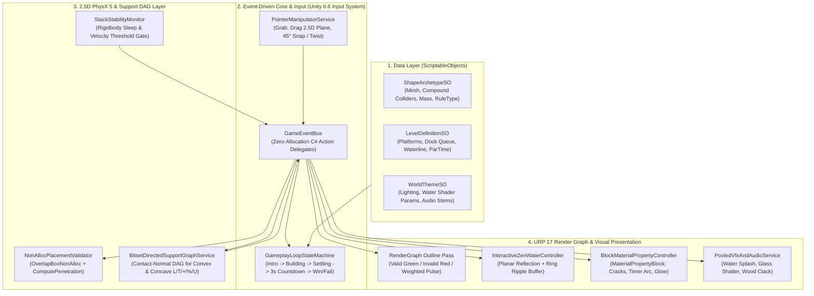
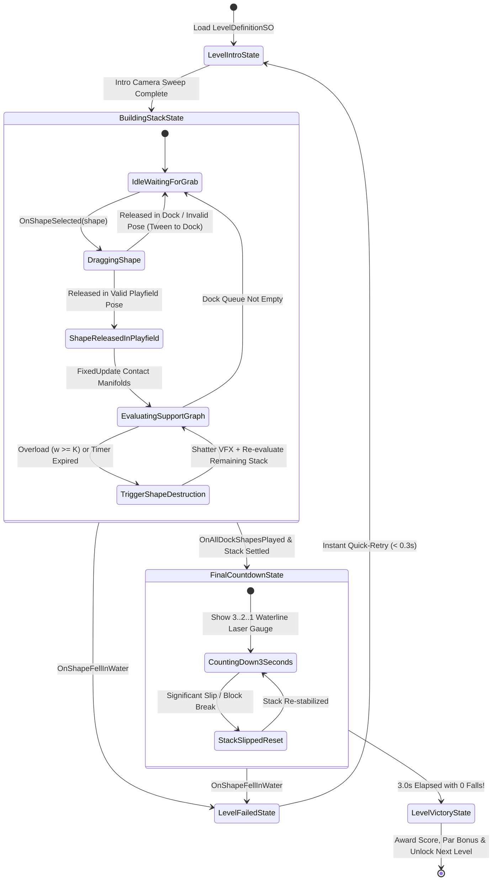

# Detailed Implementation Plan: Building an *Art of Balance* Clone from Scratch in Unity 6.6

**Project:** Balance Stack Hero 2026 (*Art of Balance* Clean-Room Architecture)  
**Target Engine:** Unity 6.6 (`6000.6.x`) — Universal Render Pipeline (URP 17 / Render Graph), PhysX 5, Unity Input System  
**Design Paradigm:** SOLID Principles + Zero-Polling Event-Driven Design (EDD)

---

## 1. Vision & Architectural Overview

The original WiiWare classic ***Art of Balance*** (Shin'en Multimedia) succeeded because of two tightly coupled pillars:
1. **Tactile, Deterministic 2.5D Physics Puzzle Loop:** Grabbing geometric blocks from a floating dock, rotating them in crisp $45^\circ$ increments (or smooth analog twist), hovering them over a physics stack with instant visual placement feedback, and holding your breath during the iconic **3-second stability countdown** once the last block is placed.
2. **Serene Zen Lounge Visuals & Audio-Visual Juice:** Blocks rest on a carved stone/wood pedestal rising out of a calm, reflective pool of water inside a warm, minimalist zen room. Every block material (carved wood, frosted load-bearing glass, brittle magma-stone, ticking clockwork metal, gravity-inverting vortex) communicates its mechanical rule purely through shader design, surface texture, and audio resonance.

### 1.1 High-Level System Architecture (SOLID + EDD)



---

## 2. Project Structure & Assembly Definitions (`.asmdef`)

Building from scratch in Unity 6.6 starts with strict compile-time modularity to enforce **Dependency Inversion (`[D]`)** and keep incremental script compilation under 1 second:

```text
Assets/
├── _ArtOfBalance/
│   ├── Scripts/
│   │   ├── Core/                   # BalanceStackHero.Core.asmdef (EventBus, Interfaces, Pooling)
│   │   ├── Data/                   # BalanceStackHero.Data.asmdef (ScriptableObjects, Level JSON/SO)
│   │   ├── PhysicsGraph/           # BalanceStackHero.PhysicsGraph.asmdef (CN-DSG Support Graph, Placement Validator)
│   │   ├── Gameplay/               # BalanceStackHero.Gameplay.asmdef (State Machine, ShapeActor, GameModes)
│   │   ├── Presentation/           # BalanceStackHero.Presentation.asmdef (Shaders, RenderGraph Outlines, Water, Camera, VFX)
│   │   ├── UI/                     # BalanceStackHero.UI.asmdef (HUD, Dock Carousel, Countdown Gauge, Menus)
│   │   └── Tests/                  # BalanceStackHero.Tests.asmdef (EditMode & PlayMode NUnit Suites)
│   ├── Shaders/                    # Shader Graph & HLSL (ZenWater, FrostedGlassWeighted, WoodBevel, OutlineJumpFlood)
│   ├── Prefabs/
│   │   ├── Shapes/                 # Pre-baked compound-collider shape prefabs (Convex + Concave L, T, +, ^, U)
│   │   ├── Platforms/              # Static, Rotating, and Seesaw/Hinge platforms
│   │   └── VFX/                    # Pooled WaterSplash, GlassShatter, CountdownLaser
│   └── ScriptableObjects/
│       ├── Shapes/
│       ├── Worlds/
│       └── Levels/
```

---

## 3. Recreating the Original WiiWare *Art of Balance* Visuals in Unity 6.6 (URP 17)

### 3.1 Zen Basin Environment & Lighting Setup

The visual signature of *Art of Balance* is a **shallow indoor zen reflection pool** surrounded by dark stained wood or slate walls, lit by warm overhead softboxes that cast crisp highlights along the chamfered edges of each block.

1. **URP 17 Asset & Render Graph Configuration:**
   - **Render Path:** Forward+ with **Render Graph API** enabled (`RenderGraphSettings`).
   - **Anti-Aliasing:** `4x MSAA` on the main camera target (essential for clean geometric block edges at $45^\circ$ angles) + `1.2x` Render Scale on mobile/console.
   - **Batching:** **SRP Batcher** enabled + **GPU Resident Drawer** (`BatchRendererGroup`) enabled for static environment geometry and platforms.
   - **Shadows:** 2 Cascades, Soft Shadows (Medium quality), `Shadow Distance = 35m` (tightly framing the playfield at `z = 0` so shadow texel density on stacked blocks is razor-sharp).
2. **Three-Point Zen Studio Lighting:**
   - **Key Light:** Warm directional light (`#FFF4E0`, intensity `1.8`, rotation `(50°, -30°, 0°)`) casting soft shadows across the stack and onto the water surface.
   - **Rim / Back Light:** Cool-cyan accent directional light (`#A8E6FF`, intensity `0.6`, rotation `(-145°, 20°, 0°)`) to separate dark wood blocks from the dark zen backdrop.
   - **Ambient GI:** Trilinear gradient ambient lighting (Sky `#4A5D6E`, Equator `#2C353D`, Ground `#182226`) + a single baked `ReflectionProbe` over the water basin for realistic glass and lacquer specular reflections.
3. **Post-Processing Volume (Subtle & Crisp):**
   - **Tonemapping:** ACES (or Neutral to preserve vivid block colors).
   - **Bloom:** Threshold `1.1`, Intensity `0.25`, Scatter `0.65` (gives Weighted Glass overload pulses, Timer arcs, and Water ripples a soft WiiWare glow).
   - **Vignette:** Intensity `0.22`, Smoothness `0.4` (draws the player's eye toward the center pedestal).

---

### 3.2 Interactive Zen Water Pool Shader & Ripple System

In *Art of Balance*, the water pool is not just a static floor trigger—it serves as the **fail boundary**, a **mirror reflecting the tower**, and a **dynamic feedback surface** that ripples when blocks hover dangerously low or splash in.

```mermaid
flowchart LR
    Hover["Block Dragged Low /<br/>Stack Wobbles"] -->|GameEventBus| RippleCtrl["ZenWaterRippleController"]
    Splash["Block Hits Water<br/>(OnShapeFellInWater)"] -->|GameEventBus| RippleCtrl
    RippleCtrl -->|Vector4 Array _RippleData[8]| WaterSG["URP ZenWater Shader<br/>(Gerstner Micro-Waves + Ring Ripples + Depth Foam + Planar Reflection)"]
```

#### Custom HLSL / Shader Graph Features for `ZenWater.shadergraph`:
1. **Dual-Normal Micro-Waves:** Two scrolling normal map layers (`UV * 2.0 + _Time.y * (0.03, 0.02)` and `UV * 3.5 + _Time.y * (-0.02, 0.025)`) keep the pool gently alive without distracting from puzzle alignment.
2. **Depth-Based Absorption & Platform Contact Foam:** Uses URP `_CameraDepthTexture` (`SceneDepth - SurfaceDepth`) to blend from shallow emerald-teal (`#1A6B72`) near submerged platform pillars to deep zen ink (`#091B24`) in the abyss, with a crisp white meniscus foam line (`smoothstep(0.0, 0.08, depthDiff)`) wrapping around platforms rising out of the water.
3. **Event-Driven Ring Ripple Array (`_RippleRings[8]`):**
   When a shape drops into the water or hovers within `1.0m` of the waterline, `ZenWaterRippleController` writes `(worldX, worldZ, startTime, amplitude)` into a fixed 8-element `Vector4[]` uniform buffer:

```csharp
using UnityEngine;
using BalanceStackHero.Events;

namespace BalanceStackHero.Presentation
{
    public sealed class ZenWaterRippleController : MonoBehaviour
    {
        [SerializeField] private Renderer waterRenderer;
        [SerializeField] private ParticleSystem splashParticlePrefab;

        private static readonly int RippleRingsPropId = Shader.PropertyToID("_RippleRings");
        private readonly Vector4[] _rippleRings = new Vector4[8];
        private int _writeIndex;
        private MaterialPropertyBlock _mpb;

        private void Awake()
        {
            _mpb = new MaterialPropertyBlock();
            for (int i = 0; i < _rippleRings.Length; i++)
                _rippleRings[i] = new Vector4(0f, 0f, -999f, 0f);
        }

        private void OnEnable()
        {
            GameEventBus.OnLevelFailed += HandleLevelFailed;
            GameEventBus.OnShapePlacedInPlayfield += HandleShapePlaced;
        }

        private void OnDisable()
        {
            GameEventBus.OnLevelFailed -= HandleLevelFailed;
            GameEventBus.OnShapePlacedInPlayfield -= HandleShapePlaced;
        }

        private void HandleShapePlaced(ShapeController shape)
        {
            // Emit a gentle acoustic pressure wave on the water below the dropped block
            AddWaterRipple(shape.transform.position, amplitude: 0.25f);
        }

        private void HandleLevelFailed(LevelFailReason reason, ShapeController culprit)
        {
            if (reason == LevelFailReason.ShapeFellInWater && culprit != null)
            {
                Vector3 hitPos = culprit.transform.position;
                AddWaterRipple(hitPos, amplitude: 1.0f);
                if (splashParticlePrefab != null)
                {
                    Instantiate(splashParticlePrefab, new Vector3(hitPos.x, transform.position.y, hitPos.z), Quaternion.identity);
                }
            }
        }

        public void AddWaterRipple(Vector3 worldPos, float amplitude)
        {
            _rippleRings[_writeIndex] = new Vector4(worldPos.x, worldPos.z, Time.time, amplitude);
            _writeIndex = (_writeIndex + 1) % _rippleRings.Length;

            if (waterRenderer != null)
            {
                waterRenderer.GetPropertyBlock(_mpb);
                _mpb.SetVectorArray(RippleRingsPropId, _rippleRings);
                waterRenderer.SetPropertyBlock(_mpb);
            }
        }
    }
}
```

---

### 3.3 Visual Design & Shaders of the 6 Canonical Block Archetypes

Every block in *Art of Balance* uses **beveled edges** (either via a baked chamfered mesh or a rounded-edge normal shader) so blocks never blend into a flat silhouette when stacked flush against one another. All dynamic per-block shader state is updated via **`MaterialPropertyBlock` (`MPB`)** solely in response to `GameEventBus` events, preserving **100% SRP Batcher compatibility** and **zero material-instance leaks**.

| Shape Type ID | *Art of Balance* Archetype | Visual Material & Shader Design | Event-Driven Visual Feedback |
| :-: | :--- | :--- | :--- |
| **`0`** | **Standard Wood / Ceramic Block** | Satin-finished triplanar birch/teak wood grain or matte porcelain with subtle ambient occlusion in the bevel seams. | Emits a brief warm rim-flash (`0.15s`) when locking into place on release. |
| **`1`** | **Weighted / Load-Bearing Glass Block** *(Breaks when supporting $\ge K$ blocks, default $K=3$)* | Translucent frosted cyan/amber glass (`Surface Type: Transparent`, refraction via `_CameraOpaqueTexture`) with **3 embedded luminous pips/dots** in the center and an internal stress-crack normal/emission mask (`_CrackStage`). | On `OnShapeWeightChanged(oldW, newW)`:<br/>• `w=0`: Clear glass, 3 lit pips.<br/>• `w=1`: 2 lit pips, hairline frost, slow `1.0s` outline pulse.<br/>• `w=2`: 1 lit pip, amber warning tint, medium `0.5s` outline pulse.<br/>• `w>=3`: Red fracture flash $\to$ Voronoi glass shatter VFX! |
| **`2`** | **Touch-Breakable / Brittle Block** *(Breaks when supporting $\ge 1$ block)* | Dark volcanic basalt with glowing orange fissures pulsing gently beneath the crust. | As soon as any block rests on top of it (`newW >= 1`), fissures flare bright white-orange for `0.25s` before shattering into embers. |
| **`3`** | **Timed Countdown Block** *(Breaks $T$ seconds after placement)* | Brushed bronze/steel casing with a central **radial LED arc gauge** (`_TimerNormalized` from `1.0` to `0.0`) and digital second readout. | Driven by a `1 Hz` beep and smooth shader `_StartTime` / `_Duration` uniform (the GPU animates the radial countdown arc automatically without CPU `Update()` calls!). |
| **`4`** | **Gravity Switch / Inverter Block** *(Flips world gravity $\vec{g} \to -\vec{g}$ upon resting)* | Deep violet/iridescent core with a vertically scrolling chevron arrow shader indicating the target gravity direction. | When settled, emits a full-screen directional shockwave distortion pass, rotates chevron arrows $180^\circ$, and flips `Physics.gravity`. |
| **`5`** | **Heavy / Anchor Block** | Dark cast-iron texture with riveted corners and $3\times$ Rigidbody mass. | Stronger camera micro-shake (`0.08s`) and deeper bass thud on impact. |

---

### 3.4 URP 17 Render Graph Selection & Weight Outline Pass

In the current project, `EPOOutline` (`Outlinable`) is used, which works well when managed cleanly via events. When building from scratch in Unity 6.6 URP 17, we implement a lightweight **Render Graph `ScriptableRendererFeature`** (`ShapeOutlineRenderGraphFeature`) that renders selected and weighted blocks into an R8 mask RTHandle and performs a single separable screen-space outline composite pass:
- **Held Shape in Playfield (Valid Placement):** Crisp `#00FF66` emerald outline (`width = 3px`).
- **Held Shape in Playfield (Invalid / Penetrating / Too Close):** Crisp `#FF2233` crimson outline (`width = 4px`) + semi-transparent red ghost tint.
- **Weighted Shape Under Load (`w = 1, 2, 3`):** GPU-driven sine-wave alpha pulse (`sin(_Time.y * _PulseFrequency)`) so **not even a single CPU tween is needed to pulse the outline**!

---

## 4. Recreating the Main Gameplay Loop & Physics Architecture

### 4.1 Complete Gameplay Loop State Machine (Event-Driven FSM)



---

### 4.2 Deterministic 2.5D PhysX 5 Configuration & Compound Collider Pipeline

To make stacking feel as responsive and fair as Shin'en's original *Art of Balance*, physics must be strictly constrained to the $XY$ playfield plane ($Z = 0$) with high solver accuracy:

1. **Unity 6.6 `DynamicsManager` (PhysX 5) Settings:**
   - **Gravity:** `(0, -9.81, 0)` (inverted to `(0, +9.81, 0)` when Gravity Switch triggers; ceiling platforms hold the inverted stack).
   - **Default Solver Iterations:** `16` (up from Unity default `6`—eliminates mushy/springy joints in 15+ block towers).
   - **Default Solver Velocity Iterations:** `6` (up from default `1`—prevents blocks from bouncing inaccurately off flat surfaces).
   - **Sleep Threshold:** `0.002` (allows settled stacks to enter sleep cleanly).
   - **Default Contact Offset:** `0.005` (`5 mm` skin width so $45^\circ$ beveled blocks rest flush without visible air gaps).
   - **Default Max Depenetration Velocity:** `2.5 m/s` (prevents violent physics explosions if a shattering block spawns fragments).
   - **Enhanced Determinism:** `Enabled`.
2. **Rigidbody Constraints on Every `ShapeActor`:**
   ```csharp
   rb.constraints = RigidbodyConstraints.FreezePositionZ
                  | RigidbodyConstraints.FreezeRotationX
                  | RigidbodyConstraints.FreezeRotationY;
   rb.interpolation = RigidbodyInterpolation.Interpolate;
   rb.collisionDetectionMode = CollisionDetectionMode.ContinuousDynamic;
   ```
3. **Edit-Time Compound Convex Collider Baking (Replacing Runtime `ExtendedColliders3D.Awake()`):**
   - Instead of calling `gameObject.AddComponent<MeshCollider>()` at runtime in `Awake()` (which forces PhysX to cook convex hulls on the main thread during level load), every concave shape prefab (`"L"`, `"T"`, `"+"`, `"^"`, `"U"`, `"4"`) has its exact decomposition of `BoxCollider`s or pre-baked convex `MeshCollider`s serialized directly in the prefab asset, and referenced in `ShapeController.CachedColliders`.

---

### 4.3 Zero-Allocation Placement Validation (`NonAllocPlacementValidator.cs`)

While dragging a shape in the playfield, *Art of Balance* prevents the player from releasing a block if:
1. It is still inside the **Dock Zone**, OR
2. Any of its sub-colliders **penetrates** an existing platform or played shape, OR
3. It is dropped from directly overlapping a shape's safety skin margin.

Instead of calling `GetComponents<Collider>()` on every shape and platform every frame (as the legacy `SpawnManager.CalculateCurShapePenetration()` does), we use **`Physics.OverlapBoxNonAlloc`** with a pre-allocated `Collider[32]` buffer and `Physics.ComputePenetration`:

```csharp
using UnityEngine;

namespace BalanceStackHero.PhysicsGraph
{
    public sealed class NonAllocPlacementValidator
    {
        private readonly Collider[] _overlapBuffer = new Collider[32];
        private readonly LayerMask _obstacleMask;
        private readonly float _safetyInflation;

        public NonAllocPlacementValidator(LayerMask obstacleMask, float safetyInflation = 0.04f)
        {
            _obstacleMask = obstacleMask;
            _safetyInflation = safetyInflation;
        }

        /// <summary>
        /// Zero-allocation placement check across all sub-colliders of a convex or concave shape.
        /// </summary>
        public bool IsPlacementValid(ShapeController candidateShape)
        {
            if (candidateShape.isdocked)
                return false;

            Collider[] myColliders = candidateShape.CachedColliders;
            Transform myTransform = candidateShape.transform;

            for (int i = 0; i < myColliders.Length; i++)
            {
                Collider colA = myColliders[i];
                Bounds b = colA.bounds;
                Vector3 halfExtents = b.extents + Vector3.one * _safetyInflation;

                int hitCount = Physics.OverlapBoxNonAlloc(
                    b.center,
                    halfExtents,
                    _overlapBuffer,
                    Quaternion.identity,
                    _obstacleMask,
                    QueryTriggerInteraction.Ignore);

                for (int h = 0; h < hitCount; h++)
                {
                    Collider colB = _overlapBuffer[h];
                    if (colB.transform.root == myTransform)
                        continue; // Ignore self sub-colliders

                    if (Physics.ComputePenetration(
                            colA, myTransform.position, myTransform.rotation,
                            colB, colB.transform.position, colB.transform.rotation,
                            out _, out float distance))
                    {
                        if (distance > 0.002f)
                            return false; // Penetrating existing platform or block!
                    }
                }
            }

            return true;
        }
    }
}
```

---

### 4.4 Data-Driven `ScriptableObject` Level & World Pipeline

Instead of hardcoding 30+ `if (name == "Box8")` string chains inside `SpawnManager.cs`, all shapes, levels, and worlds are defined via clean `ScriptableObject` assets:

```csharp
using System;
using UnityEngine;

namespace BalanceStackHero.Data
{
    public enum BlockRuleArchetype
    {
        Standard = 0,
        WeightedBreakable = 1,
        TouchBreakable = 2,
        TimedCountdown = 3,
        GravityInverter = 4,
        HeavyAnchor = 5
    }

    [CreateAssetMenu(menuName = "ArtOfBalance/Shape Archetype")]
    public sealed class ShapeArchetypeSO : ScriptableObject
    {
        public string shapeId;
        public GameObject prefab;
        public BlockRuleArchetype defaultRule;
        public float mass = 1.0f;
        public int baseScoreValue = 100;
        public Vector3 dockPreviewScale = new(0.45f, 0.45f, 0.45f);
        public Vector3 playfieldScale = Vector3.one;
    }

    [Serializable]
    public struct DockShapeEntry
    {
        public ShapeArchetypeSO archetype;
        public BlockRuleArchetype ruleOverride;
        public int maxWeightOrTimerSeconds; // e.g., 3 blocks for Weighted, or 10s for Timed
        public float initialRotationZ;
    }

    [Serializable]
    public struct PlatformSpawnEntry
    {
        public GameObject platformPrefab;
        public Vector3 position;
        public Vector3 rotationEuler;
        public Vector3 scale;
        public bool isRotatingHinge;
    }

    [CreateAssetMenu(menuName = "ArtOfBalance/Level Definition")]
    public sealed class LevelDefinitionSO : ScriptableObject
    {
        public string levelTitle;
        public int worldIndex;
        public int stageIndex;
        public float parTimeSeconds = 30f;
        public float waterlineY = -3.5f;
        public PlatformSpawnEntry[] platforms;
        public DockShapeEntry[] dockQueue;
    }
}
```

---

### 4.5 Recreating the 5 Game Modes of *Art of Balance*

| Game Mode | Core Rule Set & Victory Condition | Architectural Hook in Our FSM |
| :--- | :--- | :--- |
| **1. Arcade Mode (Worlds A–H)** | 8 thematic worlds (200+ hand-crafted levels) progressively introducing Regular, Weighted Glass, Touch-Breakable, Timed, Seesaw Platforms, and Gravity Switch blocks. | Standard `GameplayLoopStateMachine` driven by `WorldCatalogSO` and `LevelDefinitionSO`. |
| **2. Endurance / Survival Mode** | Continuous sequence of levels on a **single life bar (3 Hearts)**; clearing levels quickly restores partial time bonus. | Wraps `GameplayLoopStateMachine` with `EnduranceSessionTracker`; listens to `OnLevelCompleted` and `OnLevelFailed`. |
| **3. Tower / Height Challenge Mode** | Infinite dock queue of procedurally weighted blocks on a narrow pedestal; goal is to reach the highest composite stack elevation ($Y_{\max}$ in meters) before collapse. | Uses `ShapeController.GetCompositeWorldBounds().max.y` across all sleeping played shapes to drive an upward-tracking `CinemachineCamera` and live height laser line! |
| **4. Speed / Time Attack Mode** | Clear a 10-stage gauntlet against a shared ticking shot-clock; shattering Weighted blocks intentionally clears space faster. | `EventDrivenLevelTimer` runs in countdown mode; awards $+5\text{s}$ per cleared stage. |
| **5. Co-Op Two-Player Split Pointer** | Two players simultaneously grab and place blocks from the shared dock (like two Wii Remotes in the original game). | Unity 6.6 `InputSystem` multi-pointer support (`PointerManipulatorService` tracks up to 2 active pointer IDs / touch fingers independently). |

---

## 5. Step-by-Step Phased Implementation Roadmap (Unity 6.6)

### Phase 1: Foundation, URP 17 Render Graph & Event Bus (Days 1–3)
1. Create a fresh **Unity 6.6 (`6000.6.x`) Universal 3D (URP)** project.
2. Configure `DynamicsManager` (PhysX 5: `16` position iterations, `6` velocity iterations, `0.005` contact offset, `Enhanced Determinism = true`).
3. Create the `.asmdef` folder hierarchy (`Core`, `Data`, `PhysicsGraph`, `Gameplay`, `Presentation`, `UI`, `Tests`).
4. Implement [`GameEventBus.cs`](#11-high-level-system-architecture-solid--edd) with zero-allocation C# `event Action<T>` delegates.

### Phase 2: Compound Collider Prefabs & CN-DSG Support Graph (Days 4–7)
1. Build the canonical geometric shape meshes with $2\text{ mm}$ chamfered bevels (Cubes, Plank bars, Spheres, Half-Cylinders, Arch bridges, and Concave **`"L"`**, **`"T"`**, **`"+"`**, **`"^"`**, **`"U"`**, **`"4"`** shapes).
2. Attach pre-baked compound `BoxCollider` / convex `MeshCollider` components directly on each prefab (eliminating runtime collider cooking).
3. Implement `ContactNormalSupportEvaluator` and `BitsetDirectedSupportGraphService` (from [Deep-Dive 2](file:///d:/Unity%20Projects/Balance%20Stack%20Hero%202026[Gemini4Argon]/Assets/Scripts/Docs/DeepDive_2_WeightedShape_Calculation_Display_SOLID_EDD.md)) and run the 11-scenario NUnit test suite in EditMode to lock in 100% convex/concave weight accuracy.

### Phase 3: Event-Driven Pointer Manipulation & Placement Validator (Days 8–11)
1. Configure Unity Input System (`Point`, `Grab`, `RotateStepLeft`, `RotateStepRight`, `TwistAxis`).
2. Implement `ShapeController` (event-driven selection, $45^\circ$ snap rotation + smooth twist rotation, spatially gated `NonAllocPlacementValidator`).
3. Implement Dock Carousel spawning and return-to-dock `DOTween` / `PrimeTween` animations.

### Phase 4: Zen Environment, Block Shaders & Render Graph Outlines (Days 12–16)
1. Build the Zen Water Basin environment, three-point studio lighting, and `PlanarReflectionProbe`.
2. Author `ZenWater.shadergraph` + `ZenWaterRippleController` (8-ring uniform array + depth foam).
3. Author the 6 block shaders (`WoodLacquer`, `FrostedGlassWeighted`, `VolcanicTouchBreak`, `ClockworkTimed`, `GravityVortex`, `CastIronHeavy`) driven by `MaterialPropertyBlock` via `WeightedShapeDisplayView`.
4. Implement `ShapeOutlineRenderGraphFeature` for crisp green/red placement outlines and GPU-driven weight warning pulses.

### Phase 5: Gameplay Loop FSM, 3-Second Countdown & Audio/VFX Pools (Days 17–20)
1. Implement `GameplayLoopStateMachine` (`Intro` $\to$ `Building` $\to$ `Settling` $\to$ `FinalCountdown` $\to$ `Victory` / `Fail`).
2. Build Pooled VFX (`ObjectPool<ParticleSystem>`) for Water Splash, Glass Voronoi Shatter, Ember Burst, and Gravity Flip Shockwave.
3. Build `EventDrivenLevelTimer` (`1 Hz` clock tick + zero-allocation 3-second stability countdown laser overlay).
4. Integrate `Cinemachine 3` dynamic framing camera that smoothly zooms out as stack height ($Y_{\max}$) grows.

### Phase 6: Game Modes, Level Authoring Tool & Final Profiling (Days 21–25)
1. Create the Editor Level Maker window that serializes directly to `LevelDefinitionSO` assets.
2. Implement Arcade Worlds A–H, Endurance Mode, Tower Height Challenge, and Speed Mode.
3. Profile in Unity 6.6 Profiler + Frame Debugger to verify:
   - **0 `Update()` calls on resting/docked shapes**
   - **`0 Bytes` GC allocation per frame during steady-state gameplay**
   - **Locked 120 FPS on PC/Console and 60/120 FPS on Mobile.**

