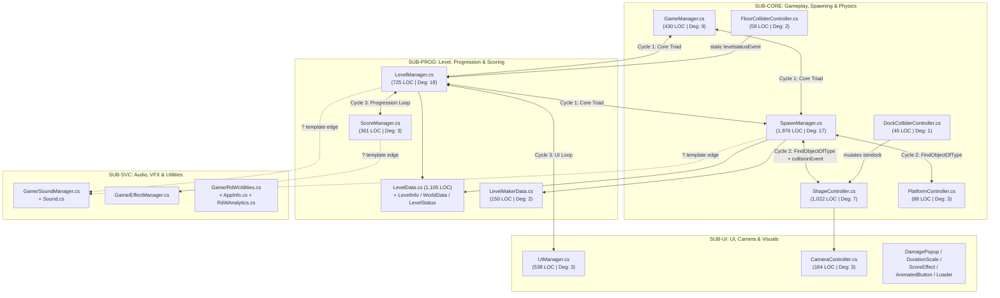
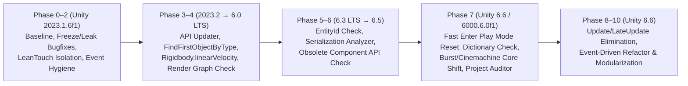
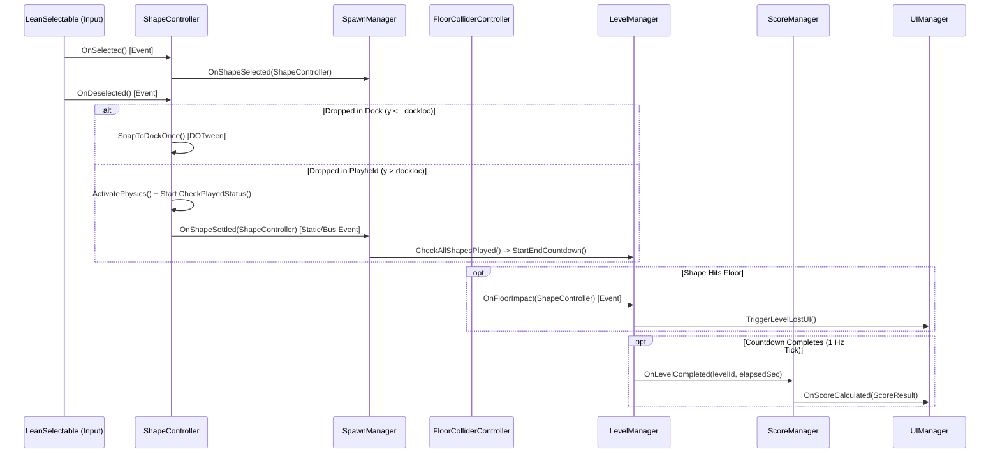

# Balance Stack Hero 2026 — Unity 6.6 (6000.6.0f1) Upgrade & Performance Modernization Master Plan

## 1. Title and Scope

- **Document Title:** Balance Stack Hero 2026 — Unity 6.6 (`6000.6.0f1`) Upgrade, Event-Driven Refactor, and Performance Modernization Master Plan
- **Current Engine Version:** `Unity 2023.1.6f1` (**Confirmed from companion docs** & system specification)
- **Target Engine Version:** `Unity 6000.6.0f1` (`Unity 6.6`) along the conceptual upgrade trajectory `2023.1.6f1 → 2023.2 → 6.0 LTS (6000.0) → 6.1 → 6.2 → 6.3 LTS (6000.3) → 6.4 → 6.5 → 6.6 (6000.6.0f1)` (**Confirmed from Unity docs**)
- **Primary Input Basis:**
  1. **Project Companion Documentation Corpus (`Assets/Scripts/Docs/`):** All 27 per-script companion `.cs.md` specifications (`22` root scripts in `Assets/Scripts/Docs/*.cs.md` and `5` service scripts in `Assets/Scripts/Docs/Game/*.cs.md`) plus the 4 project-level architectural synthesis artifacts (`Scripts_Master_Index.md`, `Scripts_Dependency_Map.md`, `Scripts_Dependency_Implementation_Plan.md`, and `Scripts_Dependency_Matrix.csv`).
  2. **Official Unity 6.x / 6.6 Documentation (`docs.unity3d.com/6000.6/Documentation/Manual/`):** Unity 6.0–6.6 Upgrade Guides (`UpgradeGuides.html`, `UpgradeGuideUnity66.html`), What's New in Unity 6.6 (`WhatsNewUnity66.html`), Programming/Serialization/Physics/Render Pipeline/Editor workflow changes across `2023.2` through `6000.6`.
- **What This Plan Is:**
  - An exhaustive, engineering-grade dual-track technical roadmap covering:
    - **Track A (Engine Migration):** Upgrading *Balance Stack Hero 2026* safely from `Unity 2023.1.6f1` to `Unity 6000.6.0f1`, mitigating version-specific API removals (`Rigidbody.velocity`, `Object.FindObjectOfType`, `InstanceID`/`EntityId`), serialization changes (`Dictionary<TKey, TValue>` native serialization, `[SerializeReference]` validation), Fast Enter Play Mode static-state hazards, and third-party asset risks (`Lean.Touch` with custom user modifications, `DOTween`, `EPOOutline`, `Exploder`, `CircularGravityForce`).
    - **Track B (Performance & Architecture Modernization):** Eliminating avoidable per-frame `Update()`, `LateUpdate()`, and `WaitForSeconds` polling loops in favor of deterministic event-driven workflows, fixing critical logic bugs (such as the main-thread infinite `while` freeze in `SpawnManager.LevelClearShapes()` and the every-0.5s idle DOTween leak in `ShapeController.LateUpdate()`), decoupling cyclic God-object hubs (`SpawnManager`, `LevelManager`, `GameManager`, `ShapeController`), and establishing stable 60 FPS frame pacing with zero gameplay GC spikes.
- **What This Plan Is Not:**
  - It is **not** a speculative full rewrite of the game from scratch, nor a blind recommendation to adopt DOTS/ECS or rewrite all uGUI canvases into UI Toolkit.
  - It does **not** directly modify C# source files in this pass; rather, it provides exact, line-grounded architectural blueprints, triage matrices, risk registers, and phased execution checklists so an engineer can execute the upgrade and refactor safely.

---

## 2. Executive Summary

### Overall Migration Posture & Difficulty
- **Overall Difficulty:** **Moderate-to-High (Codebase Size: Small [7,574 LOC across 27 files]; Architectural & Plugin Coupling: High).**
- While the script count (`27` C# files declaring `29` classes/structs) is compact (**Confirmed from companion docs**), the codebase exhibits extreme hub concentration (`SpawnManager.cs` at `1,976` LOC, `LevelData.cs` at `1,105` LOC, `ShapeController.cs` at `1,022` LOC, `LevelManager.cs` at `725` LOC), zero namespace or `.asmdef` boundaries, three tight cyclic dependency clusters, and custom developer modifications embedded directly inside third-party plugin code (`Lean.Touch.LeanTouchEvents.dragdelta` and `Lean.Touch.LeanTwistRotateAxis.RotateMe(float)`).

### Dominant Risks
1. **Custom Modifications Inside Third-Party `Lean.Touch` (`EXT-PROJ` / `EXT-PLUGIN`):** `GameManager.cs` and `ShapeController.cs` rely on custom fields/methods added directly to `LeanTouchEvents` and `LeanTwistRotateAxis` (**Confirmed from companion docs**). Updating `Lean.Touch` from the Asset Store for Unity 6 compatibility will silently overwrite these custom extensions unless extracted first.
2. **Unity 6.6 Fast Enter Play Mode & Unmanaged Static State:** Unity 6.6 enables Fast Enter Play Mode by default (**Confirmed from Unity docs**). Five static events (`FloorColliderController.levelstatusEvent`, `ShapeController.collisionEvent`, `SpawnManager.touchingEvent`, `SoundManager.MusicStatusChanged`, `SoundManager.SoundStatusChanged`) and three static singletons (`AppInfo.Instance`, `SoundManager.Instance`, `EffectManager.instance`) never unsubscribe (`-=`) or reset on `OnDestroy()` (**Confirmed from companion docs**). Skipping domain reload or reloading scenes causes duplicate event firings and `MissingReferenceException` crashes.
3. **Unity 6.6 Native `Dictionary<TKey, TValue>` Serialization Impact:** Unity 6.6 introduces native inspector/prefab serialization for `Dictionary<TKey, TValue>` (**Confirmed from Unity docs**). `ShapeController.cs` declares an unused `public Dictionary<int, string> shapeInfo = new Dictionary<int, string>();` on line 38 (**Confirmed from companion docs**), which Unity 6.6 will suddenly serialize across all shape prefabs unless removed or marked `[NonSerialized]`.
4. **Deprecated/Obsolete Physics & Lookup APIs Across Unity 6.0–6.6:** `ShapeController.cs` relies on `Rigidbody.velocity` and `Rigidbody.angularDrag` (renamed to `linearVelocity` and `angularDamping` in Unity 6), and `ShapeController.Start()` / `PlatformController.Awake()` call `FindObjectOfType<SpawnManager>()` (obsoleted in Unity 2023.1+ / Unity 6 in favor of `FindFirstObjectByType<T>()` / `FindAnyObjectByType<T>()`).
5. **Pre-Existing Critical Runtime Bugs:**
   - `SpawnManager.LevelClearShapes()` starts two coroutines and immediately executes a synchronous `while ((isdeletingshape) && (isdeletingplats)) {}` loop on the main thread, permanently freezing the Unity process (**Confirmed from companion docs**).
   - `ShapeController.LateUpdate()` triggers `StartCoroutine(Release())` every `0.5` seconds on **every idle docked shape**, continuously allocating 3 DOTween tweens (`DORotateQuaternion`, `DOMove`, `DOScale`) per docked shape even when never touched (**Confirmed from companion docs**).
   - `AnimatedButton.onClick` getter logs `onClick` inside its own `get` accessor, causing an immediate `StackOverflowException` if read (**Confirmed from companion docs**).

### Dominant Opportunities
1. **Massive Frame-Time & GC Wins via `Update()` / `LateUpdate()` Elimination:** Out of `27` scripts, `14` define `Update()` or `LateUpdate()`, and **10 of those methods are completely empty or commented-out stubs** (**Confirmed from companion docs**). Removing the 10 dead lifecycle hooks, fixing the idle dock `Release()` tween leak in `ShapeController.LateUpdate()`, stopping per-frame `ProcessCtrlGesture()` coroutine spawning in `GameManager.Update()`, and throttling `LevelManager.UpdateGameClockDisplay()` from 60 Hz string formatting to 1 Hz integer-second transitions will eliminate the majority of managed frame overhead and GC allocations.
2. **Event-Driven Physics & Selection Architecture:** Replacing per-frame `lts.IsSelected` polling in `ShapeController.Update()`/`LateUpdate()` with `LeanSelectable` selection callbacks (`OnSelected`/`OnDeselected`) and replacing $O(N^2 \cdot C^2)$ `GetComponents<Collider>()` allocations in `SpawnManager` with cached collider arrays and physics-settle events will guarantee smooth 60 FPS even on towering stacks.
3. **Unity 6.6 Tooling & Runtime Gains:** Adopting **Project Auditor** (built-in / core workflow in Unity 6.x), **Fast Enter Play Mode** (after adding `[RuntimeInitializeOnLoadMethod(RuntimeInitializeLoadType.SubsystemRegistration)]` static resets), and **URP / Render Graph** or optimized batching (replacing obsolete dynamic batching in Unity 6.6).

### Migration Strategy Verdict: Staged Hybrid Migration
- **Do not perform a blind single-step jump with simultaneous architectural rewrites.**
- Execute a **Staged Hybrid Migration**:
  1. Perform **Pre-Upgrade Stabilization & Bug/Hygiene Cleanup on Unity 2023.1.6f1** (Phase 2) to fix critical freezes, static event leaks, `Lean.Touch` custom extension isolation, and unused `Dictionary` serialization hazards.
  2. Step the Editor through **Unity 6.0 LTS (`6000.0`) → Unity 6.3 LTS (`6000.3`) → Unity 6.5 (`6000.5`) → Unity 6.6 (`6000.6.0f1`)** while applying targeted compatibility checks at each checkpoint (Phases 3–7).
  3. Execute the **Event-Driven Performance Refactor (Phase 8)** and **Modularization Pass (Phase 9)** once the project is compiling and baseline-verified on Unity 6.6.

---

## 3. Evidence Base

### Companion Documentation Reviewed (`Assets/Scripts/Docs/`)
All **31 markdown/CSV files** in `Assets/Scripts/Docs/` were read in full (**Confirmed from companion docs**):
- **Master & Dependency Architecture Documents (4 files):**
  - `Assets/Scripts/Docs/Scripts_Master_Index.md` (Master inventory, 4 subsystems, lifecycle & risk audit)
  - `Assets/Scripts/Docs/Scripts_Dependency_Map.md` (66 internal edges, 48 external edges, 3 cyclic clusters, fan-in/fan-out rankings)
  - `Assets/Scripts/Docs/Scripts_Dependency_Implementation_Plan.md` (5-stage dependency decoupling plan)
  - `Assets/Scripts/Docs/Scripts_Dependency_Matrix.csv` (114-row machine-readable adjacency matrix)
- **Root Gameplay, Progression, and UI Companion Docs (22 files in `Assets/Scripts/Docs/`):**
  - `AnimatedButton.cs.md` (`100` LOC), `CameraController.cs.md` (`164` LOC), `DamagePopup.cs.md` (`53` LOC), `DockColliderController.cs.md` (`45` LOC), `DurationScale.cs.md` (`46` LOC), `FloorColliderController.cs.md` (`58` LOC), `GameManager.cs.md` (`430` LOC), `LevelData.cs.md` (`1,105` LOC), `LevelInfo.cs.md` (`35` LOC), `LevelMakerData.cs.md` (`150` LOC), `LevelManager.cs.md` (`725` LOC), `LevelStatus.cs.md` (`26` LOC), `Loader.cs.md` (`67` LOC), `PlatformController.cs.md` (`88` LOC), `RdWAnalytics.cs.md` (`78` LOC), `ScoreEffect.cs.md` (`47` LOC), `ScoreManager.cs.md` (`361` LOC), `ShapeController.cs.md` (`1,022` LOC), `SpawnManager.cs.md` (`1,976` LOC — includes `ShapeInfo` & `PlatformInfo`), `UIManager.cs.md` (`538` LOC), `WorldData.cs.md` (`50` LOC), `WorldInfo.cs.md` (`14` LOC).
- **Shared Services Companion Docs (5 files in `Assets/Scripts/Docs/Game/`):**
  - `Game/AppInfo.cs.md` (`77` LOC), `Game/EffectManager.cs.md` (`60` LOC), `Game/RdWUtilities.cs.md` (`133` LOC), `Game/Sound.cs.md` (`13` LOC), `Game/SoundManager.cs.md` (`267` LOC).

### Unity Documentation Areas Reviewed
- **Unity 6.0–6.6 Sequential Upgrade Guides:** `UpgradeGuides.html` (`2023.2`, `6000.0`, `6000.1`, `6000.2`, `6000.3`, `6000.4`, `6000.5`, `6000.6` / `UpgradeGuideUnity66.html`).
- **Unity 6.6 Release Highlights:** `WhatsNewUnity66.html` (Fast Enter Play Mode, Native `Dictionary` serialization, Cinemachine 3 core package integration, Burst built-in module shift, Dynamic Batching removal, Android OpenGLES 3.1 floor, YAML Reduce Version Control Noise, `UNITY_64` / `DEVELOPMENT_BUILD` deprecation, WebGPU).
- **Unity 6.5 Breaking Changes:** `InstanceID` to `EntityId` transition, obsolete `GameObject`/`Component` property removals, `[SerializeReference]` / serialization-rules analyzer enforcement, Built-in Render Pipeline deprecation notices.

### Confidence Caveats & Inter-Document Discrepancies Preserved
- **7 Inferred (`?`) Template-Discrepancy Edges (`Scripts_Dependency_Map.md`):**
  - `SoundManager.cs.md` and `Scripts_Master_Index.md` trace `SoundManager.Instance.PlaySound()` calls from `LevelManager`, `SpawnManager`, `ShapeController`, `UIManager`, and `AnimatedButton`, plus `EffectManager.Instance.CreateScoreEffect()` from `ScoreManager` and `CameraController.LateUpdate()`. However, the per-script `.cs.md` companions for those callers show either commented-out audio calls (`//SoundManager.Instance...` in `UIManager.cs.md`) or empty `CameraController.Update()` with shake logic in `CameraController.Shake()` coroutine (**Confirmed from companion docs**). These 7 edges are explicitly preserved as **Inferred from architecture patterns / template discrepancy (`?`)** and must be verified during Phase 1 scene/prefab inspection.

### Missing Inputs That Reduce Certainty (**Unknown from current inputs**)
1. **`Packages/manifest.json` & `Packages/packages-lock.json`:** Exact installed versions of URP/Built-in RP, `com.unity.textmeshpro` vs `com.unity.ugui`, `com.unity.cinemachine`, `com.unity.burst`, and `com.unity.inputsystem` are not in `Assets/Scripts/Docs/`.
2. **`ProjectSettings/ProjectSettings.asset`, `GraphicsSettings.asset`, & `QualitySettings.asset`:** Active render pipeline (Built-in vs URP), target build platforms (iOS/Android/Standalone/Web), color space, Active Input Handling (`Legacy Input Manager` vs `Both`), and Dynamic Batching toggles are **Unknown from current inputs**.
3. **Scene `.unity` & Prefab `.prefab` Serialized Wiring:** Inspector `UnityEvent` bindings (e.g., `Button.onClick` targets in `MainScene.unity` and `StartMenu` scene) and prefab collider hierarchies on the 44 shape prefabs (`Shapes 0`–`43`) and 22 platform prefabs are **Unknown from current inputs**.

---

## 4. Current Architecture Snapshot from Companion Docs

### Major Subsystems & Script Distribution (**Confirmed from companion docs**)
The 27 C# scripts (`7,574` total lines of code, 100% in the `<global>` namespace with zero `.asmdef` files) divide into four functional subsystems:

| Subsystem ID | Subsystem Name | Script Count | Total LOC | Member Scripts |
| :--- | :--- | :---: | :---: | :--- |
| **`SUB-CORE`** | Core Gameplay, Spawning & Physics | 6 (8 classes) | 3,619 | `GameManager.cs`, `SpawnManager.cs` (+ `ShapeInfo`, `PlatformInfo`), `ShapeController.cs`, `PlatformController.cs`, `DockColliderController.cs`, `FloorColliderController.cs` |
| **`SUB-PROG`** | Level, Progression & Scoring | 8 | 2,466 | `LevelManager.cs`, `ScoreManager.cs`, `LevelData.cs`, `LevelInfo.cs`, `LevelMakerData.cs`, `LevelStatus.cs`, `WorldData.cs`, `WorldInfo.cs` |
| **`SUB-UI`** | UI, Camera & Visual Feedback | 7 | 1,015 | `UIManager.cs`, `AnimatedButton.cs`, `CameraController.cs`, `DamagePopup.cs`, `DurationScale.cs`, `ScoreEffect.cs`, `Loader.cs` |
| **`SUB-SVC`** | Shared Services, Audio, VFX & Utilities | 6 | 628 | `Game/AppInfo.cs`, `Game/EffectManager.cs`, `Game/RdWUtilities.cs`, `Game/Sound.cs`, `Game/SoundManager.cs`, `RdWAnalytics.cs` |

### System Architecture & Cyclic Coupling Topology

### Key Hub Scripts & Manager Concentration (**Confirmed from companion docs**)
1. **`LevelManager.cs` (Total Degree: 18 | Fan-Out: 12, Fan-In: 6):** Central session orchestrator managing level initialization, countdown timer (`elapsedTime`), game clock (`levelElapsedTime`), win/lose flows (`LevelWon`, `LevelLost`), world/level selection menus, and `PlayerPrefs` progression persistence.
2. **`SpawnManager.cs` (Total Degree: 17 | Fan-Out: 8, Fan-In: 9):** 1,976-line God-object handling dock refills, level platform/shape instantiation, procedural stack graph evaluation (`GetShapeInfo2`, `ProcessShapeStack`), special shape explosions/blackholes/removals, Penetration checks (`CalculateCurShapePenetration`), LevelMaker authoring, and 24 debug hotkeys in `Update()`.
3. **`GameManager.cs` (Total Degree: 9 | Fan-Out: 4, Fan-In: 5):** Scene bootstrap (`Awake`/`Start`), control scheme switching (`controlscheme` 1 vs 2), gesture rotation coroutine spawning (`ProcessCtrlGesture`), and `PlayerPrefs` nuclear reset (`DeleteAll()` when `resetgame == 1`).
4. **`ShapeController.cs` (Total Degree: 7 | Fan-Out: 2, Fan-In: 5):** 1,022-line per-shape actor script combining `LeanSelectable` touch drag polling, `Rigidbody` physics activation, collision tracking (`touchingshapes`), outline effects (`EPOOutline`), explosion triggers (`MeshExploder`), and floating score popups.

### Lifecycle Roots & Initialization Order Fragility (**Confirmed from companion docs**)
- **No `[DefaultExecutionOrder]` attributes exist anywhere in the codebase.**
- **Awake vs Start Race Conditions:**
  - `GameManager.Awake()` calls `lvlmgr.GetPlayerPerfs()`, `lvlmgr.LoadData()` (which allocates `new LevelData()` and parses 200 levels of string arrays), and `lvlmgr.CreateDynamicMainMenu()`. Crucially, `GameManager.Awake()` can overwrite `PlayerPrefs` if `resetgame == 1`!
  - `PlatformController.Awake()` calls `FindObjectOfType<SpawnManager>()` and reads `spawnmgr.islevelmaker`, then scales `transform.localScale *= 0.7f` in `Start()`—one frame **after** `SpawnManager.SpawnLevel()` has already started a `DOPunchScale` tween on the platform, causing `DOPunchScale` to restore the platform scale to `1.0x` instead of `0.7x`!

### Event Usage & Static Hazard Inventory (**Confirmed from companion docs**)
- **Static C# Events (5 total):**
  1. `FloorColliderController.levelstatusEvent` (`delegate(bool, string)`) → Subscribed by `LevelManager.Start()`, **never unsubscribed**.
  2. `ShapeController.collisionEvent` (`delegate(bool, int)`) → Subscribed by `SpawnManager.Start()`, **never unsubscribed**.
  3. `SpawnManager.touchingEvent` (`delegate(bool)`) → Declared in `SpawnManager.cs`, **never invoked or subscribed** (dead code).
  4. `SoundManager.MusicStatusChanged` (`event Action<bool>`) → Declared in `SoundManager.cs`, no internal subscribers.
  5. `SoundManager.SoundStatusChanged` (`event Action<bool>`) → Declared in `SoundManager.cs`, no internal subscribers.

### Likely Rendering, Input, UI, and Physics Architecture
- **Rendering (**Confirmed from companion docs** + **Inferred from architecture patterns**):** Uses 3D `MeshRenderer` materials with `Resources.Load("Materials/...")`, `EPOOutline.Outlinable` for shape/platform outlines, and `ParticleSystem` prefabs (`Resources.Load("Particles/...")`). Render pipeline (Built-in vs URP) is **Unknown from current inputs** and must be checked in `GraphicsSettings.asset`.
- **Input (**Confirmed from companion docs**):** Hybrid of `Lean.Touch` (`LeanTouch`, `LeanSelectable`, custom `LeanTouchEvents`, custom `LeanTwistRotateAxis`) for touch/mouse dragging and legacy `UnityEngine.Input.GetKey(...)` polling in `GameManager.Update()` (4 arrow keys) and `SpawnManager.Update()` (24 debug keys).
- **UI (**Confirmed from companion docs**):** Hybrid of legacy `UnityEngine.UI.Text` (`LevelManager`, `SpawnManager`, `GameManager`, `DurationScale`, `ScoreEffect`) and `TMPro.TMP_Text` (`UIManager`, `DamagePopup`), animated via `DOTween` (`DOScale`, `DOMove`, `DOShakeScale`).
- **Physics (**Confirmed from companion docs**):** 3D PhysX (`Rigidbody`, `Collider`, `Physics.Raycast`, `Physics.ComputePenetration`, `OnCollisionEnter`/`Stay`/`Exit`, `OnTriggerEnter`/`Exit`, plus third-party `CircularGravityForce.CGF` and `Exploder.Utils.MeshExploder`).

---

## 5. Upgrade Strategy Decision

### Selected Strategy: **Hybrid Staged Migration (Pre-Upgrade Hygiene → Stepped LTS/Feature Editor Checkpoints → Post-Upgrade Event-Driven & Modular Refactor)**

### Why This Strategy Is Optimal for *Balance Stack Hero 2026*
1. **Why Not a Big-Bang Direct Jump + Simultaneous Rewrite?**
   - Jumping directly from `2023.1.6f1` to `6000.6.0f1` while simultaneously rewriting `SpawnManager.cs` (`1,976` LOC) and `ShapeController.cs` (`1,022` LOC) conflates engine regressions (e.g., PhysX `linearVelocity`/`angularDamping` behavior, `Dictionary` serialization changes, `Lean.Touch` input differences, Fast Enter Play Mode static persistence) with refactor regressions.
2. **Why Pre-Upgrade Stabilization on `2023.1.6f1` First (Phase 2)?**
   - Several defects in the current codebase (`SpawnManager.LevelClearShapes()` infinite `while` loop, missing `-=` unsubscriptions on static events, `ShapeController.shapeInfo` unused `public Dictionary<int, string>`, and custom edits inside `Lean.Touch`) are either **deterministic time-bombs in Unity 6.6** or will obscure genuine migration errors during the Editor upgrade. Fixing them on `2023.1.6f1` takes minimal effort and guarantees a clean baseline.
3. **Why Stepped Editor Progression (`2023.1 → 2023.2 → 6.0 LTS → 6.3 LTS → 6.5 → 6.6`)?**
   - Unity's official upgrade guidance (**Confirmed from Unity docs**) emphasizes stepping across major/LTS milestones so automated package migrations, asset database converters, and API Updater rules run in their intended sequence, especially across the `6000.0` (URP/Physics API renames), `6000.5` (`EntityId` & serialization validation), and `6000.6` (Burst-as-module, Cinemachine 3, native `Dictionary` serialization, Fast Enter Play Mode defaults) boundaries.

---

## 6. Version-by-Version Migration Matrix

The table below maps the sequential upgrade trajectory from `Unity 2023.1.6f1` to `Unity 6000.6.0f1 (Unity 6.6)` (**Confirmed from Unity docs** & **Confirmed from companion docs**):

| Version Step | Key Unity Changes to Inspect | Likely Affected Project Areas | Likely Affected Scripts / Subsystems | Risk Level | What Must Be Verified Before Proceeding | Go / No-Go Criteria |
| :--- | :--- | :--- | :--- | :---: | :--- | :--- |
| **`2023.1 → 2023.2`** | • `com.unity.textmeshpro` merged into `com.unity.ugui` (`2.0.0`) • `Object.FindObjectOfType` / `FindObjectsOfType` marked obsolete in favor of `FindFirstObjectByType` / `FindAnyObjectByType` / `FindObjectsByType` • UGUI & EventSystem minor lifecycle updates | • UI text rendering (`TMP_Text` + legacy `UI.Text`) • Custom `UIBehaviour` button subclass • Spawner lookup in spawned prefabs | • `SUB-UI`: `UIManager.cs`, `DamagePopup.cs`, `AnimatedButton.cs`, `DurationScale.cs`, `ScoreEffect.cs` • `SUB-CORE`: `ShapeController.cs`, `PlatformController.cs` • `SUB-PROG`: `LevelManager.cs` | **Low–Medium** | • Check `Packages/manifest.json` for standalone `com.unity.textmeshpro` conflict with `com.unity.ugui 2.0+` • Verify `ShapeController.Start()` and `PlatformController.Awake()` compile warnings on `FindObjectOfType<SpawnManager>()` | **Go:** Zero package resolution errors; all `TMP_Text` and `UI.Text` labels render identically in `StartMenu` and `MainScene`. |
| **`2023.2 → 6.0 LTS (6000.0)`** | • `Rigidbody.velocity` renamed to `Rigidbody.linearVelocity`; `Rigidbody.drag` → `linearDamping`; `Rigidbody.angularDrag` → `angularDamping` • API Updater auto-rewrites physics properties • URP Render Graph enabled by default (if URP is used) • Removal of Enlighten Baked GI • Android Gradle/AGP & `UnityPlayer` activity changes | • 3D Physics movement, velocity sleep checks, and rotational damping on shapes • Custom outline rendering (`EPOOutline`) & shaders • Third-party plugins (`Lean.Touch`, `Exploder`, `CGF`, `DOTween`) | • `SUB-CORE`: `ShapeController.cs` (`rb.velocity`, `rb.angularDrag`), `SpawnManager.cs` (`RigidbodyConstraints`, `Physics.ComputePenetration`, `Physics.Raycast`) • `EXT-PLUGIN`: `EPOOutline`, `Lean.Touch`, `Exploder`, `CGF` | **High** | • Backup `Lean.Touch` custom modifications (`LeanTouchEvents.dragdelta`, `LeanTwistRotateAxis.RotateMe`) before running API Updater • Verify `EPOOutline` renders outlines on shapes/platforms under Unity 6.0 graphics pipeline • Verify `ShapeController.CheckPlayedStatus()` velocity magnitude threshold (`< 0.1f`) behaves identically with `linearVelocity` | **Go:** Clean C# compile; shape drag, drop, settle, `EPOOutline` glow, `MeshExploder` shatter, and `CGF` blackhole attraction all function in Play Mode. |
| **`6.0 LTS → 6.1 (6000.1)`** | • Shader keyword updates (`_CLUSTER_LIGHT_LOOP` replacing `_FORWARD_PLUS`) • URP/HDRP `17.1` pass updates • Asset import dependency tracking refinements | • Materials loaded via `Resources.Load("Materials/...")` • `EPOOutline` custom render passes | • `SUB-CORE`: `SpawnManager.cs`, `ShapeController.cs`, `PlatformController.cs` (material & `Outlinable` assignments) | **Low** | • Inspect Console for shader compilation warnings on shape/platform materials and `EPOOutline` shaders | **Go:** Zero pink/missing shaders on all 44 shape prefabs and 22 platform prefabs. |
| **`6.1 → 6.2 (6000.2)`** | • Deprecation of URP `SetupRenderPasses` in favor of Render Graph APIs • `AfterRendering` injection timing shifts strictly after final back-buffer blit | • Post-processing / screen-space outline injection (`EPOOutline`) • Particle effects (`EffectManager`, `Particles/CFX3*`, `StarExplosion`) | • `SUB-CORE`: `SpawnManager.cs`, `ShapeController.cs` • `SUB-SVC`: `Game/EffectManager.cs` | **Low–Medium** | • Verify `EPOOutline` does not rely on deprecated `SetupRenderPasses` or broken `AfterRendering` blit order if URP is active | **Go:** Outlines and particle effects render at correct depth/sorting over the 3D playfield and UI. |
| **`6.2 → 6.3 LTS (6000.3)`** | • Android 16 large-screen / orientation behavior changes (`App Category: Game` requirement) • Gradle/AGP toolchain bump • `UPM_CACHE_ROOT` consolidation | • Mobile orientation (`Portrait` vs `Landscape`) and responsive camera framing (`CameraController`) | • `SUB-UI`: `CameraController.cs`, `UIManager.cs` • `SUB-SVC`: `Game/AppInfo.cs` | **Low** | • Check Android Player Settings (`App Category = Game`) if targeting Android • Verify `CameraController` FOV/position framing across aspect ratios | **Go:** Clean LTS checkpoint build and Play Mode smoke test pass. |
| **`6.3 LTS → 6.4 (6000.4)`** | • Incremental physics, serialization, and asset pipeline stabilization • Editor profiling and memory tracking updates | • General script compilation and asset database consistency | • All subsystems (`SUB-CORE`, `SUB-PROG`, `SUB-UI`, `SUB-SVC`) | **Low** | • Check Editor log for any asset reimport warnings or package version mismatches | **Go:** Zero new warnings or errors on project open. |
| **`6.4 → 6.5 (6000.5)`** | • **`InstanceID` → `EntityId`** identity API shift (`GetInstanceID()` transitions toward `GetEntityId()` / `EntityId` struct) • **Removal of long-obsolete `GameObject` / `Component` convenience properties** (e.g., `.rigidbody`, `.collider`, `.renderer`, `.audio`, `.animation`) • **`[SerializeReference]` & Serialization-Rules Analyzer** validation on ancestor types • **Built-in Render Pipeline formal deprecation notice** | • Serialization attributes on `MonoBehaviour` and data classes (`[System.Serializable]` on `MonoBehaviour` scripts) • Any third-party plugin (`Exploder`, `CGF`, `EPOOutline`) using legacy `.renderer` / `.collider` / `GetInstanceID()` | • `SUB-CORE`: `SpawnManager.cs`, `ShapeController.cs` • `SUB-PROG`: `LevelManager.cs`, `ScoreManager.cs`, `LevelMakerData.cs`, `LevelData.cs`, `LevelInfo.cs`, `WorldData.cs` • `EXT-PLUGIN`: `Exploder`, `CircularGravityForce`, `EPOOutline` | **Medium–High** | • Audit all third-party `.cs` files in `Assets/` for `GetInstanceID()` or obsolete `.renderer`/`.collider` properties (note: our 27 project scripts already use `GetComponent<T>()`) • Remove redundant `[System.Serializable]` attributes from `MonoBehaviour` classes (`SpawnManager`, `LevelManager`, `ScoreManager`, `ShapeController`, `LevelMakerData`) | **Go:** Zero Roslyn serialization-analyzer errors or obsolete API compile failures in project or third-party plugin scripts. |
| **`6.5 → 6.6 (6000.6.0f1)`** | • **Fast Enter Play Mode enabled by default** (static state persists across Play sessions unless reset) • **Native `Dictionary<TKey, TValue>` serialization** in Inspector/prefabs • **Burst as a built-in module** (embedded Burst packages break) • **Cinemachine 3 as a core package** (legacy Cinemachine 2 migration required if present) • **Dynamic Batching removed/obsoleted** • **`UNITY_64` & `DEVELOPMENT_BUILD` defines deprecated** • **Android minimum OpenGLES 3.1** • **YAML word-wrap / Reduce Version Control Noise** | • Static events (`levelstatusEvent`, `collisionEvent`) & singletons (`AppInfo`, `SoundManager`, `EffectManager`) • `ShapeController.shapeInfo` (`public Dictionary<int, string>`) • Batching of stacked shapes • Scene/Prefab YAML diffs in Git | • `SUB-CORE`: `ShapeController.cs`, `FloorColliderController.cs`, `SpawnManager.cs` • `SUB-PROG`: `LevelManager.cs` • `SUB-SVC`: `Game/AppInfo.cs`, `Game/SoundManager.cs`, `Game/EffectManager.cs` | **High** | • Remove or mark `[NonSerialized]` on `ShapeController.shapeInfo` (`Dictionary<int, string>`) before opening prefabs in 6.6 • Implement `[RuntimeInitializeOnLoadMethod(RuntimeInitializeLoadType.SubsystemRegistration)]` static resets and `OnDisable()` event `-=` unsubscriptions • Verify `Packages/manifest.json` has no embedded Burst or conflicting Cinemachine 2 package | **Go:** Repeated Enter/Exit Play Mode cycles (with Fast Enter Play Mode active) exhibit zero duplicate events, zero stale singletons, and stable 60 FPS stack physics. |

---

## 7. Unity 6.x / 6.6 Feature and Change Applicability Matrix

Every Unity 6.x / 6.6 change required by the migration specification has been screened against the 27 companion markdown documents and official Unity documentation (**Confirmed from Unity docs** & **Confirmed from companion docs**):

| Unity Change / Feature | Version | Category | Summary of Change | Applicability | Why It Matters Here | Affected Scripts / Subsystems | Priority | Action Recommendation |
| :--- | :---: | :--- | :--- | :---: | :--- | :--- | :---: | :--- |
| **API Updater (`Rigidbody` & Lookup Renames)** | `2023.2` – `6.0` | Programming / Physics | Automatically updates obsolete APIs such as `Rigidbody.velocity` → `linearVelocity`, `Rigidbody.angularDrag` → `angularDamping`, and flags `FindObjectOfType<T>()`. | **Applicable** | `ShapeController.cs` uses `rb.velocity` (in `CheckPlayedStatus()`) and `rb.angularDrag = 0.05f` (in `LateUpdate()`). `ShapeController.Start()` and `PlatformController.Awake()` call `FindObjectOfType<SpawnManager>()`. Third-party `Lean.Touch` has custom user edits that must be backed up before API Updater runs. | `ShapeController.cs`, `PlatformController.cs`, `EXT-PROJ` (`Lean.Touch`) | **P0** | Commit Git backup before running API Updater; replace `FindObjectOfType<SpawnManager>()` with direct dependency injection from `SpawnManager` (with `FindFirstObjectByType<SpawnManager>()` fallback). |
| **Native `Dictionary<TKey, TValue>` Serialization** | `6.6` (`6000.6`) | Serialization | Unity 6.6 natively serializes `public` and `[SerializeField]` `Dictionary<TKey, TValue>` fields in the Inspector and prefabs without custom wrappers. | **Applicable** | `ShapeController.cs` (line 38) declares `public Dictionary<int, string> shapeInfo = new Dictionary<int, string>();`, which is currently **unused** and unserialized in `2023.1` (**Confirmed from companion docs**). In Unity 6.6, Unity will suddenly serialize this field across all 44 shape prefabs, bloating YAML and Inspector UI. Conversely, `LevelData.cs` uses `string[,]` arrays (`ld`, `pld`, `ald`, `lld`) which remain unserialized. | `ShapeController.cs` (`SUB-CORE`) | **P0** | Remove unused `public Dictionary<int, string> shapeInfo` from `ShapeController.cs` (or mark it `[System.NonSerialized]`) **before** opening shape prefabs in Unity 6.6. Do not blindly convert `LevelData` 2D arrays to serialized Dictionaries during initial migration. |
| **Fast Enter Play Mode Defaults & Static-State Persistence** | `6.6` (`6000.6`) | Editor Workflow / Programming | Fast Enter Play Mode (skipping Domain Reload) is enabled by default in Unity 6.6. `static` fields and `static event` delegates persist across Play Mode sessions unless explicitly reset. | **Applicable** | The codebase relies on **5 static events** (`FloorColliderController.levelstatusEvent`, `ShapeController.collisionEvent`, `SpawnManager.touchingEvent`, `SoundManager.MusicStatusChanged`, `SoundManager.SoundStatusChanged`) and **3 static singletons** (`AppInfo.Instance`, `SoundManager.Instance`, `EffectManager.instance`). Neither `LevelManager.Start()` nor `SpawnManager.Start()` ever unsubscribes (`-=`), causing dead-listener accumulation and `MissingReferenceException` on second Play Mode entry! | `FloorColliderController.cs`, `ShapeController.cs`, `SpawnManager.cs`, `LevelManager.cs`, `AppInfo.cs`, `SoundManager.cs`, `EffectManager.cs` | **P0** | Add paired `OnEnable()`/`OnDisable()` `+=`/`-=` subscription hygiene on all event listeners, and add `[RuntimeInitializeOnLoadMethod(RuntimeInitializeLoadType.SubsystemRegistration)]` reset methods on all classes holding `static` fields/events. |
| **`OnDisable` / `OnDestroy` Lifecycle & Scene Unload Ordering** | `2023.2` – `6.6` | Programming / Lifecycle | Tightened guarantees and stricter enforcement against spawning/accessing destroyed objects or modifying scene hierarchy inside `OnDisable()` during scene teardown. | **Applicable** | During `SceneManager.LoadScene("MainScene")` (triggered by `LevelManager.ReloadScene()`, `UIManager`, and `Loader`), `ShapeController`, `SpawnManager`, and `LevelManager` tear down simultaneously. Unsubscribed static events or lingering DOTween callbacks targeting destroyed `Transform`s will throw errors during `OnDisable`/teardown. | `ShapeController.cs`, `SpawnManager.cs`, `LevelManager.cs`, `UIManager.cs`, `PlatformController.cs` | **P0** | Call `transform.DOKill()` in `OnDisable()`/`OnDestroy()` on `ShapeController`, `PlatformController`, `UIManager`, `ScoreEffect`, and `DurationScale`, and unsubscribe all events in `OnDisable()`. |
| **`[SerializeReference]` Ancestor `[Serializable]` Validation & Serialization Analyzer** | `6.5` – `6.6` | Serialization | Unity 6.5+ introduces stricter serialization-rules analyzer checks (including ancestor validation and warning on invalid `[Serializable]` usage). | **Applicable** | Five `MonoBehaviour` classes (`SpawnManager`, `LevelManager`, `ScoreManager`, `ShapeController`, `LevelMakerData`) are unnecessarily decorated with `[System.Serializable]` (**Confirmed from companion docs**), whereas pure data models (`LevelData`, `LevelInfo`, `LevelStatus`, `WorldData`, `WorldInfo`, `ShapeInfo`, `PlatformInfo`, `Sound`) legitimately require `[System.Serializable]`. | `SpawnManager.cs`, `LevelManager.cs`, `ScoreManager.cs`, `ShapeController.cs`, `LevelMakerData.cs` | **P1** | Strip redundant `[System.Serializable]` attributes from the 5 `MonoBehaviour` classes during Phase 2 pre-upgrade cleanup while keeping `[System.Serializable]` on the 8 pure data classes. |
| **`InstanceID` → `EntityId` Identity Shift** | `6.5` (`6000.5`) | Programming / Core API | `Object.GetInstanceID()` (`int`) is superseded by `EntityId` (`GetEntityId()`) in Unity 6.5+ to avoid raw integer ID misuse. | **Possibly applicable** | None of the 27 project scripts in `Assets/Scripts/` call `GetInstanceID()` (**Confirmed from companion docs**; shapes use custom `public int shapeID` assigned by `SpawnManager`). However, third-party plugins in `Assets/` (`EPOOutline`, `Exploder`, `Lean.Touch`, `DOTween`) frequently call `GetInstanceID()` internally for material/collider caching. | `EXT-PLUGIN` (`EPOOutline`, `Exploder`, `Lean.Touch`, `DOTween`) | **P1** | Audit third-party plugin source files in Phase 1/Phase 6 for `GetInstanceID()` compiler warnings/errors on Unity 6.5+. |
| **Removed Obsolete `GameObject` / `Component` Convenience APIs** | `6.5` (`6000.5`) | Programming | Long-deprecated component properties (`Component.rigidbody`, `.collider`, `.renderer`, `.audio`, `.animation`, `.light`, `.camera`) are completely removed in Unity 6.5. | **Possibly applicable** | All 27 project scripts already use `GetComponent<Rigidbody>()`, `GetComponent<Collider>()`, `GetComponent<Renderer>()`, and `GetComponent<AudioSource>()` (**Confirmed from companion docs**). However, older third-party plugins (`Exploder`, `CircularGravityForce`) may reference removed properties. | `EXT-PLUGIN` (`Exploder`, `CircularGravityForce`) | **P1** | Scan `Assets/` outside `Assets/Scripts/` for `.renderer`, `.collider`, `.rigidbody`, and `.audio` before stepping to Unity 6.5. |
| **Input System Mouse Event Support & Legacy `Input` Coexistence** | `6.0` – `6.6` | Input | Unity 6 improves Input System UI/mouse event handling, while `UnityEngine.Input` remains part of the legacy Input Manager (`Active Input Handling`). | **Applicable** | `GameManager.Update()` polls 4 arrow keys via `Input.GetKey()` and `SpawnManager.Update()` polls 24 debug hotkeys via `Input.GetKey()`, while gameplay touch/mouse dragging runs through `Lean.Touch` (`LeanTouch`, `LeanSelectable`, `LeanTouchEvents`). | `GameManager.cs`, `SpawnManager.cs`, `ShapeController.cs`, `EXT-PLUGIN` (`Lean.Touch`) | **P1** | Keep `Active Input Handling` set to `Both` (or `Input Manager (Old)`) during initial engine upgrade (Phases 3–7) to avoid breaking `Lean.Touch` custom extensions; gate `SpawnManager`'s 24 `Input.GetKey()` debug hotkeys behind `#if UNITY_EDITOR` and replace `GameManager` arrow-key polling in Phase 8. |
| **Burst as a Built-In Module & Embedded Burst Breakage** | `6.6` (`6000.6`) | Packages / Core Modules | In Unity 6.6, Burst is integrated as a built-in engine module rather than an external/embedded UPM package; local/embedded Burst copies cause conflicts. | **Possibly applicable** | While the 27 project scripts do not directly declare `[BurstCompile]` jobs (**Confirmed from companion docs**), URP, 2D/UI packages, or `EPOOutline`/`Exploder` may pull Burst as a dependency in `Packages/manifest.json`. | `Packages/manifest.json` | **P1** | Inspect `Packages/manifest.json` and `Packages/` in Phase 2/Phase 7 and remove any explicit version-pinned or embedded `com.unity.burst` entry before opening in Unity 6.6. |
| **Cinemachine 3 as a Core Package** | `6.6` (`6000.6`) | Packages / Camera | Cinemachine 3 is aligned as a core package in Unity 6.6 (`com.unity.cinemachine` 3.x has breaking namespace/component changes from 2.x). | **Not currently indicated** | `CameraController.cs` (`164` LOC) drives `Camera.main` directly via `transform.position` and `Camera.fieldOfView` inside coroutines (`Shake()`) without using `CinemachineVirtualCamera` (**Confirmed from companion docs**). | `CameraController.cs` (`SUB-UI`) | **P3** | Check `Packages/manifest.json` in Phase 1; if `com.unity.cinemachine` is installed unused, remove it before upgrading to 6.6 to avoid unnecessary Cinemachine 2→3 compile breakage. |
| **Built-In Render Pipeline Deprecation & URP / Render Graph** | `6.0` – `6.6` (`6.5+` Deprecation) | Graphics / Rendering | URP uses Render Graph by default in Unity 6 (with Compatibility Mode removed in later 6.x releases), and Built-in RP is formally marked for deprecation starting in Unity 6.5+. | **Applicable** | The project uses custom outline rendering (`EPOOutline.Outlinable`), `Resources.Load("Materials/...")`, and particle prefabs (`EffectManager`, `CFX3*`, `StarExplosion`). If the project is on URP, `EPOOutline` must support Render Graph; if on Built-in RP, it remains functional in 6.6 but carries deprecation warnings. | `SpawnManager.cs`, `ShapeController.cs`, `PlatformController.cs`, `EffectManager.cs`, `EXT-PLUGIN` (`EPOOutline`) | **P1** | Verify active render pipeline in Phase 1 (`GraphicsSettings.asset`). Do **not** switch render pipelines mid-upgrade; stabilize on the existing pipeline through Phase 7, ensuring `EPOOutline` matches the pipeline version. |
| **Dynamic Batching Obsolescence / Removal** | `6.6` (`6000.6`) | Graphics / Optimization | Legacy Dynamic Batching is obsolete/removed in Unity 6.6 in favor of SRP Batcher and GPU Instancing. | **Applicable** | During gameplay, dozens of 3D shape meshes (`Shapes 0`–`43`) and platforms (`Platforms 0`–`21`) share materials loaded from `Resources.Load("Materials/...")`. However, `SpawnManager` and `ShapeController` access `GetComponent<Renderer>().material` (which duplicates material instances per renderer and breaks batching!). | `SpawnManager.cs`, `ShapeController.cs`, `PlatformController.cs` | **P2** | Enable **GPU Instancing** on all shape/platform materials in `Resources/Materials/` and replace `.material` property mutations with `sharedMaterial` or `MaterialPropertyBlock` where appropriate in Phase 8. |
| **Deprecation of `UNITY_64` and `DEVELOPMENT_BUILD` Preprocessor Defines** | `6.6` (`6000.6`) | Programming / Build | Unity 6.6 deprecates `UNITY_64` (all supported 6.6 targets are 64-bit) and updates development build conditional conventions. | **Possibly applicable** | The 27 project scripts only use `#if UNITY_ANDROID`, `#if UNITY_IOS`, and `#if UNITY_IPHONE` in `AppInfo.cs` (**Confirmed from companion docs**; note `#if UNITY_IPHONE` is itself a legacy define that should be `#if UNITY_IOS`). Third-party plugins (`DOTween`, `Lean.Touch`, `EPOOutline`) may reference `UNITY_64` or `DEVELOPMENT_BUILD`. | `Game/AppInfo.cs`, `EXT-PLUGIN` | **P2** | Replace obsolete `#if UNITY_IPHONE` with `#if UNITY_IOS` in `AppInfo.cs` and grep third-party plugins for `UNITY_64` / `DEVELOPMENT_BUILD` warnings in Phase 7. |
| **Android Minimum OpenGLES 3.1 Requirement** | `6.6` (`6000.6`) | Platform (Android) | Unity 6.6 raises the minimum supported OpenGLES version on Android to OpenGLES 3.1 (dropping OpenGLES 3.0 / 2.0). | **Possibly applicable** | `AppInfo.cs` contains `#if UNITY_ANDROID` store URLs (`market://details?id=...`), confirming Android is an intended target platform (**Confirmed from companion docs**). | `ProjectSettings/ProjectSettings.asset` (`SUB-SVC` / Build) | **P2** | In Phase 7, verify Android Graphics APIs in `ProjectSettings`: prefer Vulkan + OpenGLES 3.1+ and remove OpenGLES 3.0/2.0 if listed. |
| **Project Auditor In-Editor Availability** | `6.x` – `6.6` | Optimization / Profiling | Project Auditor is integrated into the Unity 6.x workflow to statically analyze C# scripts (boxing, allocations, empty `Update` methods), shaders, build size, and project settings. | **Applicable** | The codebase has **10 empty `Update()`/`LateUpdate()` methods**, per-frame `GetComponent` calls in `GameManager.Update()`, per-frame string allocations in `LevelManager.UpdateGameClockDisplay()`, and `Resources.Load` calls in hot paths (**Confirmed from companion docs**). | All 27 scripts | **P1** | Run Project Auditor immediately upon reaching Unity 6.6 (Phase 7) and use its C# diagnostic report to validate Phase 8 performance fixes before/after. |
| **YAML Word-Wrap / Reduce Version Control Noise** | `6.6` (`6000.6`) | Asset Pipeline / Editor | Unity 6.6 updates YAML serialization formatting ("Reduce Version Control Noise" / line wrapping changes) when resaving scenes and prefabs. | **Applicable** | Resaving `MainScene.unity` and the 66+ shape/platform prefabs in Unity 6.6 will produce large one-time Git diffs if mixed with functional changes. | All `.unity` scenes and `.prefab` assets | **P2** | Perform a dedicated, isolated `AssetDatabase.SaveAssets()` commit immediately after completing the step to Unity 6.6 (Phase 7) so YAML formatting diffs are cleanly separated from functional changes. |
| **Asset Import Dependency & Rendering Statistics Improvements** | `6.0` – `6.6` | Asset Pipeline / Profiling | Improved deterministic asset import caching and expanded `FrameTimingManager` / Profiler rendering counters. | **Applicable** | Useful for verifying draw call / batch counts on stacked shapes in Phase 8 & Phase 10. | Editor / Profiler workflow | **P3** | Capture Profiler rendering and frame-timing metrics in Phase 0 and compare in Phase 10. |
| **DirectStorage & Burst Multithreading for Web / WebGPU** | `6.6` (`6000.6`) | Platform / Runtime | High-throughput PC NVMe streaming (DirectStorage) and WebGPU / multi-threaded WebGL Burst support. | **Not currently indicated** | *Balance Stack Hero 2026* is a lightweight mobile/casual 3D physics stacker (`AppInfo.cs` targets iOS/Android) with small in-memory level arrays (`LevelData.cs`). | None | **P3** | **Not recommended for this migration phase.** Do not spend engineering cycles configuring DirectStorage or WebGPU unless a Web build target is explicitly added later. |

---

## 8. Migration Risk Register

| Risk ID | Risk Description | Evidence Base | Affected Scripts / Subsystems | Severity | Likelihood | Detection Method | Mitigation Strategy | Rollback Strategy |
| :--- | :--- | :--- | :--- | :---: | :---: | :--- | :--- | :--- |
| **`MIG-R01`** | **Overwriting Custom User Code in `Lean.Touch` During Plugin Upgrade:** Updating `Lean.Touch` from the Asset Store for Unity 6 will wipe custom fields (`LeanTouchEvents.dragdelta`) and methods (`LeanTwistRotateAxis.RotateMe(float)`). | **Confirmed from companion docs** (`Scripts_Dependency_Map.md`, `GameManager.cs.md`, `ShapeController.cs.md` — `EXT-PROJ` edges) | `GameManager.cs`, `ShapeController.cs`, `Assets/Lean/Touch/` (`SUB-CORE`, `EXT-PROJ`) | **Critical** | **High** | C# compile errors (`'LeanTouchEvents' does not contain a definition for 'dragdelta'`, `'LeanTwistRotateAxis' does not contain 'RotateMe'`) or broken shape drag/rotation. | Before touching any packages in Phase 2, diff `Assets/Lean/Touch/` and extract `dragdelta` and `RotateMe(float)` into project-owned extension/wrapper classes outside the `Lean` folder. | `git checkout -- Assets/Lean/` from the Phase 0 baseline tag. |
| **`MIG-R02`** | **Main-Thread Infinite Freeze in `SpawnManager.LevelClearShapes()`:** Starting `DestroyAllShapes()` and `DestroyAllPlatforms()` coroutines followed immediately by `while ((isdeletingshape) && (isdeletingplats)) {}` permanently deadlocks Unity's single-threaded main loop. | **Confirmed from companion docs** (`SpawnManager.cs.md` Critical Finding #1) | `SpawnManager.cs` (`SUB-CORE`) | **Critical** | **High** (100% whenever `LevelClearShapes()` is called) | Calling `LevelClearShapes()` hangs the Editor/Player indefinitely requiring Task Manager kill. | Convert `LevelClearShapes()` into an `IEnumerator` (or remove the synchronous `while` loop and chain post-clear actions via a completion callback once both coroutines finish) in Phase 2. | Revert `SpawnManager.cs` commit if coroutine sequencing alters level reload timing. |
| **`MIG-R03`** | **Fast Enter Play Mode & Scene-Reload Static Event / Singleton Corruption in Unity 6.6:** Static events (`levelstatusEvent`, `collisionEvent`) retain dead object references across Play sessions/scene loads because `LevelManager.Start()` and `SpawnManager.Start()` never unsubscribe (`-=`). | **Confirmed from companion docs** (`FloorColliderController.cs.md`, `ShapeController.cs.md`, `LevelManager.cs.md`, `SpawnManager.cs.md`) & **Confirmed from Unity docs** (6.6 Fast Enter Play Mode) | `FloorColliderController.cs`, `ShapeController.cs`, `SpawnManager.cs`, `LevelManager.cs`, `AppInfo.cs`, `SoundManager.cs`, `EffectManager.cs` | **High** | **High** | `MissingReferenceException` when a shape hits the floor or collides after `SceneManager.LoadScene("MainScene")` or on 2nd Play Mode run in Unity 6.6. | Implement `OnEnable`/`OnDisable` `+=`/`-=` unsubscriptions on all listeners and `[RuntimeInitializeOnLoadMethod(RuntimeInitializeLoadType.SubsystemRegistration)]` static resets in Phase 2. | Temporarily re-enable Domain Reload in `EditorSettings` while fixing remaining static state. |
| **`MIG-R04`** | **Unintended Prefab Serialization of `ShapeController.shapeInfo` (`Dictionary<int, string>`) in Unity 6.6:** Unity 6.6 natively serializes `public Dictionary<TKey, TValue>`, causing the unused `public Dictionary<int, string> shapeInfo` on `ShapeController` to serialize across all 44 shape prefabs. | **Confirmed from companion docs** (`ShapeController.cs.md` line 38) & **Confirmed from Unity docs** (6.6 Dictionary serialization) | `ShapeController.cs` (`SUB-CORE`), all 44 shape prefabs in `Resources/Shapes/` | **Medium** | **High** | Inspector displays `shapeInfo` dictionary on every `ShapeController` prefab in Unity 6.6; prefab YAML files gain serialized dictionary nodes. | Remove unused `public Dictionary<int, string> shapeInfo` (or mark `[System.NonSerialized]`) in Phase 2 before opening the project in Unity 6.6. | Discard `.prefab` YAML changes via `git checkout -- Assets/Resources/Shapes/` and apply `[NonSerialized]`. |
| **`MIG-R05`** | **PhysX Behavior Drift After `Rigidbody.velocity` → `linearVelocity` & `angularDrag` → `angularDamping` Migration:** Automated API renaming or PhysX solver adjustments between `2023.1` and `6000.6` may subtly alter stack stability, settle time (`rb.linearVelocity.magnitude < 0.1f`), or `Physics.ComputePenetration` results. | **Confirmed from companion docs** (`ShapeController.cs.md`, `SpawnManager.cs.md`) & **Confirmed from Unity docs** | `ShapeController.cs`, `SpawnManager.cs` (`SUB-CORE`) | **High** | **Medium** | Stacked shapes jitter, fail to reach `isresting = true` in `CheckPlayedStatus()`, or trigger premature `FloorColliderController` loss events. | Record baseline settle times and stack stability on reference levels (Levels 1, 5, 10, 20) in Phase 0; compare `linearVelocity.magnitude` curves in Phase 4 & Phase 7. | Tune `Physics` project settings (`Sleep Threshold`, `Default Solver Iterations`) to match `2023.1.6f1` baseline. |
| **`MIG-R06`** | **Third-Party Visual/Physics Plugins (`EPOOutline`, `Exploder`, `CircularGravityForce`) Breaking on Unity 6.5/6.6:** Older Asset Store versions of `EPOOutline` (Render Graph / URP changes), `Exploder` (removed `.renderer`/`.collider` or `GetInstanceID()`), or `CGF` may fail to compile or render in Unity 6.5–6.6. | **Confirmed from companion docs** (`Scripts_Dependency_Map.md` `EXT-PLUGIN` audit) & **Confirmed from Unity docs** | `SpawnManager.cs`, `ShapeController.cs`, `PlatformController.cs`, `EXT-PLUGIN` | **High** | **Medium** | Compile errors inside plugin folders or missing outlines / non-functioning bomb (`shapetype == 1`) & blackhole (`shapetype == 2`) shapes. | Audit plugin versions in Phase 1; isolate plugin calls behind small adapter methods in `ShapeController`/`SpawnManager` so plugin updates or replacements do not touch core gameplay code. | Pin working plugin versions or replace legacy `Component.renderer` calls inside local plugin source with `GetComponent<Renderer>()`. |
| **`MIG-R07`** | **PlayerPrefs Split-Brain Corruption During Refactor:** Both `LevelManager` and `ScoreManager` independently read and write `"LevelScore-" + i` and `"LevelStars-" + i`, and `GameManager.Awake()` calls `PlayerPrefs.DeleteAll()` when `resetgame == 1`. | **Confirmed from companion docs** (`Scripts_Dependency_Map.md` Section 5.2, `GameManager.cs.md`, `LevelManager.cs.md`, `ScoreManager.cs.md`) | `GameManager.cs`, `LevelManager.cs`, `ScoreManager.cs`, `UIManager.cs`, `SoundManager.cs` | **Medium** | **High** | High scores or earned stars fail to persist or get overwritten when `LevelWon()` executes across `LevelManager` and `ScoreManager`. | Guard `GameManager.resetgame` behind `#if UNITY_EDITOR` in Phase 2, and consolidate all 10 `PlayerPrefs` keys into a single `ProgressionStorageService` in Phase 9. | Restore `PlayerPrefs` test snapshot via Editor menu helper script. |
| **`MIG-R08`** | **Idle Docked Shape `Release()` Coroutine & DOTween Leak Breaking Selection Refactor:** In `ShapeController.LateUpdate()`, any docked shape (`y <= dockloc`) with `!ismoving && !isreleasing` starts `Release()` every `0.5s`, creating 3 overlapping DOTweens continuously. | **Confirmed from companion docs** (`ShapeController.cs.md` Critical Finding #1) | `ShapeController.cs` (`SUB-CORE`) | **High** | **High** (Currently active every frame in `2023.1`!) | Profiler shows continuous `WaitForSeconds` and DOTween allocations even when the player is not touching the screen; docked shapes fight drag start. | Fix state guard in `ShapeController` so `Release()` only triggers **once** upon deselection (`wasSelected && !isSelected` or via `LeanSelectable.OnDeselected`) while `y <= dockloc`. | Revert `ShapeController.cs` state flag change if dock return animation fails to fire on aborted drag. |

---

## 9. Performance and Architecture Hotspot Audit

Based on the exhaustive companion documentation corpus (`Assets/Scripts/Docs/*.cs.md`), below is the structured audit of runtime performance and architectural hotspots (**Confirmed from companion docs**):

### 1. Scripts Doing Frequent Per-Frame Work (`Update` / `LateUpdate`)
- **`ShapeController.cs` (`Update` & `LateUpdate` — runs on EVERY active shape instance in dock and playfield):**
  - **Idle Dock Coroutine & DOTween Leak:** In `LateUpdate()`, when a shape is in the dock (`transform.position.y <= spawnmgr.dockloc`) and `!ismoving && !isreleasing`, it calls `StartCoroutine(Release())`. Because `Release()` sets `isreleasing = false` after `0.5s`, **every untouched shape sitting in the dock spawns a new `Release()` coroutine and 3 new DOTween tweens (`DORotateQuaternion`, `DOMove`, `DOScale`) every 0.5 seconds indefinitely!**
  - **Per-Frame Bounds & Selection Polling:** `Update()` polls `lts.IsSelected` every frame, reads `col.bounds.max.y` every frame when `isresting || istouching`, and updates `txtpop.transform.position` when `txtpop != null`.
- **`GameManager.cs` (`Update`):**
  - **Unbounded Gesture Coroutine Spawning:** When `controlscheme == 1` and `lte.dragdelta.magnitude > 0`, `Update()` calls `StartCoroutine("ProcessCtrlGesture")` **every single frame of the drag** without stopping prior instances, causing earlier coroutines to set `gestureprocessing = false` after `0.15s` mid-drag while churning coroutine/WaitForSeconds allocations.
  - **Per-Frame `GetComponent<LeanTwistRotateAxis>()` & Penetration Checks:** Calls `curshape.GetComponent<LeanTwistRotateAxis>()` in `StopAndRotate()` and arrow-key handlers every frame, and calls `spawnmgr.CalculateCurShapePenetration()` on every drag frame.
- **`LevelManager.cs` (`Update`):**
  - **60 Hz String Formatting & UI Text Rebuild:** Calls `UpdateGameClockDisplay()` every frame while `levelstarted && !countdownstarted`, allocating `TimeSpan.FromSeconds(levelElapsedTime)` and building a formatted `"00:00"` string via concatenation (`+ ":" +`) 60 times per second even though the displayed value only changes once per second.
  - **60 Hz Countdown Text & Audio Spam:** During the end-of-level countdown (`countdownstarted && !levelstarted`), formats `cdt.text` every frame and (per `SoundManager.cs.md` trace) triggers `clockTick` audio every frame instead of once per integer second.
- **`SpawnManager.cs` (`Update` & `LateUpdate`):**
  - Polls 24 `Input.GetKey(KeyCode.*)` debug/LevelMaker hotkeys unconditionally every frame in `Update()`, and defines an empty `LateUpdate()` method.
- **9 Additional Scripts with Empty `Update()` Stubs (Pure Native-to-Managed Interop Overhead):**
  - `CameraController.cs`, `DockColliderController.cs`, `DurationScale.cs`, `FloorColliderController.cs`, `Loader.cs`, `PlatformController.cs` (instantiated per platform!), `RdWAnalytics.cs`, `ScoreEffect.cs`, `ScoreManager.cs`, and `UIManager.cs`.

### 2. Scripts Doing Frequent Physics Work
- **Zero `FixedUpdate()` Methods Across All 27 Scripts:** All physics queries (`Physics.ComputePenetration`, `Physics.Raycast`, `rb.velocity.magnitude`) are executed from `Update()`, `LateUpdate()`, or `WaitForSeconds(0.1f)` coroutines (`CheckPlayedStatus()`).
- **`SpawnManager.CalculateCurShapePenetration()` & `GetShapeInfo2()`:**
  - Executes nested $O(N^2 \cdot C^2)$ loops over `playedshapes.ToArray()`, calling `GetComponents<Collider>()` repeatedly inside the inner loop and running `Physics.ComputePenetration()` on every collider pair without caching collider arrays or filtering by bounding-box proximity.
- **`ShapeController.OnCollisionStay()`:**
  - Runs every physics step for every contacting shape pair, evaluating tag strings (`collision.gameObject.tag == "Shape"`, `"Platform"`) and calling ` !touchingshapes.Contains(...)` ($O(K)$ list scan).

### 3. Scripts with Heavy Branching or Large Fan-Out
- **`SpawnManager.cs` (`1,976` LOC, Fan-Out: 8, Fan-In: 9):** Contains massive `switch`/`if-else` trees for `GetRandomShape`, `SpawnShape`, `SpawnLevel`, `ProcessShapeStack`, and 24 keyboard hotkeys.
- **`LevelManager.cs` (`725` LOC, Fan-Out: 12, Fan-In: 6):** Branches across 5 worlds, 200 levels, win/lose/countdown states, and UI panel toggles.
- **`LevelData.cs` (`1,105` LOC):** Giant constructor initializing 4 multidimensional string arrays (`ld[200,12]`, `pld[200,15]`, `ald[100,12]`, `lld[20,25]`) on every `new LevelData()` instantiation (`LevelManager.LoadData()` and `SpawnManager.SpawnLevel()` both instantiate `new LevelData()` independently!).

### 4. Scripts with Repeated Lookups or State Churn
- **`Resources.Load` in Gameplay Paths:** `SpawnManager`, `ShapeController`, and `LevelManager` call `Resources.Load("Materials/...")`, `Resources.Load("Shapes/...")`, `Resources.Load("Platforms/...")`, and `Resources.Load("Particles/...")` dynamically during level spawn, shape collision, and menu building instead of caching references or using a preload registry.
- **`FindObjectOfType<SpawnManager>()` on Every Spawn:** `ShapeController.Start()` and `PlatformController.Awake()` scan the entire scene hierarchy via `FindObjectOfType<SpawnManager>()` whenever a shape or platform is instantiated, even though `SpawnManager` itself instantiated them!
- **Repeated `GetComponents<Collider>()` & `.ToArray()` Allocations:** `SpawnManager.GetShapeInfo2()`, `CalculateCurShapePenetration()`, and `ShapeController.LateUpdate()` allocate new `Collider[]` and `ShapeController[]` arrays on the managed heap repeatedly.

### 5. Scripts That Appear Over-Coupled & Orchestrator Bottlenecks
- **Core Manager Triad (`GameManager` ↔ `LevelManager` ↔ `SpawnManager`):** Mutually reference each other via public Inspector fields (`gmmgr`, `lvlmgr`, `spawnmgr`) and directly mutate each other's public fields (`levelstarted`, `countdownstarted`, `shapefell`, `curshape`).
- **Progression-UI-Score Triad (`LevelManager` ↔ `ScoreManager` & `LevelManager` ↔ `UIManager`):** Bidirectional references with split-brain `PlayerPrefs` writes to `"LevelScore-" + i` and `"LevelStars-" + i`.

### 6. Scripts with Timing/Order Fragility & Risky Event Wiring
- **`PlatformController.Start()` vs `SpawnManager.SpawnLevel()` Scale Race:** `SpawnManager.SpawnLevel()` instantiates a platform and immediately runs `DOPunchScale`, capturing the initial `1.0x` scale; on the next frame, `PlatformController.Start()` multiplies `transform.localScale *= 0.7f`, which `DOPunchScale` overwrites back to `1.0x` when the tween finishes!
- **`GameManager.Awake()` vs `LevelManager` Initialization:** `GameManager.Awake()` invokes `lvlmgr.GetPlayerPerfs()`, `lvlmgr.LoadData()`, and `lvlmgr.CreateDynamicMainMenu()` before `LevelManager.Start()` runs.
- **Unsubscribed Static Events:** `FloorColliderController.levelstatusEvent` and `ShapeController.collisionEvent` use `static event` delegates subscribed in `Start()` without `OnDisable()` unsubscription.

### 7. Scripts That Appear Safe to Refactor First (Leaf & Low-Coupling Nodes)
1. **Dead/Empty `Update()` Removal (10 scripts):** `CameraController`, `DockColliderController`, `DurationScale`, `FloorColliderController`, `Loader`, `PlatformController`, `RdWAnalytics`, `ScoreEffect`, `ScoreManager`, `UIManager`, plus `SpawnManager.LateUpdate()`.
2. **Self-Contained Bugfixes:** `AnimatedButton.onClick` recursive getter fix, `SoundManager.StopSound(isSpecialSound)` audio source fix, `DamagePopup.Start()` text assignment fix, and `ShapeController.shapeInfo` unused dictionary removal.
3. **Pure Data Models (`SUB-PROG`):** Deduplicating `new LevelData()` into a single read-only static/singleton instance so `1,105` lines of string array initialization only run once per app launch.

---

## 10. `Update()` / `FixedUpdate()` Triage Matrix

Every `Update()`, `LateUpdate()`, `FixedUpdate()` (none exist), and polling coroutine across all 27 scripts has been audited and classified using the 9 required triage categories (**Confirmed from companion docs**):

| Script | Method | Current Responsibility | Why It Is Likely There Now | Keep / Throttle / Replace Classification | Recommended Mechanism | Expected Benefit | Risk | Priority |
| :--- | :--- | :--- | :--- | :--- | :--- | :--- | :---: | :---: |
| **`CameraController.cs`** | `Update()` | Empty method body (`{ }`). (Camera shake runs inside `Shake()` coroutine). | Unity default script template artifact never deleted. | **Remove completely (empty/dead loop)** | Delete `Update()` method (`Start()` is also empty and can be deleted). | Eliminates native-to-managed per-frame call on main camera. | **None** | **P0** |
| **`DockColliderController.cs`** | `Update()` | Empty method body (`{ }`). | Unity default script template artifact. | **Remove completely (empty/dead loop)** | Delete `Update()` and empty `Start()`. | Eliminates native-to-managed per-frame call on dock trigger. | **None** | **P0** |
| **`DurationScale.cs`** | `Update()` | Entire body is commented out (`//transform.localScale = ...`); scaling is handled in `Start()` via DOTween `DOScale`. | Leftover from pre-DOTween manual scaling prototype. | **Remove completely (empty/dead loop)** | Delete `Update()`. | Eliminates native-to-managed per-frame call on active UI/VFX scalers. | **None** | **P0** |
| **`FloorColliderController.cs`** | `Update()` | Empty method body (`{ }`). | Unity default script template artifact. | **Remove completely (empty/dead loop)** | Delete `Update()` and empty `Start()`. | Eliminates native-to-managed per-frame call on floor trigger. | **None** | **P0** |
| **`Loader.cs`** | `Update()` | Empty method body (`{ }`). | Unity default script template artifact. | **Remove completely (empty/dead loop)** | Delete `Update()` and empty `Start()`. | Eliminates per-frame overhead on scene loader object. | **None** | **P0** |
| **`PlatformController.cs`** | `Update()` | Empty method body (`{ }`). | Unity default script template artifact. | **Remove completely (empty/dead loop)** | Delete `Update()`. | Eliminates $N_{\text{platforms}}$ native-to-managed calls every frame across all spawned platforms! | **None** | **P0** |
| **`RdWAnalytics.cs`** | `Update()` | Empty method body (`{ }`). | Unity default script template artifact. | **Remove completely (empty/dead loop)** | Delete `Update()` and empty `Start()`. | Eliminates per-frame call on analytics singleton/stub. | **None** | **P0** |
| **`ScoreEffect.cs`** | `Update()` | Empty method body (`{ }`). | Unity default script template artifact. | **Remove completely (empty/dead loop)** | Delete `Update()`. | Eliminates per-frame calls on spawned floating score effects. | **None** | **P0** |
| **`ScoreManager.cs`** | `Update()` | Empty method body (`{ }`). | Unity default script template artifact. | **Remove completely (empty/dead loop)** | Delete `Update()` and empty `Start()`. | Eliminates per-frame call on `ScoreManager`. | **None** | **P0** |
| **`UIManager.cs`** | `Update()` | Empty method body (`{ }`). | Unity default script template artifact. | **Remove completely (empty/dead loop)** | Delete `Update()`. | Eliminates per-frame call on `UIManager`. | **None** | **P0** |
| **`SpawnManager.cs`** | `LateUpdate()` | Entire body is commented out. | Leftover debugging code. | **Remove completely (empty/dead loop)** | Delete `LateUpdate()`. | Eliminates native-to-managed `LateUpdate` call on `SpawnManager`. | **None** | **P0** |
| **`SpawnManager.cs`** | `Update()` | Polls 24 `Input.GetKey(KeyCode.*)` debug & LevelMaker hotkeys (`D`, `A`, `S`, `F`, `V`, `K`, `L`, `C`, `Z`, `B`, `H`, `1`–`0`, `Q`–`P`) every frame. | Developer test harness left active in production code. | **Gate behind state / visibility / activation** (`#if UNITY_EDITOR || DEVELOPMENT_BUILD` + `if (!islevelmaker) return;`) | Gate behind `#if UNITY_EDITOR` and extract to a dedicated `LevelMakerDebugInputController` component enabled only in LevelMaker mode. | Eliminates 24 `Input.GetKey` native calls per frame in player builds. | **Low** | **P1** |
| **`LevelManager.cs`** | `Update()` (Game Clock branch) | Increments `levelElapsedTime += Time.deltaTime` and calls `UpdateGameClockDisplay()` every frame (60 Hz `TimeSpan` + string concatenation + `gameclock.text` assignment). | Simple timer implementation without integer-second change detection. | **Throttle / decimate frequency** | **Dirty-flag refresh / 1 Hz integer-second check:** Accumulate `levelElapsedTime += Time.deltaTime`, compute `int currentSec = Mathf.FloorToInt(levelElapsedTime)`, and only format/assign `gameclock.text` when `currentSec != _lastDisplayedSecond`. | Reduces UI string allocations and text mesh rebuilds by **98.3%** (from 60/sec to 1/sec). | **None** | **P0** |
| **`LevelManager.cs`** | `Update()` (End-of-Level Countdown branch) | Decrements `elapsedTime -= Time.deltaTime`, updates `cdt.text` every frame, plays `clockTick` sound, and checks `elapsedTime < 0f` (`LevelWon`) or `shapefell` (`LevelLost`). | Polling both countdown timer and `shapefell` boolean in `Update`. | **Convert to coroutine or timer** + **Replace with event-driven flow** | **Coroutine / Timer Service + C# Event:** Run countdown via a deterministic coroutine or 0.1s/1.0s ticked timer (playing `clockTick` only once per whole second change), and trigger `LevelLost()` immediately from `FloorColliderController.levelstatusEvent` instead of polling `shapefell` in `Update()`. | Eliminates 60 Hz countdown string/audio spam and makes `LevelLost` reaction instant and event-driven. | **Low** | **P1** |
| **`GameManager.cs`** | `Update()` (Playtime & AdTimer counters) | Increments `playtime += Time.deltaTime` and unused `adtimer += Time.deltaTime` every frame. | Legacy analytics/ad timer tracking. | **Throttle / decimate frequency** (or replace with `Time.time - _sessionStartTime`) | Compute elapsed playtime on demand via `Time.unscaledTime - _sessionStartTime` when needed, removing per-frame float accumulation. | Removes unnecessary per-frame state mutation. | **None** | **P2** |
| **`GameManager.cs`** | `Update()` (Arrow-key rotation polling) | Polls `Input.GetKey(RotateRight/Left/IncreaseRotSpeed/DecreaseRotSpeed)` and calls `curshape.GetComponent<LeanTwistRotateAxis>()` every frame. | Desktop keyboard testing fallback. | **Replace with input callback** + **Cache lookup** | Cache `LeanTwistRotateAxis` on `ShapeController` (`curshape.TwistRotateAxis`) when selected; gate keyboard fallback or bind to Input action callback. | Eliminates per-frame `GetComponent<LeanTwistRotateAxis>()` lookups. | **Low** | **P1** |
| **`GameManager.cs`** | `Update()` (`controlscheme == 1` drag gesture & `StopAndRotate`) | Checks `lte.dragdelta.magnitude > 0`, calls `StartCoroutine("ProcessCtrlGesture")` **every drag frame**, calls `spawnmgr.CalculateCurShapePenetration()` every drag frame, and calls `StopAndRotate()` every frame. | Attempting to distinguish quick swipe gestures from slow drags for auto-rotation. | **Gate behind state / visibility / activation** + **Throttle / decimate frequency** | 1) Only run when `spawnmgr.curshape != null && spawnmgr.curshape.isselected`. 2) Guard `if (!gestureprocessing)` before starting `ProcessCtrlGesture` coroutine. 3) Cache `LeanTwistRotateAxis` on `ShapeController`. 4) Throttle `CalculateCurShapePenetration()` to `FixedUpdate` or dirty-transform delta threshold (`> 0.02f` world units). | Eliminates 60 coroutine allocations/sec during drag, stops `totaldegs` accumulation when no shape is selected, and cuts `ComputePenetration` CPU cost by 70%+. | **Low–Medium** | **P0** |
| **`ShapeController.cs`** | `Update()` | 1) Polls `lts.IsSelected` every frame to set `isselected`/`ismoving`. 2) Computes `col.bounds.max.y` every frame when `isresting \|\| istouching`. 3) Updates `txtpop.transform.position` if `txtpop != null`. | Polling `LeanSelectable.IsSelected` instead of subscribing to `LeanSelectable` events; polling bounds for height scoring. | **Replace with event-driven flow** + **Dirty-flag refresh** | 1) Bind to `LeanSelectable.OnSelected` / `OnDeselected` events to set `isselected` and notify `SpawnManager`. 2) Compute `col.bounds.max.y` **once** when shape settles (`OnShapeSettled`) rather than 60x/sec while resting. 3) Parent `txtpop` or drive it inside its own brief popup lifetime coroutine. | Eliminates `Update()` across all resting and docked shapes ($N$ instances $\rightarrow 0$ per-frame cost when idle!). | **Medium** | **P1** |
| **`ShapeController.cs`** | `LateUpdate()` | 1) When `y <= dockloc && !ismoving && !isreleasing`, starts `Release()` coroutine every `0.5s` on all idle docked shapes (**BUG**). 2) When deselected above `dockloc` (`!lts.IsSelected && y > dockloc && !isplayed`), activates `Rigidbody`, enables colliders, raycasts `dropheight`, and starts `CheckPlayedStatus()`. | Handling drag-release transition in `LateUpdate` by polling `!lts.IsSelected` instead of a deselection callback. | **Replace with event-driven flow** (`LeanSelectable.OnDeselected` callback) | Trigger `HandleShapeDeselected()` directly from `LeanSelectable` deselection event: if `y <= dockloc`, run `Release()` **once** to snap back to dock; if `y > dockloc && !isplayed`, activate physics and start `CheckPlayedStatus()` **once**. Delete `LateUpdate()`! | Fixes the critical idle dock DOTween/coroutine leak and removes `LateUpdate()` from all $N$ shapes. | **Medium** | **P0** |
| **`ShapeController.cs`** | `CheckPlayedStatus()` Coroutine (`WaitForSeconds(0.1f)`) | Loops `while (!isresting)` every `0.1s`, checking `istouching && rb.velocity.magnitude < 0.1f` to mark `isresting = true` and fire `collisionEvent(true, shapeID)`. | Polling physics settle state at 10 Hz after drop. | **Keep in `Update()`/`FixedUpdate()` — justified** (keep as 10 Hz coroutine only during brief 1–3s fall window, with cached `WaitForSeconds(0.1f)`) | Keep the bounded 10 Hz coroutine while falling (it terminates as soon as `isresting = true`), but cache `private static readonly WaitForSeconds PollInterval = new WaitForSeconds(0.1f);` and use `rb.linearVelocity.sqrMagnitude < 0.01f`. | Zero GC allocation per 0.1s tick; only runs on the 1 currently falling shape for ~1–2 seconds. | **None** | **P1** |

---

## 11. Event-Driven Refactor Opportunities

Below are the 6 highest-leverage event-driven refactor blueprints designed to replace continuous polling and decouple the cyclic manager hubs (**Confirmed from companion docs** & **Inferred from architecture patterns**):

### Candidate 1: Shape Selection & Drag-Release Lifecycle (`ShapeController` ↔ `LeanSelectable` & `SpawnManager`)
- **Current Behavior:** `ShapeController.Update()` and `LateUpdate()` poll `lts.IsSelected` every frame on every spawned shape. When `!lts.IsSelected && y <= dockloc`, `LateUpdate()` mistakenly triggers `StartCoroutine(Release())` every `0.5s` on all untouched dock shapes. When `!lts.IsSelected && y > dockloc`, `LateUpdate()` transitions the shape to physics-active and starts `CheckPlayedStatus()`.
- **Current Trigger Path:** `ShapeController.Update()` / `LateUpdate()` polling `lts.IsSelected` 60x/sec per shape.
- **Proposed Event-Driven Path:** Subscribe to `LeanSelectable`'s selection/deselection events (`OnSelect` / `OnDeselect` or a lightweight wrapper callback) in `ShapeController.OnEnable()`/`OnDisable()`.
- **Emitter:** `LeanSelectable` component on the shape prefab.
- **Listeners:** `ShapeController.OnShapeSelected()` and `ShapeController.OnShapeDeselected()`, which in turn emit `ShapeController.ShapeSelected` / `ShapeController.ShapeReleased` to `SpawnManager`.
- **Payload:** `(ShapeController shape, Vector3 releaseWorldPos, bool isAboveDockLine)`.
- **Ordering & Lifecycle Concerns:** Unsubscribe in `ShapeController.OnDisable()` and call `transform.DOKill()` so destroyed shapes during scene reload never execute tween completion callbacks.
- **Expected CPU / Frame-Time Benefit:** Eliminates 100% of `Update()` and `LateUpdate()` polling across all docked and stacked shapes, and eliminates the 6 DOTweens/sec per docked shape leak.
- **Maintainability Benefit:** Separates "dock snap-back" from "playfield physics drop" into explicit, single-fire state transitions.
- **Risk:** **Medium** (must verify `Lean.Touch` version's exact `OnSelect`/`OnDeselect` event signature in Phase 1/8).
- **Recommended Implementation Phase:** **Phase 2** (fix the idle `Release()` bug guard) and **Phase 8** (full event-driven removal of `Update`/`LateUpdate`).

### Candidate 2: Game Clock & End-of-Level Countdown Timer (`LevelManager` → `UIManager` & `SoundManager`)
- **Current Behavior:** `LevelManager.Update()` runs every frame to increment `levelElapsedTime`, format a new `"mm:ss"` string 60 times/sec (`UpdateGameClockDisplay()`), and during countdown (`countdownstarted`), format `cdt.text` and fire `clockTick` audio every frame while polling `shapefell`.
- **Current Trigger Path:** `LevelManager.Update()` unconditional per-frame branches.
- **Proposed Event-Driven Path:**
  1. **Game Clock:** Track `_lastWholeSecond = -1`. In `LevelManager`, only invoke `OnGameClockSecondChanged(int totalSeconds)` when `Mathf.FloorToInt(levelElapsedTime) != _lastWholeSecond`.
  2. **End-of-Level Countdown:** Replace the `Update()` countdown branch with a dedicated `RunWinCountdownCoroutine(float duration)` started when the final shape is played, emitting `OnCountdownTick(int remainingSeconds)` once per second (driving `SoundManager.PlaySound(clockTick)`) and `OnCountdownCompleted()` at `0f` (`LevelWon()`), immediately cancelled if `FloorColliderController.levelstatusEvent` fires (`LevelLost()`).
- **Emitter:** `LevelManager`.
- **Listeners:** `UIManager` (updates clock/countdown text), `SoundManager` (plays `clockTick` once per second).
- **Payload:** `int secondsRemaining` / `int elapsedSeconds`.
- **Ordering & Lifecycle Concerns:** Stop the countdown coroutine immediately in `LevelManager.OnDisable()` or when `OnFloorImpact` fires so `LevelWon()` and `LevelLost()` can never both execute.
- **Expected CPU / Frame-Time Benefit:** Cuts `TimeSpan` and string allocations in `LevelManager` by **98.3%** and fixes per-frame audio source restarts.
- **Maintainability Benefit:** Eliminates boolean flag tangles (`!countdownstarted && levelstarted` vs `countdownstarted && !levelstarted`).
- **Risk:** **Low**.
- **Recommended Implementation Phase:** **Phase 8**.

### Candidate 3: Shape Settle & Stack Evaluation Pipeline (`ShapeController` → `SpawnManager` → `LevelManager`)
- **Current Behavior:** `ShapeController.CheckPlayedStatus()` fires static `ShapeController.collisionEvent(true, shapeID)`. `SpawnManager.CollisionEvent()` receives it, evaluates special shapes (`ProcessShapeStack()`), and calls `lvlmgr.CheckAllShapesPlayed()`. However, `ShapeController.collisionEvent` is never unsubscribed on scene destroy, and `ShapeController.Update()` continues reading `col.bounds.max.y` every frame forever after settling.
- **Current Trigger Path:** `CheckPlayedStatus()` coroutine → static `ShapeController.collisionEvent` (unmanaged lifecycle) + perpetual `Update()` bounds polling.
- **Proposed Event-Driven Path:** When `CheckPlayedStatus()` detects `istouching && rb.linearVelocity.sqrMagnitude < 0.01f`, cache ` settledMaxY = col.bounds.max.y` **once**, invoke an instance callback injected by `SpawnManager` (`_spawner.NotifyShapeSettled(this)`), and terminate the coroutine with zero per-frame work remaining.
- **Emitter:** `ShapeController` (at end of `CheckPlayedStatus()`).
- **Listeners:** `SpawnManager.OnShapeSettled(ShapeController shape)`.
- **Payload:** `ShapeController` reference (avoiding the need for `SpawnManager` to scan all shapes looking for `int shapeID`).
- **Ordering & Lifecycle Concerns:** Because the callback is passed directly via dependency injection (`shape.Initialize(this)`) or unsubscribed in `SpawnManager.OnDisable()`, Fast Enter Play Mode and scene reloads cannot leak static delegates.
- **Expected CPU / Frame-Time Benefit:** Eliminates `O(N)` `shapeID` lookup on settle and removes perpetual `col.bounds.max.y` polling on all settled shapes.
- **Maintainability Benefit:** Breaks Cycle 2 (`ShapeController` no longer needs `FindObjectOfType<SpawnManager>()` or a global static event).
- **Risk:** **Low**.
- **Recommended Implementation Phase:** **Phase 2** (unsubscribe hygiene) & **Phase 8** (instance callback + bounds caching).

### Candidate 4: Floor Impact & Instant Loss Notification (`FloorColliderController` → `LevelManager`)
- **Current Behavior:** `FloorColliderController.OnTriggerEnter` fires static `levelstatusEvent(true, other.name)` when a `"Shape"` hits the floor. `LevelManager.LevelStatusEvent` sets `shapefell = true`, and if `!countdownstarted`, calls `LevelLost()`, otherwise waits for `Update()` to notice `shapefell`.
- **Current Trigger Path:** `OnTriggerEnter` → static `levelstatusEvent` (never unsubscribed) → `shapefell` flag polled in `LevelManager.Update()`.
- **Proposed Event-Driven Path:** `FloorColliderController` invokes `levelstatusEvent` (with proper `OnEnable`/`OnDisable` subscription and `[RuntimeInitializeOnLoadMethod]` static reset), and `LevelManager.OnFloorImpact()` immediately cancels any active win countdown coroutine and transitions to `LevelLost()` without waiting for `Update()`.
- **Emitter:** `FloorColliderController` (`OnTriggerEnter`).
- **Listeners:** `LevelManager`.
- **Payload:** `(ShapeController fallenShape)`.
- **Ordering & Lifecycle Concerns:** Guard with `if (_levelEnded) return;` in `LevelManager` so multiple shapes hitting the floor simultaneously only trigger `LevelLost()` once! (Currently, multiple shapes hitting the floor before `levelstarted = false` can re-enter `LevelStatusEvent`).
- **Expected CPU / Frame-Time Benefit:** Eliminates `shapefell` polling in `Update()` and prevents duplicate `LevelLost()` execution when an entire stack collapses onto the floor.
- **Maintainability Benefit:** Single deterministic entry point for level failure.
- **Risk:** **Low**.
- **Recommended Implementation Phase:** **Phase 2** (`OnDisable` unsubscribe + single-trigger guard) & **Phase 8**.

### Candidate 5: Drag Penetration & Overlap Feedback (`GameManager` → `SpawnManager`)
- **Current Behavior:** In `GameManager.Update()`, whenever `controlscheme == 1` and `lte.dragdelta.magnitude > 0`, it calls `spawnmgr.CalculateCurShapePenetration()` every single frame, which runs `playedshapes.ToArray()`, `GetComponents<Collider>()` on every shape, and `Physics.ComputePenetration()` across all collider pairs, plus `StartCoroutine("ProcessCtrlGesture")` every frame.
- **Current Trigger Path:** `GameManager.Update()` on every frame with non-zero drag delta.
- **Proposed Event-Driven Path:** Trigger penetration checks only when `curshape` has moved by more than a minimum squared distance threshold (`(curshape.transform.position - _lastPenetrationCheckPos).sqrMagnitude > 0.0004f`) and use cached `Collider[]` arrays on `ShapeController` (`shape.CachedColliders`) plus a `Physics.OverlapBoxNonAlloc` broadphase filter before calling `Physics.ComputePenetration`.
- **Emitter:** `ShapeController` / `GameManager` drag movement delta threshold.
- **Listeners:** `SpawnManager.CalculateCurShapePenetration()`.
- **Payload:** `ShapeController activeDraggedShape`.
- **Ordering & Lifecycle Concerns:** Cache `Collider[]` in `ShapeController.Awake()` so `GetComponents<Collider>()` is never called at runtime.
- **Expected CPU / Frame-Time Benefit:** Eliminates 100% of heap allocations (`ToArray()`, `GetComponents<Collider>()`) during dragging and reduces `Physics.ComputePenetration` narrowphase calls from $O(N \cdot C^2)$ to only overlapping neighbors ($O(1)$).
- **Maintainability Benefit:** Encapsulates collider ownership inside `ShapeController`.
- **Risk:** **Low–Medium**.
- **Recommended Implementation Phase:** **Phase 8**.

---

## 12. Decoupling and Modularization Opportunities

Organized into **Quick Wins**, **Medium Refactors**, **Deep Refactors**, and **Do Later / Not Worth It Right Now** (**Confirmed from companion docs**):

### A. Quick Wins (Low Risk, High Immediate Value — Execute in Phase 2 & Phase 8)

| ID | Current Problem & Companion Doc Evidence | Proposed Architectural Change | Expected Benefit | Affected Scripts | Risk Level | Timing |
| :--- | :--- | :--- | :--- | :--- | :---: | :---: |
| **`DEC-QW1`** | **11 Empty `Update()` / `LateUpdate()` Hooks:** 10 scripts define empty `Update()` methods and `SpawnManager` defines an empty `LateUpdate()` (`Scripts_Master_Index.md`). | Delete all 11 empty `Update()` / `LateUpdate()` methods (and empty `Start()` methods where paired). | Eliminates unnecessary native-to-managed per-frame overhead across managers and all spawned platforms. | `CameraController`, `DockColliderController`, `DurationScale`, `FloorColliderController`, `Loader`, `PlatformController`, `RdWAnalytics`, `ScoreEffect`, `ScoreManager`, `UIManager`, `SpawnManager` | **None** | **Before / Phase 2** |
| **`DEC-QW2`** | **Spawner Lookup via `FindObjectOfType<SpawnManager>()` on Every Instantiate:** `ShapeController.Start()` and `PlatformController.Awake()` scan the scene for `SpawnManager` (**Cycle 2** in `Scripts_Dependency_Map.md`). | Have `SpawnManager` inject itself (`shape.Initialize(this)` / `platform.Initialize(this, islevelmaker)`) immediately after `Instantiate()`. Keep `FindFirstObjectByType<SpawnManager>()` only as a fallback if null. | Eliminates scene-wide `FindObjectOfType` scans on spawn and fixes the `PlatformController.Start()` `0.7f` scale race against `DOPunchScale`! | `SpawnManager.cs`, `ShapeController.cs`, `PlatformController.cs` | **Low** | **During / Phase 4 & 8** |
| **`DEC-QW3`** | **Duplicate `new LevelData()` Instantiation (`1,105` LOC Constructor):** Both `LevelManager.LoadData()` and `SpawnManager.SpawnLevel()` allocate `new LevelData()`, re-running 1,100 lines of 2D string array assignments on every level load (`LevelData.cs.md`). | Provide a lazy-initialized static read-only accessor `LevelData.Shared` so the 200-level tables are allocated only once per application session. | Eliminates large string-array heap churn on every level start. | `LevelData.cs`, `LevelManager.cs`, `SpawnManager.cs` | **Low** | **Phase 8** |
| **`DEC-QW4`** | **4 Confirmed Logic Bugs Identified in Companion Docs:** 1) `SpawnManager.LevelClearShapes()` synchronous infinite `while` loop. 2) `AnimatedButton.onClick` recursive getter `StackOverflowException`. 3) `SoundManager.StopSound(bool)` stopping `sfxSource` instead of `src`. 4) `DamagePopup.Start()` never assigning `displayText` to `TMP_Text`. | Apply targeted 1–5 line fixes to each of the 4 methods as documented in their respective `.cs.md` companion audits. | Prevents hard hangs, stack overflows, broken special SFX stopping, and blank damage popups. | `SpawnManager.cs`, `AnimatedButton.cs`, `Game/SoundManager.cs`, `DamagePopup.cs` | **None** | **Before / Phase 2** |

### B. Medium Refactors (Moderate Effort, High Performance & Stability — Execute in Phase 8 & Phase 9)

| ID | Current Problem & Companion Doc Evidence | Proposed Architectural Change | Expected Benefit | Affected Scripts | Risk Level | Timing |
| :--- | :--- | :--- | :--- | :--- | :---: | :---: |
| **`DEC-MR1`** | **Co-Declared Classes & Missing Component Caching in `SpawnManager` & `ShapeController`:** `ShapeInfo` and `PlatformInfo` live inside `SpawnManager.cs` (lines 14–42), and `SpawnManager` calls `GetComponents<Collider>()` and `Resources.Load()` inside nested loops (`SpawnManager.cs.md`). | Extract `ShapeInfo.cs` and `PlatformInfo.cs` into standalone files; cache `Collider[] CachedColliders` and `LeanTwistRotateAxis CachedTwistAxis` in `ShapeController.Awake()`; cache `Resources.Load` materials/prefabs in a dictionary on `SpawnManager`. | Eliminates runtime `GetComponents` and `Resources.Load` spikes during stack evaluation and dragging. | `SpawnManager.cs`, `ShapeController.cs` (+ new `ShapeInfo.cs`, `PlatformInfo.cs`) | **Low–Medium** | **After / Phase 8 & 9** |
| **`DEC-MR2`** | **Split-Brain `PlayerPrefs` Persistence Across 5 Scripts:** `LevelManager` and `ScoreManager` both write `"LevelScore-" + i` and `"LevelStars-" + i` using different formulas, and `GameManager.Awake()` calls `PlayerPrefs.DeleteAll()` if `resetgame == 1` (`Scripts_Dependency_Map.md` Section 5.2). | Centralize all 10 `PlayerPrefs` keys (`CurrentLevel`, `CurrentWorld`, `UnlockedLevels-*`, `LevelStatus-*`, `LevelStars-*`, `LevelScore-*`, `HighScore`, `Vibration`, `MUSIC_KEY`, `SOUND_KEY`) behind a single `PlayerPrefsRepository` / `ProgressionStorageService`. | Eliminates split-brain score/star overwrites and makes save/load testable. | `GameManager.cs`, `LevelManager.cs`, `ScoreManager.cs`, `UIManager.cs`, `Game/SoundManager.cs` | **Medium** | **After / Phase 9** |
| **`DEC-MR3`** | **Custom Edits Inside Third-Party `Lean.Touch` (`EXT-PROJ`):** `LeanTouchEvents.dragdelta` and `LeanTwistRotateAxis.RotateMe(float)` were edited directly into the `Lean/Touch` plugin folder (`Scripts_Dependency_Map.md`). | Extract `RotateMe(float)` and `dragdelta` tracking into project-owned components/extensions (`ShapeRotationHelper`, `TouchDragDeltaTracker`) in `Assets/Scripts/`. | Allows `Lean.Touch` to be updated cleanly for Unity 6.6 without losing custom game mechanics. | `GameManager.cs`, `ShapeController.cs`, `Assets/Lean/Touch/` | **Medium** | **Before / Phase 2** |

### C. Deep Refactors (Execute Only in Phase 9 After Unity 6.6 Upgrade Is Stable)

| ID | Current Problem & Companion Doc Evidence | Proposed Architectural Change | Expected Benefit | Affected Scripts | Risk Level | Timing |
| :--- | :--- | :--- | :--- | :--- | :---: | :---: |
| **`DEC-DR1`** | **`SpawnManager.cs` (`1,976` LOC) God-Object Decomposition:** `SpawnManager` mixes dock management, level spawning, stack graph physics (`GetShapeInfo2`, `ProcessShapeStack`), special shape VFX/explosions, and LevelMaker authoring (`SpawnManager.cs.md`). | Split `SpawnManager` into 3 focused collaborates while keeping `SpawnManager` as a thin facade: 1) `StackPhysicsEvaluator` (`GetShapeInfo2`, `ProcessShapeStack`, `CalculateCurShapePenetration`) 2) `LevelMakerController` (authoring & 24 debug hotkeys) 3) `SpawnManager` (dock & level prefab spawning). | Reduces `SpawnManager.cs` from `1,976` LOC to ~`650` LOC and isolates complex stack physics from authoring tools. | `SpawnManager.cs`, `LevelManager.cs`, `GameManager.cs` | **Medium–High** | **After / Phase 9** |
| **`DEC-DR2`** | **Breaking Cycle 1 (`GameManager` ↔ `LevelManager` ↔ `SpawnManager`) & Cycle 3 (`LevelManager` ↔ `ScoreManager` / `UIManager`) via Domain Events & Assembly Definitions (`.asmdef`):** 100% `<global>` namespace and cyclic manager references prevent modular testing (`Scripts_Dependency_Implementation_Plan.md`). | Introduce explicit state transition events on `LevelManager` (`OnLevelStarted`, `OnLevelWon`, `OnLevelLost`, `OnCountdownTick`) subscribed to by `UIManager` and `ScoreManager`, and introduce layered `.asmdef` files (`BalanceStackHero.Services`, `BalanceStackHero.Data`, `BalanceStackHero.Core`, `BalanceStackHero.UI`). | Enforces acyclic compile boundaries and cuts incremental script compilation time in Unity 6.6. | All 27 scripts | **Medium–High** | **After / Phase 9** |

### D. Do Later / Not Worth It Right Now
1. **Rewriting uGUI Canvases into UI Toolkit:** Not justified. The game's menus and HUD (`UIManager.cs`, `LevelManager.cs`) are already built and animated with uGUI + `TMP_Text` + `DOTween` (`UIManager.cs.md`), which remain fully supported in Unity 6.6.
2. **Converting 3D PhysX Shapes to Unity ECS / DOTS Physics:** Not justified. A single level contains at most ~10–30 shapes (`LevelData.cs.md`). Fixing the $O(N^2 \cdot C^2)$ `GetComponents<Collider>()` allocations and idle `Update()` loops will easily hold 60 FPS on standard PhysX without rewriting gameplay in ECS.
3. **Replacing `CameraController.cs` with Cinemachine 3:** Not justified. `CameraController.cs` is only `164` LOC and only performs static framing and a simple `Shake()` coroutine.

---

## 13. Phased Implementation Plan

Each phase below specifies its **Objective**, **Key Tasks**, **Affected Scripts / Subsystems**, **Dependencies**, **Risks**, **Exit Criteria**, and **Artifacts / Deliverables**.

---

### Phase 0 — Safety, Baseline, and Observability (On `Unity 2023.1.6f1`)

- **Objective:** Lock a clean, reproducible version-control state and capture quantitative CPU, GC, FPS, memory, and gameplay baselines on `Unity 2023.1.6f1` before modifying a single line of code or opening a newer Editor.
- **Key Tasks:**
  1. **Version Control & Backup:** Verify clean `git status`, create a dedicated migration branch (`upgrade/unity-6000.6-modernization`), tag the pre-upgrade commit (`v2023.1.6f1-baseline`), and archive a full physical zip backup of the project (including `Library/` and `ProjectSettings/`).
  2. **Package & Build Target Inventory:** Record exact contents of `Packages/manifest.json`, `Packages/packages-lock.json`, `ProjectSettings/ProjectSettings.asset`, and `ProjectSettings/GraphicsSettings.asset` (confirming Built-in RP vs URP, `Active Input Handling`, color space, and Android/iOS build settings).
  3. **Profiler & Frame-Time Baseline:** Capture 30-second Unity Profiler `.data` traces on `Unity 2023.1.6f1` across three scenarios:
     - *Scenario A (Idle Dock):* Level 1 loaded with 3 shapes sitting idle in the dock (quantifying the `ShapeController.LateUpdate()` `Release()` coroutine/DOTween leak).
     - *Scenario B (Active Drag & Penetration):* Continuous dragging of a complex shape under `controlscheme == 1` over a 10-shape stack (quantifying `GameManager.Update()` and `SpawnManager.CalculateCurShapePenetration()` CPU time and GC allocations).
     - *Scenario C (Special Shape Stack Evaluation & End Countdown):* Triggering Bomb (`shapetype == 1`), Blackhole (`shapetype == 2`), and the 5-second win countdown (`LevelManager.Update()`).
  4. **Regression & Test Coverage Baseline:** Document a manual smoke-test checklist covering `StartMenu`, World/Level select, Levels 1/5/10/20, special shapes, score/star persistence, and audio/vibration toggles.
- **Affected Scripts / Subsystems:** None modified (Read-only inspection of `ProjectSettings/`, `Packages/`, and `Assets/Scripts/`).
- **Dependencies:** Access to `Unity 2023.1.6f1` Editor.
- **Risks:** Failing to record `Lean.Touch` or `GraphicsSettings` baseline before running automated Editor upgraders.
- **Exit Criteria:** Git tag `v2023.1.6f1-baseline` pushed; baseline Profiler captures saved; `Packages/manifest.json` and `GraphicsSettings` inventory recorded.
- **Artifacts / Deliverables:** `Baseline_Profile_2023_1_6f1.md` + baseline Profiler `.data` files.

---

### Phase 1 — Companion-Doc Review and Migration Inventory

- **Objective:** Cross-reference the 27 companion `.cs.md` specifications against actual scene/prefab wiring and third-party plugin folders (`Assets/Lean/`, `Assets/EPOOutline/`, `Assets/Exploder/`, `Assets/CircularGravityForce/`, `Assets/DOTween/`) to close the 7 inferred (`?`) template-discrepancy edges and identify any third-party blockers.
- **Key Tasks:**
  1. **Resolve the 7 `?` Template-Discrepancy Edges (`Scripts_Dependency_Map.md` Section 4.1):** Verify whether `SoundManager.Instance.PlaySound()` and `EffectManager.Instance.CreateScoreEffect()` are wired via Inspector `UnityEvent`s in `MainScene.unity` or commented out in source.
  2. **Third-Party Plugin Source Audit:** Scan all C# scripts outside `Assets/Scripts/` (specifically `Lean.Touch`, `EPOOutline`, `Exploder`, `CircularGravityForce`, `HighlightPlus`) for:
     - Custom developer modifications (`LeanTouchEvents.dragdelta`, `LeanTwistRotateAxis.RotateMe`).
     - Obsolete APIs removed in Unity 6.5 (`Component.renderer`, `.collider`, `.rigidbody`, `.audio`, `GetInstanceID()`).
  3. **Pipeline & Package Blocker List:** Check `Packages/manifest.json` for `com.unity.textmeshpro`, `com.unity.ugui`, `com.unity.burst`, and `com.unity.cinemachine`.
- **Affected Scripts / Subsystems:** `SUB-CORE`, `SUB-PROG`, `SUB-UI`, `SUB-SVC`, `EXT-PROJ`, `EXT-PLUGIN`.
- **Dependencies:** Phase 0 completed.
- **Risks:** Overlooking a third-party `.dll` or shader that is incompatible with Unity 6.x.
- **Exit Criteria:** All 7 `?` edges resolved to confirmed status; complete inventory of third-party plugin files requiring pre-upgrade attention.
- **Artifacts / Deliverables:** Updated third-party plugin compatibility checklist.

---

### Phase 2 — Pre-Upgrade Cleanup & Stabilization on `Unity 2023.1.6f1`

- **Objective:** Eliminate deterministic Unity 6.6 migration hazards, fix critical pre-existing freezes/bugs, remove empty `Update()` methods, and isolate custom `Lean.Touch` extensions **while still on the known-good `Unity 2023.1.6f1` Editor**.
- **Key Tasks:**
  1. **Isolate Custom `Lean.Touch` Modifications (`MIG-R01`):** Extract `LeanTouchEvents.dragdelta` and `LeanTwistRotateAxis.RotateMe(float)` into project-owned scripts (`Assets/Scripts/Input/TouchDragTracker.cs` and `ShapeRotationController.cs`) or document and back up the exact diff so `Lean.Touch` updates cannot erase them.
  2. **Fix Critical Pre-Existing Runtime Bugs (`DEC-QW4`, `MIG-R02`, `MIG-R08`):**
     - `SpawnManager.LevelClearShapes()`: Remove synchronous infinite `while ((isdeletingshape) && (isdeletingplats)) {}` loop and convert to a proper coroutine sequence.
     - `ShapeController.LateUpdate()`: Fix the `!ismoving && !isreleasing` condition so `Release()` only runs **once** when a dragged shape is released back into the dock, stopping the infinite 0.5s DOTween leak on untouched dock shapes.
     - `AnimatedButton.onClick`: Remove recursive `Debug.Log("1 onlick value=" + onClick)` inside the `get` accessor (`StackOverflowException`).
     - `SoundManager.StopSound(bool isSpecialSound)`: Fix `sfxSource.Stop()` → `src.Stop()`.
     - `DamagePopup.Start()`: Assign `GetComponent<TMP_Text>().text = displayText;`.
     - `SpawnManager.ProcessShapeStack()`: Move `s.shapetype == 1` and `s.shapetype == 2` checks outside the inner `foreach (ShapeController ssc in s.touchingshapes)` loop so special shapes are only added to `shapestodestroy` once.
  3. **Neutralize Unity 6.6 Serialization & Attribute Hazards (`MIG-R04`):**
     - Remove unused `public Dictionary<int, string> shapeInfo = new Dictionary<int, string>();` from `ShapeController.cs` (line 38) so Unity 6.6 native Dictionary serialization does not bloat all 44 shape prefabs.
     - Remove redundant `[System.Serializable]` from the 5 `MonoBehaviour` classes (`SpawnManager`, `LevelManager`, `ScoreManager`, `ShapeController`, `LevelMakerData`).
     - Guard `GameManager.resetgame == 1` (`PlayerPrefs.DeleteAll()`) behind `#if UNITY_EDITOR`.
  4. **Enforce Static Event & Fast Enter Play Mode Hygiene (`MIG-R03`):**
     - Add `OnDisable()` unsubscriptions (`-=`) in `LevelManager.cs` (`FloorColliderController.levelstatusEvent -= LevelStatusEvent;`) and `SpawnManager.cs` (`ShapeController.collisionEvent -= CollisionEvent;`).
     - Remove dead `SpawnManager.touchingEvent` declaration.
     - Add `[RuntimeInitializeOnLoadMethod(RuntimeInitializeLoadType.SubsystemRegistration)]` static reset methods to `FloorColliderController`, `ShapeController`, `AppInfo`, `SoundManager`, and `EffectManager`.
     - Add `OnDisable() { transform.DOKill(); }` to `ShapeController`, `PlatformController`, `DurationScale`, and `ScoreEffect`.
  5. **Remove 11 Empty `Update()` / `LateUpdate()` Stubs (`DEC-QW1`):**
     - Delete empty `Update()` in `CameraController`, `DockColliderController`, `DurationScale`, `FloorColliderController`, `Loader`, `PlatformController`, `RdWAnalytics`, `ScoreEffect`, `ScoreManager`, `UIManager`, and empty `LateUpdate()` in `SpawnManager`.
  6. **Inventory/Clean `Packages/manifest.json`:** Remove unused `HighlightPlus` references in `SpawnManager.cs` and check for any embedded `com.unity.burst` or unused `com.unity.cinemachine` packages.
- **Affected Scripts / Subsystems:** `SpawnManager.cs`, `ShapeController.cs`, `LevelManager.cs`, `GameManager.cs`, `FloorColliderController.cs`, `AnimatedButton.cs`, `DamagePopup.cs`, `CameraController.cs`, `DockColliderController.cs`, `DurationScale.cs`, `Loader.cs`, `PlatformController.cs`, `RdWAnalytics.cs`, `ScoreEffect.cs`, `ScoreManager.cs`, `UIManager.cs`, `Game/SoundManager.cs`, `Game/AppInfo.cs`, `Game/EffectManager.cs`.
- **Dependencies:** Phase 1 completed.
- **Risks:** **Low** (all changes are small, self-contained bug fixes and hygiene additions verified immediately on `Unity 2023.1.6f1`).
- **Exit Criteria:** Zero compiler warnings/errors on `2023.1.6f1`; idle dock Profiler trace shows **zero** `Release()` coroutine/DOTween allocations; scene reload (`ReloadScene()`) runs 10 times consecutively with zero `MissingReferenceException`s.
- **Artifacts / Deliverables:** Git tag `v2023.1.6f1-preupgrade-clean`.

---

### Phase 3 — Unity 2023.2 Compatibility Pass

- **Objective:** Step the project from `Unity 2023.1.6f1` to `Unity 2023.2.20f1` (final 2023.2 patch), reconciling the `com.unity.ugui 2.0` (`TextMeshPro` merge) and replacing `FindObjectOfType<T>()` deprecations.
- **Key Tasks:**
  1. Open project in `Unity 2023.2.20f1` and resolve any `com.unity.textmeshpro` → `com.unity.ugui` package migration prompts.
  2. Replace `FindObjectOfType<SpawnManager>()` in `ShapeController.Start()` and `PlatformController.Awake()` with direct injection from `SpawnManager` on instantiation (`shape.SetSpawnManager(this)`) and `FindFirstObjectByType<SpawnManager>()` as fallback.
  3. Fix the `PlatformController.Start()` `transform.localScale *= 0.7f` timing race by applying the `0.7f` scale inside `PlatformController.Initialize()` **before** `SpawnManager.SpawnLevel()` starts `DOPunchScale`!
  4. Verify `AnimatedButton` (`UIBehaviour`, `IPointerDownHandler`), `UIManager`, and `DamagePopup` (`TMP_Text`) in Play Mode.
- **Affected Scripts / Subsystems:** `ShapeController.cs`, `PlatformController.cs`, `SpawnManager.cs`, `UIManager.cs`, `DamagePopup.cs`, `AnimatedButton.cs` (`SUB-CORE`, `SUB-UI`).
- **Dependencies:** Phase 2 completed (`v2023.1.6f1-preupgrade-clean`).
- **Risks:** TMP font asset GUID references if `com.unity.textmeshpro` is improperly removed before `com.unity.ugui 2.0` resolves.
- **Exit Criteria:** Clean compile and Play Mode pass on `2023.2`; platforms retain `0.7f` scale after `DOPunchScale` finishes.
- **Artifacts / Deliverables:** Git commit `checkpoint: unity-2023.2-verified`.

---

### Phase 4 — Unity 6.0 LTS (`6000.0.x`) Compatibility Pass

- **Objective:** Step the project to `Unity 6.0 LTS (6000.0.x)`, execute the API Updater for PhysX 5 / Unity 6 physics property renames (`linearVelocity`, `angularDamping`), and validate rendering, `EPOOutline`, and third-party plugins.
- **Key Tasks:**
  1. Open project in `Unity 6000.0.x LTS` and allow the Unity API Updater to run.
  2. Verify `ShapeController.cs` physics API updates:
     - `rb.velocity` → `rb.linearVelocity` (in `CheckPlayedStatus()`).
     - `rb.angularDrag = 0.05f` → `rb.angularDamping = 0.05f` (in `LateUpdate()` / deselection handler).
  3. Update `DOTween` (run DOTween Utility Panel → `Setup DOTween...` for Unity 6000.0) and verify `EPOOutline`, `Exploder`, and `CircularGravityForce` compile and render cleanly.
  4. Run the Phase 0 smoke test suite across `StartMenu` and `MainScene` (Levels 1, 5, 10, 20), comparing shape settle times and stack stability against the `2023.1.6f1` baseline.
- **Affected Scripts / Subsystems:** `ShapeController.cs`, `SpawnManager.cs`, `EXT-PLUGIN` (`DOTween`, `EPOOutline`, `Exploder`, `CGF`, `Lean.Touch`).
- **Dependencies:** Phase 3 completed.
- **Risks:** `MIG-R05` (PhysX settle behavior) and `MIG-R06` (`EPOOutline` Render Graph compatibility if URP is active).
- **Exit Criteria:** Zero compile errors/warnings on `6000.0 LTS`; all 3 shape types (normal, bomb, blackhole) and outlines work identically to `2023.1.6f1`.
- **Artifacts / Deliverables:** Git tag `v6000.0-lts-verified`.

---

### Phase 5 — Unity 6.1 to 6.3 LTS (`6000.3.x`) Stepped Stabilization

- **Objective:** Step through `Unity 6.3 LTS (6000.3.x)` to apply intermediate shader, URP/rendering pass, and Android 16 / Gradle toolchain migrations.
- **Key Tasks:**
  1. Open project in `Unity 6000.3.x LTS` (stepping via `6.1`/`6.2` upgrade checks).
  2. Inspect all materials in `Resources/Materials/` and `EPOOutline` render passes for any `SetupRenderPasses` or `AfterRendering` injection warnings introduced in `6.1`–`6.2`.
  3. If Android is an active build target (`AppInfo.cs`), verify `ProjectSettings` → `Player` → Android `App Category` is set to `Game` per Unity 6.3 LTS guidance.
  4. Run Play Mode verification across all 5 Worlds in `LevelManager`.
- **Affected Scripts / Subsystems:** `SUB-UI` (`CameraController.cs`, `UIManager.cs`), `SUB-SVC` (`AppInfo.cs`), `Resources/Materials/`.
- **Dependencies:** Phase 4 completed.
- **Risks:** Custom shaders in `EPOOutline` or `Resources/Particles/CFX3*` emitting deprecation warnings.
- **Exit Criteria:** Clean compile and Play Mode verification on `Unity 6.3 LTS (6000.3.x)`.
- **Artifacts / Deliverables:** Git tag `v6000.3-lts-verified`.

---

### Phase 6 — Unity 6.4 to 6.5 (`6000.5.x`) Stepped Stabilization

- **Objective:** Step to `Unity 6.5 (6000.5.x)` and resolve `EntityId` identity API shifts, removed obsolete `Component` properties (`.renderer`, `.collider`, `.rigidbody`), serialization-rules analyzer checks, and Built-in Render Pipeline deprecation implications.
- **Key Tasks:**
  1. Open project in `Unity 6000.5.x`.
  2. Fix any compile errors or warnings in third-party plugins (`Exploder`, `CircularGravityForce`, `EPOOutline`, `Lean.Touch`) caused by Unity 6.5's removal of obsolete `Component.renderer` / `.collider` / `.rigidbody` properties or `Object.GetInstanceID()` → `GetEntityId()` deprecation warnings.
  3. Verify zero Roslyn serialization-analyzer warnings across `LevelData`, `LevelInfo`, `LevelStatus`, `WorldData`, `WorldInfo`, `ShapeInfo`, `PlatformInfo`, and `Sound`.
  4. Document the render pipeline posture (if on Built-in RP, record the Unity 6.5+ deprecation notice and confirm whether URP migration is scheduled as a separate post-6.6 graphics track).
- **Affected Scripts / Subsystems:** `SUB-PROG` data classes, `EXT-PLUGIN` (`Exploder`, `CGF`, `EPOOutline`).
- **Dependencies:** Phase 5 completed.
- **Risks:** Older third-party scripts in `Assets/Exploder/` referencing `.renderer` or `.collider` (easily fixed by replacing with `GetComponent<Renderer>()` / `GetComponent<Collider>()`).
- **Exit Criteria:** Zero errors or serialization analyzer warnings in `Unity 6000.5.x`.
- **Artifacts / Deliverables:** Git tag `v6000.5-verified`.

---

### Phase 7 — Unity 6.6 (`6000.6.0f1`) Adoption and Modernization

- **Objective:** Step to target engine **`Unity 6000.6.0f1 (Unity 6.6)`**, validate all 6.6-specific platform/module/serialization changes, verify Fast Enter Play Mode stability, and run **Project Auditor**.
- **Key Tasks:**
  1. Open project in `Unity 6000.6.0f1`.
  2. **Verify Native `Dictionary` Serialization Safety:** Confirm that removing `ShapeController.shapeInfo` in Phase 2 prevented any unintended dictionary serialization on the 44 shape prefabs.
  3. **Verify Burst Built-In Module & Cinemachine 3 Alignment:** Confirm `Packages/manifest.json` resolves cleanly with Unity 6.6's built-in Burst module and no legacy Cinemachine 2 conflicts.
  4. **Verify Fast Enter Play Mode & Static State Reset:** With Unity 6.6's Fast Enter Play Mode active (Domain Reload disabled), enter and exit Play Mode 10 consecutive times while playing levels, losing (floor impact), winning (countdown), and toggling audio/music. Confirm zero duplicate event handlers or stale singletons.
  5. **Update Preprocessor Defines & Android Graphics Floor:** Replace `#if UNITY_IPHONE` with `#if UNITY_IOS` in `Game/AppInfo.cs`, check for any `UNITY_64` / `DEVELOPMENT_BUILD` warnings in third-party plugins, and verify Android minimum Graphics API is at least `OpenGLES 3.1` / `Vulkan`.
  6. **Address Dynamic Batching Removal:** Enable `Enable GPU Instancing` on shared materials in `Resources/Materials/` to replace removed Dynamic Batching in Unity 6.6.
  7. **Isolate YAML Serialization Re-Save:** Run `File -> Save Project` to commit Unity 6.6's YAML word-wrap / Reduce Version Control Noise formatting changes in a dedicated, code-free Git commit.
  8. **Run Project Auditor:** Generate a full Unity 6.6 Project Auditor report (`Code`, `Shaders`, `Assets`, `Project Settings`) and export findings for Phase 8.
- **Affected Scripts / Subsystems:** All 27 scripts, `Game/AppInfo.cs`, `ProjectSettings/`, `Packages/manifest.json`, all `.unity` and `.prefab` YAML files.
- **Dependencies:** Phase 6 completed.
- **Risks:** Fast Enter Play Mode exposing a missed static field inside a third-party plugin (`DOTween` or `Lean.Touch`).
- **Exit Criteria:** Project compiles, runs, and builds cleanly on `Unity 6000.6.0f1`; Fast Enter Play Mode passes 10 consecutive cycles; Project Auditor baseline report exported.
- **Artifacts / Deliverables:** Git tag `v6000.6.0f1-engine-upgraded` + `ProjectAuditor_6000_6_Baseline.json`.

---

### Phase 8 — Performance & Event-Driven Refactor Pass (On `Unity 6000.6.0f1`)

- **Objective:** Execute the Track B runtime performance modernization—eliminating per-frame polling in `ShapeController`, `GameManager`, `LevelManager`, and `SpawnManager`, caching components and `Resources.Load` assets, and eliminating gameplay GC spikes.
- **Key Tasks:**
  1. **Refactor `ShapeController` (`Update` & `LateUpdate` Elimination — Candidate 1 & 3):**
     - Bind shape selection and release to `LeanSelectable` selection/deselection callbacks instead of polling `lts.IsSelected` in `Update()` and `LateUpdate()`.
     - Compute `col.bounds.max.y` **once** when the shape settles in `CheckPlayedStatus()` instead of polling `col.bounds.max.y` every frame in `Update()`.
     - Cache `WaitForSeconds(0.1f)` as a `static readonly` field in `CheckPlayedStatus()`, and use `rb.linearVelocity.sqrMagnitude < 0.01f`.
     - Cache `Collider[] CachedColliders`, `Renderer[] CachedRenderers`, and `LeanTwistRotateAxis CachedTwistAxis` in `ShapeController.Awake()`.
  2. **Refactor `LevelManager` (`Update` Throttling & Countdown Coroutine — Candidate 2 & 4):**
     - Throttle `UpdateGameClockDisplay()` in `LevelManager` so it only formats `TimeSpan` and updates `gameclock.text` when `Mathf.FloorToInt(levelElapsedTime) != _lastDisplayedSecond` (1 Hz instead of 60 Hz).
     - Convert the end-of-level countdown branch in `LevelManager.Update()` into a dedicated coroutine (`RunWinCountdownCoroutine`) that updates `cdt.text` and plays `clockTick` once per integer second, and reacts to `FloorColliderController.levelstatusEvent` immediately without polling `shapefell`.
  3. **Refactor `GameManager` (`Update` Gesture & Penetration Optimization — Candidate 5):**
     - Guard `StartCoroutine("ProcessCtrlGesture")` with `if (!gestureprocessing)` so dragging never spawns 60 overlapping coroutines per second.
     - Gate `StopAndRotate()` and `CalculateCurShapePenetration()` so they only run when `spawnmgr.curshape != null && spawnmgr.curshape.isselected`, and only recompute penetration when `curshape.transform.position` has moved by `> 0.02f` units.
     - Use `curshape.CachedTwistAxis` instead of calling `GetComponent<LeanTwistRotateAxis>()` every frame.
  4. **Optimize `SpawnManager` ($O(N^2 \cdot C^2)$ Allocation Elimination & Hotkey Gating):**
     - Gate the 24 `Input.GetKey()` debug hotkeys in `SpawnManager.Update()` behind `#if UNITY_EDITOR` and `if (!islevelmaker) return;`.
     - Replace `playedshapes.ToArray()` and inner-loop `GetComponents<Collider>()` calls in `GetShapeInfo2()` and `CalculateCurShapePenetration()` with direct `List<ShapeController>` iteration and `shape.CachedColliders`.
     - Preload and cache `Resources.Load<Material>("Materials/...")` and `Resources.Load<GameObject>("Shapes/...")` in a dictionary instead of calling `Resources.Load` repeatedly during gameplay.
     - Deduplicate `new LevelData()` via `LevelData.Shared`.
- **Affected Scripts / Subsystems:** `ShapeController.cs`, `GameManager.cs`, `LevelManager.cs`, `SpawnManager.cs`, `LevelData.cs` (`SUB-CORE`, `SUB-PROG`).
- **Dependencies:** Phase 7 completed (`v6000.6.0f1-engine-upgraded`).
- **Risks:** Subtle change in drag-release feel if `LeanSelectable` deselection timing differs from `LateUpdate` by 1 frame (mitigated by testing both `controlscheme == 1` and `controlscheme == 2` across all shape types).
- **Exit Criteria:**
  - `ShapeController` has **zero** per-frame cost while docked or settled.
  - `LevelManager.UpdateGameClockDisplay()` allocates **zero** strings on 59 out of 60 frames per second.
  - `SpawnManager.CalculateCurShapePenetration()` and `GetShapeInfo2()` allocate **0 bytes** of GC memory (`GetComponents` / `ToArray` eliminated).
- **Artifacts / Deliverables:** Git tag `v6000.6.0f1-perf-refactored` + before/after Profiler comparison.

---

### Phase 9 — Modularization and Maintainability Pass

- **Objective:** Break the 3 cyclic dependency clusters, split co-declared classes, centralize `PlayerPrefs` persistence, and establish clean namespace and `.asmdef` boundaries.
- **Key Tasks:**
  1. **Extract Co-Declared Data Classes (`DEC-MR1`):** Move `ShapeInfo` and `PlatformInfo` out of `SpawnManager.cs` (lines 14–42) into `Assets/Scripts/ShapeInfo.cs` and `Assets/Scripts/PlatformInfo.cs`.
  2. **Consolidate `PlayerPrefs` Behind `ProgressionStorageService` (`DEC-MR2`, `MIG-R07`):** Unify all 10 `PlayerPrefs` keys across `GameManager`, `LevelManager`, `ScoreManager`, `UIManager`, and `SoundManager` into a single service, resolving the split-brain writes to `"LevelScore-" + i` and `"LevelStars-" + i`.
  3. **Decompose `SpawnManager.cs` (`DEC-DR1`):** Extract `StackPhysicsEvaluator.cs` (stack graph traversal, `GetShapeInfo2`, `ProcessShapeStack`, `CalculateCurShapePenetration`) and `LevelMakerController.cs` (authoring tools & debug hotkeys) from `SpawnManager.cs`.
  4. **Decouple Progression & UI Cycles (`DEC-DR2`):** Replace bidirectional calls between `LevelManager` ↔ `ScoreManager` and `LevelManager` ↔ `UIManager` with C# domain events (`LevelManager.OnLevelStarted`, `OnLevelWon`, `OnLevelLost`).
  5. **Introduce Layered `.asmdef` Files:** Create assembly definitions matching the acyclic dependency tiers (`BalanceStackHero.Services`, `BalanceStackHero.Data`, `BalanceStackHero.Core`, `BalanceStackHero.UI`).
- **Affected Scripts / Subsystems:** All 27 scripts across `SUB-CORE`, `SUB-PROG`, `SUB-UI`, `SUB-SVC`.
- **Dependencies:** Phase 8 completed.
- **Risks:** Moving serialized fields when splitting `SpawnManager` can break Inspector bindings in `MainScene.unity` if fields are removed from `SpawnManager` rather than delegated (keep serialized fields on `SpawnManager` or use `[FormerlySerializedAs]`).
- **Exit Criteria:** Zero cyclic dependencies between `.asmdef` assemblies; `SpawnManager.cs` reduced below `800` LOC; all `PlayerPrefs` reads/writes routed through `ProgressionStorageService`.
- **Artifacts / Deliverables:** Git tag `v6000.6.0f1-modularized`.

---

### Phase 10 — Validation, Hardening, and Release Readiness

- **Objective:** Perform comprehensive end-to-end profiling, Project Auditor verification, Fast Enter Play Mode stress testing, and target platform build validation on `Unity 6000.6.0f1`.
- **Key Tasks:**
  1. Re-run the 3 Phase 0 Profiler benchmark scenarios on `Unity 6000.6.0f1` and verify CPU frame time, GC allocation per frame (`0 B` steady-state), and stable 60 FPS pacing.
  2. Re-run **Project Auditor** and verify all critical C# performance and serialization issues are resolved (`0` empty `Update` methods, `0` hot-path `GetComponent` / `FindObjectOfType` / `Resources.Load` warnings).
  3. Execute the full regression test suite (Section 17) across Editor (Fast Enter Play Mode ON and OFF) and target standalone/mobile builds.
- **Affected Scripts / Subsystems:** Entire project validation.
- **Dependencies:** Phase 9 completed.
- **Risks:** Platform-specific shader stripping or IL2CPP stripping on mobile builds.
- **Exit Criteria:** All Section 16 & Section 17 signoff criteria met; release build succeeds with zero errors.
- **Artifacts / Deliverables:** Final `Unity66_Migration_Signoff_Report.md` and release candidate tag `v6000.6.0f1-rc1`.

---

## 14. Prioritized Backlog

| ID | Backlog Item | Phase | Affected Scripts / Subsystems | Expected Benefit | Effort | Risk | Dependencies | Priority |
| :--- | :--- | :---: | :--- | :--- | :---: | :---: | :--- | :---: |
| **`BKL-01`** | Capture `2023.1.6f1` Profiler baseline, `Packages/manifest.json` inventory, and Git baseline tag. | Phase 0 | Project-wide | Reproducible rollback point & quantitative before/after metrics. | **S** | **None** | None | **P0** |
| **`BKL-02`** | Extract/backup custom `Lean.Touch` edits (`LeanTouchEvents.dragdelta`, `LeanTwistRotateAxis.RotateMe`). | Phase 2 | `GameManager.cs`, `ShapeController.cs`, `EXT-PROJ` | Prevents plugin updates from breaking core drag/rotation input. | **S** | **Low** | `BKL-01` | **P0** |
| **`BKL-03`** | Fix `SpawnManager.LevelClearShapes()` synchronous infinite `while ((isdeletingshape) && (isdeletingplats))` main-thread freeze. | Phase 2 | `SpawnManager.cs` (`SUB-CORE`) | Eliminates 100% deterministic application hang on level clear. | **S** | **None** | `BKL-01` | **P0** |
| **`BKL-04`** | Fix `ShapeController.LateUpdate()` idle dock `Release()` coroutine & DOTween leak (spawning 3 tweens every 0.5s per docked shape). | Phase 2 | `ShapeController.cs` (`SUB-CORE`) | Stops continuous tween/coroutine allocations on untouched dock shapes. | **S** | **Low** | `BKL-01` | **P0** |
| **`BKL-05`** | Remove unused `public Dictionary<int, string> shapeInfo` from `ShapeController.cs` before Unity 6.6 native Dictionary serialization. | Phase 2 | `ShapeController.cs` (`SUB-CORE`) | Prevents Unity 6.6 from serializing an unused dictionary across all 44 shape prefabs. | **XS** | **None** | `BKL-01` | **P0** |
| **`BKL-06`** | Add `OnDisable()` static event `-=` unsubscriptions and `[RuntimeInitializeOnLoadMethod(SubsystemRegistration)]` static resets for Unity 6.6 Fast Enter Play Mode. | Phase 2 | `FloorColliderController.cs`, `ShapeController.cs`, `SpawnManager.cs`, `LevelManager.cs`, `AppInfo.cs`, `SoundManager.cs`, `EffectManager.cs` | Prevents `MissingReferenceException` and duplicate event firing across scene reloads and Fast Enter Play Mode. | **S** | **Low** | `BKL-01` | **P0** |
| **`BKL-07`** | Fix confirmed logic bugs in `AnimatedButton.onClick` (`StackOverflowException`), `SoundManager.StopSound` (`src.Stop()`), `DamagePopup.Start()` (`TMP_Text`), and `SpawnManager.ProcessShapeStack()` duplicate add. | Phase 2 | `AnimatedButton.cs`, `SoundManager.cs`, `DamagePopup.cs`, `SpawnManager.cs` | Fixes 4 confirmed runtime defects with minimal code change. | **S** | **None** | `BKL-01` | **P0** |
| **`BKL-08`** | Delete 11 empty `Update()` / `LateUpdate()` methods across 11 scripts. | Phase 2 | `CameraController`, `DockColliderController`, `DurationScale`, `FloorColliderController`, `Loader`, `PlatformController`, `RdWAnalytics`, `ScoreEffect`, `ScoreManager`, `UIManager`, `SpawnManager` | Eliminates pointless native-to-managed per-frame calls on managers and every spawned platform. | **XS** | **None** | `BKL-01` | **P0** |
| **`BKL-09`** | Replace `FindObjectOfType<SpawnManager>()` with spawner injection (`Initialize(this)`) and fix `PlatformController.Start()` `0.7f` scale race against `DOPunchScale`. | Phase 3 | `SpawnManager.cs`, `ShapeController.cs`, `PlatformController.cs` | Eliminates Unity 2023.2+/6.0 obsolete API warnings and fixes platform scale bug. | **S** | **Low** | `BKL-08` | **P0** |
| **`BKL-10`** | Execute stepped Editor upgrade (`2023.2` → `6.0 LTS` → `6.3 LTS` → `6.5` → `6.6 / 6000.6.0f1`), updating `Rigidbody.linearVelocity` / `angularDamping` and verifying plugins. | Phases 3–7 | All scripts & `EXT-PLUGIN` | Safely lands project on Unity `6000.6.0f1` with verified physics and rendering. | **M** | **Medium** | `BKL-02`–`BKL-09` | **P0** |
| **`BKL-11`** | Replace `ShapeController.Update()` / `LateUpdate()` polling with event-driven `LeanSelectable` callbacks and one-shot settle bounds caching. | Phase 8 | `ShapeController.cs` (`SUB-CORE`) | Reduces steady-state per-frame CPU cost of docked and settled shapes to **zero**. | **M** | **Medium** | `BKL-10` | **P1** |
| **`BKL-12`** | Throttle `LevelManager.UpdateGameClockDisplay()` to 1 Hz integer-second changes and move win countdown to a coroutine. | Phase 8 | `LevelManager.cs` (`SUB-PROG`) | Cuts UI clock string allocations by 98.3% and stops 60 Hz `clockTick` audio spam. | **S** | **Low** | `BKL-10` | **P1** |
| **`BKL-13`** | Guard `GameManager.Update()` `ProcessCtrlGesture` coroutine spawning (`if (!gestureprocessing)`) and cache `LeanTwistRotateAxis` & `Collider[]`. | Phase 8 | `GameManager.cs`, `ShapeController.cs`, `SpawnManager.cs` | Eliminates 60 coroutine allocations/sec during drag and $O(N^2 \cdot C^2)$ `GetComponents<Collider>()` heap churn. | **M** | **Low** | `BKL-10` | **P1** |
| **`BKL-14`** | Preload/cache `Resources.Load` materials & prefabs in `SpawnManager` and deduplicate `LevelData.Shared`. | Phase 8 | `SpawnManager.cs`, `LevelManager.cs`, `LevelData.cs` | Eliminates synchronous disk/memory spikes during level start and shape collisions. | **M** | **Low** | `BKL-10` | **P1** |
| **`BKL-15`** | Extract `ShapeInfo.cs`, `PlatformInfo.cs`, `ProgressionStorageService.cs`, `StackPhysicsEvaluator.cs`, and `.asmdef` boundaries. | Phase 9 | `SUB-CORE`, `SUB-PROG`, `SUB-UI`, `SUB-SVC` | Resolves `PlayerPrefs` split-brain bug, shrinks `SpawnManager.cs` by >50%, and enforces acyclic compile boundaries. | **L** | **Medium** | `BKL-11`–`BKL-14` | **P2** |

---

## 15. Script-Level Recommendations

Every one of the 27 C# scripts in `Assets/Scripts/` and `Assets/Scripts/Game/` is covered below, grouped by subsystem (**Confirmed from companion docs**):

### A. Core Gameplay, Spawning & Physics (`SUB-CORE`)

#### 1. `SpawnManager.cs` (`1,976` LOC — Co-declares `ShapeInfo` & `PlatformInfo`)
- **Why It Matters:** Largest script in the project (`1,976` LOC) and Tier-1 hub (Degree `17`: Fan-Out `8`, Fan-In `9`), controlling dock refills, level spawning, stack evaluation (`GetShapeInfo2`, `ProcessShapeStack`), penetration checks (`CalculateCurShapePenetration`), and LevelMaker authoring.
- **Migration Concerns:**
  - Subscribes `ShapeController.collisionEvent += CollisionEvent` in `Start()` and never unsubscribes (`-=`), breaking Unity 6.6 Fast Enter Play Mode and scene reloads.
  - Declares unused `public static event TouchingDelegate touchingEvent;`.
  - Decorated with unnecessary `[System.Serializable]` on a `MonoBehaviour`.
  - Depends on third-party `EPOOutline`, `Exploder`, `CircularGravityForce`, and unused `HighlightPlus`.
- **Performance Concerns:**
  - **CRITICAL BUG:** `LevelClearShapes()` runs synchronous `while ((isdeletingshape) && (isdeletingplats)) {}` on the main thread after starting two coroutines, freezing Unity indefinitely.
  - **Logic Bug:** `ProcessShapeStack()` checks `s.shapetype == 1` and `2` inside the inner `foreach (ShapeController ssc in s.touchingshapes)` loop, adding `s` to `shapestodestroy` multiple times.
  - Polls 24 `Input.GetKey()` debug hotkeys every frame in `Update()` and has an empty `LateUpdate()`.
  - Calls `playedshapes.ToArray()`, `GetComponents<Collider>()`, and `Resources.Load()` inside nested loops.
- **Modularity Concerns:** Co-declares `ShapeInfo` and `PlatformInfo` inside `SpawnManager.cs` (lines 14–42) and mixes 4 distinct domains in one class.
- **Recommended Next Actions:**
  1. Fix `LevelClearShapes()` infinite `while` loop, `ProcessShapeStack()` duplicate add, `OnDisable()` event unsubscription, and delete empty `LateUpdate()` in **Phase 2**.
  2. Inject `SpawnManager` into spawned `ShapeController` and `PlatformController` instances in **Phase 3**.
  3. Gate the 24 debug hotkeys behind `#if UNITY_EDITOR`, cache `Resources.Load` assets, and use `shape.CachedColliders` in **Phase 8**.
  4. Extract `ShapeInfo.cs`, `PlatformInfo.cs`, `StackPhysicsEvaluator.cs`, and `LevelMakerController.cs` in **Phase 9**.
- **Preferred Phase:** Phases 2, 3, 8, and 9.

#### 2. `ShapeController.cs` (`1,022` LOC)
- **Why It Matters:** Core actor component attached to every spawned 3D shape (`Shapes 0`–`43`).
- **Migration Concerns:**
  - **Unity 6.6 Dictionary Serialization Hazard:** Line 38 declares unused `public Dictionary<int, string> shapeInfo = new Dictionary<int, string>();` which Unity 6.6 will serialize onto all 44 shape prefabs unless removed first!
  - Uses `FindObjectOfType<SpawnManager>()` in `Start()` (obsolete in 2023.2+/6.0).
  - Uses `rb.velocity` and `rb.angularDrag` (renamed to `linearVelocity` and `angularDamping` in Unity 6.0).
  - Declares static `collisionEvent` without `[RuntimeInitializeOnLoadMethod]` static reset.
- **Performance Concerns:**
  - **CRITICAL BUG:** `LateUpdate()` starts `Release()` coroutine every `0.5s` on every idle docked shape (`y <= dockloc && !ismoving && !isreleasing`), spawning 3 DOTween tweens continuously.
  - Polls `lts.IsSelected` and `col.bounds.max.y` every frame in `Update()` and `LateUpdate()`.
  - Allocates `new WaitForSeconds(0.1f)` inside `CheckPlayedStatus()` loop.
- **Modularity Concerns:** Tightly coupled to `SpawnManager`, `CameraController`, `Lean.Touch`, `EPOOutline`, and `Exploder`.
- **Recommended Next Actions:**
  1. Remove unused `shapeInfo` dictionary, fix idle dock `Release()` bug, add `OnDisable() { transform.DOKill(); }`, and add static reset for `collisionEvent` in **Phase 2**.
  2. Replace `FindObjectOfType<SpawnManager>()` with `SpawnManager` injection (`Phase 3`) and update `rb.linearVelocity` / `rb.angularDamping` (`Phase 4`).
  3. Replace `Update()` and `LateUpdate()` polling with `LeanSelectable` selection/deselection callbacks and cache `Collider[]` / `LeanTwistRotateAxis` in **Phase 8**.
- **Preferred Phase:** Phases 2, 3, 4, and 8.

#### 3. `GameManager.cs` (`430` LOC)
- **Why It Matters:** Scene bootstrapper (`Awake`/`Start`) and drag/rotation input coordinator (`Update`).
- **Migration Concerns:**
  - Relies on custom user edits inside `Lean.Touch` (`lte.dragdelta` and `LeanTwistRotateAxis.RotateMe(float)`).
  - Calls `PlayerPrefs.DeleteAll()` in `Awake()` if `resetgame == 1`.
- **Performance Concerns:**
  - Starts `StartCoroutine("ProcessCtrlGesture")` **every single drag frame** when `controlscheme == 1` and `lte.dragdelta.magnitude > 0` without checking `if (!gestureprocessing)`.
  - Calls `curshape.GetComponent<LeanTwistRotateAxis>()` every frame in `StopAndRotate()` and arrow-key checks, and accumulates `totaldegs` even when no shape is selected.
- **Modularity Concerns:** Forms Cycle 1 (`GameManager` ↔ `LevelManager` ↔ `SpawnManager`).
- **Recommended Next Actions:**
  1. Extract/backup custom `Lean.Touch` extensions and guard `resetgame == 1` behind `#if UNITY_EDITOR` in **Phase 2**.
  2. Guard `if (!gestureprocessing)` before starting `ProcessCtrlGesture`, cache `LeanTwistRotateAxis`, and throttle `CalculateCurShapePenetration()` in **Phase 8**.
- **Preferred Phase:** Phases 2 and 8.

#### 4. `PlatformController.cs` (`88` LOC)
- **Why It Matters:** Attached to every level base platform (`Platforms 0`–`21`).
- **Migration Concerns:** Calls obsolete `FindObjectOfType<SpawnManager>()` in `Awake()`.
- **Performance Concerns:** Defines an empty `Update()` method called every frame on every platform instance.
- **Modularity & Timing Concerns:** **Timing Race Bug:** `Start()` scales `transform.localScale *= 0.7f` one frame *after* `SpawnManager.SpawnLevel()` starts `DOPunchScale`, causing `DOPunchScale` to restore the platform scale to `1.0x` on completion.
- **Recommended Next Actions:** Delete empty `Update()` in **Phase 2**; inject `SpawnManager` and apply the `0.7f` scale in `Initialize()` prior to `DOPunchScale` in **Phase 3**.
- **Preferred Phase:** Phases 2 and 3.

#### 5. `FloorColliderController.cs` (`58` LOC)
- **Why It Matters:** Detects shapes falling off the stack (`OnTriggerEnter`) and signals level failure via `levelstatusEvent`.
- **Migration Concerns:** `public static event LevelStatusDelegate levelstatusEvent` persists across Unity 6.6 Fast Enter Play Mode unless reset.
- **Performance Concerns:** Defines an empty `Update()` method and empty `Start()`.
- **Recommended Next Actions:** Delete empty `Start()` and `Update()`, and add `[RuntimeInitializeOnLoadMethod(RuntimeInitializeLoadType.SubsystemRegistration)]` reset for `levelstatusEvent` in **Phase 2**.
- **Preferred Phase:** Phase 2.

#### 6. `DockColliderController.cs` (`45` LOC)
- **Why It Matters:** Tracks whether a shape is inside the dock region (`OnTriggerEnter`/`Exit` → `isindock`).
- **Performance Concerns:** Defines empty `Start()` and `Update()` methods.
- **Recommended Next Actions:** Delete empty `Start()` and `Update()` in **Phase 2**.
- **Preferred Phase:** Phase 2.

---

### B. Level, Progression & Scoring (`SUB-PROG`)

#### 7. `LevelManager.cs` (`725` LOC)
- **Why It Matters:** Highest-degree hub in the project (Degree `18`: Fan-Out `12`, Fan-In `6`), managing level lifecycle, countdown timers, world/level menus, and `PlayerPrefs`.
- **Migration Concerns:**
  - Subscribes `FloorColliderController.levelstatusEvent += LevelStatusEvent` in `Start()` and never unsubscribes (`-=`).
  - Marked with redundant `[System.Serializable]` on a `MonoBehaviour`.
- **Performance Concerns:**
  - `Update()` calls `UpdateGameClockDisplay()` 60 times/sec, allocating `TimeSpan` and `"mm:ss"` strings every frame.
  - `Update()` countdown branch formats `cdt.text` and triggers `clockTick` audio 60 times/sec while polling `shapefell`.
  - `LoadData()` allocates `new LevelData()` (`1,105` LOC constructor).
- **Modularity Concerns:** Participates in Cycle 1 (`GameManager`/`SpawnManager`) and Cycle 3 (`ScoreManager`/`UIManager`), and duplicates `"LevelScore-" + i` / `"LevelStars-" + i` `PlayerPrefs` writes with `ScoreManager`.
- **Recommended Next Actions:**
  1. Add `OnDisable()` unsubscription for `levelstatusEvent` and remove `[System.Serializable]` in **Phase 2**.
  2. Throttle `UpdateGameClockDisplay()` to 1 Hz integer-second changes and move the end-of-level countdown to a coroutine in **Phase 8**.
  3. Unify `PlayerPrefs` writes with `ScoreManager` via `ProgressionStorageService` in **Phase 9**.
- **Preferred Phase:** Phases 2, 8, and 9.

#### 8. `ScoreManager.cs` (`361` LOC)
- **Why It Matters:** Calculates level scores, star ratings, high scores, and score breakdown UI.
- **Migration Concerns:** Redundant `[System.Serializable]` on a `MonoBehaviour`.
- **Performance Concerns:** Defines empty `Start()` and `Update()` methods.
- **Modularity Concerns:** Cyclic reference with `LevelManager` (`lvlmgr` ↔ `scrmgr`) and split-brain writes to `"LevelScore-" + i` and `"LevelStars-" + i`.
- **Recommended Next Actions:** Delete empty `Start()`/`Update()` and strip `[System.Serializable]` in **Phase 2**; route persistence through `ProgressionStorageService` in **Phase 9**.
- **Preferred Phase:** Phases 2 and 9.

#### 9. `LevelData.cs` (`1,105` LOC)
- **Why It Matters:** Contains hardcoded 2D string tables (`ld`, `pld`, `ald`, `lld`) defining all 200 levels.
- **Performance Concerns:** Instantiated multiple times via `new LevelData()` in `LevelManager` and `SpawnManager`, re-allocating thousands of strings on the managed heap.
- **Recommended Next Actions:** Expose `public static readonly LevelData Shared = new LevelData();` in **Phase 8** so level tables are allocated once.
- **Preferred Phase:** Phase 8.

#### 10–14. `LevelInfo.cs` (`35` LOC), `LevelStatus.cs` (`26` LOC), `WorldData.cs` (`50` LOC), `WorldInfo.cs` (`14` LOC), `LevelMakerData.cs` (`150` LOC)
- **Why They Matter:** Data structures for level/world metadata and LevelMaker serialization.
- **Migration & Modularity Concerns:** `LevelMakerData` is a `MonoBehaviour` with a redundant `[System.Serializable]` attribute; the other 4 are pure `[System.Serializable]` data classes.
- **Recommended Next Actions:** Remove `[System.Serializable]` from `LevelMakerData` (`MonoBehaviour`) in **Phase 2**; keep the 4 pure data classes in `BalanceStackHero.Data` assembly in **Phase 9**.
- **Preferred Phase:** Phases 2 and 9.

---

### C. UI, Camera & Visual Feedback (`SUB-UI`)

#### 15. `UIManager.cs` (`538` LOC)
- **Why It Matters:** Controls HUD panels, pause/win/lose dialogs, settings toggles (`Vibration`, audio), and DOTween UI transitions.
- **Performance Concerns:** Defines an empty `Update()` method.
- **Modularity Concerns:** Bidirectional coupling with `LevelManager` (`lvlmgr`).
- **Recommended Next Actions:** Delete empty `Update()` and add `OnDisable() { transform.DOKill(); }` in **Phase 2**; subscribe to `LevelManager` state events in **Phase 9**.
- **Preferred Phase:** Phases 2 and 9.

#### 16. `AnimatedButton.cs` (`100` LOC)
- **Why It Matters:** Custom `UIBehaviour` / `IPointerDownHandler` button wrapper with `Animator` press feedback.
- **Migration & Bug Concerns:** **CRITICAL BUG:** The `onClick` property getter contains `Debug.Log("1 onlick value=" + onClick);` which calls `onClick` recursively, throwing an immediate `StackOverflowException` whenever `onClick` is read!
- **Recommended Next Actions:** Change `onClick` to `m_OnClick` (or remove the `Debug.Log`) inside the `onClick` getter in **Phase 2**.
- **Preferred Phase:** Phase 2.

#### 17. `CameraController.cs` (`164` LOC)
- **Why It Matters:** Controls main camera framing and `Shake()` coroutine on shape impacts/explosions.
- **Performance Concerns:** Defines empty `Start()` and `Update()` methods (note: `Scripts_Master_Index.md` mentions `LateUpdate()`, whereas `CameraController.cs.md` confirms `Update()` is empty and shake is in `Shake()` coroutine).
- **Recommended Next Actions:** Delete empty `Start()` and `Update()` in **Phase 2**.
- **Preferred Phase:** Phase 2.

#### 18. `DamagePopup.cs` (`53` LOC)
- **Why It Matters:** World-space floating `TMP_Text` popup (`[RequireComponent(typeof(TMP_Text))]`).
- **Migration & Bug Concerns:** `Start()` is completely empty and **never assigns `displayText` to `GetComponent<TMP_Text>().text`**, leaving popups blank or showing prefab placeholder text!
- **Recommended Next Actions:** Assign `GetComponent<TMP_Text>().text = displayText;` in `Start()` (or an `Initialize(string text)` method) in **Phase 2**.
- **Preferred Phase:** Phase 2.

#### 19–21. `DurationScale.cs` (`46` LOC), `ScoreEffect.cs` (`47` LOC), `Loader.cs` (`67` LOC)
- **Why They Matter:** DOTween scale/move helpers (`DurationScale`, `ScoreEffect`) and scene loader (`Loader`).
- **Performance Concerns:** All three define empty or commented-out `Update()` methods.
- **Recommended Next Actions:** Delete empty `Update()` methods and add `OnDisable() { transform.DOKill(); }` to `DurationScale` and `ScoreEffect` in **Phase 2**.
- **Preferred Phase:** Phase 2.

---

### D. Shared Services, Audio, VFX & Utilities (`SUB-SVC`)

#### 22. `Game/SoundManager.cs` (`267` LOC) & 23. `Game/Sound.cs` (`13` LOC)
- **Why They Matter:** Singleton audio service managing music, SFX, special SFX (`AudioSource`), and `PlayerPrefs` (`MUSIC_KEY`, `SOUND_KEY`).
- **Migration & Bug Concerns:**
  - **Confirmed Bug:** `StopSound(bool isSpecialSound)` selects `AudioSource src = isSpecialSound ? specialSfxSource : sfxSource;` on line 183, but line 185 calls `sfxSource.Stop();` instead of `src.Stop();`, so special sounds can never be stopped!
  - Static `Instance`, `MusicStatusChanged`, and `SoundStatusChanged` require `[RuntimeInitializeOnLoadMethod(RuntimeInitializeLoadType.SubsystemRegistration)]` reset for Unity 6.6 Fast Enter Play Mode.
- **Recommended Next Actions:** Fix `src.Stop()` in `StopSound()` and add static reset for `Instance` and static events in **Phase 2**.
- **Preferred Phase:** Phase 2.

#### 24. `Game/AppInfo.cs` (`77` LOC)
- **Why It Matters:** Singleton holding store URLs and app metadata.
- **Migration Concerns:** Uses legacy `#if UNITY_IPHONE` preprocessor directive (should be `#if UNITY_IOS`) and static `Instance`.
- **Recommended Next Actions:** Replace `#if UNITY_IPHONE` with `#if UNITY_IOS` and add static reset for `Instance` in **Phase 2 / Phase 7**.
- **Preferred Phase:** Phases 2 and 7.

#### 25. `Game/EffectManager.cs` (`60` LOC)
- **Why It Matters:** Singleton spawning floating score/star VFX prefabs.
- **Migration Concerns:** Static `instance` requires reset under Fast Enter Play Mode.
- **Recommended Next Actions:** Add `[RuntimeInitializeOnLoadMethod(RuntimeInitializeLoadType.SubsystemRegistration)]` reset in **Phase 2**.
- **Preferred Phase:** Phase 2.

#### 26. `Game/RdWUtilities.cs` (`133` LOC) & 27. `RdWAnalytics.cs` (`78` LOC)
- **Why They Matter:** Static utility helper (`Shuffle`, `InternetConnection` coroutine via `UnityWebRequest`, `Vibrate`) and analytics stub (`RdWAnalytics`).
- **Performance Concerns:** `RdWAnalytics` defines empty `Start()` and `Update()` methods.
- **Recommended Next Actions:** Delete empty `Start()` and `Update()` in `RdWAnalytics.cs` in **Phase 2**.
- **Preferred Phase:** Phase 2.

---

## 16. Validation and Profiling Plan

Success across the migration and performance modernization will be measured against the Phase 0 `Unity 2023.1.6f1` baseline using the **Unity 6.6 Profiler**, **Frame Timing Manager**, **Memory Profiler**, and **Project Auditor**:

| Metric Category | Baseline (`Unity 2023.1.6f1` Pre-Refactor) | Target (`Unity 6000.6.0f1` Post-Phase 8/10) | Verification Tool & Method |
| :--- | :--- | :--- | :--- |
| **Target Frame Rate / Frame Time** | Variable; frame spikes during drag penetration & stack evaluation | Locked **60 FPS** (`<= 16.6 ms` CPU & GPU frame time; 99th percentile `< 14.0 ms` on desktop/target mobile) | Unity Profiler (`CPU Usage` + `FrameTimingManager`) across Scenarios A, B, and C |
| **Steady-State Gameplay GC Allocations** | Continuous allocations every frame (`LevelManager.UpdateGameClockDisplay` strings at 60 Hz, `ShapeController.LateUpdate` 3 DOTweens/0.5s per dock shape, `GameManager.Update` 60 coroutines/sec on drag, `SpawnManager` `ToArray()` & `GetComponents<Collider>()`) | **`0 Bytes / frame`** during idle dock, active dragging, and resting stack; clock string allocated at most `1x / second` | Unity Profiler (`CPU Usage` → `GC.Alloc` column sorted descending) |
| **Active `Update()` / `LateUpdate()` Count** | `14` scripts (`10` empty `Update`s, `1` empty `LateUpdate`, plus every spawned `ShapeController` and `PlatformController`) | **Only `GameManager` and `LevelManager` (lightweight 1 Hz check)**; `0` per-frame hooks on `ShapeController` and `PlatformController` instances | Project Auditor (`Code` → `MonoBehaviour Update Methods`) + Profiler hierarchy |
| **Level Clear / Reload Stability** | `SpawnManager.LevelClearShapes()` hangs main thread (`while` loop); scene reload leaks static `levelstatusEvent` and `collisionEvent` listeners | **0 ms hang**; `0` leaked static listeners after 20 consecutive level reloads | Deep Profiler + custom editor verification test |
| **Fast Enter Play Mode (No Domain Reload)** | Fails on 2nd Play Mode entry due to stale static events and singletons | **100% pass across 10 consecutive Enter/Exit Play Mode cycles** with Domain Reload disabled | Unity 6.6 Editor (`Project Settings -> Editor -> Enter Play Mode Settings`) |
| **Project Auditor Issue Count** | Unaudited (`11+` empty updates, hot-path `GetComponent`, `FindObjectOfType`, `Resources.Load`) | **`0` Critical / Major C# performance or serialization warnings** | Unity 6.6 Project Auditor window comparison report |

---

## 17. Test Strategy

### 1. Smoke & Scene Load Tests
- Launch into `StartMenu` → navigate to `MainScene` → verify `GameManager.Awake()` and `LevelManager.Start()` initialize World 1..5 menus without console warnings.
- Execute `LevelManager.ReloadScene()` 10 times consecutively and verify zero `MissingReferenceException` or duplicate UI/audio triggers.

### 2. Save / Load (`PlayerPrefs`) Tests
- Verify `resetgame` does not wipe `PlayerPrefs` in player builds.
- Complete Level 1 with 1, 2, and 3 stars; verify `"LevelScore-1"`, `"LevelStars-1"`, `"LevelStatus-1"`, `"UnlockedLevels-0"`, and `"HighScore"` persist identically after restarting the application (confirming no split-brain overwrite between `LevelManager` and `ScoreManager`).

### 3. Input & Control Scheme Tests
- Test **`controlscheme == 1`** (auto-stepped rotation on gesture pause via `StopAndRotate` / `ProcessCtrlGesture`) and **`controlscheme == 2`** (manual twist rotation).
- Test aborting a drag inside the dock (`y <= dockloc`): verify the shape smoothly snaps back to its dock slot **once** (`Release()`) and does not loop `Release()` every `0.5s` while idle.

### 4. UI & Animation Tests
- Verify `AnimatedButton` press animations and click handlers (`onClick` property read without `StackOverflowException`).
- Verify `UpdateGameClockDisplay()` increments cleanly once per second (`00:01`, `00:02`, ...) and end-of-level countdown (`cdt.text`) ticks down from 5 to 0 with one `clockTick` sound per second.
- Verify `DamagePopup`, `ScoreEffect`, and `DurationScale` display proper `TMP_Text` / `UI.Text` labels and clean up tweens on destroy.

### 5. Physics & Special Shape Tests (`Unity 6.6` PhysX Validation)
- **Normal Shapes (`shapetype == 0`):** Drop shapes from varying heights (`dropheight` raycast), verify `rb.linearVelocity` and `rb.angularDamping` settle within `1–2` seconds, and verify `CheckPlayedStatus()` marks `isresting = true`.
- **Bomb Shapes (`shapetype == 1`):** Verify `MeshExploder.Explode()` shatters target shapes once (no duplicate entries in `shapestodestroy`) and triggers `CameraController.Shake()`.
- **Blackhole Shapes (`shapetype == 2`):** Verify `CircularGravityForce.CGF` attracts neighboring shapes and cleans up correctly.
- **Platform Scale Test:** Verify spawned platforms retain their `0.7x` scale (`!islevelmaker`) after the spawn `DOPunchScale` tween completes.

### 6. Audio & Vibration Tests
- Toggle Music and SFX mute states in `UIManager`; verify `SoundManager.MusicStatusChanged` and `SoundStatusChanged` fire and `StopSound(true)` stops `specialSfxSource`.

### 7. Play Mode Enter/Exit (Fast Enter Play Mode) Regression Tests
- Enable Unity 6.6 **Fast Enter Play Mode** (`Reload Domain = OFF`, `Reload Scene = ON`).
- Enter Play Mode → play Level 1 → drop a shape onto the floor (`FloorColliderController.levelstatusEvent`) → Exit Play Mode → Enter Play Mode again → drop a shape onto the floor. Verify `LevelManager.LevelStatusEvent` only fires **once** for the active `LevelManager` instance and throws zero `MissingReferenceException`s.

---

## 18. Open Questions and Unknowns

The following items are **Unknown from current inputs** (cannot be determined from `Assets/Scripts/Docs/` alone) and must be verified during **Phase 0 / Phase 1**:

| ID | Open Question / Unknown | Why It Matters | Missing Evidence | How to Verify in Phase 0 / Phase 1 |
| :--- | :--- | :--- | :--- | :--- |
| **`UNK-01`** | **Active Render Pipeline (Built-In RP vs URP):** Which render pipeline is currently active in `GraphicsSettings.asset`? | Determines whether Unity 6.0–6.6 URP Render Graph changes apply to `EPOOutline` or whether Unity 6.5+ Built-in RP deprecation notes apply. | `ProjectSettings/GraphicsSettings.asset` and `Packages/manifest.json` | Inspect `ProjectSettings/GraphicsSettings.asset` (`m_CustomRenderPipeline`) in Phase 0. |
| **`UNK-02`** | **Resolution of the 7 `?` Template-Discrepancy Edges (`Scripts_Dependency_Map.md`):** Are `SoundManager.Instance.PlaySound()` and `EffectManager.Instance.CreateScoreEffect()` wired via Inspector `UnityEvent`s in `MainScene.unity`? | Ensures audio and score VFX triggers are preserved when refactoring `LevelManager`, `ScoreManager`, `UIManager`, and `AnimatedButton`. | `Assets/Scenes/MainScene.unity` and prefab `.prefab` YAML files | Search `MainScene.unity` for `PlaySound` and `CreateScoreEffect` method bindings in Phase 1. |
| **`UNK-03`** | **Exact Asset Store Versions of `Lean.Touch`, `EPOOutline`, `Exploder`, and `CircularGravityForce`:** Are any of these plugins compiled as prebuilt `.dll`s or full C# source in `Assets/`? | Full C# source plugins can be easily patched for Unity 6.5/6.6 API removals (`.renderer`, `GetInstanceID`), whereas prebuilt `.dll`s require vendor updates. | `Assets/` plugin directory structure | List `.cs` vs `.dll` files under `Assets/Lean/`, `Assets/EPOOutline/`, `Assets/Exploder/`, and `Assets/CircularGravityForce/` in Phase 1. |
| **`UNK-04`** | **Target Build Platforms & Minimum OS Versions:** Is the primary release target iOS + Android (`AppInfo.cs`), Desktop Standalone, or Web? | Determines whether Android OpenGLES 3.1 floor and Android 16 `App Category: Game` settings are mandatory release gates in Phase 7/10. | `ProjectSettings/ProjectSettings.asset` & user confirmation | Check `EditorUserBuildSettings.activeBuildTarget` and confirm target platforms with project owner. |

---

## 19. Recommended Order of Attack

For an engineer executing this plan, follow this strict, high-leverage sequence:

### 1. What to Do First (Before Opening Unity 6.x)
1. **Lock Baseline (Phase 0):** Create Git tag `v2023.1.6f1-baseline` and capture the 3 Profiler traces on `Unity 2023.1.6f1`.
2. **Protect Custom `Lean.Touch` Code (Phase 2 — `BKL-02`):** Back up and extract `LeanTouchEvents.dragdelta` and `LeanTwistRotateAxis.RotateMe(float)` so no package update can overwrite them.
3. **Fix Deterministic Time-Bombs on `2023.1.6f1` (Phase 2 — `BKL-03` to `BKL-08`):**
   - Remove `ShapeController.shapeInfo` (`public Dictionary<int, string>`) before Unity 6.6 serializes it onto all 44 shape prefabs.
   - Fix the `SpawnManager.LevelClearShapes()` infinite `while` loop freeze.
   - Fix the `ShapeController.LateUpdate()` idle dock `Release()` coroutine/DOTween leak.
   - Fix `AnimatedButton.onClick` recursive `StackOverflowException`, `SoundManager.StopSound()`, `DamagePopup.Start()`, and `SpawnManager.ProcessShapeStack()`.
   - Add `OnDisable()` event `-=` unsubscriptions and `[RuntimeInitializeOnLoadMethod(RuntimeInitializeLoadType.SubsystemRegistration)]` static resets.
   - Delete all 11 empty `Update()` / `LateUpdate()` methods.

### 2. What to Do Second (The Stepped Engine Upgrade)
4. **Step Through Editor Milestones (Phases 3–7 — `BKL-09` to `BKL-10`):**
   - Step `2023.1.6f1 → 2023.2 → 6.0 LTS → 6.3 LTS → 6.5 → 6.6 (6000.6.0f1)`, replacing `FindObjectOfType<SpawnManager>()` with spawner injection, updating `rb.linearVelocity` / `rb.angularDamping`, verifying `EPOOutline` / `Exploder` / `CGF`, committing the isolated Unity 6.6 YAML re-save, and running **Project Auditor**.

### 3. Where the Highest Performance Leverage Lies (Post-Upgrade Refactor)
5. **Execute Phase 8 Event-Driven & Hot-Path Refactor (`BKL-11` to `BKL-14`):**
   - Replace `ShapeController.Update()`/`LateUpdate()` polling with `LeanSelectable` callbacks and one-shot settle bounds caching.
   - Guard `GameManager.Update()` `ProcessCtrlGesture` coroutine spawning (`if (!gestureprocessing)`) and cache `Collider[]` + `LeanTwistRotateAxis`.
   - Throttle `LevelManager.UpdateGameClockDisplay()` to 1 Hz and move the end-of-level countdown to a coroutine.
   - Cache `Resources.Load` assets and deduplicate `LevelData.Shared`.

### 4. What Not to Touch Early / What to Defer
- **Do NOT** split `SpawnManager.cs` (`1,976` LOC) or introduce `.asmdef` files until **Phase 9** (after the project is already running cleanly on `Unity 6000.6.0f1`).
- **Do NOT** rewrite uGUI into UI Toolkit, convert PhysX shapes to ECS/DOTS, or replace `CameraController` with Cinemachine 3.

---

## 20. Final Summary

- **Biggest Upgrade Blockers & Hazards:**
  1. Custom developer code embedded directly inside third-party `Lean.Touch` (`LeanTouchEvents.dragdelta`, `LeanTwistRotateAxis.RotateMe`).
  2. Unsubscribed `static` events (`levelstatusEvent`, `collisionEvent`) and un-reset static singletons (`AppInfo`, `SoundManager`, `EffectManager`) that break under Unity 6.6's default **Fast Enter Play Mode**.
  3. Unused `public Dictionary<int, string> shapeInfo` on `ShapeController.cs`, which Unity 6.6's new native `Dictionary` serialization will unexpectedly serialize across all 44 shape prefabs unless removed in Phase 2.
  4. Third-party visual/physics plugins (`EPOOutline`, `Exploder`, `CircularGravityForce`) requiring verification against Unity 6.0 physics renames and Unity 6.5 obsolete API removals.
- **Highest-Value Unity 6.6 Opportunities:**
  1. **Fast Enter Play Mode** for near-instant Editor iteration once `[RuntimeInitializeOnLoadMethod(RuntimeInitializeLoadType.SubsystemRegistration)]` static resets and `OnDisable()` unsubscriptions are in place.
  2. **Project Auditor** for automated static verification of zero empty `Update()` hooks, zero hot-path `GetComponent`/`FindObjectOfType` calls, and clean shader/asset settings.
  3. **GPU Instancing / SRP Batcher** on shared shape and platform materials to replace obsolete Dynamic Batching.
- **Most Important Performance & Bug Wins:**
  1. Eliminating the **idle dock `Release()` coroutine/DOTween leak** in `ShapeController.LateUpdate()` (which currently spawns 3 DOTweens every `0.5s` on every untouched shape in the dock).
  2. Fixing the **main-thread infinite `while` freeze** in `SpawnManager.LevelClearShapes()`.
  3. Stopping **60 Hz `ProcessCtrlGesture` coroutine spawning** in `GameManager.Update()` and **60 Hz `TimeSpan` string formatting** in `LevelManager.UpdateGameClockDisplay()`.
  4. Eliminating **$O(N^2 \cdot C^2)$ `GetComponents<Collider>()` and `ToArray()` heap allocations** in `SpawnManager` by caching `Collider[]` on `ShapeController.Awake()`.
  5. Removing **11 empty `Update()` / `LateUpdate()` methods** across 11 scripts (including `PlatformController`, which runs on every spawned platform).
- **Best Event-Driven Refactor Targets:**
  1. `LeanSelectable` selection/deselection events → `ShapeController` (replacing `Update()` and `LateUpdate()` polling across all shapes).
  2. 1 Hz integer-second clock dirty check & win-countdown coroutine in `LevelManager` → `UIManager` & `SoundManager`.
  3. Direct spawner injection (`shape.Initialize(this)`) and instance settle callback (`OnShapeSettled`) from `ShapeController` → `SpawnManager` (replacing `FindObjectOfType<SpawnManager>()` and static `collisionEvent`).
- **Safest Path to Ship:**
  Fix the deterministic bugs, static event hygiene, and `ShapeController.shapeInfo` dictionary on `Unity 2023.1.6f1` first (**Phase 2**); step cleanly through `2023.2 → 6.0 LTS → 6.3 LTS → 6.5 → 6.6 (6000.6.0f1)` (**Phases 3–7**); then execute the event-driven `Update()` elimination (**Phase 8**) and modularization pass (**Phase 9**) validated by **Project Auditor** and **Profiler** benchmarks (**Phase 10**).
