# COMBINED MARKDOWN - combine

_Generated 2026-10-29 14:27:23 | 5 files | folder: D:\stuff\docs\taylor_fv\github\rayrite.github.io\cvx\bsh\combine_

## Contents

1. 00_README-gemini4h-multiscreen.md
2. 01_POC_BRAINSTORM_AND_ARCHITECTURE.md
3. 02_MULTI_PHASED_IMPLEMENTATION_PLAN.md
4. 03_MASTER_TASK_LIST.md
5. 04_PLUG_AND_PLAY_INTEGRATION_GUIDE.md

---

<!-- ====================================================================== -->
<!-- FILE: 00_README-gemini4h-multiscreen.md -->
<!-- ====================================================================== -->

# OmniScreen UI — Universal Multi-Screen Boilerplate System for Unity 6.5

> **Proof-of-Concept Architecture, Innovative Feature Brainstorm, Multi-Phased Implementation Plan, and Master Task List**  
> **Target Engine:** Unity 6.5 (`6000.5.x`) | **Render Pipeline:** URP | **UI Stack:** uGUI + TextMeshPro 2.0 + DOTween Pro + Input System  

---

## 📚 Root Documentation Index

All project documentation is saved directly in the workspace root folder (`d:\Unity Projects\Unity Multi-Screen System[Gemini-Argon4h]`):

1. **[01_POC_BRAINSTORM_AND_ARCHITECTURE.md](file:///d:/Unity%20Projects/Unity%20Multi-Screen%20System[Gemini-Argon4h]/01_POC_BRAINSTORM_AND_ARCHITECTURE.md)**  
   *Complete Proof-of-Concept (PoC) brainstorm, `[UMS_SystemRoot]` GameObject hierarchy design, specifications & ASCII wireframes for all 16 required features, 12+ innovative value-add features, C# schemas, and mobile/console performance architecture.*
2. **[02_MULTI_PHASED_IMPLEMENTATION_PLAN.md](file:///d:/Unity%20Projects/Unity%20Multi-Screen%20System[Gemini-Argon4h]/02_MULTI_PHASED_IMPLEMENTATION_PLAN.md)**  
   *Detailed 10-phase engineering plan (Phase 0 to Phase 10) for creating the brand-new Unity 6.5 project from scratch, configuring packages and `.asmdef` modules, and building every subsystem and screen.*
3. **[03_MASTER_TASK_LIST.md](file:///d:/Unity%20Projects/Unity%20Multi-Screen%20System[Gemini-Argon4h]/03_MASTER_TASK_LIST.md)**  
   *Granular, checkbox-driven engineering task list organized by phase, screen, C# script, prefab, ScriptableObject, and QA verification gate.*
4. **[04_PLUG_AND_PLAY_INTEGRATION_GUIDE.md](file:///d:/Unity%20Projects/Unity%20Multi-Screen%20System[Gemini-Argon4h]/04_PLUG_AND_PLAY_INTEGRATION_GUIDE.md)**  
   *Developer handbook with heavily commented C# HUD controllers, event bridges, 4-player session spawners, and step-by-step setup instructions for integrating into new or existing Unity 6.5 projects.*

---

## 🎯 Complete Feature Coverage Matrix (Requirements 1–16)

| # | Screen / Requirement | GameObject Hierarchy Node | Key Capabilities Included |
|---|---|---|---|
| **1** | **Title Screen** | `Screen_01_Title` | Multiple `TMP_FontAsset` slots & materials, `DOTween Pro` staggered entrance & idle loops, intro+loop BGM, hover/confirm SFX |
| **2** | **Global Game Settings** | `Screen_02_GlobalSettings` | Custom themed **Sliders**, **Toggles**, and **Radio Buttons (`UIRadioGroup`)**, tabbed layout, audio mixer & quality bindings |
| **3** | **Player Stats & Inventory** | `Screen_03_PlayerStatsInventory` | Career telemetry & attribute bars + virtualized/pooled **Inventory Grid**, category filters, sorting, item inspector |
| **4** | **Achievements / Trophies** | `Screen_04_AchievementsTrophies` | **Google Play Games Services (GPGS v2)** & **Apple Game Center** adapters, progress bars, secret achievements, native UI launch |
| **5** | **Character Select (1P)** | `Screen_05_CharacterSelect_1P` | Character carousel/grid, animated preview stage, DOTween stat comparison bars, skin selector, IAP/Achievement unlock links |
| **6** | **IAP Store Screen** | `Screen_06_IAPStore` | **Unity IAP v5** integration + Editor Mock Store, consumables/non-consumables/VIP, localized prices, **Restore Purchases** |
| **7** | **Two-Tier Level Select** | `Screen_07_LevelSelect_TwoTier` | **World -> Level** 2-tier navigation, World/Level names & numbers, **Level Type (Name &/or Icon)**, Locked/Unlocked state, **3-Star Display**, **Personal Best Score, Time, & Stack Height**, dynamic virtualized scrolling |
| **8** | **Level Intro / Outro** | `Screen_08_LevelIntroOutro` | Pre-level briefing & menu options + Post-level animated DOTween tally (Score, Time, Stack Height, Stars, New Record badges) |
| **8b** | **Pause Menu Screen** | `Screen_08b_PauseMenu` | Modal overlay: *Resume*, *Adjust Game Options*, *Select Different Level*, *Save Progress*, *Return to Main Menu* |
| **9** | **Tutorial / On-Boarding** | `Screen_09_TutorialOverlaySystem` | Dynamic spawn-at-any-time interactive **Stencil/SDF Cutout Mask**, click-through spotlight, smart auto-positioned popup callouts |
| **10** | **Account Settings Screen** | `Screen_10_AccountSettings` | Create Account, Log In/Out, **Recover/Restore Game Settings & IAP**, centralized database server sync (`ICloudAccountService`) |
| **11** | **Sound Test Screen (NES)** | `Screen_11_SoundTest_NES` | Classic NES-style BGM & SFX previewer, real-time 16-band spectrum visualizer, loop/pitch controls, auto-synced with Screen 13 |
| **12** | **In-Game HUD Screens** | `HUD_12A` – `HUD_12D` | Genre-specific HUDs (*Action, Stacker w/ Live Stack Height Meter, 4P Arcade, Time Attack*) + full inline setup comments |
| **13** | **Dev Asset Studio Screen** | `Screen_13_DeveloperAssetStudio` | Private developer-only screen partitioned into **UI Screen Assets** & **Gameplay Assets** for live graphic/icon/SFX/music assignment |
| **14** | **Console & Handheld Input** | `UIInputDeviceManager` | Xbox One/Series, PS5 DualSense, Switch, Steam Deck support; instant button glyph swapping; focus traps & auto-scroll |
| **15** | **4-Player Arcade Select** | `Screen_15_ArcadeSelect_4P_TMNT` | *TMNT*-style **4 independent viewports** tied to **4 controllers** (`MultiplayerEventSystem`), carousel, looping animations, name/attribute bars, IAP/Achievement locks, confirm & back-out, global session output |
| **16** | **Repeat & Re-order Screens** | `ScreenFlowSequencer` | Data-driven `ScreenFlowGraphSO` allowing developers to freely order, re-order, branch, skip, and repeat screens in any sequence |

---

## 💡 Innovative Value-Add Features Brainstormed (Beyond the List)

1. **Design-Token Theme Engine (`UIThemeProfileSO`)**: 1-click live skinning across all 16 screens with 5 starter themes (*Neon Cyber Arcade, Cozy Fantasy Wood, Minimalist Sci-Fi, Retro 8-Bit NES, High-Contrast Accessible*).
2. **Adaptive Aspect-Ratio & Safe-Area Reflow Engine (`UIResponsiveLayoutAdapter`)**: Intelligently adapts between Portrait phones (`9:19.5`), Dynamic Island notches, 4:3 tablets, 16:10 Steam Deck, and 16:9/21:9 desktop/TV screens (e.g., reflowing the 4P Character Select between `1x4` columns and a `2x2` quadrant grid).
3. **Built-In Accessibility (a11y) Suite**: Colorblind filters (Protanopia/Deuteranopia/Tritanopia), Dyslexia-friendly font toggle, global UI scale (`80%–140%`), high-contrast controller focus rings, and a **Reduce Motion** toggle for DOTween animations.
4. **Universal Non-Blocking Toast & Banner Queue (`Overlay_ToastNotificationQueue`)**: Queues achievement unlocks, cloud save confirmations, and controller connection alerts over any active screen or HUD without stealing controller focus.
5. **Interactive Control Rebinding & Gamepad Remapper**: Plug-and-play control remapping widget inside Global Settings (Screen 2) with conflict detection and cloud persistence.
6. **Zero-Code Mock Database & Interactive Gameplay Sandbox**: Pre-populated with 4 Worlds, 40 Levels, 8 Characters, 24 Items, 20 Achievements, 8 IAP Products, and 12 Audio Tracks so pressing Play in a brand-new project works immediately.
7. **Scene-View "Hierarchy Screen Switcher" Editor Toolbar**: Dockable Unity Editor overlay allowing designers to switch which Screen GameObject is visible and framed in the Scene View with a single click.
8. **Automated Mobile UI Performance Auditor (`UMSPerformanceAuditorWindow`)**: Scans all screens for `Raycast Target` overhead, un-atlased sprites, and layout rebuild bottlenecks with 1-click auto-fix.
9. **Async Scene Loading Bridge (`UISceneLoaderOverlay`)**: Smooth transition overlay with progress bars and rotating gameplay tips when loading heavy 3D/2D gameplay scenes.
10. **Shareable Victory Card Snapshot Generator**: Generates a clean social-share image on the Level Outro screen showcasing the player's 3-Star rating and Personal Best Score, Time, and Stack Height.
11. **Live-Ops News & Deep-Link Banner Widget**: Remote/local JSON promo carousel that deep-links directly to specific screens or store bundles.
12. **Automated PlayMode Flow & 4-Controller Smoke-Test Runner**: NUnit PlayMode test suite that programmatically verifies all screen transitions and 4-viewport controller interactions.

---

## 🗺️ Implementation Phases Summary

- **Phase 0**: Unity 6.5 URP Project Creation, Package Installation (`ugui`, `inputsystem`, `purchasing`, `DOTween Pro`), Folder Structure & `.asmdef` Setup
- **Phase 1**: `[UMS_SystemRoot]` Master Hierarchy, `UIScreenBase` GameObject Toggle Architecture, `ScreenFlowSequencer` (Repeat/Re-order), & DOTween Transition Director
- **Phase 2**: Design-Token Theme Engine, Mobile Safe-Area/Aspect Layout Adapter, & **Screen 13 Private Developer Asset Studio**
- **Phase 3**: Console/Handheld Controller Architecture (Xbox/PS5/Switch Glyph Swapper, Focus Guard), Audio Mixer, & **Screen 11 NES Sound Test**
- **Phase 4**: **Screen 1 Title Screen** (Multi-TMP Fonts, DOTween Pro, BGM/SFX) & **Screen 2 Global Settings** (Sliders, Toggles, Radio Buttons, Rebinding)
- **Phase 5**: **Screen 7 Two-Tier Level Select** (World->Level, Type Icon/Name, 3 Stars, Score/Time/Stack Height), **Screen 8 Level Intro/Outro**, & **Screen 8b Pause Menu**
- **Phase 6**: **Screen 5 Single-Player Character Select** & **Screen 15 4-Player TMNT Arcade Character Select** (4 Viewports, 4 Controllers, Carousel, Looping Anims, Locks)
- **Phase 7**: **Screen 3 Player Stats & Virtualized Inventory** & **Screen 9 Dynamic Cutout-Masking Tutorial System**
- **Phase 8**: **Screen 4 Achievements** (GPGS + Apple Game Center), **Screen 6 IAP Store**, & **Screen 10 Cloud Account Settings**
- **Phase 9**: **Screen 12 Genre In-Game HUDs** (*Action, Stacker, 4P Arcade, Time Attack*), Mock Gameplay Harness, & Inline Setup Documentation
- **Phase 10**: Editor Scene-View Screen Switcher, Mobile Performance Auditor, Accessibility Polish, & PlayMode Automated Tests


---

<!-- ====================================================================== -->
<!-- FILE: 01_POC_BRAINSTORM_AND_ARCHITECTURE.md -->
<!-- ====================================================================== -->

# OmniScreen UI: Universal Multi-Screen Boilerplate System for Unity 6.5
## Document 01: Proof-of-Concept (PoC) Brainstorm & System Architecture Specification

> **Target Engine:** Unity 6.5 (`6000.5.x`) — Universal Render Pipeline (URP)  
> **UI Runtime:** Unity uGUI (`UnityEngine.UI` + `TextMeshPro` Unified 2.0) + `DOTween Pro`  
> **Input Runtime:** Unity Input System (`com.unity.inputsystem` 1.11+) with `MultiplayerEventSystem`  
> **Target Platforms:** iOS, Android, Windows/macOS/Linux, Steam Deck, Xbox Series X|S / Xbox One, PlayStation 5 / PS4, Nintendo Switch  

---

## 1. Executive Summary & Proof-of-Concept Vision

**OmniScreen UI** (working title for the Universal Multi-Screen Boilerplate System) is a production-ready, plug-and-play Unity 6.5 utility asset template designed for indie developers, studios, and rapid prototypers. 

Game developers repeatedly spend weeks rebuilding the same foundational UI plumbing for every project: title screens, settings menus, controller navigation focus traps, 2-tier level selectors, pause menus, HUDs, IAP stores, achievement lists, and local multiplayer character lobbies. Most existing UI frameworks fail in one of two ways:
1. They are **too abstract and code-heavy** (requiring complex dependency-injection containers or code-generated views that artists cannot inspect in the scene).
2. They are **tightly coupled to demo game logic**, making it painful to strip out the sample game and drop the menus into a real project.

### Core Design Philosophy of This PoC
1. **100% GameObject-First Hierarchy**: Every screen is a self-contained `GameObject` under a master hierarchy (`[UMS_SystemRoot]`). Developers can literally click the active checkbox on any screen `GameObject` in the Unity Hierarchy (in Edit Mode or Play Mode) to turn it on/off, inspect it, rearrange it, or deactivate unused screens completely.
2. **Zero Game-Logic Coupling**: The UI system knows **nothing** about your specific game mechanics. Communication happens exclusively through lightweight **ScriptableObject Data Contracts**, **C# Provider Interfaces** (`ISaveProvider`, `IAchievementProvider`, `IIAPProvider`, `IAccountCloudProvider`), and **Zero-Allocation Reactive Event Channels**.
3. **Drop-In Design-Token Theming & Developer Asset Studio**: Reskinning the entire 16+ screen suite requires zero prefab surgery. Developers swap a `UIThemeProfileSO` or open the built-in **Private Developer Asset Studio (Screen 13)** to hot-swap sprites, icons, TextMeshPro fonts, color palettes, music, and SFX across both UI screens and gameplay registries.
4. **Declarative Screen Sequencing (Repeat & Re-order)**: A data-driven `ScreenFlowGraphSO` allows developers to order, re-order, loop/repeat, or skip screens in any sequence for any genre (e.g., Arcade Loop vs. Mobile F2P Loop vs. Story Campaign Loop).
5. **First-Class Console, Handheld & 4-Player Local Arcade Support**: Built from day one for Xbox One/Series, PS5 DualSense, Switch Pro, Steam Deck, Touch, and Mouse/Keyboard—featuring simultaneous 4-controller independent viewport navigation (`MultiplayerEventSystem`) for the **TMNT-style 4-Player Character Select Screen**.
6. **Mobile-First Performance & Adaptive Responsiveness**: Uses sub-canvas isolation, `CanvasGroup` fast-hiding, object-pooled virtualized scroll views, safe-area notch handlers, and aspect-ratio breakpoint adapters to maintain 60–120 FPS with zero per-frame GC allocations.

---

## 2. High-Level System Architecture

### 2.1 Master GameObject Hierarchy (`[UMS_SystemRoot]`)

All screens live inside a single, modular root prefab structure so developers can see and toggle every screen directly in the Unity Editor Hierarchy:

```text
[UMS_SystemRoot] (DontDestroyOnLoad Optional / Scene-Local Configurable)
├── [UMS_CoreServices]
│   ├── ScreenNavigationManager       (Active screen state, history stack, GameObject sync)
│   ├── ScreenFlowSequencer           (Executes repeatable/reorderable ScreenFlowGraphSO)
│   ├── UIThemeManager                (Applies UIThemeProfileSO tokens across all screens)
│   ├── UIAudioManager                (BGM crossfading, UI SFX pooling, AudioMixer routing)
│   ├── UIInputDeviceManager          (Xbox/PS5/Switch/Touch detection, glyph swapping, 4P pairing)
│   ├── UIAssetRegistryManager        (Runtime database backing Screen 13 Developer Asset Studio)
│   └── UIServiceBridge               (Pluggable adapters for GPGS, Game Center, IAP, Cloud DB)
│
└── [UMS_CanvasHierarchy]
    ├── [Layer_00_SharedBackgroundCanvas]     (Sorting Order: 0)
    │   └── DynamicThemeBackdrop              (Animated parallax/shader background or 3D stage output)
    │
    ├── [Layer_10_PrimaryScreensCanvas]       (Sorting Order: 100 — Each child is an independent Screen GO)
    │   ├── Screen_01_Title                   (GameObject — Turn ON/OFF individually)
    │   ├── Screen_02_GlobalSettings          (GameObject — Turn ON/OFF individually)
    │   ├── Screen_03_PlayerStatsInventory    (GameObject — Turn ON/OFF individually)
    │   ├── Screen_04_AchievementsTrophies    (GameObject — Turn ON/OFF individually)
    │   ├── Screen_05_CharacterSelect_1P      (GameObject — Turn ON/OFF individually)
    │   ├── Screen_06_IAPStore                (GameObject — Turn ON/OFF individually)
    │   ├── Screen_07_LevelSelect_TwoTier     (GameObject — Turn ON/OFF individually)
    │   ├── Screen_08_LevelIntroOutro         (GameObject — Turn ON/OFF individually)
    │   ├── Screen_10_AccountSettings         (GameObject — Turn ON/OFF individually)
    │   ├── Screen_11_SoundTest_NES           (GameObject — Turn ON/OFF individually)
    │   ├── Screen_13_DeveloperAssetStudio    (GameObject — Dev/Private Asset Assignment Screen)
    │   └── Screen_15_ArcadeSelect_4P_TMNT    (GameObject — 4-Viewport Independent Controller Select)
    │
    ├── [Layer_20_InGameHUDCanvas]            (Sorting Order: 200 — Genre/LevelType Specific HUDs)
    │   ├── HUD_12A_StandardAction            (GameObject — Health, Score, Combo, Timer, Skill Slots)
    │   ├── HUD_12B_StackerPuzzle             (GameObject — Live Stack Height Meter, PB Line, Score, Time)
    │   ├── HUD_12C_ArcadeBrawler_4P          (GameObject — 4-Corner P1-P4 Status & Press Start Pods)
    │   └── HUD_12D_TimeAttackRacing          (GameObject — Split Delta Timer, Lap, Speedometer)
    │
    ├── [Layer_30_ModalsAndPauseCanvas]       (Sorting Order: 300 — Overlays Gameplay or Menus)
    │   ├── Screen_08b_PauseMenu              (GameObject — Resume, Options, Level Select, Save, Main Menu)
    │   ├── Modal_GenericConfirmation         (GameObject — Reusable Yes/No/Cancel dialog)
    │   └── Modal_CloudConflictResolver       (GameObject — Local vs. Cloud Save comparison)
    │
    ├── [Layer_40_TutorialOnboardingCanvas]   (Sorting Order: 400 — Dynamic Spawnable Cutout & Popups)
    │   └── Screen_09_TutorialOverlaySystem   (GameObject — Stencil/SDF Mask, Spotlight, Callout Bubble)
    │
    └── [Layer_50_SystemOverlaysCanvas]       (Sorting Order: 500 — Non-blocking System Feedback)
        ├── Overlay_ScreenTransitionDirector  (GameObject — Fade, Wipe, Iris, Curtain transitions)
        ├── Overlay_ToastNotificationQueue    (GameObject — Achievement unlocked, Save complete toasts)
        └── Overlay_ControllerDisconnectAlert (GameObject — Console TRC/XR required controller prompt)
```

### 2.2 Architecture Flow Diagram

```mermaid
flowchart TD
    subgraph DevConfig["Developer Configuration (Zero Code)"]
        ThemeSO["UIThemeProfileSO\n(Fonts, Colors, 9-Slices, Tween Curves)"]
        FlowSO["ScreenFlowGraphSO\n(Reorderable & Repeatable Sequence)"]
        AssetSO["UIAssetRegistrySO\n(Screen 13 UI + Gameplay Asset Map)"]
        GameDataSO["Catalog SOs\n(Worlds, Levels, Characters, Items, IAP, Audio)"]
    end

    subgraph CoreEngine["OmniScreen Core Runtime ([UMS_CoreServices])"]
        NavMgr["ScreenNavigationManager\n(GameObject SetActive / CanvasGroup Sync)"]
        SeqMgr["ScreenFlowSequencer\n(Next, Back, Branch, Loop)"]
        InputMgr["UIInputDeviceManager\n(1P EventSystem + 4P MultiplayerEventSystem)"]
        AudioMgr["UIAudioManager\n(DOTween Crossfades + Pooled SFX)"]
    end

    subgraph ScreenLayer["Modular Screen GameObjects (1 to 16)"]
        FrontEnd["Front-End Screens\n(Title, Settings, Account, Sound Test)"]
        Selection["Selection Screens\n(1P Char, 4P TMNT Char, 2-Tier Level Select)"]
        MetaStore["Meta & Commerce\n(Stats/Inventory, Achievements, IAP Store)"]
        GameplayUI["Gameplay UI\n(Level Intro/Outro, Pause Menu, HUDs, Tutorials)"]
        DevScreen["Private Dev Screen\n(Screen 13 Asset Studio)"]
    end

    subgraph ExternalAdapters["Plug-and-Play Game & Platform Bridges"]
        GameBridge["IGameplayHUDAdapter & Event Channels\n(Score, Time, Stack Height, Pause, Loadout)"]
        PlatformSDK["Platform Providers\n(GPGS, Apple Game Center, Unity IAP, Cloud DB)"]
    end

    DevConfig --> CoreEngine
    CoreEngine --> ScreenLayer
    ScreenLayer <--> ExternalAdapters
```



---

## 3. Detailed Feature Specifications (Features 1–16)

### Feature 1: Title Screen (`Screen_01_Title`)
- **Multi-Font TextMeshPro Architecture**:
  - Dedicated semantic font slots (`TitleDisplayFont`, `SubtitleFont`, `MenuButtonFont`, `VersionLegalFont`) managed by `UIThemeBinder`.
  - Supports multiple `TMP_FontAsset` materials (e.g., metallic bevel for the main game title, clean high-DPI SDF for menu options, pixel or monospace for version build stamps).
- **DOTween Pro Animation Choreography**:
  - **Entrance Sequence**: Background parallax fade-in → Title Logo elastic drop/scale with shine shader sweep → Subtitle typewriter/fade → Menu buttons staggered slide-in (`0.06s` delay per button).
  - **Idle Loop**: Subtle floating sine-wave on logo, pulsing "Press Start / Tap to Begin" prompt.
  - **Interactive Tweens**: `UIAnimatedButton` component triggers scale punch, color tint, and icon nudge on hover/select/click using unscaled time (`SetUpdate(true)`).
- **Music & SFX Integration**:
  - Automatic BGM playback on screen enter with optional **Intro Clip + Seamless Loop Clip** scheduling (`AudioSource.PlayScheduled`).
  - Dedicated UI SFX bindings for `Hover/Navigate`, `Confirm/Start`, `Back`, and a special `StartGameStinger` that ducks the BGM via an `AudioMixerSnapshot`.

### Feature 2: Global Game Settings Screen (`Screen_02_GlobalSettings`)
- **Category Tabs**: *Audio*, *Graphics & Display*, *Controls & Haptics*, *Gameplay & Accessibility*, *Language*.
- **First-Class Widget Primitives**:
  - **Sliders (`UISettingSlider`)**: Supports continuous (`0.0–1.0`) or stepped (`0–100%` in `5%` increments) values, live numeric readout (`TMP_Text`), mute-on-zero icon swap, and real-time audio preview when adjusting SFX/Music/Voice sliders. Optimized for controller D-pad/stick hold acceleration.
  - **Toggles (`UISettingToggle`)**: Supports both animated iOS-style pill switches and classic arcade checkboxes (Screen Shake, VSync, Show FPS, Invert Y-Axis, Vibrations, Colorblind Mode, Reduce Motion).
  - **Radio Buttons (`UIRadioGroup` & `UIRadioButton`)**: Mutually exclusive option groups with keyboard/gamepad arrow navigation for settings such as Graphics Quality (*Low / Medium / High / Ultra*), Window Mode (*Fullscreen / Borderless / Windowed*), Frame Rate Cap (*30 / 60 / 120 / Uncapped*), and Difficulty Tier.
- **Persistence & Cloud Sync**:
  - Instant local serialization to `Application.persistentDataPath/user_settings.json` plus dirty-flag propagation to **Screen 10 (Account Settings)** for centralized server backup.

### Feature 3: Player Stats & Inventory Screen (`Screen_03_PlayerStatsInventory`)
- **Dual-Pane / Tabbed Layout**:
  - **Player Stats View**:
    - Displays player profile header (Avatar, Display Name, Level, XP Progress Bar, Currency balances).
    - **Attribute Breakdown**: Visual stat bars + optional polygon radar widget (Strength, Speed, Defense, Luck, Stamina).
    - **Lifetime Telemetry Ledger**: Scrollable list of career metrics (Total Score, Highest Stack Height, Fastest Clear Time, Levels Completed, Total Stars, Achievements Unlocked, Time Played).
  - **Inventory View**:
    - **Virtualized Grid (`UIVirtualizedGridView`)**: Pools item slot GameObjects so inventories of 10 to 10,000 items cause zero frame drops on mobile.
    - **Filtering & Sorting**: Category tabs (*All, Weapons/Gear, Consumables, Cosmetics, Key Items*) + Sort dropdown/radio (*Rarity, Quantity, Name, Recent*).
    - **Detail Inspector Panel**: Selecting any item displays its high-res icon, rarity border, lore description, stat modifiers, stack count badge (`x99`), and contextual action buttons (*Equip, Use, Upgrade, Drop*).

### Feature 4: Achievements / Trophy Screen (`Screen_04_AchievementsTrophies`)
- **Cross-Platform Provider Architecture (`IAchievementProvider`)**:
  - **`GPGS_AchievementAdapter`**: Integrates with Google Play Games Services v2 (`PlayGamesPlatform.Instance.ReportProgress`, `IncrementAchievement`, `ShowAchievementsUI`).
  - **`GameCenter_AchievementAdapter`**: Integrates with Apple Game Center (`Social.ReportProgress`, `GameCenterPlatform.ShowDefaultAchievementBanner`, native dashboard launch).
  - **`LocalCompositeAchievementAdapter`**: Offline-first local tracker that caches progress locally in encrypted JSON, triggers in-game unlock toasts immediately, and automatically synchronizes queued unlocks to GPGS / Game Center whenever network authentication succeeds.
- **UI Features**:
  - Summary header showing total completion (`32 / 50 Unlocked — 64%`), Trophy Points/GamerScore, and a button to launch the **Native GPGS / Apple Game Center Overlay**.
  - Filter tabs: *All*, *Unlocked*, *In Progress*, *Locked*.
  - Each Achievement Row displays: Icon (grayscale/padlock if locked), Title, Description (masked as `"Hidden Achievement"` until unlocked if marked secret), incremental progress bar (`15 / 50`), Trophy Tier icon (*Bronze, Silver, Gold, Platinum*), Unlock Date, and optional **In-Game Reward Claim** button (e.g., "+100 Gems").

### Feature 5: Single-Player Character Select Screen (`Screen_05_CharacterSelect_1P`)
- **Data-Driven via `CharacterDefinitionSO`**:
  - Stores Character ID, Name, Title/Class, Element/Type Icon, Biography, Attribute Dictionary (Speed, Power, Technique, Defense), 2D Sprite/Animator & 3D Prefab reference, Skin variants, Voice/SFX clips, and `UnlockCondition` (*DefaultUnlocked, RequiresIAPProduct, RequiresAchievementID, RequiresInGameCurrency*).
- **Interactive Layout**:
  - Left/Bottom: Scrollable grid or carousel of character portraits with lock/new/selected badges.
  - Center: Large animated character showcase (supports UI `Animator` sprite loops, Spine/Live2D, or a dedicated 3D `RenderTexture` pedestal stage with orbital rotation).
  - Right: Animated DOTween stat bars (comparing current vs. hovered character), special ability description, skin/color palette switcher, and context-sensitive primary action button (*Confirm Selection*, *Buy in Store*, or *View Required Achievement*).

### Feature 6: In-App Purchases (IAP) Store Screen (`Screen_06_IAPStore`)
- **Unity IAP v5 Integration (`IIAPStoreProvider`)**:
  - Supports **Consumables** (Coins, Gems, Energy), **Non-Consumables** (Remove Ads, Character Packs, World Unlock Pass), and **Subscriptions** (Monthly VIP Pass).
  - Includes a full **Editor Mock Store Mode** simulating purchase success, network latency, user cancellation, and receipt failure without requiring live store credentials during development.
- **Store UI Sections**:
  - Top Currency Bar with animated rolling counters (`DOTween.To`).
  - Featured / Limited-Time Bundles carousel with countdown timer badge.
  - Tabbed Catalog (*Featured, Bundles, Characters, Gems/Coins, VIP*).
  - Product Cards featuring dynamic localized pricing (`$4.99`, `€4,99`, `¥600`), bonus tags (`"+25% BONUS!"`, `"MOST POPULAR"`), reward item breakdown preview, and mandatory **"Restore Purchases"** button (required for Apple iOS App Store review and synced with Screen 10 Account Settings).

### Feature 7: Two-Tier Level Selection Screen (`Screen_07_LevelSelect_TwoTier`)
- **Tier 1 — World Selection View**:
  - Displays a horizontal snap-carousel or world map of `WorldDefinitionSO` assets.
  - Each World Card shows:
    - **World Number & Name** (e.g., `WORLD 01: NEON METROPOLIS`)
    - **World Preview Artwork & Theme Accent Color**
    - **Locked / Unlocked Status** (with star-gate requirement, e.g., *"Requires 20 ★ to Unlock"*)
    - **Aggregated World Progress**: Total Stars earned (`27 / 30 ★`), Levels Cleared (`9 / 10`), and World Completion Badge.
- **Tier 2 — Level Selection View (Under Selected World)**:
  - Smooth, virtualized scrolling grid or connected node-path of `LevelDefinitionSO` assets belonging to the selected World.
  - **Every Level Node & Detail Inspection Card accommodates**:
    1. **World & Level Numbers and Names** (e.g., `1-4: Skyscraper Stack`)
    2. **Level Type** displayed with both a **Name and/or Custom Icon** (e.g., 🧱 *Stack Challenge*, ⏱️ *Time Attack*, ⚔️ *Boss Battle*, 🧩 *Puzzle*, ⭐ *Bonus Stage*)
    3. **Locked / Unlocked / Newly Unlocked / Mastered Status**
    4. **3-Star Display System** (3 star slots with individual objective descriptions and animated gold fill)
    5. **Personal Best Telemetry Trio**:
       - **Personal Best Score** (e.g., `142,850 PTS`)
       - **Personal Best Time** (e.g., `01:14.32`)
       - **Personal Best Stack Height** (e.g., `68.4m / 54 Blocks`) — *toggleable per level or globally visible!*
- **Modular & Dynamic**:
  - Adding a new `LevelDefinitionSO` to a World asset (or downloading new level JSON via remote config/Addressables) automatically generates the UI nodes, binds controller navigation links, and auto-scrolls smoothly (`DOTween` scroll snapping) to the player's highest unlocked level.

```text
+-----------------------------------------------------------------------------------+
| [ < BACK TO WORLDS ]   WORLD 02: CRYSTAL CAVERNS                [ ★ 18 / 30 ]     |
+-----------------------------------------------------------------------------------+
|  LEVEL NODES (Smooth Virtualized Scroll / Controller D-Pad Grid)                  |
|  +-------------+  +-------------+  +-------------+  +-------------+               |
|  | 2-1  [🧱]   |  | 2-2  [⏱️]   |  | 2-3  [🧱]   |  | 2-4  [⚔️]   |               |
|  | Base Camp   |  | Ice Slide   |  | Prism Tower |  | Crystal Boss|               |
|  | [★][★][★]   |  | [★][★][☆]   |  | [★][☆][☆]   |  |   [ 🔒 ]    |  [ > NEXT ]   |
|  +-------------+  +-------------+  +======+======+  +-------------+               |
|                                           | (Selected Focus)                      |
+-------------------------------------------+---------------------------------------+
| SELECTED LEVEL DETAILS: 2-3 "PRISM TOWER" | PERSONAL BEST RECORDS                 |
| Type: [🧱 Icon] Stack Challenge           | 🏆 Best Score:        98,450 PTS      |
| Stars: [★] Clear Level                    | ⏱️ Best Time:         01:42.18        |
|        [☆] Score >= 120,000               | 📏 Best Stack Height: 48.5m (39 Blks) |
|        [☆] Stack Height >= 60.0m          |               [ ▶ PLAY LEVEL (A) ]    |
+-----------------------------------------------------------------------------------+
```

### Feature 8: Level Intro / Outro Screen (`Screen_08_LevelIntroOutro`)
- **Unified Dual-Mode Screen (or Paired Sub-Views)**:
  - **Mode A: Level Intro (Pre-Level Briefing)**:
    - Shown after selecting a level (and/or character) before gameplay begins.
    - Displays Level Number, Title, Level Type badge & icon, 3-Star Mission Objectives, current Personal Best (Score, Time, Stack Height), optional Booster/Modifier toggles, and Menu Options:
      - **Play / Start Level**
      - **Change Character / Loadout** (routes to Character Select or Inventory)
      - **How to Play** (spawns Screen 9 Tutorial for this Level Type)
      - **Back to Level Select**
  - **Mode B: Level Outro (Post-Level Results — Victory or Defeat)**:
    - Triggered immediately when a level finishes (`LevelSessionResultPayload`).
    - **Choreographed DOTween Tally Sequence**:
      1. Banner slam (*"LEVEL COMPLETE!"* or *"TRY AGAIN!"*).
      2. Rolling number count-up for **Final Score**, **Clear Time**, and **Final Stack Height**, comparing each against the previous Personal Best and stamping an animated `"NEW RECORD!"` badge when beaten.
      3. Sequential 1–3 Star reveal with particle bursts and rising-pitch audio stingers.
      4. XP / Currency / Item Drops summary.
    - **Menu Options**:
      - **Next Level** (advances directly to the next `LevelDefinitionSO` intro or gameplay)
      - **Replay / Retry Level**
      - **Change Character / Loadout**
      - **Level Select**
      - **Main Menu**

### Feature 8b: Pause Menu Screen (`Screen_08b_PauseMenu`)
- **Non-Destructive Modal Overlay**:
  - Activated during gameplay via `Escape`, `Start`/`Options` controller button, or HUD Pause button.
  - Notifies `IPauseStateListener` subscribers, sets `Time.timeScale = 0f` (configurable for multiplayer), applies a background blur/dimmer (`CanvasGroup`), and transitions the `AudioMixer` to a muffled `Paused` snapshot.
- **Displays Current Context**: Shows current World/Level name, live current run stats (Score, Time, Stack Height), and 3-star objective progress so the player remembers what they are aiming for.
- **Complete Menu Options**:
  1. **Resume Game** (restores timeScale, audio snapshot, and gameplay input map)
  2. **Restart Level**
  3. **Adjust Game Options** (opens **Screen 2 Global Settings** as a nested sub-screen and returns seamlessly to the Pause Menu on Back)
  4. **Save Progress** (invokes `ISaveProvider.SaveGameAsync()` with animated spinner + *"Progress Saved!"* confirmation toast)
  5. **Select a Different Level** (confirmation modal if unsaved run progress will be lost → transitions to **Screen 7 Level Select**)
  6. **Return to Main Menu** (confirmation modal → transitions to **Screen 1 Title Screen**)

### Feature 9: Tutorial / On-Boarding Screen(s) (`Screen_09_TutorialOverlaySystem`)
- **Dynamic, Spawn-Anywhere Modular Design**:
  - Driven by `TutorialSequenceSO` (a list of `TutorialStepData` entries).
  - Can be spawned at **any moment** from any menu or mid-gameplay via a single line of code (`UITutorialManager.Instance.ShowTutorial(tutorialSO)`), an Inspector `UnityEvent`, or automatically on first visit to a screen/level type.
- **Interactive Cutout Masking (`UITutorialSpotlightMask`)**:
  - Supports **UI RectTransform Tracking** (automatically wraps any button, slider, HUD meter, or inventory slot on screen, even if the screen resizes or scrolls) and **World-Space Target Tracking** (projects a 3D/2D gameplay object's world position onto the UI canvas).
  - **Smooth Mask Morphing**: Uses DOTween to smoothly animate the cutout hole's position, size, shape (Rectangle / Rounded Rect / Circle), and feathering between Step 1, Step 2, and Step 3.
  - **Raycast Filtering (`ICanvasRaycastFilter`)**: Can either block all clicks *except* inside the cutout hole (forcing the user to press the highlighted button to advance) or allow clicking anywhere to advance to the next step.
- **Smart Pop-Up Callout Windows**:
  - Automatically positions the instruction dialog box (with pointer arrow, optional character mascot portrait, title, rich-text body, step counter `2/5`, animated hand/controller gesture icon, and *Next / Back / Skip Tutorial* buttons) in the largest available screen quadrant so it never overlaps the masked highlight area.

### Feature 10: Account Settings Screen (`Screen_10_AccountSettings`)
- **Full Account Lifecycle & Cloud Sync UI**:
  - **Unauthenticated / Guest View**:
    - *Create New Account* form (Username, Email, Password + validation, Terms checkbox).
    - *Log In to Existing Account* form (Email/Username + Password, "Forgot Password" flow, plus one-click platform sign-in buttons for Apple Sign-In / Google Play Sign-In).
  - **Authenticated Member View**:
    - Displays Account ID, Username, Linked Providers (Email, GPGS, Apple), Last Cloud Sync Timestamp, and Cloud Server Status badge.
    - **Cloud Config & Purchase Recovery Actions**:
      - **Sync / Backup Settings to Server Now**: Uploads the serialized `CloudAccountPayload` (Global Settings from Screen 2, Control Bindings, Progression, Inventory, and Achievements) to the centralized database server.
      - **Recover / Restore Account Data & IAP**: Downloads the player's saved config settings from the centralized database server, applies them immediately to `GlobalSettings`, and triggers `IIAPStoreProvider.RestorePurchases()` to reinstate all non-consumable/subscription entitlements.
      - **Sign Out** & **Delete Account (GDPR Compliance)**.
- **Pluggable Backend Architecture (`IAccountCloudService`)**:
  - Ships with:
    1. **`RestApiAccountCloudAdapter`**: Ready-to-configure HTTP/JSON client (`UnityWebRequest` with JWT Bearer auth) targeting any centralized database server (Node.js/Fastify, Supabase, PostgreSQL, Firebase, PlayFab, or Unity Cloud Save).
    2. **`LocalMockCloudServerAdapter`**: Simulates a centralized database server locally so developers can test registration, login, settings backup, and cross-session recovery out of the box in the Unity Editor.

### Feature 11: Sound Test Screen (`Screen_11_SoundTest_NES`)
- **Retro NES / 16-Bit Inspired Audio Laboratory**:
  - Reminiscent of classic NES/SNES sound test screens (*Mega Man*, *Sonic*, *TMNT*, *Castlevania*) with a modern customizable theme wrapper.
- **Core Features**:
  - **Dual Selectors**:
    - **BGM Selector (`MUSIC 00` – `99`)**: Cycle tracks with Left/Right D-pad or buttons, press Confirm to play. Shows Track ID (Hex/Dec), Title, Composer, BPM, Loop Start/End timestamps, and Associated Screen/Level name.
    - **SFX Selector (`SOUND 00` – `99`)**: Rapid-fire preview of every UI and gameplay sound effect in the project without interrupting the playing BGM (unless toggled).
  - **Real-Time Audio Visualizer**:
    - Zero-allocation 16-band or 32-band retro LED bar spectrum analyzer (`AudioSource.GetSpectrumData`) + animated pixel mascot / cassette reel that bops to the beat.
  - **Transport & Fun Controls**:
    - Play, Stop, Pause, Loop Toggle, Tempo/Pitch Shift slider (`0.5x` to `2.0x`), and Audio Channel Mute toggles (simulating chiptune channels or stem layers if multi-stem audio is used).
  - **Automatic Asset Registry Sync**: Automatically pulls all registered music and SFX from **Screen 13 (Developer Asset Studio)**.

### Feature 12: In-Game HUD Screens (`HUD_12A` – `HUD_12D`)
- **Level-Type Driven HUD Selection**:
  - Each `LevelDefinitionSO` specifies a `LevelType` (or explicit `HUDPrefabID`). When a level starts, `UIHUDManager` activates the matching HUD GameObject and deactivates all others.
- **Included Pre-Built HUD Screens**:
  1. **`HUD_12A_StandardAction`**: Health bar/hearts, shield bar, score ticker, combo multiplier badge, wave/stage timer, active weapon/item slot with cooldown radial fill, and Pause button (`Screen_08b`).
  2. **`HUD_12B_StackerPuzzle`**: Specifically engineered for stack/physics/puzzle levels — features a **Live Vertical Stack Height Meter** with a movable **"Personal Best Height" marker line**, current Block/Stack count, Score ticker, Elapsed/Remaining Timer, Next-Piece preview box, and Pause button.
  3. **`HUD_12C_ArcadeBrawler_4P`**: 4-player arcade HUD matching the **TMNT 4-Player Character Select Screen** — 4 top-screen player pods showing each joined player's selected character portrait, name, health bar, lives count, and score, while unjoined slots blink `"P3 PRESS START"`.
  4. **`HUD_12D_TimeAttackRacing`**: High-precision millisecond timer, live split delta indicator (`-00:01.42` green / `+00:00.85` red vs. Personal Best Time), progress bar/minimap, and speed/gear widget.
- **Extensive In-Code & Inspector Setup Documentation**:
  - Every HUD script implements `IGameplayHUDView` and includes a `[HelpBox]` Inspector guide plus step-by-step XML and header comments showing exactly how an existing game script pushes updates (e.g., `UMS_HudEvents.RaiseScoreChanged(newScore)`, `UMS_HudEvents.RaiseStackHeightChanged(currentMeters)`).

### Feature 13: Graphical / Sound / Music Asset Screen — "Private" Developer Asset Studio (`Screen_13_DeveloperAssetStudio`)
- **Developer-Only Access Gate**:
  - Accessible only in the Unity Editor, `DEVELOPMENT_BUILD`, or via a configurable secret developer unlock (e.g., holding `L1 + R1 + Select` on the Title Screen and entering a developer PIN). Can be completely stripped from production builds via a single toggle on `UMS_SystemSettingsSO`.
- **Two Dedicated Control Partitions**:
  1. **Section A — UI Screen Assets Controller**:
     - Inspects and reassigns every graphical, font, and audio slot used by Screens 1 through 15:
       - Screen Backgrounds, Panel 9-Slice Sprites, Button States, Currency/Star/Lock Icons, TextMeshPro Fonts, Screen BGM tracks, and UI SFX (`Click`, `Back`, `Error`, `Unlock`, `StarEarn`).
  2. **Section B — Gameplay Assets Controller**:
     - Inspects and reassigns logical gameplay asset keys (`AssetKey` -> `Sprite / Prefab / AudioClip`) used by the actual game and HUDs:
       - Character Sprites/Portraits, Level Type Icons, Item/Inventory Icons, Gameplay SFX (Jump, Hit, Stack Land, Victory), and Level Music Tracks.
- **Live Runtime Preview & Export**:
  - Changes made inside Screen 13 immediately propagate across all screens and gameplay registries via `UIAssetRegistryManager.OnAssetOverridden`.
  - In the Unity Editor, clicking **"Save to Asset Registry SO"** writes the assignments permanently to the project's `UIAssetRegistrySO` and `UIThemeProfileSO`. At runtime on mobile/console test builds, developers can export/import a JSON override manifest to test reskins on actual hardware!

### Feature 14: Console & Handheld Controller Support (`Xbox One/Series, PS5, Switch, Steam Deck`)
- **Unified Input Action Asset (`UMS_InputActions.inputactions`)**:
  - Action Maps for `UI_Navigation` (`Navigate`, `Submit`, `Cancel`, `TabLeft/LB`, `TabRight/RB`, `SecondaryAction/X/Square`, `TertiaryAction/Y/Triangle`, `Start/Pause`) and `Gameplay_HUD`.
- **Real-Time Controller Glyph & Prompt Swapper (`UIInputPromptWidget`)**:
  - Detects active hardware (`DualSenseGamepadHID`, `DualShockGamepad`, `XInputController`, `SwitchProControllerHID`, `SteamDeck`, `Keyboard/Mouse`, `Touchscreen`) and swaps button icons and text labels instantly across the entire UI.
  - Hides button prompts automatically when the user touches a mobile screen, and reveals them immediately if a Bluetooth controller (e.g., Xbox or PS5 controller paired to iPad/Android) sends input.
- **Console Certification-Grade Focus Management (`UIFocusTrapController`)**:
  - Guarantees `EventSystem.current.currentSelectedGameObject` is **never null** when a controller is active.
  - Remembers the originating button when opening modals or sub-menus and restores focus on close.
  - Automatically scrolls `ScrollRect` containers smoothly to keep the controller-selected element inside the viewport.
  - Displays a high-visibility animated focus border (`UIFocusIndicator`) that glides between buttons using DOTween.

### Feature 15: 4-Player Arcade Character Select Screen — TMNT Style (`Screen_15_ArcadeSelect_4P_TMNT`)
- **4 Independent Viewports Tied to 4 Distinct Controllers**:
  - Screen is divided into 4 vertical arcade bays (Viewport P1, Viewport P2, Viewport P3, Viewport P4) — or automatically reflows into a `2x2` quadrant grid on narrower aspect ratios.
  - **How Independent Controller Isolation Works in Unity 6.5**:
    - Each of the 4 viewports has its own dedicated **`MultiplayerEventSystem`** + **`InputSystemUIInputModule`** component whose `actionsAsset` is cloned and bound exclusively to that player's `PlayerInput` / `InputDevice`!
    - Result: All 4 players can simultaneously scroll their own carousels, inspect attributes, confirm, or cancel at the exact same millisecond without interfering with each other's UI focus.
- **Per-Viewport Features**:
  - **Join Gate**: Unjoined viewports display an arcade attract state (`"PLAYER 2 — PRESS START / A / CROSS TO JOIN"`). Pressing Join pairs that controller to that viewport.
  - **Independent Character Carousel**: Left/Right D-pad or Stick cycles through `CharacterDefinitionSO` roster.
  - **Visual Highlight & Looping Animation**:
    - The currently highlighted character plays its **looping idle animation** (Sprite `Animator` or 3D `RenderTexture` character rig).
    - Confirming selection triggers the character's **"Ready / Taunt" animation** and voice clip.
  - **Character Name & Attributes Placeholders**:
    - Displays Character Name, Archetype Icon, and 3–4 Attribute Bars (e.g., *Power, Speed, Reach, Defense*) with DOTween fill transitions.
  - **Lock / Unlock Gate**:
    - Characters locked behind an **In-App Purchase** or **Achievement** display a lock badge and unlock requirement text (e.g., *"UNLOCK IN STORE"* or *"UNLOCK: BEAT WORLD 1"*). Attempting to confirm a locked character plays a denied shake tween + buzzer SFX (or optionally opens a quick-unlock modal).
  - **Duplicate Character Policy Toggle**:
    - Configurable per game via Inspector: either `UniqueCharactersOnly` (like classic *TMNT* where once P1 locks in Leonardo, other players see Leonardo dimmed/taken) or `AllowDuplicates` (with automatic P1–P4 color palette tinting).
  - **Confirm & Back-Out Flow**:
    - Confirm (`South Button / A / Cross`) → Locks selection (`State = Ready`).
    - Cancel (`East Button / B / Circle`) → If `Ready`, unlocks selection and returns to `Browsing`; if `Browsing`, unjoins the viewport (or exits to previous screen if P1 backs out when alone).
- **Session Handoff & Plug-and-Play Sequencing**:
  - Once all joined players are `Ready`, an animated 3-second countdown completes, writes the confirmed `PlayerSlotSelection[4]` array to `MultiplayerSessionDataSO` (accessible globally via `UMS_SessionManager.ConfirmedPlayers`), and triggers `ScreenFlowSequencer.Advance()` to transition to the next screen in the developer's sequence (e.g., Level Select, Level Intro, or directly into Gameplay).

```text
+---------------------------------------------------------------------------------------------------+
| [ < BACK ]                   SELECT YOUR FIGHTER (UP TO 4 PLAYERS)            [ ALL READY -> GO ] |
+------------------------+------------------------+------------------------+------------------------+
| === PLAYER 1 (P1) ===  | === PLAYER 2 (P2) ===  | === PLAYER 3 (P3) ===  | === PLAYER 4 (P4) ===  |
| [Xbox Pad #1]   READY! | [PS5 DualSense] BROWSE | [Keyboard WASD] LOCKED |   (NO CONTROLLER)      |
|                        |                        |                        |                        |
|   +----------------+   |  < +----------------+ >|  < +----------------+ >|   +----------------+   |
|   |  (Looping Anim)|   |    |  (Looping Anim)|  |    |   [ 🔒 LOCKED ]|  |   |                |   |
|   |   LEO-BLADE    |   |    |   DON-STAFF    |  |    |  CYBER-SHREDDER|  |   |  PRESS [START] |   |
|   |  [READY POSE!] |   |    |  [IDLE LOOP]   |  |    | (Silhouetted)  |  |   |    OR [ A / X ]|   |
|   +----------------+   |    +----------------+  |    +----------------+  |   |    TO JOIN!    |   |
|  [o] [●] [o] [o] [o]   |   [o] [o] [●] [o] [o]  |   [o] [o] [o] [o] [●]  |   +----------------+   |
|                        |                        |                        |                        |
| NAME:  KAI (BALANCED)  | NAME:  AXEL (TECH)     | NAME:  VEX (BOSS)      |                        |
| POW: [████████░░] 8/10 | POW: [██████░░░░] 6/10 | POW: [██████████] 10/10|                        |
| SPD: [████████░░] 8/10 | SPD: [███████░░░] 7/10 | SPD: [█████████░] 9/10 |                        |
| DEF: [███████░░░] 7/10 | DEF: [█████████░] 9/10 | DEF: [████████░░] 8/10 |                        |
|                        |                        |                        |                        |
|  [ ✔ CONFIRMED! ]      | [A/X] Confirm [B/O] Out| 🔒 Beat Achv "Apex"    |   [ WAITING... ]       |
|  Press [B] to Cancel   |                        |    or Buy in Store     |                        |
+------------------------+------------------------+------------------------+------------------------+
```

### Feature 16: Repeatable & Re-orderable Screen Flow Sequencer (`ScreenFlowGraphSO`)
- **Complete Sequence Freedom**:
  - Instead of hardcoding `"Title Screen opens Character Select which opens Level Select"`, every screen simply emits semantic intent events (`OnPrimaryContinue`, `OnSecondaryAction`, `OnBackRequested`, `OnCustomRoute(string routeKey)`).
  - The **`ScreenFlowSequencer`** consults the active `ScreenFlowGraphSO` (a reorderable list/graph of `ScreenFlowNode` steps in the Inspector) to decide which screen comes next.
- **Supports Repeating & Looping Screens**:
  - A developer can place the same screen multiple times in a sequence or define loop edges:
    - *Example 1 (Party/Arcade Loop)*: `Title -> 4P Select -> Level Select -> Level Intro -> Gameplay HUD -> Level Outro -> [Loop back to 4P Select or Level Select]`.
    - *Example 2 (Onboarding/Episodic Loop)*: `Title -> Tutorial Screen (Basic) -> Level Intro (1-1) -> Gameplay HUD -> Level Outro -> Character Select (Unlock New Hero!) -> Tutorial Screen (Advanced) -> Level Select`.
- **Runtime API & Inspector Re-Ordering**:
  - Developers can drag-and-drop steps in the `ScreenFlowGraphSO` Inspector list, enable/disable specific steps with a checkbox, or swap the entire `ScreenFlowGraphSO` at runtime for different game modes (e.g., *Story Mode Flow* vs. *Arcade Mode Flow* vs. *Endless Tower Flow*).

---

## 4. Brainstorm: Additional Innovative Features for Game Developers

To make **OmniScreen UI** a truly standout, next-generation Unity utility asset, we incorporate **12 innovative features** beyond the core 16 requirements:

| # | Innovative Feature | Problem Solved for Game Devs | How It Works in OmniScreen UI |
|---|---|---|---|
| **I-1** | **Design-Token Theme Engine with 1-Click Live Skinning (`UIThemeProfileSO`)** | Reskinning a 16-screen UI asset usually takes days of clicking nested prefabs. | All colors, TMP fonts, 9-slice sprites, sound effects, and DOTween animation curves are bound via semantic tokens (`PrimaryAccent`, `SurfacePanel`, `FontHeader`). Swapping one ScriptableObject reskins all 16 screens in 1 frame. Includes 5 starter themes (*Neon Arcade, Cozy RPG, Sci-Fi Minimal, 8-Bit NES, High-Contrast*). |
| **I-2** | **Adaptive Aspect-Ratio & Safe-Area Reflow Engine (`UIResponsiveBreakpointAdapter`)** | UI layouts designed for 16:9 desktop break on portrait phones, iPhone Dynamic Islands, foldable tablets, or 16:10 Steam Decks. | Automatically detects aspect ratio (`Portrait < 0.8`, `Square/Foldable 0.8–1.2`, `Standard 16:9 / 16:10`, `Ultrawide > 2.1`), applies `Screen.safeArea` padding, and swaps `GridLayoutGroup` column counts or flex directions dynamically. |
| **I-3** | **First-Class Accessibility (a11y) & Photosensitivity Suite** | Modern console certification (Xbox/PS5) and mobile features favor accessible games, yet devs rarely have time to build a11y tools. | Built-in support for **Colorblind Filters** (Protanopia/Deuteranopia/Tritanopia), **Dyslexia-Friendly Font Override**, **Global UI Scale (`80%–140%`)**, **High-Contrast Focus Rings**, and a **"Reduce Motion" toggle** that automatically converts intense DOTween elastic/shake tweens into gentle fades. |
| **I-4** | **Universal Non-Blocking Toast & Banner Queue (`UIToastNotificationCenter`)** | When an achievement unlocks, cloud save finishes, or a controller disconnects mid-game, popping a modal ruins gameplay flow. | A pooled, priority-sorted toast queue in `Layer_50` that slides in sleek banners (Achievement Unlocked, Cloud Synced, Controller 2 Connected, Item Acquired) over any screen or HUD without stealing input focus. |
| **I-5** | **Interactive Control Rebinding & Gamepad Remapper Widget** | Players on PC and consoles expect custom button mapping, which is notoriously tricky with Unity's Input System. | Plugs directly into **Screen 2 (Global Settings)** using `InputActionRebindingExtensions`, complete with "Listening for Input..." modal, duplicate-binding conflict detection, per-device overrides, and JSON cloud persistence. |
| **I-6** | **Smart "Zero-Code" Mock Data & Play-Mode Sandbox (`UIMockDatabaseSO`)** | When devs import a UI asset, screens often look empty or throw `NullReferenceException` until hooked up to a real game. | Ships with a rich, toggleable Mock Database (4 Worlds, 40 Levels with scores/times/stack heights, 8 Animated Characters, 24 Inventory Items, 20 Achievements, 8 IAP Packs, 12 Chiptune/Synth Audio Tracks) so pressing Play works 100% out-of-the-box. |
| **I-7** | **In-Editor "Hierarchy Screen Switcher" Toolbar & Scene View Gizmos** | Turning 16 overlapping screen GameObjects on and off manually in the Hierarchy during UI layout work gets tedious. | Custom Editor Scene View overlay toolbar with 1-click buttons for every screen (`[Title] [Settings] [LevelSelect] [4P Select] ...`). Clicking a button activates that screen GameObject, hides all others, and frames it in the Scene View camera! |
| **I-8** | **UI Performance & Mobile Batching Auditor (`UMSPerformanceAuditorWindow`)** | Unchecked `Raycast Target` checkboxes, un-atlased sprites, and nested layout groups tank mobile frame rates. | One-click Editor window that audits all Screen GameObjects for `Raycast Target` waste, missing `SpriteAtlas` packing, overdraw, and `Canvas` rebuild spikes—with an **"Auto-Fix Common Issues"** button. |
| **I-9** | **Async Loading Screen & Scene Transition Bridge (`UISceneLoaderOverlay`)** | Moving from Level Intro (Screen 8) into an actual heavy Unity gameplay scene requires smooth async progress handling. | Built-in transition screen with progress bar, rotating gameplay tips (`TipDatabaseSO`), animated loading spinner, minimum display time (to prevent flicker), and Addressables/SceneManager async hooks. |
| **I-10** | **Shareable Victory Card & QR/Deep-Link Snapshot Generator** | Mobile and indie devs want organic social sharing when a player beats a Personal Best Score or Stack Height on the Level Outro screen. | Captures a clean, branded screenshot of the **Screen 8 Level Outro** card (showing Player Name, Level, 3 Stars, Score, Time, and Stack Height) ready for native mobile share sheets or Steam screenshots. |
| **I-11** | **Dynamic Promo / Live-Ops News Carousel Widget** | Developers need a way to announce new levels, characters, or sales on the Title or Store screen. | Modular widget that reads from a local SO or remote JSON URL to display patch notes, "New World Available!" banners, and deep-links directly to any screen (e.g., clicking a banner jumps straight to Screen 6 IAP Store or Screen 7 World 3). |
| **I-12** | **Automated Screen Flow Smoke-Test Runner (PlayMode Test Suite)** | Customizing 16 screens can accidentally break navigation links or controller focus. | Includes an automated Unity Test Runner PlayMode suite that programmatically walks the entire `ScreenFlowGraphSO`, simulates Xbox/PS5 controller inputs on all 4 viewports, and verifies zero console errors or orphaned focus states. |

---

## 5. Core Technical Contracts & Data Schemas

### 5.1 Base Screen Component (`UIScreenBase.cs`)
Every screen GameObject in the hierarchy attaches a component derived from `UIScreenBase`:

```csharp
namespace OmniScreen.Core
{
    public enum ScreenDeactivationMode
    {
        GameObjectSetActive, // Deactivates the GameObject in hierarchy (Default, simplest workflow)
        CanvasGroupFastHide  // Keeps GameObject active, sets Canvas.enabled=false & alpha=0 for zero-GC mobile toggles
    }

    [RequireComponent(typeof(Canvas), typeof(CanvasGroup), typeof(GraphicRaycaster))]
    public abstract class UIScreenBase : MonoBehaviour
    {
        [Header("Screen Identity")]
        [SerializeField] private ScreenIdSO _screenId;
        [SerializeField] private ScreenDeactivationMode _deactivationMode = ScreenDeactivationMode.GameObjectSetActive;

        [Header("Controller & Focus Navigation")]
        [SerializeField] private GameObject _defaultSelectedElement;
        [SerializeField] private bool _rememberLastFocusedElement = true;

        [Header("Audio & Animation")]
        [SerializeField] private AudioClipReferenceSO _screenMusicOverride;
        [SerializeField] private UITransitionPresetSO _enterTransition;
        [SerializeField] private UITransitionPresetSO _exitTransition;

        public ScreenIdSO ScreenId => _screenId;
        public bool IsVisible { get; private set; }

        // Automatically hooks into ScreenNavigationManager even if toggled manually in the Hierarchy!
        protected virtual void OnEnable() { /* Register & Play Enter Tween + Focus */ }
        protected virtual void OnDisable() { /* Unregister & Cleanup Tweens */ }

        public virtual void OnScreenEnter(ScreenNavigationContext context) { }
        public virtual void OnScreenExit(ScreenNavigationContext context) { }
        public virtual void OnBackActionTriggered() { }
    }
}
```

### 5.2 Two-Tier Level Data & Personal Best Schema (`LevelDefinitionSO.cs`)
Directly supports the user's requirement for World/Level names & numbers, Level Type (name + icon), Locked/Unlocked status, 3-Star display, and Personal Best Score, Time, and Stack Height:

```csharp
namespace OmniScreen.Data
{
    [CreateAssetMenu(fileName = "Level_01_01", menuName = "OmniScreen/Data/Level Definition")]
    public class LevelDefinitionSO : ScriptableObject
    {
        [Header("Identity")]
        public string LevelUniqueId = "world_01_level_01";
        public int WorldNumber = 1;
        public int LevelNumber = 1;
        public string LevelDisplayName = "Skyscraper Stack";
        [TextArea] public string LevelDescription;
        public Sprite ThumbnailPreview;

        [Header("Level Type & HUD Mapping")]
        public LevelTypeDefinitionSO LevelType; // Contains TypeName, TypeIcon, AccentColor, and TargetHUDScreenId

        [Header("Unlock & Star Thresholds")]
        public bool UnlockedByDefault = false;
        public int RequiredStarsToUnlock = 0;
        public string[] StarCriteriaDescriptions = new string[3];
        public int ThreeStarScoreThreshold = 100000;
        public float ThreeStarTimeThresholdSeconds = 90f;
        public float ThreeStarStackHeightThreshold = 50f;

        [Header("Scene / Gameplay Payload")]
        public string TargetGameplaySceneName;
    }

    [System.Serializable]
    public struct LevelPersonalBestRecord
    {
        public string LevelUniqueId;
        public bool IsUnlocked;
        public bool IsCompleted;
        [Range(0, 3)] public int StarsEarned;
        public long BestScore;
        public float BestTimeSeconds;     // <= 0 if no time recorded
        public float BestStackHeight;     // Highest stack height achieved (meters or blocks)
        public long LastUpdatedUnixTime;
    }
}
```

### 5.3 4-Player Arcade Character Select State & Session Contract
```csharp
namespace OmniScreen.Multiplayer
{
    public enum ArcadeViewportState
    {
        Unjoined,           // Waiting for controller to press Start / South button
        BrowsingCarousel,   // Cycling characters, playing looping idle animation
        InspectingLocked,   // Highlighting a character locked by IAP or Achievement
        ConfirmedReady      // Selection locked in, playing Ready animation; can press Cancel to back out
    }

    [System.Serializable]
    public struct PlayerSlotSelectionData
    {
        public int PlayerIndex;                     // 0 to 3 (P1 to P4)
        public bool IsJoined;
        public int InputDeviceId;                   // Tied to InputDevice.deviceId
        public string ControlScheme;                // "Gamepad", "KeyboardLeft", etc.
        public CharacterDefinitionSO SelectedCharacter;
        public int SelectedSkinIndex;
    }
}
```

---

## 6. Mobile & Console Performance Architecture

1. **Sub-Canvas Isolation**:
   - Static decorative elements, dynamic animated tickers, and scrolling lists sit on separate child `Canvas` components so a score counter update or carousel scroll never dirties the entire screen's vertex buffer.
2. **Zero-GC Update Loops**:
   - All numeric formatting (Score, Timer `MM:SS.ms`, Stack Height `00.0m`) uses pre-allocated `char[]` buffers with `TMP_Text.SetCharArray()` to eliminate string allocation garbage collection spikes during gameplay HUD updates.
3. **Object Pooling & ScrollView Virtualization**:
   - Level Select grids, Inventory grids, Achievement lists, and Sound Test track lists recycle a small fixed pool of visible row/cell `GameObjects` (`UIVirtualScrollRect`).
4. **DOTween Pro Safe Lifecycle**:
   - All tweens are cached or linked via `.SetLink(gameObject)` and `.SetUpdate(true)` so disabling any screen `GameObject` immediately and safely pauses/kills active tweens without leaked callbacks.
5. **Sprite Atlasing & ASTC/BC7 Presets**:
   - UI themes pack icons, 9-slices, and controller glyphs into dedicated `SpriteAtlas` assets (`UI_Core_Atlas`, `UI_ControllerGlyphs_Atlas`, `UI_DemoTheme_Atlas`) to collapse draw calls to 1–3 batches per screen.


---

<!-- ====================================================================== -->
<!-- FILE: 02_MULTI_PHASED_IMPLEMENTATION_PLAN.md -->
<!-- ====================================================================== -->

# OmniScreen UI: Universal Multi-Screen Boilerplate System for Unity 6.5
## Document 02: Detailed Multi-Phased Implementation Plan

> **Target Engine:** Unity 6.5 (`6000.5.x` LTS/Tech Stream)  
> **Render Pipeline:** Universal Render Pipeline (URP 2D/3D Compatible)  
> **Architecture Pattern:** GameObject-Hierarchy Screen Architecture + ScriptableObject Data Contracts + Provider Adapters  

---

## Overview of Implementation Phases

```mermaid
flowchart LR
    P0["Phase 0\nUnity 6.5 Setup &\nProject Skeleton"] --> P1["Phase 1\nCore Screen Engine &\nFlow Sequencer (16)"]
    P1 --> P2["Phase 2\nTheme Engine, Responsive\nLayout & Dev Studio (13)"]
    P2 --> P3["Phase 3\nConsole Input (14), Audio\n& NES Sound Test (11)"]
    P3 --> P4["Phase 4\nTitle Screen (1) &\nGlobal Settings (2)"]
    P4 --> P5["Phase 5\n2-Tier Level Select (7),\nIntro/Outro (8) & Pause (8b)"]
    P5 --> P6["Phase 6\n1P Char Select (5) &\n4P Arcade TMNT Select (15)"]
    P6 --> P7["Phase 7\nStats/Inventory (3) &\nMasking Tutorials (9)"]
    P7 --> P8["Phase 8\nAchievements GPGS/GC (4),\nIAP Store (6) & Cloud (10)"]
    P8 --> P9["Phase 9\nGenre In-Game HUDs (12)\n& Plug-and-Play Demos"]
    P9 --> P10["Phase 10\nMobile/Console QA,\nPerformance & Docs"]
```



| Phase | Phase Name | Features Covered | Estimated Effort | Primary Deliverables |
|---|---|---|---|---|
| **Phase 0** | **Unity 6.5 Project Creation & Foundation** | Engine Config, Packages, `asmdef` | Days 1–2 | Clean Unity 6.5 URP project, folder tree, Assembly Definitions, DOTween Pro & Input System setup |
| **Phase 1** | **Core Screen Hierarchy & Flow Sequencer** | **Feature 16**, GameObject Toggle Architecture | Days 3–5 | `[UMS_SystemRoot]` prefab, `UIScreenBase`, `ScreenNavigationManager`, `ScreenFlowSequencer` (Repeat/Reorder) |
| **Phase 2** | **Theme Engine, Responsive Layout & Dev Asset Studio** | **Feature 13**, Dynamic Reskinning, Mobile Adaptive UI | Days 6–9 | `UIThemeProfileSO`, `UIResponsiveLayoutAdapter`, `UIAssetRegistrySO`, **Screen 13 Private Developer Asset Studio** |
| **Phase 3** | **Console Controller Architecture & NES Sound Test** | **Features 11 & 14**, Multi-Controller Glyphs | Days 10–13 | `UMS_InputActions`, Xbox/PS5/Switch Glyph Swapper, Focus Traps, `UIAudioManager`, **Screen 11 NES Sound Test** |
| **Phase 4** | **Front-End Core: Title Screen & Global Settings** | **Features 1 & 2** | Days 14–16 | **Screen 1 Title Screen** (Multi-TMP, DOTween Pro, BGM/SFX), **Screen 2 Global Settings** (Sliders, Toggles, Radio Buttons) |
| **Phase 5** | **Level Progression: 2-Tier Select, Intro/Outro & Pause** | **Features 7, 8, & 8b** | Days 17–21 | **Screen 7 Two-Tier Level Select** (World->Level, 3 Stars, Score/Time/Stack Height), **Screen 8 Intro/Outro**, **Screen 8b Pause** |
| **Phase 6** | **Character Select Suite: 1P & 4P Arcade TMNT Style** | **Features 5 & 15** | Days 22–26 | **Screen 5 1P Character Select**, **Screen 15 4-Player Arcade Character Select** (4 Viewports, 4 Controllers, Carousel, Locks) |
| **Phase 7** | **Player Meta & Onboarding: Stats/Inventory & Tutorials** | **Features 3 & 9** | Days 27–30 | **Screen 3 Player Stats & Virtualized Inventory**, **Screen 9 Dynamic Cutout-Masking Tutorial System** |
| **Phase 8** | **Live-Ops & Platform Services: Achievements, IAP & Cloud** | **Features 4, 6, & 10** | Days 31–35 | **Screen 4 Achievements** (GPGS + Game Center), **Screen 6 IAP Store**, **Screen 10 Account Settings** (Cloud DB Sync) |
| **Phase 9** | **In-Game HUD Suite & Plug-and-Play Gameplay Harness** | **Feature 12** + Full Loop Verification | Days 36–39 | **Screen 12 Genre HUDs** (Action, Stacker, 4P Arcade, Time Attack), Mock Gameplay Sandbox, Inline Setup Docs |
| **Phase 10** | **Optimization, Accessibility, Editor Tooling & Packaging** | Innovative Features, Mobile/Console QA | Days 40–42 | Scene-View Screen Switcher, Performance Auditor, PlayMode Smoke Tests, Asset Store Package Export |

---

## Phase 0: Brand-New Unity 6.5 Project Creation & Foundation

### 0.1 Creating the Unity 6.5 Project
1. **Unity Hub Initialization**:
   - Install **Unity 6.5 (`6000.5.x`)** with **Android Build Support (SDK/NDK/OpenJDK)**, **iOS Build Support**, **Windows/Mac Dedicated & IL2CPP modules**, and **WebGL**.
   - Create a new project using the **Universal 3D (URP)** Core template in root directory `d:\Unity Projects\Unity Multi-Screen System[Gemini-Argon4h]`.
2. **Project Settings Configuration (`ProjectSettings/`)**:
   - **Active Input Handling**: Set to `Input System Package (New)` (or `Both` for legacy project compatibility).
   - **Color Space**: `Linear`.
   - **Scripting Backend**: `IL2CPP`, API Compatibility Level `.NET Standard 2.1` (or `.NET 8` in Unity 6.5 profile), C# 11+ language features enabled.
   - **Enter Play Mode Options**: Enable `Enter Play Mode Options` (Domain Reload & Scene Reload configurable; ensure all static events use `[RuntimeInitializeOnLoadMethod(RuntimeInitializeLoadType.SubsystemRegistration)]` reset hooks for instant Play Mode entry!).

### 0.2 Package Dependencies (`Packages/manifest.json`)
Configure the project's package manifest with:
- `com.unity.ugui` (`2.0.0+` — includes unified TextMeshPro in Unity 6.5)
- `com.unity.inputsystem` (`1.11.2+` — required for `PlayerInput`, `MultiplayerEventSystem`, Xbox/PS5 DualSense HID)
- `com.unity.render-pipelines.universal` (`17.x+` for Unity 6.5)
- `com.unity.purchasing` (`4.12.2+` / `5.x` — Unity IAP for Screen 6)
- `com.unity.addressables` (`2.3.x+` — optional async asset loading)
- `com.unity.localization` (`1.5.x+` — localization hooks)
- `com.unity.nuget.newtonsoft-json` (`3.2.1` — robust JSON serialization for Cloud Account & Save payloads)
- `com.unity.test-framework` (`1.4.5+` — EditMode & PlayMode automated testing)
- **Third-Party / Platform Plugins**:
  - **DOTween Pro** (`Assets/Plugins/Demigiant/DOTweenPro` — Run `DOTween Utility Panel -> Setup DOTween...` to enable TextMeshPro, UI, and Audio tween modules).
  - **Google Play Games Plugin for Unity (`v2.x`)** wrapped behind `#if UNITY_ANDROID && OMNISCREEN_GPGS` compilation symbols (with mock simulation fallback in Editor).
  - **Apple GameKit / Game Center** (`UnityEngine.SocialPlatforms.GameCenter` + optional Apple Core wrapper behind `#if UNITY_IOS || UNITY_STANDALONE_OSX`).

### 0.3 Project Folder Structure & Assembly Definitions (`asmdef`)
Organize everything under `Assets/_OmniScreenUI/` so it can be exported as a clean drag-and-drop package or UPM tarball without polluting a host game's root `Assets/` folder:

```text
Assets/
└── _OmniScreenUI/
    ├── Scripts/
    │   ├── Core/                  (OmniScreen.Core.asmdef)
    │   ├── Theming/               (OmniScreen.Theming.asmdef)
    │   ├── Input/                 (OmniScreen.Input.asmdef)
    │   ├── Audio/                 (OmniScreen.Audio.asmdef)
    │   ├── Data/                  (OmniScreen.Data.asmdef)
    │   ├── Services/              (OmniScreen.Services.asmdef — GPGS, GameCenter, IAP, Cloud, Save)
    │   ├── Widgets/               (OmniScreen.Widgets.asmdef — Sliders, Radios, VirtualScroll, Mask)
    │   ├── Screens/               (OmniScreen.Screens.asmdef — Screens 1 to 15 Controllers)
    │   ├── HUD/                   (OmniScreen.HUD.asmdef — Screen 12 HUD Controllers & Adapters)
    │   └── Editor/                (OmniScreen.Editor.asmdef — Scene Toolbar, Theme & Flow Editors)
    ├── Prefabs/
    │   ├── MasterRoot/            ([UMS_SystemRoot].prefab)
    │   ├── Screens/               (Individual Screen_01 through Screen_15 Prefabs)
    │   ├── HUDs/                  (HUD_12A through HUD_12D Prefabs)
    │   └── Widgets/               (Buttons, Sliders, Toggles, RadioButtons, Carousels, Toasts)
    ├── ScriptableObjects/
    │   ├── Themes/                (5 Built-in Theme Profiles)
    │   ├── Flows/                 (DefaultFlow, Arcade4PFlow, MobilePuzzleFlow, CampaignFlow)
    │   ├── Registry/              (MasterAssetRegistry.asset)
    │   └── MockCatalogs/          (Worlds, Levels, Characters, Items, Achievements, IAP, Audio)
    ├── Art/
    │   ├── Sprites/               (9-slice UI panels, icons, badges, masks)
    │   ├── ControllerGlyphs/      (Xbox, PS5, Switch, SteamDeck, Keyboard/Mouse atlases)
    │   ├── Fonts/                 (4 Distinct SDF TMP Font Assets + Material Presets)
    │   └── Shaders/               (UITutorialCutout.shader, UIGradient.shader, UIGlassBlur.shader)
    ├── Audio/
    │   ├── Mixers/                (UMS_MasterAudioMixer.mixer with Normal/Paused/Ducked snapshots)
    │   ├── Music/                 (Demo BGM tracks for Title, Menus, Gameplay, Sound Test)
    │   └── SFX/                   (UI Hover, Click, Back, Confirm, Unlock, Star 1-3, Countdown)
    ├── Scenes/
    │   ├── UMS_MasterShowcase.unity
    │   └── UMS_MockGameplaySandbox.unity
    └── Tests/
        ├── EditMode/
        └── PlayMode/
```

---

## Phase 1: Core Screen Hierarchy & Flow Sequencer (Feature 16)

### 1.1 GameObject-Centric Screen Management (`ScreenNavigationManager.cs`)
- **Objective**: Ensure every screen is a standard Unity `GameObject` that can be toggled on/off manually in the Hierarchy or programmatically via API.
- **Implementation Details**:
  - Create `ScreenIdSO` ScriptableObjects for every screen (`Screen_Title`, `Screen_Settings`, `Screen_LevelSelect`, etc.).
  - Build `UIScreenBase`:
    - Registers itself with `ScreenNavigationManager` on `Awake`/`OnEnable`.
    - Includes `[ExecuteAlways]` Hierarchy synchronization: if a developer checks/unchecks a screen GameObject in the Unity Editor while designing, `UIScreenBase` cleanly updates its visibility state.
    - Supports both `GameObject.SetActive(true/false)` and `CanvasGroup` zero-alpha hiding.
  - Build `ScreenNavigationHistoryStack`:
    - Tracks visited screens and modal overlays so pressing the `Back` button or controller `B / Circle` always returns to the exact previous screen and restores the previously selected button.

### 1.2 Repeatable & Re-orderable Screen Flow Sequencer (`ScreenFlowSequencer.cs` — Feature 16)
- **Objective**: Allow developers to repeat, skip, branch, and re-order screens freely without editing code.
- **Implementation Details**:
  - Create `ScreenFlowGraphSO`:
    - Contains a reorderable `List<ScreenFlowStep>` where each step specifies:
      - `StepId` (string)
      - `TargetScreen` (`ScreenIdSO`)
      - `Enabled` (bool — uncheck to skip this screen in the sequence!)
      - `OnAdvanceNextStepId` (defaults to next item in list, or loops back to an earlier `StepId` to **repeat** screens!)
      - `ConditionalRules` (optional overrides, e.g., `IfMultiplayerJoined -> RouteTo_Screen15_4PSelect`, `IfFirstTimeUser -> Spawn_Screen09_Tutorial`).
  - Create `ScreenFlowSequencer`:
    - Exposes `StartFlow()`, `AdvanceToNextScreen()`, `ReturnToPreviousScreen()`, `JumpToStep(string stepId)`, and `RestartLoop()`.
    - Ship 4 ready-made flow presets:
      1. `Flow_AllScreensTour.asset` (walks through all 16 screens sequentially for showcasing)
      2. `Flow_ArcadeMultiplayerTMNT.asset` (`Title -> 4P Select -> Level Select -> Level Intro -> 4P HUD -> Level Outro -> Loop to 4P Select`)
      3. `Flow_MobileStackerPuzzle.asset` (`Title -> Account Login -> 2-Tier Level Select -> Level Intro -> Stacker HUD -> Level Outro -> Repeat Level Select`)
      4. `Flow_ActionRPG.asset` (`Title -> 1P Character Select -> Stats/Inventory -> Level Select -> Level Intro -> Action HUD -> Level Outro`)

### 1.3 DOTween Pro Transition Director (`UITransitionDirector.cs`)
- Build reusable `UITransitionPresetSO` profiles:
  - `SlideLeftRight`, `ScalePopElastic`, `CrossFade`, `StaggeredCanvasGroupCascade`, and `ArcadeIrisWipe`.
- All tweens run on unscaled time (`SetUpdate(true)`) so transitions work identically inside the Pause Menu (`Time.timeScale = 0`).

---

## Phase 2: Theme Engine, Responsive Layout & Developer Asset Studio (Feature 13)

### 2.1 Drop-In Design-Token Theme Engine (`UIThemeManager.cs`)
- Create `UIThemeProfileSO` containing:
  - **Color Tokens**: `Primary`, `Secondary`, `Accent`, `BackgroundDark`, `SurfacePanel`, `SurfaceCard`, `TextPrimary`, `TextSecondary`, `SuccessGreen`, `WarningGold`, `DangerRed`, `Player1Color`..`Player4Color`.
  - **Typography Tokens**: `HeadingFont` (`TMP_FontAsset` + Material), `SubheadingFont`, `BodyFont`, `NumericMonospaceFont`.
  - **Sprite & 9-Slice Tokens**: `WindowFrameSprite`, `CardBackgroundSprite`, `PrimaryButtonSprite`, `SecondaryButtonSprite`, `SliderTrackSprite`, `SliderThumbSprite`, `ToggleSwitchSprite`, `RadioButtonSprite`.
  - **Audio & Feel Tokens**: Default UI SFX references and DOTween overshoot/duration multipliers.
- Create `UIThemeBinder` component:
  - Attached to UI elements on all 16 screens; listens to `UIThemeManager.OnThemeChanged` and updates `Image`, `TMP_Text`, `Selectable`, and `DOTween` settings in both Edit Mode and Play Mode.

### 2.2 Intelligent Mobile & Desktop Responsive Layout Engine
- **`UISafeAreaFitter.cs`**: Automatically insets screen headers/footers around iOS Dynamic Island, Android camera hole-punches, and rounded corners.
- **`UIResponsiveLayoutAdapter.cs`**:
  - Evaluates current screen aspect ratio and physical DPI (`Screen.dpi`) on `OnRectTransformDimensionsChange`.
  - Adjusts `CanvasScaler.matchWidthOrHeight` (`0.0` for portrait, `0.5` for tablet/Steam Deck, `1.0` for ultrawide desktop).
  - Dynamically switches grid column counts (e.g., Level Select shows 5 columns on 16:9 Landscape, 3 columns on Portrait Phone; 4P Character Select shows `1x4` columns on 16:9 and `2x2` grid on 4:3/Portrait).

### 2.3 Private Developer Asset Screen (`Screen_13_DeveloperAssetStudio` — Feature 13)
- **Architecture**:
  - Build `UIAssetRegistrySO` & `UIAssetRegistryManager` storing keyed asset slots divided into two major domains:
    - **Domain 1: Screen / UI Assets** (Backgrounds, Icons, Fonts, Frame Sprites, Screen BGM, Button SFX for Screens 1–15).
    - **Domain 2: Gameplay Assets** (Character Portraits/Prefabs, Level Type Icons, Item Sprites, Gameplay SFX, Level BGM).
- **Screen 13 UI Implementation**:
  - Guarded by `DeveloperAccessGate` (accessible from Editor menu, secret Title Screen button combo, or dev console; automatically hidden/stripped in non-dev release builds if configured).
  - Left Sidebar: Domain Switcher (*UI Screen Assets* vs. *Gameplay Assets*) + Screen/Category Filter (*Title Screen, Level Select, 4P Select, HUDs, Audio, Global Icons*).
  - Center Inspector Grid: Shows each `AssetSlot` with its current Sprite/AudioClip/Font preview, an interactive asset picker/carousel to swap from available project assets or Addressables, and a real-time **Preview Window** + **Audio Play button**.
  - Top Action Bar: *Apply Live Override*, *Reset to Default*, *Export JSON Manifest*, and (in Editor) *Commit Changes to ScriptableObject*.

---

## Phase 3: Console/Handheld Controller Support & NES Sound Test (Features 11 & 14)

### 3.1 Multi-Platform Controller Architecture (`Screen 14`)
- Create `UMS_InputActions.inputactions` with schemes for:
  - `Gamepad` (Xbox One / Xbox Series, PS4 DualShock 4, PS5 DualSense, Nintendo Switch Pro / Joy-Con, Steam Deck)
  - `Keyboard&Mouse`
  - `Touch`
- Build `UIInputDeviceManager.cs`:
  - Monitors `InputSystem.onActionChange` and `InputSystem.onDeviceChange`.
  - Broadcasts `OnActiveDeviceTypeChanged(InputDeviceStyle style)` where `InputDeviceStyle` is `Xbox`, `PlayStation`, `NintendoSwitch`, `SteamDeck`, `KeyboardMouse`, or `Touch`.
  - Handles controller disconnection events during gameplay (automatically opening `Screen_08b_PauseMenu` or `Overlay_ControllerDisconnectAlert`).
- Build `UIInputGlyphSwapper.cs` & `ControllerGlyphDatabaseSO`:
  - Automatically replaces inline `<sprite>` tags and `Image` button prompts (`[A]` ↔ `[Cross]` ↔ `[B]` ↔ `[Enter]`).
- Build `UIFocusGuard.cs` & `UIScrollRectAutoScroller.cs`:
  - Prevents lost controller focus when clicking outside UI with a mouse and then pressing a D-pad direction.
  - Smoothly scrolls any `ScrollRect` (`DOTween`) so the currently selected button/card is always centered in the viewport.

### 3.2 Audio Manager & NES Sound Test Screen (`Screen_11_SoundTest_NES` — Feature 11)
- Build `UIAudioManager.cs`:
  - Dual `AudioSource` BGM crossfader + scheduled intro-to-loop stitcher.
  - Object-pooled `AudioSource` array (16 channels) for overlapping UI & gameplay SFX preview with pitch randomization support.
- Build **Screen 11 (`Screen_11_SoundTest_NES`)**:
  - Retro-styled layout with customizable theme skinning.
  - **BGM Track Selector** (`01` to `N`) + **SFX Bank Selector** (`01` to `M`) reading live from `UIAssetRegistrySO`.
  - **Real-Time 16-Band Spectrum Visualizer** (`UISpectrumVisualizer.cs` using `GetSpectrumData(samples, 0, FFTWindow.BlackmanHarris)` with zero GC allocations).
  - Track metadata panel (Track Title, Composer, BPM, Usage Tag e.g. *"Used in: World 1 / Title Screen"*), Loop toggle, Pitch/Speed slider, and controller shortcut hints (`[X/Square] Play BGM`, `[A/Cross] Play SFX`, `[Y/Triangle] Stop All`).

---

## Phase 4: Front-End Core — Title Screen & Global Game Settings (Features 1 & 2)

### 4.1 Title Screen (`Screen_01_Title` — Feature 1)
- Construct the `Screen_01_Title` GameObject hierarchy:
  - `AnimatedBackdropGroup` (Parallax layers + particle embers/stars)
  - `TitleLogoGroup` (Main Title TMP using Font #1 with SDF bevel/glow material, Subtitle TMP using Font #2, Edition Badge)
  - `PressStartPromptGroup` (Blinking prompt that transitions to the Main Menu Button Stack upon input)
  - `MainMenuButtonStack` (Play / Start Sequence, Multiplayer 4P Arcade, Continue, Level Select, Character Select, Inventory & Stats, Achievements, Store, Sound Test, Settings, Account, Quit) — *all buttons are modular child GameObjects that developers can toggle ON/OFF!*
  - `FooterInfoGroup` (Version/Build TMP using Font #3, Copyright TMP using Font #4, Secret Dev Asset Studio trigger button)
- Wire DOTween Pro entrance choreography, idle loops, button hover/click punch animations, Title BGM, and navigation SFX.

### 4.2 Global Game Settings Screen (`Screen_02_GlobalSettings` — Feature 2)
- Construct the `Screen_02_GlobalSettings` GameObject hierarchy with `[LB / RB]` controller tab switching:
  - **Sliders (`UISettingSlider`)**: Master Volume, Music Volume, SFX Volume, Voice/UI Volume, UI Scale (`80%–140%`), Controller Vibration Intensity, Camera Sensitivity.
  - **Toggles (`UISettingToggle`)**: Mute All, Fullscreen, VSync, Show FPS Counter, Screen Shake, Invert Y-Axis, Reduce Motion (a11y), Dyslexia Font (a11y).
  - **Radio Button Groups (`UIRadioGroup`)**:
    - *Graphics Quality Preset*: (`[●] Low  [○] Medium  [○] High  [○] Ultra`)
    - *Target Frame Rate*: (`[○] 30 FPS  [●] 60 FPS  [○] 120 FPS`)
    - *Colorblind Mode*: (`[●] Off  [○] Protanopia  [○] Deuteranopia  [○] Tritanopia`)
    - *Audio Output Mode*: (`[●] Stereo  [○] Mono  [○] Headphones`)
- Connect all controls to `GameSettingsModel` + `AudioMixer` exposed parameters + `QualitySettings` + `Screen` APIs, with local JSON save and Cloud Account dirty flag.

---

## Phase 5: Level Progression — Two-Tier Level Select, Intro/Outro & Pause (Features 7, 8, 8b)

### 5.1 Two-Tier Level Selection Screen (`Screen_07_LevelSelect_TwoTier` — Feature 7)
- Build **Tier 1 (`WorldSelectSubView`)**:
  - Populated dynamically from `List<WorldDefinitionSO>`.
  - Smooth horizontal scroll snap (`UIScrollSnapController`) with World Number, World Name, World Icon/Banner, Locked/Unlocked state, and aggregated Star Counter.
- Build **Tier 2 (`LevelGridSubView` + `LevelInspectorPanel`)**:
  - Dynamically spawns/pools `UILevelNodeCard` elements for the selected World's `List<LevelDefinitionSO>`.
  - Each `UILevelNodeCard` and the `LevelInspectorPanel` display:
    - **World & Level Number + Name** (`1-1`, `2-4`, etc.)
    - **Level Type Badge** (supports **Icon Only**, **Name Only**, or **Icon + Name** mode via Inspector enum!)
    - **Locked / Unlocked Visual State** (padlock overlay, star requirement tooltip)
    - **3-Star Display Widget** (`UIThreeStarDisplay` showing earned vs. unearned stars)
    - **Personal Best Stats Trio**:
      - **Best Score** (`125,400`)
      - **Best Time** (`01:12.45`)
      - **Best Stack Height** (`54.2m`)
- Ensure smooth DOTween scrolling, controller D-pad grid navigation, and `[B / Circle]` back-out from Tier 2 (Levels) to Tier 1 (Worlds) to Previous Screen.

### 5.2 Level Intro / Outro Screen (`Screen_08_LevelIntroOutro` — Feature 8)
- **Pre-Level Intro Sub-View**:
  - Displays selected World/Level header, Level Type icon/name, 3-star target checklist, Personal Best Score/Time/Stack Height, active Character/Loadout badge, and buttons: *Start Level*, *Select Character*, *Tutorial*, *Back to Level Select*.
- **Post-Level Outro Sub-View**:
  - Accepts a `LevelResultPayload` (`Score`, `TimeSeconds`, `StackHeight`, `StarsEarned`, `IsVictory`, `Rewards`).
  - Compares against stored `LevelPersonalBestRecord`, saves new personal bests, and plays the DOTween count-up sequence with `"NEW PERSONAL BEST!"` callouts for Score, Time, or Stack Height.
  - Provides menu options: *Next Level*, *Replay Level*, *Level Select*, *Main Menu*.

### 5.3 Pause Menu Screen (`Screen_08b_PauseMenu` — Feature 8b)
- Modal overlay operable over any HUD/Gameplay scene.
- Implements:
  - *Resume Game*
  - *Adjust Game Options* (opens `Screen_02_GlobalSettings` in modal-return mode)
  - *Save Progress* (calls `ISaveProvider` and pops a "Progress Saved" toast)
  - *Select a Different Level* (routes to `Screen_07_LevelSelect_TwoTier`)
  - *Return to Main Menu* (routes to `Screen_01_Title`)

---

## Phase 6: Character Selection Suite — 1P & 4-Player Arcade TMNT Style (Features 5 & 15)

### 6.1 Single-Player Character Select (`Screen_05_CharacterSelect_1P` — Feature 5)
- Built around `CharacterCatalogSO` (`List<CharacterDefinitionSO>`).
- Features character portrait grid/carousel, animated character stage preview, attribute stat bars (with DOTween fill), skin selector, lock status (IAP or Achievement requirement), and Confirm/Back actions writing to `SessionSelectionModelSO`.

### 6.2 4-Player Arcade Character Select (`Screen_15_ArcadeSelect_4P_TMNT` — Feature 15)
- **Independent 4-Viewport Architecture**:
  - Construct 4 `UIArcadePlayerViewport` prefabs inside `Screen_15_ArcadeSelect_4P_TMNT`.
  - Configure 4 independent `MultiplayerEventSystem` instances (or custom per-device `ArcadeViewportInputRouter` wrapping `PlayerInput` instances) so **Controller 1 -> Viewport 1**, **Controller 2 -> Viewport 2**, **Controller 3 -> Viewport 3**, and **Controller 4 -> Viewport 4**.
  - Include a **Keyboard Split/Fallback Testing Mode** in the Editor so a developer with only 1 gamepad + 1 keyboard can test all 4 viewports simultaneously in Play Mode!
- **Per-Viewport Mechanics**:
  - **Carousel Navigation**: Independent Left/Right cycling with wrap-around, highlight frame, and character index dots.
  - **Looping Animation Playback**: Plays the highlighted character's `IdleLoop` animation clip (`Animator` or `UISpriteSheetAnimator`) inside the viewport's stage box; switches to `ConfirmPose` animation on lock-in.
  - **Placeholders for Character Name & Attributes**: Dynamic TMP labels for Name/Title/Role plus 4 configurable attribute progress bars (`StatDefinitionSO`).
  - **Lock/Unlock Enforcement**: Queries `IIAPStoreProvider` and `IAchievementProvider` to check if each character is unlocked. Locked characters show lock overlay + requirement label and block confirmation.
  - **Confirm & Back-Out State Machine**:
    - `Unjoined` ↔ `Browsing` ↔ `Ready`.
    - When all active players (`>= 1`) reach `Ready`, starts a 3-second synchronized "READY? 3... 2... 1..." countdown (cancels automatically if any player backs out before `0`), commits all 4 player selections to `MultiplayerSessionDataSO`, and advances the `ScreenFlowSequencer`.

---

## Phase 7: Player Meta & Onboarding — Stats/Inventory & Tutorials (Features 3 & 9)

### 7.1 Player Stats & Inventory Screen (`Screen_03_PlayerStatsInventory` — Feature 3)
- **Stats Panel**: binds to `PlayerProfileData` (Career stats including Highest Stack Height, Total Score, Playtime, Level Completion, plus Combat/Character attributes).
- **Inventory Panel**:
  - Implements `UIVirtualizedInventoryGrid` with category tabs, sorting, item stack counts, rarity borders, detail inspector sidebar, and *Equip / Use / Drop* actions with controller focus persistence.

### 7.2 Dynamic Masking Tutorial / On-Boarding Screen (`Screen_09_TutorialOverlaySystem` — Feature 9)
- **Custom Stencil / SDF Cutout Shader & Graphic (`UITutorialCutoutMask.cs`)**:
  - Renders a darkened overlay across the screen with 1 or more smooth rectangular/circular cutouts tracking target `RectTransform`s or world-space Transforms.
  - Implements `ICanvasRaycastFilter` so clicks inside the spotlight pass through to the underlying UI button when `RequireTargetClick = true`.
- **Modular Pop-Up Window (`UITutorialCalloutPopup.cs`)**:
  - Supports multi-step `TutorialSequenceSO` assets, character portrait, typewriter text, animated pointer hand, step dots, and *Skip / Next* buttons.
  - Expose static & Inspector triggers so a tutorial can be spawned from **any screen or gameplay moment** with 1 call.

---

## Phase 8: Live-Ops & Platform Services — Achievements, IAP Store & Cloud Account (Features 4, 6, 10)

### 8.1 Achievements / Trophy Screen (`Screen_04_AchievementsTrophies` — Feature 4)
- Define `IAchievementProvider` and implement:
  1. `GooglePlayGamesAchievementProvider` (GPGS v2 API wrapper)
  2. `AppleGameCenterAchievementProvider` (`Social.localUser.Authenticate`, `Social.ReportProgress`, `GameCenterPlatform`)
  3. `MockAndLocalAchievementProvider` (local persistence + Editor simulation toolbar to test unlocking achievements live)
- Build `Screen_04_AchievementsTrophies` UI with progress bars, Trophy Tiers, Secret Achievement masking, Reward Claiming, Native Overlay launch button, and live unlock Toast popup (`Overlay_ToastNotificationQueue`).

### 8.2 IAP Store Screen (`Screen_06_IAPStore` — Feature 6)
- Define `IIAPStoreProvider` wrapping **Unity IAP (`IDetailedStoreListener`)**:
  - Product catalog initialization from `IAPCatalogSO`.
  - Purchase flow with loading blocker, receipt verification hook, and reward granting (unlocking Characters for Screen 5/15, adding Gems/Coins to Inventory, or unlocking Worlds in Screen 7).
  - Full `RestorePurchases()` implementation connected to both Screen 6 and Screen 10.

### 8.3 Account Settings Screen (`Screen_10_AccountSettings` — Feature 10)
- Define `ICloudAccountService` for centralized database server communication:
  - Methods: `RegisterAccountAsync`, `LoginAsync`, `LogoutAsync`, `UploadSettingsAndProgressAsync`, `DownloadAndRestoreAccountAsync`, `RecoverPurchasesAsync`.
  - Provide both a production-ready REST/JSON client (`RestCloudAccountProvider` with configurable endpoint URLs and auth headers) and a zero-setup `MockCentralDatabaseProvider` (simulating a remote database server in Editor).
- Build `Screen_10_AccountSettings` UI with Login/Register forms, Account Profile dashboard, **"Backup Settings to Server"**, **"Recover / Restore Settings & IAP from Server"**, and Cloud vs. Local conflict resolution modal.

---

## Phase 9: In-Game HUD Suite & Plug-and-Play Gameplay Harness (Feature 12)

### 9.1 Genre-Specific In-Game HUDs (`HUD_12A` to `HUD_12D` — Feature 12)
- Build 4 distinct HUD Screen GameObjects under `[Layer_20_InGameHUDCanvas]`:
  1. `HUD_12A_StandardAction` (Health, Score, Combo, Timer, Ability Cooldowns)
  2. `HUD_12B_StackerPuzzle` (Live Vertical Stack Height Bar + Personal Best Height Line, Block Counter, Score, Timer)
  3. `HUD_12C_ArcadeBrawler_4P` (4-Player TMNT-style top status pods dynamically populated from `Screen_15_ArcadeSelect_4P_TMNT` selections!)
  4. `HUD_12D_TimeAttackRacing` (Millisecond Timer, Live PB Split Delta, Progress Track)
- Add comprehensive XML documentation, header comments, and custom Inspector `[HelpBox]` instructions on every HUD root GameObject and script explaining how to wire it into a new or existing game.

### 9.2 Interactive Mock Gameplay Harness (`UMS_MockGameplayController.cs`)
- Create a lightweight, self-contained interactive gameplay simulator panel that runs behind the HUD when a user presses **"Play Level"** from Screen 8:
  - Allows the developer/tester to press buttons or use controllers to increment Score, increase **Stack Height**, take damage, trigger a **Tutorial (Screen 9)** mid-game, open the **Pause Menu (Screen 8b)**, or finish the level (Victory/Defeat) to transition into the **Level Outro (Screen 8)** with real data!

---

## Phase 10: Optimization, Accessibility, Editor Tooling & Final Verification

### 10.1 Editor Productivity & Diagnostic Tools
- **`UMSSceneToolbarOverlay.cs`**: Scene View dockable bar to toggle individual Screen GameObjects on/off with 1 click while editing layouts.
- **`UMSPerformanceAuditorWindow.cs`**: Scans all 16+ screens for unnecessary `Raycast Target` flags, missing `SpriteAtlas` assignments, and layout rebuild bottlenecks.

### 10.2 Automated Verification & Profiling
- **EditMode Tests**: Validate `ScreenFlowGraphSO` serialization, `LevelPersonalBestRecord` comparisons (Score, Time, Stack Height), `UIThemeProfileSO` token completeness, and `UIAssetRegistrySO` key integrity.
- **PlayMode Tests**:
  - Verify toggling every Screen `GameObject` on/off directly in the hierarchy produces `0` errors and `0` leaked DOTween instances.
  - Verify 4-controller independent navigation on `Screen_15_ArcadeSelect_4P_TMNT`.
  - Verify custom re-ordered and repeating flows in `ScreenFlowSequencer`.
  - Profile mobile frame budget (< 2ms UI CPU frame time, 0 bytes GC allocation in steady-state HUD updates).


---

<!-- ====================================================================== -->
<!-- FILE: 03_MASTER_TASK_LIST.md -->
<!-- ====================================================================== -->

# OmniScreen UI: Universal Multi-Screen Boilerplate System for Unity 6.5
## Document 03: Master Engineering Task List & Verification Checklist

> **Project Root:** `d:\Unity Projects\Unity Multi-Screen System[Gemini-Argon4h]`  
> **Target Engine:** Unity 6.5 (`6000.5.x`)  
> **Usage:** Track implementation progress across all 10 phases and all 16+ screens. Every task maps directly to a concrete script, ScriptableObject, prefab, or verification milestone.

---

## Phase 0: Unity 6.5 Project Initialization & Architecture Setup
- [x] **0.1 — Initialize Unity 6.5 Project**
  - [x] Create new Unity 6.5 (`6000.5.x`) project using the Universal Render Pipeline (URP) template in the workspace root (`ProjectSettings/ProjectVersion.txt`).
  - [x] Set Color Space to `Linear`, Scripting Backend to `IL2CPP`, and API Compatibility to `.NET Standard 2.1`.
  - [x] Enable **Input System Package (New)** in `ProjectSettings/Player`.
  - [x] Configure `Game View` resolution presets for:
    - [x] `1920x1080` (16:9 Console/Desktop HD)
    - [x] `3840x2160` (16:9 4K TV)
    - [x] `1280x800` (16:10 Steam Deck / Handheld)
    - [x] `2556x1179` & `1179x2556` (iPhone 15/16 Pro Landscape & Portrait with Dynamic Island)
    - [x] `2048x1536` (4:3 Tablet / iPad)
- [x] **0.2 — Package & Plugin Installation**
  - [x] Verify `com.unity.ugui` (2.0+ with unified TextMeshPro) and import TMP Essential Resources (`Packages/manifest.json`).
  - [x] Install `com.unity.inputsystem` (1.11.2+), `com.unity.purchasing`, `com.unity.addressables`, `com.unity.localization`, `com.unity.nuget.newtonsoft-json`, and `com.unity.test-framework`.
  - [x] Import **DOTween Pro** and run `Tools > Demigiant > DOTween Utility Panel > Setup DOTween...` with TextMeshPro, UI, and Audio modules enabled (plus `#if OMNISCREEN_DOTWEEN` safe fallback).
  - [x] Add conditional compilation symbols support (`OMNISCREEN_DOTWEEN`, `OMNISCREEN_GPGS`, `OMNISCREEN_GAMECENTER`, `OMNISCREEN_IAP`).
- [x] **0.3 — Directory Structure & Assembly Definitions (`asmdef`)**
  - [x] Create root folder `Assets/_OmniScreenUI/` and all subfolders (`Scripts`, `Prefabs`, `ScriptableObjects`, `Art`, `Audio`, `Scenes`, `Tests`).
  - [x] Create modular `.asmdef` files:
    - [x] `OmniScreen.Core.asmdef`
    - [x] `OmniScreen.Data.asmdef`
    - [x] `OmniScreen.Theming.asmdef`
    - [x] `OmniScreen.Input.asmdef` (references `Unity.InputSystem`)
    - [x] `OmniScreen.Audio.asmdef`
    - [x] `OmniScreen.Services.asmdef` (references `UnityEngine.Purchasing`)
    - [x] `OmniScreen.Widgets.asmdef`
    - [x] `OmniScreen.Screens.asmdef`
    - [x] `OmniScreen.HUD.asmdef`
    - [x] `OmniScreen.Editor.asmdef` (Editor-only platform constraint)
    - [x] `OmniScreen.Tests.EditMode.asmdef` & `OmniScreen.Tests.PlayMode.asmdef`

---

## Phase 1: Core Screen Hierarchy, GameObject Toggle Engine & Flow Sequencer (Feature 16)
- [x] **1.1 — Master Hierarchy Prefab (`[UMS_SystemRoot].prefab`)**
  - [x] Create `[UMS_SystemRoot]` root GameObject builder (`UMSSystemBootstrapperEditor.cs`) with `[UMS_CoreServices]` and `[UMS_CanvasHierarchy]`.
  - [x] Configure 6 isolated sorting-layer Canvases:
    - [x] `[Layer_00_SharedBackgroundCanvas]` (Sort Order 0)
    - [x] `[Layer_10_PrimaryScreensCanvas]` (Sort Order 100)
    - [x] `[Layer_20_InGameHUDCanvas]` (Sort Order 200)
    - [x] `[Layer_30_ModalsAndPauseCanvas]` (Sort Order 300)
    - [x] `[Layer_40_TutorialOnboardingCanvas]` (Sort Order 400)
    - [x] `[Layer_50_SystemOverlaysCanvas]` (Sort Order 500)
- [x] **1.2 — Base Screen & GameObject Toggle Architecture**
  - [x] Implement `ScreenIdSO.cs` (`ScriptableObject` identifier for each screen + `WellKnownScreenKeys` registry).
  - [x] Implement `UIScreenBase.cs`:
    - [x] Support `GameObject.SetActive(true/false)` activation/deactivation directly from the Unity Hierarchy or code.
    - [x] Support optional `CanvasGroupFastHide` mode (`Canvas.enabled = false`, `alpha = 0`, `blocksRaycasts = false`) for instant mobile HUD/Pause toggling.
    - [x] Implement `OnScreenEnter`, `OnScreenExit`, controller focus preservation (`_rememberLastFocusedElement`), and `OnBackActionTriggered` virtual lifecycle hooks.
  - [x] Implement `ScreenNavigationManager.cs`:
    - [x] Maintain active primary screen, active HUD, and modal stack (`Stack<UIScreenBase>`).
    - [x] Synchronize state automatically when a developer toggles a screen GameObject on/off manually in the Inspector/Hierarchy.
- [x] **1.3 — Repeatable & Re-orderable Screen Flow Sequencer (Feature 16)**
  - [x] Implement `ScreenFlowStep.cs` & `ScreenFlowGraphSO.cs`:
    - [x] Support drag-and-drop re-ordering of screens in the Inspector and `MoveStep()` runtime reordering.
    - [x] Support repeating the same `ScreenIdSO` multiple times (`RepeatCount`) or looping back to any prior `StepId` (`NextStepIdOverride`).
    - [x] Support conditional branch rules (`IF MultiplayerCount > 1 -> Screen_15_Arcade4P ELSE Screen_05_CharSelect1P`).
  - [x] Implement `ScreenFlowSequencer.cs`:
    - [x] Provide `StartFlow()`, `AdvanceFlow()`, `StepBackward()`, `JumpToStep(string stepId)`, and `SwitchFlowProfile(ScreenFlowGraphSO newFlow)`.
  - [x] Create pre-configured `ScreenFlowGraphSO` generator presets (*All Screens Tour, 4P Arcade Loop, Mobile Stacker Loop*).
- [x] **1.4 — DOTween Pro Transition Director**
  - [x] Implement `UITransitionPresetSO.cs` and `UITransitionDirector.cs` supporting Fade, Directional Slide, Elastic Pop, Staggered Child Cascade, and Iris Wipe using `SetUpdate(true)` and `.SetLink(gameObject)` (with zero-allocation unscaled coroutine fallback).

---

## Phase 2: Theme Engine, Responsive Mobile/Desktop Layout & Private Developer Asset Studio (Feature 13)
- [ ] **2.1 — Drop-In Design-Token Theme Engine**
  - [ ] Implement `UIThemeProfileSO.cs` defining semantic colors, 4 TMP Font Asset slots + materials, 9-slice sprites, button state presets, and animation curve tokens.
  - [ ] Implement `UIThemeManager.cs` and `UIThemeBinder.cs` (auto-updates bound `Image`, `TMP_Text`, `Button`, `Slider`, `Toggle`, and `RadioButton` components in Edit Mode and Play Mode).
  - [ ] Author 5 complete starter `UIThemeProfileSO` assets:
    - [ ] `Theme_01_NeonCyberArcade.asset`
    - [ ] `Theme_02_CozyFantasyWood.asset`
    - [ ] `Theme_03_MinimalSciFiFlat.asset`
    - [ ] `Theme_04_Retro8BitNES.asset`
    - [ ] `Theme_05_HighContrastAccessible.asset`
- [ ] **2.2 — Intelligent Responsive Layout & Safe Area System**
  - [ ] Implement `UISafeAreaFitter.cs` for mobile notches, hole-punches, and home-indicator bars.
  - [ ] Implement `UIResponsiveLayoutAdapter.cs`:
    - [ ] Detect aspect ratio & orientation changes (`Portrait`, `Tablet 4:3`, `Handheld 16:10`, `Widescreen 16:9`, `Ultrawide 21:9`).
    - [ ] Reflow grid column counts, font size bounds, and split-panel orientations automatically.
- [ ] **2.3 — Private Developer Asset Studio Screen (`Screen_13_DeveloperAssetStudio` — Feature 13)**
  - [ ] Implement `UIAssetRegistrySO.cs` and `UIAssetRegistryManager.cs` with keyed slots for **UI Screen Assets** and **Gameplay Assets**.
  - [ ] Implement `UIAssetConsumer.cs` component so any UI Image, TMP Font, or Audio trigger dynamically resolves its asset from `UIAssetRegistryManager`.
  - [ ] Build `Screen_13_DeveloperAssetStudio` GameObject & `DeveloperAssetStudioScreen.cs`:
    - [ ] Implement `DeveloperAccessGate` (Editor/Dev-Build flag + optional secret controller combo / PIN code on Title Screen).
    - [ ] Build **Tab 1: UI Screen Assets** (assign graphics, icons, fonts, BGM, and SFX per screen for Screens 1–15).
    - [ ] Build **Tab 2: Gameplay Assets** (assign character sprites, level type icons, inventory icons, gameplay SFX, and level BGM).
    - [ ] Build live preview widget, audio audition button, *Save to SO (Editor)* button, and *Export/Import Override JSON (Runtime)* button.

---

## Phase 3: Console/Handheld Controller Support & NES Sound Test (Features 11 & 14)
- [ ] **3.1 — Console & Handheld Controller Support (`Screen 14`)**
  - [ ] Author `UMS_InputActions.inputactions` with full bindings for Xbox One/Series, PS5 DualSense / PS4 DualShock, Nintendo Switch Pro/Joy-Con, Steam Deck, Keyboard/Mouse, and Touch.
  - [ ] Implement `UIInputDeviceManager.cs` to detect active input hardware and broadcast `OnDeviceStyleChanged`.
  - [ ] Implement `ControllerGlyphDatabaseSO.cs` and `UIInputPromptWidget.cs` for automatic real-time button icon swapping (`[A]` ↔ `[Cross]` ↔ `[B]` ↔ `[Space]`).
  - [ ] Implement `UIFocusGuard.cs` (ensures controller selection is never lost) and `UIScrollRectAutoScroller.cs` (keeps D-pad focused item visible inside scroll views).
  - [ ] Build `Overlay_ControllerDisconnectAlert` modal for console TRC/XR compliance.
- [ ] **3.2 — Audio System & NES Sound Test Screen (`Screen_11_SoundTest_NES` — Feature 11)**
  - [ ] Create `UMS_MasterAudioMixer.mixer` with `Master`, `Music`, `SFX`, and `Voice` groups plus `Normal`, `PausedMuffled`, and `StingerDucked` snapshots.
  - [ ] Implement `UIAudioManager.cs` with BGM crossfading, scheduled intro-to-loop playback, and a 16-source pooled SFX player.
  - [ ] Build `Screen_11_SoundTest_NES` GameObject & `SoundTestScreen.cs`:
    - [ ] BGM Track Carousel (`BGM 00` – `99`) and SFX Selector (`SFX 00` – `99`) synced automatically with `UIAssetRegistrySO`.
    - [ ] Zero-allocation 16-band LED spectrum visualizer (`UISpectrumVisualizer.cs`) + beat-reactive retro animation.
    - [ ] Transport controls (Play, Stop, Pause, Loop Toggle, Pitch/Tempo slider `0.5x–2.0x`) and track metadata display (Title, Artist, BPM, Associated Screen/Level).

---

## Phase 4: Front-End Screens — Title Screen & Global Game Settings (Features 1 & 2)
- [ ] **4.1 — Title Screen (`Screen_01_Title` — Feature 1)**
  - [ ] Build `Screen_01_Title` GameObject hierarchy under `[Layer_10_PrimaryScreensCanvas]`.
  - [ ] Configure 4 distinct `TMP_FontAsset` styles (Main Display Logo Font, Subtitle Font, Navigation Button Font, Build/Legal Footer Font).
  - [ ] Implement `TitleScreenController.cs` with DOTween Pro entrance choreography, looping logo float/shine, and button hover/press tweens (`UIAnimatedButton.cs`).
  - [ ] Wire Title BGM (intro + loop) and UI SFX (`Hover`, `Confirm`, `StartGameStinger`, `Cancel`).
  - [ ] Add modular navigation buttons to launch the configured `ScreenFlowSequencer` or jump directly to any enabled screen.
- [ ] **4.2 — Global Game Settings Screen (`Screen_02_GlobalSettings` — Feature 2)**
  - [ ] Implement reusable widget primitives:
    - [ ] `UISettingSlider.cs` (step snapping, value formatting, D-pad acceleration, audio preview on release).
    - [ ] `UISettingToggle.cs` (animated switch pill + checkbox variants).
    - [ ] `UIRadioGroup.cs` & `UIRadioButton.cs` (single-selection enforcement, controller navigation, event callbacks).
  - [ ] Build `Screen_02_GlobalSettings` GameObject with tabbed categories (*Audio, Graphics, Controls, Gameplay & Accessibility*).
  - [ ] Implement `GlobalSettingsController.cs` & `GameSettingsData.cs` with local JSON persistence and Cloud Account sync hooks.
  - [ ] Include interactive **Control Rebinding Widget** (`UIControlRebindRow.cs`) and **Theme/Accessibility Switchers** (Colorblind mode, UI Scale, Reduce Motion, Dyslexia Font).

---

## Phase 5: Level Progression Suite — 2-Tier Level Select, Intro/Outro & Pause (Features 7, 8, 8b)
- [ ] **5.1 — Two-Tier Level Selection Screen (`Screen_07_LevelSelect_TwoTier` — Feature 7)**
  - [ ] Implement data assets: `WorldDefinitionSO.cs`, `LevelDefinitionSO.cs`, `LevelTypeDefinitionSO.cs`, and `LevelPersonalBestRecord.cs`.
  - [ ] Build **Tier 1: World Selection Sub-View** (`UIWorldCarouselView.cs`):
    - [ ] Display World Number, World Name, World Preview Art, Locked/Unlocked state, and Total Stars earned (`X / Y ★`).
  - [ ] Build **Tier 2: Level Grid/Scroll Sub-View** (`UILevelGridView.cs` + `UILevelNodeWidget.cs` + `UILevelDetailPanel.cs`):
    - [ ] Display World & Level Number and Name.
    - [ ] Display **Level Type** via Name, Icon, or Name + Icon (`LevelTypeDisplayMode` enum).
    - [ ] Display **Locked / Unlocked** status with unlock requirement feedback.
    - [ ] Display **3-Star Rating System** (`UIThreeStarWidget.cs`).
    - [ ] Display **Personal Best Player Score**, **Personal Best Time (`MM:SS.ms`)**, and **Personal Best Stack Height (`00.0m` / blocks)**.
  - [ ] Implement dynamic data population and smooth virtualized scrolling (`DOTween` snap-to-focused-card for gamepad navigation).
  - [ ] Generate Mock Data for 4 Worlds x 10 Levels (`40 LevelDefinitionSO` assets) with diverse level types (*Standard, Stack Challenge, Time Attack, Boss*).
- [ ] **5.2 — Level Intro / Outro Screen (`Screen_08_LevelIntroOutro` — Feature 8)**
  - [ ] Build **Level Intro View** (`UILevelIntroPanel.cs`):
    - [ ] Show Level Number/Name, Level Type icon/rules, 3-Star targets, Personal Best (Score, Time, Stack Height), and menu options (*Start Level, Change Character, View Tutorial, Back to Level Select*).
  - [ ] Build **Level Outro View** (`UILevelOutroPanel.cs`):
    - [ ] Implement DOTween tally sequence counting up **Run Score**, **Clear Time**, and **Stack Height** with `"NEW PERSONAL BEST!"` stamp animations and sequential 1–3 Star bursts.
    - [ ] Provide menu options (*Next Level, Replay Level, Level Select, Share Victory Card, Main Menu*).
- [ ] **5.3 — Pause Menu Screen (`Screen_08b_PauseMenu` — Feature 8b)**
  - [ ] Build `Screen_08b_PauseMenu` GameObject under `[Layer_30_ModalsAndPauseCanvas]`.
  - [ ] Implement `PauseMenuScreen.cs`:
    - [ ] Pause/Unpause timeScale & AudioMixer snapshot management.
    - [ ] Wire menu buttons: *Resume Game*, *Adjust Game Options* (opens Screen 2 Settings overlay), *Save Progress* (triggers `ISaveProvider` + Toast), *Select a Different Level* (routes to Screen 7), and *Return to Main Menu* (routes to Screen 1).

---

## Phase 6: Character Selection Suite — 1P & 4-Player Arcade TMNT Style (Features 5 & 15)
- [ ] **6.1 — Shared Character Data & Unlock Architecture**
  - [ ] Implement `CharacterDefinitionSO.cs` (ID, Name, Role Icon, Bio, Attribute Array, Looping Idle Animation / Animator / 3D Prefab, Ready Pose Animation, Skin Palettes, and `CharacterUnlockRule` linking to IAP Product ID or Achievement ID).
  - [ ] Create 8 Mock `CharacterDefinitionSO` assets (4 unlocked by default, 2 locked behind Achievements, 2 locked behind IAP Store).
- [ ] **6.2 — Single-Player Character Select Screen (`Screen_05_CharacterSelect_1P` — Feature 5)**
  - [ ] Build `Screen_05_CharacterSelect_1P` GameObject & `CharacterSelect1PScreen.cs` with carousel/grid, animated preview stage, DOTween stat comparison bars, skin switcher, and unlock redirect buttons.
- [ ] **6.3 — 4-Player Arcade Character Select Screen (`Screen_15_ArcadeSelect_4P_TMNT` — Feature 15)**
  - [ ] Build `Screen_15_ArcadeSelect_4P_TMNT` GameObject with 4 independent `UIArcadePlayerViewport` bays (P1, P2, P3, P4).
  - [ ] Implement **Multi-Controller Isolation (`ArcadeMultiControllerManager.cs`)**:
    - [ ] Configure 4 `MultiplayerEventSystem` + `InputSystemUIInputModule` instances (or per-device action maps) so each viewport responds strictly to its assigned controller (`Player 1`–`Player 4`).
    - [ ] Add Editor Split-Keyboard Simulation mode so all 4 viewports can be tested on a single development machine even without 4 physical gamepads plugged in.
  - [ ] Implement `UIArcadePlayerViewport.cs`:
    - [ ] State machine: `Unjoined ("PRESS START")` → `BrowsingCarousel` → `ConfirmedReady`.
    - [ ] Independent Left/Right character carousel with highlight border and player color coding.
    - [ ] Placeholders for **Character Name**, **Archetype Badge**, and **4 Character Attribute Bars**.
    - [ ] **Looping Animation Playback** for the highlighted character (`Animator` / Sprite loop) + `Ready` animation on confirm.
    - [ ] **Lock Mechanism**: Prevent confirming characters locked behind IAP or Achievements; display unlock requirement badge and play denied feedback tween.
    - [ ] **Confirm & Back-Out**: Confirm (`South Button`) locks in selection; Cancel (`East Button`) backs out of `ConfirmedReady` to `BrowsingCarousel` (or unjoins slot).
  - [ ] Implement `MultiplayerSessionDataSO.cs`:
    - [ ] Store confirmed player count, `InputDevice` assignments, and selected `CharacterDefinitionSO` per player slot so HUDs and Gameplay scenes can read them directly.
  - [ ] Verify plug-and-play connection inside `ScreenFlowSequencer` (can precede Level Select or Level Intro, or be toggled off completely).

---

## Phase 7: Player Meta & Onboarding — Stats/Inventory & Tutorials (Features 3 & 9)
- [ ] **7.1 — Player Stats & Inventory Screen (`Screen_03_PlayerStatsInventory` — Feature 3)**
  - [ ] Implement `ItemDefinitionSO.cs`, `InventoryItemStack.cs`, and `PlayerStatsData.cs`.
  - [ ] Build `Screen_03_PlayerStatsInventory` GameObject & `PlayerStatsInventoryScreen.cs`:
    - [ ] **Player Stats Sub-Panel**: Attribute bars, career telemetry (Best Score, Highest Stack Height, Fastest Time, Playtime, Win Rate).
    - [ ] **Virtualized Inventory Sub-Panel**: Pooled grid (`UIVirtualizedInventoryGrid.cs`), category filter tabs, sort radio buttons, item detail inspector, and *Equip / Use / Drop* actions.
- [ ] **7.2 — Dynamic Cutout-Masking Tutorial / On-Boarding Screen (`Screen_09_TutorialOverlaySystem` — Feature 9)**
  - [ ] Implement `UITutorialCutoutMask.cs` + custom SDF/Stencil cutout shader (`UITutorialCutout.shader`) with `ICanvasRaycastFilter` click-through support.
  - [ ] Implement `TutorialSequenceSO.cs`, `TutorialStepData.cs`, and `UITutorialManager.cs`.
  - [ ] Build `Screen_09_TutorialOverlaySystem` GameObject under `[Layer_40_TutorialOnboardingCanvas]`:
    - [ ] Smooth DOTween cutout morphing between target `RectTransform`s or world-space coordinates.
    - [ ] Smart auto-positioning pop-up callout window with character portrait, typewriter text, step dots, animated pointer hand, and *Next / Skip* buttons.
  - [ ] Verify spawning tutorials dynamically at any time from Title Screen, Level Select, Inventory, or mid-gameplay HUD.

---

## Phase 8: Live-Ops & Platform Services — Achievements, IAP Store & Cloud Account (Features 4, 6, 10)
- [ ] **8.1 — Achievements / Trophy Screen (`Screen_04_AchievementsTrophies` — Feature 4)**
  - [ ] Implement `AchievementDefinitionSO.cs` and `IAchievementProvider.cs`.
  - [ ] Implement **Google Play Games Services Adapter** (`GPGS_AchievementProvider.cs` with `#if UNITY_ANDROID && OMNISCREEN_GPGS`).
  - [ ] Implement **Apple Game Center Adapter** (`GameCenter_AchievementProvider.cs` with `#if UNITY_IOS || UNITY_STANDALONE_OSX`).
  - [ ] Implement **Offline/Editor Composite Adapter** (`LocalAchievementProvider.cs`) with automatic cloud sync and toast notifications (`Overlay_ToastNotificationQueue`).
  - [ ] Build `Screen_04_AchievementsTrophies` GameObject displaying unlocked/locked status, progress bars, trophy tiers, secret achievement masking, reward claim buttons, and "Open Native GPGS / Game Center UI" button.
- [ ] **8.2 — In-App Purchases (IAP) Store Screen (`Screen_06_IAPStore` — Feature 6)**
  - [ ] Implement `IAPProductDefinitionSO.cs` and `IIAPStoreProvider.cs` wrapping **Unity IAP (`IDetailedStoreListener`)** + Mock Store simulator.
  - [ ] Build `Screen_06_IAPStore` GameObject with currency header, featured bundle carousel, category tabs (*Bundles, Characters, Gems/Coins, VIP*), localized price tags, and **"Restore Purchases"** button.
  - [ ] Connect character/world IAP purchases so buying a character immediately unlocks them in **Screen 5 (1P Select)** and **Screen 15 (4P Arcade Select)**.
- [ ] **8.3 — Account Settings & Cloud Database Sync Screen (`Screen_10_AccountSettings` — Feature 10)**
  - [ ] Implement `CloudAccountPayload.cs` and `ICloudAccountService.cs`.
  - [ ] Implement `RestDatabaseAccountProvider.cs` (`UnityWebRequest` JSON client for centralized database servers) + `MockCentralDatabaseProvider.cs` for instant offline/Editor testing.
  - [ ] Build `Screen_10_AccountSettings` GameObject & `AccountSettingsScreen.cs`:
    - [ ] Create Account (Register) & Log In / Log Out UI forms with input validation.
    - [ ] **"Save Config Settings to Server"** action.
    - [ ] **"Recover / Restore Game Settings & In-App Purchases"** action (downloads settings JSON from centralized server, applies to `GlobalSettings`, and restores IAP entitlements).
    - [ ] Cloud vs. Local conflict resolution modal (`Modal_CloudConflictResolver`).

---

## Phase 9: In-Game HUD Suite & Plug-and-Play Gameplay Harness (Feature 12)
- [ ] **9.1 — Genre-Specific In-Game HUD Screens (`Screen 12`)**
  - [ ] Implement `IGameplayHUDView.cs` and `UIHudEventChannelSO.cs` (zero-GC reactive bindings for Score, Time, Stack Height, Health, Combo, Player Slots).
  - [ ] Build 4 modular HUD Screen GameObjects under `[Layer_20_InGameHUDCanvas]`:
    - [ ] `HUD_12A_StandardAction` (Health, Score, Combo, Timer, Ability Cooldowns, Pause Button)
    - [ ] `HUD_12B_StackerPuzzle` (**Live Stack Height Meter + Personal Best Height Line**, Block Counter, Score, Timer, Next Piece Preview, Pause Button)
    - [ ] `HUD_12C_ArcadeBrawler_4P` (4-Player TMNT status pods bound to `MultiplayerSessionDataSO` + `"PRESS START TO JOIN"` blinking prompts)
    - [ ] `HUD_12D_TimeAttackRacing` (Millisecond Timer, Live Personal Best Split Delta, Progress Bar)
  - [ ] Add detailed XML docstrings, inline code comments, and `[HelpBox]` Inspector setup guides on every HUD prefab and script.
- [ ] **9.2 — Interactive Mock Gameplay Sandbox**
  - [ ] Build `UMS_MockGameplayHarness.cs` so developers can play through a simulated level (increasing Score, building Stack Height, unlocking Achievements, triggering Tutorials, pausing via Screen 8b, and finishing into Screen 8 Level Outro).

---

## Phase 10: Polish, Editor Tooling, Performance Audit & Documentation
- [ ] **10.1 — Editor Tooling & Innovative Extras**
  - [ ] Build `UMSSceneToolbarOverlay.cs` (1-click Scene View screen switcher for toggling Screen GameObjects during layout editing).
  - [ ] Build `UMSPerformanceAuditorWindow.cs` (audits `Raycast Target`, `SpriteAtlas`, and layout rebuilds across all screens).
  - [ ] Build `UIToastNotificationCenter.cs` (`Overlay_ToastNotificationQueue` for non-blocking achievement/cloud/controller alerts).
- [ ] **10.2 — Automated Test Suite & Final QA**
  - [ ] Run EditMode tests verifying data schemas, personal best record updates, and flow sequencer loops.
  - [ ] Run PlayMode tests verifying all 16 Screen GameObjects toggle cleanly, controller focus never drops, and 4P viewports operate independently.
  - [ ] Verify mobile responsiveness across Portrait (`9:19.5`), Landscape (`16:9`), Handheld (`16:10`), and Tablet (`4:3`) aspect ratios.


---

<!-- ====================================================================== -->
<!-- FILE: 04_PLUG_AND_PLAY_INTEGRATION_GUIDE.md -->
<!-- ====================================================================== -->

# OmniScreen UI: Universal Multi-Screen Boilerplate System for Unity 6.5
## Document 04: Plug-and-Play Developer Integration & HUD Setup Guide

> **Purpose:** Step-by-step instructions and heavily commented C# reference implementations showing how to drop OmniScreen UI into any new or existing Unity 6.5 project, toggle screens via GameObjects, reorder screen flows, and connect every screen and HUD to your existing gameplay code.

---

## 1. 5-Minute Quick-Start: Dropping OmniScreen UI into an Existing Project

### Step 1: Copy or Import the `_OmniScreenUI` Folder
1. Copy `Assets/_OmniScreenUI` into your Unity 6.5 project's `Assets/` directory.
2. Ensure **Unity Input System**, **TextMeshPro (`com.unity.ugui`)**, and **DOTween Pro** are installed.

### Step 2: Drag `[UMS_SystemRoot].prefab` into Your Boot / Menu Scene
1. Locate `Assets/_OmniScreenUI/Prefabs/MasterRoot/[UMS_SystemRoot].prefab` and drag it into your scene hierarchy.
2. Expand `[UMS_SystemRoot] -> [UMS_CanvasHierarchy] -> [Layer_10_PrimaryScreensCanvas]`.
3. **Turn Screens On or Off Directly in the Hierarchy**:
   - Don't need the **IAP Store (`Screen_06_IAPStore`)** or **4-Player Select (`Screen_15_ArcadeSelect_4P_TMNT`)** in your current game? Simply **uncheck or disable** those GameObjects in the Hierarchy (or uncheck their steps in your active `ScreenFlowGraphSO`). The system automatically hides navigation buttons leading to disabled screens!
   - Want to edit or preview **Level Select (`Screen_07_LevelSelect_TwoTier`)** in the Scene View? Simply activate `Screen_07_LevelSelect_TwoTier` in the Hierarchy (or click `[Level Select]` in the Scene View OmniScreen Toolbar).

### Step 3: Choose or Customize Your Screen Sequence (`ScreenFlowGraphSO`)
1. Select `[UMS_SystemRoot] -> [UMS_CoreServices] -> ScreenFlowSequencer`.
2. In the Inspector, assign a `ScreenFlowGraphSO` asset (e.g., `Flow_ArcadeMultiplayerTMNT` or `Flow_MobileStackerPuzzle`), or click **"Create New Flow Preset"**.
3. Drag and drop the steps in the Inspector reorderable list to change the screen order, or add the same screen multiple times to repeat it!

---

## 2. Connecting In-Game HUD Screens (Feature 12) to Your Existing Game

Each HUD under `[Layer_20_InGameHUDCanvas]` is a standalone GameObject with zero dependencies on your game's scripts. Your gameplay code communicates with the active HUD using the **`UMS_HudBridge`** static facade or **`UIHudEventChannelSO`** ScriptableObject asset.

### 2.1 Heavily Commented HUD Controller Reference (`HUD_StackerPuzzleView.cs`)

```csharp
using UnityEngine;
using UnityEngine.UI;
using TMPro;
using DG.Tweening;
using OmniScreen.Core;
using OmniScreen.Data;

namespace OmniScreen.HUD
{
    /// <summary>
    /// ========================================================================================
    /// HUD_12B: STACKER / PUZZLE / PHYSICS IN-GAME HUD SCREEN
    /// ========================================================================================
    /// HOW TO INCORPORATE THIS HUD INTO A NEW OR EXISTING UNITY PROJECT:
    /// 
    /// 1. HIERARCHY SETUP:
    ///    - Keep `HUD_12B_StackerPuzzle` under `[UMS_CanvasHierarchy]/[Layer_20_InGameHUDCanvas]`,
    ///      OR drag this prefab directly into your standalone Gameplay Scene.
    ///    - In your `LevelDefinitionSO` asset, set `LevelType` to `LevelType_Stacker` so this
    ///      HUD GameObject automatically turns ON when the level starts and turns OFF on exit.
    ///
    /// 2. PUSHING GAMEPLAY UPDATES (ZERO COUPLING):
    ///    From your existing PlayerController, GameManager, or StackTowerManager script, call:
    ///    - `UMS_HudBridge.PushScore(currentScore);`
    ///    - `UMS_HudBridge.PushElapsedTime(elapsedSeconds);`
    ///    - `UMS_HudBridge.PushStackHeight(currentHeightMeters, personalBestHeightMeters);`
    ///
    /// 3. PAUSE MENU INTEGRATION:
    ///    - Clicking the Pause Button (or pressing Start/Escape on controller) automatically
    ///      activates `Screen_08b_PauseMenu` in `[Layer_30_ModalsAndPauseCanvas]`.
    /// ========================================================================================
    /// </summary>
    public class HUD_StackerPuzzleView : UIScreenBase
    {
        #region Serialized Inspector References

        [Header("Score & Timer Readouts (Zero-GC TMP Buffers)")]
        [Tooltip("Displays current run score. Uses pre-allocated char[] buffer to avoid GC allocations.")]
        [SerializeField] private TMP_Text _scoreValueText;

        [Tooltip("Displays elapsed or remaining time in MM:SS.ms format.")]
        [SerializeField] private TMP_Text _timerValueText;

        [Header("Stack Height Telemetry (Feature 7 & 12 Integration)")]
        [Tooltip("Displays current live stack height (e.g., '42.8m').")]
        [SerializeField] private TMP_Text _currentStackHeightText;

        [Tooltip("Displays the player's Personal Best stack height for this level.")]
        [SerializeField] private TMP_Text _personalBestHeightText;

        [Tooltip("Vertical progress bar filling toward the Personal Best / 3-Star target height.")]
        [SerializeField] private Image _stackHeightFillBar;

        [Tooltip("Anchored marker line on the height meter showing the Personal Best threshold.")]
        [SerializeField] private RectTransform _personalBestMarkerLine;

        [Header("Pause & Tutorial Triggers")]
        [SerializeField] private Button _pauseButton;
        [SerializeField] private Button _helpTutorialButton;
        [SerializeField] private TutorialSequenceSO _stackerRulesTutorial;

        #endregion

        #region Private Fields (Pre-allocated for Mobile Performance)

        private readonly char[] _scoreCharBuffer = new char[16];
        private readonly char[] _timeCharBuffer = new char[12];
        private float _personalBestHeight = 50f;
        private float _maxMeterHeight = 100f;
        private bool _hasTriggeredNewRecordJuice;

        #endregion

        #region Unity Lifecycle

        protected override void OnEnable()
        {
            base.OnEnable();

            // Subscribe to the decoupled HUD Event Bridge
            UMS_HudBridge.OnScoreUpdated += HandleScoreUpdated;
            UMS_HudBridge.OnTimerUpdated += HandleTimerUpdated;
            UMS_HudBridge.OnStackHeightUpdated += HandleStackHeightUpdated;

            if (_pauseButton != null)
                _pauseButton.onClick.AddListener(HandlePauseClicked);

            if (_helpTutorialButton != null)
                _helpTutorialButton.onClick.AddListener(HandleTutorialClicked);
        }

        protected override void OnDisable()
        {
            UMS_HudBridge.OnScoreUpdated -= HandleScoreUpdated;
            UMS_HudBridge.OnTimerUpdated -= HandleTimerUpdated;
            UMS_HudBridge.OnStackHeightUpdated -= HandleStackHeightUpdated;

            if (_pauseButton != null)
                _pauseButton.onClick.RemoveListener(HandlePauseClicked);

            if (_helpTutorialButton != null)
                _helpTutorialButton.onClick.RemoveListener(HandleTutorialClicked);

            base.OnDisable();
        }

        #endregion

        #region HUD Event Handlers

        private void HandleScoreUpdated(long newScore)
        {
            if (_scoreValueText == null) return;
            // Zero-GC integer-to-char-buffer formatting
            int length = ZeroGCStringFormatter.WriteInt64(newScore, _scoreCharBuffer);
            _scoreValueText.SetCharArray(_scoreCharBuffer, 0, length);
        }

        private void HandleTimerUpdated(float timeSeconds)
        {
            if (_timerValueText == null) return;
            int length = ZeroGCStringFormatter.WriteTimeMMSSms(timeSeconds, _timeCharBuffer);
            _timerValueText.SetCharArray(_timeCharBuffer, 0, length);
        }

        private void HandleStackHeightUpdated(float currentHeight, float personalBestHeight)
        {
            _personalBestHeight = Mathf.Max(0.1f, personalBestHeight);
            _maxMeterHeight = Mathf.Max(_personalBestHeight * 1.25f, currentHeight * 1.1f, 10f);

            if (_currentStackHeightText != null)
                _currentStackHeightText.SetText("{0:1}m", currentHeight);

            if (_personalBestHeightText != null)
                _personalBestHeightText.SetText("PB: {0:1}m", _personalBestHeight);

            if (_stackHeightFillBar != null)
                _stackHeightFillBar.fillAmount = Mathf.Clamp01(currentHeight / _maxMeterHeight);

            // Celebrate the exact moment the player surpasses their Personal Best Stack Height!
            if (!_hasTriggeredNewRecordJuice && currentHeight > _personalBestHeight && _personalBestHeight > 0f)
            {
                _hasTriggeredNewRecordJuice = true;
                _currentStackHeightText.transform
                    .DOPunchScale(Vector3.one * 0.35f, 0.4f, 8, 0.8f)
                    .SetUpdate(true)
                    .SetLink(gameObject);
            }
        }

        private void HandlePauseClicked()
        {
            // Opens Screen_08b_PauseMenu as a modal overlay over the HUD
            ScreenNavigationManager.Instance.OpenModalScreen("Screen_08b_PauseMenu");
        }

        private void HandleTutorialClicked()
        {
            // Spawns Screen_09_TutorialOverlaySystem dynamically on top of gameplay!
            UITutorialManager.Instance.ShowTutorial(_stackerRulesTutorial);
        }

        #endregion
    }
}
```

---

## 3. Connecting Each Screen to Your Existing Game Features

### 3.1 Reading Selected Level & Reporting Level Completion (Screens 7 & 8)

```csharp
using UnityEngine;
using OmniScreen.Core;
using OmniScreen.Data;

public class MyExistingGameLevelManager : MonoBehaviour
{
    private LevelDefinitionSO _activeLevel;

    private void OnEnable()
    {
        // 1. Listen for when the player clicks "PLAY LEVEL" on Screen 8 (Level Intro)
        UMS_GameEvents.OnLevelStartRequested += StartGameplayForLevel;
    }

    private void OnDisable()
    {
        UMS_GameEvents.OnLevelStartRequested -= StartGameplayForLevel;
    }

    private void StartGameplayForLevel(LevelDefinitionSO selectedLevel)
    {
        _activeLevel = selectedLevel;
        Debug.Log($"Starting World {selectedLevel.WorldNumber}-{selectedLevel.LevelNumber}: {selectedLevel.LevelDisplayName}");

        // Spawn your level geometry or load your scene here.
        // The matching In-Game HUD (Screen 12) is automatically activated based on selectedLevel.LevelType!
    }

    // 2. Call this from your game when the player wins or loses the level:
    public void OnPlayerFinishedLevel(bool won, long finalScore, float clearTimeSeconds, float maxStackHeight)
    {
        var resultPayload = new LevelSessionResultPayload
        {
            LevelId = _activeLevel.LevelUniqueId,
            IsVictory = won,
            FinalScore = finalScore,
            ClearTimeSeconds = clearTimeSeconds,
            MaxStackHeight = maxStackHeight
        };

        // Automatically saves any new Personal Best (Score, Time, or Stack Height),
        // hides the In-Game HUD, and opens Screen 8 in Level Outro Mode!
        UMS_GameEvents.RaiseLevelCompleted(resultPayload);
    }
}
```

### 3.2 Reading the 4-Player Arcade Character Selections (Screen 15)

When players confirm their characters on **`Screen_15_ArcadeSelect_4P_TMNT`**, their selections and bound controllers (`InputDevice`) are immediately available anywhere in your project:

```csharp
using UnityEngine;
using UnityEngine.InputSystem;
using OmniScreen.Multiplayer;

public class ArcadeSpawnerExample : MonoBehaviour
{
    [SerializeField] private Transform[] _spawnPoints = new Transform[4];

    public void SpawnSelectedArcadePlayers()
    {
        // Retrieve all confirmed players (1 to 4) from the plug-and-play session manager
        IReadOnlyList<PlayerSlotSelectionData> slots = UMS_MultiplayerSession.ConfirmedPlayerSlots;

        foreach (PlayerSlotSelectionData slot in slots)
        {
            if (!slot.IsJoined || slot.SelectedCharacter == null)
                continue;

            // 1. Instantiate your gameplay character prefab assigned in CharacterDefinitionSO
            GameObject playerPrefab = slot.SelectedCharacter.GameplayCharacterPrefab;
            Transform spawnPoint = _spawnPoints[slot.PlayerIndex];

            // 2. Pair the instantiated character directly with the exact controller used in Viewport 1..4!
            InputDevice assignedDevice = InputSystem.GetDeviceById(slot.InputDeviceId);
            PlayerInput playerInput = PlayerInput.Instantiate(
                playerPrefab,
                playerIndex: slot.PlayerIndex,
                controlScheme: slot.ControlScheme,
                splitScreenIndex: -1,
                pairWithDevice: assignedDevice
            );

            playerInput.transform.SetPositionAndRotation(spawnPoint.position, spawnPoint.rotation);
        }
    }
}
```

### 3.3 Triggering Dynamic Tutorials at Any Time (Screen 9)

You can spawn an interactive cutout-masked tutorial from **any** script in your game:

```csharp
// Example 1: Highlight a specific UI RectTransform (e.g., the Special Attack button on the HUD)
UITutorialManager.Instance.ShowSingleSpotlightStep(
    targetRect: mySpecialAttackButtonRect,
    title: "SUPER STACK BREAKER!",
    bodyText: "Your meter is full! Press this button or [RT / R2] to stabilize your tower!",
    requireTargetClickToAdvance: true
);

// Example 2: Launch a multi-step TutorialSequenceSO asset created in the Inspector
UITutorialManager.Instance.ShowTutorial(onboardingSequenceAsset, onCompletedCallback: () =>
{
    Debug.Log("Player finished onboarding tutorial!");
});
```

### 3.4 Plugging In GPGS, Apple Game Center, Unity IAP, & Your Centralized Cloud Database (Screens 4, 6, 10)

OmniScreen UI uses clean C# interfaces so you can test offline in the Unity Editor and flip to production backends by assigning your provider component on `[UMS_CoreServices]/UIServiceBridge`:

| Subsystem | Screen | Interface to Implement (or Use Built-in Adapter) | Built-In Adapters Included |
|---|---|---|---|
| **Achievements** | Screen 4 | `IAchievementProvider` | `GPGS_AchievementAdapter` (Android), `GameCenter_AchievementAdapter` (iOS/macOS), `LocalMockAchievementAdapter` |
| **In-App Purchases** | Screen 6 | `IIAPStoreProvider` | `UnityIAPv5Adapter` (Google Play Billing, Apple StoreKit 2), `MockIAPStoreAdapter` |
| **Account & Cloud Settings** | Screen 10 | `ICloudAccountService` | `RestJsonAccountCloudAdapter` (Node/Supabase/Postgres/Custom REST API), `MockCloudDatabaseAdapter` |
| **Save Progress** | Screen 8b | `ISaveSystemProvider` | `JsonFileSaveAdapter` (AES-encrypted optional + Cloud sync hook) |

