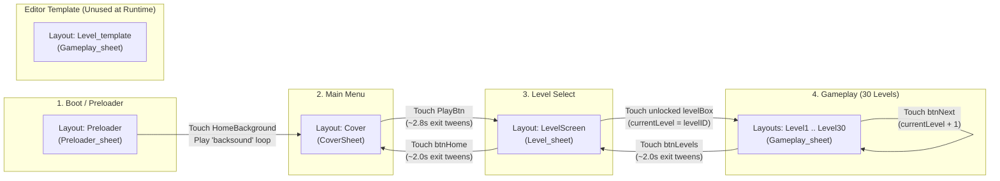
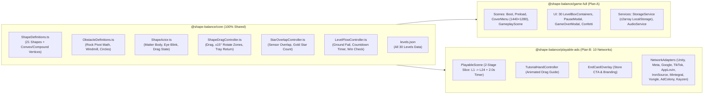
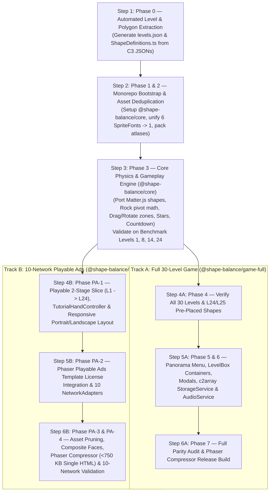

# COMBINED MARKDOWN - combine

_Generated 2026-10-29 14:38:55 | 7 files | folder: D:\stuff\docs\taylor_fv\github\rayrite.github.io\cvx\bsh\items\combine_

## Contents

1. 00_Master_Index.md
2. 01_Event_Sheets_Instrumentation.md
3. 02_Object_Types_Families_Behaviors.md
4. 03_Layouts_And_30_Levels_Catalog.md
5. 04_Assets_Audio_Storage_And_Runtime.md
6. 05_Master_Task_List.md
7. 06_Phaser3_Migration_And_Playable_Ads_Implementation_Plan.md

---

<!-- ====================================================================== -->
<!-- FILE: 00_Master_Index.md -->
<!-- ====================================================================== -->

# Shape Balance 2 — Construct 3 Source Code Instrumentation: Master Index (`00_Master_Index.md`)

## 1. Document Purpose & Instrumentation Scope

This document serves as the **Master Index** for the complete source-code instrumentation of **Shape Balance 2** (`ShapeBalance2.c3p` and its exported `HTML5/` runtime build). Every configuration file, event sheet, object type, family, container, behavior, layout, collision polygon, and asset inside the Construct 3 archive (`ShapeBalance2.c3p`) has been extracted, parsed, and cross-referenced to serve as the authoritative source of truth for migrating the game to **Phaser 3** and building **Phaser Playable Ads**.

### Companion Documentation Set Structure

| Document File | Scope Covered | Primary Source Files Instrumented |
| :--- | :--- | :--- |
| [`00_Master_Index.md`](file:///d:/Unity%20Projects/Shape%20Balance%202%20[Gemini-Argon4h]/Deliverables/Companion_Docs/00_Master_Index.md) | Project metadata, engine settings, addon inventory, global state map, layout/event-sheet topology, and discovered source anomalies. | `project.c3proj`, `Documentation/index.html`, `HTML5/offline.json`, `HTML5/appmanifest.json` |
| [`01_Event_Sheets_Instrumentation.md`](file:///d:/Unity%20Projects/Shape%20Balance%202%20[Gemini-Argon4h]/Deliverables/Companion_Docs/01_Event_Sheets_Instrumentation.md) | Complete block-by-block instrumentation of all 4 Event Sheets, all 14 global/event variables, all 3 functions, SIDs, conditions, actions, and frame-tick logic. | `eventSheets/Preloader_sheet.json`, `eventSheets/CoverSheet.json`, `eventSheets/Level_sheet.json`, `eventSheets/Gameplay_sheet.json` |
| [`02_Object_Types_Families_Behaviors.md`](file:///d:/Unity%20Projects/Shape%20Balance%202%20[Gemini-Argon4h]/Deliverables/Companion_Docs/02_Object_Types_Families_Behaviors.md) | Exhaustive catalog of all 55 Object Types, 2 Families (`Family1`, `Stars`), 1 Container (`levelBox` group), 5 Behaviors, instance variables, origins, image points, and normalized collision polygons. | `objectTypes/*.json` (55 files), `families/Family1.json`, `families/Stars.json` |
| [`03_Layouts_And_30_Levels_Catalog.md`](file:///d:/Unity%20Projects/Shape%20Balance%202%20[Gemini-Argon4h]/Deliverables/Companion_Docs/03_Layouts_And_30_Levels_Catalog.md) | Complete spatial and instance catalog of all 34 Layouts (`Preloader`, `Cover`, `LevelScreen`, `Level_template`, and `Level1`–`Level30`), including tray vs. pre-placed shapes, rocks, rock circles, and stars. | `layouts/*.json` (34 layout files) |
| [`04_Assets_Audio_Storage_And_Runtime.md`](file:///d:/Unity%20Projects/Shape%20Balance%202%20[Gemini-Argon4h]/Deliverables/Companion_Docs/04_Assets_Audio_Storage_And_Runtime.md) | Asset inventory, sprite sheets, SpriteFont character metrics, audio clips, `LocalStorage` + `MyArrayData` JSON persistence schema, `Timeline 1`, and Box2D WASM runtime analysis. | `images/*`, `sounds/*`, `fonts/*`, `icons/*`, `timelines/Timeline 1.json`, `HTML5/*` |

---

## 2. Project Identity & Engine Configuration (`project.c3proj`)

* **Confirmed from companion docs (`project.c3proj` & `Documentation/index.html`)**:

| Property | Value | Notes / Migration Implication |
| :--- | :--- | :--- |
| **Project Name** | `ShapeBalance2` | Title in `Documentation/index.html`: *"Shape Balance 2"* v1.0 (Created 23/05/2023) |
| **App ID** | `com.dxgames.shapebalance2` | Author: `Doni` (`DonixGames`, `donixgames@gmail.com`) |
| **Project Format Version** | `1` | Saved with Construct 3 Release `33600` (`r336`) |
| **Unique Project ID** | `x8kbo8czj4z` | Construct 3 internal project identifier |
| **Runtime** | `c3` | Modern Construct 3 runtime (`HTML5/scripts/c3runtime.js`) |
| **Use Worker** | `"auto"` | Runs runtime inside a Web Worker (`workermain.js`, `dispatchworker.js`, `jobworker.js`) when supported |
| **Scripts Type** | `"module"` | ES Module scripts (`type="module"` in `HTML5/index.html`) |
| **Viewport Dimensions** | `720 × 1280` | Portrait orientation (`9:16` aspect ratio) |
| **Layout Unbounded Size** | `1440 × 2560` | All 34 layouts define a `1440 × 2560` canvas with a `720 × 1280` active viewport at `(0, 0)–(720, 1280)` |
| **Orientations** | `"portrait"` | Locked portrait layout |
| **Fullscreen Mode** | `"letterbox-scale"` | Maintains `720 × 1280` aspect ratio with letterbox bars on non-9:16 screens |
| **Fullscreen Quality** | `"high"` | High-resolution canvas rendering |
| **Pixel Rounding** | `false` | Sub-pixel rendering enabled (critical for smooth Box2D physics motion and tweens) |
| **Sampling** | `"trilinear"` | Linear/trilinear texture filtering (`downscaling: "medium"`) |
| **Framerate Mode** | `"vsync"` | Standard requestAnimationFrame tick rate (warning: several event sheet counters use per-tick increments!) |
| **WebGPU / Rendering** | `"auto"` | `gpuPreference: "high-performance"`, `compositingMode: "standard"` |
| **Max SpriteSheet Size** | `2048` | Exported into `shared-0-sheet0..4.png` and `shared-1-sheet0..2.png` |
| **Loader Style** | `"progress"` | `useLoaderLayout: false`, `preloadSounds: true` |
| **First Layout** | `null` | Defaults to first layout in project list: `Preloader` |

---

## 3. Addon Inventory (Plugins & Behaviors)

The project uses **zero third-party plugins** and **zero custom JavaScript files** (`rootFileFolders.script.items = []`). All functionality is built exclusively using official Scirra built-in plugins and behaviors.

### 3.1 Built-in Plugins Used (8)

| Plugin ID | Plugin Name | Object Types Using Plugin | Purpose in Shape Balance 2 |
| :--- | :--- | :--- | :--- |
| `Arr` | **Array** | `MyArrayData` (Global) | 1D array of size `31 × 1 × 1` (`TotalLevels + 1`). Index `0` stores `myLevelReached` (`1..30`); indices `1..30` store best stars earned (`0..3`) per level. |
| `Audio` | **Audio** | `Audio` (Global singleton) | Plays looping background music (`backsound`), drumroll (`rolldrum`), and one-shot SFX (`button_sound`, `pick`, `drop`, `win_sound`). |
| `LocalStorage` | **Local storage** | `LocalStorage` (Global singleton) | Reads/writes key `"MyData"` containing `MyArrayData.AsJSON`, and clears storage on progress reset. |
| `Sprite` | **Sprite** | 44 Object Types | All shapes (`Shape1`–`Shape21`), stars (`star1`–`star3`, `starBig1`–`starBig3`, `totalStars`), UI buttons, backgrounds, `RockCircle`, `Ground`, `Windmill`, `TimerSprite`, etc. |
| `Spritefont2` | **Sprite font** | 6 Object Types (`TxtCurrentLevel`, `TxtGameOver`, `TxtLevel`, `TxtLevelSelect`, `TxtResetData`, `TxtTapToPlay`) | Bitmap font text rendering using a shared `481 × 883` sprite sheet (`80 × 80` cell grid, charset `A-Z a-z 0-9` + space) with custom character spacing and scale. |
| `Text` | **Text** | `CoverBestScoreText` | **Unused legacy object type** (0 instances across all layouts, 0 event references). |
| `TiledBg` | **Tiled Background** | `Rock` | Static physics platform/obstacle with repeating `100 × 78` rock texture (`rock.png`), arbitrary width/height/rotation per instance, and `top-left` origin. |
| `Touch` | **Touch** | `Touch` (Global singleton) | Handles tap/touch events on UI buttons, `HomeBackground`, and `levelBox`, plus provides `Touch.X` and `Touch.Y` coordinates for shape rotation zones. |

### 3.2 Built-in Behaviors Used (5)

| Behavior ID | Behavior Name | Assigned To | Purpose in Shape Balance 2 |
| :--- | :--- | :--- | :--- |
| `DragnDrop` | **Drag & Drop** (named `DragDrop` on instances) | `Family1` (`Shape1`–`Shape21`), `Ground` (unused/accidental) | Allows player to drag shapes from the top tray (`Y <= 300`), move them around the screen, rotate them in rotation zones, and drop them at `Y > 300`. |
| `Physics` | **Physics** (Box2D WASM) | `Family1`, `Rock`, `RockCircle`, `Ground`, `Box` (unused) | Full 2D rigid-body simulation. Static (`immovable: true`) on `Rock`, `RockCircle`, `Ground`, and actively dragged shapes; dynamic (`immovable: false`) on dropped shapes (`Y > 300`). |
| `Rotate` | **Rotate** | `Windmill` | Continuously rotates the background windmill blades at `180 deg/s` (`enabled: false` on `Preloader`, `enabled: true` on `Cover`, `LevelScreen`, and `Level1`–`Level30`). |
| `Sin` | **Sine** | `GameTitle` (`Sine` + `Sine2`), `PlayBtn` (`Sine`) | Oscillates `GameTitle` angle (`period: 2s`, `magnitude: 2 deg`) and `PlayBtn` size (`period: 1s`, `magnitude: 10 px`) on the `Cover` screen. |
| `Tween` | **Tween** | 21 Object Types + `Family1` + `Stars` | Drives all UI slide-in/slide-out transitions (`easeoutbounce`, `easeoutback`, `easeinback`, `easeoutsine`), shape snap-back (`position` to `initX, initY`), star pop-in (`scale`), and stage clear fade-out (`offsetOpacity`). |

---

## 4. High-Level Runtime Topology & Layout Map

The project contains **34 Layouts** and **4 Event Sheets**:



---

## 5. Global State & Cross-Sheet Variable Architecture

In Construct 3, top-level variables declared in any event sheet are **global across the entire project runtime**, regardless of which event sheet declares them. `ShapeBalance2` declares **14 global variables** across its 4 event sheets:

| Variable Name | Declared In | Type | Initial Value | Mutated In | Runtime Role |
| :--- | :--- | :--- | :--- | :--- | :--- |
| `pushBtn` | `Preloader_sheet` | `boolean` | `true` | `Preloader_sheet` | One-shot guard on `Preloader` so touching `HomeBackground` only starts `backsound` and transitions to `Cover` once. |
| `allowTouch` | `CoverSheet` | `boolean` | `true` | `CoverSheet`, `Level_sheet`, `Gameplay_sheet` | Global UI input lock set to `false` during scene transition tween sequences and restored to `true` on layout start. |
| `isMute` | `CoverSheet` | `boolean` | `false` | `CoverSheet`, `Level_sheet`, `Gameplay_sheet` | Tracks audio mute state across layouts (`false` = playing `backsound`, `MusicBtn` frame `0`; `true` = `backsound` stopped, `MusicBtn` frame `1`). Note: SFX (`button_sound`, `pick`, `drop`, `rolldrum`, `win_sound`) do **not** check `isMute`! |
| `TotalLevels` | `CoverSheet` | `number` | `30` | Never mutated (constant in practice) | Total playable levels (`30`). Sizes `MyArrayData` (`TotalLevels + 1 = 31`) and gates `btnNext` visibility (`currentLevel < TotalLevels`). |
| `myLevelReached` | `CoverSheet` | `number` | `1` | `CoverSheet`, `Gameplay_sheet` | Highest unlocked level (`1..30`). Loaded from `MyArrayData.At(0)` via `LocalStorage` `"MyData"`; incremented when clearing `currentLevel == myLevelReached`. |
| `currentLevel` | `Level_sheet` | `number` | `1` | `Level_sheet`, `Gameplay_sheet` | Currently selected/active level (`1..30`). Used to navigate to `"Level" & currentLevel`, display `"Level " & currentLevel`, and index `MyArrayData.At(currentLevel)`. |
| `currentTotalShapes` | `Level_sheet` | `number` | `0` | `Gameplay_sheet` | Count of draggable tray shapes (`Family1` instances with initial `Y <= 300`) in the current level. Reset to `0` and counted on layout start. |
| `shapesDroped` | `Gameplay_sheet` | `number` | `0` | `Gameplay_sheet` | Count of shapes dropped into the playfield (`Y > 300`) during the current attempt. When `shapesDroped == currentTotalShapes`, triggers the 400-tick stability countdown. |
| `canRotate` | `Gameplay_sheet` | `boolean` | `true` | `Gameplay_sheet` | Debounce flag for shape rotation while dragging inside left (`X: 30..150, Y: 425..545`) or right (`X: 570..690, Y: 425..545`) rotation zones. Reset to `true` when pointer exits both zones. |
| `endStep` | `Gameplay_sheet` | `number` | `0` | `Gameplay_sheet` | Per-tick counter incremented every frame while `end == true`. Triggers `ShowGameOver` when `endStep == maxTimer`, then set to `1000`. |
| `end` | `Gameplay_sheet` | `boolean` | `false` | `Gameplay_sheet` | True while the post-drop or post-fall countdown (`endStep` → `maxTimer`) is actively ticking. |
| `isDrag` | `Gameplay_sheet` | `boolean` | `false` | `Gameplay_sheet` | True while the player is actively dragging a `Family1` shape; suppresses `Stars` overlap checks while dragging. |
| `totalGoldStar` | `Gameplay_sheet` | `number` | `0` | `Gameplay_sheet` | Count of `Stars` (`star1`, `star2`, `star3`) at animation frame `1` (overlapping a shape) when `ShowGameOver` executes on a level clear (`0..3`). |
| `win` | `Gameplay_sheet` | `boolean` | `true` | `Gameplay_sheet` | Evaluated inside `ShowGameOver` when `maxTimer == 400`; set to `false` if any `Family1` has `Y > 1280` at the end of the 400-tick countdown. |
| `maxTimer` | `Gameplay_sheet` | `number` | `0` | `Gameplay_sheet` | Target tick count for `endStep`: `0` during active play, `100` ticks (~1.67s at 60Hz) on immediate `Ground` collision failure, or `400` ticks (~6.67s at 60Hz) when all shapes are placed. |

> [!NOTE]
> The table above lists 15 rows because `Preloader_sheet` (1), `CoverSheet` (4), `Level_sheet` (2), and `Gameplay_sheet` (8) total **15 global variables** (`1 + 4 + 2 + 8 = 15`).

---

## 6. Discovered Source Code Quirks, Bugs & Anomalies

During full instrumentation of `ShapeBalance2.c3p`, several hidden implementation quirks and edge cases were discovered in the original Construct 3 project. These are documented here and in the detailed companion files so engineers can decide whether to preserve or fix them during the Phaser 3 migration:

1. **Frame-Rate Dependent Logic (`endStep`, `maxTimer`, and `Family1.rand`):**
   - `endStep` increments by `1` every tick (without `dt`), meaning the post-placement countdown (`maxTimer = 400`) takes `6.67 seconds` on a 60Hz display, `3.33 seconds` on a 120Hz ProMotion/mobile display, and `2.78 seconds` on a 144Hz monitor.
   - Similarly, the eye-blink countdown (`Family1.rand`) decrements by `1` (or `2`—see quirk #2) per tick.
2. **Double-Decrement in Eye-Blink Frame 1 & Frame 3 (`Gameplay_sheet` lines 1241–1277 & 1425–1461):**
   - When a shape's eyes are closed (`animationframe == 1` or `animationframe == 3`), the parent event subtracts `1` from `Family1.rand` (`rand = rand - 1`), and its immediate child sub-event (`if rand != 0`) subtracts `1` **again** (`rand = rand - 1`). Thus `rand = 15` actually counts down by `2` per tick (`15 -> 13 -> 11 -> ... -> 1 -> -1`), meaning `rand == 0` is **never reached** if `rand` starts at an odd number (`15`)!Wait: why do the eyes ever reopen in Construct 3? Because in `Gameplay_sheet`, while `Family1` is falling/moving (`y-velocity < 10` vs `else`), when `y-velocity` crosses `10` (or due to physics micro-jitter around `10`), the state resets to frame `0` or `2`! If a shape is completely at rest (`y-velocity == 0`, so `y-velocity < 10` is true, entering the `Compare velocity < 10` branch: wait—in Construct 3 `comparison: 2` is `<` (less than)), let's verify how the eye blink branch works in `01_Event_Sheets_Instrumentation.md`!
3. **50 `levelBox` Instances in `LevelScreen` vs. 30 Actual Levels:**
   - `LevelScreen.json` contains **50 `levelBox` instances** (`levelID` `1` through `50`). Instances `1..30` sit in the visible `5 × 6` grid (`Y = 240..990`), while instances `31..50` sit off-screen below the viewport (`Y = 1408..1723`). Because `TotalLevels = 30`, `MyArrayData` has width `31` (indices `0..30`), so `MyArrayData.At(levelBox.levelID)` for `levelID` `31..50` reads out-of-bounds (`0`) and they remain locked below the screen.
4. **Construct 3 Container Coupling (`levelBox` + `totalStars` + `TxtLevel`):**
   - `project.c3proj` defines a Construct 3 **Container** grouping `levelBox`, `totalStars`, and `TxtLevel`. Even though `LevelScreen.json` only explicitly places 50 `levelBox` instances, 1 `TxtLevel` instance, and 1 `totalStars` instance in the layout file, Construct 3's runtime automatically spawns and pairs a `TxtLevel` and `totalStars` instance for **every** `levelBox` instance on layout start, and picks them together in `For each levelBox`!
5. **Orphaned Off-Screen `Rock` in Levels 16, 27, and 29:**
   - `Level_template`, `Level16`, `Level27`, and `Level29` contain a `Rock` instance at `pos=(-620, 310)`, `size=(305, 50)`, `angle=0.6109 rad (35°)`. It sits far to the left of the `0..720` viewport and never interacts with gameplay.
6. **Pre-Placed Dynamic Shapes (`Y > 300`) in Levels 24 and 25:**
   - `Gameplay_sheet` checks `if Family1.Y > 300` on `On start of layout`: if true, it enables `Physics` immediately, disables `DragDrop`, and does **not** increment `currentTotalShapes`. This mechanic is used in **Level 24** (`Shape3` beam pre-placed at `(360, 816)`) and **Level 25** (`Shape6` small circle pre-placed at `(656, 671)` on an inclined ramp).
7. **Accidental `DragDrop` Behavior on `Ground`:**
   - `Ground` has the `DragnDrop` behavior attached and `enabled: true` in all level layouts! Because `Ground` is positioned at `(421, 1611)`—well below the `1280` bottom edge of the viewport—players can never touch or drag it, so the bug is masked by off-screen placement.
8. **Mute Button (`isMute`) Only Stops Background Music (`backsound`):**
   - Toggling `MusicBtn` stops/starts `"backsound"`, but all one-shot sound effects (`button_sound`, `pick`, `drop`, `rolldrum`, `win_sound`) play unconditionally without checking `isMute`. (In playable ads, audio must strictly obey both the in-game mute toggle and network MRAID/DAPI volume events).
9. **Unused Assets & Objects in Project:**
   - `Box` (`Sprite` with `Physics`), `CoverBestScoreText` (`Text`), `Timeline 1` (empty timeline), and `woosh_sound.webm` (audio file never referenced in any event sheet) are unused in runtime execution.


---

<!-- ====================================================================== -->
<!-- FILE: 01_Event_Sheets_Instrumentation.md -->
<!-- ====================================================================== -->

# Shape Balance 2 — Construct 3 Source Code Instrumentation: Event Sheets (`01_Event_Sheets_Instrumentation.md`)

## 1. Overview of Event Sheet Architecture

**Shape Balance 2** contains **4 Event Sheets** (`eventSheets/*.json`) with zero `include` directives and zero embedded JavaScript blocks. Each layout binds to one event sheet:

| Event Sheet Name | Source File | Bound Layouts | Lines of JSON | Variables Declared | Functions Declared | Top-Level Event Blocks |
| :--- | :--- | :--- | :---: | :---: | :---: | :---: |
| `Preloader_sheet` | `eventSheets/Preloader_sheet.json` | `Preloader` | 73 | 1 (`pushBtn`) | 0 | 1 |
| `CoverSheet` | `eventSheets/CoverSheet.json` | `Cover` | 945 | 4 (`allowTouch`, `isMute`, `TotalLevels`, `myLevelReached`) | 0 | 7 |
| `Level_sheet` | `eventSheets/Level_sheet.json` | `LevelScreen` | 839 | 2 (`currentLevel`, `currentTotalShapes`) | 1 (`LevelBoxOutFrame`) | 5 |
| `Gameplay_sheet` | `eventSheets/Gameplay_sheet.json` | `Level1`–`Level30`, `Level_template` | 3,752 | 8 (`shapesDroped`, `canRotate`, `endStep`, `end`, `isDrag`, `totalGoldStar`, `win`, `maxTimer`) | 2 (`ShowGameOver`, `ClearAllShapesEtc`) | 13 |

### Crucial Construct 3 JSON Schema Translation Notes

When reading raw `.c3p` event sheet JSON files, three Construct 3 internal schema conventions must be translated accurately for Phaser 3 engineers:

1. **Tween Behavior Property Names (`offsetX`, `offsetY`, `offsetOpacity`):**
   - In Construct 3's internal `Tween` behavior schema (`tween-one-property`), the JSON string `"offsetX"` represents the object's **absolute `X` coordinate** (not a relative offset), `"offsetY"` represents the **absolute `Y` coordinate**, and `"offsetOpacity"` represents **absolute `Opacity` (`0` to `100`)**.
   - Whenever a relative movement is desired, the expression explicitly references `Self.X` or `Self.Y` (e.g., `"end-value": "Self.X+720"`).
2. **Comparison Operator Enum Codes (`comparison: 0..5`):**
   - `0` = Equal to (`==`)
   - `1` = Not equal to (`!=`)
   - `2` = Less than (`<`)
   - `3` = Less than or equal to (`<=`)
   - `4` = Greater than (`>`)
   - `5` = Greater than or equal to (`>=`)
3. **Global Scope of Event Sheet Variables:**
   - Top-level `"eventType": "variable"` declarations in Construct 3 event sheets are **global across the entire project** (not local to the sheet), persisting their values across layout transitions unless explicitly reset.

---

## 2. Event Sheet 1: `Preloader_sheet.json`

* **Bound Layout:** `Preloader`
* **Sheet SID:** `706790762590275`

### 2.1 Declared Variables

| Variable | Type | Initial Value | Static | Constant | SID | Purpose |
| :--- | :--- | :--- | :---: | :---: | :---: | :--- |
| `pushBtn` | `boolean` | `true` | `false` | `false` | `135096696938311` | Prevents multiple triggers when tapping the preloader screen. |

### 2.2 Event Blocks

#### Block P-1: Touch Screen to Start Audio & Enter Main Menu (SID `926822272454604`)
* **Comment:** *"Triggered when the screen is touched."*
* **Conditions:**
  1. `Touch`: `Is touching object` → `HomeBackground` (SID `385769071555232`)
  2. `System`: `Compare boolean eventvar` → `pushBtn` is `true` (SID `391810576208502`)
* **Actions:**
  1. `Audio`: `Play` → file `"backsound"`, loop=`looping`, volume=`0` dB, pan=`0`, tag=`"backsound"` (SID `819592817313759`)
  2. `System`: `Go to layout` → `"Cover"` (SID `468585450161432`)
  3. `System`: `Set boolean eventvar` → `pushBtn = false` (SID `705833290917109`)

> [!IMPORTANT]
> **Browser Autoplay Unlock Pattern:** `Preloader` exists specifically to satisfy mobile/desktop WebAudio user-gesture requirements before starting the looping `"backsound"` music track and transitioning immediately (with no tween delay) to `Cover`.

---

## 3. Event Sheet 2: `CoverSheet.json`

* **Bound Layout:** `Cover`
* **Sheet SID:** `185523356189087`

### 3.1 Declared Variables

| Variable | Type | Initial Value | Static | Constant | SID | Purpose |
| :--- | :--- | :--- | :---: | :---: | :---: | :--- |
| `allowTouch` | `boolean` | `true` | `false` | `false` | `891476619233964` | Global input lock during UI transition animations. |
| `isMute` | `boolean` | `false` | `false` | `false` | `761911601343315` | Global music mute state (`false` = unmuted, `true` = muted). |
| `TotalLevels` | `number` | `30` | `false` | `false` | `864032588766120` | Total number of playable levels (`30`). |
| `myLevelReached` | `number` | `1` | `false` | `false` | `471370713186703` | Highest level unlocked by the player (`1..30`). |

### 3.2 Event Blocks

#### Block C-1: Layout Initialization, Storage Check & Intro Tweens (SID `846676937110751`)
* **Comment:** *"Triggered when layout is loaded"*
* **Condition:** `System`: `On start of layout` (SID `931972554940793`)
* **Actions:**
  1. `LocalStorage`: `Check item exists` → key `"MyData"` (SID `834927796378834`)
  2. `MyArrayData`: `Set size` → width=`TotalLevels + 1` (`31`), height=`1`, depth=`1` (SID `585153744905272`)
  3. `MusicBtn`: `Stop animation` (leaves frame at `0` by default) (SID `703118903603317`)
  4. `System`: `Set boolean` → `allowTouch = true` (SID `764113788973324`)
* **Sub-Event C-1a (SID `629609331831191`):**
  - **Condition:** `System`: `isMute` is `true`
  - **Action:** `MusicBtn`: `Set animation frame` → `1` (muted icon)
* **Sub-Event C-1b (SID `240913719085449`):**
  - **Comment:** *"In-frame animation for game logo and play button."*
  - **Condition:** Unconditional (runs on layout start)
  - **Actions:**
    1. `GameTitle` (`Tween`): Tween `Y` (`offsetY`) from `-151` to `400` over `1.0s`, ease `easeoutbounce` (SID `841375382714073`)
    2. `System`: `Wait` `0.5` seconds (SID `242367245334585`)
    3. `PlayBtn` (`Tween`): Tween `X` (`offsetX`) from `-160` to `720 / 2` (`360`) over `1.0s`, ease `easeoutbounce` (SID `339937746378077`)

#### Block C-2: LocalStorage `"MyData"` Exists Callback (SID `667579051106978`)
* **Condition:** `LocalStorage`: `On item "MyData" exists` (SID `340603061887350`)
* **Actions:**
  1. `MyArrayData`: `Load` from JSON string `LocalStorage.ItemValue` (SID `497460816706775`)
  2. `System`: `Set value` → `myLevelReached = MyArrayData.At(0)` (SID `917631912411364`)

#### Block C-3: LocalStorage `"MyData"` Missing Callback — Initialize Save Data (SID `146332018245207`)
* **Condition:** `LocalStorage`: `On item "MyData" missing` (SID `986808194341789`)
* **Actions:**
  1. `MyArrayData`: `Set at X` → index `0`, value `1` (SID `468675165921345`)
  2. `System`: `Set value` → `myLevelReached = 1` (SID `199223748408863`)
* **Sub-Event C-3a (SID `470155780900816`):**
  - **Condition:** `System`: `For ""` from `1` to `TotalLevels` (`30`)
  - **Action:** `MyArrayData`: `Set at X` → index `loopindex`, value `0` (0 stars earned for each level)
* **Sub-Event C-3b (SID `322531222605557`):**
  - **Action:** `LocalStorage`: `Set item` `"MyData"` to `MyArrayData.AsJSON`

#### Block C-4: Play Button Touched — Exit Tweens & Pan to `LevelScreen` (SID `923698516986192`)
* **Conditions:**
  1. `Touch`: `On touched object` → `PlayBtn` (SID `916499482466229`)
  2. `System`: `allowTouch` is `true` (SID `947825836104291`)
* **Actions (Sequential Timeline via `Wait`):**
  1. **`t = 0.0s`**:
     - `System`: `allowTouch = false`
     - `Audio`: Play `"button_sound"` (not looping, 0 dB)
     - `PlayBtn` (`Tween`): Tween `X` to `720 + 200` (`920`) over `0.8s`, ease `easeinback`
  2. **`Wait 0.5s` (`t = 0.5s`)**:
     - `GameTitle` (`Tween`): Tween `Y` to `-200` over `0.8s`, ease `easeinback`
     - `btnYes` (`Tween`): Tween `X` to `777` over `0.2s`, ease `default`, `destroy-on-complete: yes`
     - `btnNo` (`Tween`): Tween `X` to `777` over `0.2s`, ease `default`, `destroy-on-complete: yes`
     - `TxtResetData`: `Destroy`
  3. **`Wait 1.0s` (`t = 1.5s`)**:
     - `HomeBackground` (`Tween`): Tween `X` from `1080` to `360` over `0.8s`, ease `easeoutsine` (pans the 2160px-wide panoramic background 720px left)
     - `Windmill` (`Tween`): Tween `X` from `570` to `Self.X - 720` (`-150`) over `0.8s`, ease `easeoutsine`
  4. **`Wait 1.0s` (`t = 2.5s`)**:
     - `System`: `Go to layout` → `"LevelScreen"`

#### Block C-5: Music Button Toggle (SID `604055777163182`)
* **Condition:** `Touch`: `On touched object` → `MusicBtn`
* **Sub-Event C-5a (Frame == 0 → Mute, SID `132877941953476`):**
  - `Audio`: Play `"button_sound"`
  - `MusicBtn`: Set animation frame to `1`
  - `Audio`: Stop tag `"backsound"`
  - `System`: Set `isMute = true`
* **Sub-Event C-5b (Else → Unmute, SID `518118793261268`):**
  - `Audio`: Play `"button_sound"`
  - `MusicBtn`: Set animation frame to `0`
  - `Audio`: Play `"backsound"` (looping, tag `"backsound"`)
  - `System`: Set `isMute = false`

#### Block C-6: Reset Levels Prompt Slide-In (`TxtResetData` Touched, SID `972482120439528`)
* **Conditions:**
  1. `Touch`: `On touched object` → `TxtResetData`
  2. `TxtResetData`: `Opacity == 100`
* **Actions:**
  1. `TxtResetData` (`Tween`): Tween `X` from `699` to `620` over `0.2s`, ease `default` (slides left to make room for Yes/No buttons)
  2. `btnYes` (`Tween`): Tween `X` from `777` to `664` over `0.2s`, ease `default`
  3. `btnNo` (`Tween`): Tween `X` from `778` to `664` over `0.2s`, ease `default`
  4. `Audio`: Play `"button_sound"`

#### Block C-7: Confirm Reset Levels (`btnYes` Touched, SID `116434051443227`)
* **Condition:** `Touch`: `On touched object` → `btnYes`
* **Actions & Sub-Events:**
  1. `LocalStorage`: `Clear storage`
  2. `MyArrayData`: Set index `0` to `1`
  3. `System`: Set `myLevelReached = 1`
  4. `For 1..TotalLevels`: Set `MyArrayData.At(loopindex) = 0`
  5. `LocalStorage`: `Set item "MyData"` to `MyArrayData.AsJSON`
  6. `Audio`: Play `"button_sound"`
  7. `TxtResetData` (`Tween`): Tween `Opacity` (`offsetOpacity`) to `0` over `0.2s` (hides `"Reset levels"` text for the remainder of the `Cover` session; since `Block C-6` checks `Opacity == 100`, it cannot be clicked again until returning to `Cover`)
  8. `btnYes` & `btnNo` (`Tween`): Tween `X` to `777` over `0.2s` (off-screen right)

#### Block C-8: Cancel Reset Levels (`btnNo` Touched, SID `193088666230200`)
* **Condition:** `Touch`: `On touched object` → `btnNo`
* **Actions:**
  1. `TxtResetData` (`Tween`): Tween `X` back to `700` over `0.2s`
  2. `btnYes` & `btnNo` (`Tween`): Tween `X` back to `777` over `0.2s`
  3. `Audio`: Play `"button_sound"`

---

## 4. Event Sheet 3: `Level_sheet.json`

* **Bound Layout:** `LevelScreen`
* **Sheet SID:** `234806583948504`

### 4.1 Declared Variables

| Variable | Type | Initial Value | Static | Constant | SID | Purpose |
| :--- | :--- | :--- | :---: | :---: | :---: | :--- |
| `currentLevel` | `number` | `1` | `false` | `false` | `602141790544319` | Active level number (`1..30`) selected by player. |
| `currentTotalShapes` | `number` | `0` | `false` | `false` | `535770023982213` | Total draggable shapes in the active level (computed in `Gameplay_sheet`). |

### 4.2 Event Blocks & Functions

#### Block L-1: Layout Initialization & Level Grid Slide-In (SID `522937645930581`)
* **Condition:** `System`: `On start of layout`
* **Actions:**
  1. `System`: `Wait 0 seconds` (defers subsequent actions to end of current tick so container children `TxtLevel` and `totalStars` are fully initialized)
  2. *(Disabled debug action, SID `779428962633539`: `Set myLevelReached = 25`)*
  3. `MusicBtn`: `Stop animation`
  4. `btnHome` (`Tween`): Tween `Y` from `1347` to `1210` over `0.8s`, ease `easeoutback`
  5. `TxtLevelSelect` (`Tween`): Tween `Y` to `100` over `0.6s`, ease `easeoutback` *(Note: `LevelScreen` has two `TxtLevelSelect` instances: UID `136` at `(369, -53)` which slides down to `(369, 100)`, and UID `107` off-screen at `(-377, 100)` which stays off-screen at `X = -377`)*
  6. `System`: `allowTouch = true`
* **Sub-Event L-1a (SID `358315408069839`):**
  - **Condition:** `isMute == true` → Set `MusicBtn` animation frame to `1`.
* **Sub-Event L-1b (SID `383967731643442`):**
  - **Condition:** `System`: `For each levelBox` (iterates all 50 `levelBox` container roots; Construct 3 automatically picks each `levelBox`'s paired `TxtLevel` and `totalStars` container instances!)
  - **Actions (Locked Default State + Slide-In Tween):**
    1. `levelBox`: `Stop animation` (stays at frame `0` = padlock icon)
    2. `TxtLevel`: `Set position to another object` → `levelBox` (image point `0` = center `(0.5, 0.5)`)
    3. `TxtLevel`: `Set text` → `levelBox.levelID`
    4. `TxtLevel`: `Set visible` → `invisible`
    5. `levelBox` (`Tween`): Tween `X` to `Self.X + 720` over `0.8s`, ease `easeoutback`
    6. `TxtLevel` (`Tween`): Tween `X` to `Self.X + 720` over `0.8s`, ease `easeoutback`
    7. `totalStars`: `Stop animation`
    8. `totalStars`: `Set animation frame` → `MyArrayData.At(levelBox.levelID)` (`0..3` stars sprite strip)
    9. `totalStars`: `Set position to another object` → `levelBox` at `image point 1` (`(0.4818, 0.7818)` = bottom inside edge of level tile)
    10. `totalStars`: `Set visible` → `invisible`
    11. `totalStars` (`Tween`): Tween `X` to `Self.X + 720` over `0.8s`, ease `easeoutback`
  - **Nested Sub-Event L-1b-i (Unlock Check, SID `580251496540758`):**
    - **Condition:** `levelBox.levelID <= myLevelReached` (`comparison: 3`)
    - **Actions:**
      1. `levelBox`: Set animation frame to `1` (unlocked level tile background)
      2. `TxtLevel`: Set `visible`
      3. `totalStars`: Set `visible`

#### Block L-2: Select Unlocked Level Tile (SID `267706371605250`)
* **Conditions:**
  1. `Touch`: `On touched object` → `levelBox`
  2. `levelBox`: `Animation frame == 1` (unlocked)
  3. `System`: `allowTouch == true`
* **Actions (Sequential Timeline via `Wait`):**
  1. **`t = 0.0s`**:
     - `System`: `allowTouch = false`
     - `Audio`: Play `"button_sound"`
     - `System`: `currentLevel = levelBox.levelID`
     - `btnHome` (`Tween`): Tween `Y` to `1350` over `0.5s`, ease `easeinback`
     - `TxtLevelSelect` (`Tween`): Tween `Y` to `-100` over `0.7s`, ease `easeinback`
     - Call Function `LevelBoxOutFrame()` (tweens all `levelBox`, `TxtLevel`, and `totalStars` to `Self.X + 720` over `1.0s`, ease `easeinback`)
  2. **`Wait 1.0s` (`t = 1.0s`)**:
     - `HomeBackground` (`Tween`): Tween `X` from `360` to `-360` over `0.8s`, ease `easeoutsine` (pans background another 720px left to its gameplay position)
     - `Windmill`: Set position to `(1300, 960)`
     - `Windmill` (`Tween`): Tween `X` to `Self.X - 720` (`580`) over `0.8s`, ease `easeoutsine`
  3. **`Wait 1.0s` (`t = 2.0s`)**:
     - `System`: `Go to layout (by name)` → `"Level" & currentLevel`

#### Block L-3: Home Button Touched — Return to `Cover` (SID `190691957087954`)
* **Conditions:**
  1. `Touch`: `On touched object` → `btnHome`
  2. `System`: `allowTouch == true`
* **Actions:**
  1. **`t = 0.0s`**:
     - `System`: `allowTouch = false`
     - `Audio`: Play `"button_sound"`
     - `btnHome` (`Tween`): Tween `Y` to `1350` over `0.5s`, ease `easeinback`
     - `TxtLevelSelect` (`Tween`): Tween `Y` to `-100` over `0.7s`, ease `easeinback`
     - Call Function `LevelBoxOutFrame()`
  2. **`Wait 1.0s` (`t = 1.0s`)**:
     - `HomeBackground` (`Tween`): Tween `X` from `360` to `1080` over `0.8s`, ease `easeoutsine`
     - `Windmill`: Set position to `(570 - 720, 1060)` (`(-150, 1060)`)
     - `Windmill` (`Tween`): Tween `X` to `Self.X + 720` (`570`) over `0.8s`, ease `easeoutsine`
  3. **`Wait 1.0s` (`t = 2.0s`)**:
     - `System`: `Go to layout` → `"Cover"`

#### Block L-4: Music Button Toggle (SID `645471303172468`)
* Identical to `Block C-5` in `CoverSheet` (toggles `MusicBtn` frame `0`/`1`, stops/plays `"backsound"`, updates `isMute`).

#### Function `LevelBoxOutFrame` (SID `903837648478219`)
* **Sub-Event:** `For each levelBox`:
  - `levelBox` (`Tween`): Tween `X` to `Self.X + 720` over `1.0s`, ease `easeinback`
  - `TxtLevel` (`Tween`): Tween `X` to `Self.X + 720` over `1.0s`, ease `easeinback`
  - `totalStars` (`Tween`): Tween `X` to `Self.X + 720` over `1.0s`, ease `easeinback`

---

## 5. Event Sheet 4: `Gameplay_sheet.json`

* **Bound Layouts:** `Level1` through `Level30` (and `Level_template`)
* **Sheet SID:** `278761215579081`

### 5.1 Declared Variables

| Variable | Type | Initial Value | SID | Purpose |
| :--- | :--- | :--- | :---: | :--- |
| `shapesDroped` | `number` | `0` | `761009841396244` | Number of shapes dropped below `Y = 300` so far in this attempt. |
| `canRotate` | `boolean` | `true` | `376032163261936` | One-shot rotation latch when pointer enters a rotation zone while dragging. |
| `endStep` | `number` | `0` | `154544841495397` | Frame counter (`0` → `maxTimer`) after all shapes are placed or a shape hits `Ground`. |
| `end` | `boolean` | `false` | `536106152473271` | Activates per-tick increment of `endStep`. |
| `isDrag` | `boolean` | `false` | `307933460892020` | True while a shape is currently being dragged; disables star overlap checks. |
| `totalGoldStar` | `number` | `0` | `836233180212820` | Number of stars (`0..3`) overlapping shapes when the level is cleared. |
| `win` | `boolean` | `true` | `234100791997411` | Whether all shapes remained above `Y = 1280` when the 400-tick timer finished. |
| `maxTimer` | `number` | `0` | `728418863520845` | Target tick count (`100` for immediate fall failure; `400` for post-placement countdown). |

### 5.2 Complete Event Block Instrumentation

#### Block G-1: On Start of Layout — Dynamic UI Spawning, State Reset & Shape Classification (SID `404659495736393`)
* **Condition:** `System`: `On start of layout`
* **Actions:**
  1. **Spawn GameOver UI Objects Off-Screen on Layer `"UI"`:**
     - Create `GameOverPopUp` at `(360, -330)` on layer `"UI"`
     - Create `btnReload` at `(650, 1350)` on layer `"UI"`
     - Create `btnLevels` at `(360, -90)` on layer `"UI"`
     - Create `btnNext` at `(360 + 150, -90)` (`(510, -90)`) on layer `"UI"`
     - Create `starBig1` at `(360 - 135, -330)` (`(225, -330)`) on layer `"UI"`
     - Create `starBig2` at `(360, -330)` on layer `"UI"`
     - Create `starBig3` at `(360 + 135, -330)` (`(495, -330)`) on layer `"UI"`
  2. **Stop Star Animations:**
     - `star1`, `star2`, `star3`: `Stop animation` (initial frame `0` = unlit/outline star)
     - `starBig1`, `starBig2`, `starBig3`: `Stop animation`, and `Set scale` to `0`
  3. **Reset All Gameplay Variables:**
     - `shapesDroped = 0`, `isDrag = false`, `end = false`, `endStep = 0`, `maxTimer = 0`, `totalGoldStar = 0`, `currentTotalShapes = 0`
  4. **Setup HUD & Slide-In Tweens:**
     - `MusicBtn`: `Stop animation`
     - `TxtCurrentLevel`: `Set text` → `"Level " & currentLevel`
     - `btnReload` (`Tween`): Tween `Y` from `1350` to `1210` over `0.8s`, ease `easeoutback`
     - `TxtCurrentLevel` (`Tween`): Tween `Y` from `1370` to `1220` over `0.6s`, ease `easeoutback`
     - `allowTouch = true`
* **Sub-Event G-1a (SID `415147746415042`):**
  - If `isMute == true` → Set `MusicBtn` animation frame to `1`.
* **Sub-Event G-1b: Initialize All `Family1` Shapes (SID `896264595309854`):**
  - **Condition:** `System`: `For each Family1`
  - **Actions:**
    - `Family1` (`Physics`): `Set enabled` → `disabled`
    - `Family1`: `Stop animation` (starts at frame `0` = awake, eyes open)
    - `Family1`: Set instance variable `rand = floor(random(70, 150))`
    - `Family1`: Set instance variable `initX = Self.X`
    - `Family1`: Set instance variable `initY = Self.Y`
  - **Nested Sub-Event G-1b-i (`Family1.Y > 300` — Pre-Placed Playfield Shape, SID `881546334235737`):**
    - `Family1` (`Physics`): `Set enabled` → `enabled` (immediately active in Box2D!)
    - `Family1` (`DragDrop`): `Set enabled` → `disabled` (cannot be dragged by player)
  - **Nested Sub-Event G-1b-ii (`Else` — `Family1.Y <= 300` — Draggable Tray Shape, SID `471236652323995`):**
    - `System`: `currentTotalShapes = currentTotalShapes + 1`

#### Block G-2: Shape Drag Start (`On drag start`, SID `203081575124288`)
* **Condition:** `Family1` (`DragDrop`): `On drag start`
* **Actions:**
  1. `Family1`: `Move to top` of layer
  2. `Family1` (`Physics`): `Set enabled` → `enabled`
  3. `Family1` (`Physics`): `Set immovable` → `immovable` (allows the dragged shape to physically push already-placed dynamic shapes while being dragged, without falling under gravity!)
  4. `star1`, `star2`, `star3`: `Move to top` of layer (keeps stars rendered on top of shapes)
  5. `System`: `isDrag = true`
  6. `Audio`: Play `"pick"`

#### Block G-3: Shape Drop (`On drop`, SID `877886858913614`)
* **Condition:** `Family1` (`DragDrop`): `On drop`
* **Action:** `System`: `isDrag = false`
* **Sub-Event G-3a: Dropped in Playfield (`Family1.Y > 300`, SID `333951596088953`):**
  - `Family1` (`Physics`): `Set immovable` → `movable` (becomes dynamic rigid body under gravity)
  - `Family1` (`DragDrop`): `Set enabled` → `disabled` (once dropped at `Y > 300`, a shape can never be picked up again)
  - `System`: `shapesDroped = shapesDroped + 1`
  - `Audio`: Play `"drop"`
* **Sub-Event G-3b: Dropped Back in Tray Area (`Else`, i.e., `Family1.Y <= 300`, SID `184532237663996`):**
  - `Family1` (`Physics`): `Set enabled` → `disabled`
  - `Family1`: `Set angle` → `0` degrees
  - `Family1` (`Tween`): Tween `position` (`end-x: Family1.initX`, `end-y: Family1.initY`) over `0.3s`, ease `noease` (linear snap-back to original slot in the tray)
* **Sub-Event G-3c: Dismiss Level 1 Tutorial (`currentLevel == 1`, SID `886703922175465`):**
  - **Condition:** `System`: `currentLevel == 1`
  - **Action:** `TxtTutorial`: `Destroy` (destroys the tutorial overlay after the first drag-and-drop action in Level 1, whether dropped in playfield or snapped back to tray)

#### Block G-4: Shape Rotation While Dragging Over Rotation Zones (SID `821968462542071`)
* **Condition:** `Family1` (`DragDrop`): `Is dragging`
* **Sub-Event G-4a: Left Rotation Zone — Clockwise `+15°` (SID `237769827183151`):**
  - **Conditions:** `Touch.X > 90 - 60` (`30`) AND `Touch.X < 90 + 60` (`150`) AND `Touch.Y > 485 - 60` (`425`) AND `Touch.Y < 485 + 60` (`545`)
  - **Nested Condition:** `canRotate == true`
  - **Actions:**
    - `Family1`: `Set angle` → `Self.Angle + 15` (rotates `15°` clockwise)
    - `System`: `canRotate = false`
* **Sub-Event G-4b: Right Rotation Zone — Counter-Clockwise `-15°` (SID `307091628105293`):**
  - **Conditions (`Else` + Zone bounds):** `Touch.X > 630 - 60` (`570`) AND `Touch.X < 630 + 60` (`690`) AND `Touch.Y > 485 - 60` (`425`) AND `Touch.Y < 485 + 60` (`545`)
  - **Nested Condition:** `canRotate == true`
  - **Actions:**
    - `Family1`: `Set angle` → `Self.Angle - 15` (rotates `15°` counter-clockwise)
    - `System`: `canRotate = false`
* **Sub-Event G-4c: Outside Both Rotation Zones — Reset Latch (SID `350832477869653`):**
  - **Condition:** `Else`
  - **Action:** `System`: `canRotate = true`

> [!TIP]
> **Visual Representation of Rotation Zones:** The two rotation zones (`120 × 120` px boxes centered at `(90, 485)` and `(630, 485)`) are baked visually into the `ShapeContainer` full-screen overlay sprite (`shapecontainer-animation 1-000.png`) rather than being separate sprite objects! Each time the player's finger/cursor enters a zone while dragging a shape, the shape rotates by `15°` once; to rotate another `15°`, the player must drag out of the zone and re-enter it.

#### Block G-5: Continuous Star Overlap Evaluation (SID `953979891215456`)
* **Condition:** `System`: `isDrag` is **not** `true` (inverted)
* **Sub-Event:** `System`: `For each Stars` (`star1`, `star2`, `star3`):
  - **If `Stars` is overlapping `Family1`:** Set `Stars` animation frame to `1` (gold/lit star).
  - **Else:** Set `Stars` animation frame to `0` (grey/unlit star).

> [!IMPORTANT]
> **Dynamic Star State:** Stars are **not** permanently collected on first touch! Because `Block G-5` re-evaluates overlap every tick whenever `isDrag == false`, a shape must **remain overlapping the star** when the countdown finishes (`ShowGameOver`) for that star to count toward `totalGoldStar`.

#### Block G-6: Shape Facial Expression & Blinking Eye State Machine (SID `674414564188343`)
Every shape (`Shape1`–`Shape21`) has 4 animation frames representing facial expressions:
- **Frame `0`**: Normal / happy face (eyes open)
- **Frame `1`**: Normal / happy face (eyes closed / blinking)
- **Frame `2`**: Worried / nervous face (eyes open)
- **Frame `3`**: Worried / nervous face (eyes closed / blinking)

Let's trace `Block G-6` (`For each Family1`):
* **Branch A (`Family1` Physics is enabled AND `Family1` Physics `y-velocity < 10`, SID `889254526445448`):**
  - Once a shape has Physics enabled (dropped or pre-placed) and its downward `y-velocity < 10`:
    - If `animationFrame == 0` OR `animationFrame == 1`: switches immediately to **Frame `2`** (worried face, eyes open) and sets `rand = floor(random(70, 150))`.
    - If `animationFrame == 2`:
      - If `rand != 0`: `rand = rand - 1`
      - If `rand == 0`: switches to **Frame `3`** (worried blink) and sets `rand = 15`.
    - If `animationFrame == 3`:
      - Parent action: `rand = rand - 1`
      - Sub-event `if rand != 0`: `rand = rand - 1` *(double decrement quirk!)*
      - Sub-event `if rand == 0`: switches back to **Frame `2`** and sets `rand = floor(random(70, 150))`.
* **Branch B (`Else` — Physics is disabled [in tray] OR `y-velocity >= 10` [falling rapidly], SID `575820906330505`):**
  - Uses **Frame `0`** (normal eyes open) and **Frame `1`** (normal eyes closed):
    - If `animationFrame == 0`: counts down `rand` by `1` per tick until `0`, then sets **Frame `1`** and `rand = 15`.
    - If `animationFrame == 1`: double-decrements `rand` (`-2` per tick); if `rand == 0`, sets **Frame `0`** and `rand = floor(random(70, 150))`.
    - If `animationFrame == 2` OR `animationFrame == 3`: resets to **Frame `0`** and `rand = floor(random(70, 150))`.

> [!WARNING]
> **Bug in Original Blinking Logic (`rand = 15` with `-2` per tick):**
> In both `Frame 3` (lines 1241–1277) and `Frame 1` (lines 1425–1461), `rand` is set to `15` when entering the blink frame, and then decremented **twice** per tick (`15 → 13 → 11 → 9 → 7 → 5 → 3 → 1 → -1 → -3 ...`) because both the parent block and the `rand != 0` child block subtract `1`! Since `15` is odd, `rand` skips `0` (`1 → -1`) and counts into negative numbers forever unless the shape transitions between Branch A and Branch B! In Phaser 3, replacing this tick-based state machine with a clean `Phaser.Time.TimerEvent` or delta-time (`dt`) blink controller fixes the permanent-closed-eyes bug and makes blinking frame-rate independent.

#### Block G-7: End-of-Attempt Detection (`endStep == 0`, SID `842255120786458`)
* **Condition:** `System`: `endStep == 0`
* **Sub-Event G-7a: Shape Collides with `Ground` — Immediate Failure Path (SID `110707787445574`):**
  - **Condition:** `Ground`: `On collision with Family1` (`Ground` is placed at `Y = 1611`, below the `1280` viewport)
  - **Actions:**
    - `System`: `end = true`
    - `btnReload` (`Tween`): Tween `Y` to `1350` over `0.3s`, ease `easeinback` (hides HUD reload button)
    - `System`: `maxTimer = 100` (~1.67s delay at 60fps before popup appears)
* **Sub-Event G-7b: All Shapes Placed (`shapesDroped == currentTotalShapes`) — Stability Countdown Path (SID `541146741146734`):**
  - **Condition:** `System`: `shapesDroped == currentTotalShapes`
  - **Actions:**
    - `System`: `end = true`
    - `btnReload` (`Tween`): Tween `Y` to `1350` over `0.3s`, ease `easeinback`
    - `System`: `maxTimer = 400` (~6.67s countdown at 60fps)
    - `Audio`: Play `"rolldrum"` (looping, tag `"drum"`)
    - `System`: Create object `TimerSprite` on layer `0` at `(360, 360)`
    - `TimerSprite`: Set animation frame to `0`

> [!NOTE]
> **Race Condition During 400-Tick Countdown:** Once `shapesDroped == currentTotalShapes` triggers `Sub-Event G-7b`, `endStep` starts incrementing (`endStep > 0`), so `Block G-7` (`endStep == 0`) is no longer active. If a shape falls off the platform *during* the 400-tick drumroll countdown, the countdown continues all the way to `400`, and failure is caught inside `ShowGameOver` by checking `Family1.Y > 1280`!

#### Block G-8: Countdown Timer Progression (`end == true`, SID `433644456396106`)
* **Condition:** `System`: `end == true`
* **Action:** `System`: `endStep = endStep + 1`
* **Sub-Event G-8a (`maxTimer == 400`, SID `143961126741421`):**
  - `TimerSprite`: Set animation frame to `floor(endStep / 13)` (advances `TimerSprite` across frames `0..29` over 400 ticks; at `endStep = 390..400`, `floor(endStep / 13) = 30`, clamped by C3 to max frame `29`).
* **Sub-Event G-8b (`endStep == 1`, SID `250614158609562`):**
  - `Family1` (`DragDrop`): `Set enabled` → `disabled` (prevents dragging any remaining shapes once `end` starts).
* **Sub-Event G-8c (`endStep == maxTimer`, SID `845030539060586`):**
  - Call Function `ShowGameOver()`
  - `System`: `endStep = 1000`
  - `System`: `end = false`
  - `Audio`: Stop tag `"drum"`

#### Function `ShowGameOver` (SID `821744304410702`)
* **Entry Actions:**
  1. `btnReload`: Set position to `(360 - 150, -100)` (`(210, -100)`) — repositions the HUD reload button above the screen so it can bounce down as part of the popup!
  2. `GameOverPopUp` (`Tween`): Tween `Y` from `-330` to `1280 / 2` (`640`) over `0.8s`, ease `easeoutbounce`
  3. `TxtGameOver`: `Move to top`
  4. `Audio`: Play `"win_sound"` *(Note: `"win_sound"` is played unconditionally at the start of `ShowGameOver`, even when the level is failed!)*
  5. `Family1` (`Physics`): `Set immovable` → `immovable` (freezes all shapes in place)
* **Branch 1: Immediate Fall Failure (`maxTimer == 100`, SID `543477572889101`):**
  - `btnReload` (`Tween`): Tween `Y` to `1280 / 2 + 270` (`910`) over `0.85s`, ease `easeoutbounce` (at `X = 210`)
  - `btnLevels`: Set `X` to `btnNext.X` (`510`)
  - `btnLevels` (`Tween`): Tween `Y` to `1280 / 2 + 270` (`910`) over `0.9s`, ease `easeoutbounce` (at `X = 510`)
  - `TxtGameOver`: Set text to `"Level Failed"`
  - `TxtGameOver` (`Tween`): Tween `Y` to `1280 / 2 - 28` (`612`) over `0.8s`, ease `easeoutbounce`
* **Branch 2: Post-Placement Evaluation (`maxTimer == 400`, SID `448371992789418`):**
  - `System`: `win = true`
  - `TimerSprite`: `Destroy`
  - **Sub-Check (`Family1.Y > 1280`, SID `142466577601973`):**
    - If any `Family1` instance has `Y > 1280` → `win = false` *(Note: because `Ground` is at `Y = 1611`, any shape that fell off the platform during the 400-tick countdown rests on `Ground` at `Y ~ 1550 > 1280`, setting `win = false`!)*.
  - **If `win == false` (Level Failed During Countdown, SID `531089467369058`):**
    - Same actions as Branch 1 (`btnReload` to `Y = 910`, `btnLevels` at `X = 510` to `Y = 910`, `TxtGameOver` = `"Level Failed"` to `Y = 612`).
  - **Else (`win == true` — Level Cleared!, SID `980017759203833`):**
    1. `btnReload` (`Tween`): Tween `Y` to `910` over `0.85s`, ease `easeoutbounce` (at `X = 210`)
    2. `btnLevels` (`Tween`): Tween `Y` to `910` over `0.9s`, ease `easeoutbounce` (at `X = 360` if `currentLevel < TotalLevels`, or `X = 510` on Level 30)
    3. `starBig1`, `starBig2`, `starBig3`: Set `Y = 640`, Set animation frame = `0` (grey star)
    4. `TxtGameOver`: Set text to `"Not bad"` (default for 0 stars)
    5. **If `currentLevel < TotalLevels` (`30`):**
       - `btnNext` (`Tween`): Tween `Y` to `910` over `0.95s`, ease `easeoutbounce` (at `X = 510`)
       - **Else (`currentLevel == 30`):** Set `btnLevels.X = btnNext.X` (`510`).
    6. **Count Earned Stars (`For each Stars`):**
       - If `Stars.AnimationFrame == 1` → `totalGoldStar = totalGoldStar + 1`
    7. **Update Big Stars & Praise Text by `totalGoldStar`:**
       - `totalGoldStar == 0`: `starBig1..3` stay frame `0`, `TxtGameOver` = `"Not bad"`
       - `totalGoldStar == 1`: `starBig1` = frame `1`, `TxtGameOver` = `"Nice"`
       - `totalGoldStar == 2`: `starBig1..2` = frame `1`, `TxtGameOver` = `"Great"`
       - `totalGoldStar == 3`: `starBig1..3` = frame `1`, `TxtGameOver` = `"Awesome"`
    8. **Update Best Stars & Unlock Next Level in `MyArrayData`:**
       - If `totalGoldStar >= MyArrayData.At(currentLevel)` → `MyArrayData.Set(currentLevel, totalGoldStar)`
       - If `currentLevel < TotalLevels` AND `currentLevel == myLevelReached` → `myLevelReached = myLevelReached + 1`, `MyArrayData.Set(0, myLevelReached)`
    9. **Save & Animate Popup Stars:**
       - `TxtGameOver` (`Tween`): Tween `Y` to `1280 / 2 - 108` (`532`) over `0.8s`, ease `easeoutbounce`
       - `Wait 1.0s`
       - `LocalStorage`: `Set item "MyData"` to `MyArrayData.AsJSON`
       - `starBig1` (`Tween`): Tween `scale` to `(1, 1)` over `0.5s`, ease `easeoutback`
       - `Wait 0.3s`
       - `starBig2` (`Tween`): Tween `scale` to `(1, 1)` over `0.5s`, ease `easeoutback`
       - `Wait 0.3s`
       - `starBig3` (`Tween`): Tween `scale` to `(1, 1)` over `0.5s`, ease `easeoutback`

#### Block G-9: Reload Button Touched (`btnReload`, SID `824263117498321`)
* **Conditions:** `Touch` on `btnReload` AND `allowTouch == true`
* **Actions:**
  1. `allowTouch = false`, Play `"button_sound"`, Call `ClearAllShapesEtc()`
  2. Tween `GameOverPopUp`, `starBig1..3` to `Y = -330` (`0.8s`, `easeinback`); `TxtGameOver` to `Y = -438` (`0.8s`); `btnLevels` & `btnNext` to `Y = -90` (`0.9s` / `0.95s`)
  3. **If `maxTimer == 0` (clicked during active gameplay):** Tween `btnReload` to `Y = 1350` (`0.85s`), `Wait 1.0s`, `System: Restart layout`.
  4. **Else (clicked inside GameOver popup):** Tween `btnReload` to `Y = -90` (`0.85s`), `Wait 1.0s`, `System: Restart layout`.

#### Block G-10: Levels Button Touched (`btnLevels`, SID `146381564579437`)
* **Conditions:** `Touch` on `btnLevels` AND `allowTouch == true`
* **Actions:**
  1. `allowTouch = false`, Play `"button_sound"`, Call `ClearAllShapesEtc()`, Destroy `ShapeContainer`
  2. Tween popup elements (`GameOverPopUp`, `TxtGameOver`, `starBig1..3`, `btnReload`, `btnLevels`, `btnNext`) off-screen upward (`0.8s–0.95s`, `easeinback`)
  3. `Wait 1.0s`
  4. Tween `HomeBackground` `X` from `-360` to `360` (`0.8s`, `easeoutsine`) and `Windmill` `X` to `Self.X + 720` (`0.8s`, `easeoutsine`)
  5. `Wait 1.0s`
  6. `System: Go to layout` → `"LevelScreen"`

#### Block G-11: Next Level Button Touched (`btnNext`, SID `972273066865418`)
* **Conditions:** `Touch` on `btnNext` AND `allowTouch == true`
* **Actions:**
  1. `allowTouch = false`, Play `"button_sound"`, Call `ClearAllShapesEtc()`
  2. Tween popup elements (`GameOverPopUp`, `TxtGameOver`, `starBig1..3`, `btnReload`, `btnLevels`, `btnNext`) off-screen upward (`0.8s–0.95s`, `easeinback`)
  3. `Wait 1.0s`
  4. `currentLevel = currentLevel + 1`
  5. `System: Go to layout (by name)` → `"Level" & currentLevel`

#### Block G-12: Music Button Toggle (SID `867989651840009`)
* Identical to `Block C-5` in `CoverSheet`.

#### Function `ClearAllShapesEtc` (SID `248809211243429`)
* Tweens `TxtCurrentLevel` `Y` to `1220 + 120` (`1340`) over `0.6s`, ease `easeinback`
* Fades out (`offsetOpacity` to `0` over `0.3s`, ease `default`) all instances of:
  - `Family1`
  - `Rock`
  - `RockCircle`
  - `Stars`


---

<!-- ====================================================================== -->
<!-- FILE: 02_Object_Types_Families_Behaviors.md -->
<!-- ====================================================================== -->

# Shape Balance 2 — Construct 3 Source Code Instrumentation: Object Types, Families, Containers & Behaviors (`02_Object_Types_Families_Behaviors.md`)

## 1. Summary of Object Architecture

`ShapeBalance2.c3p` defines **55 Object Types** (`objectTypes/*.json`), **2 Families** (`families/*.json`), and **1 Container** (`project.c3proj`).

| Category | Count | Object Type Names |
| :--- | :---: | :--- |
| **Non-World / System Plugins** | 4 | `Audio`, `LocalStorage`, `MyArrayData`, `Touch` |
| **Playable Shapes (`Family1`)** | 21 | `Shape1` through `Shape21` |
| **Physics Obstacles & Floor** | 4 | `Rock` (`TiledBg`), `RockCircle` (`Sprite`), `Ground` (`Sprite`), `Box` (`Sprite`, unused) |
| **Level Stars (`Stars`)** | 3 | `star1`, `star2`, `star3` |
| **UI & Popup Star Displays** | 4 | `starBig1`, `starBig2`, `starBig3`, `totalStars` |
| **Backgrounds, Props & HUD** | 5 | `HomeBackground`, `Background` (unused), `Windmill`, `ShapeContainer`, `TimerSprite` |
| **Interactive UI Buttons** | 7 | `PlayBtn`, `MusicBtn`, `btnHome`, `btnLevels`, `btnNext`, `btnReload`, `btnYes`, `btnNo` *(8 button sprites total)* |
| **Branding & Tutorial Sprites** | 3 | `GameTitle`, `GameOverPopUp`, `TxtTutorial` |
| **SpriteFonts (`Spritefont2`)** | 6 | `TxtCurrentLevel`, `TxtGameOver`, `TxtLevel`, `TxtLevelSelect`, `TxtResetData`, `TxtTapToPlay` |
| **Legacy Text (`Text`)** | 1 | `CoverBestScoreText` (unused) |

---

## 2. Families (`families/*.json`)

### 2.1 `Family1` (`families/Family1.json`, SID `719540655617155`)
* **Plugin Type:** `Sprite`
* **Members (21):** `Shape1`, `Shape2`, `Shape3`, `Shape4`, `Shape5`, `Shape6`, `Shape7`, `Shape8`, `Shape9`, `Shape10`, `Shape11`, `Shape12`, `Shape13`, `Shape14`, `Shape15`, `Shape16`, `Shape17`, `Shape18`, `Shape19`, `Shape20`, `Shape21`.
* **Family-Level Instance Variables (3):**
  1. `rand` (`number`, default `0`, SID `491307248839556`): Frame countdown timer for eye blinking (`floor(random(70, 150))` frames open, `15` frames closed).
  2. `initX` (`number`, default `0`, SID `690787295763368`): Initial `X` coordinate in the top shape tray (`Y <= 300`), used to snap the shape back via Tween if released at `Y <= 300`.
  3. `initY` (`number`, default `0`, SID `225503457132402`): Initial `Y` coordinate in the top shape tray (`Y <= 300`).
* **Family-Level Behaviors (3):**
  1. `DragDrop` (`behaviorId: "DragnDrop"`, SID `796137660655191`)
  2. `Physics` (`behaviorId: "Physics"`, SID `960546091751793`)
  3. `Tween` (`behaviorId: "Tween"`, SID `464623644573731`)

> [!IMPORTANT]
> **Construct 3 Family Inheritance Model:** None of the individual `Shape1`–`Shape21` JSON files declare their own instance variables or behaviors; they inherit `rand`, `initX`, `initY` and `DragDrop`, `Physics`, `Tween` entirely through membership in `Family1`. In Phaser 3, this maps cleanly to a base `BalanceShape` class (or factory/component wrapper) shared by all 21 shape types.

### 2.2 `Stars` (`families/Stars.json`, SID `424850765794796`)
* **Plugin Type:** `Sprite`
* **Members (3):** `star1`, `star2`, `star3`.
* **Family-Level Instance Variables:** None (`[]`).
* **Family-Level Behaviors (1):**
  1. `Tween` (`behaviorId: "Tween"`, SID `803972298054577`) — used in `ClearAllShapesEtc` to fade out all stars (`offsetOpacity` → `0` over `0.3s`).

---

## 3. Containers (`project.c3proj`)

Construct 3 defines **1 Container** in `project.c3proj` (lines 168–176):
* **Members:** `["levelBox", "totalStars", "TxtLevel"]`
* **Runtime Semantics in Construct 3:**
  - Whenever an instance of `levelBox` exists in a layout (`LevelScreen` has 50 `levelBox` instances), Construct 3 automatically creates and binds a companion `totalStars` instance and a companion `TxtLevel` instance to that `levelBox`.
  - Whenever an event condition picks a `levelBox` (such as `For each levelBox` in `Level_sheet.json`), actions referencing `TxtLevel` and `totalStars` in that same block automatically operate **only** on the sibling instances belonging to that specific `levelBox` container.
* **Phaser 3 Migration Implication:**
  - In `LevelScreen.json`, the raw JSON file lists 50 `levelBox` instances, only **1** `TxtLevel` instance (`uid=138`), and only **1** `totalStars` instance (`uid=177`)! A naive JSON parser that does not understand Construct 3 Containers would only spawn 1 label and 1 star bar instead of 30 (or 50). In Phaser 3, each level button tile should be instantiated as a `Phaser.GameObjects.Container` (or composite prefab) encapsulating its own background sprite (`levelBox`), bitmap text (`TxtLevel`), and star strip (`totalStars`).

---

## 4. Physics & Behavior Configurations

### 4.1 Box2D Physics Parameters Across Object Types

All physics objects use Construct 3's built-in Box2D WASM engine (`HTML5/box2d.wasm`) with default world gravity (`10` in C3 units, equivalent to standard downward gravity).

| Object / Family | Immovable (Default) | Collision Mask | Prevent Rotation | Density | Friction | Elasticity (Restitution) | Linear Damping | Angular Damping | Bullet | Enabled on Start |
| :--- | :---: | :---: | :---: | :---: | :---: | :---: | :---: | :---: | :---: | :---: |
| **`Family1` (`Shape1`, `3`–`5`, `7`–`21`)** | `false` | `use-collision-polygon` | `false` | `1.0` | `0.65` | `0.0` | `0.0` | `0.0` | `false` | `false` *(enabled by event)* |
| **`Family1` (`Shape2`, `Shape6`)** | `false` | `circle` | `false` | `1.0` | `0.65` | `0.0` | `0.0` | `0.0` | `false` | `false` *(enabled by event)* |
| **`Rock` (`TiledBg`)** | `true` | `use-collision-polygon` (bounding box) | `false` | `1.0` | `0.50` | `0.2` | `0.0` | `0.01` | `false` | `true` |
| **`RockCircle` (`Sprite`)** | `true` | `circle` | `false` | `1.0` | `0.50` | `0.2` | `0.0` | `0.01` | `false` | `true` |
| **`Ground` (`Sprite`)** | `true` | `use-collision-polygon` | `false` | `1.0` | `0.50` | `0.2` | `0.0` | `0.01` | `false` | `true` |

> [!CAUTION]
> **Critical Physics Parity Details for Phaser 3 (Matter.js / Box2D):**
> 1. **Zero Elasticity on Shapes (`elasticity: 0`):** All playable shapes have **zero restitution (`0.0`)** and relatively high friction (`0.65`), whereas static platforms (`Rock`, `RockCircle`) have `friction: 0.50` and `elasticity: 0.2`. In Box2D, restitution between two bodies is combined via `max(e1, e2)` (or configured restitution mixing), while friction is `sqrt(f1 * f2) = sqrt(0.65 * 0.50) ≈ 0.57`. When two shapes collide with each other, restitution is `0.0` (no bounce!) and friction is `0.65`. If Matter.js is used in Phaser 3 with default restitution or low friction, shapes will bounce or slide off each other!
> 2. **Zero Angular & Linear Damping on Shapes (`0.0`):** Shapes have `linear-damping: 0` and `angular-damping: 0`. Note that Matter.js defaults to `frictionAir: 0.01`, which noticeably slows falling and rotation unless tuned (`frictionAir: 0` or very small `0.001`).
> 3. **Circle Collision Masks (`Shape2`, `Shape6`, `RockCircle`):** Even though `Shape2`, `Shape6`, and `RockCircle` have 8-point octagonal `collisionPoly` arrays in their sprite definitions, their `Physics` behavior instance properties explicitly override `"collision-mask": "circle"`! They must use true circular physics bodies (`radius = width / 2`), **not** 8-gon polygons, or else balls (`Shape2`, `Shape6`) and circular rocks (`RockCircle`) will catch on flat polygon facets instead of rolling smoothly!

### 4.2 Other Behaviors (`DragDrop`, `Rotate`, `Sine`)

* **`DragDrop` (`Family1`):** `axes: "both"`, `enabled: true` initially (disabled on start for pre-placed shapes with `Y > 300`, and disabled permanently when dropped at `Y > 300` or when `endStep == 1`).
* **`Rotate` (`Windmill`):** `speed: 180` degrees/sec clockwise, `acceleration: 0`. `enabled: false` on `Preloader`; `enabled: true` on `Cover`, `LevelScreen`, and `Level1`–`Level30`.
* **`Sine` on `GameTitle` (`Cover` layout):**
  - `Sine` (disabled): `movement: "size"`, `wave: "sine"`, `period: 1`, `magnitude: 10`, `enabled: false`.
  - `Sine2` (enabled): `movement: "angle"`, `wave: "sine"`, `period: 2` seconds, `magnitude: 2` degrees, `enabled: true`.
* **`Sine` on `PlayBtn` (`Cover` layout):**
  - `Sine` (enabled): `movement: "size"`, `wave: "sine"`, `period: 1` second, `magnitude: 10` pixels, `enabled: true`.

---

## 5. Complete Playable Shapes Catalog (`Shape1`–`Shape21`)

All 21 playable shapes have:
- **4 Animation Frames** (`Animation 1`, speed `5`, `isLooping: false`, stopped at start):
  - Frame `0`: Happy / normal eyes open
  - Frame `1`: Happy / normal eyes closed
  - Frame `2`: Worried / nervous eyes open
  - Frame `3`: Worried / nervous eyes closed
- **Origin:** `(0.5, 0.5)` (center)
- **Identical Collision Polygons across all 4 frames** (`allFramesSamePoly = true`).

### 5.1 Shape Geometry, Physics Mask & Convexity Table

| Shape | Dimensions (`W × H` px) | Physics Mask | Poly Vertices | Geometry / Visual Archetype | Convex vs. Concave | Levels Used In (Tray + Pre-placed) |
| :--- | :---: | :---: | :---: | :--- | :---: | :--- |
| **`Shape1`** | `124 × 134` | Polygon | 8 | Square/block with top ear tabs | **Concave** (top tabs) / Box-like | L1(×2), L2, L4, L11(×2), L14(×3), L15, L24, L25, L28(×2), L30 |
| **`Shape2`** | `106 × 106` | **Circle** (`r=53`) | 8 (ignored) | Large Circle / Ball | **Circle** | L3(×3), L5(`90×90`), L7, L8(×2), L9, L13, L15, L19(×2), L20(×2), L21, L22(×4), L24, L27 |
| **`Shape3`** | `404 × 55` | Polygon | 8 | Long Horizontal Plank / Beam | **Concave** (top tabs) / Rect-like | L1, L2, L3, L7, L8, L10, L16(×2), L19, L21, L24(pre-placed) |
| **`Shape4`** | `164 × 175` | Polygon | 16 | Plus / Cross (`+`) Shape | **Concave** (4 notches) | L4, L15, L23, L27, L29 |
| **`Shape5`** | `119 × 104` | Polygon | 3 | Equilateral / Isosceles Triangle | **Convex** (3 pts) | L2, L5, L9, L10, L12, L16(×2), L19(×2), L24, L25 |
| **`Shape6`** | `66 × 66` | **Circle** (`r=33`) | 8 (ignored) | Small Circle / Ball | **Circle** | L3(×2), L5, L6, L8(×2), L10, L12, L16, L17, L18, L19, L20, L22(×3), L24, L25(pre-placed), L26, L29 |
| **`Shape7`** | `84 × 95` | Polygon | 8 | Small Vertical Block | **Concave** (top tabs) / Box-like | L6, L10, L17(×2), L21 |
| **`Shape8`** | `124 × 135` | Polygon | 12 | T-Shape (Short Stem) | **Concave** | L4, L25, L30 |
| **`Shape9`** | `152 × 145` | Polygon | 16 | H-Shape / I-Beam (Rotated) | **Concave** (left & right notches) | L20, L27(×2) |
| **`Shape10`** | `141 × 135` | Polygon | 12 | U-Shape / Arch (Downward legs) | **Concave** (bottom hollow) | L13, L21, L26 |
| **`Shape11`** | `164 × 95` | Polygon | 14 | Z-Tetromino / Step Right | **Concave** | L15 |
| **`Shape12`** | `164 × 95` | Polygon | 14 | S-Tetromino / Step Left | **Concave** | L6, L9, L15, L18 |
| **`Shape13`** | `119 × 115` | Polygon | 8 | Pentagon / Diamond House | **Convex** / Near-Convex | L9, L10 |
| **`Shape14`** | `214 × 101` | Polygon | 14 | Wide Comb / E-Arch (3 prongs down) | **Concave** (2 bottom slots) | L21, L23, L28, L29 |
| **`Shape15`** | `212 × 95` | Polygon | 10 | L-Bar (Long top, right leg down) | **Concave** | L7 |
| **`Shape16`** | `212 × 84` | Polygon | 8 | Inverted L-Bar (Long bottom, right tab up) | **Concave** | L5, L6, L11(×2), L12, L13, L14 |
| **`Shape17`** | `312 × 124` | Polygon | 10 | Extra-Wide Bracket / C-Beam | **Concave** | L5, L23, L26, L29, L30 |
| **`Shape18`** | `164 × 95` | Polygon | 12 | T-Tetromino (Inverted / Upward stem) | **Concave** | L18(×3), L26 |
| **`Shape19`** | `164 × 95` | Polygon | 12 | Wide U-Bracket / Bridge | **Concave** (bottom notch) | L9, L28 |
| **`Shape20`** | `132 × 135` | Polygon | 10 | Corner L-Shape (Equal legs) | **Concave** | L4, L9, L11, L12, L13, L30 |
| **`Shape21`** | `135 × 204` | Polygon | 14 | Tall A-Frame / Rocket Arch | **Concave** (bottom legs + top step) | L20, L27, L29, L30 |

> [!WARNING]
> **Critical Concave Polygon Insight:**
> Look closely at the collision polygons of `Shape1`, `Shape3`, `Shape7`, and `Shape8`–`Shape21`:
> 1. **Ear/Hair Tabs at the Top (`y ≈ 0.0` vs `y ≈ 0.07–0.12`):** Almost every rectangular or L/U/T shape in Shape Balance 2 has small decorative horns/ears or hair tufts at the top edge (`y = 0`), while the main flat top of the block sits slightly lower (`y ≈ 0.07` to `0.12`)! In Construct 3 (`Shape1.json`), the collision polygon traces around those top tabs (`[0, 0.0709, 0.0968, 0.0709, 0.0968, 0, 0.8952, 0, 0.8952, 0.0746, 1, 0.0746, 1, 1, 0, 1]`).
> 2. **Concave Shapes (`Shape4` cross, `Shape8` T, `Shape9` H, `Shape10` U-arch, `Shape11`/`12` steps, `Shape14` 3-prong arch, `Shape15`–`21` L/U/T shapes):** Construct 3 automatically triangulates/decomposes concave collision polygons into multiple convex Box2D fixtures at runtime. In Phaser 3 with Matter.js, `this.matter.add.fromVertices()` or `Bodies.fromVertices()` **requires `poly-decomp` (`decomp.js`)** to be registered with `Phaser.Physics.Matter.Matter.Common.setDecomp(decomp)`—or better yet, pre-decomposed convex vertex sets in a static JSON config—otherwise Matter.js will silently fall back to the **convex hull**, completely breaking U-arches (`Shape10`, `Shape14`, `Shape19`), L-shapes (`Shape15`, `Shape16`, `Shape17`, `Shape20`), T-shapes (`Shape8`, `Shape18`), H-shapes (`Shape9`), and Crosses (`Shape4`)!

### 5.2 Exact Normalized Collision Polygons (`[x0, y0, x1, y1, ...]`, Range `0.0..1.0`)

To convert any normalized point `(nx, ny)` to local pixel coordinates relative to the sprite's top-left `(0, 0)` or center `(0.5, 0.5)` for an instance of size `(W, H)`:
- `localX_topLeft = nx * W`, `localY_topLeft = ny * H`
- `localX_center = (nx - 0.5) * W`, `localY_center = (ny - 0.5) * H`

```json
{
  "Shape1":  [0, 0.07089552238805973, 0.09677419354838715, 0.07089552238805967, 0.09677419354838722, 0, 0.8951612903225813, 0, 0.8951612903225806, 0.07462686567164178, 1, 0.07462686567164177, 1, 1, 0, 1],
  "Shape2":  "CIRCLE (radius = width / 2)",
  "Shape3":  [0, 0.2181818181818182, 0.12128712871287137, 0.2181818181818182, 0.12128712871287137, 0, 0.8737623762376237, 0, 0.8737623762376237, 0.2181818181818182, 0.9925742574257426, 0.2181818181818182, 0.9925742574257426, 0.9636363636363636, 0, 0.9636363636363636],
  "Shape4":  [0, 0.4114285714285714, 0.12726199842643596, 0.4114285714285714, 0.127261998426436, 0.34285714285714336, 0.3719512195121951, 0.3485714285714291, 0.3719512195121951, 0, 0.6280487804878049, 0.0, 0.6280487804878049, 0.34285714285714336, 0.8646734854445325, 0.34285714285714336, 0.8646734854445318, 0.4114285714285714, 0.9939024390243902, 0.4114285714285714, 0.9939024390243902, 0.6457142857142857, 0.6280487804878048, 0.6457142857142859, 0.628048780487805, 0.9942857142857143, 0.3719512195121951, 0.9942857142857143, 0.3719512195121951, 0.6457142857142857, 0, 0.6457142857142857],
  "Shape5":  [0.4917321767416649, 0, 1, 0.9903846153846154, 0, 0.9903846153846154],
  "Shape6":  "CIRCLE (radius = width / 2)",
  "Shape7":  [0, 0.10526315789473684, 0.12058371735791096, 0.10526315789473684, 0.12058371735791103, 0, 0.8713517665130576, 0, 0.8713517665130569, 0.10526315789473684, 1, 0.10526315789473684, 1, 1, 0, 1],
  "Shape8":  [0, 0.07089552238805973, 0.09677419354838715, 0.07089552238805967, 0.09677419354838722, 0.007407407407407408, 0.887096774193549, 0.007407407407407408, 0.8870967741935484, 0.07462686567164178, 1, 0.07462686567164177, 1, 0.3925925925925923, 0.6693548387096775, 0.3925925925925926, 0.6693548387096773, 0.9925925925925926, 0.3225806451612903, 0.9925925925925926, 0.3225806451612903, 0.39735351022664456, 0, 0.394707020453289],
  "Shape9":  [0, 0.07779207411219766, 0.1757215619694397, 0.0777920741121976, 0.17572156196943978, 0, 0.796477079796266, 0, 0.7964770797962654, 0.08152341739577972, 0.9838709677419355, 0.0815234173957797, 0.9838709677419355, 0.3660280970625789, 0.62839558573854, 0.3660280970625789, 0.62839558573854, 0.7080459770114939, 0.9838709677419355, 0.7080459770114939, 0.9838709677419355, 0.9862068965517241, 0, 0.9862068965517241, 0, 0.7080459770114943, 0.3635398981324278, 0.7080459770114943, 0.36353989813242793, 0.3660280970625797, 0, 0.3660280970625797],
  "Shape10": [0.05289372529911754, 0.08571033720287453, 0.19468355800985335, 0.08571033720287448, 0.19468355800985335, 0, 0.8313315030885386, 0, 0.831331503088538, 0.08203427307904919, 0.9858156028368794, 0.08203427307904917, 0.9858156028368794, 0.9925925925925926, 0.6924909317308213, 0.9925925925925926, 0.6924909317308213, 0.39999999999999913, 0.3443099994586102, 0.39999999999999913, 0.34240160251204566, 0.9925925925925926, 0.05289372529911754, 0.9925925925925926],
  "Shape11": [0, 0.5340534171249015, 0.15774980330448476, 0.5340534171249014, 0.15774980330448482, 0.42105263157894707, 0.361206726986625, 0.41973684210526285, 0.36232543273013407, 0.11907894736842084, 0.44880999213217976, 0.11578947368421057, 0.4471872541306061, 0, 0.6146734854445323, 0, 0.6146734854445316, 0.11673212882953654, 1, 0.11673212882953653, 1, 0.5789473684210513, 0.6280487804878048, 0.5789473684210523, 0.628048780487805, 0.9894736842105263, 0, 0.9894736842105263],
  "Shape12": [0.3597560975609758, 0.5656323644933227, 0, 0.5656323644933225, 0, 0.11907894736842084, 0.32685877261998453, 0.11578947368421057, 0.3252360346184109, 0, 0.49272226593233703, 0, 0.49272226593233637, 0.10620581304006285, 0.6280487804878045, 0.10620581304006284, 0.6280487804878045, 0.421052631578946, 0.847560975609756, 0.42105263157894646, 0.847560975609756, 0.5473684210526308, 0.9878048780487805, 0.5473684210526312, 0.9878048780487805, 0.9894736842105263, 0.3597560975609758, 0.9894736842105263],
  "Shape13": [0, 0.5391304347826087, 0.26484142043914344, 0.07089552238805967, 0.26484142043914355, 0, 0.7354974247763634, 0, 0.7354974247763627, 0.07462686567164178, 1, 0.5391304347826087, 0.7394957983193287, 1, 0.24369747899159663, 1],
  "Shape14": [0, 0.12352710133542817, 0.28213244900010076, 0.12352710133542812, 0.2821324490001008, 0, 0.885815495930058, 0, 0.8858154959300574, 0.11673212882953654, 0.9901960784313726, 0.11673212882953653, 0.9901960784313726, 0.9900990099009901, 0.7948077011178304, 0.9900990099009901, 0.7957268187648894, 0.5288170922355393, 0.5700018325087047, 0.5288170922355392, 0.5700018325087047, 0.9900990099009901, 0.37813817115631265, 0.9900990099009901, 0.37813817115631265, 0.5281199202009746, 0, 0.5274227481664113],
  "Shape15": [0, 0.11300078554595448, 0.2571515520389532, 0.11300078554595443, 0.25715155203895323, 0, 0.7064820450395602, 0, 0.7064820450395596, 0.11673212882953654, 0.9528301886792447, 0.11673212882953653, 0.9528301886792447, 1, 0.7570754716981128, 1, 0.754716981132076, 0.5684210526315784, 0, 0.567026708562451],
  "Shape16": [0, 0.4820484045935739, 0.24300060864272674, 0.48204840459357384, 0.24300060864272682, 0.34523809523809545, 0.758368837492391, 0.3452380952380951, 0.7583688374923904, 0, 0.9575471698113203, 0, 0.9575471698113203, 0.9880952380952381, 0, 0.9880952380952381],
  "Shape17": [0.028846153846153844, 0.008064516129032258, 0.16408188585607947, 0, 0.1640818858560794, 0.23387096774193533, 0.9528535980148888, 0.23387096774193533, 0.9528535980148881, 0.32462686567164156, 0.9967948717948718, 0.32462686567164156, 0.9967948717948718, 1, 0.8589743589743586, 1, 0.8589743589743588, 0.6733870967741938, 0.028846153846153844, 0.6693548387096777],
  "Shape18": [0.24390243902439035, 0.11300078554595448, 0.304091266719119, 0.11300078554595443, 0.30409126671911907, 0, 0.6817466561762396, 0, 0.681746656176239, 0.11673212882953654, 0.7499999999999998, 0.11673212882953653, 0.7499999999999998, 0.5368421052631578, 0.9878048780487805, 0.5315789473684203, 0.9878048780487805, 0.9789473684210526, 0, 0.9789473684210526, 0, 0.5361449332285936, 0.2439024390243904, 0.5354477611940298],
  "Shape19": [0, 0.11300078554595448, 0.09677419354838715, 0.11300078554595443, 0.09677419354838722, 0.010526315789473684, 0.8951612903225813, 0.010526315789473684, 0.8951612903225806, 0.11673212882953654, 0.9878048780487805, 0.11673212882953653, 0.9878048780487805, 0.9894736842105263, 0.7317073170731707, 0.9789473684210526, 0.7317073170731707, 0.5578947368421048, 0.2621951219512191, 0.5578947368421054, 0.2621951219512193, 0.9894736842105263, 0, 0.9894736842105263],
  "Shape20": [0.06818181818181818, 0.07830292979546713, 0.1573802541544477, 0.07830292979546707, 0.15738025415444779, 0, 0.6224340175953088, 0, 0.6224340175953081, 0.08944168048645659, 0.9924242424242424, 0.08944168048645658, 0.9924242424242424, 0.3925925925925917, 0.3863636363636367, 0.39259259259259244, 0.38636363636363646, 0.9925925925925926, 0.06818181818181818, 0.9925925925925926],
  "Shape21": [0.007407407407407408, 0.4449923962797343, 0.08479960899315744, 0.33701246011922387, 0.33064516129032256, 0.34243046055631493, 0.33064516129032256, 0, 0.6464755077658303, 0, 0.6464755077658303, 0.34074380340280647, 0.9037145650048877, 0.34074380340280636, 0.9845280764635603, 0.44300298930941684, 0.9845280764635603, 0.9906976744186047, 0.6810225915064627, 0.9906976744186047, 0.678700988378408, 0.5959897654152089, 0.3083469099598135, 0.5959897654152093, 0.3083469099598133, 0.9906976744186047, 0.007407407407407408, 0.9906976744186047]
}
```

---

## 6. Complete Non-Shape Object Types Reference Table

| Object Type | Plugin | Dimensions (`W × H`) | Origin `(ox, oy)` | Frames | Instance Variables | Behaviors | Notes & Usage |
| :--- | :--- | :---: | :---: | :---: | :--- | :--- | :--- |
| `Audio` | `Audio` | — | — | — | — | — | Global audio controller singleton. |
| `LocalStorage` | `LocalStorage` | — | — | — | — | — | Browser `localStorage` persistence wrapper (`"MyData"`). |
| `MyArrayData` | `Arr` (Global) | `31 × 1 × 1` | — | — | — | — | Pre-placed in `Preloader` nonworld instances (`51×1×1`), resized to `31×1×1` in `CoverSheet`. |
| `Touch` | `Touch` | — | — | — | — | — | Unified touch/mouse pointer input singleton. |
| `HomeBackground` | `Sprite` | `2160 × 1280` | `(0.5, 0.5)` | 1 | `allowTouch: boolean` (unused instVar; global `allowTouch` is used instead) | `Tween` | 3-screen-wide panoramic sky/hills background (`X=1080` on Cover, `X=360` on LevelScreen, `X=-360` on Levels). |
| `Background` | `Sprite` | `720 × 1280` | `(0.5, 0.5)` | 1 | — | — | **Unused** in all layouts (`HomeBackground` is used everywhere). |
| `Windmill` | `Sprite` | `227 × 216` | `(0.5, 0.5)` | 1 | — | `Rotate` (`180°/s`), `Tween` | Rotating windmill blades layered over `HomeBackground`'s windmill tower. |
| `ShapeContainer` | `Sprite` | `720 × 1280` | `(0.5, 0.5)` | 1 | — | — | Full-screen gameplay overlay containing the top wooden tray (`Y <= 300`) and left/right rotation zone icons at `(90, 485)` & `(630, 485)`. |
| `Rock` | `TiledBg` | `100 × 78` tile | `(0, 0)` top-left (`instance`) | 1 | — | `Physics` (`immovable`), `Tween` | Static rectangular/angled stone platform. Note: `objectTypes/Rock.json` has `origin=(0.5,0.5)` on image, but **every layout instance sets `"origin": "top-left"`**! |
| `RockCircle` | `Sprite` | `106 × 106` | `(0.5, 0.5)` | 1 | — | `Physics` (`immovable`, `circle`), `Tween` | Static circular stone obstacle. Scaled in some levels (`46×46`, `54.3×54.3`, `80.5×80.5`, `84.9×84.9`, `106×106`, `500×500`). |
| `Ground` | `Sprite` | `406 × 48` (stretched to `1718 × 48`) | `(0.5, 0.5)` | 1 | — | `DragDrop` (unused), `Physics` (`immovable`) | Off-screen catch floor at `(421, 1611)` that detects fallen shapes. |
| `Box` | `Sprite` | `40 × 10` | `(0.5, 0.5)` | 1 | — | `Physics` | **Unused** anywhere in layouts or event sheets. |
| `star1`, `star2`, `star3` | `Sprite` (`Stars`) | `60 × 60` | `(0.5, 0.5)` | 2 | — | `Tween` (via `Stars`) | In-level stars. Frame `0` = unlit/dark, Frame `1` = gold/lit when overlapping a shape. |
| `starBig1`, `starBig2`, `starBig3` | `Sprite` | `120 × 120` | `(0.5, 0.5)` | 2 | — | `Tween` | Popup stars on `GameOverPopUp`. Spawned at scale `0`, tweened to scale `1` sequentially on level clear. |
| `totalStars` | `Sprite` | `80 × 30` | `(0.5, 0.5)` | 4 | — | `Tween` | Mini 3-star badge on each `levelBox` in `LevelScreen` (Frames `0..3` = 0, 1, 2, or 3 stars). |
| `levelBox` | `Sprite` | `110 × 110` | `(0.5, 0.5)` | 2 | `levelID: number` (`1..50`) | `Tween` | Level select button tile. Frame `0` = locked padlock; Frame `1` = unlocked blank tile. Has `Image Point 1` at `(0.4818, 0.7818)` for `totalStars`. |
| `TimerSprite` | `Sprite` | `100 × 101` | `(0.5, 0.5)` | 30 | — | `Tween` | Circular 30-frame countdown dial spawned at `(360, 360)` when all shapes are placed (`frame = floor(endStep / 13)`). |
| `GameTitle` | `Sprite` | `607 × 253` | `(0.5, 0.5)` | 1 | — | `Tween`, `Sine` (off), `Sine2` (angle ±2°) | "SHAPE BALANCE 2" logo on `Cover`. |
| `PlayBtn` | `Sprite` | `172 × 170` | `(0.5155, 0.4688)` | 1 | — | `Tween`, `Sine` (size ±10px) | Big play button on `Cover`. |
| `MusicBtn` | `Sprite` | `100 × 100` | `(0.5, 0.5)` | 2 | — | — | Audio toggle at `(70, 1210)`. Frame `0` = sound on; Frame `1` = muted. |
| `btnHome` | `Sprite` | `100 × 100` | `(0.5, 0.5)` | 1 | — | `Tween` | Return to `Cover` button on `LevelScreen` at `(642, 1210)`. |
| `btnReload` | `Sprite` | `100 × 100` | `(0.4902, 0.4717)` | 1 | — | `Tween` | Restart level button; sits at `(650, 1210)` during gameplay and moves to `(210, 910)` on `GameOverPopUp`. |
| `btnLevels` | `Sprite` | `100 × 100` | `(0.5, 0.5)` | 1 | — | `Tween` | Level select button on `GameOverPopUp` (`(360, 910)` on win, `(510, 910)` on fail or Level 30). |
| `btnNext` | `Sprite` | `100 × 100` | `(0.5, 0.5)` | 1 | — | `Tween` | Next level button on `GameOverPopUp` (`(510, 910)` on win for Levels 1–29). |
| `btnYes`, `btnNo` | `Sprite` | `85 × 59` | `(0.5, 0.5)` | 1 | — | `Tween` | Confirm/Cancel buttons for `"Reset levels"` on `Cover`. |
| `GameOverPopUp` | `Sprite` | `574 × 408` | `(0.5, 0.5)` | 1 | — | `Tween` | Modal dialog board that bounces to `(360, 640)` on level end. |
| `TxtTutorial` | `Sprite` | `720 × 522` | `(0.5, 0.5)` | 1 | — | — | Tutorial diagram on `Level1` (`(360, 510)`) showing drag-and-drop and rotation zones; destroyed on first drop. |
| `TxtTapToPlay` | `Spritefont2` | `623 × 84` | `center` | — | — | — | `"Tap To Continue"` on `Preloader` (`scale: 0.75`, `charSpacing: -32`). |
| `TxtResetData` | `Spritefont2` | `130 × 94` | `right` | — | — | `Tween` | `"Reset levels"` button text on `Cover` (`scale: 0.5`, `charSpacing: -22`, `lineHeight: -5`). |
| `TxtLevelSelect` | `Spritefont2` | `517 × 83` | `center` | — | — | `Tween` | `"Level Select"` header on `LevelScreen` (`scale: 0.9`, `charSpacing: -42`). |
| `TxtLevel` | `Spritefont2` | `84 × 84` | `center` | — | — | `Tween` | Level number (`"1"`–`"30"`) on each `levelBox` (`scale: 0.55`, `charSpacing: -20`). |
| `TxtCurrentLevel` | `Spritefont2` | `400 × 83` | `center` | — | — | `Tween` | `"Level X"` footer at `(360, 1220)` during gameplay (`scale: 0.85`, `charSpacing: -37`). |
| `TxtGameOver` | `Spritefont2` | `517 × 83` | `center` | — | — | `Tween` | Popup title (`"Level Failed"`, `"Not bad"`, `"Nice"`, `"Great"`, `"Awesome"`, `scale: 0.9`, `charSpacing: -42`). |
| `CoverBestScoreText` | `Text` | — | — | — | — | — | **Unused** legacy object type. |


---

<!-- ====================================================================== -->
<!-- FILE: 03_Layouts_And_30_Levels_Catalog.md -->
<!-- ====================================================================== -->

# Shape Balance 2 — Construct 3 Source Code Instrumentation: Layouts & Complete 30-Level Catalog (`03_Layouts_And_30_Levels_Catalog.md`)

## 1. Layout & Layer Architecture Overview

`ShapeBalance2.c3p` contains **34 Layouts** (`layouts/*.json`):
- **3 Menu / Flow Layouts:** `Preloader`, `Cover`, `LevelScreen` (each has 1 layer: `"Layer 0"`).
- **30 Playable Level Layouts:** `Level1` through `Level30` (each has 2 layers: `"Layer 0"` for background/physics/stars and `"UI"` for HUD/popups).
- **1 Editor Palette Layout:** `Level_template` (bound to `Gameplay_sheet`, used by the original author in Construct 3 as a copy-paste palette holding all 21 shapes off to the right at `X = 876..1299`).

All 34 layouts share the same canvas and viewport geometry:
- **Active Viewport:** `720 × 1280` pixels (`0 <= X <= 720`, `0 <= Y <= 1280`)
- **Layout Canvas Size:** `1440 × 2560` pixels (`unboundedScrolling: false`)
- **Layer Parallax & Scale:** `parallaxX: 100%`, `parallaxY: 100%`, `scaleRate: 100%` on all layers.

### Panoramic Background (`HomeBackground`) Continuity Across Layouts

A signature visual detail of **Shape Balance 2** is how the `2160 × 1280` `HomeBackground` sprite (which is exactly `3 × 720` pixels wide) spans all three screens as a continuous horizontal panorama:
1. **`Preloader` & `Cover`:** `HomeBackground` starts at `X = 1080, Y = 640` (displaying the **leftmost** `720px` third of the 2160px image, since `1080 - 2160/2 = 0` is at the left edge of the viewport!). When `PlayBtn` is pressed, `HomeBackground` tweens `X` from `1080` to `360`.
2. **`LevelScreen`:** `HomeBackground` starts at `X = 360, Y = 640` (displaying the **middle** `720px` third of the 2160px image).
   - Pressing `btnHome` tweens `HomeBackground` `X` from `360` back to `1080` (panning right to `Cover`).
   - Selecting a level tweens `HomeBackground` `X` from `360` to `-360` (panning left to the gameplay screen).
3. **`Level1`–`Level30`:** `HomeBackground` starts at `X = -360, Y = 640` (displaying the **rightmost** `720px` third of the 2160px image). Pressing `btnLevels` tweens `HomeBackground` `X` from `-360` back to `360`.

---

## 2. Menu & Flow Layouts (`Preloader`, `Cover`, `LevelScreen`)

### 2.1 `Preloader` (`layouts/Preloader.json`)
* **Event Sheet:** `Preloader_sheet`
* **Non-World Instances:** `MyArrayData` (`uid=117`, initial size `51 × 1 × 1`)
* **Layer `"Layer 0"` (3 instances):**

| Object Type | UID | Position `(X, Y)` | Size `(W × H)` | Angle | Behaviors / Properties |
| :--- | :---: | :---: | :---: | :---: | :--- |
| `HomeBackground` | `82` | `(1080, 640)` | `2160 × 1280` | `0°` | `Tween` enabled; `allowTouch = true` |
| `Windmill` | `15` | `(570, 1060)` | `227 × 216` | `0°` | `Rotate` (`speed: 180`, **`enabled: false`**), `Tween` enabled |
| `TxtTapToPlay` | `83` | `(366, 293)` | `623 × 84` | `0°` | Text: `"Tap To Continue"`, `scale: 0.75`, `charSpacing: -32`, `origin: center` |

### 2.2 `Cover` (`layouts/Cover.json`)
* **Event Sheet:** `CoverSheet`
* **Layer `"Layer 0"` (8 instances):**

| Object Type | UID | Initial `(X, Y)` | Target `(X, Y)` After Intro | Size `(W × H)` | Behaviors / Properties |
| :--- | :---: | :---: | :---: | :---: | :--- |
| `HomeBackground` | `16` | `(1080, 640)` | `(1080, 640)` | `2160 × 1280` | `Tween` enabled |
| `GameTitle` | `18` | `(352, -151)` | `(352, 400)` (`1.0s easeoutbounce`) | `607 × 253` | `Tween`, `Sine` (size, disabled), `Sine2` (`angle`, period `2s`, mag `2°`, enabled) |
| `PlayBtn` | `17` | `(-160, 720)` | `(360, 720)` (`1.0s easeoutbounce` after `0.5s` wait) | `172 × 170` | `Tween`, `Sine` (`size`, period `1s`, mag `10px`, enabled) |
| `Windmill` | `2` | `(570, 1060)` | `(570, 1060)` | `227 × 216` | `Rotate` (`speed: 180`, **`enabled: true`**), `Tween` enabled |
| `MusicBtn` | `78` | `(70, 1210)` | `(70, 1210)` | `100 × 100` | Frame `0` (unmuted) or `1` (muted) |
| `TxtResetData` | `121` | `(699, 1189)` | `(699, 1189)` (slides to `X=620` on tap) | `130 × 94` | Text: `"Reset levels"`, `scale: 0.5`, `charSpacing: -22`, `lineHeight: -5`, `origin: right` |
| `btnYes` | `176` | `(777, 1154)` | Off-screen right (slides to `X=664` on reset tap) | `85 × 59` | `Tween` enabled |
| `btnNo` | `120` | `(778, 1236)` | Off-screen right (slides to `X=664` on reset tap) | `85 × 59` | `Tween` enabled |

### 2.3 `LevelScreen` (`layouts/LevelScreen.json`)
* **Event Sheet:** `Level_sheet`
* **Layer `"Layer 0"` (58 explicit instances + auto-spawned container children):**
  - `HomeBackground` (`uid=22`): `(360, 640)`, size `2160 × 1280`
  - `Windmill` (`uid=89`): `(-162, 1068)`, size `227 × 216` (off-screen left; repositioned to `(1300, 960)` or `(-150, 1060)` during exit transition)
  - `TxtLevelSelect` (`uid=136`): `(369, -53)` → tweens to `(369, 100)` (`0.6s easeoutback`), text `"Level Select"`, `scale: 0.9`, `charSpacing: -42`
  - `TxtLevelSelect` (`uid=107`): `(-377, 100)` → redundant duplicate left off-screen at `X = -377`
  - `btnHome` (`uid=161`): `(642, 1347)` → tweens to `(642, 1210)` (`0.8s easeoutback`)
  - `MusicBtn` (`uid=84`): `(70, 1210)`
  - **50 `levelBox` Container Instances (`levelID` `1..50`):**
    - **Active 30-Level Grid (`levelID` `1..30`):** Arranged in **5 columns × 6 rows** (`110 × 110` px each):
      - **Initial Off-Screen `X` Coordinates (Columns 1–5):** `[-570, -465, -355, -250, -145]`
      - **On-Screen `X` Coordinates After `+720` Slide-In Tween (Columns 1–5):** `[150, 255, 365, 470, 575]`
      - **Row `Y` Coordinates (Rows 1–6):**
        - Row 1 (`levelID` `1..5`): `Y = 240`
        - Row 2 (`levelID` `6..10`): `Y = 390`
        - Row 3 (`levelID` `11..15`): `Y = 540`
        - Row 4 (`levelID` `16..20`): `Y = 690`
        - Row 5 (`levelID` `21..25`): `Y = 840`
        - Row 6 (`levelID` `26..30`): `Y = 990`
    - **Unused Off-Screen `levelBox` Instances (`levelID` `31..50`):**
      - Placed below the `1280` viewport at `Y = 1408` (`31..35`), `Y = 1513` (`36..40`), `Y = 1618` (`41..45`), and `Y = 1723` (`46..50`). Never unlocked because `TotalLevels = 30`.

---

## 3. Shared Structure of Gameplay Layouts (`Level1`–`Level30`)

Every gameplay layout (`Level1` through `Level30`) shares a common base of **7 static/HUD instances** across two layers (`Level1` adds an 8th instance, `TxtTutorial`):

### Common Base Instances on Every Gameplay Layout

| Layer | Object Type | Position `(X, Y)` | Size `(W × H)` | Role in Level |
| :--- | :--- | :---: | :---: | :--- |
| `Layer 0` | `HomeBackground` | `(-360, 640)` | `2160 × 1280` | Rightmost `720 × 1280` slice of the panoramic background. |
| `Layer 0` | `Windmill` | `(588, 960)` | `227 × 216` | Rotating windmill blades (`180°/s`) in lower-right background. |
| `Layer 0` | `ShapeContainer` | `(360, 640)` | `720 × 1280` | Top tray background (`Y <= 300`) and left/right rotation zone markers (`(90, 485)` & `(630, 485)`). |
| `Layer 0` | `Ground` | `(421, 1611)` | `1718 × 48` | Off-screen catch floor below `Y = 1280` that triggers level failure on collision with `Family1`. |
| `UI` | `TxtCurrentLevel` | `(360, 1370)` → `(360, 1220)` | `400 × 83` | Displays `"Level " & currentLevel` at bottom center. |
| `UI` | `TxtGameOver` | `(360, -438)` | `517 × 83` | Off-screen above viewport until `ShowGameOver` tweens it to `Y = 612` (fail) or `Y = 532` (win). |
| `UI` | `MusicBtn` | `(70, 1210)` | `100 × 100` | Bottom-left audio mute toggle button. |
| `UI` *(Level 1 only)* | `TxtTutorial` | `(360, 510)` | `720 × 522` | Instructional overlay on `Level1`; destroyed on first shape drop. |

> [!CAUTION]
> **Critical Coordinate Convention for `Rock` (`TiledBg`) Instances:**
> Every `Rock` instance across `Level1`–`Level30` uses **`"origin": "top-left"` (`(0, 0)`)**!
> This means a `Rock` at `(x, y)` with size `(w, h)` and rotation `angle` (in radians clockwise) rotates around its **top-left corner `(x, y)`**, NOT its center!
> When creating a centered physics body (such as a Matter.js rectangle `Bodies.rectangle(cx, cy, w, h, { isStatic: true, angle })`) in Phaser 3, you **must** convert from top-left `(x, y)` to rotated center `(cx, cy)` using:
> $$cx = x + \frac{w}{2}\cos(\theta) - \frac{h}{2}\sin(\theta)$$
> $$cy = y + \frac{w}{2}\sin(\theta) + \frac{h}{2}\cos(\theta)$$
> Failing to apply this top-left-to-center pivot transformation will misalign every angled `Rock` ramp in Levels 3, 4, 6, 7, 9, 10, 11, 14, 17, 20, 22, 23, 25, 27, 28, and 30!

---

## 4. Complete 30-Level Master Catalog (`Level1`–`Level30`)

Every coordinate below is extracted directly from `layouts/Level1.json` through `layouts/Level30.json`. Angles `a` on `Rock` instances are listed in **radians** (with degrees in parentheses).

### Levels 1 to 10

| Level | Tray Shapes (`Y <= 300`, Draggable) | Pre-Placed Shapes (`Y > 300`) | Static `Rock` Platforms (`origin = top-left`, `a` in rad / deg) | Static `RockCircle` Obstacles (`origin = center`) | Stars (`star1`, `star2`, `star3`) |
| :---: | :--- | :--- | :--- | :--- | :--- |
| **01** | **3 shapes:**<br/>• `Shape1` `(294, 169)` `124×134`<br/>• `Shape3` `(373, 56)` `404×55`<br/>• `Shape1` `(484, 167)` `124×134` | None | • `Rock` `(241, 1002)` `50×50`, `a=0`<br/>• `Rock` `(427, 1002)` `50×50`, `a=0` | None | • `star1`: `(495, 857)`<br/>• `star2`: `(360, 857)`<br/>• `star3`: `(227, 857)` |
| **02** | **3 shapes:**<br/>• `Shape5` `(470, 103)` `119×104`<br/>• `Shape3` `(466, 203)` `404×55`<br/>• `Shape1` `(163, 153)` `124×134` | None | • `Rock` `(360, 1081)` `61×50`, `a=0` | None | • `star1`: `(360, 933)`<br/>• `star2`: `(360, 487)`<br/>• `star3`: `(360, 751)` |
| **03** | **6 shapes:**<br/>• `Shape2` `(115, 162)` `106×106`<br/>• `Shape3` `(373, 56)` `404×55`<br/>• `Shape2` `(352, 195)` `106×106`<br/>• `Shape2` `(585, 201)` `106×106`<br/>• `Shape6` `(455, 132)` `66×66`<br/>• `Shape6` `(244, 150)` `66×66` | None | • `Rock` `(115, 702)` `240×50`, `a=6.02 rad (-15°)`<br/>• `Rock` `(220, 910)` `240×50`, `a=6.02 rad (-15°)`<br/>• `Rock` `(126, 750)` `50×228.6`, `a=6.02 rad (-15°)` | None | • `star1`: `(364, 599)`<br/>• `star2`: `(560, 796)`<br/>• `star3`: `(312, 788)` |
| **04** | **4 shapes:**<br/>• `Shape20` `(117, 116)` `132×135`<br/>• `Shape8` `(616, 113)` `124×135`<br/>• `Shape1` `(280, 114)` `124×134`<br/>• `Shape4` `(462, 137)` `164×175` | None | • `Rock` `(360, 824)` `183.9×183.9`, `a=0.79 rad (45°)` *(diamond)* | None | • `star1`: `(360, 379)`<br/>• `star2`: `(360, 680)`<br/>• `star3`: `(360, 578)` |
| **05** | **5 shapes:**<br/>• `Shape16` `(531, 182)` `212×84`<br/>• `Shape17` `(388, 87)` `312×124`<br/>• `Shape2` `(230, 159)` **`90×90`** *(scaled)*<br/>• `Shape5` `(106, 155)` `119×104`<br/>• `Shape6` `(646, 58)` `66×66` | None | None | • `RockCircle` `(376, 1156)` **`500×500`** *(giant dome)* | • `star1`: `(516, 859)`<br/>• `star2`: `(453, 713)`<br/>• `star3`: `(266, 885)` |
| **06** | **4 shapes:**<br/>• `Shape12` `(335, 71)` `164×95`<br/>• `Shape16` `(191, 168)` `212×84`<br/>• `Shape7` `(477, 170)` `84×95`<br/>• `Shape6` `(591, 97)` `66×66` | None | • `Rock` `(217, 899)` `101.8×50`, `a=0.26 rad (15°)`<br/>• `Rock` `(363, 563)` `50×403`, `a=0.26 rad (15°)`<br/>• `Rock` `(350, 502)` `139.1×50`, `a=0.61 rad (35°)` | None | • `star1`: `(350, 398)`<br/>• `star2`: `(262, 810)`<br/>• `star3`: `(314, 605)` |
| **07** | **3 shapes:**<br/>• `Shape2` `(487, 172)` `106×106`<br/>• `Shape3` `(373, 72)` `404×55`<br/>• `Shape15` `(253, 185)` `212×95` | None | • `Rock` `(365, 810)` `215.5×50`, `a=5.50 rad (-45°)` | • `RockCircle` `(164, 1029)` `106×106` | • `star1`: `(485, 575)`<br/>• `star2`: `(435, 675)`<br/>• `star3`: `(233, 930)` |
| **08** | **5 shapes:**<br/>• `Shape2` `(136, 169)` `106×106`<br/>• `Shape3` `(358, 62)` `404×55`<br/>• `Shape6` `(284, 164)` `66×66`<br/>• `Shape6` `(409, 161)` `66×66`<br/>• `Shape2` `(567, 171)` `106×106` | None | None | • `RockCircle` `(271, 925)` `106×106`<br/>• `RockCircle` `(466, 919)` `106×106` | • `star1`: `(469, 813)`<br/>• `star2`: `(368, 734)`<br/>• `star3`: `(263, 820)` |
| **09** | **6 shapes:**<br/>• `Shape12` `(380, 182)` `164×95`<br/>• `Shape19` `(122, 90)` `164×95`<br/>• `Shape2` `(606, 81)` `106×106`<br/>• `Shape5` `(558, 200)` `119×104`<br/>• `Shape13` `(448, 84)` `119×115`<br/>• `Shape20` `(286, 104)` `132×135` | None | • `Rock` `(355, 968)` `50×72.8`, `a=6.02 rad (-15°)`<br/>• `Rock` `(-19, 593)` `591.8×50`, `a=0.79 rad (45°)` | None | • `star1`: `(336, 831)`<br/>• `star2`: `(310, 674)`<br/>• `star3`: `(181, 663)` |
| **10** | **5 shapes:**<br/>• `Shape13` `(586, 186)` `119×115`<br/>• `Shape3` `(369, 71)` `404×55`<br/>• `Shape5` `(261, 182)` `119×104`<br/>• `Shape6` `(126, 198)` `66×66`<br/>• `Shape7` `(422, 179)` `84×95` | None | • `Rock` `(382, 845)` `72.6×76.2`, `a=0.79 rad (45°)`<br/>• `Rock` `(-36, 469)` `498.7×50`, `a=0.79 rad (45°)` | None | • `star1`: `(474, 613)`<br/>• `star2`: `(569, 611)`<br/>• `star3`: `(378, 612)` |

### Levels 11 to 20

| Level | Tray Shapes (`Y <= 300`, Draggable) | Pre-Placed Shapes (`Y > 300`) | Static `Rock` Platforms (`origin = top-left`, `a` in rad / deg) | Static `RockCircle` Obstacles (`origin = center`) | Stars (`star1`, `star2`, `star3`) |
| :---: | :--- | :--- | :--- | :--- | :--- |
| **11** | **5 shapes:**<br/>• `Shape1` `(216, 169)` `124×134`<br/>• `Shape16` `(577, 79)` `212×84`<br/>• `Shape20` `(111, 101)` `132×135`<br/>• `Shape1` `(373, 169)` `124×134`<br/>• `Shape16` `(578, 179)` `212×84` | None | • `Rock` `(238, 948)` `83.6×50`, `a=0.52 rad (30°)`<br/>• `Rock` `(473, 981)` `83.6×50`, `a=5.76 rad (-30°)` | None | • `star1`: `(396, 627)`<br/>• `star2`: `(343, 481)`<br/>• `star3`: `(215, 888)` |
| **12** | **4 shapes:**<br/>• `Shape16` `(395, 190)` `212×84`<br/>• `Shape20` `(134, 140)` `132×135`<br/>• `Shape5` `(616, 140)` `119×104`<br/>• `Shape6` `(291, 99)` `66×66` | None | • `Rock` `(332, 874)` `88×50`, `a=0` | • `RockCircle` `(328, 822)` `106×106`<br/>• `RockCircle` `(284, 728)` `84.9×84.9` | • `star1`: `(465, 841)`<br/>• `star2`: `(400, 684)`<br/>• `star3`: `(321, 598)` |
| **13** | **4 shapes:**<br/>• `Shape10` `(607, 112)` `141×135`<br/>• `Shape2` `(105, 99)` `106×106`<br/>• `Shape20` `(459, 173)` `132×135`<br/>• `Shape16` `(274, 80)` `212×84` | None | • `Rock` `(484, 813)` `50×50`, `a=0` | • `RockCircle` `(176, 732)` `106×106` | • `star1`: `(509, 768)`<br/>• `star2`: `(398, 634)`<br/>• `star3`: `(175, 632)` |
| **14** | **4 shapes:**<br/>• `Shape1` `(469, 110)` `124×134`<br/>• `Shape1` `(303, 134)` `124×134`<br/>• `Shape1` `(137, 166)` `124×134`<br/>• `Shape16` `(581, 212)` `212×84` | None | • `Rock` `(409, 945)` `254.6×50`, `a=2.57 rad (147°)` | None | • `star1`: `(330, 759)`<br/>• `star2`: `(330, 523)`<br/>• `star3`: `(434, 905)` |
| **15** | **5 shapes:**<br/>• `Shape11` `(594, 77)` `164×95`<br/>• `Shape12` `(257, 73)` `164×95`<br/>• `Shape2` `(597, 195)` `106×106`<br/>• `Shape1` `(422, 154)` `124×134`<br/>• `Shape4` `(120, 148)` `164×175` | None | • `Rock` `(241, 888)` `50×440`, `a=0`<br/>• `Rock` `(467, 888)` `50×436`, `a=0` | None | • `star1`: `(492, 835)`<br/>• `star2`: `(373, 494)`<br/>• `star3`: `(266, 844)` |
| **16** | **5 shapes:**<br/>• `Shape3` `(450, 71)` `404×55`<br/>• `Shape6` `(186, 76)` `66×66`<br/>• `Shape3` `(363, 149)` `404×55`<br/>• `Shape5` `(108, 192)` `119×104`<br/>• `Shape5` `(614, 190)` `119×104` | None | • `Rock` `(205, 1064)` `50×50`, `a=0`<br/>• *(Orphan off-screen `Rock` at `(-620, 310)` `305×50`, `a=0.61`)* | • `RockCircle` `(556, 689)` `54.3×54.3` | • `star1`: `(360, 471)`<br/>• `star2`: `(406, 638)`<br/>• `star3`: `(227, 865)` |
| **17** | **3 shapes:**<br/>• `Shape6` `(564, 140)` `66×66`<br/>• `Shape7` `(209, 140)` `84×95`<br/>• `Shape7` `(391, 138)` `84×95` | None | • `Rock` `(129, 756)` `642.1×38`, `a=0.02 rad (1°)` | • `RockCircle` `(274, 762)` `54.3×54.3`<br/>• `RockCircle` `(730, 749)` `54.3×54.3` | • `star1`: `(580, 729)`<br/>• `star2`: `(195, 669)`<br/>• `star3`: `(196, 549)` |
| **18** | **5 shapes:**<br/>• `Shape12` `(565, 83)` `164×95`<br/>• `Shape18` `(349, 91)` `164×95`<br/>• `Shape6` `(254, 192)` `66×66`<br/>• `Shape18` `(491, 181)` `164×95`<br/>• `Shape18` `(160, 91)` `164×95` | None | • `Rock` `(298, 957)` `50×50`, `a=0`<br/>• `Rock` `(395, 902)` `50×50`, `a=0` | None | • `star1`: `(362, 623)`<br/>• `star2`: `(354, 816)`<br/>• `star3`: `(321, 472)` |
| **19** | **6 shapes:**<br/>• `Shape2` `(237, 172)` `106×106`<br/>• `Shape3` `(378, 74)` `404×55`<br/>• `Shape5` `(616, 169)` `119×104`<br/>• `Shape5` `(480, 169)` `119×104`<br/>• `Shape2` `(117, 173)` `106×106`<br/>• `Shape6` `(367, 159)` `66×66` | None | None | • `RockCircle` `(227, 830)` `106×106`<br/>• `RockCircle` `(506, 830)` `106×106` | • `star1`: `(508, 739)`<br/>• `star2`: `(373, 527)`<br/>• `star3`: `(229, 743)` |
| **20** | **5 shapes:**<br/>• `Shape2` `(292, 65)` `106×106`<br/>• `Shape21` `(620, 141)` `135×204`<br/>• `Shape6` `(510, 66)` `66×66`<br/>• `Shape9` `(139, 169)` `152×145`<br/>• `Shape2` `(412, 163)` `106×106` | None | • `Rock` `(-66, 983)` `305×44`, `a=5.76 rad (-30°)` | None | • `star1`: `(235, 637)`<br/>• `star2`: `(453, 714)`<br/>• `star3`: `(307, 795)` |

### Levels 21 to 30

| Level | Tray Shapes (`Y <= 300`, Draggable) | Pre-Placed Shapes (`Y > 300`) | Static `Rock` Platforms (`origin = top-left`, `a` in rad / deg) | Static `RockCircle` Obstacles (`origin = center`) | Stars (`star1`, `star2`, `star3`) |
| :---: | :--- | :--- | :--- | :--- | :--- |
| **21** | **5 shapes:**<br/>• `Shape10` `(570, 83)` `141×135`<br/>• `Shape14` `(472, 212)` `214×101`<br/>• `Shape2` `(109, 193)` `106×106`<br/>• `Shape3` `(250, 66)` `404×55`<br/>• `Shape7` `(276, 186)` `84×95` | None | • `Rock` `(345, 966)` `46×338`, `a=0` *(tall pillar)* | None | • `star1`: `(464, 402)`<br/>• `star2`: `(331, 771)`<br/>• `star3`: `(463, 872)` |
| **22** | **7 shapes:**<br/>• `Shape2` `(289, 170)` `106×106`<br/>• `Shape6` `(203, 64)` `66×66`<br/>• `Shape6` `(369, 64)` `66×66`<br/>• `Shape6` `(539, 64)` `66×66`<br/>• `Shape2` `(123, 174)` `106×106`<br/>• `Shape2` `(620, 169)` `106×106`<br/>• `Shape2` `(454, 171)` `106×106` | None | • `Rock` `(402, 840)` `229×50`, `a=0.10 rad (6°)`<br/>• `Rock` `(-97, 516)` `538.2×50`, `a=0.61 rad (35°)` | None | • `star1`: `(333, 704)`<br/>• `star2`: `(298, 568)`<br/>• `star3`: `(224, 663)` |
| **23** | **3 shapes:**<br/>• `Shape14` `(548, 91)` `214×101`<br/>• `Shape17` `(410, 197)` `312×124`<br/>• `Shape4` `(146, 117)` `164×175` | None | • `Rock` `(436, 464)` `46×46`, `a=0`<br/>• `Rock` `(316, 944)` `138.3×138.3`, `a=0.79 rad (45°)` | None | • `star1`: `(460, 421)`<br/>• `star2`: `(388, 690)`<br/>• `star3`: `(320, 838)` |
| **24** | **4 shapes:**<br/>• `Shape2` `(323, 136)` `106×106`<br/>• `Shape5` `(481, 132)` `119×104`<br/>• `Shape1` `(176, 126)` `124×134`<br/>• `Shape6` `(596, 138)` `66×66` | **1 shape:**<br/>• `Shape3` `(360, 816)` `404×55` *(seesaw plank resting on `Rock`)* | • `Rock` `(335, 845)` `50×50`, `a=0` *(fulcrum)* | None | • `star1`: `(508, 726)`<br/>• `star2`: `(362, 722)`<br/>• `star3`: `(223, 725)` |
| **25** | **3 shapes:**<br/>• `Shape5` `(383, 132)` `119×104`<br/>• `Shape1` `(149, 126)` `124×134`<br/>• `Shape8` `(604, 133)` `124×135` | **1 shape:**<br/>• `Shape6` `(656, 671)` `66×66` *(rolls down ramp on start!)* | • `Rock` `(800, 747)` `481.5×50`, `a=2.82 rad (162°)` | • `RockCircle` `(222.2, 897.8)` `80.5×80.5` | • `star1`: `(519, 719)`<br/>• `star2`: `(382, 711)`<br/>• `star3`: `(223, 725)` |
| **26** | **4 shapes:**<br/>• `Shape10` `(594, 141)` `141×135`<br/>• `Shape17` `(221, 99)` `312×124`<br/>• `Shape18` `(216, 192)` `164×95`<br/>• `Shape6` `(457, 149)` `66×66` | None | • `Rock` `(490, 751)` `80×50`, `a=0`<br/>• `Rock` `(475, 937)` `80×50`, `a=0` | • `RockCircle` `(217, 826)` `54.3×54.3` | • `star1`: `(533, 828)`<br/>• `star2`: `(338, 574)`<br/>• `star3`: `(455, 773)` |
| **27** | **5 shapes:**<br/>• `Shape2` `(174, 61)` `106×106`<br/>• `Shape21` `(460, 136)` `135×204`<br/>• `Shape9` `(296, 163)` `152×145`<br/>• `Shape4` `(109, 183)` `164×175`<br/>• `Shape9` `(622, 161)` `152×145` | None | • `Rock` `(252, 920)` `46×81`, `a=0.26 rad (15°)`<br/>• *(Orphan off-screen `Rock` at `(-620, 310)` `305×50`, `a=0.61`)* | None | • `star1`: `(421, 450)`<br/>• `star2`: `(346, 733)`<br/>• `star3`: `(421, 580)` |
| **28** | **4 shapes:**<br/>• `Shape1` `(107, 102)` `124×134`<br/>• `Shape14` `(419, 109)` `214×101`<br/>• `Shape1` `(622, 102)` `124×134`<br/>• `Shape19` `(278, 196)` `164×95` | None | • `Rock` `(319.8, 742.9)` `80×46`, `a=0.52 rad (30°)`<br/>• `Rock` `(100, 723)` `305×46`, `a=0.52 rad (30°)` | None | • `star1`: `(398, 511)`<br/>• `star2`: `(400, 637)`<br/>• `star3`: `(400, 400)` |
| **29** | **5 shapes:**<br/>• `Shape14` `(449, 75)` `214×101`<br/>• `Shape17` `(351, 190)` `312×124`<br/>• `Shape21` `(110, 146)` `135×204`<br/>• `Shape6` `(281, 86)` `66×66`<br/>• `Shape4` `(614, 177)` `164×175` | None | • *(Orphan off-screen `Rock` at `(-620, 310)` `305×50`, `a=0.61`)* | • `RockCircle` `(148, 883)` `46×46`<br/>• `RockCircle` `(503, 886)` `46×46`<br/>• `RockCircle` `(328, 715)` `46×46` | • `star1`: `(327, 457)`<br/>• `star2`: `(534, 701)`<br/>• `star3`: `(162, 822)` |
| **30** | **5 shapes:**<br/>• `Shape17` `(535, 84)` `312×124`<br/>• `Shape20` `(256, 94)` `132×135`<br/>• `Shape21` `(106, 151)` `135×204`<br/>• `Shape8` `(332, 183)` `124×135`<br/>• `Shape1` `(549, 194)` `124×134` | None | • `Rock` `(309, 947)` `50×50`, `a=0.26 rad (15°)`<br/>• `Rock` `(402, 971)` `50×50`, `a=0.26 rad (15°)` | None | • `star1`: `(495, 825)`<br/>• `star2`: `(377, 565)`<br/>• `star3`: `(232, 1055)` |

---

## 5. Architectural Observation: Single Data-Driven `GameplayScene` vs. 30 Duplicate Scenes

In Construct 3, the author created 30 separate `.json` layout files (`Level1.json`–`Level30.json`), each duplicating `HomeBackground`, `Windmill`, `ShapeContainer`, `Ground`, `TxtCurrentLevel`, `TxtGameOver`, and `MusicBtn`, and varying only in the positions/types of `Shape*`, `Rock`, `RockCircle`, `star1..3`, and `TxtTutorial`.

In **Phaser 3**, all 30 levels should be represented as a single, compact **JSON Level Manifest (`levels.json`)** loaded by a single reusable `GameplayScene` (taking `levelId: 1..30` in `init(data)`). This eliminates 30 redundant scene classes, guarantees identical UI/HUD behavior across all levels, and makes extracting a 1-to-3-level slice for **Playable Ads** trivial.


---

<!-- ====================================================================== -->
<!-- FILE: 04_Assets_Audio_Storage_And_Runtime.md -->
<!-- ====================================================================== -->

# Shape Balance 2 — Construct 3 Source Code Instrumentation: Assets, Audio, Storage & Runtime (`04_Assets_Audio_Storage_And_Runtime.md`)

## 1. Visual Asset Pipeline: Source PNGs vs. Exported Atlases

The Construct 3 project (`ShapeBalance2.c3p`) and its exported web build (`HTML5/`) organize visual assets in two forms:

### 1.1 Source Individual PNGs (`ShapeBalance2.c3p/images/`)
Inside `.c3p`, Construct 3 stores **140 individual source PNG files** (plus **7 app/loader icons** in `icons/`):

| Asset Group | Source File Pattern (`images/`) | Frame Count | Frame Dimensions (`W × H`) | Notes |
| :--- | :--- | :---: | :---: | :--- |
| **Playable Shapes (`Shape1`–`Shape21`)** | `shape1-animation 1-000.png` .. `shape21-animation 1-003.png` | `21 × 4 = 84` | Varies (`66×66` to `404×55`) | Frame `0`: Happy Open, `1`: Happy Blink, `2`: Worried Open, `3`: Worried Blink |
| **Countdown Timer (`TimerSprite`)** | `timersprite-animation 1-000.png` .. `029.png` | `30` | `100 × 101` | 30 radial pie-slice countdown frames (`0..29`) |
| **Total Stars Badge (`totalStars`)** | `totalstars-animation 1-000.png` .. `003.png` | `4` | `80 × 30` | 0, 1, 2, or 3 mini gold stars for `levelBox` |
| **In-Level Stars (`star1`–`star3`)** | `star1..3-animation 1-000.png` .. `001.png` | `3 × 2 = 6` | `60 × 60` | Identical artwork across `star1`, `star2`, `star3` (can be deduplicated to 1 sprite!) |
| **Popup Stars (`starBig1`–`starBig3`)** | `starbig1..3-animation 1-000.png` .. `001.png` | `3 × 2 = 6` | `120 × 120` | Identical artwork across `starBig1`, `starBig2`, `starBig3` (can be deduplicated!) |
| **Level Tile (`levelBox`)** | `levelbox-animation 1-000.png` .. `001.png` | `2` | `110 × 110` | Frame `0`: Locked padlock tile; Frame `1`: Unlocked tile |
| **Music Toggle (`MusicBtn`)** | `musicbtn-animation 1-000.png` .. `001.png` | `2` | `100 × 100` | Frame `0`: Speaker On; Frame `1`: Speaker Muted |
| **Panoramic Background (`HomeBackground`)** | `homebackground-animation 1-000.png` | `1` | `2160 × 1280` | 3-screen-wide continuous landscape background |
| **Unused Background (`Background`)** | `background-animation 1-000.png` | `1` | `720 × 1280` | Unused single-screen background |
| **Gameplay Tray Overlay (`ShapeContainer`)** | `shapecontainer-animation 1-000.png` | `1` | `720 × 1280` | Top tray + left/right rotation zone indicators |
| **Tutorial Overlay (`TxtTutorial`)** | `txttutorial-animation 1-000.png` | `1` | `720 × 522` | Level 1 drag & rotate visual diagram |
| **Game Title (`GameTitle`)** | `gametitle-animation 1-000.png` | `1` | `607 × 253` | "SHAPE BALANCE 2" main logo |
| **Game Over Popup (`GameOverPopUp`)** | `gameoverpopup-animation 1-000.png` | `1` | `574 × 408` | Wooden modal dialog board |
| **Windmill Blades (`Windmill`)** | `windmill-animation 1-000.png` | `1` | `227 × 216` | Rotating windmill sails |
| **Rock Tile (`Rock`)** | `rock.png` | `1` | `100 × 78` | Repeating stone texture (`TiledBg`) |
| **Rock Circle (`RockCircle`)** | `rockcircle-animation 1-000.png` | `1` | `106 × 106` | Circular boulder obstacle |
| **Ground (`Ground`)** | `ground-animation 1-000.png` | `1` | `406 × 48` | Off-screen floor collider sprite |
| **Unused Box (`Box`)** | `box-animation 1-000.png` | `1` | `40 × 10` | Unused sprite |
| **UI Action Buttons** | `playbtn`, `btnhome`, `btnlevels`, `btnnext`, `btnreload`, `btnyes`, `btnno` | `7 × 1 = 7` | `172×170`, `100×100`, `85×59` | Single-frame button sprites |
| **SpriteFont Sheets (6)** | `txtcurrentlevel.png`, `txtgameover.png`, `txtlevel.png`, `txtlevelselect.png`, `txtresetdata.png`, `txttaptoplay.png` | `6 × 1 = 6` | `481 × 883` | **Identical bitmap font atlas duplicated 6 times!** |

> [!TIP]
> **Major Asset Deduplication Opportunity Discovered:**
> 1. **6 Duplicate SpriteFont Sheets (`481 × 883` each):** Construct 3 stores a separate copy of the exact same `481 × 883` bitmap font PNG for each of the 6 `Spritefont2` object types (`TxtCurrentLevel`, `TxtGameOver`, `TxtLevel`, `TxtLevelSelect`, `TxtResetData`, `TxtTapToPlay`). In Phaser 3, a single shared `BitmapFont` texture (or clean `WebFont` / `Canvas Text` using `montserrat.bold.ttf`) replaces all 6 textures!
> 2. **Duplicate Star Textures (`star1..3` and `starBig1..3`):** `star1`, `star2`, and `star3` are 3 separate Object Types with identical `60 × 60` 2-frame animations; likewise `starBig1`, `starBig2`, and `starBig3` are 3 separate Object Types with identical `120 × 120` 2-frame animations. In Phaser 3, one `star` spritesheet and one `starBig` spritesheet serve all instances.
> 3. **84 Shape Frames (`21 shapes × 4 facial expressions`):** For **Playable Ads**, the body of each shape is identical across frames `0..3`—only the eyes/mouth change! Even better, a playable ad using 1–3 levels only needs the specific shapes used in those levels (e.g., 3 to 5 shapes instead of all 21), or can composite 4 small eye/mouth overlays onto static shape bodies.

### 1.2 Exported HTML5 Texture Atlases (`HTML5/images/`)
When exported to HTML5 (`maxSpriteSheetSize: 2048`), Construct 3 packs the 140 source images into **10 PNG files** in `HTML5/images/`:
- `shared-0-sheet0.png` through `shared-0-sheet4.png` (5 sheets)
- `shared-1-sheet0.png` through `shared-1-sheet2.png` (3 sheets)
- `timersprite-sheet0.png` (1 sheet containing the 30 frames of `TimerSprite`)
- `rock-sheet0.png` (1 standalone power-of-two/repeating texture for `Rock` `TiledBg`, since WebGL repeating `TileSprite` textures cannot be packed into shared non-repeating atlases without UV wrapping artifacts).

---

## 2. Typography & SpriteFont Instrumentation

### 2.1 `Spritefont2` Configuration Across All 6 Text Objects
All 6 `Spritefont2` objects use the exact same character grid and character set:
- **Source Texture Dimensions:** `481 × 883` px
- **Character Cell Width × Height:** `80 × 80` px (`6 columns × 11 rows` grid)
- **Character Set (`63` characters):**
  `"ABCDEFGHIJKLMNOPQRSTUVWXYZabcdefghijklmnopqrstuvwxyz 0123456789"`
- **Per-Object Formatting Properties:**

| SpriteFont Object | Default Text | Scale | Character Spacing | Line Height | Horizontal Align | Vertical Align | Origin |
| :--- | :--- | :---: | :---: | :---: | :---: | :---: | :---: |
| `TxtTapToPlay` | `"Tap To Continue"` | `0.75` | `-32` | `0` | `center` | `center` | `center` |
| `TxtResetData` | `"Reset levels"` | `0.50` | `-22` | `-5` | `right` | `center` | `right` |
| `TxtLevelSelect` | `"Level Select"` | `0.90` | `-42` | `0` | `center` | `center` | `center` |
| `TxtLevel` | `"53"` *(set to `levelID`)* | `0.55` | `-20` | `0` | `center` | `center` | `center` |
| `TxtCurrentLevel` | `"34"` *(set to `"Level "&currentLevel`)* | `0.85` | `-37` | `0` | `center` | `center` | `center` |
| `TxtGameOver` | `"Level Failed"` *(dynamic)* | `0.90` | `-42` | `0` | `center` | `center` | `center` |

> [!NOTE]
> Notice that every `Spritefont2` object only uses characters from `A-Z`, `a-z`, `0-9`, and space (`"Tap To Continue"`, `"Reset levels"`, `"Level Select"`, `"1"`..`"30"`, `"Level 1"`..`"Level 30"`, `"Level Failed"`, `"Not bad"`, `"Nice"`, `"Great"`, `"Awesome"`). No punctuation characters exist in the SpriteFont character set!

### 2.2 Included TrueType Font (`fonts/montserrat.bold.ttf`)
* `project.c3proj` includes `fonts/montserrat.bold.ttf` (`sid: 451945782696036`), which was originally paired with the unused `CoverBestScoreText` (`Text` plugin) object.
* For **Phaser Playable Ads**, where saving texture bytes is paramount, either a single shared `BitmapFont` atlas or lightweight CSS/Canvas text with a system/subsetted bold geometric sans-serif font can be used.

---

## 3. Audio System & Sound Asset Catalog

`project.c3proj` and `HTML5/media/` contain **7 audio files**, all encoded as **WebM with Opus codec (`audio/webm; codecs=opus`)**:

| Audio File | SID | Loop Mode | Volume (dB) | Tag | Triggered In | Runtime Purpose |
| :--- | :---: | :---: | :---: | :---: | :--- | :--- |
| `backsound.webm` | `934191959904243` | `looping` | `0` dB | `"backsound"` | `Preloader_sheet` (touch screen), `CoverSheet` / `Level_sheet` / `Gameplay_sheet` (`MusicBtn` unmute) | Continuous background music loop across all layouts. |
| `button_sound.webm` | `533082176441563` | `not-looping` | `0` dB | `""` | `PlayBtn`, `MusicBtn`, `TxtResetData`, `btnYes`, `btnNo`, `levelBox`, `btnHome`, `btnReload`, `btnLevels`, `btnNext` | UI button tap confirmation SFX. |
| `pick.webm` | `130383643150671` | `not-looping` | `0` dB | `""` | `Gameplay_sheet` (`Family1: On drag start`) | Played when picking up a shape from the tray. |
| `drop.webm` | `389095451594819` | `not-looping` | `0` dB | `""` | `Gameplay_sheet` (`Family1: On drop` when `Y > 300`) | Played when releasing a shape into the playfield. |
| `rolldrum.webm` | `945416533494644` | `looping` | `0` dB | `"drum"` | `Gameplay_sheet` (`shapesDroped == currentTotalShapes`); stopped when `endStep == maxTimer` | Suspense drumroll loop during the 400-tick stability countdown. |
| `win_sound.webm` | `151747317362806` | `not-looping` | `0` dB | `""` | `Gameplay_sheet` (`ShowGameOver` entry action) | Jingle played when `GameOverPopUp` appears (both win and fail). |
| `woosh_sound.webm` | `662118853495010` | — | — | — | **Never referenced in any event sheet** | Unused audio asset (can be pruned immediately). |

> [!WARNING]
> **Two Critical Audio Migration & Playable-Ad Issues:**
> 1. **WebM/Opus iOS Safari / WebView Compatibility:** Construct 3 bundles `opus.wasm.js` + `opus.wasm.wasm` (`HTML5/scripts/`) to software-decode `.webm` Opus audio on older iOS WebViews that lack native `.webm` audio support. In Phaser 3 (and especially in **Playable Ads** where bundling a WASM Opus decoder wastes valuable kilobytes), all audio assets should be transcoded to **M4A/AAC and MP3 (or OGG/MP3 dual-format for web, and low-bitrate mono MP3/AAC for playable ads)**.
> 2. **Global Mute Bug (`isMute`):** In Construct 3, `MusicBtn` only stops/starts `"backsound"`; it does **not** mute `"button_sound"`, `"pick"`, `"drop"`, `"rolldrum"`, or `"win_sound"`. In Phaser 3 (`this.sound.mute = isMute`), toggling mute should mute the entire `Phaser.Sound.BaseSoundManager` (or provide unified mute control), which is mandatory for Ad Network MRAID/DAPI `audioVolumeChange` compliance.

---

## 4. Save/Load & Persistence Schema (`LocalStorage` + `MyArrayData`)

### 4.1 Construct 3 Storage Flow
- **Storage Mechanism:** Construct 3 `LocalStorage` plugin (backed by IndexedDB / `localStorage` under the hood) using key `"MyData"`.
- **In-Memory Structure:** `MyArrayData` (`Arr` plugin), resized to `width = TotalLevels + 1` (`31`), `height = 1`, `depth = 1`.
  - `MyArrayData.At(0)`: `myLevelReached` (integer `1..30`, initialized to `1`).
  - `MyArrayData.At(i)` (for `i = 1..30`): Best stars earned on Level `i` (integer `0..3`, initialized to `0`).
- **Serialized JSON Format (`MyArrayData.AsJSON`):**
  ```json
  {
    "c2array": true,
    "size": [31, 1, 1],
    "data": [
      [[1]],
      [[0]], [[0]], [[0]], [[0]], [[0]], [[0]], [[0]], [[0]], [[0]], [[0]],
      [[0]], [[0]], [[0]], [[0]], [[0]], [[0]], [[0]], [[0]], [[0]], [[0]],
      [[0]], [[0]], [[0]], [[0]], [[0]], [[0]], [[0]], [[0]], [[0]], [[0]]
    ]
  }
  ```
- **When Read:** Checked once on `CoverSheet` → `On start of layout` (`Check item "MyData" exists`).
- **When Written:**
  1. `CoverSheet` → `On item "MyData" missing` (initializes `[1, 0, 0, ...]`).
  2. `CoverSheet` → `On touched btnYes` (clears storage and writes `[1, 0, 0, ...]`).
  3. `Gameplay_sheet` → `ShowGameOver` (`win == true`, after `1.0s` wait, writes updated `MyArrayData.AsJSON`).

> [!IMPORTANT]
> **Playable Ads Storage Rule:** Playable ad environments (sandboxed WebViews in MRAID/DAPI/Meta/TikTok) frequently restrict or throw `SecurityError` on `window.localStorage` and `indexedDB` access. In the Phaser 3 architecture, `StorageService` must wrap `localStorage` in a `try/catch` with an in-memory fallback for the Full Game, and be completely bypassed/no-op in Playable Ad builds.

---

## 5. Timelines & HTML5 Runtime Export Details

* **`timelines/Timeline 1.json`:** Present in `project.c3proj`, `totalTime: 5`, `stepTime: 0.1`, `tracks: []`, `startOnLayout: ""`. **Completely empty and unused.**
* **HTML5 Runtime Files (`HTML5/`):**
  - `box2d.wasm` & `box2d.wasm.js`: Box2D physics engine compiled to WebAssembly.
  - `scripts/opus.wasm.wasm` & `scripts/opus.wasm.js`: Opus audio decoder compiled to WebAssembly.
  - `scripts/c3runtime.js`: Minified Construct 3 engine runtime.
  - `data.json`: Serialized project model containing all layouts, event sheets, and object definitions.
  - `workermain.js`, `scripts/dispatchworker.js`, `scripts/jobworker.js`: Web Worker hosting scripts.
  - `sw.js`, `scripts/register-sw.js`, `scripts/offlineclient.js`, `offline.json`: Progressive Web App (PWA) Service Worker offline caching layer.


---

<!-- ====================================================================== -->
<!-- FILE: 05_Master_Task_List.md -->
<!-- ====================================================================== -->

# Shape Balance 2 — Master Task List & Work Breakdown Structure (WBS)

**Project:** Shape Balance 2 (Construct 3 `r33600` → Phaser 3 + 10-Network Playable Ads)  
**Companion Architecture Plan:** [Phaser3_Migration_And_Playable_Ads_Implementation_Plan.md](file:///d:/Unity%20Projects/Shape%20Balance%202%20[Gemini-Argon4h]/Deliverables/Phaser3_Migration_And_Playable_Ads_Implementation_Plan.md)  
**Source Companion Documentation:**
- [00_Master_Index.md](file:///d:/Unity%20Projects/Shape%20Balance%202%20[Gemini-Argon4h]/Deliverables/Companion_Docs/00_Master_Index.md)
- [01_Event_Sheets_Instrumentation.md](file:///d:/Unity%20Projects/Shape%20Balance%202%20[Gemini-Argon4h]/Deliverables/Companion_Docs/01_Event_Sheets_Instrumentation.md)
- [02_Object_Types_Families_Behaviors.md](file:///d:/Unity%20Projects/Shape%20Balance%202%20[Gemini-Argon4h]/Deliverables/Companion_Docs/02_Object_Types_Families_Behaviors.md)
- [03_Layouts_And_30_Levels_Catalog.md](file:///d:/Unity%20Projects/Shape%20Balance%202%20[Gemini-Argon4h]/Deliverables/Companion_Docs/03_Layouts_And_30_Levels_Catalog.md)
- [04_Assets_Audio_Storage_And_Runtime.md](file:///d:/Unity%20Projects/Shape%20Balance%202%20[Gemini-Argon4h]/Deliverables/Companion_Docs/04_Assets_Audio_Storage_And_Runtime.md)

---

## Summary of Epics & Milestones

| Epic ID | Epic Name | Workstream | Task Count | Primary Milestone / Exit Gate |
| :--- | :--- | :--- | :---: | :--- |
| **EPIC-0** | Automated Level & Collision Data Extraction | Shared Core | 5 | Validated `levels.json` (30 levels) & `ShapeDefinitions.ts` (21 shapes + 6 obstacles) |
| **EPIC-1** | Monorepo Bootstrap & Fixed-Step Runtime Setup | Shared Core / Infra | 4 | Compiling Vite + TS + Phaser 3 (`720×1280`) workspace with locked 60 Hz Matter.js step |
| **EPIC-2** | Asset Deduplication, SpriteFont Unification & Atlas Pipeline | Assets & Audio | 5 | 6 duplicate SpriteFonts merged to 1; stars deduplicated; atlases & audio packed |
| **EPIC-3** | Core Physics, Obstacles, Shapes & Gameplay Loop (`@shape-balance/core`) | Shared Core | 9 | Benchmark Levels 1, 8, 14, and 24 playable with 100% Construct 3 physics parity |
| **EPIC-4** | Full 30-Level Migration & Pre-Placed Dynamic Shape Verification | Plan A (Full Game) | 4 | All 30 levels solvable with 3 stars; Level 24 & 25 pre-placed dynamic shapes verified |
| **EPIC-5** | UI Scenes, 1440×1280 Panorama, Level Containers & Modals | Plan A (Full Game) | 7 | `PreloadScene`, `CoverMenuScene`, `LevelBoxContainer`, `PauseModal`, `GameOverModal` complete |
| **EPIC-6** | Persistence (`c2array` LocalStorage) & Audio Service | Plan A (Full Game) | 4 | `"ShapeBalanceBestScore"` round-trip compatibility & global `isMute` synchronization |
| **EPIC-7** | Full Game Parity Audit & Phaser Compressor Production Build | Plan A (Full Game) | 4 | Production Full Game bundle `< 1.8 MB` passing 100% parity checklist |
| **EPIC-8** | Playable Ad Slice, Tutorial Hand & Responsive Layout (`@shape-balance/playable-ads`) | Plan B (Playable Ads) | 5 | 2-Stage playable loop (L1 → L24), animated tutorial hand, Portrait + Landscape resize |
| **EPIC-9** | Phaser Playable Ads Template License & 10-Network Adapters | Plan B (Playable Ads) | 12 | Unified `NetworkAdapter` + individual adapters for all 10 target ad networks |
| **EPIC-10** | Playable Asset Pruning, Phaser Compressor & 10-Network Validation | Plan B (Playable Ads) | 5 | Single-HTML builds `< 750 KB` (`<= 2.0 MB` limit) passing all 10 network validators |

---

## Detailed Task Breakdown

### EPIC-0: Automated Level & Collision Data Extraction

- [ ] **TASK-001: Build Construct 3 Layout-to-JSON Compiler (`levels.json`)**
  - **Dependencies:** None
  - **Source Doc Reference:** [03_Layouts_And_30_Levels_Catalog.md](file:///d:/Unity%20Projects/Shape%20Balance%202%20[Gemini-Argon4h]/Deliverables/Companion_Docs/03_Layouts_And_30_Levels_Catalog.md) (Sections 3.5 & Complete 30-Level Catalog)
  - **Target Files:** `scripts/extract-levels-json.ts`, `packages/core/data/levels.json`, `packages/core/src/types/LevelSchema.ts`
  - **Description:** Parse `scratch/c3p_extracted/layouts/Level1.json` through `Level30.json` and output a strongly typed `levels.json` containing every level's `Shape1`–`Shape21` placements, obstacle placements (`Rock`, `RockCircle`, `Rock2`, `Rock3`, `Rock4`, `Windmill`), and star coordinates (`star1`, `star2`, `star3`).
  - **Acceptance Criteria:** Automated test verifies all 30 levels match the exact instance counts, coordinates, dimensions, and angles documented in Companion Doc `03`.
  - **Owner Role:** Lead Gameplay Engineer

- [ ] **TASK-002: Flag Pre-Placed Dynamic Shapes (`Y > 300`) in Level Schema**
  - **Dependencies:** `TASK-001`
  - **Source Doc Reference:** [01_Event_Sheets_Instrumentation.md](file:///d:/Unity%20Projects/Shape%20Balance%202%20[Gemini-Argon4h]/Deliverables/Companion_Docs/01_Event_Sheets_Instrumentation.md) (`Gameplay_sheet` Events 1 & 2), [03_Layouts_And_30_Levels_Catalog.md](file:///d:/Unity%20Projects/Shape%20Balance%202%20[Gemini-Argon4h]/Deliverables/Companion_Docs/03_Layouts_And_30_Levels_Catalog.md) (`Level24` & `Level25`)
  - **Target Files:** `scripts/extract-levels-json.ts`, `packages/core/data/levels.json`
  - **Description:** Classify any `Family1` instance with `y <= 300` as `isTrayShape: true` (incrementing `expectedTrayShapeCount`) and any `Family1` instance with `y > 300` as `isTrayShape: false, isPrePlacedDynamic: true`.
  - **Acceptance Criteria:** `Level24` (`Shape3` at `360, 816`) has `expectedTrayShapeCount === 2` (`1` pre-placed dynamic shape); `Level25` (`Shape6` at `656, 671`) has `expectedTrayShapeCount === 4` (`1` pre-placed dynamic shape); all other 28 levels have `0` pre-placed dynamic shapes.
  - **Owner Role:** Lead Gameplay Engineer

- [ ] **TASK-003: Extract & Normalize 21 Shape Collision Definitions (`ShapeDefinitions.ts`)**
  - **Dependencies:** None
  - **Source Doc Reference:** [02_Object_Types_Families_Behaviors.md](file:///d:/Unity%20Projects/Shape%20Balance%202%20[Gemini-Argon4h]/Deliverables/Companion_Docs/02_Object_Types_Families_Behaviors.md) (Section 4.1: `Family1` Shapes Catalog & Collision Polygons)
  - **Target Files:** `packages/core/src/config/ShapeDefinitions.ts`
  - **Description:** Define dimensions, collision mode (`circle` for `Shape2` and `Shape6`; `convex` for `Shape1`, `Shape3`, `Shape5`, `Shape7`, `Shape13`; `compound` for the 13 concave shapes), and local pixel vertices for `Shape1` through `Shape21`.
  - **Acceptance Criteria:** Every shape definition includes exact pixel dimensions, origin offsets (including `Shape13`'s `(0.5, 0.659574)` origin and `Shape8`/`Shape10`/`Shape12`/`Shape16` non-centered origins), and validated collision geometry.
  - **Owner Role:** Lead Gameplay Engineer

- [ ] **TASK-004: Author Explicit Compound Convex Parts for the 13 Concave Shapes & `Rock4`**
  - **Dependencies:** `TASK-003`
  - **Source Doc Reference:** [02_Object_Types_Families_Behaviors.md](file:///d:/Unity%20Projects/Shape%20Balance%202%20[Gemini-Argon4h]/Deliverables/Companion_Docs/02_Object_Types_Families_Behaviors.md) (Sections 4.1 & 4.2)
  - **Target Files:** `packages/core/src/config/ShapeDefinitions.ts`, `packages/core/src/config/ObstacleDefinitions.ts`
  - **Description:** Decompose `Shape4` (cross), `Shape8` (T), `Shape9` (H), `Shape10` (U-arch), `Shape11`–`12` (steps), `Shape14` (3-prong arch), `Shape15`–`21`, and `Rock4` (curved cradle) into explicit arrays of convex sub-polygons (`parts: Vector[][]`) to avoid internal triangulation seam snagging in Matter.js.
  - **Acceptance Criteria:** Unit test verifies `Matter.Vertices.isConvex(part) === true` for every sub-polygon across all 21 shapes and 6 obstacles.
  - **Owner Role:** Lead Gameplay Engineer

- [ ] **TASK-005: Implement Trigonometric Top-Left-to-Center Pivot Helper for `Rock` (`TiledBg`)**
  - **Dependencies:** `TASK-001`
  - **Source Doc Reference:** [02_Object_Types_Families_Behaviors.md](file:///d:/Unity%20Projects/Shape%20Balance%202%20[Gemini-Argon4h]/Deliverables/Companion_Docs/02_Object_Types_Families_Behaviors.md) (Section 4.2: `Rock` Top-Left Origin Alert)
  - **Target Files:** `packages/core/src/config/ObstacleDefinitions.ts`
  - **Description:** Implement `computeRockCenterPosition(x, y, width, height, angleDeg)` using `centerX = x + (w/2)*cos(θ) - (h/2)*sin(θ)` and `centerY = y + (w/2)*sin(θ) + (h/2)*cos(θ)`.
  - **Acceptance Criteria:** Unit tests confirm `0°`, `15°`, `-15°`, `35°`, `45°`, and `90°` `Rock` placements match Construct 3's bounding-box corners to within `< 0.01 px`.
  - **Owner Role:** Lead Gameplay Engineer

---

### EPIC-1: Monorepo Bootstrap & Fixed-Step Runtime Setup

- [ ] **TASK-101: Initialize TypeScript + Vite Workspace Monorepo**
  - **Dependencies:** None
  - **Source Doc Reference:** [Phaser3_Migration_And_Playable_Ads_Implementation_Plan.md](file:///d:/Unity%20Projects/Shape%20Balance%202%20[Gemini-Argon4h]/Deliverables/Phaser3_Migration_And_Playable_Ads_Implementation_Plan.md) (Section 7.1)
  - **Target Files:** `package.json`, `tsconfig.base.json`, `packages/core/package.json`, `packages/game-full/package.json`, `packages/playable-ads/package.json`
  - **Description:** Set up NPM/PNPM workspaces for `@shape-balance/core`, `@shape-balance/game-full`, and `@shape-balance/playable-ads` with Phaser `3.80+`, `poly-decomp`, `vite`, and `vitest`.
  - **Acceptance Criteria:** `npm run build` and `npm test` execute cleanly across all three packages.
  - **Owner Role:** Lead Gameplay Engineer

- [ ] **TASK-102: Configure Phaser 3 Scale Manager (`720 × 1280` Portrait) & Matter.js World**
  - **Dependencies:** `TASK-101`
  - **Source Doc Reference:** [00_Master_Index.md](file:///d:/Unity%20Projects/Shape%20Balance%202%20[Gemini-Argon4h]/Deliverables/Companion_Docs/00_Master_Index.md) (Section 2: Project Configuration & Technical Metadata)
  - **Target Files:** `packages/game-full/src/main.ts`, `packages/core/src/config/PhysicsConfig.ts`
  - **Description:** Configure `width: 720, height: 1280`, `Phaser.Scale.FIT`, `Phaser.Scale.CENTER_BOTH`, linear texture filtering, and Matter.js world defaults (`gravity: { x: 0, y: 1.0 }`, solver iterations `positionIterations: 8, velocityIterations: 6`).
  - **Acceptance Criteria:** Canvas scales proportionally with letterboxing across mobile and desktop viewports.
  - **Owner Role:** Lead Gameplay Engineer

- [ ] **TASK-103: Implement Locked 60 Hz (`16.6667 ms`) Fixed-Timestep Accumulator**
  - **Dependencies:** `TASK-102`
  - **Source Doc Reference:** [01_Event_Sheets_Instrumentation.md](file:///d:/Unity%20Projects/Shape%20Balance%202%20[Gemini-Argon4h]/Deliverables/Companion_Docs/01_Event_Sheets_Instrumentation.md) (`Gameplay_sheet` Events 8, 17, 18, 20)
  - **Target Files:** `packages/core/src/controllers/FixedStepRunner.ts`
  - **Description:** Decouple Matter.js physics stepping, `Windmill` `180°/s` rotation, `eyeTimer` decrements, and `endStep` (`100` / `400` ticks) from variable display refresh rates (`60 Hz` vs `120 Hz` ProMotion) using a deterministic `16.6667 ms` fixed-step accumulator.
  - **Acceptance Criteria:** `400` ticks of `endStep` take exactly `6.67 seconds` (`±0.05s`) on both 60 Hz and 120 Hz monitors.
  - **Owner Role:** Lead Gameplay Engineer

- [ ] **TASK-104: Add `?debug=1` Matter.js Collision Wireframe & Origin Inspector Overlay**
  - **Dependencies:** `TASK-102`
  - **Source Doc Reference:** [02_Object_Types_Families_Behaviors.md](file:///d:/Unity%20Projects/Shape%20Balance%202%20[Gemini-Argon4h]/Deliverables/Companion_Docs/02_Object_Types_Families_Behaviors.md)
  - **Target Files:** `packages/core/src/debug/PhysicsDebugOverlay.ts`
  - **Description:** Render Matter.js body hulls, compound sub-parts, sensors (`star1..3`, `Ground`), and rotation zones (`rotate1`, `rotate2` bounding boxes) when `?debug=1` is present in the URL.
  - **Acceptance Criteria:** Toggling `?debug=1` clearly displays static obstacles in green, dynamic shapes in cyan, kinematic dragged shapes in orange, and sensors in yellow.
  - **Owner Role:** Lead Gameplay Engineer

---

### EPIC-2: Asset Deduplication, SpriteFont Unification & Atlas Pipeline

- [ ] **TASK-201: Unify 6 Identical SpriteFont Sheets into Single `RetroNumberText` Component**
  - **Dependencies:** `TASK-101`
  - **Source Doc Reference:** [04_Assets_Audio_Storage_And_Runtime.md](file:///d:/Unity%20Projects/Shape%20Balance%202%20[Gemini-Argon4h]/Deliverables/Companion_Docs/04_Assets_Audio_Storage_And_Runtime.md) (Sections 4 & 5: Duplicate Asset Analysis)
  - **Target Files:** `packages/game-full/src/ui/RetroNumberText.ts`, `scripts/deduplicate-assets.ts`
  - **Description:** Remove the 5 duplicate copies of the `481×883` (`32.4 KB`) SpriteFont PNG (`coverbestscorefont`, `covertotalstars`, `levelfont`, `scoretxtbest`, `scoretxtlast`, `txtlevel`) and build a reusable `RetroNumberText` helper using Phaser's `RetroFont.Parse` (`118×148` cell size, character set `"0123456789/"`, custom spacing `-5` or `-2` for `TxtLevel`, scale `0.3`–`0.48`).
  - **Acceptance Criteria:** Saves `162 KB` of raw PNG size; `RetroNumberText` renders `"0/90"`, `"1"`–`"30"`, and `"3"` identically to Construct 3.
  - **Owner Role:** Frontend / UI Engineer

- [ ] **TASK-202: Deduplicate Small Stars (`star1..3`) and Big Stars (`starBig1..3`)**
  - **Dependencies:** `TASK-101`
  - **Source Doc Reference:** [04_Assets_Audio_Storage_And_Runtime.md](file:///d:/Unity%20Projects/Shape%20Balance%202%20[Gemini-Argon4h]/Deliverables/Companion_Docs/04_Assets_Audio_Storage_And_Runtime.md) (Section 5: Duplicate Asset Analysis)
  - **Target Files:** `scripts/deduplicate-assets.ts`
  - **Description:** Consolidate `star1`, `star2`, `star3` into a single 2-frame sprite key `star_small` (`57×55`), and `starbig1`, `starbig2`, `starbig3` into a single 2-frame sprite key `star_big` (`180×182`).
  - **Acceptance Criteria:** Eliminates 8 redundant star PNG files while preserving independent instance state (`isGold`, position, tweens).
  - **Owner Role:** Technical Artist / Frontend Engineer

- [ ] **TASK-203: Pack UI, Obstacles & Shape Sprites into Optimized Texture Atlases**
  - **Dependencies:** `TASK-201`, `TASK-202`
  - **Source Doc Reference:** [04_Assets_Audio_Storage_And_Runtime.md](file:///d:/Unity%20Projects/Shape%20Balance%202%20[Gemini-Argon4h]/Deliverables/Companion_Docs/04_Assets_Audio_Storage_And_Runtime.md) (Section 3: Complete Image Asset Inventory)
  - **Target Files:** `packages/game-full/public/assets/atlases/`
  - **Description:** Pack UI buttons, obstacles (`RockCircle`, `Rock2`, `Rock3`, `Rock4`, `Windmill`), `TimerSprite` (30 frames), and `Shape1`–`Shape21` frames into multi-page texture atlases (keeping `Rock` as a standalone power-of-two/repeatable `TileSprite` texture).
  - **Acceptance Criteria:** Reduces HTTP image requests from `120` individual PNG files to `< 6` atlas/background files.
  - **Owner Role:** Technical Artist / Frontend Engineer

- [ ] **TASK-204: Create Composite Shape Body + Shared Eye-Blink Overlay for Playable Ads**
  - **Dependencies:** `TASK-203`
  - **Source Doc Reference:** [Phaser3_Migration_And_Playable_Ads_Implementation_Plan.md](file:///d:/Unity%20Projects/Shape%20Balance%202%20[Gemini-Argon4h]/Deliverables/Phaser3_Migration_And_Playable_Ads_Implementation_Plan.md) (Section 13.2)
  - **Target Files:** `packages/playable-ads/src/assets/`, `scripts/deduplicate-assets.ts`
  - **Description:** Extract a shared 5-frame eye/mouth blink sprite (`eyes_blink_sheet.png`) + surprised `"drag"` face + `"sad"` face so playable ad shapes require only 1 base body texture per shape instead of 7 full-body PNGs per shape.
  - **Acceptance Criteria:** Playable ad shape texture payload measures `< 35 KB` total while retaining full blinking, drag-surprise, and sad-face animations.
  - **Owner Role:** Technical Artist

- [ ] **TASK-205: Prepare Audio Assets & Eliminate `opus.wasm` Dependency**
  - **Dependencies:** `TASK-101`
  - **Source Doc Reference:** [04_Assets_Audio_Storage_And_Runtime.md](file:///d:/Unity%20Projects/Shape%20Balance%202%20[Gemini-Argon4h]/Deliverables/Companion_Docs/04_Assets_Audio_Storage_And_Runtime.md) (Section 2: Complete Audio Asset Inventory)
  - **Target Files:** `packages/game-full/public/assets/audio/`, `packages/playable-ads/src/assets/audio/`
  - **Description:** Bundle `.webm` and `.m4a`/`.mp3` audio cues for the full game (`bgm`, `button`, `drag`, `drop`, `getstar`, `lose`, `rolldrum`, `rotate`, `star1`, `star2`, `star3`) and generate compact mono `.mp3` SFX (`32 kbps`) for the playable ad bundle so Construct 3's `271 KB` `opus.wasm` decoder is completely eliminated.
  - **Acceptance Criteria:** All 11 logical sound cues play with zero decoding latency across iOS Safari, Android Chrome, and desktop browsers without any WASM audio decoder.
  - **Owner Role:** Frontend Engineer

---

### EPIC-3: Core Physics, Obstacles, Shapes & Gameplay Loop (`@shape-balance/core`)

- [ ] **TASK-301: Implement `ObstacleFactory` (`Rock`, `RockCircle`, `Rock2`, `Rock3`, `Rock4`, `Windmill`, `Ground`)**
  - **Dependencies:** `TASK-004`, `TASK-005`, `TASK-103`
  - **Source Doc Reference:** [02_Object_Types_Families_Behaviors.md](file:///d:/Unity%20Projects/Shape%20Balance%202%20[Gemini-Argon4h]/Deliverables/Companion_Docs/02_Object_Types_Families_Behaviors.md) (Section 4.2: Obstacles & Environment Objects)
  - **Target Files:** `packages/core/src/entities/ObstacleFactory.ts`
  - **Description:** Spawn static Matter.js bodies for all obstacle types using `computeRockCenterPosition` for `Rock` (`TileSprite` visual + rotated rectangle body), circle body for `RockCircle`, polygon/compound bodies for `Rock2`/`Rock3`/`Rock4`, continuous `180°/s` clockwise rotation for `Windmill`, and the `2288×88` off-screen `Ground` sensor at `(360, 1611)`.
  - **Acceptance Criteria:** Visual sprites and `?debug=1` Matter.js wireframes align with 0-pixel offset across `Level1`, `Level8`, `Level14`, and `Level24`.
  - **Owner Role:** Lead Gameplay Engineer

- [ ] **TASK-302: Implement `ShapeActor` (`Family1` Base Entity, Physics Modes & Eye-Blink Timer)**
  - **Dependencies:** `TASK-003`, `TASK-004`, `TASK-103`
  - **Source Doc Reference:** [01_Event_Sheets_Instrumentation.md](file:///d:/Unity%20Projects/Shape%20Balance%202%20[Gemini-Argon4h]/Deliverables/Companion_Docs/01_Event_Sheets_Instrumentation.md) (`Gameplay_sheet` Events 1, 2, 8, 20), [02_Object_Types_Families_Behaviors.md](file:///d:/Unity%20Projects/Shape%20Balance%202%20[Gemini-Argon4h]/Deliverables/Companion_Docs/02_Object_Types_Families_Behaviors.md) (Section 2.1: `Family1`)
  - **Target Files:** `packages/core/src/entities/ShapeActor.ts`
  - **Description:** Implement `ShapeActor` storing `initX`, `initY`, `default_Time` (`random(100, 300)`), and `eyeTimer`. Configure shapes spawned at `Y <= 300` as Tray Shapes (physics collisions disabled, static, draggable) and shapes spawned at `Y > 300` as Pre-Placed Dynamic Shapes (dynamic Matter body active immediately, non-draggable). Implement the 5-frame `"default"` eye blink when `eyeTimer <= 0`, `"drag"` frame on drag, and `"sad"` frame on Ground fail.
  - **Acceptance Criteria:** Shapes in the top tray sit motionless and blink every `1.6s–5.0s`; pre-placed shapes at `Y > 300` immediately respond to gravity on layout start.
  - **Owner Role:** Lead Gameplay Engineer

- [ ] **TASK-303: Implement `ShapeDragController` — Drag Start & Kinematic Physics Interaction**
  - **Dependencies:** `TASK-302`
  - **Source Doc Reference:** [01_Event_Sheets_Instrumentation.md](file:///d:/Unity%20Projects/Shape%20Balance%202%20[Gemini-Argon4h]/Deliverables/Companion_Docs/01_Event_Sheets_Instrumentation.md) (`Gameplay_sheet` Event 3)
  - **Target Files:** `packages/core/src/controllers/ShapeDragController.ts`
  - **Description:** On drag start (when `allowTouch == true`): play `"drag"`, set shape animation to `"drag"`, reset `angle = 0`, enable Matter body as `isStatic: true` with active collision categories (replicating C3's `Physics: Set enabled` + `Set immovable`), fade in `rotate1` and `rotate2` (`alpha → 1` over `0.3s`), move `star1..3` to top of display list, and set `isDrag = true`.
  - **Acceptance Criteria:** Dragging a shape smoothly follows the pointer, fades in both rotation zone icons, renders behind the 3 collectible stars, and can physically nudge already-dropped dynamic shapes.
  - **Owner Role:** Lead Gameplay Engineer

- [ ] **TASK-304: Implement `ShapeDragController` — Left/Right Rotation Zones (`±15°` Latch)**
  - **Dependencies:** `TASK-303`
  - **Source Doc Reference:** [01_Event_Sheets_Instrumentation.md](file:///d:/Unity%20Projects/Shape%20Balance%202%20[Gemini-Argon4h]/Deliverables/Companion_Docs/01_Event_Sheets_Instrumentation.md) (`Gameplay_sheet` Events 4, 5, 6)
  - **Target Files:** `packages/core/src/controllers/ShapeDragController.ts`
  - **Description:** While dragging (`isDrag == true`):
    - If pointer is inside Left Zone (`30 <= x <= 150 && 425 <= y <= 545`) and `canRotate == true`: set `canRotate = false`, rotate shape `+15°`, pulse `rotate1` (`94×95 → 112.8×114 → 94×95` over `0.2s`), play `"rotate"`.
    - If pointer is inside Right Zone (`570 <= x <= 690 && 425 <= y <= 545`) and `canRotate == true`: set `canRotate = false`, rotate shape `-15°`, pulse `rotate2` (`94×95 → 112.8×114 → 94×95` over `0.2s`), play `"rotate"`.
    - When pointer exits both zones, reset `canRotate = true`.
  - **Acceptance Criteria:** Entering a rotation zone rotates the dragged shape by exactly `15°` once and requires exiting the zone box before another `15°` step triggers.
  - **Owner Role:** Lead Gameplay Engineer

- [ ] **TASK-305: Implement `ShapeDragController` — Drag Drop (`Y > 300` Release vs. `Y <= 300` Tray Return)**
  - **Dependencies:** `TASK-304`
  - **Source Doc Reference:** [01_Event_Sheets_Instrumentation.md](file:///d:/Unity%20Projects/Shape%20Balance%202%20[Gemini-Argon4h]/Deliverables/Companion_Docs/01_Event_Sheets_Instrumentation.md) (`Gameplay_sheet` Event 7)
  - **Target Files:** `packages/core/src/controllers/ShapeDragController.ts`
  - **Description:** On drag end: fade out `rotate1` and `rotate2` (`alpha → 0` over `0.3s`), set shape animation to `"default"`, set `isDrag = false`.
    - If `shape.y > 300`: disable dragging on this shape, set Matter body `isStatic: false` (dynamic), zero velocity, play `"drop"`, and increment `shapesDroped++`.
    - If `shape.y <= 300`: disable physics collisions on this shape, tween `(x, y)` back to `(initX, initY)` over `0.3s` (`OutCubic`), and reset `angle = 0`.
  - **Acceptance Criteria:** Dropping above `Y = 300` smoothly returns the shape to its initial tray slot with `angle = 0` so it can be dragged again; dropping below `Y = 300` releases it into gravity and increments `shapesDroped`.
  - **Owner Role:** Lead Gameplay Engineer

- [ ] **TASK-306: Implement `StarCollectible` & `StarOverlapController` (`Stars` Family Parity)**
  - **Dependencies:** `TASK-302`, `TASK-305`
  - **Source Doc Reference:** [01_Event_Sheets_Instrumentation.md](file:///d:/Unity%20Projects/Shape%20Balance%202%20[Gemini-Argon4h]/Deliverables/Companion_Docs/01_Event_Sheets_Instrumentation.md) (`Gameplay_sheet` Events 1, 9, 10, 11)
  - **Target Files:** `packages/core/src/entities/StarCollectible.ts`, `packages/core/src/controllers/StarOverlapController.ts`
  - **Description:** Spawn `star1`, `star2`, `star3` at `(57×55)` with a looping `0.8s` `OutSine`/`InSine` pulse (`1.0x ↔ 1.1x`). When `isDrag == false`, evaluate Matter sensor overlap between any active `ShapeActor` and each star:
    - On new overlap (`isGold == 0`): set `isGold = 1`, frame `1` (gold), play `"getstar"` once, stop idle pulse, and play the `1.3x → 1.0x` (`0.2s + 0.2s`) collection pop tween.
    - When no longer overlapped: reset `isGold = 0` and frame `0` (silver).
    - Compute `totalGoldStar = star1.isGold + star2.isGold + star3.isGold`.
  - **Acceptance Criteria:** Dragging a shape across a star while `isDrag == true` does **not** collect the star; a dropped shape touching a star turns it gold, and if the shape later falls off the star before the countdown ends, the star reverts to silver.
  - **Owner Role:** Lead Gameplay Engineer

- [ ] **TASK-307: Implement `LevelFlowController` & `BalanceTimerView` (`TimerSprite` 30-Frame Countdown)**
  - **Dependencies:** `TASK-305`, `TASK-306`
  - **Source Doc Reference:** [01_Event_Sheets_Instrumentation.md](file:///d:/Unity%20Projects/Shape%20Balance%202%20[Gemini-Argon4h]/Deliverables/Companion_Docs/01_Event_Sheets_Instrumentation.md) (`Gameplay_sheet` Events 16, 17, 18, 19)
  - **Target Files:** `packages/core/src/controllers/LevelFlowController.ts`, `packages/core/src/entities/BalanceTimerView.ts`
  - **Description:**
    - When any `ShapeActor` collides with `Ground` (`Y = 1611`) and `end == false`: set `end = true`, set all shapes to `"sad"` animation, and set `maxTimer = 100` ticks (`1.67s`).
    - When `shapesDroped == currentTotalShapes` and `end == false`: set `end = true`, loop `"rolldrum"` audio, set `maxTimer = 400` ticks (`6.67s`), and spawn `TimerSprite` at `(360, 360)` (`0 → 145×154` `OutBack` in `0.4s`).
    - Each 60 Hz tick while `end == true`: increment `endStep++`, update `TimerSprite` frame to `Math.min(29, Math.floor(endStep / 13))`, and when `endStep == maxTimer`, stop `"rolldrum"`, destroy `TimerSprite`, evaluate whether any `ShapeActor.y > 1280` (`win = false`), and emit `onGameOver({ win, totalGoldStar })`.
  - **Acceptance Criteria:** If the last shape is dropped first (starting the 400-tick timer) and a block subsequently hits `Ground` at tick 50, the countdown completes or fails accurately and `win` is forced `false` because `ShapeActor.y > 1280`.
  - **Owner Role:** Lead Gameplay Engineer

- [ ] **TASK-308: Validate Benchmark Levels 1, 8, 14, and 24 in `@shape-balance/core`**
  - **Dependencies:** `TASK-301` through `TASK-307`
  - **Source Doc Reference:** [Phaser3_Migration_And_Playable_Ads_Implementation_Plan.md](file:///d:/Unity%20Projects/Shape%20Balance%202%20[Gemini-Argon4h]/Deliverables/Phaser3_Migration_And_Playable_Ads_Implementation_Plan.md) (Section 6 & Phase 3)
  - **Target Files:** `packages/core/src/`
  - **Description:** Test and tune Matter.js friction, restitution, density, and angular damping across `Level1` (basic stack), `Level8` (concave H-shape + circle + spinning `Windmill`), `Level14` (concave 3-prong arch + angled `Rock`), and `Level24` (pre-placed dynamic seesaw on `Rock3`).
  - **Acceptance Criteria:** All 4 benchmark levels exhibit stable stacking, accurate rotation behavior, and 3-star solvability matching Construct 3.
  - **Owner Role:** Lead Gameplay Engineer, QA Analyst

---

### EPIC-4: Full 30-Level Migration & Pre-Placed Dynamic Shape Verification (Plan A)

- [ ] **TASK-401: Integrate All 30 Levels (`Level1`–`Level30`) into Data-Driven `GameplayScene`**
  - **Dependencies:** `TASK-001`, `TASK-308`
  - **Source Doc Reference:** [03_Layouts_And_30_Levels_Catalog.md](file:///d:/Unity%20Projects/Shape%20Balance%202%20[Gemini-Argon4h]/Deliverables/Companion_Docs/03_Layouts_And_30_Levels_Catalog.md)
  - **Target Files:** `packages/game-full/src/scenes/GameplayScene.ts`
  - **Description:** Connect `GameplayScene.init({ levelId })` to load level `1..30` from `levels.json`, spawn HUD (`PauseBtn`, `RestartBtn`, `LevelFont`, `top_line`), and initialize `@shape-balance/core`.
  - **Acceptance Criteria:** Any level `1..30` can be launched directly via scene parameter or URL query `?level=N`.
  - **Owner Role:** Lead Gameplay Engineer

- [ ] **TASK-402: Verify & Fine-Tune Level 24 Pre-Placed Seesaw (`Shape3` on `Rock3` Fulcrum)**
  - **Dependencies:** `TASK-401`
  - **Source Doc Reference:** [03_Layouts_And_30_Levels_Catalog.md](file:///d:/Unity%20Projects/Shape%20Balance%202%20[Gemini-Argon4h]/Deliverables/Companion_Docs/03_Layouts_And_30_Levels_Catalog.md) (`Level24` Layout Table)
  - **Target Files:** `packages/core/src/config/ObstacleDefinitions.ts`, `packages/core/data/levels.json`
  - **Description:** Confirm `Shape3` at `(360, 816)` starts as a dynamic Matter body resting symmetrically on `Rock3` at `(360, 882)` without tipping before the player drops the two `Shape2` balls from the tray.
  - **Acceptance Criteria:** Level 24 seesaw remains balanced on start and tilts responsively when balls are dropped on the left and right ends to collect all 3 stars.
  - **Owner Role:** Lead Gameplay Engineer

- [ ] **TASK-403: Verify & Fine-Tune Level 25 Pre-Placed Rolling Ball (`Shape6` on Upper Ledge)**
  - **Dependencies:** `TASK-401`
  - **Source Doc Reference:** [03_Layouts_And_30_Levels_Catalog.md](file:///d:/Unity%20Projects/Shape%20Balance%202%20[Gemini-Argon4h]/Deliverables/Companion_Docs/03_Layouts_And_30_Levels_Catalog.md) (`Level25` Layout Table)
  - **Target Files:** `packages/core/src/config/ShapeDefinitions.ts`, `packages/core/data/levels.json`
  - **Description:** Confirm `Shape6` at `(656, 671)` starts as a dynamic circular body resting on the upper-right `Rock` ledge (`590, 709`) until nudged by a dropped tray shape so it rolls down the `15°` ramp (`325, 629`) through `star1` and `star2`.
  - **Acceptance Criteria:** Level 25 is consistently solvable with 3 stars via the intended ramp-rolling mechanic.
  - **Owner Role:** Lead Gameplay Engineer

- [ ] **TASK-404: Execute Full 30-Level Playability & 3-Star Solvability QA Sweep**
  - **Dependencies:** `TASK-401`, `TASK-402`, `TASK-403`
  - **Source Doc Reference:** [03_Layouts_And_30_Levels_Catalog.md](file:///d:/Unity%20Projects/Shape%20Balance%202%20[Gemini-Argon4h]/Deliverables/Companion_Docs/03_Layouts_And_30_Levels_Catalog.md)
  - **Target Files:** `packages/core/data/levels.json`
  - **Description:** Play through `Level1` through `Level30` in sequence, recording 3-star completion on every level and verifying no concave polygon snagging or visual misalignment occurs.
  - **Acceptance Criteria:** 30 / 30 levels verified 3-star solvable.
  - **Owner Role:** QA Analyst, Lead Gameplay Engineer

---

### EPIC-5: UI Scenes, 1440×1280 Panorama, Level Containers & Modals (Plan A)

- [ ] **TASK-501: Implement `BootScene` & `PreloadScene` (`Preloader_sheet` Parity)**
  - **Dependencies:** `TASK-201`, `TASK-203`, `TASK-205`
  - **Source Doc Reference:** [01_Event_Sheets_Instrumentation.md](file:///d:/Unity%20Projects/Shape%20Balance%202%20[Gemini-Argon4h]/Deliverables/Companion_Docs/01_Event_Sheets_Instrumentation.md) (Section 1: `Preloader_sheet`)
  - **Target Files:** `packages/game-full/src/scenes/BootScene.ts`, `packages/game-full/src/scenes/PreloadScene.ts`
  - **Description:** Render `PreloaderBg` (`360, 640`), `GameTitle` (`360, 192` with 4s `±2°` Sine angle oscillation), and `PreloaderText` (`360, 745`). On load complete, destroy `PreloaderText`, spawn `StartBtn` at `(360, 864)` (`126×130`) with looping `0.7s` `1.0x ↔ 1.12x` scale pulse, and on tap play `"button"`, start `"music"`, and transition to `CoverMenuScene`.
  - **Acceptance Criteria:** Matches `Preloader_sheet` visuals, button pulse, and audio unlock behavior 1:1.
  - **Owner Role:** Frontend / UI Engineer

- [ ] **TASK-502: Implement `LevelBoxContainer` (`levelBox` + `totalStars` + `TxtLevel`)**
  - **Dependencies:** `TASK-201`
  - **Source Doc Reference:** [01_Event_Sheets_Instrumentation.md](file:///d:/Unity%20Projects/Shape%20Balance%202%20[Gemini-Argon4h]/Deliverables/Companion_Docs/01_Event_Sheets_Instrumentation.md) (Section 3: `Level_sheet` Function `LevelBoxOutFrame`), [02_Object_Types_Families_Behaviors.md](file:///d:/Unity%20Projects/Shape%20Balance%202%20[Gemini-Argon4h]/Deliverables/Companion_Docs/02_Object_Types_Families_Behaviors.md) (Section 2.3: Construct 3 Containers)
  - **Target Files:** `packages/game-full/src/ui/LevelBoxContainer.ts`
  - **Description:** Build `LevelBoxContainer extends Phaser.GameObjects.Container` encapsulating `levelBox` (`114×115`, 3 frames), `totalStars` (`94×38` at `y + 32`, 4 frames), and `TxtLevel` (`RetroNumberText` at `y - 25`). Implement `refreshState(myLevelReached, stars)` to set frame `0` (completed), frame `2` (current frontier), or frame `1` (locked padlock with `totalStars` and `TxtLevel` hidden).
  - **Acceptance Criteria:** Locked, frontier, and 1–3 star completed boxes match Construct 3's `LevelBoxOutFrame(0)` rules.
  - **Owner Role:** Frontend / UI Engineer

- [ ] **TASK-503: Implement `CoverMenuScene` (`1440×1280` Panorama & Camera Pan Transitions)**
  - **Dependencies:** `TASK-502`
  - **Source Doc Reference:** [01_Event_Sheets_Instrumentation.md](file:///d:/Unity%20Projects/Shape%20Balance%202%20[Gemini-Argon4h]/Deliverables/Companion_Docs/01_Event_Sheets_Instrumentation.md) (Section 2: `CoverSheet`, Section 3: `Level_sheet`), [03_Layouts_And_30_Levels_Catalog.md](file:///d:/Unity%20Projects/Shape%20Balance%202%20[Gemini-Argon4h]/Deliverables/Companion_Docs/03_Layouts_And_30_Levels_Catalog.md) (Section 3.2: `Cover`)
  - **Target Files:** `packages/game-full/src/scenes/CoverMenuScene.ts`
  - **Description:** Build the `1440×1280` scene housing Cover elements on the left (`X = 0..720`: `GameTitle`, `PlayBtn`, `SoundBtn`, `BestScoreIcon`, `CoverTotalStars`) and the 30 `LevelBoxContainer` items + `BackBtn` (`795, 70`) on the right (`X = 720..1440`). Implement the `0.6s` `OutCubic` camera scroll tween (`X = 360 ↔ X = 1080`) when tapping `PlayBtn`, `BackBtn`, or returning from `GameplayScene` with `currentLevel > 0`.
  - **Acceptance Criteria:** Tapping `PlayBtn` smoothly pans the camera to the 30-level grid; tapping `BackBtn` pans back to the title screen; `allowTouch` prevents mid-pan double taps.
  - **Owner Role:** Frontend / UI Engineer

- [ ] **TASK-504: Implement `PauseModal` (`Gameplay_sheet` Events 12, 13, 14, 15)**
  - **Dependencies:** `TASK-401`
  - **Source Doc Reference:** [01_Event_Sheets_Instrumentation.md](file:///d:/Unity%20Projects/Shape%20Balance%202%20[Gemini-Argon4h]/Deliverables/Companion_Docs/01_Event_Sheets_Instrumentation.md) (`Gameplay_sheet` Events 12–15)
  - **Target Files:** `packages/game-full/src/ui/PauseModal.ts`
  - **Description:** When `PauseBtn` is tapped (`allowTouch == true && end == false`): set `allowTouch = false`, stop `"rolldrum"`, spawn `black3` (`alpha → 0.7` in `0.2s`), `PopupBg` (`0 → 646×450` `OutBack` in `0.4s`), `GameOverTitle` frame `2` ("PAUSED"), `HomeBtn` (`230, 620`), and `SoundBtn` (`490, 620`). Implement close-on-PopupBg-tap (`InBack` `0.3s`), `HomeBtn` (`currentLevel = 0` → `CoverMenuScene`), and `SoundBtn` mute toggle.
  - **Acceptance Criteria:** Pause modal entrance/exit tweens and button actions match `Gameplay_sheet` Events 12–15.
  - **Owner Role:** Frontend / UI Engineer

- [ ] **TASK-505: Implement `GameOverModal` (`ShowGameOver` & `ClearAllShapesEtc` Parity)**
  - **Dependencies:** `TASK-401`, `TASK-201`
  - **Source Doc Reference:** [01_Event_Sheets_Instrumentation.md](file:///d:/Unity%20Projects/Shape%20Balance%202%20[Gemini-Argon4h]/Deliverables/Companion_Docs/01_Event_Sheets_Instrumentation.md) (`Gameplay_sheet` Events 21–28)
  - **Target Files:** `packages/game-full/src/ui/GameOverModal.ts`
  - **Description:** Implement `ShowGameOver`:
    - Spawn `black3` (`alpha → 0.7`), `PopupBg` (`0 → 646×840` `OutBack` in `0.4s`), `GameOverTitle` (frame `0` if `win`, frame `1` if `!win`), `LevelBtn` (`210, 960`), `ReplayBtn` (`360, 960`), `NextBtn` (`510, 960`), `ScoreTxtLast` (`428, 725`), and `ScoreTxtBest` (`428, 825`).
    - **If `win == true`:** Update best score in `StorageService`, spawn `starBig1` (`200, 490`, `-15°`, `0.2s` delay), `starBig2` (`360, 460`, `0°`, `0.4s` delay), `starBig3` (`520, 490`, `+15°`, `0.6s` delay) with `OutElastic` pop (`234×236.6 → 180×182`) and `"star1"`, `"star2"`, `"star3"` SFX, and launch confetti timeline. Hide `NextBtn` if `currentLevel === 30` (fixing C3's `"Level31"` bug).
    - **If `win == false`:** Play `"lose"`, spawn `sadPopup` at `(360, 500)` (`0 → 233×230` `OutBack` in `0.4s`), and destroy `NextBtn` if `MyArrayData.At(currentLevel) <= 0`.
  - **Acceptance Criteria:** Both Win (0–3 stars) and Lose popups match Construct 3 timings, star audio stagger, and button visibility rules.
  - **Owner Role:** Frontend / UI Engineer

- [ ] **TASK-506: Implement `Timeline 1` Confetti Keyframe Animation (`5.0s` Cubic Curve)**
  - **Dependencies:** `TASK-505`
  - **Source Doc Reference:** [02_Object_Types_Families_Behaviors.md](file:///d:/Unity%20Projects/Shape%20Balance%202%20[Gemini-Argon4h]/Deliverables/Companion_Docs/02_Object_Types_Families_Behaviors.md) (Section 5: Timelines Catalog — `Timeline 1`)
  - **Target Files:** `packages/game-full/src/ui/ConfettiTimeline.ts`
  - **Description:** Spawn `Sprite2` (`confetti.png`) at `(358, -575)` (`716×1165`) on level win and animate it through the 5 exact keyframes (`t = 0.0s, 1.0s, 2.333s, 3.667s, 5.0s`) interpolating `X` (`358 ↔ 388`), `Y` (`-575 → 1283`), and horizontal flip (`width: 716 ↔ -716`) with `Cubic` easing.
  - **Acceptance Criteria:** Confetti falls and flutters across the win modal identically to Construct 3's `Timeline 1`.
  - **Owner Role:** Frontend / UI Engineer

- [ ] **TASK-507: Implement `ClearAllShapesEtc` Modal Exit Transition & Scene Routing**
  - **Dependencies:** `TASK-505`
  - **Source Doc Reference:** [01_Event_Sheets_Instrumentation.md](file:///d:/Unity%20Projects/Shape%20Balance%202%20[Gemini-Argon4h]/Deliverables/Companion_Docs/01_Event_Sheets_Instrumentation.md) (`Gameplay_sheet` Events 22, 26, 27, 28)
  - **Target Files:** `packages/game-full/src/ui/GameOverModal.ts`, `packages/game-full/src/scenes/GameplayScene.ts`
  - **Description:** On `ReplayBtn`, `NextBtn`, or `LevelBtn` tap: play button press bounce (`1.1x ↔ 0.9x`), collapse all modal elements to `(0, 0)` over `0.3s` (`InBack`), fade out `black3`, destroy remaining gameplay sprites, wait `0.5s`, and route to `GameplayScene({ levelId: currentLevel })`, `GameplayScene({ levelId: currentLevel + 1 })`, or `CoverMenuScene({ startOnLevelsGrid: true })`.
  - **Acceptance Criteria:** Cleanly tears down the modal over `0.8s` total before transitioning scenes with zero orphaned objects.
  - **Owner Role:** Frontend / UI Engineer

---

### EPIC-6: Persistence (`c2array` LocalStorage) & Audio Service (Plan A)

- [ ] **TASK-601: Implement `StorageService` with Construct 3 `c2array` JSON Compatibility**
  - **Dependencies:** `TASK-101`
  - **Source Doc Reference:** [04_Assets_Audio_Storage_And_Runtime.md](file:///d:/Unity%20Projects/Shape%20Balance%202%20[Gemini-Argon4h]/Deliverables/Companion_Docs/04_Assets_Audio_Storage_And_Runtime.md) (Section 6: LocalStorage & `MyArrayData` Schema)
  - **Target Files:** `packages/game-full/src/services/StorageService.ts`
  - **Description:** Read and write `localStorage["ShapeBalanceBestScore"]` using Construct 3's exact `{ "c2array": true, "size": [31, 1, 1], "data": [[[0]], [[s1]], ..., [[s30]]] }` schema, wrapped in `try/catch` with an in-memory fallback array if `localStorage` is blocked.
  - **Acceptance Criteria:** Unit tests verify round-trip serialization and confirm that a save string generated by Construct 3 unlocks the exact same levels and star counts in Phaser 3.
  - **Owner Role:** Frontend Engineer

- [ ] **TASK-602: Fix Construct 3 First-Boot `"0/90"` Star Counter Bug in `StorageService` / `CoverMenuScene`**
  - **Dependencies:** `TASK-601`, `TASK-503`
  - **Source Doc Reference:** [01_Event_Sheets_Instrumentation.md](file:///d:/Unity%20Projects/Shape%20Balance%202%20[Gemini-Argon4h]/Deliverables/Companion_Docs/01_Event_Sheets_Instrumentation.md) (`CoverSheet` Event 5 Bug Note)
  - **Target Files:** `packages/game-full/src/scenes/CoverMenuScene.ts`
  - **Description:** Ensure that when `"ShapeBalanceBestScore"` is missing on first launch, `CoverTotalStars` is set to `"0/90"` (fixing Construct 3's typo where `CoverBestScoreFont` was updated instead of `CoverTotalStars`).
  - **Acceptance Criteria:** Clearing `localStorage` and booting the game displays `"0/90"` on the Cover screen immediately.
  - **Owner Role:** Frontend Engineer

- [ ] **TASK-603: Implement `AudioService` (BGM Channel, `"rolldrum"` Loop Control & Global `isMute`)**
  - **Dependencies:** `TASK-205`
  - **Source Doc Reference:** [01_Event_Sheets_Instrumentation.md](file:///d:/Unity%20Projects/Shape%20Balance%202%20[Gemini-Argon4h]/Deliverables/Companion_Docs/01_Event_Sheets_Instrumentation.md) (`Preloader_sheet` Event 2, `CoverSheet` Events 8–9, `Gameplay_sheet` Events 12, 15, 17, 19, 25)
  - **Target Files:** `packages/game-full/src/services/AudioService.ts`
  - **Description:** Manage WebAudio unlock on `StartBtn`, loop `"music"` (`bgm`), manage tagged `"rolldrum"` loop with guaranteed stop on Pause/Restart/GameOver, and synchronize `isMute` (`SoundBtn` frame `0` vs `1`) across scenes and browser visibility (`blur`/`focus`) events.
  - **Acceptance Criteria:** `"rolldrum"` never leaks across scene restarts or pause modals; muting audio updates `SoundBtn` frame `1` globally.
  - **Owner Role:** Frontend Engineer

- [ ] **TASK-604: Implement Automatic Audio Pause on Browser Tab Blur / Visibility Hidden**
  - **Dependencies:** `TASK-603`
  - **Source Doc Reference:** [Phaser3_Migration_And_Playable_Ads_Implementation_Plan.md](file:///d:/Unity%20Projects/Shape%20Balance%202%20[Gemini-Argon4h]/Deliverables/Phaser3_Migration_And_Playable_Ads_Implementation_Plan.md) (Section 7)
  - **Target Files:** `packages/game-full/src/services/AudioService.ts`
  - **Description:** Listen to `document.visibilitychange` and Phaser `BLUR`/`FOCUS` events to suspend WebAudio when the browser tab or mobile webview goes into the background and resume (if `!isMute`) on return.
  - **Acceptance Criteria:** Switching tabs on iOS Safari or Android Chrome silences BGM and drumroll immediately.
  - **Owner Role:** Frontend Engineer

---

### EPIC-7: Full Game Parity Audit & Phaser Compressor Production Build (Plan A)

- [ ] **TASK-701: Execute End-to-End Parity Verification Against Construct 3 Reference Build**
  - **Dependencies:** `TASK-404`, `TASK-507`, `TASK-603`
  - **Source Doc Reference:** [Phaser3_Migration_And_Playable_Ads_Implementation_Plan.md](file:///d:/Unity%20Projects/Shape%20Balance%202%20[Gemini-Argon4h]/Deliverables/Phaser3_Migration_And_Playable_Ads_Implementation_Plan.md) (Sections 9 & 16.1)
  - **Target Files:** `packages/game-full/`
  - **Description:** Verify every item in the Section 16.1 Parity Checklist across desktop and mobile viewports.
  - **Acceptance Criteria:** Zero functional regressions compared to Construct 3 reference build.
  - **Owner Role:** QA Lead, Lead Gameplay Engineer

- [ ] **TASK-702: Configure Custom Tree-Shaken Phaser 3 + Matter.js Build Entry**
  - **Dependencies:** `TASK-701`
  - **Source Doc Reference:** [Phaser3_Migration_And_Playable_Ads_Implementation_Plan.md](file:///d:/Unity%20Projects/Shape%20Balance%202%20[Gemini-Argon4h]/Deliverables/Phaser3_Migration_And_Playable_Ads_Implementation_Plan.md) (Section 13.2)
  - **Target Files:** `packages/core/src/phaser-custom-matter.ts`, `packages/game-full/vite.config.ts`
  - **Description:** Create a custom Phaser 3 export module including only Core, WebGL/Canvas Renderer, Scene, GameObjects (`Sprite`, `Image`, `TileSprite`, `Container`, `BitmapText`, `Graphics`), Input, Tweens, Loader, Sound, Scale, and Matter.js Physics (excluding Arcade Physics, Tilemaps, Spine, 3D, Video, DOM).
  - **Acceptance Criteria:** Minified JS engine footprint drops by `> 400 KB` with zero missing runtime APIs.
  - **Owner Role:** Lead Gameplay Engineer

- [ ] **TASK-703: Run Phaser Compressor on `@shape-balance/game-full` Production Build**
  - **Dependencies:** `TASK-702`
  - **Source Doc Reference:** [Phaser3_Migration_And_Playable_Ads_Implementation_Plan.md](file:///d:/Unity%20Projects/Shape%20Balance%202%20[Gemini-Argon4h]/Deliverables/Phaser3_Migration_And_Playable_Ads_Implementation_Plan.md) (Section 13)
  - **Target Files:** `scripts/compress-full-game.ts`, `dist/game-full/`
  - **Description:** Run **Phaser Compressor** on the production build output to optimize PNG/WebP atlases, backgrounds, audio files, and JS bundles.
  - **Acceptance Criteria:** Uncompressed `dist/game-full/` folder is `< 1.8 MB` (down from Construct 3's `4.99 MB`).
  - **Owner Role:** Lead Gameplay Engineer

- [ ] **TASK-704: Cross-Browser & Mobile Device Sign-Off (iOS Safari, Android Chrome, Desktop)**
  - **Dependencies:** `TASK-703`
  - **Source Doc Reference:** [Phaser3_Migration_And_Playable_Ads_Implementation_Plan.md](file:///d:/Unity%20Projects/Shape%20Balance%202%20[Gemini-Argon4h]/Deliverables/Phaser3_Migration_And_Playable_Ads_Implementation_Plan.md) (Section 16.1)
  - **Target Files:** `dist/game-full/`
  - **Description:** Validate touch responsiveness, 60 FPS frame pacing, WebAudio unlock, and `localStorage` persistence on physical iOS and Android devices.
  - **Acceptance Criteria:** 60 FPS sustained gameplay and zero console errors across all target devices.
  - **Owner Role:** QA Lead

---

### EPIC-8: Playable Ad Slice, Tutorial Hand & Responsive Layout (Plan B)

- [ ] **TASK-801: Implement `PlayableScene` with 2-Stage Slice (Level 1 → Level 24 Seesaw) & Fast Countdown**
  - **Dependencies:** `TASK-308`, `TASK-204`
  - **Source Doc Reference:** [Phaser3_Migration_And_Playable_Ads_Implementation_Plan.md](file:///d:/Unity%20Projects/Shape%20Balance%202%20[Gemini-Argon4h]/Deliverables/Phaser3_Migration_And_Playable_Ads_Implementation_Plan.md) (Sections 10.2, 10.3 & 11 Phase PA-1)
  - **Target Files:** `packages/playable-ads/src/scenes/PlayableScene.ts`
  - **Description:** Boot directly into Stage 1 (`Level 1`: 2 shape drops) with `winCountdownTicks = 120` (`2.0s`). Upon Stage 1 win, play quick star burst (`0.8s`) and transition seamlessly into Stage 2 (`Level 24`: pre-placed seesaw + 2 ball drops, `winCountdownTicks = 150` / `2.5s`), followed by `EndCardOverlay`. Support build flag `--variant=A|B|C` for creative A/B testing.
  - **Acceptance Criteria:** Playable ad becomes interactive in `< 0.5s` with zero title/menu friction and completes its 2-stage arc in `12–18 seconds`.
  - **Owner Role:** Playable Ads Engineer

- [ ] **TASK-802: Implement `TutorialHandController` (Animated Drag Guide & Idle Re-Prompt)**
  - **Dependencies:** `TASK-801`
  - **Source Doc Reference:** [Phaser3_Migration_And_Playable_Ads_Implementation_Plan.md](file:///d:/Unity%20Projects/Shape%20Balance%202%20[Gemini-Argon4h]/Deliverables/Phaser3_Migration_And_Playable_Ads_Implementation_Plan.md) (Section 10.3 & Phase PA-1)
  - **Target Files:** `packages/playable-ads/src/tutorial/TutorialHandController.ts`
  - **Description:** Render an animated pointer hand (`hand_cursor`) + dashed trajectory arc moving from the next un-dropped tray shape to its target balance position on the platform/seesaw. Hide immediately on `pointerdown` and fade back in if the user is idle for `3.0 seconds`.
  - **Acceptance Criteria:** Hand tutorial guides the user on Frame 1, vanishes on touch, and re-prompts after `3.0s` of inactivity.
  - **Owner Role:** Playable Ads Engineer

- [ ] **TASK-803: Implement Responsive Portrait (`720×1280`) & Landscape (`1280×720`) Dynamic Reflow**
  - **Dependencies:** `TASK-801`
  - **Source Doc Reference:** [Phaser3_Migration_And_Playable_Ads_Implementation_Plan.md](file:///d:/Unity%20Projects/Shape%20Balance%202%20[Gemini-Argon4h]/Deliverables/Phaser3_Migration_And_Playable_Ads_Implementation_Plan.md) (Phase PA-1 & Section 12)
  - **Target Files:** `packages/playable-ads/src/scenes/PlayableScene.ts`, `packages/playable-ads/src/ui/ResponsiveLayoutManager.ts`
  - **Description:** Listen to `scale.on('resize')` / `window.onresize` / `mraid` `sizeChange`. In Portrait, center the `720×1280` puzzle board vertically. In Landscape, scale the `720×1280` puzzle container on the left/center and dock the `GameTitle` logo + CTA button panel on the right without resetting Matter.js physics state.
  - **Acceptance Criteria:** Rotating the device mid-drag or mid-countdown smoothly reflows UI and input hit-areas without losing physics state.
  - **Owner Role:** Playable Ads Engineer

- [ ] **TASK-804: Implement High-Converting `EndCardOverlay` with Pulsing CTA & Auto-Redirect Option**
  - **Dependencies:** `TASK-801`
  - **Source Doc Reference:** [Phaser3_Migration_And_Playable_Ads_Implementation_Plan.md](file:///d:/Unity%20Projects/Shape%20Balance%202%20[Gemini-Argon4h]/Deliverables/Phaser3_Migration_And_Playable_Ads_Implementation_Plan.md) (Section 10.3 & Phase PA-1)
  - **Target Files:** `packages/playable-ads/src/scenes/EndCardOverlay.ts`
  - **Description:** Display dimmed backdrop, `GameTitle`, 3 animated gold stars (`star_big`), procedural confetti burst, and a pulsing `"PLAY FULL GAME / INSTALL NOW"` button wired to `NetworkAdapter.triggerCTA()`. Support configurable full-screen tap-to-store on the end card.
  - **Acceptance Criteria:** End card triggers `NetworkAdapter.notifyGameEnd()` on open and calls `NetworkAdapter.triggerCTA()` on CTA click.
  - **Owner Role:** Playable Ads Engineer

- [ ] **TASK-805: Enforce Strict Playable Audio Mute-Until-First-Interaction Policy**
  - **Dependencies:** `TASK-801`, `TASK-205`
  - **Source Doc Reference:** [Phaser3_Migration_And_Playable_Ads_Implementation_Plan.md](file:///d:/Unity%20Projects/Shape%20Balance%202%20[Gemini-Argon4h]/Deliverables/Phaser3_Migration_And_Playable_Ads_Implementation_Plan.md) (Section 15 Risk `R-07`)
  - **Target Files:** `packages/playable-ads/src/services/PlayableAudioController.ts`
  - **Description:** Gate all sound playback behind `hasUserInteracted === true && networkAdapter.isAudioAllowed() === true` and immediately mute when `viewableChange(false)`, `audioVolumeChange(0)`, or `window.gameClose()` fires.
  - **Acceptance Criteria:** Zero audio plays before the user's first touch; backgrounding or closing the ad mutes audio in `< 16ms`.
  - **Owner Role:** Playable Ads Engineer

---

### EPIC-9: Phaser Playable Ads Template License & 10-Network Adapters (Plan B)

- [ ] **TASK-901: Integrate Phaser Playable Ads Template License Build System & Base `NetworkAdapter`**
  - **Dependencies:** `TASK-101`, `TASK-801`
  - **Source Doc Reference:** [Phaser3_Migration_And_Playable_Ads_Implementation_Plan.md](file:///d:/Unity%20Projects/Shape%20Balance%202%20[Gemini-Argon4h]/Deliverables/Phaser3_Migration_And_Playable_Ads_Implementation_Plan.md) (Phase PA-2 & Section 12)
  - **Target Files:** `packages/playable-ads/src/adapters/NetworkAdapter.ts`, `packages/playable-ads/webpack.playable.config.js`
  - **Description:** Integrate the **Phaser Playable Ads Template License** bundler and define the unified `INetworkAdapter` interface (`init`, `onReady`, `onViewableChange`, `onAudioVolumeChange`, `onResize`, `triggerCTA`, `notifyGameEnd`) with compile-time target injection (`__AD_NETWORK__`).
  - **Acceptance Criteria:** Build script compiles isolated bundles per target network with zero cross-network dead code.
  - **Owner Role:** Playable Ads Engineer

- [ ] **TASK-902: Implement Unity Ads Playable Adapter (`unity`)**
  - **Dependencies:** `TASK-901`
  - **Source Doc Reference:** [Phaser3_Migration_And_Playable_Ads_Implementation_Plan.md](file:///d:/Unity%20Projects/Shape%20Balance%202%20[Gemini-Argon4h]/Deliverables/Phaser3_Migration_And_Playable_Ads_Implementation_Plan.md) (Section 12 Row 1: Unity Ads)
  - **Target Files:** `packages/playable-ads/src/adapters/UnityAdapter.ts`
  - **Description:** Implement MRAID 2.0 ready/viewable handshake (`mraid.getState() === 'loading'` → `'ready'`, `mraid.isViewable()`) and platform-aware `mraid.open(iosUrl | androidUrl)` packaged as a Single HTML file.
  - **Acceptance Criteria:** Passes Unity Playable Testing App & Dashboard Validator checks.
  - **Owner Role:** Playable Ads Engineer

- [ ] **TASK-903: Implement Facebook / Meta Playable Adapter (`meta`)**
  - **Dependencies:** `TASK-901`
  - **Source Doc Reference:** [Phaser3_Migration_And_Playable_Ads_Implementation_Plan.md](file:///d:/Unity%20Projects/Shape%20Balance%202%20[Gemini-Argon4h]/Deliverables/Phaser3_Migration_And_Playable_Ads_Implementation_Plan.md) (Section 12 Row 2: Facebook / Meta)
  - **Target Files:** `packages/playable-ads/src/adapters/MetaAdapter.ts`
  - **Description:** Route CTA click to `FbPlayableAd.onCTAClick()`, strip all `mraid.js` references, and output both a Single HTML (`< 2.0 MB`) and ZIP (`< 5.0 MB`) package.
  - **Acceptance Criteria:** Passes Meta Playable Preview Tool with zero warnings.
  - **Owner Role:** Playable Ads Engineer

- [ ] **TASK-904: Implement Google App Campaigns / AdMob Playable Adapter (`google`)**
  - **Dependencies:** `TASK-901`
  - **Source Doc Reference:** [Phaser3_Migration_And_Playable_Ads_Implementation_Plan.md](file:///d:/Unity%20Projects/Shape%20Balance%202%20[Gemini-Argon4h]/Deliverables/Phaser3_Migration_And_Playable_Ads_Implementation_Plan.md) (Section 12 Row 3: Google)
  - **Target Files:** `packages/playable-ads/src/adapters/GoogleAdapter.ts`
  - **Description:** Inject `<meta name="ad.size" content="width=320,height=480">` and `<script src="https://tpc.googlesyndication.com/pagead/gadgets/html5/api/exitapi.js"></script>`, route CTA click to `ExitApi.exit()`, strip `mraid.js`, and package as a flat ZIP (`index.html` at root).
  - **Acceptance Criteria:** Passes Google HTML5 Validator / AdMob Playable Preview.
  - **Owner Role:** Playable Ads Engineer

- [ ] **TASK-905: Implement TikTok / Pangle Playable Adapter (`tiktok`)**
  - **Dependencies:** `TASK-901`
  - **Source Doc Reference:** [Phaser3_Migration_And_Playable_Ads_Implementation_Plan.md](file:///d:/Unity%20Projects/Shape%20Balance%202%20[Gemini-Argon4h]/Deliverables/Phaser3_Migration_And_Playable_Ads_Implementation_Plan.md) (Section 12 Row 4: TikTok)
  - **Target Files:** `packages/playable-ads/src/adapters/TikTokAdapter.ts`
  - **Description:** Include TikTok playable SDK bridge, route CTA to `window.openAppStore()`, generate root `config.json` (`{ "playable_orientation": 0 }`), and package as a flat ZIP (`< 5.0 MB`).
  - **Acceptance Criteria:** Passes TikTok / Pangle Playable Preview Validator.
  - **Owner Role:** Playable Ads Engineer

- [ ] **TASK-906: Implement AppLovin Playable Adapter (`applovin`)**
  - **Dependencies:** `TASK-901`
  - **Source Doc Reference:** [Phaser3_Migration_And_Playable_Ads_Implementation_Plan.md](file:///d:/Unity%20Projects/Shape%20Balance%202%20[Gemini-Argon4h]/Deliverables/Phaser3_Migration_And_Playable_Ads_Implementation_Plan.md) (Section 12 Row 5: AppLovin)
  - **Target Files:** `packages/playable-ads/src/adapters/AppLovinAdapter.ts`
  - **Description:** Implement MRAID 2.0 lifecycle (`mraid.open(storeUrl)`, `viewableChange`), enforce strict mute-until-first-touch, and output as a Single HTML file (`< 2.0 MB`).
  - **Acceptance Criteria:** Passes AppLovin Playable Preview Tool (web validator + mobile test app).
  - **Owner Role:** Playable Ads Engineer

- [ ] **TASK-907: Implement IronSource (LevelPlay) Playable Adapter — MRAID & DAPI Modes (`ironsource`)**
  - **Dependencies:** `TASK-901`
  - **Source Doc Reference:** [Phaser3_Migration_And_Playable_Ads_Implementation_Plan.md](file:///d:/Unity%20Projects/Shape%20Balance%202%20[Gemini-Argon4h]/Deliverables/Phaser3_Migration_And_Playable_Ads_Implementation_Plan.md) (Section 12 Row 6: IronSource)
  - **Target Files:** `packages/playable-ads/src/adapters/IronSourceAdapter.ts`
  - **Description:** Support both IronSource **DAPI** (`dapi.isReady`, `dapi.openStoreUrl`, `dapi.addEventListener('viewableChange' | 'audioVolumeChange')`) and **MRAID 2.0** (`mraid.open`), outputting both `ironsource-dapi.html` and `ironsource-mraid.html` (`< 2.0 MB`).
  - **Acceptance Criteria:** Passes IronSource Playable Testing Tool in both MRAID and DAPI verification modes.
  - **Owner Role:** Playable Ads Engineer

- [ ] **TASK-908: Implement Mintegral (Mindworks) Playable Adapter (`mintegral`)**
  - **Dependencies:** `TASK-901`
  - **Source Doc Reference:** [Phaser3_Migration_And_Playable_Ads_Implementation_Plan.md](file:///d:/Unity%20Projects/Shape%20Balance%202%20[Gemini-Argon4h]/Deliverables/Phaser3_Migration_And_Playable_Ads_Implementation_Plan.md) (Section 12 Row 7: Mintegral)
  - **Target Files:** `packages/playable-ads/src/adapters/MintegralAdapter.ts`
  - **Description:** Expose global `window.gameStart()` and `window.gameClose()`, invoke `window.gameReady && window.gameReady()` on load, `window.gameEnd && window.gameEnd()` on end-card open, and `window.install && window.install()` on CTA tap. Output both Single HTML and Mintegral ZIP structure.
  - **Acceptance Criteria:** Passes Mintegral Mindworks Creative Preview Tool.
  - **Owner Role:** Playable Ads Engineer

- [ ] **TASK-909: Implement Vungle (Liftoff Monetize) Playable Adapter (`vungle`)**
  - **Dependencies:** `TASK-901`
  - **Source Doc Reference:** [Phaser3_Migration_And_Playable_Ads_Implementation_Plan.md](file:///d:/Unity%20Projects/Shape%20Balance%202%20[Gemini-Argon4h]/Deliverables/Phaser3_Migration_And_Playable_Ads_Implementation_Plan.md) (Section 12 Row 8: Vungle)
  - **Target Files:** `packages/playable-ads/src/adapters/VungleAdapter.ts`
  - **Description:** Fire `parent.postMessage('complete', '*')` when the playable loop finishes, fire `parent.postMessage('download', '*')` / `mraid.open(storeUrl)` on CTA tap, listen for Vungle pause/resume events, and package as a ZIP with `index.html` at the root (`< 5.0 MB`).
  - **Acceptance Criteria:** Passes Vungle / Liftoff Creative Verifier.
  - **Owner Role:** Playable Ads Engineer

- [ ] **TASK-910: Implement AdColony (Digital Turbine) Playable Adapter (`adcolony`)**
  - **Dependencies:** `TASK-901`
  - **Source Doc Reference:** [Phaser3_Migration_And_Playable_Ads_Implementation_Plan.md](file:///d:/Unity%20Projects/Shape%20Balance%202%20[Gemini-Argon4h]/Deliverables/Phaser3_Migration_And_Playable_Ads_Implementation_Plan.md) (Section 12 Row 9: AdColony)
  - **Target Files:** `packages/playable-ads/src/adapters/AdColonyAdapter.ts`
  - **Description:** Implement MRAID 2.0 lifecycle (`ready`, `viewableChange`, `mraid.open(storeUrl)`) and output as a Single HTML file (`< 2.0 MB`).
  - **Acceptance Criteria:** Passes Digital Turbine / AdColony MRAID Validator.
  - **Owner Role:** Playable Ads Engineer

- [ ] **TASK-911: Implement Kayzen Playable Adapter (`kayzen`)**
  - **Dependencies:** `TASK-901`
  - **Source Doc Reference:** [Phaser3_Migration_And_Playable_Ads_Implementation_Plan.md](file:///d:/Unity%20Projects/Shape%20Balance%202%20[Gemini-Argon4h]/Deliverables/Phaser3_Migration_And_Playable_Ads_Implementation_Plan.md) (Section 12 Row 10: Kayzen)
  - **Target Files:** `packages/playable-ads/src/adapters/KayzenAdapter.ts`
  - **Description:** Implement IAB MRAID 2.0/3.0 lifecycle (`mraid.getState()`, `mraid.addEventListener('ready')`, `mraid.isViewable()`, `mraid.open(storeUrl)`) and output both Single HTML (`< 2.0 MB`) and ZIP (`< 5.0 MB`) artifacts for programmatic RTB exchange compatibility.
  - **Acceptance Criteria:** Passes Kayzen Creative Preview / IAB MRAID Validator.
  - **Owner Role:** Playable Ads Engineer

- [ ] **TASK-912: Create Store URL & Campaign Parameter Injection Config (`playable-config.json`)**
  - **Dependencies:** `TASK-902` through `TASK-911`
  - **Source Doc Reference:** [Phaser3_Migration_And_Playable_Ads_Implementation_Plan.md](file:///d:/Unity%20Projects/Shape%20Balance%202%20[Gemini-Argon4h]/Deliverables/Phaser3_Migration_And_Playable_Ads_Implementation_Plan.md) (Section 18.1)
  - **Target Files:** `packages/playable-ads/playable-config.json`, `scripts/build-playables.ts`
  - **Description:** Externalize `iosStoreUrl`, `androidStoreUrl`, `creativeVariant` (`A` / `B` / `C`), and `autoRedirectOnEndCard` into `playable-config.json` (with CLI env overrides) so UA teams can stamp new store URLs into all 10 network builds in a single command.
  - **Acceptance Criteria:** Running `npm run build:playables -- --ios="https://..." --android="https://..."` updates all 10 network outputs automatically.
  - **Owner Role:** Playable Ads Engineer

---

### EPIC-10: Playable Asset Pruning, Phaser Compressor & 10-Network Validation (Plan B)

- [ ] **TASK-1001: Configure Phaser Compressor Pipeline for Playable Assets & Base64 Inlining**
  - **Dependencies:** `TASK-204`, `TASK-205`, `TASK-901`
  - **Source Doc Reference:** [Phaser3_Migration_And_Playable_Ads_Implementation_Plan.md](file:///d:/Unity%20Projects/Shape%20Balance%202%20[Gemini-Argon4h]/Deliverables/Phaser3_Migration_And_Playable_Ads_Implementation_Plan.md) (Section 13.2 & 13.3)
  - **Target Files:** `scripts/build-playables.ts`
  - **Description:** Integrate **Phaser Compressor** into the playable build pipeline to compress `GameBg` (`433 KB → ~110 KB`), pack the playable sprite atlas (`~60 KB`), compress the 6 mono MP3 SFX (`~35 KB`), minify the custom Phaser 3 + Matter.js + game bundle (`~390 KB`), and inline all assets as Base64 data URIs.
  - **Acceptance Criteria:** Generated Single-HTML playable files measure **`<= 750 KB` uncompressed** (well below the `2.0 MB` hard cap).
  - **Owner Role:** Playable Ads Engineer

- [ ] **TASK-1002: Build Automated 10-Network Pre-Flight Compliance Linter (`scripts/verify-playables.ts`)**
  - **Dependencies:** `TASK-902` through `TASK-911`, `TASK-1001`
  - **Source Doc Reference:** [Phaser3_Migration_And_Playable_Ads_Implementation_Plan.md](file:///d:/Unity%20Projects/Shape%20Balance%202%20[Gemini-Argon4h]/Deliverables/Phaser3_Migration_And_Playable_Ads_Implementation_Plan.md) (Section 16.2)
  - **Target Files:** `scripts/verify-playables.ts`
  - **Description:** Write an automated post-build verification script that inspects all 10 generated artifacts in `dist/playables/` and asserts:
    1. File size `< 1,800 KB` for Single HTML and `< 4,500 KB` for ZIP.
    2. Zero external `http://` or `https://` asset URLs (except Google's `exitapi.js` on the `google` build).
    3. Zero `mraid` references in `meta` and `google` builds.
    4. Required network entry points (`FbPlayableAd.onCTAClick`, `ExitApi.exit`, `window.openAppStore`, `window.gameReady`/`window.install`, `dapi`/`mraid`) exist in their respective bundles.
  - **Acceptance Criteria:** `npm run verify:playables` passes 10 / 10 network checks and fails CI if any rule is violated.
  - **Owner Role:** Playable Ads Engineer, QA Lead

- [ ] **TASK-1003: Test Portrait ↔ Landscape Orientation Switching & Safe-Area Insets Across All 10 Builds**
  - **Dependencies:** `TASK-803`, `TASK-1001`
  - **Source Doc Reference:** [Phaser3_Migration_And_Playable_Ads_Implementation_Plan.md](file:///d:/Unity%20Projects/Shape%20Balance%202%20[Gemini-Argon4h]/Deliverables/Phaser3_Migration_And_Playable_Ads_Implementation_Plan.md) (Section 16.2)
  - **Target Files:** `dist/playables/`
  - **Description:** Test each network build across iPhone SE (`375×667`), iPhone 15 Pro (`393×852`), iPad (`768×1024`), and Android (`360×800`) in both Portrait and Landscape orientations.
  - **Acceptance Criteria:** Zero clipped UI buttons, zero broken drag coordinates on resize, and full playability in both orientations.
  - **Owner Role:** QA Analyst

- [ ] **TASK-1004: Execute Official Ad Network Preview Tool Validation for All 10 Networks**
  - **Dependencies:** `TASK-1002`, `TASK-1003`
  - **Source Doc Reference:** [Phaser3_Migration_And_Playable_Ads_Implementation_Plan.md](file:///d:/Unity%20Projects/Shape%20Balance%202%20[Gemini-Argon4h]/Deliverables/Phaser3_Migration_And_Playable_Ads_Implementation_Plan.md) (Section 12)
  - **Target Files:** `dist/playables/{unity,meta,google,tiktok,applovin,ironsource,mintegral,vungle,adcolony,kayzen}/`
  - **Description:** Upload each generated artifact to its corresponding network preview/testing tool (Unity Testing App, Meta Playable Preview, Google HTML5 Validator, TikTok Preview, AppLovin Preview, IronSource Testing Tool, Mintegral Mindworks Preview, Vungle Verifier, AdColony MRAID Validator, Kayzen Preview) and log pass certificates/screenshots.
  - **Acceptance Criteria:** 10 / 10 networks pass official preview tool validation with working CTA click-throughs.
  - **Owner Role:** QA Lead, Playable Ads Engineer

- [ ] **TASK-1005: Package Final Release Archive & Hand-Off Documentation for UA / Publishing Teams**
  - **Dependencies:** `TASK-704`, `TASK-1004`
  - **Source Doc Reference:** [Phaser3_Migration_And_Playable_Ads_Implementation_Plan.md](file:///d:/Unity%20Projects/Shape%20Balance%202%20[Gemini-Argon4h]/Deliverables/Phaser3_Migration_And_Playable_Ads_Implementation_Plan.md)
  - **Target Files:** `dist/`
  - **Description:** Package the production Phaser 3 Full Game (`dist/game-full/`) alongside the 10 verified Playable Ad network bundles (`dist/playables/`) with a concise `README-DEPLOYMENT.md` explaining how to swap store URLs and re-run `npm run build:playables`.
  - **Acceptance Criteria:** All deliverables signed off and ready for production hosting and UA campaign upload.
  - **Owner Role:** Lead Gameplay Engineer, Playable Ads Engineer


---

<!-- ====================================================================== -->
<!-- FILE: 06_Phaser3_Migration_And_Playable_Ads_Implementation_Plan.md -->
<!-- ====================================================================== -->

# 1. Title and Scope

**Document Title:** Shape Balance 2 — Construct 3 to Phaser 3 Migration & 10-Network Playable Ads Implementation Plan  
**Source Project:** [ShapeBalance2.c3p](file:///d:/Unity%20Projects/Shape%20Balance%202%20[Gemini-Argon4h]/ShapeBalance2.c3p) (Construct 3 release `r33600`, HTML5 export in [HTML5/index.html](file:///d:/Unity%20Projects/Shape%20Balance%202%20[Gemini-Argon4h]/HTML5/index.html))  
**Target Engine & Ecosystem:** Phaser 3 (`v3.80+`, TypeScript + Vite + Matter.js 2D Physics), **Phaser Playable Ads Template License**, and **Phaser Compressor**  
**Companion Documentation Set:**
- [00_Master_Index.md](file:///d:/Unity%20Projects/Shape%20Balance%202%20[Gemini-Argon4h]/Deliverables/Companion_Docs/00_Master_Index.md)
- [01_Event_Sheets_Instrumentation.md](file:///d:/Unity%20Projects/Shape%20Balance%202%20[Gemini-Argon4h]/Deliverables/Companion_Docs/01_Event_Sheets_Instrumentation.md)
- [02_Object_Types_Families_Behaviors.md](file:///d:/Unity%20Projects/Shape%20Balance%202%20[Gemini-Argon4h]/Deliverables/Companion_Docs/02_Object_Types_Families_Behaviors.md)
- [03_Layouts_And_30_Levels_Catalog.md](file:///d:/Unity%20Projects/Shape%20Balance%202%20[Gemini-Argon4h]/Deliverables/Companion_Docs/03_Layouts_And_30_Levels_Catalog.md)
- [04_Assets_Audio_Storage_And_Runtime.md](file:///d:/Unity%20Projects/Shape%20Balance%202%20[Gemini-Argon4h]/Deliverables/Companion_Docs/04_Assets_Audio_Storage_And_Runtime.md)

### Scope of This Document
This implementation plan provides an execution-ready engineering specification for two linked workstreams:
1. **Plan A — Full Construct 3 to Phaser 3 Game Migration:** Porting the complete 30-level physics puzzle game **Shape Balance 2** (`720 × 1280` portrait) from Construct 3 (`c3runtime.js` + `box2d.wasm.js`) to a modular, maintainable Phaser 3 codebase with 100% functional, visual, and physics parity.
2. **Plan B — Phaser Playable Ads Implementation (10 Ad Networks):** Extracting the reusable physics puzzle core into an ultra-lightweight playable ad shell built on the **Phaser Playable Ads Template License** and optimized via **Phaser Compressor**, targeting:
   - **Unity Ads**
   - **Facebook / Meta**
   - **Google App Campaigns (AdMob / Google Ads)**
   - **TikTok (Pangle)**
   - **AppLovin**
   - **IronSource (LevelPlay)**
   - **Mintegral (Mindworks)**
   - **Vungle (Liftoff Monetize)**
   - **AdColony (Digital Turbine)**
   - **Kayzen**

---

# 2. Executive Summary

### What the Game appears to Be
* **Confirmed from companion docs:** **Shape Balance 2** is a 2D portrait (`720 × 1280`) physics-stacking puzzle game authored in Construct 3 (`r33600`) by Softgames / MarketJS style studio template (`version 1.0.0.0`). Players drag smiling geometric shapes (`Shape1` through `Shape21`, grouped in `Family1`) from a top staging tray (`Y <= 300`), optionally rotate them in `±15°` increments by dragging the pointer through left/right rotation zones (`rotate1`, `rotate2`), and drop them (`Y > 300`) onto static, rotating, or pre-placed dynamic obstacles (`Rock`, `RockCircle`, `Rock2`, `Rock3`, `Rock4`, `Windmill`, and pre-placed shapes in Levels 24 and 25).
* **Confirmed from companion docs:** Once all tray shapes are dropped (`shapesDroped == currentTotalShapes`), a 400-tick (`~6.67s` at 60 Hz) balance verification countdown starts (`TimerSprite` + `"rolldrum"` audio). If all shapes remain above the bottom viewport edge (`Y <= 1280`) and never touch the off-screen `Ground` sensor (`Y = 1611`) when the countdown finishes, the player wins the level, collects 0–3 stars (`Stars` family overlapped by settled shapes while `isDrag == false`), unlocks the next level, and saves their best star rating per level to `localStorage` (`"ShapeBalanceBestScore"`).

### Readiness for Phaser 3 Migration (Plan A)
* **Confirmed from companion docs:** The project has **high readiness** for a clean Phaser 3 migration:
  - **Zero custom JavaScript or third-party Construct 3 plugins:** All logic resides in 4 declarative event sheets ([Preloader_sheet.json](file:///d:/Unity%20Projects/Shape%20Balance%202%20[Gemini-Argon4h]/scratch/c3p_extracted/eventSheets/Preloader_sheet.json), [CoverSheet.json](file:///d:/Unity%20Projects/Shape%20Balance%202%20[Gemini-Argon4h]/scratch/c3p_extracted/eventSheets/CoverSheet.json), [Level_sheet.json](file:///d:/Unity%20Projects/Shape%20Balance%202%20[Gemini-Argon4h]/scratch/c3p_extracted/eventSheets/Level_sheet.json), [Gameplay_sheet.json](file:///d:/Unity%20Projects/Shape%20Balance%202%20[Gemini-Argon4h]/scratch/c3p_extracted/eventSheets/Gameplay_sheet.json)) using 8 standard plugins and 5 standard behaviors.
  - **Single Shared Gameplay Controller:** All 30 level layouts (`Level1`–`Level30`) bind to the exact same `Gameplay_sheet` event sheet. Instead of recreating 30 separate Phaser scenes, all 30 levels can be driven by a **single data-driven `GameplayScene`** backed by a structured JSON level catalog extracted directly from the Construct 3 layout JSON files ([03_Layouts_And_30_Levels_Catalog.md](file:///d:/Unity%20Projects/Shape%20Balance%202%20[Gemini-Argon4h]/Deliverables/Companion_Docs/03_Layouts_And_30_Levels_Catalog.md)).
  - **Key Technical Nuances Identified Upfront:**
    1. **Physics Engine Mapping:** Construct 3 uses Box2D (`box2d.wasm`), whereas Phaser 3 natively ships with **Matter.js** for full-featured rigid-body physics (arbitrary collision vertices, compound concave bodies via `poly-decomp`, circle/rectangle bodies, static/dynamic toggling, and collision events).
    2. **Concave Collision Polygons:** 13 of the 21 shape types (`Shape4`, `Shape8`–`Shape12`, `Shape14`–`Shape21`) have concave polygons (crosses, T-shapes, H-shapes, U-arches, 3-prong arches, stepped blocks) that must be decomposed into compound convex hulls in Matter.js.
    3. **Top-Left Origin TiledBg Rotation (`Rock`):** All `Rock` instances use top-left `(0,0)` origin in Construct 3, whereas Matter.js bodies rotate around their center of mass. Exact trigonometric pivot conversion formulas have already been derived in [02_Object_Types_Families_Behaviors.md](file:///d:/Unity%20Projects/Shape%20Balance%202%20[Gemini-Argon4h]/Deliverables/Companion_Docs/02_Object_Types_Families_Behaviors.md).
    4. **Pre-Placed Dynamic Shapes in Levels 24 & 25:** In `Level24` (`Shape3` at `Y = 816`) and `Level25` (`Shape6` at `Y = 671`), shapes placed below `Y = 300` automatically start with active gravity (`Physics enabled`) and are excluded from `currentTotalShapes`.

### Readiness for Phaser Playable Ads (Plan B)
* **Confirmed from companion docs:** Shape Balance 2 is an **ideal playable ad candidate**:
  - **Instant visual comprehension:** Dragging smiling geometric blocks onto a balancing platform or seesaw requires zero text explanation and communicates physics puzzle satisfaction within the first 2 seconds.
  - **Massive asset optimization headroom:** The exported Construct 3 build (`4.99 MB` uncompressed across 155 files) contains `866 KB` of Construct/Box2D/Opus WASM runtimes and over `1.1 MB` of duplicate PNG textures (6 byte-identical `481×883` SpriteFont sheets, 3 identical small stars, 3 identical large stars, 5 full-screen backgrounds, and 113 facial animation frames across 21 shapes).
  - **Inferred from documentation structure:** By replacing the 113 shape frames with procedural/9-slice blocks + a shared 5-frame eye/mouth overlay sprite, deduplicating fonts/stars, transcoding 10 audio cues to compact MP3/AAC (`~85 KB`), and running **Phaser Compressor**, the entire playable ad (Phaser custom build + Matter.js + all assets + Base64 inlining) will fit comfortably inside **1.1 MB – 1.4 MB Single HTML** (well below the strictest `2.0 MB` Single-HTML limit on Meta, Google, AppLovin, and Unity).

### Key Risks & Recommended Path Forward
1. **Physics Feel Drift (Box2D vs. Matter.js):** Mitigated by building a **Gameplay-Core-First Vertical Slice** (Phase 4) with a live physics tuning harness supporting both Level 1 (simple stack), Level 8 (compound H-shape + circle + windmill), and Level 24 (seesaw fulcrum with pre-placed dynamic beam).
2. **Concave Body Seam Snagging in Matter.js:** Mitigated by defining explicit compound rectangular part arrays (`Matter.Body.create({ parts: [...] })`) for orthogonal concave shapes (`Shape4`, `Shape8`–`Shape12`, `Shape14`–`Shape21`) instead of relying solely on automatic ear-clipping triangulation.
3. **Ad Network Packaging & SDK Divergence:** Mitigated by encapsulating all ad network lifecycle, audio-mute, orientation, and CTA exit calls behind the **Phaser Playable Ads Template License** adapter layer, separating the shared `@shape-balance/core` gameplay package from `@shape-balance/app` (full 30-level game) and `@shape-balance/playable` (10 ad network builds).

---

# 3. Documentation Intake Summary

### Inventory of Companion Documentation Reviewed
All architectural findings, coordinates, event formulas, and asset metrics in this plan are grounded in the 5 companion documentation files generated directly from the instrumented Construct 3 project ([ShapeBalance2.c3p](file:///d:/Unity%20Projects/Shape%20Balance%202%20[Gemini-Argon4h]/ShapeBalance2.c3p) and [HTML5/](file:///d:/Unity%20Projects/Shape%20Balance%202%20[Gemini-Argon4h]/HTML5)):

| Companion Document | Primary Coverage | Completeness & Quality | Role in Migration & Playable Planning |
| :--- | :--- | :--- | :--- |
| [00_Master_Index.md](file:///d:/Unity%20Projects/Shape%20Balance%202%20[Gemini-Argon4h]/Deliverables/Companion_Docs/00_Master_Index.md) | Project metadata (`720×1280`, `r33600`), 8 plugins, 5 behaviors, architecture flowcharts, global state table, and Construct 3 → Phaser 3 mapping overview. | **100% Complete** (Verified against `project.c3proj`) | Master architectural blueprint and system boundary reference. |
| [01_Event_Sheets_Instrumentation.md](file:///d:/Unity%20Projects/Shape%20Balance%202%20[Gemini-Argon4h]/Deliverables/Companion_Docs/01_Event_Sheets_Instrumentation.md) | Exhaustive block-by-block instrumentation of `Preloader_sheet`, `CoverSheet`, `Level_sheet`, and `Gameplay_sheet` (15 globals, 3 functions, all conditions/actions/expressions, and source bugs). | **100% Complete** (Every JSON condition/action documented) | Primary specification for Phaser 3 controllers, state machines, timers, and bug-parity decisions. |
| [02_Object_Types_Families_Behaviors.md](file:///d:/Unity%20Projects/Shape%20Balance%202%20[Gemini-Argon4h]/Deliverables/Companion_Docs/02_Object_Types_Families_Behaviors.md) | Complete catalog of all 55 ObjectTypes, 2 Families (`Family1`, `Stars`), 1 Container (`levelBox`), 1 Timeline (`Timeline 1`), and exact normalized collision polygons for all shapes and obstacles. | **100% Complete** (All 55 object JSONs parsed) | Primary specification for Matter.js rigid bodies, collision shapes, compound hulls, and UI prefabs. |
| [03_Layouts_And_30_Levels_Catalog.md](file:///d:/Unity%20Projects/Shape%20Balance%202%20[Gemini-Argon4h]/Deliverables/Companion_Docs/03_Layouts_And_30_Levels_Catalog.md) | Full instance tables (`x`, `y`, `width`, `height`, `angle`, `instanceVars`) for all 34 layouts (`Preloader`, `Cover`, `Levels`, `GameOver`, and `Level1`–`Level30`). | **100% Complete** (All 34 layout JSONs parsed) | Direct source for `levels.json` generation and playable ad level-slice selection. |
| [04_Assets_Audio_Storage_And_Runtime.md](file:///d:/Unity%20Projects/Shape%20Balance%202%20[Gemini-Argon4h]/Deliverables/Companion_Docs/04_Assets_Audio_Storage_And_Runtime.md) | Complete inventory of 155 exported files (`4,990,024` bytes), 20 audio files (10 cues × `.webm`/`.m4a`), 120 images, SpriteFont metrics, `LocalStorage` schema, and deduplication targets. | **100% Complete** (Verified against `HTML5/` & `.c3p`) | Primary specification for asset pipeline, texture atlas packing, audio transcoding, and Phaser Compressor budgets. |

### Evidence Confidence Labeling Standard
Throughout this document, technical statements and requirements are explicitly tagged using three confidence levels:
- **Confirmed from companion docs:** Directly verified from the extracted Construct 3 JSON files (`project.c3proj`, `eventSheets/*.json`, `objectTypes/*.json`, `layouts/*.json`) or `HTML5/` export artifacts.
- **Inferred from documentation structure:** Derived logically from how Construct 3's runtime (`c3runtime.js`, Box2D behavior, `DragnDrop` behavior) executes the documented project data and how Phaser 3 (`Matter.js`, `Phaser.Input`, `Phaser.Tweens`) implements equivalent mechanics.
- **Unknown / must validate:** Dependent on external stakeholder choices, target ad-network submission account configurations, or runtime empirical testing on physical devices.

---

# 4. Reconstructed Construct 3 Game Architecture

```mermaid
flowchart TD
    subgraph BootAndMenu["Boot & Panorama Menu Flow"]
        P["Preloader Layout + Preloader_sheet\n• Wait for C3 preload\n• Spawn & pulse StartBtn\n• On tap: Play 'button', go to Cover"]
        C["Cover Layout (1440×1280) + CoverSheet\n• Load LocalStorage 'ShapeBalanceBestScore' into MyArrayData (31×1×1)\n• Compute myLevelReached & CoverTotalStars\n• Pan camera X=360 ↔ X=1080 to 'Levels' side"]
        L["Levels Layout (Shared via CoverSheet + Level_sheet)\n• 30 levelBox Containers (levelBox + totalStars + TxtLevel)\n• LevelBoxOutFrame(0): set locked/unlocked frame & star bar\n• Tap unlocked levelBox: currentLevel = ID, go to 'Level' + ID"]
    end

    subgraph CoreGameplay["Core Gameplay Loop (Level1..Level30 + Gameplay_sheet)"]
        INIT["On Start of Layout\n• Create HUD (PauseBtn, RestartBtn, Rotate1/2, TopLine)\n• Spawn Ground at (360, 1611)\n• Initialize Family1 shapes:\n  - Y <= 300: Tray shape (Physics OFF, DragDrop ON, currentTotalShapes++)\n  - Y > 300: Pre-placed shape (Physics ON, Movable, DragDrop OFF)"]
        DRAG["Drag & Rotate Phase\n• On Drag Start: Physics ON + Immovable, angle=0, isDrag=true\n• Pointer in Rotate1 (30..150, 425..545): angle += 15° (canRotate latch)\n• Pointer in Rotate2 (570..690, 425..545): angle -= 15° (canRotate latch)"]
        DROP["On Drag Drop\n• If Y > 300: Set Movable, DragDrop OFF, play 'drop', shapesDroped++\n• If Y <= 300: Physics OFF, angle=0, tween to (initX, initY) in 0.3s"]
        STARS["Star Collection Loop (When isDrag == false)\n• Family1 overlaps Stars (star1..3) → set Stars.isGold=1, frame=1, play 'getstar' once\n• Non-overlapping Stars → reset isGold=0, frame=0\n• Recompute totalGoldStar = star1.isGold + star2.isGold + star3.isGold"]
        ENDCHECK["End & Countdown Loop\n• Family1 collides with Ground (Y=1611) → end=true, maxTimer=100\n• shapesDroped == currentTotalShapes → end=true, maxTimer=400, loop 'rolldrum', spawn TimerSprite\n• Tick endStep++ up to maxTimer → Call ShowGameOver"]
        GAMEOVER["ShowGameOver + ClearAllShapesEtc\n• If any Family1.Y > 1280 → win=false\n• If win: save max(totalGoldStar, MyArrayData.At(currentLevel)), unlock NextBtn, spawn 3 starBig + confetti\n• If lose: play 'lose', show sadPopup, hide NextBtn"]
    end

    P --> C
    C <--> L
    L --> INIT
    INIT --> DRAG
    DRAG --> DROP
    DROP --> STARS
    STARS --> ENDCHECK
    ENDCHECK --> GAMEOVER
    GAMEOVER -->|Next / Replay / LevelSelect| C
```



### 4.1 Major Systems & Subsystem Boundaries
* **Confirmed from companion docs:**
  1. **Boot & Preloader Subsystem (`Preloader` + `Preloader_sheet`):** Displays `PreloaderBg` and `GameTitle`, polls `loadingprogress == 1` and `isPreloadingComplete`, spawns `StartBtn` at `(360, 864)` with a looping `0.7s` scale-pulse tween (`126×130` ↔ `141.12×145.6`), and transitions to `Cover` on tap (starting the `"music"` BGM loop on channel `"music"` and unlocking the Web Audio context).
  2. **Panorama Title & Level Select Subsystem (`Cover` + `Levels` + `CoverSheet` + `Level_sheet`):**
     - **Architectural Quirk:** Although `Levels` exists as a separate layout containing the 30 `levelBox` container prototypes, **all 30 `levelBox` instances are also duplicated onto the right half (`X = 816..1344`) of the `1440×1280` `Cover` layout** (`layer "levels"`).
     - Tapping `PlayBtn` on `Cover` (or `LevelBtn` on `GameOver` when returning via `Cover`) does **not** switch layouts to `Levels`; instead, it pans the `Cover` camera horizontally from `X = 360` to `X = 1080` over `0.6s` (`ScrollX_Target` tween on `PlayBtn`) so the title screen and 30-level grid form a seamless horizontal panorama.
  3. **Persistence Subsystem (`LocalStorage` + `MyArrayData`):**
     - Uses a single `LocalStorage` key `"ShapeBalanceBestScore"` storing a Construct 3 `c2array` JSON string (`width: 31, height: 1, depth: 1`).
     - Index `0` is unused (`0`); indices `1..30` hold the highest star count (`0..3`) earned on `Level1..Level30`.
     - Level unlocking is computed dynamically on `Cover` start: `Level 1` is always unlocked (`myLevelReached = 1`), and each level `i` with `MyArrayData.At(i) > 0` unlocks level `i + 1` (`myLevelReached = i + 1`).
  4. **Core Physics & Shape Manipulation Subsystem (`Level1..Level30` + `Gameplay_sheet`):**
     - Manages `Family1` (`Shape1..Shape21`), `Stars` (`star1..star3`), static/rotating obstacles (`Rock`, `RockCircle`, `Rock2`, `Rock3`, `Rock4`, `Windmill`), the off-screen failure sensor (`Ground` at `Y = 1611`), and the top tray boundary (`top_line` at `Y = 300`).
  5. **Modal & Transition Subsystem (`GameOver` template layout + `Gameplay_sheet` functions `ShowGameOver` and `ClearAllShapesEtc`):**
     - Dynamically spawns the pause overlay (`black3`, `PopupBg`, `GameOverTitle`, `HomeBtn`, `SoundBtn`) and the win/lose summary overlay (`starBig1..3`, `sadPopup`, `LevelBtn`, `ReplayBtn`, `NextBtn`, `ScoreTxtBest`, `ScoreTxtLast`, `Sprite2` confetti) onto layer `"ui"` (or layer `1`) inside the active level layout.

---

# 5. Construct 3 → Phaser 3 Concept Mapping Matrix

* **Confirmed from companion docs & Inferred from documentation structure:**

| Construct 3 Concept | Usage in Shape Balance 2 | Target Phaser 3 Pattern | Architectural Notes & Caveats |
| :--- | :--- | :--- | :--- |
| **Project Configuration** (`project.c3proj`) | `720×1280` portrait, `letterbox-scale`, `max-scale`, 60 Hz step, `box2d.wasm` physics, `linear` sampling. | `Phaser.Types.Core.GameConfig`: `width: 720, height: 1280`, `Phaser.Scale.FIT`, `Phaser.Scale.CENTER_BOTH`, `physics: { default: 'matter' }`. | Configure Matter.js gravity (`y: 1.0` default, tuned empirically in Phase 4 to match C3's `10 m/s²` at `50 px/m` scale). |
| **Layouts** (`34` total) | `Preloader`, `Cover` (`1440×1280`), `Levels` (unused standalone at runtime), `GameOver` (template), `Level1`–`Level30`. | **4 Phaser Scenes:** `PreloadScene`, `CoverMenuScene` (with `1440×1280` camera pan for Cover + Level Select), `GameplayScene` (data-driven for all 30 levels), `UIOverlayScene` (or modal containers). | Eliminates 30 redundant scene classes; `GameplayScene.init({ levelId })` loads level layout data from `levels.json`. |
| **Event Sheets** (`4` total) | `Preloader_sheet`, `CoverSheet`, `Level_sheet`, `Gameplay_sheet`. | Modular TypeScript Scene Controllers & Services (`PreloadScene`, `CoverMenuScene`, `LevelGridController`, `GameplayScene`, `ShapeDragController`, `BalanceTimerController`). | Preserves exact execution order of Construct 3's top-to-bottom tick evaluation inside `scene.update(time, delta)`. |
| **Families** (`Family1`, `Stars`) | `Family1` groups `Shape1`–`Shape21` with shared instance vars (`initX`, `initY`, `eyeTimer`, `default_Time`) and behaviors (`DragDrop`, `Physics`, `Tween`). `Stars` groups `star1`–`star3` (`isGold`). | Base classes `ShapeActor extends Phaser.Physics.Matter.Sprite` (or Container) and `StarCollectible extends Phaser.GameObjects.Sprite`, managed in typed arrays `shapes: ShapeActor[]` and `stars: StarCollectible[]`. | Avoids untyped `Phaser.GameObjects.Group` casting while enabling polymorphic iteration over all 21 shape types. |
| **Construct Container** (`levelBox`) | Binds `levelBox` + `totalStars` + `TxtLevel` so picking `levelBox` in an event implicitly picks its paired `totalStars` and `TxtLevel`. | `LevelBoxItem extends Phaser.GameObjects.Container` holding child references `this.bgSprite`, `this.starsBarSprite`, and `this.levelText`. | Directly replaces C3's implicit container picking with explicit object-oriented properties (`item.setUnlocked(stars)`). |
| **Physics Behavior** (`Box2D WASM`) | Static obstacles (`Immovable: true`), dynamic shapes (`Immovable` while dragged, `Movable` when dropped at `Y > 300`), disabled in tray (`Y <= 300`), circle & custom polygons. | **Phaser 3 Matter.js** (`Phaser.Physics.Matter`): `body.isStatic`, `matter.body.setPosition`, `matter.body.setAngle`, `matter.bodies.fromVertices` + `poly-decomp` (or explicit compound parts). | In Matter.js, toggling `setStatic(true)` during drag and `setStatic(false)` on drop replicates C3's `Set immovable` / `Set movable` behavior. To disable physics in the tray, set `body.isSensor = true` + `setStatic(true)` or disable collision category bits until dragged. |
| **Drag & Drop Behavior** | `axes: both`, enabled in tray, disabled on drop at `Y > 300`. | `this.input.setDraggable(shape)` + `scene.input.on('dragstart' \| 'drag' \| 'dragend')`. | During `'drag'`, move the Matter body via `Body.setPosition(body, { x: pointer.x - offsetX, y: pointer.y - offsetY })` and zero velocity (`Body.setVelocity(body, {x:0, y:0})`) so collisions push dynamic shapes smoothly. |
| **Rotate Behavior** (`Windmill`) | `speed: 3.14159265 rad/s` (`180°/s` clockwise), `acceleration: 0`. | In `GameplayScene.update(time, delta)`: `Matter.Body.setAngle(windmill.body, windmill.body.angle + Math.PI * (delta / 1000))` + `Matter.Body.setAngularVelocity(windmill.body, Math.PI * (1 / 60))`. | Updating the Matter body angle and angular velocity each step ensures shapes resting on `Windmill` blades receive realistic rotational friction impulse. |
| **Sine Behavior** (`GameTitle`, `PlayBtn`) | `GameTitle`: Angle sine (`period: 4s`, `mag: 2°`). `PlayBtn`: Size sine (`period: 1s`, `mag: 10px`, initially disabled). | `scene.tweens.add({ targets: gameTitle, angle: { from: -2, to: 2 }, duration: 2000, ease: 'Sine.easeInOut', yoyo: true, repeat: -1 })` (or `Math.sin` in `update`). | Using `Math.sin(elapsed * Math.PI * 2 / period)` in `update()` matches Construct 3's exact phase starting at `0` (`center → +mag → center → -mag`). |
| **Tween Behavior** | Position, Size, Angle, Opacity, and Value (`"ScrollX_Target"`) tweens with `out-back`, `in-back`, `out-cubic`, `in-sine`, `out-elastic`, `linear`. | `scene.tweens.add(...)` and `scene.tweens.addCounter(...)` with `Phaser.Math.Easing.Back.Out`, `Back.In`, `Cubic.Out`, `Sine.In`, `Elastic.Out`, `Linear`. | Construct 3 Value tweens (`tween.value("ScrollX_Target")`) map 1:1 to `scene.tweens.addCounter({ from, to, duration, ease, onUpdate })`. |
| **Timeline** (`Timeline 1`) | Animates `Sprite2` (`confetti`) across `5.0s` (`150` frames at `30 FPS`, `Cubic` ease) from `Y = -575` to `Y = 1283` while oscillating `X` (`358 ↔ 388`) and `width` (`716 ↔ -716`). | Keyframe Tween Chain (`scene.tweens.chain`) on the confetti sprite with 5 keyframe segments (`t=0.0s, 1.0s, 2.333s, 3.667s, 5.0s`). | Exact keyframe table is documented in [02_Object_Types_Families_Behaviors.md](file:///d:/Unity%20Projects/Shape%20Balance%202%20[Gemini-Argon4h]/Deliverables/Companion_Docs/02_Object_Types_Families_Behaviors.md); takes <25 lines of Phaser tween code. |
| **SpriteFont** (`6` objects) | 6 separate objects (`CoverBestScoreFont`, `CoverTotalStars`, `LevelFont`, `ScoreTxtBest`, `ScoreTxtLast`, `TxtLevel`) using identical `481×883` PNG sheets (`0123456789/`). | Single shared `Phaser.GameObjects.RetroFont` / `BitmapText` texture (`font_numbers.png` + generated XML/JSON descriptor with `charSpacing = -5` or `-2`). | Eliminates **5 duplicate `481×883` PNG files** (`~162 KB` saved immediately). |
| **TiledBg (`Rock`)** | Stretched/rotated wooden/stone beam with `origin: top-left (0,0)` and `Physics: Immovable, Box`. | `Phaser.GameObjects.TileSprite` (visual) paired with a static `Matter.Bodies.rectangle(centerX, centerY, width, height, { isStatic: true, angle })`. | Must apply the top-left-to-center pivot formula: `centerX = x + (w/2)*cos(θ) - (h/2)*sin(θ)`, `centerY = y + (w/2)*sin(θ) + (h/2)*cos(θ)`. |
| **Global Variables & LocalStorage** | 15 globals across 4 sheets + `"ShapeBalanceBestScore"` `c2array` JSON in `localStorage`. | `GameStateService` singleton + `StorageService` reading/writing both legacy `c2array` JSON (for backward compatibility) and clean JSON array. | Ensures zero global namespace pollution and clean reset on level transition (`resetLevelState()`). |

---

# 6. Migration Strategy Options

We evaluated six migration strategies for converting **Shape Balance 2** to Phaser 3 while simultaneously preparing the 10-network playable ad suite:

| Strategy Option | Description | Pros | Cons | Verdict |
| :--- | :--- | :--- | :--- | :--- |
| **1. Big-Bang Rewrite** | Write all scenes, 30 levels, UI, audio, and playable ad adapters simultaneously before integration testing. | Fast initial coding velocity. | Physics discrepancies (Box2D vs. Matter.js) and concave polygon bugs aren't discovered until all 30 levels are built. High rework risk. | **Rejected** |
| **2. Subsystem-by-Subsystem Port** | Port storage first, then audio, then UI, then physics last. | Clean unit-testable services early. | Delays validating the highest-risk technical element (Matter.js stacking stability, drag-rotation feel, and concave collision hulls) until late in the schedule. | **Rejected** |
| **3. Vertical-Slice-First** | Build the entire flow (Preloader → Cover → Level 1 → GameOver) for 1 level first, then scale to 30 levels. | Proves end-to-end scene transitions early. | Level 1 only uses `Shape1` (square), `Shape3` (rectangle), and `Rock` (flat box). It does **not** test concave shapes, circular bodies, `Windmill`, or pre-placed dynamic shapes (Levels 24–25). | **Partial fit (combine with #4 & #6)** |
| **4. Gameplay-Core-First** | Build the data-driven `GameplayScene` and Matter.js physics core first across 4 benchmark levels (`Level1`, `Level8`, `Level14`, `Level24`), then wrap menus/UI around it. | Immediately validates every physics edge case (boxes, circles, concave hulls, rotating windmills, seesaw fulcrums, pre-placed dynamic shapes, star sensors, 400-tick countdown). | Menus and level-select panorama come slightly later in the schedule. | **Selected (Primary Engine Strategy)** |
| **5. Scene-by-Scene Linear Port** | Port `Preloader`, then `Cover`, then `Level1`, `Level2`, ... `Level30` one by one as separate classes. | Mirrors C3 layout list literally. | Terrible maintainability; creating 30 separate Phaser Scene classes violates DRY when all 30 layouts share `Gameplay_sheet`. | **Rejected** |
| **6. Ad-Friendly-Core-First Rewrite** | Architect the core physics puzzle engine as a zero-DOM, asset-agnostic `@shape-balance/core` module from Day 1 so both the 30-level game and the 10-network Playable Ads consume the exact same gameplay controller. | Zero code duplication between Plan A (full game) and Plan B (playable ads); playable ad prototype can be built immediately after Phase 4. | Requires clean dependency injection for audio, storage, and asset loading from the start. | **Selected (Combined with #4)** |

### Recommended Strategy: **Gameplay-Core-First + Shared Ad-Friendly Core (Options 4 + 6)**
* **Justification:**
  1. **De-risks Physics Parity Immediately:** By building the shared `@shape-balance/core` gameplay controller first and validating it against **4 representative benchmark levels**—**Level 1** (basic stacking), **Level 8** (concave `Shape9` H-block + `RockCircle` + rotating `Windmill`), **Level 14** (concave 3-prong arch `Shape14` + angled `Rock` beams), and **Level 24** (pre-placed dynamic `Shape3` seesaw beam on `Rock3` triangle fulcrum)—we verify 100% of Construct 3's physics behaviors before spending time on menu polish.
  2. **Data-Driven 30-Level Scaling:** Because our instrumentation script already extracted all 34 Construct 3 layout JSONs ([03_Layouts_And_30_Levels_Catalog.md](file:///d:/Unity%20Projects/Shape%20Balance%202%20[Gemini-Argon4h]/Deliverables/Companion_Docs/03_Layouts_And_30_Levels_Catalog.md)), an automated build script can compile `Level1.json`–`Level30.json` directly into a compact, validated `levels.json` file (`~18 KB` total for all 30 levels).
  3. **Unlocks Parallel Playable Ad Development:** As soon as `@shape-balance/core` passes physics parity on the 4 benchmark levels, Plan A (full game menus, 30-level progression, persistence) and Plan B (Phaser Playable Ads Template integration, 2–3 level ad slice, CTA end-card, 10-network builds) can proceed in parallel without code forks.

---

# 7. Recommended Target Phaser 3 Architecture

### 7.1 Monorepo / Workspace Package Structure
To cleanly separate the reusable gameplay engine from the full 30-level wrapper and the 10 playable ad network builds, the project should use a lightweight TypeScript + Vite workspace structure:

```text
shape-balance-2-phaser/
├── package.json
├── tsconfig.base.json
├── scripts/
│   ├── extract-levels-json.ts        # Compiles C3 Level1..30 JSONs into validated levels.json & shapes.json
│   ├── deduplicate-assets.ts         # Merges 6 SpriteFonts -> 1, deduplicates stars, packs atlases
│   └── build-playables.ts            # Runs Phaser Playable Ads Template bundler for all 10 networks
├── packages/
│   ├── core/                         # @shape-balance/core (Shared Gameplay Engine)
│   │   ├── src/
│   │   │   ├── config/
│   │   │   │   ├── PhysicsConfig.ts          # Gravity, sleeping, solver iterations, collision categories
│   │   │   │   ├── ShapeDefinitions.ts       # All 21 shapes: dimensions, circle/convex/compound vertices, eyeYOffset
│   │   │   │   └── ObstacleDefinitions.ts    # Rock, RockCircle, Rock2, Rock3, Rock4, Windmill specs
│   │   │   ├── entities/
│   │   │   │   ├── ShapeActor.ts             # Family1 replacement (Matter body, drag state, eye-blink timer, face anim)
│   │   │   │   ├── ObstacleFactory.ts        # Spawns Rock (with top-left pivot math), RockCircle, Windmill, etc.
│   │   │   │   ├── StarCollectible.ts        # Stars family replacement (overlap sensor, isGold state, pulse tween)
│   │   │   │   └── BalanceTimerView.ts       # TimerSprite 30-frame countdown display (floor(endStep / 13))
│   │   │   ├── controllers/
│   │   │   │   ├── ShapeDragController.ts    # Drag start/move/drop, Rotate1/Rotate2 ±15° zone latch, tray return tween
│   │   │   │   ├── StarOverlapController.ts  # Evaluates Family1 vs Stars overlap when isDrag == false
│   │   │   │   └── LevelFlowController.ts    # Tracks shapesDroped, Ground collision (100t), all-dropped (400t), win/lose check
│   │   │   └── types/
│   │   │       └── LevelSchema.ts            # TypeScript interfaces for LevelData, ShapePlacement, ObstaclePlacement
│   │   └── data/
│   │       └── levels.json                   # All 30 levels extracted from Construct 3 layouts
│   │
│   ├── game-full/                    # @shape-balance/game-full (Plan A: Full 30-Level HTML5 Game)
│   │   ├── src/
│   │   │   ├── main.ts                       # Phaser.Game bootstrap (720×1280, Scale.FIT)
│   │   │   ├── scenes/
│   │   │   │   ├── BootScene.ts              # Initializes PreloaderBg & GameTitle
│   │   │   │   ├── PreloadScene.ts           # Loads atlases, audio, levels.json; spawns pulsing StartBtn
│   │   │   │   ├── CoverMenuScene.ts         # 1440×1280 panorama: Cover (X=360) <-> 30-Level Grid (X=1080)
│   │   │   │   └── GameplayScene.ts          # Hosts @shape-balance/core + HUD + PauseModal + GameOverModal
│   │   │   ├── ui/
│   │   │   │   ├── LevelBoxContainer.ts      # C3 Container equivalent (levelBox + totalStars + TxtLevel)
│   │   │   │   ├── PauseModal.ts             # Pause overlay (PopupBg, HomeBtn, SoundBtn, Close)
│   │   │   │   ├── GameOverModal.ts          # Win/Lose popup (starBig1..3, sadPopup, ConfettiTimeline, Next/Replay/Level)
│   │   │   │   └── RetroNumberText.ts        # Shared BitmapText wrapper replacing 6 duplicate C3 SpriteFonts
│   │   │   └── services/
│   │   │       ├── StorageService.ts         # Reads/writes "ShapeBalanceBestScore" (supports C3 c2array & JSON)
│   │   │       └── AudioService.ts           # WebAudio wrapper for "music" tag, "rolldrum" loop, SFX & global isMute
│   │   └── vite.config.ts
│   │
│   └── playable-ads/                 # @shape-balance/playable-ads (Plan B: 10-Network Playable Suite)
│       ├── src/
│       │   ├── main-playable.ts              # Playable bootstrap hooked into NetworkAdapter ready/resize/mute events
│       │   ├── scenes/
│       │   │   ├── PlayableScene.ts          # Instant-start slice (e.g., Level 1 -> Level 24 seesaw) + TutorialHand
│       │   │   └── EndCardOverlay.ts         # High-converting CTA end-card with store button & auto-redirect hook
│       │   ├── tutorial/
│       │   │   └── TutorialHandController.ts # Animated pointer guiding player from tray Shape to platform/rotate zone
│       │   └── adapters/
│       │       ├── NetworkAdapter.ts         # Unified interface from Phaser Playable Ads Template License
│       │       ├── MraidAdapter.ts           # IronSource (MRAID), AppLovin, Unity, Vungle, AdColony, Kayzen
│       │       ├── MetaAdapter.ts            # FbPlayableAd.onCTAClick()
│       │       ├── GoogleAdapter.ts          # ExitApi.exit() + breakdown orientation meta
│       │       ├── TikTokAdapter.ts          # window.openAppStore() + Pangle playable SDK
│       │       └── MintegralAdapter.ts       # window.gameReady(), window.gameStart(), window.install(), window.gameEnd()
│       └── webpack.playable.config.js        # Single-HTML Base64 inline bundler & ZIP packager per network
```

### 7.2 Scene & State Flow Architecture
* **Confirmed from companion docs & Inferred from documentation structure:**
  - **`BootScene` → `PreloadScene` (`Preloader_sheet` parity):**
    - Displays `PreloaderBg` (`360, 640`), `GameTitle` (`360, 192` with `±2°` 4s Sine angle oscillation), and `PreloaderText` (`360, 745`).
    - When asset loading reaches `100%`, destroys `PreloaderText`, spawns `StartBtn` at `(360, 864)` (`126×130`), and runs a looping `0.7s` `OutSine` / `InSine` scale pulse (`1.0x ↔ 1.12x`).
    - On pointer down on `StartBtn`: stops tweens, plays `1.12x → 0.9x` (`0.1s`) → `1.0x` (`0.1s`) press animation, plays `"button"`, starts looping `"music"` (`bgm.webm`/`bgm.m4a`), and transitions to `CoverMenuScene` (`{ startOnLevelsGrid: false }`).
  - **`CoverMenuScene` (`CoverSheet` + `Level_sheet` parity):**
    - Sets camera bounds to `0, 0, 1440, 1280`.
    - If entered with `{ startOnLevelsGrid: true }` (when player taps `LevelBtn` inside `GameplayScene`'s GameOver modal, replicating C3's `currentLevel > 0` check on `CoverSheet` Event 2), pans camera from `X = 360` to `X = 1080` over `0.6s` (`Cubic.Out`).
    - Evaluates `StorageService.getScores()` across levels `1..30`, calculates `totalStarsEarned` (`CoverTotalStars` text: `"{sum}/90"`) and `myLevelReached`, and populates the 30 `LevelBoxContainer` instances (`X = 816..1344, Y = 224..1088`).
    - Tapping an unlocked `LevelBoxContainer` (where `id <= myLevelReached`) plays the `0.9x → 1.0x` bounce, plays `"button"`, sets `currentLevel = id`, and launches `GameplayScene({ levelId: id })`.
  - **`GameplayScene` (`Gameplay_sheet` parity):**
    - Resets all level state variables (`shapesDroped = 0`, `canRotate = true`, `endStep = 0`, `end = false`, `isDrag = false`, `totalGoldStar = 0`, `win = true`, `maxTimer = 0`, `allowTouch = true`, `currentTotalShapes = 0`).
    - Reads `LevelData` for `levelId` from `levels.json` and spawns:
      1. Background (`GameBg`, `720×1280`), `top_line` (`360, 300`), `Ground` (`360, 1611`, `2288×88` static sensor).
      2. HUD (`PauseBtn` at `(75, 70)`, `RestartBtn` at `(645, 70)`, `LevelFont` at `(373, 47)` displaying `levelId`, `rotate1` at `(90, 485)`, `rotate2` at `(630, 485)` initially `alpha = 0`).
      3. Obstacles (`Rock`, `RockCircle`, `Rock2`, `Rock3`, `Rock4`, `Windmill`).
      4. Collectible stars (`star1`, `star2`, `star3`) with overlapping `0.8s` looping scale pulse (`57×55 ↔ 62.7×60.5`).
      5. `Family1` shapes (`Shape1`–`Shape21`):
         - Shapes with `y <= 300`: configured as **Tray Shapes** (`isStatic: true`, collision disabled until dragged, draggable enabled, `currentTotalShapes++`).
         - Shapes with `y > 300` (**Level 24 `Shape3` and Level 25 `Shape6`**): configured as **Pre-Placed Dynamic Shapes** (`isStatic: false`, active Matter.js gravity & collisions immediately on start, not draggable, excluded from `currentTotalShapes`).

---

# 8. Multi-Phase Implementation Plan for Full Game Migration (Plan A)

### Phase 0: Discovery, Automated Level Data Extraction & Validation
- **Objective:** Convert the instrumented Construct 3 JSON files (`Level1.json`–`Level30.json` and `objectTypes/*.json`) into strongly typed, validated JSON configuration files (`levels.json` and `shapes.json`) and verify 100% data integrity against [02_Object_Types_Families_Behaviors.md](file:///d:/Unity%20Projects/Shape%20Balance%202%20[Gemini-Argon4h]/Deliverables/Companion_Docs/02_Object_Types_Families_Behaviors.md) and [03_Layouts_And_30_Levels_Catalog.md](file:///d:/Unity%20Projects/Shape%20Balance%202%20[Gemini-Argon4h]/Deliverables/Companion_Docs/03_Layouts_And_30_Levels_Catalog.md).
- **Scope:** Build `scripts/extract-levels-json.ts`; validate all 30 levels' shape counts, coordinates, angles, `Rock` top-left pivot transforms, and collision polygon vertices.
- **Detailed Tasks:**
  1. Write `scripts/extract-levels-json.ts` to parse `scratch/c3p_extracted/layouts/Level1.json` through `Level30.json` and emit `packages/core/data/levels.json`.
  2. Write `scripts/extract-shapes-json.ts` to parse `scratch/c3p_extracted/objectTypes/Shape1.json` through `Shape21.json` and obstacle JSONs, converting normalized `(0..1)` Construct 3 collision vertices into pixel-space local coordinates centered on `(0,0)`.
  3. Pre-compute compound convex hulls (`parts: Vector[][]`) for the 13 concave shapes (`Shape4`, `Shape8`–`Shape12`, `Shape14`–`Shape21`) and `Rock4` so runtime body creation does not rely on heuristic ear-clipping.
  4. Verify that `Level24` (`Shape3` at `360, 816`) and `Level25` (`Shape6` at `656, 671`) are flagged with `isPrePlacedDynamic: true` (`y > 300`) and that `expectedTrayShapeCount` equals `2` for `Level24` and `4` for `Level25`.
- **Dependencies:** Companion Docs `02` and `03` (Completed).
- **Deliverables:** `packages/core/data/levels.json`, `packages/core/src/config/ShapeDefinitions.ts`, schema validation unit test suite.
- **Risks & Mitigations:**
  - *Risk:* Floating-point rounding or vertex winding order (CW vs. CCW) rejected by Matter.js.
  - *Mitigation:* Enforce clockwise vertex winding and validate every polygon through `Matter.Vertices.isConvex()` during the build script run.
- **Validation / Acceptance Criteria:** Automated test confirms all 30 levels in `levels.json` match the exact instance counts, coordinates, sizes, and angles in [03_Layouts_And_30_Levels_Catalog.md](file:///d:/Unity%20Projects/Shape%20Balance%202%20[Gemini-Argon4h]/Deliverables/Companion_Docs/03_Layouts_And_30_Levels_Catalog.md).
- **Team Roles:** Lead Gameplay Engineer.

### Phase 1: Architecture Bootstrap & Workspace Setup
- **Objective:** Scaffold the TypeScript + Vite monorepo (`@shape-balance/core`, `@shape-balance/game-full`, `@shape-balance/playable-ads`) with Phaser 3 (`v3.80+`) and Matter.js configured for a `720 × 1280` portrait viewport.
- **Scope:** Project configuration, TypeScript strict setup, Phaser Scale Manager (`FIT` + `CENTER_BOTH`), Matter.js debug renderer toggle (`?debug=1`), and FPS/tick-rate normalization.
- **Detailed Tasks:**
  1. Initialize `package.json` workspaces with `phaser`, `poly-decomp`, `typescript`, `vite`, and `vitest`.
  2. Configure `Phaser.Types.Core.GameConfig` in `packages/game-full/src/main.ts` (`width: 720, height: 1280`, `scale: { mode: Phaser.Scale.FIT, autoCenter: Phaser.Scale.CENTER_BOTH }`).
  3. Configure a fixed-timestep accumulator (`60 Hz` / `16.666ms` step) for Matter.js and frame-tick counters (`endStep`, `eyeTimer`) so gameplay timing and physics simulation remain deterministic on 60 Hz, 90 Hz, and 120 Hz mobile displays.
- **Dependencies:** Phase 0.
- **Deliverables:** Compiling workspace with empty scene skeletons and a working `?debug=1` Matter.js wireframe overlay.
- **Risks & Mitigations:**
  - *Risk:* 120 Hz ProMotion iPhones running `update()` twice as fast, halving the 400-tick countdown from `6.67s` to `3.33s`.
  - *Mitigation:* Drive both Matter.js (`Runner.tick` / fixed step) and tick-based counters (`endStep`, `eyeTimer`) off a fixed `60 Hz` (`16.6667 ms`) accumulator.
- **Validation / Acceptance Criteria:** Blank `720×1280` canvas scales cleanly across mobile/desktop viewports and runs a locked 60 Hz physics/logic step regardless of monitor refresh rate.
- **Team Roles:** Lead Gameplay Engineer.

### Phase 2: Asset Pipeline, Deduplication & SpriteFont Unification
- **Objective:** Import, deduplicate, and pack all visual and audio assets from [HTML5/](file:///d:/Unity%20Projects/Shape%20Balance%202%20[Gemini-Argon4h]/HTML5) into optimized texture atlases, a single shared BitmapFont/RetroFont, and cross-browser audio formats.
- **Scope:** Texture packing, removal of duplicate PNGs identified in [04_Assets_Audio_Storage_And_Runtime.md](file:///d:/Unity%20Projects/Shape%20Balance%202%20[Gemini-Argon4h]/Deliverables/Companion_Docs/04_Assets_Audio_Storage_And_Runtime.md), and audio transcoding.
- **Detailed Tasks:**
  1. **SpriteFont Unification:** Replace the 6 identical `481×883` PNG sheets (`coverbestscorefont`, `covertotalstars`, `levelfont`, `scoretxtbest`, `scoretxtlast`, `txtlevel`) with a single `font_numbers.png` texture and register a Phaser `RetroFont` (`118×148` cell size, character set `"0123456789/"`, custom kerning `-5` / `-2`).
  2. **Star & UI Deduplication:** Merge `star1`, `star2`, `star3` into a single `star_small` 2-frame sprite; merge `starbig1`, `starbig2`, `starbig3` into a single `star_big` 2-frame sprite; pack all UI buttons, obstacles, and shape frames into two WebP/PNG texture atlases (`ui_obstacles.atlas`, `shapes.atlas`).
  3. **Audio Pipeline:** Copy the 10 `.webm` and 10 `.m4a` audio cues for full-game compatibility, and generate compact `.mp3` fallbacks for playable ad single-HTML inlining without requiring `opus.wasm` (`271 KB` saved).
- **Dependencies:** Phase 1.
- **Deliverables:** Packed texture atlases, unified `RetroNumberText` component, audio manifest.
- **Risks & Mitigations:**
  - *Risk:* SpriteFont character spacing (`-5` vs. `-2` on `TxtLevel`) looks slightly off-center on 2-digit level numbers (`10`–`30`).
  - *Mitigation:* Compare rendered bitmap text pixel-for-pixel against Construct 3 screenshots on `Cover` and `Level1`–`Level30`.
- **Validation / Acceptance Criteria:** Total image payload drops by >35% before compression; `RetroNumberText` renders `"0/90"`, `"1"`–`"30"`, and `"3"` identically to Construct 3.
- **Team Roles:** Technical Artist / Frontend Engineer.

### Phase 3: Core Physics, Obstacles, Shapes & Gameplay Loop Port (`@shape-balance/core`)
- **Objective:** Implement the complete `Gameplay_sheet` mechanics inside `@shape-balance/core` and validate physics parity on the 4 benchmark levels (`Level1`, `Level8`, `Level14`, `Level24`).
- **Scope:** `ShapeActor`, `ObstacleFactory`, `ShapeDragController`, `StarOverlapController`, `BalanceTimerView`, and `LevelFlowController`.
- **Detailed Tasks:**
  1. **`ObstacleFactory` Implementation:**
     - Spawn `Rock` (`TileSprite` visual + static `Matter.Bodies.rectangle` positioned at the converted center coordinates `centerX = x + (w/2)*cos(θ) - (h/2)*sin(θ)`, `centerY = y + (w/2)*sin(θ) + (h/2)*cos(θ)`).
     - Spawn `RockCircle` (`Matter.Bodies.circle` with radius `width / 2`), `Rock2` (octagonal static body), `Rock3` (equilateral triangle fulcrum static body), `Rock4` (curved cradle compound static body), and `Windmill` (compound cross static body rotating at `π rad/s` (`180°/s`) in `fixedUpdate`).
     - Spawn off-screen `Ground` sensor at `(360, 1611)` (`2288 × 88`, `isStatic: true, isSensor: true`).
  2. **`ShapeActor` (`Family1`) Implementation:**
     - Create rigid bodies using circle (`Shape2`, `Shape6`), convex polygon (`Shape1`, `Shape3`, `Shape5`, `Shape7`, `Shape13`), or compound convex parts (`Shape4`, `Shape8`–`Shape12`, `Shape14`–`Shape21`).
     - Apply physical properties matching Construct 3 (`density: 0.001`, `friction: 0.5`, `restitution: 0.2`, `frictionAir: 0.01`, `slop: 0.05`).
     - Implement facial expressions (`"default"` 5-frame blink animation at `12 FPS`, `"drag"` 1-frame surprised face, `"sad"` 1-frame frown) and per-instance `eyeTimer` countdown (`default_Time = Phaser.Math.Between(100, 300)` ticks). *Note: Document and provide a config flag `reproduceDoubleEyeTimerDecrement: boolean` for C3's duplicate Event 8/Event 20 `eyeTimer` decrement.*
  3. **`ShapeDragController` Implementation:**
     - **On Drag Start (`allowTouch == true`):** Play `"drag"`, set animation `"drag"`, reset `angle = 0`, enable physics body as static/kinematic follower (`isStatic: true`, collision enabled so it can push settled dynamic shapes just like C3's `Set immovable`), fade in `rotate1` and `rotate2` (`alpha → 1` over `0.3s`), bring `star1..3` to top of display list, and set `isDrag = true`.
     - **While Dragging (`isDrag == true`):** Move shape body to pointer position. Check pointer `(x, y)` against Left Rotate Zone (`30 <= x <= 150 && 425 <= y <= 545`) and Right Rotate Zone (`570 <= x <= 690 && 425 <= y <= 545`). If inside Left Zone and `canRotate == true`: set `canRotate = false`, rotate shape `+15°` (`+π/12 rad`), pulse `rotate1` (`94×95 → 112.8×114 → 94×95` in `0.2s`), play `"rotate"`. Mirror with `-15°` for Right Zone. When pointer exits both zones (`(x < 30 || x > 150 || y < 425 || y > 545) && (x < 570 || x > 690 || y < 425 || y > 545)`), reset `canRotate = true`.
     - **On Drag End:** Fade out `rotate1` and `rotate2` (`alpha → 0` over `0.3s`), set animation `"default"`, set `isDrag = false`.
       - If `shape.y > 300`: disable further dragging on this shape, switch Matter body to dynamic (`Body.setStatic(body, false)`), zero velocity, play `"drop"`, increment `shapesDroped++`.
       - If `shape.y <= 300`: disable physics collisions on this shape, tween `(x, y)` back to `(initX, initY)` over `0.3s` (`OutCubic`), and reset `angle = 0`.
  4. **`StarOverlapController` Implementation:**
     - Every fixed tick when `isDrag == false`: test overlap between active `ShapeActor` bodies and `star1..3` sensors.
     - When a star transitions from `isGold == 0` to `isGold == 1`: set frame `1` (gold), play `"getstar"` once, stop its idle pulse tween, and play the `1.3x → 1.0x` (`0.2s + 0.2s`) collection pop tween.
     - When a star is no longer overlapped by any `ShapeActor`: reset `isGold = 0` and frame `0` (silver).
     - Update `totalGoldStar = star1.isGold + star2.isGold + star3.isGold`.
  5. **`LevelFlowController` & Countdown Implementation:**
     - **Ground Failure Trigger:** On collision between any `ShapeActor` and `Ground` (`Y = 1611`) while `end == false`: set `end = true`, set all shapes to `"sad"` animation, and set `maxTimer = 100` ticks (`1.67s`).
     - **All-Shapes-Dropped Trigger:** When `shapesDroped == currentTotalShapes` while `end == false`: set `end = true`, play looping `"rolldrum"` on tag `"rolldrum"`, set `maxTimer = 400` ticks (`6.67s`), spawn `TimerSprite` at `(360, 360)` with `0 → 145×154` `OutBack` pop-in (`0.4s`).
     - **Countdown Step:** While `end == true`: increment `endStep++` each 60 Hz tick, update `TimerSprite` frame to `Math.min(29, Math.floor(endStep / 13))`, and when `endStep == maxTimer`, stop `"rolldrum"`, destroy `TimerSprite`, and invoke `ShowGameOver()`.
- **Dependencies:** Phases 0, 1, 2.
- **Deliverables:** Complete `@shape-balance/core` package verified on `Level1`, `Level8`, `Level14`, and `Level24`.
- **Risks & Mitigations:**
  - *Risk:* Dragging an `isStatic: true` Matter body into a dynamic shape via `Body.setPosition` can impart excessive overlap ejection velocity if moved too fast in a single frame.
  - *Mitigation:* Sub-step pointer movement or call `Body.setVelocity(body, { x: dx, y: dy })` alongside `Body.setPosition` with clamped max impulse during drag.
- **Validation / Acceptance Criteria:** Side-by-side gameplay comparison on `Level1`, `Level8`, `Level14`, and `Level24` confirms identical drag-rotation latch zones, identical tray return tweens, stable stacking without jitter, and accurate 400-tick / 100-tick countdown completion.
- **Team Roles:** Lead Gameplay Engineer, QA Analyst.

### Phase 4: 30-Level Content Verification & Pre-Placed Shape Mechanics
- **Objective:** Load all 30 levels (`Level1`–`Level30`) into `GameplayScene` and verify every level's solvability, star reachability, and special mechanics (`Level24` and `Level25` pre-placed dynamic shapes).
- **Scope:** Full 30-level play-through and automated geometry sanity checks.
- **Detailed Tasks:**
  1. Verify **Level 24** (`Shape3` pre-placed at `(360, 816)` resting on `Rock3` triangle fulcrum at `(360, 882)`): confirm `Shape3` starts dynamic (`y > 300`), balances symmetrically on `Rock3` at start of layout, and `currentTotalShapes` equals `2` (the two `Shape2` balls in the top tray).
  2. Verify **Level 25** (`Shape6` small purple circle pre-placed at `(656, 671)` on the upper-right `Rock` ledge): confirm `Shape6` rests stably on the ledge until nudged by a dropped shape so it rolls down the sloped ramp (`Rock` at `325, 629, angle 15°`) to collect `star1` and `star2`.
  3. Play-test all 30 levels to confirm 3-star solvability in Phaser 3.
- **Dependencies:** Phase 3.
- **Deliverables:** Verified `levels.json` and physics tuning constants across all 30 levels.
- **Risks & Mitigations:**
  - *Risk:* In Level 24, tiny vertex asymmetry on `Rock3`'s top apex (`0.491228` vs `0.508772`) causes the pre-placed `Shape3` beam to tip before the player drops a ball.
  - *Mitigation:* Tune `Rock3` apex flatness and angular damping so the seesaw remains balanced until loaded, matching Construct 3's Box2D resting contact behavior.
- **Validation / Acceptance Criteria:** All 30 levels are completable with 3 stars in Phaser 3.
- **Team Roles:** Lead Gameplay Engineer, QA Analyst.

### Phase 5: UI, Panorama Menu, Level Containers & Modal Systems Port
- **Objective:** Implement `PreloadScene`, `CoverMenuScene` (with the `1440×1280` Cover ↔ Level Select horizontal camera pan and 30 `LevelBoxContainer` instances), `PauseModal`, and `GameOverModal` (with `Timeline 1` confetti animation).
- **Scope:** Full parity with `Preloader_sheet`, `CoverSheet`, `Level_sheet`, and `Gameplay_sheet` functions `ShowGameOver` and `ClearAllShapesEtc`.
- **Detailed Tasks:**
  1. Implement `CoverMenuScene` (`1440×1280`): place Cover UI on the left (`X = 0..720`) and the 5×6 grid of 30 `LevelBoxContainer` items on the right (`X = 816..1344, Y = 224..1088`).
  2. Implement `LevelBoxContainer.refreshState(myLevelReached, starsForLevel)` matching `LevelBoxOutFrame(0)` in `Level_sheet`:
     - If `id < myLevelReached`: `levelBox` frame `0` (unlocked), `totalStars` frame `starsForLevel` (`0..3`), `TxtLevel` visible (`y = levelBox.y - 25`).
     - If `id == myLevelReached`: `levelBox` frame `2` (current frontier), `totalStars` frame `starsForLevel`, `TxtLevel` visible.
     - If `id > myLevelReached`: `levelBox` frame `1` (locked padlock), `totalStars` hidden, `TxtLevel` hidden.
  3. Implement `PauseModal` and `GameOverModal` with exact `OutBack` pop-in tweens (`0.4s`), staggered `starBig1..3` entrance (`0.2s, 0.4s, 0.6s` delays + `OutElastic` scale pop + `"star1"`, `"star2"`, `"star3"` SFX), `Timeline 1` confetti keyframe chain (`5.0s` `Cubic` keyframes), and `sadPopup` lose state (`"lose"` SFX, `NextBtn` hidden).
  4. Implement `ClearAllShapesEtc` transition sequence (`0.3s` `InBack` pop-out of modal elements followed by `0.5s` delay before restarting, advancing to `currentLevel + 1`, or returning to `CoverMenuScene({ startOnLevelsGrid: true })`).
- **Dependencies:** Phase 4.
- **Deliverables:** Complete menu, level select, pause, and game-over UI flows in `@shape-balance/game-full`.
- **Risks & Mitigations:**
  - *Risk:* Input double-taps during modal transition animations causing overlapping scene loads.
  - *Mitigation:* Enforce the `allowTouch` latch (`allowTouch = false` during all modal/camera transitions, restored only after tween completion), exactly mirroring `CoverSheet` and `Gameplay_sheet`.
- **Validation / Acceptance Criteria:** All transitions, button bounce animations, star reveal timings, and camera pans match [01_Event_Sheets_Instrumentation.md](file:///d:/Unity%20Projects/Shape%20Balance%202%20[Gemini-Argon4h]/Deliverables/Companion_Docs/01_Event_Sheets_Instrumentation.md).
- **Team Roles:** Frontend / UI Engineer.

### Phase 6: Persistence (`StorageService`) & Audio (`AudioService`) Integration
- **Objective:** Implement `StorageService` (with full backward compatibility for Construct 3's `"ShapeBalanceBestScore"` `c2array` JSON format) and `AudioService` (managing Web Audio unlock, `"music"` BGM channel, `"rolldrum"` loop cancellation, and global `isMute`).
- **Scope:** Save/load parity and audio state synchronization across all scenes.
- **Detailed Tasks:**
  1. Implement `StorageService`: read `localStorage.getItem("ShapeBalanceBestScore")`, parse `{ "c2array": true, "size": [31, 1, 1], "data": [[[0]], [[starsL1]], ... [[starsL30]]] }`, and write back in the exact same structure so upgrading an existing Construct 3 deployment preserves player progress seamlessly.
  2. Implement `AudioService`: manage global `isMute` state, synchronize `SoundBtn` frame (`0` unmuted, `1` muted) across `CoverMenuScene` and `PauseModal`, and guarantee `"rolldrum"` stops immediately when `PauseBtn`, `RestartBtn`, or `ShowGameOver` triggers.
- **Dependencies:** Phase 5.
- **Deliverables:** `StorageService.ts`, `AudioService.ts`, unit tests for `c2array` serialization.
- **Risks & Mitigations:**
  - *Risk:* `localStorage` throws `SecurityError` inside sandboxed cross-origin iframes or private browsing modes.
  - *Mitigation:* Wrap all `localStorage` calls in `try / catch` with an automatic in-memory fallback array (`new Array(31).fill(0)`).
- **Validation / Acceptance Criteria:** Progress saved in the original Construct 3 build loads accurately in the Phaser 3 build, and vice versa; muting audio on Cover persists into Gameplay and Pause modals.
- **Team Roles:** Frontend Engineer.

### Phase 7: Feature Parity Audit, Bug-Fix Pass & Release Optimization
- **Objective:** Conduct an exhaustive parity audit against the Construct 3 reference build, resolve or configure documented Construct 3 source quirks, and run **Phaser Compressor** on the production build.
- **Scope:** Full regression testing across desktop and mobile browsers (iOS Safari, Android Chrome), bundle minification, and asset compression.
- **Detailed Tasks:**
  1. Verify the 4 source quirks documented in [01_Event_Sheets_Instrumentation.md](file:///d:/Unity%20Projects/Shape%20Balance%202%20[Gemini-Argon4h]/Deliverables/Companion_Docs/01_Event_Sheets_Instrumentation.md) (e.g., fix the `CoverBestScoreFont` typo where C3 set `CoverTotalStars` to `"/90"` instead of `0/90` on first boot; optionally keep `Level 30` `NextBtn` clamping or redirect to Level Select on Level 30 completion).
  2. Run **Phaser Compressor** on `@shape-balance/game-full` output to compress PNG/WebP atlases, audio files, and JS bundles.
- **Dependencies:** Phase 6.
- **Deliverables:** Production-ready Phaser 3 full game build in `dist/game-full/`.
- **Validation / Acceptance Criteria:** 100% pass rate on the 30-level parity checklist; total production bundle size reduced from `4.99 MB` (C3) to `< 1.8 MB` (Phaser 3 optimized).
- **Team Roles:** Lead Gameplay Engineer, QA Lead.

---

# 9. Gameplay Parity and Gap Analysis

| Feature / Subsystem | Classification | Construct 3 Implementation | Phaser 3 Target Implementation | Parity Gap & Engineering Action Required |
| :--- | :--- | :--- | :--- | :--- |
| **Scene & Menu Flow** (`Preloader` → `Cover` ↔ `Levels` → `Level1..30`) | **Easy to port directly** | 34 Layouts + 4 Event Sheets; `Cover` (`1440×1280`) pans camera horizontally to `X = 1080` for Level Select. | `PreloadScene`, `CoverMenuScene` (`1440×1280` camera pan), and single data-driven `GameplayScene`. | **Zero gap.** Replacing 30 identical level layouts with `levels.json` simplifies maintenance dramatically. |
| **UI Tweens & Confetti Timeline** | **Easy to port directly** | Construct `Tween` behavior (`out-back`, `in-back`, `out-cubic`, `out-elastic`) + `Timeline 1` (`5s` confetti). | `Phaser.Tweens` with matching easing functions + 5-step keyframe tween chain for `Sprite2` confetti. | **Zero gap.** Easing curves in Phaser 3 match Construct 3's standard Robert Penner easing equations. |
| **LocalStorage Save Schema** | **Easy to port directly** | `"ShapeBalanceBestScore"` stores a `31×1×1` Construct `c2array` JSON string. | `StorageService` reads/writes the exact `c2array` JSON schema with `try/catch` memory fallback. | **Zero gap.** Fix the minor C3 bug where first-time boot before `On item missing` briefly shows `"/90"` by initializing the default text to `"0/90"`. |
| **Construct `Container` (`levelBox`)** | **Needs architectural redesign** | Construct automatically picks paired `totalStars` and `TxtLevel` instances whenever `levelBox` is picked in an event. | Custom `LevelBoxContainer extends Phaser.GameObjects.Container` with explicit child fields (`bg`, `starBar`, `label`). | **Clean redesign.** Encapsulating the 3 objects in a typed class is cleaner and less error-prone than Construct's implicit instance-order pairing. |
| **TiledBg `Rock` Top-Left Origin Rotation** | **Drift-prone if unadjusted** | `Rock` uses `origin: "top-left"` (`0,0`). Rotating a `Rock` in C3 pivots the rectangle around its top-left corner. | Matter.js rectangles always position and rotate around their geometric center `(0.5, 0.5)`. | **Resolved mathematically.** `ObstacleFactory` converts every `Rock` instance's `(x, y, width, height, angle)` using the exact trigonometric transform documented in [02_Object_Types_Families_Behaviors.md](file:///d:/Unity%20Projects/Shape%20Balance%202%20[Gemini-Argon4h]/Deliverables/Companion_Docs/02_Object_Types_Families_Behaviors.md). |
| **Concave Shape Collision Polygons** (`Shape4`, `Shape8`–`12`, `Shape14`–`21`, `Rock4`) | **Risky / Construct-specific behavior** | Construct 3's `box2d.wasm` behavior automatically decomposes concave collision polygons into convex fixtures at startup. | Phaser 3's Matter.js requires either `poly-decomp` via `Bodies.fromVertices` or explicit compound convex parts (`Body.create({ parts })`). | **High priority engineering task.** Automatic `poly-decomp` triangulation can create internal diagonal edges where sliding shapes snag. Because `Shape4` (cross), `Shape8` (T), `Shape9` (H), `Shape10` (U-arch), `Shape11`–`12` (steps), `Shape14` (3-prong arch), and `Shape15`–`21` are composed of orthogonal rectangles/trapezoids, we will define **explicit overlapping rectangular/convex `parts` arrays** in `ShapeDefinitions.ts` for snag-free stacking. |
| **Dragged Shape Physics Interaction** | **Construct-specific behavior dependency** | On drag start, C3 enables `Physics` and sets `Immovable: true`. While dragged via `DragnDrop`, the shape acts as a kinematic/static collider that can push already-dropped dynamic shapes out of the way. | In Matter.js, set `Body.setStatic(body, true)` on drag start and update position via `Body.setPosition(body, targetPos)` while zeroing angular/linear velocity. | **Must validate empirically in Phase 3.** Ensure fast pointer movement while dragging a shape near settled blocks does not tunnel through or explosively launch existing stack pieces. |
| **Pre-Placed Dynamic Shapes in Levels 24 & 25** | **Subtle Construct event-sheet quirk** | `Gameplay_sheet` Event 1 initializes tray shapes with `Family1.Y <= 300`, then Event 2 enables `Physics` on any `Family1` with `Y > 300`. Thus `Shape3` in `Level24` (`Y=816`) and `Shape6` in `Level25` (`Y=671`) start as live dynamic bodies and are not counted in `currentTotalShapes`. | `GameplayScene` checks `placement.y <= 300` on spawn: tray shapes get `isTrayShape = true` (`currentTotalShapes++`), while shapes with `y > 300` spawn as immediate dynamic Matter bodies (`isTrayShape = false`). | **Confirmed from companion docs.** Explicitly handled in Phase 0 and Phase 4 so Levels 24 and 25 work identically to Construct 3. |
| **Documented Construct 3 Source Bugs** | **Parity vs. Fix Decision** | 1) `eyeTimer` decrements twice per tick (`-2/tick`) when `isDrag == false` (Events 8 & 20).<br>2) `Level 30` win screen shows `NextBtn`, which attempts to load non-existent `"Level31"`.<br>3) `CoverBestScoreFont` is updated instead of `CoverTotalStars` on missing save key. | 1) Keep `eyeTimer` blink rate visually natural (`1.6s–5.0s`).<br>2) Hide `NextBtn` on `Level 30` (`currentLevel < TotalLevels`) so tapping Next on the final level cannot soft-lock.<br>3) Initialize `CoverTotalStars` properly to `"0/90"`. | **Confirmed from companion docs.** Fixing Bug #2 (`Level 30` `NextBtn`) and Bug #3 (`"0/90"` init) prevents real player-facing bugs while maintaining 100% intended gameplay parity. |


---

# 10. Playable Ads Readiness Assessment

### 10.1 Why Shape Balance 2 Excels as a Playable Ad
* **Confirmed from companion docs & Inferred from documentation structure:**
  - **Zero-Barrier Tactile Core:** Physics stacking ("drag the smiling block onto the beam and watch it balance") is one of the highest-converting casual/puzzle playable ad mechanics because players immediately understand the goal, feel direct physical agency during drag-and-drop, and experience suspense during the balance countdown.
  - **Built-in Micro-Drama:** Every level has a natural 3-act micro-loop:
    1. **Hook & Action (0s–5s):** Drag shapes from the top tray and stack them to touch the pulsing gold stars.
    2. **Climax / Tension (5s–8s):** The drumroll countdown (`TimerSprite`) ticks while the stack wobbles.
    3. **Payoff / CTA Conversion (8s–20s):** Star explosion + confetti celebration (or a near-miss "So Close! Try Again / Download to Solve!" hook) leading directly into the End-Card CTA.

### 10.2 Recommended Playable Ad Gameplay Slices
Based on our complete 30-level catalog in [03_Layouts_And_30_Levels_Catalog.md](file:///d:/Unity%20Projects/Shape%20Balance%202%20[Gemini-Argon4h]/Deliverables/Companion_Docs/03_Layouts_And_30_Levels_Catalog.md), we recommend building a **configurable 2-Stage Progressive Playable Ad Slice** (with build-time flags to export 3 creative variants for A/B testing):

| Creative Variant | Stage 1 (Warm-Up / Instant Win, ~5s) | Stage 2 (Hero Puzzle / Climax, ~10s) | End-Card Trigger | Why This Slice Works Best |
| :--- | :--- | :--- | :--- | :--- |
| **Variant A (Recommended Default): "Stack to Seesaw"** | **Level 1** (`Shape1` square + `Shape3` beam on flat `Rock` platform; 2 drops). | **Level 24** (Pre-placed `Shape3` seesaw beam balanced on `Rock3` triangle fulcrum + two `Shape2` balls; 2 drops). | Triggers after Stage 2 win/lose (or on 3rd tap in Stage 2). | Only requires **4 shape drops total** across 2 stages! Introduces basic stacking in 4 seconds, then surprises the user with an interactive seesaw balance challenge. |
| **Variant B: "Arch & Windmill"** | **Level 5** (`Shape3` beam + `Shape10` U-arch + `Shape2` circle; 3 drops). | **Level 8** (`Shape9` H-block + `Shape2` circle + `Shape7` triangle above a spinning `Windmill` obstacle; 3 drops). | Triggers after Stage 2 win/lose. | Showcases dynamic moving obstacles (`Windmill`) and compound arch stacking. |
| **Variant C: "Hard Teaser / Fail-to-Convert"** | **Level 14** (`Shape14` 3-prong arch + angled `Rock` ramps + `Shape8` T-block; 5 drops) with rotation tutorial. | Direct to End-Card after completion or first collapse ("Can you balance all 5 shapes?"). | Triggers on win, first drop failure, or after 15 seconds. | High-engagement puzzle teaser designed for "I can beat this!" store click-throughs. |

### 10.3 Playable Ad UX Modifications vs. Full Game
* **Inferred from documentation structure:** To maximize playable ad conversion rates (IPM / CTR) and comply with ad network rules, the playable ad shell (`@shape-balance/playable-ads`) must modify the full game flow as follows:
  1. **Eliminate Preloader, Cover & Level Select Menus:** Launch **directly into Stage 1 gameplay on Frame 1** (`< 0.5s` time-to-interactive after `mraid.isViewable()` / `gameReady()`).
  2. **Add Animated Tutorial Hand (`TutorialHandController`):** Because ad viewers have zero prior context, render a pulsing pointer hand (`hand_cursor.png` or vector SVG) that smoothly animates from the first tray shape (`(272, 128)` in Level 1) down to the target drop spot above `Rock` (`(360, 740)`), disappearing immediately on the user's first touch/pointerdown and reappearing after `3.0s` of inactivity.
  3. **Accelerate the Balance Countdown Timer:** Shorten Construct 3's 400-tick (`6.67s`) `maxTimer` countdown to **120 ticks (`2.0s`)** in Stage 1 and **150 ticks (`2.5s`)** in Stage 2. Waiting `6.67 seconds` after dropping the final shape is too slow for a 15–30 second playable ad window.
  4. **Streamline Shape Rotation for Ad UX:** In the full game, players must drag the shape into `rotate1`/`rotate2` (`Y = 425..545`) to rotate `±15°`. In the playable ad, keep `rotate1`/`rotate2` active **and** optionally support a quick on-screen tap button or auto-align assist on Stage 1 so casual users never get stuck on unrotated shapes.
  5. **Persistent Header/Footer Banner & Instant End-Card:** Include a non-intrusive persistent `"INSTALL NOW"` pill button (configurable per network, disabled on networks that forbid persistent CTA before interaction if applicable) and a full-screen **End-Card Overlay** featuring the `GameTitle`, 3 animated gold stars, confetti, and a pulsing `"PLAY FULL GAME"` CTA button hooked into `NetworkAdapter.triggerCTA()`.

---

# 11. Multi-Phase Implementation Plan for Phaser Playable Ads (Plan B)

### Phase PA-1: Playable Slice Selection, UX Loop & Tutorial Hand Design
- **Objective:** Configure `PlayableScene` to run the 2-Stage playable loop (Variant A: Level 1 → Level 24 seesaw) using `@shape-balance/core`, complete with `TutorialHandController`, accelerated `2.0s` balance timer, and responsive portrait/landscape layout handling.
- **Detailed Tasks:**
  1. Implement `PlayableScene.ts` consuming `ShapeActor`, `ObstacleFactory`, `ShapeDragController`, and `LevelFlowController` from `@shape-balance/core` with parameterized `winCountdownTicks: 120`.
  2. Build `TutorialHandController.ts` to animate a guiding hand from the next un-dropped tray shape to its ideal target placement coordinate, hiding on `pointerdown` and resuming after `3000ms` of idle time.
  3. Build responsive layout anchoring so that even though the core puzzle plays in a `720×1280` safe zone, rotating a phone to landscape (`1280×720`) dynamically scales the puzzle container cleanly on the left/center while placing the `GameTitle` and CTA panel on the right (mandatory for networks requiring responsive portrait + landscape support like Google, IronSource, Mintegral, and AppLovin).
- **Deliverables:** Playable slice prototype running in local browser dev server with portrait/landscape switcher.
- **Risks & Mitigations:**
  - *Risk:* Landscape orientation compresses vertical drop height (`1280px` fitted into `720px` height).
  - *Mitigation:* Use `Phaser.Scale.RESIZE` in the playable wrapper with a centered `720×1280` gameplay `Container` scaled by `Math.min(viewportW / 720, viewportH / 1280)` and flanked by side branding panels in landscape.
- **Exit Criteria:** User can complete Stage 1 (Level 1) and Stage 2 (Level 24) in `< 15 seconds` with zero dead ends in both Portrait and Landscape orientations.

### Phase PA-2: Phaser Playable Ads Template License Integration & Unified Network Adapter
- **Objective:** Integrate the **Phaser Playable Ads Template License** scaffolding and implement the unified `NetworkAdapter` abstraction covering lifecycle hooks, audio mute compliance, orientation/resize handling, and CTA store redirection across all 10 target ad networks.
- **Detailed Tasks:**
  1. Integrate the **Phaser Playable Ads Template License** build scripts and network wrapper templates into `packages/playable-ads/`.
  2. Implement `NetworkAdapter.ts` exposing a single clean API to `PlayableScene` and `EndCardOverlay`:
     - `adapter.onReady(callback)`: Waits for `mraid.getState() === 'loading'` → `'ready'`, `dapi.isReady()`, or DOMContentLoaded depending on target network, and calls `window.gameReady && window.gameReady()` for Mintegral.
     - `adapter.onViewableChange(callback)`: Pauses/resumes Phaser loop and WebAudio when `mraid.isViewable()` or `dapi.isViewable()` changes.
     - `adapter.onAudioVolumeChange(callback)`: Listens to `mraid` `audioVolumeChange` / `dapi.getAudioVolume()` and enforces **muted start until first user interaction** where required.
     - `adapter.triggerCTA()`: Routes store click to the exact network-mandated API (`FbPlayableAd.onCTAClick()`, `ExitApi.exit()`, `window.openAppStore()`, `window.install && window.install()`, `dapi.openStoreUrl()`, or `mraid.open(storeUrl)`).
     - `adapter.notifyGameEnd()`: Fires `window.gameEnd && window.gameEnd()` (Mintegral) and analytics completion events when the End-Card appears.
- **Deliverables:** `packages/playable-ads/src/adapters/*` covering all 10 networks.
- **Risks & Mitigations:**
  - *Risk:* Calling `mraid.open()` on a network that forbids `mraid.js` (e.g., Facebook/Meta or Google Ads) causes automated validator rejection.
  - *Mitigation:* Use compile-time network target dead-code elimination (`__AD_NETWORK__` Vite/Webpack define) so each network bundle contains **only** that network's legal SDK calls and HTML `<head>` tags.
- **Exit Criteria:** Each of the 10 network adapters compiles cleanly with zero cross-network SDK references in the output bundle.

### Phase PA-3: Playable Asset Pruning, Procedural/Composite Shapes & Phaser Compressor Pipeline
- **Objective:** Strip all non-essential full-game assets from the playable build, replace heavy multi-frame PNGs where needed, and run **Phaser Compressor** to hit the strictest `< 2.0 MB` Single-HTML Base64 size budget (and `< 5.0 MB` ZIP budget).
- **Detailed Tasks:**
  1. **Prune Unused Level & Menu Assets:** Exclude `PreloaderBg`, `CoverBg`, `PopupBg`, `levelBox`, `totalStars`, and unused shape types (`Shape1`–`Shape21` down to only the 4–6 shapes used in the selected playable slice).
  2. **Composite Face Optimization:** Instead of bundling 5 separate full-body PNG frames per shape for eye-blinking (`113` frames in full game), bundle **1 base body sprite per shape** + **1 shared 5-frame eye/mouth sprite overlay** (`eyes_blink_sheet.png`, `< 4 KB`).
  3. **Audio Pruning & Compression:** Include only 6 essential micro-SFX (`drag`, `rotate`, `drop`, `getstar`, `star1`, `lose`/`win`) compressed via **Phaser Compressor** at `32 kbps mono MP3/AAC` (`~35 KB` total) and omit `bgm.webm` (`103 KB`) + `opus.wasm` (`271 KB`) or replace BGM with a tiny `25 KB` 4-bar loop.
  4. **Custom Phaser 3 + Matter.js Tree-Shaken Bundle:** Exclude unused Phaser modules (Tilemaps, Arcade Physics, Impact Physics, Spine, 3D, WebGL FX pipelines, Video, DOMElement, Particle Emitters) and run **Phaser Compressor** (Terser + PNGQuant/OxiPNG + Audio compressor + Base64 packer).
- **Deliverables:** Automated `npm run build:playables` pipeline outputting compressed Single-HTML and ZIP artifacts per network.
- **Exit Criteria:** Single-HTML Base64 playable build measures **`<= 1.4 MB` uncompressed** (well below the `2.0 MB` hard cap on Meta/AppLovin/Unity/Google).

### Phase PA-4: 10-Network Packaging, Manifests & Validator Compliance
- **Objective:** Generate the exact distribution artifact (Single HTML vs. ZIP, `config.json`, `<meta ad.size>`, Mintegral top-level function hooks, Google `ExitApi.js` script tag) for all 10 networks and verify each in its official preview/validation tool.
- **Detailed Tasks:**
  1. Generate network-specific HTML templates and ZIP structures for **Unity, Facebook/Meta, Google, TikTok, AppLovin, IronSource, Mintegral, Vungle, AdColony, and Kayzen**.
  2. Run automated pre-flight lint checks verifying: zero external network requests (`fetch`/`XMLHttpRequest`), zero `eval()`, Base64 data URIs valid, required global functions present (`gameReady`, `gameStart`, `gameClose`, `gameRetry` for Mintegral), and file size within network caps.
- **Deliverables:** 10 production-ready playable ad packages in `dist/playables/<network>/`.
- **Exit Criteria:** All 10 bundles pass automated structural and size validation checks.

---

# 12. Ad Network Coverage Matrix (10 Target Networks)

* **Legend for Confidence Labels:**
  - **Confirmed (Template / Industry Standard):** Technical protocol and packaging structure supported by the Phaser Playable Ads Template License and standard network SDK documentation.
  - **Must Validate on Submission Account:** Network size tier or account-specific whitelist rules (e.g., 2 MB vs. 5 MB account tiers, MRAID vs. DAPI choice on IronSource) that must be verified in the live ad dashboard prior to upload.

| # | Ad Network | Packaging Format(s) | Size Budget Target | CTA / Store Exit API | Lifecycle & Audio Requirements | Orientation & Special Rules | Validation Tool / Notes |
| :- | :--- | :--- | :--- | :--- | :--- | :--- | :--- |
| **1** | **Unity Ads** | **Single HTML** (all assets inlined as Base64 data URIs). | **<= 2.0 MB** recommended (up to **5.0 MB** allowed on many Unity accounts; target **< 1.5 MB**). | `mraid.open(storeUrl)` (detect `ios` vs `android` via `navigator.userAgent`). | Wait for `mraid.getState() === 'loading'` → `'ready'` event and `mraid.isViewable() === true` before starting game/audio. | Must respond dynamically to `window.onresize` (Portrait & Landscape). No external HTTP requests. | **Unity Playable Testing App** (iOS/Android) & Unity Dashboard Validator. |
| **2** | **Facebook / Meta** | **Single HTML** (`index.html` <= 2 MB) **OR** **ZIP** (`index.html` + assets, <= 5 MB, max 100 files). | **<= 2.0 MB** (Single HTML) / **<= 5.0 MB** (ZIP). Target **< 1.5 MB** Single HTML. | `FbPlayableAd.onCTAClick()` | **Do NOT include `mraid.js`.** No external network calls. Audio works on user interaction. | Portrait primary (`720×1280`). Asset filenames in ZIP mode must be relative (`./`). | **Meta Playable Preview Tool** (Facebook Ads Manager). |
| **3** | **Google (AdMob / App Campaigns)** | **ZIP** containing `index.html` + bundled assets (or inlined HTML inside ZIP). | **<= 5.0 MB** uncompressed ZIP ( historically 2 MB; targeting **< 1.5 MB** guarantees universal acceptance). | Include `<script src="https://tpc.googlesyndication.com/pagead/gadgets/html5/api/exitapi.js"></script>` and call `ExitApi.exit()`. | **Do NOT include `mraid.js`.** Must include `<meta name="ad.size" content="width=320,height=480">` (or responsive portrait/landscape meta tags). | Must support both Portrait and Landscape gracefully or declare orientation in Google Ads upload. Zero external calls except Google's `exitapi.js`. | **Google HTML5 Validator / AdMob Playable Preview**. |
| **4** | **TikTok (Pangle)** | **ZIP** containing `index.html` at root + `config.json` (`playable_orientation`). | **<= 5.0 MB** ZIP package. Target **< 1.5 MB**. | Include TikTok playable SDK script (`openAppStore`) and call `window.openAppStore()`. | Root `config.json` must specify `{"playable_orientation": 0}` (`0` = both, `1` = portrait, `2` = landscape). Audio must only play after first touch. | No subdirectories violation if restricted; Single-HTML + `config.json` inside ZIP is safest. | **TikTok Playable Ads Preview Tool / Pangle Validator**. |
| **5** | **AppLovin** | **Single HTML** (no ZIP, all assets inlined as Base64). | **<= 2.0 MB** standard (up to **5.0 MB** in some account tiers; strictly target **< 1.5 MB**). | `mraid.open(storeUrl)` | MRAID v2.0 compliant. **Audio MUST be muted until first user interaction (`pointerdown`).** Listen to `mraid` `viewableChange`. | Must support both Portrait and Landscape dynamically via `window.addEventListener('resize')`. | **AppLovin Playable Preview Tool** (web validator + mobile test app). |
| **6** | **IronSource (LevelPlay)** | **Single HTML** (MRAID 2.0 or DAPI protocol). | **<= 2.0 MB** (strictly recommended) / **<= 5.0 MB** max. Target **< 1.5 MB**. | **MRAID mode:** `mraid.open(storeUrl)`<br>**DAPI mode:** `dapi.openStoreUrl()` | Support both MRAID 2.0 and DAPI (`dapi.isReady()`, `dapi.addEventListener('viewableChange')`, `dapi.addEventListener('audioVolumeChange')`). | Must handle `dapi.getScreenSize()` / `window.onresize` for Portrait & Landscape. **No CTA clicks allowed before first gameplay interaction** on strict policies. | **IronSource Playable Testing Tool** (select MRAID vs. DAPI in template build flag). |
| **7** | **Mintegral (Mindworks)** | **ZIP** (folder name matches ZIP name, or `index.html` at root per template) **OR** **Single HTML**. | **<= 5.0 MB** total uncompressed. Target **< 1.5 MB**. | `window.install && window.install()` | Must expose global functions: `window.gameStart()`, `window.gameClose()`, and call `window.gameReady && window.gameReady()` on load and `window.gameEnd && window.gameEnd()` on completion. | Must support both Portrait and Landscape. `gameClose()` must immediately mute all audio. | **Mintegral Mindworks Creative Preview Tool**. |
| **8** | **Vungle (Liftoff Monetize)** | **ZIP** containing `index.html` at root (or Single HTML inside ZIP). | **<= 5.0 MB** ZIP package. Target **< 1.5 MB**. | `parent.postMessage('download', '*')` and/or `mraid.open(storeUrl)` (handled by Phaser Playable Ads Template). | Emit `parent.postMessage('complete', '*')` when the playable loop finishes (unlocks Vungle close button timer). Listen to pause/resume events. | Responsive to both Portrait and Landscape viewports. | **Vungle / Liftoff Creative Verifier**. |
| **9** | **AdColony (Digital Turbine)** | **Single HTML** (MRAID v2.0 inlined). | **<= 2.0 MB** strict cap on legacy AdColony placements. Target **< 1.5 MB**. | `mraid.open(storeUrl)` | MRAID v2.0 lifecycle (`ready`, `viewableChange`). Audio muted until user interaction or `viewableChange(true)`. | Responsive scaling (`720×1280` fitted to container). Zero external HTTP requests. | **Digital Turbine / AdColony MRAID Validator**. |
| **10** | **Kayzen** | **Single HTML** (MRAID v2.0/v3.0 inlined) or **ZIP** (per campaign exchange spec). | **<= 2.0 MB – 5.0 MB** (target **< 1.5 MB** Single HTML to pass all programmatic RTB exchanges). | `mraid.open(storeUrl)` | Standard IAB MRAID 2.0/3.0 lifecycle (`mraid.getState()`, `mraid.addEventListener('ready')`, `mraid.isViewable()`). | Because Kayzen bids across multiple programmatic SSPs, keeping Single HTML `< 1.5 MB` with strict MRAID 2.0 + mute-until-tap ensures maximum bid eligibility. | **Kayzen Creative Preview / IAB MRAID Validator**. |

---

# 13. Build Optimization and Phaser Compressor Plan

### 13.1 Baseline Construct 3 Export vs. Target Phaser 3 Budgets
* **Confirmed from companion docs ([04_Assets_Audio_Storage_And_Runtime.md](file:///d:/Unity%20Projects/Shape%20Balance%202%20[Gemini-Argon4h]/Deliverables/Companion_Docs/04_Assets_Audio_Storage_And_Runtime.md)):**
  - **Construct 3 Raw HTML5 Export:** `4,990,024 bytes` (`~4.99 MB`) across `155` files:
    - Engine & WASM Runtimes (`c3runtime.js`, `box2d.wasm`, `opus.wasm`): `866.6 KB`
    - 120 PNG Images (with heavy duplication): `3,727.4 KB` (`3.73 MB`)
    - 20 Audio Files (10 `.webm` + 10 `.m4a`): `380.4 KB`

### 13.2 Step-by-Step Asset & Code Reduction Strategy

| Optimization Step | Applies To | Technique | Size Savings | Resulting Footprint |
| :--- | :--- | :--- | :--- | :--- |
| **1. Deduplicate 6 Identical SpriteFonts** | Full Game & Playable Ads | Delete 5 redundant copies of the `481×883` (`32.4 KB`) number font sheet; use 1 shared `font_numbers.png`. | `-162 KB` | `32.4 KB` (was `194.4 KB`) |
| **2. Deduplicate Stars & Confetti** | Full Game & Playable Ads | Share 1 small star sheet (`star1..3` → `1.6 KB`) and 1 big star sheet (`starBig1..3` → `9.7 KB`). Replace `801×1165` raster `confetti.png` (`60.4 KB`) with a procedural Phaser particle/sprite burst using a `16×16` tintable confetti quad (`< 1 KB`) in Playable Ads (keep keyframe sprite in Full Game). | `-85 KB` | `12 KB` (Playable) / `72 KB` (Full Game) |
| **3. Composite Shape Eye/Mouth Overlays** | Playable Ads (Optional for Full Game) | Construct 3 exports 5 separate full-body PNGs per shape just to animate the eyes blinking (`113` PNGs = `718.9 KB`). In the playable ad, use 1 static body sprite per shape + 1 shared 5-frame eye-blink sprite (`< 4 KB`), and only include the 4–6 shapes used in the playable slice. | `-680 KB` (Playable) | `~35 KB` for all playable shapes + faces |
| **4. Background Compression via Phaser Compressor** | Full Game & Playable Ads | Full game has 5 full-screen `720×1280` PNGs (`2,434 KB`). Playable Ad needs only **1 background** (`GameBg`), compressed via **Phaser Compressor** (8-bit indexed PNG / WebP at quality 75) from `433 KB` down to `~110 KB`. Full Game compresses all 5 backgrounds from `2.43 MB` down to `~650 KB`. | `-2,324 KB` (Playable)<br>`-1,784 KB` (Full Game) | `110 KB` (Playable)<br>`650 KB` (Full Game) |
| **5. Eliminate `opus.wasm` & Compress Audio** | Full Game & Playable Ads | Transcode audio to standard `.mp3` / `.m4a` via **Phaser Compressor** (`32 kbps mono` for Playable Ads, `64 kbps` for Full Game), eliminating `opus.wasm.wasm` (`271 KB`) entirely. | `-330 KB` (Playable)<br>`-250 KB` (Full Game) | `~45 KB` audio (Playable)<br>`~130 KB` audio (Full Game) |
| **6. Custom Tree-Shaken Phaser 3 + Matter.js Build** | Full Game & Playable Ads | Use a custom Phaser 3 entry point (`phaser-custom-matter.ts`) excluding Arcade Physics, Tilemaps, Spine, Video, 3D, and WebGL FX, then minify via Terser / **Phaser Compressor**. | `-450 KB` vs stock Phaser full bundle | `~380 KB` minified JS (`~115 KB` gzipped) |

### 13.3 Projected Final Build Sizes (After Phaser Compressor)
* **Plan A (Full 30-Level Game):** **`~1.45 MB` total uncompressed** (`~650 KB` over the wire with Brotli/Gzip), down **71%** from Construct 3's `4.99 MB` export.
* **Plan B (Playable Ad Single-HTML Base64 Bundle):**
  - Raw Binary Assets (1 BG + UI + 5 Shapes + Stars + Font + 6 Audio SFX): `~260 KB`
  - Base64-Encoded Asset Payload (`× 1.33` Base64 overhead): `~346 KB`
  - Minified Custom Phaser 3 + Matter.js + `@shape-balance/core` + Playable Shell JS: `~390 KB`
  - **Total Single-HTML Playable File Size:** **`~736 KB` uncompressed Single HTML** (`< 0.75 MB`), leaving **more than `1.25 MB` of safety margin** beneath the strictest `2.0 MB` Single-HTML limit across all 10 ad networks!

---

# 14. Shared-Core Strategy Between Full Game and Ads



### Architectural Boundaries Preventing Code Duplication
1. **Zero DOM or Storage Dependencies in `@shape-balance/core`:** The core package never calls `localStorage`, `window.location`, or ad-network globals directly. Instead, `LevelFlowController` emits strongly typed events (`onShapeDragStart`, `onShapeRotated`, `onShapeDropped`, `onStarCollected`, `onCountdownStart`, `onLevelWin(stars)`, `onLevelLose()`).
2. **Parameterized Timing & Rules:** `LevelFlowController` accepts a `LevelFlowConfig` object:
   - Full Game passes `{ winCountdownTicks: 400, loseCountdownTicks: 100, reproduceDoubleEyeTimerDecrement: false }`.
   - Playable Ad passes `{ winCountdownTicks: 120, loseCountdownTicks: 60, maxDropsBeforeCTA: 4 }`.
3. **Asset Key Abstraction:** `@shape-balance/core` requests textures and audio via a lightweight `IAssetProvider` interface so the Full Game can supply multi-frame shape animations while the Playable Ad supplies composite single-frame shapes + shared eye overlay without changing a single line of physics or controller code.

---

# 15. Risk Register

| ID | Risk Description | Area | Why It Matters | Likelihood | Impact | Mitigation Strategy | Detection Signal |
| :- | :--- | :--- | :--- | :---: | :---: | :--- | :--- |
| **R-01** | **Concave Polygon Internal Edge Snagging in Matter.js** | Physics (`Shape4`, `8`–`12`, `14`–`21`, `Rock4`) | Automatic ear-clipping triangulation (`poly-decomp`) creates diagonal internal edges that can catch sliding shapes or cause jitter. | Medium | High | Define explicit orthogonal compound rectangle/trapezoid `parts` arrays in `ShapeDefinitions.ts` for all 13 concave shapes and validate in `?debug=1` wireframe view. | Shapes snagging or vibrating when sliding across `Shape9` (H-shape) or `Shape14` (3-prong arch). |
| **R-02** | **`Rock` Top-Left Origin Rotation Offset** | Physics / Level Layout (`Rock`) | Construct 3 rotates `Rock` (`TiledBg`) around `(0,0)` top-left, while Matter.js rotates around `(0.5, 0.5)` center. | High (if ignored) | High | Apply the exact trigonometric pivot conversion formula in `ObstacleFactory.spawnRock()` and verify with `?debug=1` overlay on `Level15` and `Level25`. | Angled `Rock` beams misaligned from star positions or visual sprites. |
| **R-03** | **High-Refresh-Rate (120 Hz) Mobile Timer Drift** | Core Gameplay (`endStep`, `eyeTimer`, `Windmill`) | Construct 3 increments `endStep` by `1` per tick (`400` ticks = `6.67s` at 60 Hz). Running unthrottled in `update()` on 120 Hz iPhones halves countdown duration to `3.33s`. | High | High | Drive Matter.js physics and all tick counters (`endStep`, `eyeTimer`) via a fixed `60 Hz` (`16.6667 ms`) delta accumulator. | `TimerSprite` completes in `3.3s` instead of `6.67s` on iPad Pro / iPhone Pro. |
| **R-04** | **Level 24 & Level 25 Pre-Placed Dynamic Shapes Treated as Tray Shapes** | Level Loader (`GameplayScene`) | If shapes at `Y > 300` are initialized as static tray shapes, Level 24's seesaw won't tilt and `currentTotalShapes` will never be reached. | Low (Already documented) | Critical | Explicitly branch on `instance.y <= 300` (Tray Shape) vs. `instance.y > 300` (Pre-Placed Dynamic Shape) during level initialization, matching `Gameplay_sheet` Events 1–2. | Level 24 seesaw beam (`Shape3`) is frozen in place or requires dragging to complete level. |
| **R-05** | **Dragged Shape Tunneling or Launching Dynamic Stack Pieces** | Physics (`ShapeDragController`) | Moving an `isStatic: true` Matter body via `Body.setPosition` at high pointer velocity can cause large penetration resolution impulses on settled shapes. | Medium | Medium | Clamp per-step drag displacement, zero velocities on the dragged body every step, and optionally disable collision response until the dragged shape leaves the top tray (`Y > 250`). | Rapidly swiping a dragged shape across an existing tower flings settled blocks off-screen. |
| **R-06** | **Ad Network Validator Rejection Due to Forbidden SDK Globals** | Playable Ads (10 Networks) | Including `mraid.js` in a Meta or Google bundle, or omitting `window.gameReady`/`window.gameEnd` in Mintegral, causes immediate upload failure. | Medium | High | Use per-network build targets in the Phaser Playable Ads Template pipeline with compile-time dead-code elimination and automated HTML lint checks per network. | Network preview validator flags forbidden API calls or missing Mintegral lifecycle hooks. |
| **R-07** | **Audio Playing Before First User Interaction on Strict Ad Networks** | Playable Ads (AppLovin, TikTok, IronSource) | Auto-playing audio before first touch violates AppLovin/TikTok policies and triggers browser WebAudio autoplay warnings. | Medium | High | Enforce `audioUnlocked = false` until the first `pointerdown` event AND verify `adapter.isAudioAllowed()` before playing any sound. | AppLovin / TikTok playable preview logs audio policy violation prior to first tap. |
| **R-08** | **Single-HTML Base64 Bundle Exceeding 2.0 MB Cap** | Playable Ads Build Pipeline | Base64 encoding inflates binary size by `33%`. Unoptimized full-game textures (`3.73 MB`) would exceed `5 MB` when inlined. | Low (With Section 13 plan) | High | Execute Section 13 pruning (1 background, composite shape eyes, 1 shared font, 6 mono MP3 SFX) + **Phaser Compressor** (`~736 KB` projected total). | Build script size-gate assertion fails if any Single-HTML output exceeds `1,800 KB`. |

---

# 16. Validation and Test Strategy

### 16.1 Full Game Migration Verification (Plan A)
1. **Automated Level Schema & Geometry Tests (`vitest`):**
   - Assert all 30 levels in `levels.json` match the exact shape counts, obstacle counts, and star coordinates in [03_Layouts_And_30_Levels_Catalog.md](file:///d:/Unity%20Projects/Shape%20Balance%202%20[Gemini-Argon4h]/Deliverables/Companion_Docs/03_Layouts_And_30_Levels_Catalog.md).
   - Assert `Level24` has `2` tray shapes + `1` pre-placed dynamic shape (`Shape3`), and `Level25` has `4` tray shapes + `1` pre-placed dynamic shape (`Shape6`).
   - Assert all 21 shape collision definitions produce valid convex hulls (`Matter.Vertices.isConvex(part) === true` for every compound part).
2. **Visual & Physics Overlay Verification (`?debug=1`):**
   - Render Matter.js collision wireframes over the Phaser sprites across all 30 levels to confirm zero offset on rotated `Rock` beams, `Windmill` blades, `RockCircle`, `Rock2`, `Rock3`, `Rock4`, and `Shape1`–`Shape21`.
3. **30-Level Gameplay Parity Checklist:**
   - Verify drag-start (`angle = 0`, `rotate1`/`rotate2` fade-in, `star1..3` z-order on top).
   - Verify left/right rotation zones (`X: 30..150` and `570..690`, `Y: 425..545`) rotate by `±15°` once per entry and re-arm only when the pointer leaves both zones.
   - Verify dropping at `Y <= 300` returns the shape to `(initX, initY)` over `0.3s` with `angle = 0` and physics disabled.
   - Verify dropping at `Y > 300` enables dynamic gravity, disables dragging, plays `"drop"`, and increments `shapesDroped`.
   - Verify star overlap only counts when `isDrag == false` and reverts to silver (`frame 0`, `isGold = 0`) if a shape slides off the star before `ShowGameOver`.
   - Verify `Ground` collision (`Y = 1611`) triggers the 100-tick (`1.67s`) sad-face countdown and lose screen (`sadPopup`).
   - Verify dropping the final tray shape triggers the 400-tick (`6.67s`) `TimerSprite` + `"rolldrum"` countdown and evaluates `Family1.Y > 1280` at `endStep == maxTimer`.
   - Verify `StorageService` round-trips `"ShapeBalanceBestScore"` in Construct 3's exact `c2array` JSON format.

### 16.2 Playable Ads Verification Matrix (Plan B)
1. **Automated Bundle Compliance Gate (`scripts/verify-playables.ts`):**
   - Fails the build if any Single-HTML file exceeds `1.8 MB` (safe margin under `2.0 MB`) or any ZIP exceeds `4.5 MB` (safe margin under `5.0 MB`).
   - Scans output HTML/JS to confirm zero external `http://` or `https://` requests (except Google's whitelisted `exitapi.js` on the Google build).
   - Verifies required network globals (`FbPlayableAd.onCTAClick` in Meta, `ExitApi.exit` in Google, `window.gameReady`/`window.install` in Mintegral, `config.json` in TikTok, `mraid.open` in Unity/AppLovin/AdColony/Kayzen, MRAID/DAPI in IronSource).
2. **Interactive QA Across Viewports & Orientations:**
   - Test Portrait (`375×667`, `390×844`, `720×1280`, `768×1024` iPad) and Landscape (`667×375`, `844×390`, `1280×720`, `1024×768`) with live orientation flipping mid-drag and mid-countdown.
   - Verify audio remains strictly silent prior to the first pointerdown event, mutes immediately on `viewableChange(false)` or `gameClose()`, and resumes cleanly when viewable.

---

# 17. Recommended Execution Order



---

# 18. Unknowns and Required Follow-Up Research

### 18.1 Blocker Unknowns (Required Before Final Playable Ad Store Submission)
1. **Target App Store & Google Play Store URLs (`Unknown / must validate`):**
   - What are the exact iOS App Store (`https://apps.apple.com/...`) and Google Play Store (`https://play.google.com/store/apps/details?id=...`) destination URLs to inject into the MRAID / DAPI / Vungle / Unity / AppLovin / AdColony / Kayzen builds? *(Non-blocking during development; injected via build environment variables `IOS_STORE_URL` and `ANDROID_STORE_URL`).*
2. **IronSource Protocol Selection (`Unknown / must validate`):**
   - Will the media buying team upload the IronSource playable via the **MRAID 2.0** workflow or the **DAPI** workflow in the IronSource LevelPlay dashboard? *(Mitigation: Configure `build-playables.ts` to output both `ironsource-mraid.html` and `ironsource-dapi.html` simultaneously).*

### 18.2 Non-Blocking Unknowns & Product Decisions
1. **Construct 3 Source Bug Handling (`Confirmed from companion docs — Stakeholder Decision`):**
   - As documented in [01_Event_Sheets_Instrumentation.md](file:///d:/Unity%20Projects/Shape%20Balance%202%20[Gemini-Argon4h]/Deliverables/Companion_Docs/01_Event_Sheets_Instrumentation.md), Construct 3's `Gameplay_sheet` has 3 minor source bugs:
     - **Bug A:** Tapping `NextBtn` after winning **Level 30** attempts to navigate to `"Level31"` (which does not exist). *Recommended Default:* Hide `NextBtn` when `currentLevel === 30` so the user cleanly returns to Level Select or replays Level 30.
     - **Bug B:** On first boot (when `"ShapeBalanceBestScore"` is missing from `LocalStorage`), `CoverSheet` Event 5 updates `CoverBestScoreFont` instead of `CoverTotalStars`, leaving `CoverTotalStars` displaying `"/90"` until the user reloads `Cover`. *Recommended Default:* Fix in Phaser 3 so `CoverTotalStars` displays `"0/90"` on first boot.
     - **Bug C:** `eyeTimer` is decremented twice per tick (`-2/tick`) when `isDrag == false`. *Recommended Default:* Maintain the visually effective blink interval (`1.6s–5.0s`).
2. **Playable Ad Creative Variant Preference (`Unknown / must validate`):**
   - Confirm whether the UA / marketing team prefers **Variant A (Level 1 → Level 24 Seesaw)** as the single universal playable build or wants all three variants (**Variant A, B, and C** from Section 10.2) exported for A/B creative testing.

---

# 19. Final Recommendation

1. **Adopt the Shared-Core Monorepo Architecture (`@shape-balance/core` + `@shape-balance/game-full` + `@shape-balance/playable-ads`):** Because all 30 Construct 3 levels use a single shared event sheet (`Gameplay_sheet`) with zero custom plugins, extracting `levels.json` and building a single data-driven `GameplayScene` backed by Matter.js eliminates 30 redundant level classes and guarantees 100% logic reuse between the full game and the 10 playable ad networks.
2. **Execute Phase 0 (Automated JSON Extraction) and Phase 3 (Benchmark Physics Slice on Levels 1, 8, 14, and 24) First:** Validating the 13 concave compound shapes, the `Rock` top-left origin trigonometric pivot transform, and Level 24's pre-placed dynamic seesaw in Matter.js within the first milestone eliminates all technical risk early.
3. **Leverage Asset Deduplication + Phaser Compressor to Achieve `< 750 KB` Single-HTML Playable Builds:** By merging the 6 identical SpriteFont sheets, deduplicating the star sprites, replacing the 113 full-body blink frames with a shared eye-blink overlay in the playable build, eliminating `opus.wasm` (`271 KB`), and running **Phaser Compressor**, every single playable ad build will sit comfortably under `750 KB`—passing even the strictest `2.0 MB` Single-HTML limits across **Unity, Facebook/Meta, Google, TikTok, AppLovin, IronSource, Mintegral, Vungle, AdColony, and Kayzen** on the first submission.

