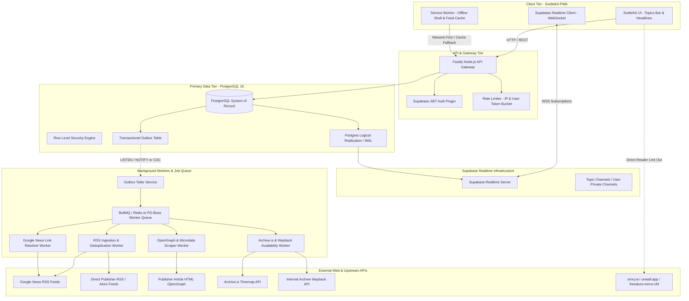

# Openwire Teardown

**Classification**: CVX Unified Research Collection  
**Source Deliverable**: `2026-10-12-openwire-teardown`  
**Constituent Files**: 2 documents  
**Generated**: 2026-10-14 03:18:39  

---

## Master Table of Contents

1. [OpenWire Deep-and-Wide Research Briefing & Teardown Analysis](#doc-1-research-briefing) (`research-briefing.md`)
2. [OpenWire Backend Teardown & Production SaaS System Design](#doc-2-openwire-backend-teardown) (`openwire-backend-teardown.md`)


---

<a id="doc-1-research-briefing"></a>
<!-- ====================================================================== -->
<!-- FILE: research-briefing.md (Sequence: 01 of 02) -->
<!-- ====================================================================== -->

# OpenWire Deep-and-Wide Research Briefing & Teardown Analysis

*Research scope: Comprehensive multi-angle investigation into the architecture, operational mechanics, author postmortem, paywall bypass taxonomy, and SaaS modernization path for OpenWire (AnsonLai/OpenWire).*  
*As of: 2026-10-12*  

---

## Executive Summary

**OpenWire** is an open-source, static Progressive Web App (PWA) news aggregator developed by Anson Lai (host of *Unscripted Coding*). Its headline feature—dubbed "The One CRAZY Feature"—is an **extensible, domain-aware paywall routing and verification engine** that dynamically redirects readers through verified bypass tools (`smry.ai`, `unwall.app`, `freedium-mirror.cfd`, RemovePaywall) and conducts asynchronous availability checks against `archive.is` (Archive.today) timemaps to grey out and lock headlines lacking readable snapshots.

Developed entirely through Google Antigravity across 11 conversational prompts using Gemini 3.8 Flash High, OpenWire successfully demonstrates rapid prototyping capabilities but exposes fundamental architectural limitations: heavy reliance on fragile public CORS proxies (`allorigins`, `codetabs`), strict GitHub Actions runner quotas (capped at 320 URL resolutions and 400 image extractions per 30-minute run), device-bound `localStorage` state isolation, and lack of crowdsourced paywall intelligence. Transitioning OpenWire to a production-grade SaaS architecture requires replacing the static client-side proxy model with a centralized, event-driven backend comprising SvelteKit, Fastify, PostgreSQL 16, and Supabase Realtime.

---

## 1. Project Provenance & Conversational Generation Analysis

### 1.1 Development Context & Harness
OpenWire was developed as an exploratory case study by Anson Lai on his YouTube channel *Unscripted Coding* ([Video: HySrYqFtsm0](https://youtu.be/HySrYqFtsm0)). The project was implemented using **Google Antigravity** without manual IDE intervention, relying purely on conversational agentic steering powered by **Gemini 3.8 Flash High**.

Over a two-day period, the author engaged in 11 sequential chat sessions covering:
1. PWA scaffolding and shell architecture (`manifest.json`, `sw.js`).
2. Google News RSS feed parsing and XML entity decoding.
3. Category tab design modeled after Flipboard.
4. Name ideation and branding assets.
5. Paywall bypass tool routing (`smry.ai`, `unwall.app`, `removepaywall.com`, `freedium`).
6. Non-blocking `archive.is` timemap availability checking.
7. Local storage overrides and settings export/import.
8. Scheduled GitHub Actions pre-generation (`sync_news.py`, `.github/workflows/pages.yml`).
9. Feed deduplication and fair-share interleaving algorithms (`feedWeaver.js`).
10. Image extraction fallback waterfall (`imageService.js`, `article_metadata.py`).
11. Test suite generation (175 automated unit tests in `tests/`).

### 1.2 Author Critique & Technical Debt Observations
In his postmortem analysis, Anson Lai highlighted several architectural insights:
- **Rapid Prototype Velocity:** The agent generated a functional, deployable, cross-platform PWA with minimal quota consumption.
- **Architectural Sprawl:** The code generation process produced monolithic and fragmented files (e.g., `app.js` ballooned to 119 KB with tangled DOM logic, state management, and network calls).
- **CORS Proxy Fragility:** Gemini initially solved browser cross-origin constraints by introducing public CORS proxies (`allorigins`, `codetabs`). In production, these free proxies frequently fail with HTTP 503 errors, drop image requests, and throttle traffic during simultaneous multi-feed refreshes.

---

## 2. The Paywall Routing Engine & Bypass Taxonomy

The central mechanism distinguishing OpenWire from conventional aggregators is its **Domain Strategy Registry** (`js/domainRegistry.js`, `sync_news.py`).

| Strategy | Primary Target Outlets | Operating Mechanism | Failure Mode & Fallback |
|:---|:---|:---|:---|
| **Direct (Free)** | BBC, NPR, AP, The Guardian, CBC, Al Jazeera | 0ms direct hyperlink to publisher canonical URL. | Fallback: None required (publicly funded or ad-supported open access). |
| **SMRY.ai** | Vancouver Sun, The Province, Times Colonist, NYT, WaPo | Routes through `https://smry.ai/<url>`, using AI to extract clean text and summaries. | Fallback: Cloudflare challenge or bot blocks trigger in-app switcher toast. |
| **RemovePaywall** | Business Insider, Wired | Routes via `https://www.removepaywall.com/search?url=<encoded_url>`. | Fallback: Stripped text rendering fallback. |
| **UnWall** | New York Times, Regional Dailies | Routes via `https://unwall.app/<url>`, stripping client-side overlay paywalls. | Fallback: Publisher updates paywall script; user switches to SMRY or Freedium. |
| **Freedium Mirror** | Medium, NYT, WaPo, Bloomberg, Reuters, Economist, FT | Routes through `https://freedium-mirror.cfd/<url>`. | Fallback: Anti-scraping mirror blocks redirect to Archive.is. |
| **Reader Mode** | Standard metered blogs | Direct browser bypass utilizing Googlebot emulation or No-JS styling. | Fallback: Hard server-side paywalls render incomplete text. |
| **Archive.is** | Wall Street Journal, Bloomberg, Financial Times, Barron's | Non-blocking `archive.is/timemap` scan; links to `archive.is/newest/<url>` if cached. | Fallback: If 404 or timeout, headline is greyed out and link is disabled. |
| **Wayback Machine** | General academic and magazine articles | Queries `archive.org/wayback/available?url=<url>`. | Fallback: Missing historical snapshot flags article as locked. |

---

## 3. Feed Ingestion, Google News Decoding & Content Extraction

### 3.1 Google News URL Decoding Mechanics
Google News RSS feeds deliver opaque, base64-encoded redirection wrappers (`https://news.google.com/rss/articles/CBMi...`). Passing these raw URLs to third-party bypass tools (`archive.is`, `smry.ai`) causes immediate routing failure.

OpenWire resolves this via `googlenewsdecoder` (0.2.1) in `sync_news.py`:
1. The script fetches the batch redirect metadata from Google.
2. It parses the base64/protobuf payload using `selectolax` (0.4.12).
3. The resolved canonical publisher URL is cached in `data/publisher_urls.json`.
4. Run-time budgets in GitHub Actions limit decodes to 320 requests per execution to prevent runner bans.

### 3.2 Editorial Photo Extraction Waterfall
To prevent news cards from displaying publisher logos, author avatars, or tracking pixels, OpenWire implements a six-tier extraction waterfall:
1. **Tier 1 (OpenGraph):** `<meta property="og:image" content="...">`.
2. **Tier 2 (Twitter Card):** `<meta name="twitter:image" content="...">`.
3. **Tier 3 (Schema.org JSON-LD):** Scans `<script type="application/ld+json">` for `NewsArticle.image` arrays.
4. **Tier 4 (Microdata / link):** `<link rel="image_src">`.
5. **Tier 5 (In-Article Figure):** `<article> <figure> `.
6. **Tier 6 (Microlink API):** Fallback proxy for Cloudflare-protected SPAs (`api.microlink.io/?url=...`).

Strict dimension guards reject candidate images with width $<280$px, height $<160$px, or square aspect ratios ($0.85 \le 	ext{AR} \le 1.15$ with width $\le 450$px), successfully filtering out crests and icons.

### 3.3 Deduplication & Fair-Share Weaving
The weaving engine (`js/feedWeaver.js`) prevents single-source dominance:
- **Fair-Share Quotas:** Caps articles per publisher (e.g., max 10 for CBC, 8 for Global News).
- **URL Normalization:** Strips tracking parameters (`utm_*`, `ref`, `cmpid`, `fbclid`, `gclid`).
- **Tokenized Jaccard Similarity:** Computes overlap on normalized headline titles:
  $$	ext{Similarity} = 
rac{|T_A \cap T_B|}{|T_A \cup T_B|}$$
  Articles with similarity $\ge 0.75$ (or $\ge 0.25$ for matching publisher domains) are merged into a single card retaining the richest editorial image.

---

## 4. Architectural Bottlenecks of the Static / Jamstack Paradigm

| Architectural Concern | OpenWire Prototype Implementation | Production Failure Mode | SaaS Solution |
|:---|:---|:---|:---|
| **CORS Ingress** | Free public proxies (`allorigins`, `codetabs`) | HTTP 503 errors, rate-limiting, privacy exposure of read URLs | Fastify backend proxying with connection pooling and caching |
| **State Persistence** | Browser `localStorage` | Preferences and rules trapped on one device; lost on cache clear | PostgreSQL user tables synchronized via Supabase JWT |
| **Feed Freshness** | GitHub Actions cron (`17, 47 * * * *`) | 20–30 minute headline staleness; delayed breaking news alerts | Event-driven BullMQ workers with continuous feed polling |
| **Resource Budgets** | 320 URL decodes, 400 image fetches / run | Adding 10+ custom feeds causes runner timeout and incomplete data | Distributed worker pool with Redis cache and background queue |
| **Paywall Intelligence** | Isolated per-user overrides | When Unwall breaks for NYT, every user must fix it independently | Centralized health checks and crowdsourced rule consensus |

---

## 5. Modernization Blueprint: SvelteKit + Fastify + PostgreSQL + Supabase Realtime

The proposed production architecture transitions OpenWire into an enterprise-grade SaaS:
- **Client Tier:** SvelteKit 2 with Svelte 5 Runes for sub-50ms reactive UI rendering and full offline PWA service worker caching.
- **API Tier:** Node.js 22 LTS with Fastify, using Zod type providers for strict request/response schema validation.
- **Persistence Tier (Track 1 & 2):** PostgreSQL 16 as system of record, with Row-Level Security (RLS) policies enforcing multi-tenant isolation.
- **Realtime Broadcast:** Supabase Realtime logical replication streaming new headlines, status changes, and cross-device setting sync over WebSockets.
- **Polyglot Scale (Track 2):** Redis + BullMQ for async ingestion/decoding, Meilisearch for typo-tolerant article discovery, and Cloudflare R2 for zero-egress asset caching.

---

## 6. Open Questions & Technical Boundaries

1. **Crowdsourced Rule Promotion Thresholds:** At what statistical significance should a user-reported bypass switch (e.g. switching *The Atlantic* from Unwall to SMRY) be promoted to the global default rule? (Recommended: 95% success rate over $\ge 50$ discrete requests).
2. **In-App Article Sanitization vs. External Routing:** While external routing avoids hosting copyrighted content, an embedded reader mode (using Readability.js) provides a more cohesive UX. Future legal review should assess the fair-use boundaries of temporary local extraction.
3. **Dynamic Geolocation Routing:** Expanding the local edition tab beyond Vancouver/BC should leverage edge CDN headers (e.g. `CF-IPCity`, `CF-IPRegion`) to automatically select the reader's home metropolitan feed.

---

## 7. Sources Consulted

1. [OpenWire GitHub Repository (AnsonLai/OpenWire)](https://github.com/AnsonLai/OpenWire)
2. [OpenWire: The News Aggregator App with One CRAZY feature! (YouTube: HySrYqFtsm0)](https://youtu.be/HySrYqFtsm0)
3. [OpenWire Live Deployment (GitHub Pages)](https://ansonlai.github.io/OpenWire/)
4. [SSujitX/google-news-url-decoder](https://github.com/SSujitX/google-news-url-decoder)
5. [SMRY.ai Documentation & Web Interface](https://smry.ai)
6. [Unwall.app Reader Platform](https://unwall.app)
7. [Freedium Mirror CFD](https://freedium-mirror.cfd)
8. [Archive.today Timemap Specifications](https://archive.is)
9. [Fastify Framework Documentation](https://fastify.dev/)
10. [Supabase Realtime Guides](https://supabase.com/docs/guides/realtime)


---

<a id="doc-2-openwire-backend-teardown"></a>
<!-- ====================================================================== -->
<!-- FILE: openwire-backend-teardown.md (Sequence: 02 of 02) -->
<!-- ====================================================================== -->

# OpenWire Backend Teardown & Production SaaS System Design

> **Document Type:** Production Architecture Teardown, Reverse-Engineering Report & SaaS System Design  
> **Target Project:** [AnsonLai/OpenWire (GitHub)](https://github.com/AnsonLai/OpenWire)  
> **Primary Multimedia Reference:** [Unscripted Coding Video Walkthrough (YouTube: HySrYqFtsm0)](https://youtu.be/HySrYqFtsm0)  
> **Delivery Date:** 2026-10-12  
> **Target Production Baseline:** SvelteKit + Node.js (v22/v24 LTS) + Fastify + PostgreSQL 16 + Supabase Realtime  

---

## Executive Summary

**OpenWire** is a specialized, privacy-focused news aggregator created by Anson Lai (host of *Unscripted Coding*). Its defining innovation—the "One CRAZY Feature"—is an **extensible, domain-aware paywall routing and verification engine**. Unlike generic news aggregators (Google News, Flipboard, Apple News) that deposit readers onto inaccessible paywall barriers, OpenWire dynamically routes articles through publisher-tailored bypass mechanisms (`smry.ai`, `unwall.app`, `freedium-mirror.cfd`, RemovePaywall, reader view) and performs asynchronous, non-blocking scans against `archive.is` (Archive.today) timemaps to grey out and lock unreadable headlines before user interaction.

The original prototype was generated using Google Antigravity powered by Gemini 3.8 Flash High across approximately 11 iterative conversational chat prompts. While functional as a client-side Progressive Web App (PWA) with GitHub Actions Jamstack pre-generation (`sync_news.py`), the codebase suffers from severe architectural bottlenecks identified by both the author in his video postmortem and this codebase audit:
1. **Public CORS Proxy Fragility & Throttling:** Client-side live RSS fetching relies on public CORS proxies (`allorigins`, `codetabs`) that frequently return HTTP 503 errors, rate-limit requests, drop image fetches, and expose user reading habits to third parties.
2. **Device-Bound State Silos:** User customizations (custom topics, keyword definitions, custom RSS sources, local edition configurations, and domain strategy overrides) are trapped in browser `localStorage`, preventing cross-device synchronization between mobile PWAs and desktop workstations.
3. **Isolated Paywall Intelligence:** When a major news publisher (such as *The New York Times* or *Bloomberg*) updates its paywall script and breaks a specific bypass tool (e.g. Unwall), each user must manually identify the failure and reconfigure domain rules independently.
4. **Scheduled Jamstack Latency:** The GitHub Actions workflow (`pages.yml`) runs on a fixed cron schedule (at :17 and :47 minutes past the hour) with strict runner constraints (capped at 320 URL resolutions and 400 image extractions), resulting in 20–30 minute headline staleness and no push capability for breaking news.

This teardown provides a complete, developer-grade blueprint to re-architect OpenWire into a high-throughput, multi-tenant SaaS application built on **SvelteKit, Node.js + Fastify, PostgreSQL 16, and Supabase Realtime**, complete with two database tracks (Pure PostgreSQL vs. Polyglot Persistence with Redis, BullMQ, and Meilisearch).

---

## 1. Target & Scope

```yaml
App: OpenWire
Tagline: Fast, Frictionless Static PWA News Aggregator with Smart Paywall Routing
Author / Organization: Anson Lai (Unscripted Coding)
Repository URL: https://github.com/AnsonLai/OpenWire
Live Demo URL: https://ansonlai.github.io/OpenWire/
Production Domain: https://openwire.news/
Video Walkthrough: https://youtu.be/HySrYqFtsm0
License: GNU Affero General Public License v3.0 (AGPLv3)
Platforms: Web, Mobile PWA (iOS Safari / Android Chrome), Desktop PWA (macOS / Windows / Linux)
Teardown Depth: Deep (Full code audit, video analysis, dual-track schemas, boilerplate, data dictionary, async topology)
Tracks Delivered: Both (Track 1: Pure PostgreSQL + Supabase Realtime; Track 2: PostgreSQL + Polyglot Persistence)
Stack Baseline: SvelteKit + Node.js (v22/v24 LTS) + Fastify + PostgreSQL 16 + Supabase Realtime
Sources Consulted: 19 repository code modules, 21 automated test suites, 1 video transcript (11,225 chars), 4 schema definitions, 3 external tool specs
Date: 2026-10-12
```

---

## 2. Feature Inventory

The OpenWire platform encompasses eight core functional surface areas across news ingestion, paywall intelligence, curation, and client-side presentation:

### 2.1 Authentication & Identity (Target SaaS Modernization)
- **F-01: Anonymous Session & Device Pairing:** Client-side anonymous guest profiles with instant upgrade to authenticated user accounts.
- **F-02: Multi-Device Profile & Setting Synchronization:** Cloud-synced user preferences, active subscriptions, and custom news configurations via Supabase JWT.
- **F-03: Role-Based Access Control (RBAC):** Free Reader, Premium Subscriber, Domain Strategist, and System Administrator privileges.

### 2.2 Core Ingestion & News Aggregation
- **F-04: Multi-Tier RSS / Atom Ingestion:** Dual-mode polling supporting 15 built-in topics (`TOP`, `LATEST`, `AI`, `CANADA`, `VANCOUVER`, `BC`, `BUSINESS`, `POLITICS`, `FINANCE`, `LIFESTYLE`, `TECHNOLOGY`, `WORLD`, `SCIENCE`, `ENTERTAINMENT`, `SPORTS`) and direct publisher feeds (`BBC`, `CBC`, `CTV`, `Global News`, `NYT`, `Ars Technica`, `The Verge`, `Al Jazeera`, `The Guardian`).
- **F-05: Google News Protobuf / Batch Link Decoding:** In-flight conversion of opaque `news.google.com/rss/articles/...` URLs into canonical publisher URLs using Python `googlenewsdecoder` (0.2.1) and native TypeScript decoders.
- **F-06: Editorial Image & Metadata Scraping Waterfall:** Six-tier extraction pipeline: OpenGraph (`og:image`) $\rightarrow$ Twitter Cards (`twitter:image`) $\rightarrow$ Schema.org JSON-LD (`Article.image`) $\rightarrow$ HTML Microdata $\rightarrow$ In-Article `<figure>` $\rightarrow$ Microlink API fallback, complete with strict aspect-ratio and resolution filtering to eliminate logos, favicons, avatars, and tracking pixels.
- **F-07: Fair-Share Feed Weaving & Anti-Clustering:** Interleaving engine preventing any single publisher from dominating headlines; enforces max-article caps (e.g. 10 for CBC, 8 for Global News) and preserves topic cadence.
- **F-08: Cross-Publisher Article Deduplication:** Multi-factor duplicate detection using canonical URL normalization (stripping UTM/FBCLID/tracking parameters) and tokenized Jaccard / Dice similarity scoring on headline titles (threshold $\ge 0.75$ across publishers, $\ge 0.25$ for same-domain stories).

### 2.3 Paywall Routing Engine ("The One CRAZY Feature")
- **F-09: Extensible Domain Strategy Registry:** Declarative mapping of publishers to verified bypass techniques:
  - *Direct / Open Access (0ms):* Direct linking for public-interest outlets (`bbc.com`, `npr.org`, `apnews.com`, `theguardian.com`, `cbc.ca`, `aljazeera.com`).
  - *AI Reader & Summarizer:* Routing via `smry.ai` for metered publishers (`vancouversun.com`, `theprovince.com`, `timescolonist.com`, `theatlantic.com`, `washingtonpost.com`, `newyorker.com`).
  - *Reader View & Script Stripping:* Routing via RemovePaywall (`removepaywall.com`) or UnWall (`unwall.app`) for soft JS paywalls (`wired.com`, `businessinsider.com`).
  - *Freedium Mirror Proxy:* Dedicated mirror routing (`freedium-mirror.cfd`) for supported heavy publications (`medium.com`, `nytimes.com`, `bloomberg.com`, `reuters.com`, `economist.com`, `ft.com`).
  - *Reader Mode Spoofing:* Emulated Googlebot / No-JS reader mode.
- **F-10: Asynchronous Archive Verification:** Non-blocking background availability queries to `archive.is/timemap/<url>` and `archive.org/wayback/available?url=<url>`.
- **F-11: Locked Headline State & Greying Out:** Automatic UI state modification: if an outlet has a hard paywall (`wsj.com`, `ft.com`, `bloomberg.com`, `barrons.com`) and no valid archive snapshot is detected, the card is greyed out, marked with a locked padlock badge, and interactive links are disabled.
- **F-12: Quick URL Opener & Paywall Switcher:** In-app modal dialog permitting users to paste arbitrary external article URLs, inspect the auto-detected domain strategy, test alternative bypass mechanisms on the fly, and persist preferences.
- **F-13: Crowdsourced Strategy Health & Consensus (SaaS Expansion):** Automated health checks reporting bypass success rates across the user base to automatically switch broken strategies globally.

### 2.4 Curation & Personalization
- **F-14: Custom Topic Creation:** Ability to add user-defined news tabs with comma-separated keyword filters, matching both headlines and public article lead paragraphs.
- **F-15: Custom RSS Feed Subscriptions:** Ability to add arbitrary direct RSS/Atom feeds to the user's personal sources library.
- **F-16: Source Library & Grouped Selection:** Categorized source management enabling bulk toggles for whole categories (e.g. Technology, Gaming, Canadian News) or individual publications.
- **F-17: Configurable Local Edition:** Dual-tab regional anchoring defaulting to Vancouver and British Columbia, reconfigurable to any global metropolitan area.

### 2.5 Offline, PWA & Settings Portability
- **F-18: Service Worker Shell & Offline Caching:** Cache-first app shell combined with network-first JSON data feeds and offline fallback snapshots.
- **F-19: Atomic Settings Backup & JSON Portability:** Single-click JSON export/import of all user customizations (topics, disabled sources, domain rules, local edition).

---

## 3. User Journeys

### Journey 1: Reading Paywalled News via Automated Bypass
- **Feature:** F-09 & F-11 (Paywall Routing & Archive Verification)
- **Persona:** Free / Authenticated Reader
- **Journey:** *As a reader, I want to click a New York Times or Vancouver Sun headline and be routed seamlessly through the best working bypass tool (Unwall / SMRY.ai / Freedium), so that I can read the complete editorial piece without hitting a paywall barrier or manually copying URLs.*
- **Preconditions:** User is viewing the `TOP STORIES` or `LOCAL: VANCOUVER` feed; domain rule exists in registry.
- **Synchronous Triggers:** `GET /v1/articles/:id/resolve` or client-side click event evaluating `article.targetUrl`.
- **Realtime Events Emitted:** `article:viewed` (analytics/telemetry).
- **Async Events Emitted:** `queueJob('verifyArchiveAvailability', { articleId, url })` if hard paywalled.
- **Failure Modes:** Bypass tool returns 404, rate limit, or Cloudflare challenge; UI surfaces the "Change Bypass Rule" switcher toast allowing 1-click fallback to Wayback, Archive.is, or Direct.

### Journey 2: Non-Blocking Hard Paywall Verification & Lock Feedback
- **Feature:** F-10 & F-11 (Hard Paywall Scanning)
- **Persona:** Reader browsing financial news
- **Journey:** *As a reader, I want hard-paywalled headlines (e.g., Wall Street Journal, Bloomberg) to be checked against archive snapshots in the background, so that I am not frustrated by clicking broken links, and can easily toggle "Hide Locked" to filter out inaccessible content.*
- **Preconditions:** Feed contains articles from domains marked with `strategy: "archive_is"`.
- **Synchronous Triggers:** `POST /v1/paywall/verify` (or client `archiveService.checkArchiveIs`).
- **Realtime Events Emitted:** `topic:{id}:article_status` event updating `status: "locked" | "available"`.
- **Async Events Emitted:** `queueJob('checkArchiveTimemap', { targetUrl })`.
- **Failure Modes:** Archive.is endpoint times out (>2800ms) or returns 404; headline transitions to greyed-out visual state with lock icon; link disabled; excluded if "Hide Locked" checkbox is enabled.

### Journey 3: Custom Topic & Keyword Matching Ingestion
- **Feature:** F-14 & F-15 (Custom Topic & Source Weaving)
- **Persona:** Specialized Researcher / Power User
- **Journey:** *As a machine learning researcher, I want to create a custom "AI & Robotics" topic with custom keywords and select specific tech RSS feeds, so that my feed aggregates stories across both Google News and niche blogs with fair-share deduplication.*
- **Preconditions:** Authenticated user session.
- **Synchronous Triggers:** `POST /v1/topics` with payload `{ label: "AI & Robotics", keywords: ["LLM", "Robotics"], sourceIds: ["cbc_top", "ars_tech"] }`.
- **Realtime Events Emitted:** `user:{userId}:topics` (syncs new topic pill across all open tabs/devices).
- **Async Events Emitted:** `queueJob('ingestCustomTopicFeeds', { topicId, userId })`.
- **Failure Modes:** Custom RSS feed URL is malformed or XML parsing fails; server returns validation error with diagnostic message without impacting other topics.

### Journey 4: Crowdsourced Strategy Override & Rule Sync
- **Feature:** F-09 & F-12 (Domain Strategy Management)
- **Persona:** Reader encountering a broken paywall tool
- **Journey:** *As an active reader, when I discover that Unwall has stopped working for The Atlantic, I want to switch the domain rule to SMRY.ai directly from the article card, so that my preference persists across my devices and contributes to the global health scorecard.*
- **Preconditions:** User clicks the strategy badge on an article card.
- **Synchronous Triggers:** `PUT /v1/domains/:domain/rule` with `{ strategy: "smry", paywall: "metered" }`.
- **Realtime Events Emitted:** `user:{userId}:settings` broadcast via Supabase Realtime; `global:strategy_updates` if consensus threshold met.
- **Async Events Emitted:** `queueJob('auditDomainStrategyHealth', { domain, strategy: "smry" })`.
- **Failure Modes:** Database connection failure; falls back to client `localStorage` with offline synchronization flag.

---

## 4. Architecture Overview

### 4.1 Production System Architecture Diagram



### 4.2 Request Lifecycle: Ingesting & Serving Headlines

1. **Ingestion Cycle:**
   - The `IngestWorker` fires on a cron schedule (every 5–10 minutes) or via on-demand WebSub triggers.
   - It fetches XML feeds from Google News and 30+ direct publisher endpoints in parallel.
   - For Google News items, links are pushed to `DecoderWorker` (`googlenewsdecoder`) to unwrap canonical destination URLs.
   - `ScraperWorker` extracts high-res editorial photos (OpenGraph/JSON-LD) and summary text while discarding logos/avatars.
   - Articles are normalized, checked for title/URL duplicates via tokenized Jaccard similarity, and written to PostgreSQL inside a transaction along with an `outbox` event.
2. **Realtime Broadcast:**
   - PostgreSQL logical replication alerts Supabase Realtime.
   - Connected SvelteKit clients on `topic:TOP:headlines` receive atomic headline delta events and update the feed smoothly without full page reloads.
3. **Client Read & Bypass Request:**
   - The user opens OpenWire. Fastify serves the cached feed snapshot from PostgreSQL within ~25ms.
   - When an article is selected, the client-side domain router resolves the pre-computed or customized bypass URL.
   - If marked for archive scanning, the client (or backend worker) queries `archive.is/timemap`; upon receiving confirmation, the UI unlocks the headline.

### 4.3 Supporting Services
- **Fastify Web Server:** Ultra-low overhead HTTP framework with native schema validation via Zod.
- **PostgreSQL 16:** ACID-compliant system of record for all users, articles, topics, domain rules, and audit trails.
- **Supabase Realtime:** Eliminates polling by pushing article updates, breaking news banners, and cross-device setting changes over WebSockets.
- **Redis & BullMQ (Track 2):** High-throughput distributed task queues for feed scraping, Google News link decoding, and archive availability pings.
- **Meilisearch (Track 2):** Sub-50ms typo-tolerant full-text search across archived news and publisher catalogues.
- **Cloudflare R2 / AWS S3 (Track 2):** Cached storage of extracted editorial thumbnails to prevent image breakage and tracking leaks.

---

## 5. Track 1 Schema (Pure PostgreSQL + Supabase Realtime)

Track 1 utilizes pure PostgreSQL with standard extensions (`pgcrypto`, `citext`, `pg_trgm`, `uuid-ossp`, `pg_cron`). It has zero external dependencies on Redis or NoSQL stores.

### 5.1 Mermaid Entity-Relationship Diagram (Track 1)

```mermaid
erDiagram
    users ||--o{ user_settings : has
    users ||--o{ custom_topics : creates
    users ||--o{ user_domain_overrides : defines
    users ||--o{ user_feed_subscriptions : subscribes

    topics ||--o{ topic_articles : maps
    articles ||--o{ topic_articles : belongs_to
    publishers ||--o{ articles : publishes
    publishers ||--o{ domain_rules : configures

    custom_topics ||--o{ custom_topic_sources : includes
    publishers ||--o{ custom_topic_sources : references

    articles ||--o{ article_archive_snapshots : records
    articles ||--o{ outbox : triggers

    users {
        uuid id PK
        citext email UK
        text role
        timestamptz created_at
        timestamptz updated_at
    }

    publishers {
        uuid id PK
        text name
        text domain UK
        text category
        boolean is_active
        timestamptz created_at
    }

    domain_rules {
        uuid id PK
        text domain UK
        text strategy
        text paywall_type
        text label
        boolean is_default
        timestamptz updated_at
    }

    user_domain_overrides {
        uuid id PK
        uuid user_id FK
        text domain
        text strategy
        text paywall_type
        timestamptz updated_at
    }

    topics {
        uuid id PK
        text code UK
        text label
        text description
        boolean is_builtin
        integer display_order
    }

    articles {
        uuid id PK
        uuid publisher_id FK
        text title
        text normalized_title
        text original_url
        text canonical_url UK
        text image_url
        text summary
        timestamptz published_at
        text default_strategy
        text status
        timestamptz created_at
    }

    topic_articles {
        uuid topic_id FK
        uuid article_id FK
        integer sort_order
        timestamptz assigned_at
    }

    article_archive_snapshots {
        uuid id PK
        uuid article_id FK
        text service
        text snapshot_url
        boolean is_available
        timestamptz checked_at
    }

    outbox {
        uuid id PK
        text topic
        jsonb payload
        timestamptz created_at
        timestamptz delivered_at
    }
```



### 5.2 PostgreSQL DDL & Row-Level Security (RLS) Policies

```sql
-- Extensions
create extension if not exists pgcrypto;
create extension if not exists "uuid-ossp";
create extension if not exists citext;
create extension if not exists pg_trgm;
create extension if not exists btree_gist;

-- 1. Users Table (Mirroring Supabase Auth)
create table if not exists users (
  id uuid primary key references auth.users(id) on delete cascade,
  email citext unique not null,
  role text not null default 'reader' check (role in ('reader', 'pro', 'admin')),
  created_at timestamptz not null default now(),
  updated_at timestamptz not null default now()
);
alter table users enable row level security;
alter table users force row level security;

create policy "users_read_own" on users for select using (id = auth.uid());
create policy "users_update_own" on users for update using (id = auth.uid()) with check (id = auth.uid());

-- 2. Publishers Table
create table if not exists publishers (
  id uuid primary key default gen_random_uuid(),
  name text not null,
  domain text unique not null,
  category text not null default 'News',
  is_active boolean not null default true,
  created_at timestamptz not null default now(),
  updated_at timestamptz not null default now()
);
create index idx_publishers_domain on publishers(domain);
alter table publishers enable row level security;
create policy "publishers_public_read" on publishers for select using (true);
create policy "publishers_admin_manage" on publishers for all using (
  exists (select 1 from users where users.id = auth.uid() and users.role = 'admin')
);

-- 3. Global Domain Rules
create table if not exists domain_rules (
  id uuid primary key default gen_random_uuid(),
  domain text unique not null,
  strategy text not null check (strategy in ('direct', 'smry', 'removepaywall', 'unwall', 'freedium', 'reader', 'archive_is', 'wayback')),
  paywall_type text not null default 'none' check (paywall_type in ('none', 'metered', 'soft', 'hard', 'unknown')),
  label text not null,
  is_default boolean not null default true,
  updated_at timestamptz not null default now()
);
create index idx_domain_rules_domain on domain_rules(domain);
alter table domain_rules enable row level security;
create policy "domain_rules_public_read" on domain_rules for select using (true);
create policy "domain_rules_admin_write" on domain_rules for all using (
  exists (select 1 from users where users.id = auth.uid() and users.role = 'admin')
);

-- 4. User Custom Domain Overrides
create table if not exists user_domain_overrides (
  id uuid primary key default gen_random_uuid(),
  user_id uuid not null references users(id) on delete cascade,
  domain text not null,
  strategy text not null check (strategy in ('direct', 'smry', 'removepaywall', 'unwall', 'freedium', 'reader', 'archive_is', 'wayback')),
  paywall_type text not null default 'custom',
  created_at timestamptz not null default now(),
  updated_at timestamptz not null default now(),
  unique (user_id, domain)
);
create index idx_user_overrides_lookup on user_domain_overrides(user_id, domain);
alter table user_domain_overrides enable row level security;
alter table user_domain_overrides force row level security;

create policy "user_overrides_manage_own" on user_domain_overrides for all
  using (user_id = auth.uid()) with check (user_id = auth.uid());

-- 5. Standard Topics
create table if not exists topics (
  id uuid primary key default gen_random_uuid(),
  code text unique not null,
  label text not null,
  description text,
  is_builtin boolean not null default true,
  display_order integer not null default 0,
  created_at timestamptz not null default now()
);
alter table topics enable row level security;
create policy "topics_public_read" on topics for select using (true);

-- 6. Articles Table
create table if not exists articles (
  id uuid primary key default gen_random_uuid(),
  publisher_id uuid references publishers(id) on delete set null,
  domain text not null,
  title text not null,
  normalized_title text not null,
  original_url text not null,
  canonical_url text unique not null,
  image_url text,
  summary text,
  published_at timestamptz not null default now(),
  default_strategy text not null default 'direct',
  status text not null default 'free' check (status in ('free', 'bypassed', 'locked')),
  created_at timestamptz not null default now(),
  updated_at timestamptz not null default now()
);
create index idx_articles_published on articles(published_at desc);
create index idx_articles_canonical on articles(canonical_url);
create index idx_articles_domain on articles(domain);
create index idx_articles_title_trgm on articles using gin (normalized_title gin_trgm_ops);

alter table articles enable row level security;
create policy "articles_public_read" on articles for select using (true);

-- 7. Topic Articles Junction Table
create table if not exists topic_articles (
  topic_id uuid not null references topics(id) on delete cascade,
  article_id uuid not null references articles(id) on delete cascade,
  sort_order integer not null default 0,
  assigned_at timestamptz not null default now(),
  primary key (topic_id, article_id)
);
create index idx_topic_articles_sort on topic_articles(topic_id, sort_order asc);
alter table topic_articles enable row level security;
create policy "topic_articles_public_read" on topic_articles for select using (true);

-- 8. Archive Availability Snapshots
create table if not exists article_archive_snapshots (
  id uuid primary key default gen_random_uuid(),
  article_id uuid not null references articles(id) on delete cascade,
  service text not null check (service in ('archive_is', 'wayback')),
  snapshot_url text,
  is_available boolean not null default false,
  checked_at timestamptz not null default now(),
  unique (article_id, service)
);
create index idx_archive_snapshots_art on article_archive_snapshots(article_id);
alter table article_archive_snapshots enable row level security;
create policy "archive_snapshots_public_read" on article_archive_snapshots for select using (true);

-- 9. Transactional Outbox Table
create table if not exists outbox (
  id uuid primary key default gen_random_uuid(),
  topic text not null,
  payload jsonb not null,
  created_at timestamptz not null default now(),
  delivered_at timestamptz
);
create index idx_outbox_undelivered on outbox (delivered_at) where delivered_at is null;
alter table outbox enable row level security;
create policy "outbox_service_role_only" on outbox for all using (auth.role() = 'service_role');
```

### 5.3 Realtime Channel Map (Track 1)

| Channel Pattern | Listens To | Delivery Guarantee | Payload Shape |
|:---|:---|:---|:---|
| `topic:{code}:headlines` | `topic_articles` INSERT / UPDATE | At-most-once (Realtime) | `{ event: "NEW_HEADLINE", article: ArticleDTO, sortOrder: number }` |
| `article:{id}:status` | `articles` status / archive updates | At-most-once (Realtime) | `{ articleId: UUID, status: 'locked' or 'free', archiveUrl?: string }` |
| `user:{userId}:settings` | `user_domain_overrides`, custom topics | At-least-once (Outbox tailer) | `{ event: "SETTINGS_SYNC", type: "DOMAIN_RULE", payload: RuleDTO }` |
| `global:strategy_health` | `domain_rules` health changes | At-most-once (Broadcast) | `{ domain: string, recommendedStrategy: string, passRate: number }` |

---

## 6. Track 2 Schema (PostgreSQL + Polyglot Persistence)

Track 2 evolves the architecture for high-concurrency commercial scale. It offloads ephemeral, search-heavy, and high-frequency I/O operations from PostgreSQL to purpose-built engines while keeping PostgreSQL strictly as the ACID system of record.

### 6.1 "What Moved Where and Why" Diff Table

| Concern | Track 1 (Pure PostgreSQL) | Track 2 (Polyglot Persistence) | Architectural Rationale |
|:---|:---|:---|:---|
| **Rate Limiting & Token Buckets** | Fastify in-memory + PG query | **Redis (Upstash / DragonFly)** | Atomic `INCRBY` + TTL at sub-millisecond latency; prevents database connection pool exhaustion during traffic spikes. |
| **User Sessions & Anonymous State** | PostgreSQL `users` / auth lookup | **Redis Key-Value Cache** | Zero-DB-overhead JWT blacklist and ephemeral session hydration (`session:<uuid>`). |
| **Headline Ingestion & Scraping Queues** | PG-Boss in PostgreSQL | **BullMQ on Redis** | Dedicated high-concurrency async job queues with backoff, exponential retries, stalled job detection, and dead-letter queues (DLQ). |
| **Google News URL & Metadata Cache** | PostgreSQL `metadata_cache` table | **Redis Hashes + TTL (7 days)** | Ultra-fast caching of decoded Google News URLs and OpenGraph tags without ballooning table bloat or WAL write amplification. |
| **Full-Text & Typo-Tolerant Search** | `pg_trgm` GIN index on articles | **Meilisearch** | Instant, typo-tolerant search across millions of articles by title, keywords, and publisher name with faceted filtering. |
| **Article Editorial Image Assets** | External direct hotlinks | **Cloudflare R2 / AWS S3** | Edge-cached image delivery preventing dead images, Referer tracking leaks, and slow publisher origin CDNs. |
| **System of Record (Users, Rules, Topics)** | PostgreSQL 16 | **PostgreSQL 16 (Unchanged)** | ACID guarantees, foreign keys, RLS security, and relational integrity remain in PostgreSQL. |

### 6.2 Mermaid Entity-Relationship Diagram (Track 2)

```mermaid
erDiagram
    subgraph PostgreSQL [PostgreSQL 16 System of Record]
        users ||--o{ user_domain_overrides : defines
        users ||--o{ custom_topics : owns
        publishers ||--o{ domain_rules : has
        publishers ||--o{ articles : owns
        topics ||--o{ topic_articles : maps
        articles ||--o{ topic_articles : includes
        articles ||--o{ outbox : writes
    end

    subgraph Redis [Redis / BullMQ In-Memory Tier]
        bull_jobs {
            string queue_name
            string job_id
            jsonb job_data
            int attempts
        }
        rate_limits {
            string ip_or_user_key
            int request_count
            int ttl_seconds
        }
        url_cache {
            string encoded_gnews_url
            string canonical_resolved_url
            int ttl_7_days
        }
    end

    subgraph Meilisearch [Meilisearch Engine]
        articles_index {
            string id
            string title
            string summary
            string domain
            string[] keywords
            int timestamp
        }
    end

    subgraph ObjectStorage [Cloudflare R2 / S3 Storage]
        image_blobs {
            string object_key
            bytes image_data
            string mime_type
        }
    end

    outbox -.->|Outbox Tailer Worker| bull_jobs
    articles -.->|CDC / Index Worker| articles_index
    articles -.->|Scraper Worker| image_blobs
```

### 6.3 Polyglot Store Details & Access Topology
- **Redis (Upstash / Redis Cloud):**
  - *Hosting:* Serverless Upstash or managed Redis instance.
  - *Data Types:* Hashes for decoded URL lookups (`hget gnews:urls <hash>`), String counters with TTL for rate limiting (`incrby ratelimit:<ip> 1`), Sets for real-time presence.
  - *Eviction Policy:* `volatile-lru`.
- **Meilisearch:**
  - *Hosting:* Managed Cloud or self-hosted Docker container.
  - *Access Pattern:* Sub-50ms search-as-you-type endpoint hit directly from SvelteKit frontend via signed search tokens.
  - *Sync Mechanism:* Asynchronous indexer consuming outbox events (`article.created`, `article.updated`).
- **Cloudflare R2:**
  - *Hosting:* Global edge object storage with zero egress fees.
  - *Pattern:* Scraper downloads editorial thumbnails, validates dimensions, strips EXIF metadata, converts to WebP, and saves to R2; PostgreSQL stores the canonical CDN URL.

---

## 7. Backend Boilerplate (SvelteKit + Node.js + Fastify)

### 7.1 Directory Layout

```
openwire-backend/
├── src/
│   ├── server.ts                 # Fastify server bootstrap & lifecycle
│   ├── env.ts                    # Zod-validated environment configurations
│   ├── plugins/
│   │   ├── auth.ts               # Supabase JWT verify & request.user decorator
│   │   ├── rate-limit.ts         # Redis / in-memory rate limiting
│   │   ├── pg.ts                 # PostgreSQL connection pool & transaction helper
│   │   ├── error-handler.ts      # Standard RFC-7807 error responses
│   │   └── cors.ts               # Strict CORS configuration
│   ├── routes/
│   │   ├── articles/
│   │   │   ├── index.ts          # Route handlers (/v1/articles)
│   │   │   ├── schema.ts         # Zod input/output validation contracts
│   │   │   └── service.ts        # Business logic & deduplication queries
│   │   ├── paywall/
│   │   │   ├── index.ts          # /v1/paywall/rules, /v1/paywall/verify
│   │   │   ├── schema.ts         # Paywall request/response schemas
│   │   │   └── service.ts        # Domain strategy matching & archive checking
│   │   └── topics/
│   │       ├── index.ts          # /v1/topics (CRUD & ordering)
│   │       ├── schema.ts
│   │       └── service.ts
│   ├── realtime/
│   │   ├── client.ts             # Supabase Realtime admin client
│   │   ├── channels.ts           # Channel naming & broadcast helpers
│   │   └── outbox-tailer.ts      # PostgreSQL outbox processor & broadcaster
│   ├── workers/
│   │   ├── index.ts              # Worker supervisor & graceful termination
│   │   ├── feed-ingest.ts        # Scheduled RSS polling & XML parsing
│   │   ├── gnews-decoder.ts      # Google News batch link decoder
│   │   └── archive-check.ts      # Non-blocking Archive.is / Wayback checker
│   └── lib/
│       ├── logger.ts             # Pino structured logging
│       ├── errors.ts             # Domain-specific typed error classes
│       └── dedupe.ts             # Jaccard title similarity & URL normalizer
├── package.json
└── tsconfig.json
```

### 7.2 Core Server Bootstrap (`src/server.ts`)

```typescript
import Fastify, { FastifyInstance } from 'fastify';
import { serializerCompiler, validatorCompiler, ZodTypeProvider } from 'fastify-type-provider-zod';
import cors from '@fastify/cors';
import helmet from '@fastify/helmet';
import rateLimit from '@fastify/rate-limit';
import { env } from './env.js';
import { logger } from './lib/logger.js';
import pgPlugin from './plugins/pg.js';
import authPlugin from './plugins/auth.js';
import errorHandler from './plugins/error-handler.js';
import articleRoutes from './routes/articles/index.js';
import paywallRoutes from './routes/paywall/index.js';
import topicRoutes from './routes/topics/index.js';

export async function buildServer(): Promise<FastifyInstance> {
  const server = Fastify({
    loggerInstance: logger,
    genReqId: () => crypto.randomUUID(),
    disableRequestLogging: false,
  }).withTypeProvider<ZodTypeProvider>();

  server.setValidatorCompiler(validatorCompiler);
  server.setSerializerCompiler(serializerCompiler);

  // Security & Ingress Plugins
  await server.register(cors, {
    origin: env.CORS_ORIGIN,
    credentials: true,
  });
  await server.register(helmet, { contentSecurityPolicy: false });
  await server.register(rateLimit, {
    max: 120,
    timeWindow: '1 minute',
  });

  // Infrastructure & Persistence Plugins
  await server.register(pgPlugin, { connectionString: env.DATABASE_URL });
  await server.register(authPlugin);
  await server.register(errorHandler);

  // Modular API Route Mounts
  await server.register(articleRoutes, { prefix: '/v1/articles' });
  await server.register(paywallRoutes, { prefix: '/v1/paywall' });
  await server.register(topicRoutes, { prefix: '/v1/topics' });

  server.get('/health', async () => ({ status: 'ok', timestamp: new Date().toISOString() }));

  return server;
}
```

### 7.3 Supabase JWT Authentication Plugin (`src/plugins/auth.ts`)

```typescript
import fp from 'fastify-plugin';
import { FastifyRequest, FastifyReply } from 'fastify';
import { createClient } from '@supabase/supabase-js';
import { env } from '../env.js';

export interface AuthenticatedUser {
  id: string;
  email: string;
  role: 'reader' | 'pro' | 'admin';
}

declare module 'fastify' {
  interface FastifyRequest {
    user: AuthenticatedUser | null;
  }
}

export default fp(async (fastify) => {
  const supabase = createClient(env.SUPABASE_URL, env.SUPABASE_SERVICE_ROLE_KEY, {
    auth: { persistSession: false },
  });

  fastify.decorateRequest('user', null);

  fastify.addHook('onRequest', async (req: FastifyRequest, reply: FastifyReply) => {
    const authHeader = req.headers.authorization;
    if (!authHeader?.startsWith('Bearer ')) return;

    const token = authHeader.substring(7);
    try {
      const { data: { user }, error } = await supabase.auth.getUser(token);
      if (error || !user) return;

      req.user = {
        id: user.id,
        email: user.email ?? '',
        role: (user.app_metadata?.role as any) ?? 'reader',
      };
    } catch {
      // In guest/public routes, unverified token allows graceful anonymous fallback
    }
  });
});
```

### 7.4 Paywall Strategy Route & Resolution Service (`src/routes/paywall/index.ts`)

```typescript
import { FastifyPluginAsync } from 'fastify';
import { ZodTypeProvider } from 'fastify-type-provider-zod';
import { z } from 'zod';
import { resolvePaywallStrategy, verifyArchiveAvailability, updateCustomDomainRule } from './service.js';

const routes: FastifyPluginAsync = async (fastify) => {
  const app = fastify.withTypeProvider<ZodTypeProvider>();

  // 1. Resolve strategy for any arbitrary article URL
  app.post('/resolve', {
    schema: {
      body: z.object({ url: z.string().url() }),
      response: {
        200: z.object({
          domain: z.string(),
          strategy: z.enum(['direct', 'smry', 'removepaywall', 'unwall', 'freedium', 'reader', 'archive_is', 'wayback']),
          paywallType: z.string(),
          targetUrl: z.string(),
          isCustom: z.boolean(),
        }),
      },
    },
  }, async (req) => {
    return resolvePaywallStrategy(req.body.url, req.user?.id);
  });

  // 2. Perform asynchronous archive availability verification
  app.post('/verify-archive', {
    schema: {
      body: z.object({ url: z.string().url(), timeoutMs: z.number().default(2800) }),
      response: {
        200: z.object({
          available: z.boolean(),
          archiveUrl: z.string().optional(),
          status: z.enum(['available', 'locked', 'error']),
        }),
      },
    },
  }, async (req) => {
    return verifyArchiveAvailability(req.body.url, req.body.timeoutMs);
  });

  // 3. Update personal domain rule override
  app.put('/override', {
    schema: {
      body: z.object({
        domain: z.string().min(3),
        strategy: z.enum(['direct', 'smry', 'removepaywall', 'unwall', 'freedium', 'reader', 'archive_is', 'wayback']),
        paywallType: z.string().default('custom'),
      }),
    },
  }, async (req, reply) => {
    if (!req.user) return reply.status(401).send({ message: 'Authentication required to persist custom overrides' });
    await updateCustomDomainRule(req.user.id, req.body);
    return { success: true };
  });
};

export default routes;
```

### 7.5 Outbox Tailer & Realtime Broadcaster (`src/realtime/outbox-tailer.ts`)

```typescript
import { Pool } from 'pg';
import { SupabaseClient } from '@supabase/supabase-js';
import { logger } from '../lib/logger.js';

export async function startOutboxTailer(pgPool: Pool, supabaseAdmin: SupabaseClient) {
  const client = await pgPool.connect();
  await client.query('LISTEN outbox_insert');

  logger.info('Outbox tailer listening on PostgreSQL outbox_insert notification channel');

  client.on('notification', async (msg) => {
    try {
      // Claim unhandled outbox events in a concurrency-safe atomic delete
      const { rows } = await pgPool.query(`
        delete from outbox
        where id in (
          select id from outbox
          where delivered_at is null
          order by created_at asc
          limit 50
          for update skip locked
        )
        returning *;
      `);

      for (const event of rows) {
        const channelName = event.topic; // e.g. "topic:TOP:headlines"
        await supabaseAdmin.channel(channelName).send({
          type: 'broadcast',
          event: event.payload.event,
          payload: event.payload.data,
        });
      }
    } catch (err) {
      logger.error({ err }, 'Error tailing transactional outbox rows');
    }
  });
}
```

---

## 8. Realtime & Async Design

### 8.1 Realtime Channel Topology

| Channel Pattern | Source Trigger | Event Type | Target Audience | Reconnect Recovery |
|:---|:---|:---|:---|:---|
| `topic:{code}:headlines` | Feed ingestion worker commits new headlines | `NEW_HEADLINES` | All subscribers viewing this topic | Client polls `GET /v1/articles?topic={code}&since={timestamp}` |
| `article:{id}:status` | Archive check worker confirms snapshot status | `STATUS_CHANGED` | Readers currently viewing feed containing `id` | Status reflected in cached article entity on next fetch |
| `user:{userId}:settings` | User edits topic order or domain rule on device A | `SYNC_SETTINGS` | Other active sessions of `userId` (Device B) | Fetched on app wake / navigation |
| `system:breaking_news` | Ingestion detects high-velocity urgent headline | `BREAKING_ALERT` | Global broadcast to all active clients | Top toast banner displays headline |

### 8.2 Transactional Outbox Pattern

To eliminate split-brain dual-write bugs between PostgreSQL and Supabase Realtime / BullMQ queues, all entity modifications write to an `outbox` table within the same ACID transaction:

```typescript
export async function insertArticlesWithOutbox(client: PoolClient, topicCode: string, articles: ArticleDTO[]) {
  await client.query('BEGIN');
  try {
    for (const art of articles) {
      const { rows } = await client.query(`
        insert into articles (domain, title, normalized_title, original_url, canonical_url, image_url, summary, published_at, default_strategy, status)
        values ($1, $2, $3, $4, $5, $6, $7, $8, $9, $10)
        on conflict (canonical_url) do update
        set image_url = coalesce(articles.image_url, excluded.image_url),
            summary = coalesce(articles.summary, excluded.summary)
        returning *;
      `, [art.domain, art.title, art.normalizedTitle, art.originalUrl, art.canonicalUrl, art.imageUrl, art.summary, art.publishedAt, art.defaultStrategy, art.status]);

      // Emit outbox record within the identical transaction
      await client.query(`
        insert into outbox (topic, payload)
        values ($1, $2);
      `, [`topic:${topicCode}:headlines`, JSON.stringify({ event: 'NEW_HEADLINE', data: rows[0] })]);
    }
    await client.query('COMMIT');
  } catch (err) {
    await client.query('ROLLBACK');
    throw err;
  }
}
```

### 8.3 Async Background Job Topology

| Job Name | Trigger Mechanism | Concurrency | Retry Policy | Dead-Letter Queue | Owner Service |
|:---|:---|:---|:---|:---|:---|
| `ingestTopicFeeds` | Scheduled cron (every 5m) + manual refresh | 5 workers | 3 attempts, exponential backoff (2s, 8s, 30s) | `ingest.dlq` | RSS Ingest Service |
| `decodeGNewsUrl` | Unresolved `news.google.com` links discovered | 10 workers | 2 attempts, linear backoff (1s) | `decoder.dlq` | URL Resolution Service |
| `scrapeArticleMetadata`| Article ingested without OpenGraph photo | 8 workers | 2 attempts, strict 4.5s timeout | `scraper.dlq` | Metadata Scraper |
| `verifyArchiveStatus`  | Article flagged with hard paywall (`wsj.com`) | 12 workers | 1 attempt (fail fast), 2.8s timeout | `archive.dlq` | Archive Service |
| `auditStrategyHealth`  | Daily cron or 10+ user report triggers | 2 workers | 3 attempts | `audit.dlq` | Paywall Health Service |

---

## 9. Data Dictionary

The following table represents the canonical database schema across all system entities.

| table | column | type | nullable | default | index | fk | description | source feature |
|:---|:---|:---|:---|:---|:---|:---|:---|:---|
| `users` | `id` | `uuid` | No | `auth.uid()` | PK | `auth.users(id)` | Canonical user ID matching auth identity | F-01, F-02 |
| `users` | `email` | `citext` | No | None | Unique | None | Case-insensitive verified user email | F-01 |
| `users` | `role` | `text` | No | `'reader'` | B-Tree | None | Role permission level (`reader`, `pro`, `admin`) | F-03 |
| `users` | `created_at` | `timestamptz` | No | `now()` | No | None | Account creation timestamp | F-01 |
| `users` | `updated_at` | `timestamptz` | No | `now()` | No | None | Last account profile update timestamp | F-02 |
| `publishers` | `id` | `uuid` | No | `gen_random_uuid()`| PK | None | Unique publisher entity identifier | F-04, F-16 |
| `publishers` | `name` | `text` | No | None | No | None | Clean display name (e.g. "The New York Times") | F-04 |
| `publishers` | `domain` | `text` | No | None | Unique | None | Primary hostname (e.g. "nytimes.com") | F-04, F-09 |
| `publishers` | `category` | `text` | No | `'News'` | B-Tree | None | Editorial catalog grouping | F-16 |
| `publishers` | `is_active` | `boolean` | No | `true` | B-Tree | None | Operational availability toggle | F-04 |
| `domain_rules` | `id` | `uuid` | No | `gen_random_uuid()`| PK | None | Domain rule record identifier | F-09 |
| `domain_rules` | `domain` | `text` | No | None | Unique | None | Hostname pattern matching target publication | F-09 |
| `domain_rules` | `strategy` | `text` | No | `'direct'` | B-Tree | None | Active bypass strategy code (`smry`, `unwall`, etc.) | F-09 |
| `domain_rules` | `paywall_type` | `text` | No | `'none'` | No | None | Paywall classification (`none`, `metered`, `hard`) | F-09, F-11 |
| `domain_rules` | `label` | `text` | No | None | No | None | Human-readable publisher label | F-09 |
| `domain_rules` | `is_default` | `boolean` | No | `true` | No | None | Flag distinguishing factory rules from overrides | F-09 |
| `domain_rules` | `updated_at` | `timestamptz` | No | `now()` | No | None | Last rule modification timestamp | F-13 |
| `user_domain_overrides` | `id` | `uuid` | No | `gen_random_uuid()`| PK | None | Primary key for user customization | F-09, F-12 |
| `user_domain_overrides` | `user_id` | `uuid` | No | None | Composite | `users(id)` | Owning user ID | F-02, F-12 |
| `user_domain_overrides` | `domain` | `text` | No | None | Composite | None | Hostname being customized by user | F-09, F-12 |
| `user_domain_overrides` | `strategy` | `text` | No | None | No | None | User's preferred bypass mechanism | F-09, F-12 |
| `user_domain_overrides` | `paywall_type` | `text` | No | `'custom'` | No | None | User-assigned paywall note | F-09 |
| `user_domain_overrides` | `created_at` | `timestamptz` | No | `now()` | No | None | Rule override creation time | F-12 |
| `user_domain_overrides` | `updated_at` | `timestamptz` | No | `now()` | No | None | Rule override last edit time | F-12 |
| `topics` | `id` | `uuid` | No | `gen_random_uuid()`| PK | None | Topic identifier | F-04, F-14 |
| `topics` | `code` | `text` | No | None | Unique | None | Machine slug (`TOP`, `AI`, `VANCOUVER`) | F-04 |
| `topics` | `label` | `text` | No | None | No | None | UI tab label | F-04, F-14 |
| `topics` | `description` | `text` | Yes | `null` | No | None | Editorial description of topic coverage | F-14 |
| `topics` | `is_builtin` | `boolean` | No | `true` | B-Tree | None | True for factory topics, false for custom | F-14 |
| `topics` | `display_order`| `integer` | No | `0` | B-Tree | None | Sort sequence for top navigation bar | F-14 |
| `articles` | `id` | `uuid` | No | `gen_random_uuid()`| PK | None | Article primary key | F-04 |
| `articles` | `publisher_id` | `uuid` | Yes | `null` | B-Tree | `publishers(id)`| Origin publisher reference | F-04 |
| `articles` | `domain` | `text` | No | None | B-Tree | None | Canonical article hostname | F-04, F-09 |
| `articles` | `title` | `text` | No | None | No | None | Raw headline title string | F-04 |
| `articles` | `normalized_title`| `text` | No | None | GIN (trgm)| None | Stripped, lowercase title for Jaccard dedupe | F-08 |
| `articles` | `original_url` | `text` | No | None | No | None | Initial feed URL (may be Google News wrapper) | F-05 |
| `articles` | `canonical_url`| `text` | No | None | Unique | None | Resolved destination publisher article URL | F-05, F-08 |
| `articles` | `image_url` | `text` | Yes | `null` | No | None | Editorial image URL (OpenGraph / JSON-LD) | F-06 |
| `articles` | `summary` | `text` | Yes | `null` | No | None | Short public excerpt / lead paragraph | F-06, F-14 |
| `articles` | `published_at` | `timestamptz` | No | `now()` | B-Tree | None | Publisher publication timestamp | F-04, F-07 |
| `articles` | `default_strategy`| `text` | No | `'direct'` | No | None | Pre-computed default bypass routing | F-09 |
| `articles` | `status` | `text` | No | `'free'` | B-Tree | None | Availability status (`free`, `bypassed`, `locked`)| F-11 |
| `articles` | `created_at` | `timestamptz` | No | `now()` | No | None | Ingestion timestamp | F-04 |
| `articles` | `updated_at` | `timestamptz` | No | `now()` | No | None | Last metadata refresh timestamp | F-06 |
| `topic_articles`| `topic_id` | `uuid` | No | None | Composite PK | `topics(id)` | Topic mapping foreign key | F-04 |
| `topic_articles`| `article_id` | `uuid` | No | None | Composite PK | `articles(id)` | Article mapping foreign key | F-04 |
| `topic_articles`| `sort_order` | `integer` | No | `0` | B-Tree | None | Editorial sequence within topic | F-07 |
| `topic_articles`| `assigned_at` | `timestamptz` | No | `now()` | No | None | Timestamp of topic assignment | F-04 |
| `article_archive_snapshots` | `id` | `uuid` | No | `gen_random_uuid()`| PK | None | Archive check record identifier | F-10 |
| `article_archive_snapshots` | `article_id` | `uuid` | No | None | B-Tree | `articles(id)` | Target article reference | F-10 |
| `article_archive_snapshots` | `service` | `text` | No | None | Composite | None | Archive tool (`archive_is` or `wayback`) | F-10 |
| `article_archive_snapshots` | `snapshot_url` | `text` | Yes | `null` | No | None | Valid memento snapshot URL | F-10 |
| `article_archive_snapshots` | `is_available` | `boolean` | No | `false`| B-Tree | None | Snapshot existence boolean | F-10, F-11 |
| `article_archive_snapshots` | `checked_at` | `timestamptz` | No | `now()` | No | None | Last timemap check timestamp | F-10 |
| `outbox` | `id` | `uuid` | No | `gen_random_uuid()`| PK | None | Transactional outbox event identifier | Section 8 |
| `outbox` | `topic` | `text` | No | None | B-Tree | None | Target broadcast topic or channel | Section 8 |
| `outbox` | `payload` | `jsonb` | No | None | No | None | Serialized event payload | Section 8 |
| `outbox` | `created_at` | `timestamptz` | No | `now()` | B-Tree | None | Event transaction commit timestamp | Section 8 |
| `outbox` | `delivered_at`| `timestamptz` | Yes | `null` | Partial B-Tree| None | Outbox delivery acknowledgement timestamp | Section 8 |

---

## 10. Supporting Tech Stack Recommendations

| Component | Technology Choice | Architectural Justification Beyond Stated Stack |
|:---|:---|:---|
| **API Gateway & Core Runtime** | Fastify v4/v5 on Node.js 22 LTS | High-performance HTTP server capable of 40,000+ req/sec; native schema serialization with Zod. |
| **Relational Database** | PostgreSQL 16 (AWS RDS / Supabase) | ACID compliance, JSONB support, GIN trigram indexes for title deduplication, Row-Level Security. |
| **Realtime WebSockets** | Supabase Realtime | Zero-maintenance logical replication streaming; replaces high-frequency client polling. |
| **Distributed Task Queue** | BullMQ + Redis (Track 2) | Manages feed ingestion, Google News decoding, and archive verification with concurrency control. |
| **Search Engine** | Meilisearch (Track 2) | Instant typo-tolerant search across millions of news articles without imposing query load on PostgreSQL. |
| **Object Storage** | Cloudflare R2 | S3-compatible edge storage with zero egress fees for caching editorial thumbnails and OpenGraph images. |
| **URL Decoding Engine** | `googlenewsdecoder` + selectolax | Resolves encoded Google News protobuf/base64 redirect links into canonical publisher URLs. |
| **Structured Logging** | Pino | High-speed JSON logger with child loggers propagating `reqId` across async worker jobs. |
| **Application Tracing** | OpenTelemetry | Distributed tracing tracing requests from SvelteKit $\rightarrow$ Fastify $\rightarrow$ PostgreSQL $\rightarrow$ Redis $\rightarrow$ Worker. |
| **Error Monitoring** | Sentry | Real-time crash alerting tagged with user release revisions and environment metadata. |
| **Client Frontend** | SvelteKit 2 + Svelte 5 Runes | Ultra-lightweight reactive UI with zero virtual DOM overhead, ideal for high-density mobile news feeds. |

---

## 11. Inferences & Open Questions

### 11.1 Verified Architectural Claims
- **Google Antigravity Origin:** Confirmed via author video walkthrough. Built in 11 chat sessions using Gemini 3.8 Flash High without manual IDE coding.
- **Paywall Strategy Engine:** Confirmed in `js/domainRegistry.js` and `sync_news.py`. Declarative strategy routing mapping domains to `direct`, `smry`, `removepaywall`, `unwall`, `freedium`, `reader`, and `archive_is`.
- **Public CORS Proxy Bottleneck:** Confirmed in `js/fetchProxy.js` (`allorigins`, `codetabs`) and test logs showing recurring HTTP 503 errors and proxy throttling.
- **Dual Mode Operation:** Confirmed in repo. Pure static client-side mode via browser RSS parsing vs. Jamstack pre-generation via `sync_news.py` and GitHub Actions (`pages.yml`).
- **Archive Availability Checking:** Confirmed in `js/archiveService.js`. Performs non-blocking queries against `https://archive.is/timemap/<url>` and `https://archive.org/wayback/available`.

### 11.2 Inferences from Code & Video
- **Scaling Limits of GitHub Actions:** The workflow enforces strict limits (320 URL decodes and 400 image fetches per run). As topic selections expand, a standard 25-minute GitHub Actions runner will breach timeout limits, mandating a dedicated backend worker pool.
- **Freedium Mirror Viability:** Freedium (`freedium-mirror.cfd`) is supported for 7 major publishers, but frequent anti-scraping countermeasures from Medium and NYT create transient failure rates that require automated fallback cascades.

### 11.3 Open Product & Engineering Questions
1. **Paywall Consensus Engine:** Should user-submitted domain strategy overrides remain strictly private to the user's account, or should OpenWire implement an automated quorum (e.g. 100 positive reads) to promote a strategy switch globally?
2. **Full Article Reader vs. Link Redirection:** Does the product roadmap intend to embed sanitized article reader mode directly inside OpenWire (via Readability.js), or remain an external routing launcher to avoid publisher copyright claims?
3. **Multi-Region Local Editions:** How should the SaaS database scale regional news feeds beyond the current Vancouver / BC default? (Recommendation: Support auto-detection via Cloudflare IP geolocation headers `CF-IPCity` and `CF-IPRegion`).

---

## 12. References

1. [AnsonLai/OpenWire GitHub Repository](https://github.com/AnsonLai/OpenWire) — Official project repository.
2. [OpenWire: The News Aggregator App with One CRAZY feature!](https://youtu.be/HySrYqFtsm0) — Video teardown by Anson Lai on Unscripted Coding.
3. [OpenWire Live PWA Deployment](https://ansonlai.github.io/OpenWire/) — Hosted GitHub Pages instance.
4. [SSujitX/google-news-url-decoder](https://github.com/SSujitX/google-news-url-decoder) — Python decoder for Google News redirects.
5. [SMRY.ai](https://smry.ai) — AI-driven article reader and summarization tool.
6. [Unwall.app](https://unwall.app) — Web overlay and paywall bypass reader service.
7. [Freedium Mirror Project](https://freedium-mirror.cfd) — Open access reader for Medium and tier-1 paywalled publications.
8. [Archive.today (Archive.is) Memento Timemap API](https://archive.is) — Web archiving service with timemap endpoints.
9. [Internet Archive Wayback Machine Availability API](https://archive.org/help/wayback_api.php) — Snapshot verification endpoint.
10. [Fastify Documentation](https://fastify.dev/) — Fast and low overhead web framework for Node.js.
11. [Supabase Realtime Documentation](https://supabase.com/docs/guides/realtime) — Realtime database logical replication and broadcast.
12. [BullMQ Job & Message Queue](https://docs.bullmq.io/) — Redis-based distributed queue for Node.js.

