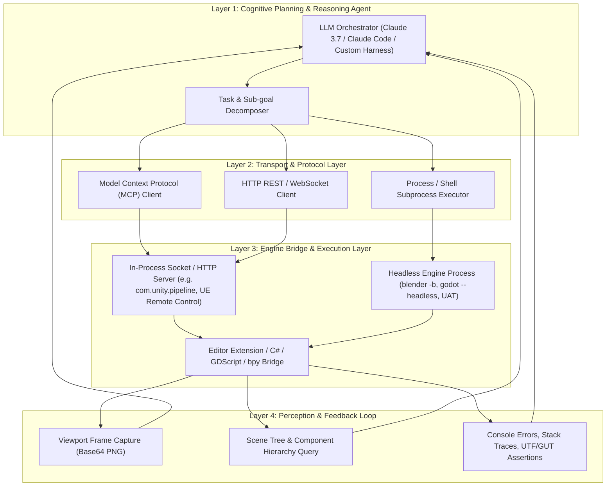
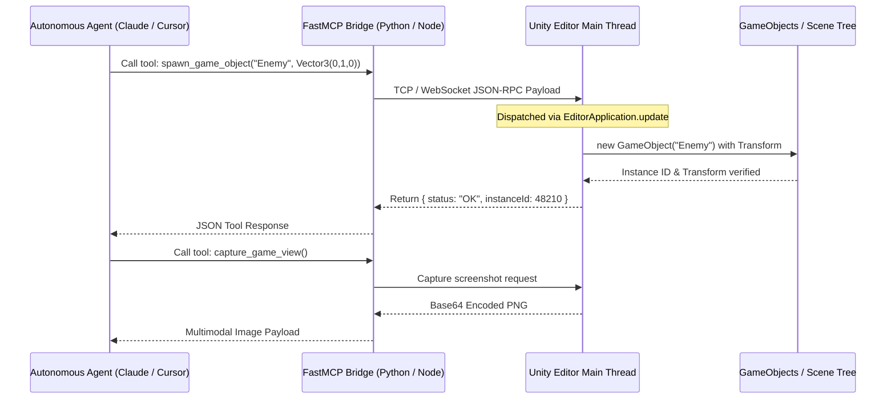
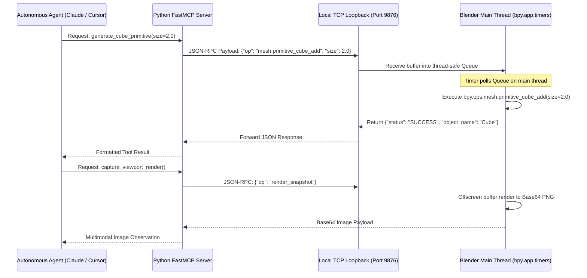
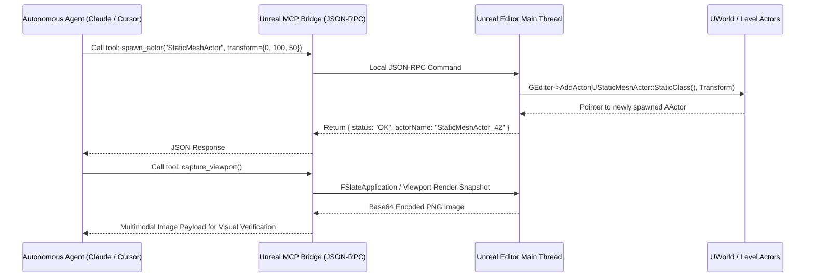
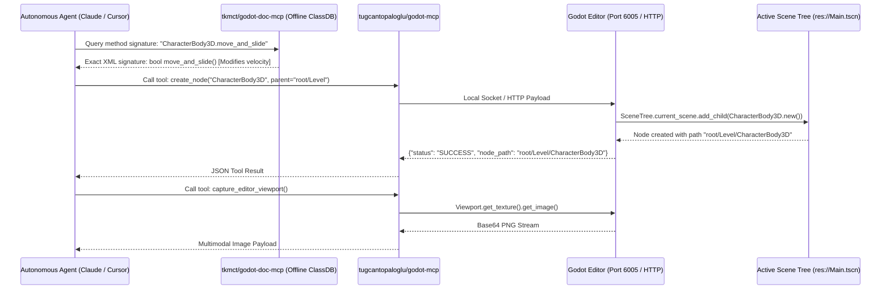

# Game Engine Ide Automation Agentic Roundup

**Classification**: CVX Unified Research Collection  
**Source Deliverable**: `2026-10-13-game-engine-ide-automation-agentic-roundup`  
**Constituent Files**: 8 documents  
**Generated**: 2026-10-14 03:18:39  

---

## Master Table of Contents

1. [Executive Summary & Industry Briefing: Game Development IDE Automation, Headless Tooling & Agentic Control (2025–2026)](#doc-1-00-executive-summary-briefing) (`00-executive-summary-briefing.md`)
2. [Unity 3D Automation, Headless Tooling & Agentic Control (2025–2026)](#doc-2-01-unity-3d-automation-agentic-control) (`01-unity-3d-automation-agentic-control.md`)
3. [Blender Headless Pipeline Orchestration & 3D Generative Automation (2025–2026)](#doc-3-02-blender-headless-pipeline-orchestration) (`02-blender-headless-pipeline-orchestration.md`)
4. [Unreal Engine 5 Automation, Web Remote Control & Agent Frameworks (2025–2026)](#doc-4-03-unreal-engine-5-automation-agent-frameworks) (`03-unreal-engine-5-automation-agent-frameworks.md`)
5. [Godot Engine Automation, Headless CLI & Agentic Control (2025–2026)](#doc-5-04-godot-engine-automation-agentic-control) (`04-godot-engine-automation-agentic-control.md`)
6. [Phaser 3/4 & Construct 3: Web Game Engine Automation, Headless Workflows & Agentic Control (2025–2026)](#doc-6-05-phaser-and-construct3-web-engine-automation) (`05-phaser-and-construct3-web-engine-automation.md`)
7. [Cross-Engine Generative 3D Asset Pipelines, Retopology & Texturing Automation (2025–2026)](#doc-7-06-cross-engine-generative-3d-asset-pipelines) (`06-cross-engine-generative-3d-asset-pipelines.md`)
8. [Master Unique Value Proposition (UVP) Taxonomy, Tool Matrix & Multi-Engine Evaluation (2025–2026)](#doc-8-07-master-uvp-taxonomy-and-comparative-matrix) (`07-master-uvp-taxonomy-and-comparative-matrix.md`)


---

<a id="doc-1-00-executive-summary-briefing"></a>
<!-- ====================================================================== -->
<!-- FILE: 00-executive-summary-briefing.md (Sequence: 01 of 08) -->
<!-- ====================================================================== -->

# Executive Summary & Industry Briefing: Game Development IDE Automation, Headless Tooling & Agentic Control (2025–2026)

*Research Scope: Comprehensive multi-engine roundup covering official ecosystem plugins, FOSS tools, and third-party standalone software designed to automate and programmatically control Unity 3D, Blender, Unreal Engine 5, Phaser 3/4, Construct 3, and Godot 4.*  
*As of: October 2026 — Recency sweep covering innovations across the past 12 months (2025–2026).*

---

## 1. Executive Summary

Over the past 12 months (late 2025 through late 2026), game development IDE automation underwent an architectural paradigm shift: **the transition from brittle, batch-mode CLI script execution to live, in-process, protocol-driven agentic control**. 

Historically, automating game IDEs required launching heavyweight GUI processes in headless batch mode (e.g., `-batchmode`, `--headless`, `UnrealEditor-Cmd.exe`), which incurred multi-minute cold-start delays, recompilation domain reloads, and rigid single-pass pipeline execution. In 2025–2026, the game development ecosystem converged on Anthropic's **Model Context Protocol (MCP)**, high-speed loopback IPC (WebSocket/JSON-RPC), and dynamic in-editor evaluation runtimes. 

Today, every major game engine—from AAA titans like Unreal Engine 5.8 and Unity 6 to lightweight open-source and web frameworks like Godot 4.4, Blender 4.2+, Phaser Editor v5, and Construct 3—features production-ready or native MCP bridges. Autonomous coding agents (such as Claude Code, Cursor, Windsurf, and custom autonomous LLM harnesses) can now maintain persistent bidirectional connections to live engine instances, inspect scene trees and ASTs, mutate materials and components, trigger sub-second code evaluations without domain reloads, capture viewport frames for visual verification, and orchestrate headless build and test suites.

Concurrently, 3D content creation pipelines have reached production maturity. Generative AI is no longer confined to producing chaotic untextured point clouds; modern foundation models (Tencent Hunyuan3D-2.1, Microsoft TRELLIS.2) and cloud APIs (Tripo3D V3, Meshy API, Rodin Gen-2.5) now output quad-dominant meshes, clean PBR material maps, automated skeleton rigging, and physics-ready colliders. When coupled with headless retopology scripts (Quad Remesher, Instant Meshes) and procedural texture compilers (Adobe Substance Automation Toolkit, MaterialX), a single autonomous agent can orchestrate full asset generation from natural-language concept to engine-ready prefab in under 90 seconds.

---

## 2. Key Industry Paradigm Shifts (2025–2026)

```
┌────────────────────────────────────────────────────────────────────────────────────────┐
│                        THE 2025-2026 PARADIGM SHIFT IN GAME DEV IDEs                  │
├─────────────────────────────────────────┬──────────────────────────────────────────────┤
│ Legacy Workflow (Pre-2025)              │ Modern Agentic Workflow (2025–2026)          │
├─────────────────────────────────────────┼──────────────────────────────────────────────┤
│ Heavy cold-start batchmode CLI runs     │ Persistent in-process loopback MCP servers   │
│ Multi-minute domain reloads per edit    │ Dynamic live evaluation (e.g. unity eval)    │
│ Manual GUI-based scene assembly         │ Programmatic AST & scene tree mutation       │
│ Untextured point-cloud generative meshes│ Clean quad-dominant PBR meshes + auto-rigs   │
│ Brittle pixel-matching UI tests         │ In-engine reflection testing (AltTester CLI) │
│ Isolated engine-specific build scripts  │ Standardized MCP & GameCI container runners  │
└─────────────────────────────────────────┴──────────────────────────────────────────────┘
```

### Shift 1: Model Context Protocol (MCP) as the Universal Engine Bus
In 2025, MCP emerged as the de facto standard connecting LLM agents to local developer environments. In 2026, this standard penetrated game engine architectures:
* **Unreal Engine 5.8** introduced the native, built-in `ModelContextProtocol` plugin, turning Unreal Editor into a first-party MCP host.
* **Unity 6** saw the rapid adoption of multi-layer MCP bridges (`CoplayDev/unity-mcp`, `AnkleBreaker-Studio/unity-mcp-plugin`) exposing over 200 granular editor tools across physics, Shader Graph, NavMesh, and UI Toolkit.
* **Godot 4.3/4.4** adopted both runtime scene controllers (`tugcantopaloglu/godot-mcp` with 157 tools, `IvanMurzak/Godot-MCP`) and offline XML documentation servers (`tkmct/godot-doc-mcp`) providing zero-latency API retrieval without hallucinations.
* **Phaser Editor v5** published the official first-party `@phaserjs/editor-mcp-server` alongside pre-configured Cursor/Claude project starter templates.
* **Construct 3** gained community-led AST-level JSON MCP servers (`liauw-media/construct3-mcp`, `construct-factory`) allowing AI models to manipulate `.c3proj` folder trees safely outside the browser GUI.
* **Blender 4.2+** saw the release of streamable HTTP and socket MCP servers (`ahujasid/mcp-for-blender`, `RFingAdam/mcp-blender`, `dcc-mcp-blender`), allowing external AI clients to execute `bpy` commands, manipulate Geometry Nodes, and query scene hierarchies.

### Shift 2: Zero-Reload Dynamic Evaluation Runtimes
Previously, modifying C# scripts in Unity or C++ code in Unreal triggered expensive compilation domain reloads, freezing editor interfaces for 15 to 90 seconds. 
* In Unity 6, the official **`com.unity.pipeline`** package and standalone **Unity CLI** introduced `unity command eval`, using the Roslyn compiler inside the running editor process to evaluate arbitrary C# statements on the fly with zero recompilation delay.
* In Unreal Engine 5, the built-in **Web Remote Control API** (REST and WebSockets) allows external agents to mutate Actor properties, invoke UFunctions, and adjust sequencer curves dynamically without touching C++ headers or waiting for live-coding links.

### Shift 3: Game-Ready 3D Generative Pipelines
The generative 3D landscape matured from novel prototypes to deterministic pipelines:
* Open-source architectures such as **Microsoft TRELLIS.2** (utilizing 4B parameter O-Voxel sparse representations) and **Tencent Hunyuan3D-2.1** (decoupling DiT geometry flow from PBR texture synthesis) allow studios to run local, zero-cost 3D asset generation pipelines.
* Enterprise APIs (**Tripo3D V3**, **Meshy API**, **Hyper3D Rodin Gen-2.5**) incorporate automatic quad retopology, bone skinning, and multi-view PBR texture baking (BaseColor, Normal, Roughness, Metallic) exportable directly to `.glb` and `.fbx` formats.

### Shift 4: Headless CI/CD & Automated Deterministic QA
Game testing transitioned from manual QA playtesting and brittle external pixel diffing to deep runtime reflection:
* **AltTester CLI** and its companion AI MCP Extension bridge test runners (in Python, C#, or Robot Framework) directly to running Unity and Unreal Engine executables, inspecting live scene hierarchies, triggering UI Toolkit interactions, and generating deterministic test scripts automatically.
* **GameCI CLI** and **Chickensoft Godot CI** containerized multi-platform build orchestration across GitHub Actions and GitLab CI, enabling automated PR verification, unit testing (via Unity UTF or Godot GUT), and multi-platform packaging.

---

## 3. Landscape Overview Across the Six Engines

| Engine / IDE | Primary Automation Interface | Headless CLI Mode | AI / Agent Integration | CI/CD Ecosystem |
| :--- | :--- | :--- | :--- | :--- |
| **Unity 3D (Unity 6 / 2023 LTS)** | Unity CLI, `com.unity.pipeline`, C# Editor API | `-batchmode -nographics -executeMethod` | Official: Unity Muse, Unity Sentis; FOSS: `unity-mcp` (200+ tools) | GameCI CLI (`unity-builder@v4`), Orchestrator, UTF CLI |
| **Blender (4.2 LTS / 4.3+)** | Native `bpy`, PyPI `bpy` package, Python API | `blender -b -P <script.py>`, `--python-expr` | FOSS: `mcp-for-blender`, `mcp-blender`, ComfyUI-Blender | Flamenco 3, Dockerized `bpy` runners, GitHub Actions |
| **Unreal Engine (UE 5.4–5.8)** | Native MCP Plugin (5.8), Web Remote Control, Python API | `UnrealEditor-Cmd.exe -run=pythonscript -nullrhi` | Official: UE 5.8 ModelContextProtocol, Claude Code Plugin; FOSS: `ue-mcp` | Unreal Automation Tool (`RunUAT.bat`), Gauntlet, UEC Rust CLI |
| **Godot (4.2–4.4+)** | Headless binary, GDScript `-s`, ClassDB XML | `godot --headless -s <script.gd> --export-release` | FOSS: `Godot-MCP` (IvanMurzak), `godot-mcp` (157 tools), Doc MCP | GUT Headless CLI, `Chickensoft.GodotEnv`, `godot-ci` Docker |
| **Phaser (3 / 4 Beta)** | Phaser Editor v5 API, TypeScript/JS, `Phaser.HEADLESS` | Node.js headless, Playwright / Puppeteer | Official: `@phaserjs/editor-mcp-server`, Cursor starter template | Vitest/Jest, Vite/Rollup/Webpack bundler CLI, GitHub Actions |
| **Construct 3 (r450+)** | JavaScript Scripting API, Addon SDK v2, Developer Mode | Headless `.c3proj` folder parsing, Playwright | FOSS: `construct3-mcp`, `construct-factory`, Claude Code plugin | Node.js build scripts, Capacitor/Cordova CLI, NW.js CLI |

---

## 4. Architectural Blueprint for an Autonomous Agent Controller

To build an autonomous agent that can write code, assemble levels, generate assets, and verify gameplay across any of these IDEs, teams must adopt a **4-Layer Decoupled Architecture**:



1. **Layer 1: Cognitive Planning & Reasoning:** The external LLM (Claude Code, Cursor, or autonomous Python harness) breaks down user prompts into discrete, executable engine actions.
2. **Layer 2: Transport & Protocol:** Standardized JSON-RPC via stdio/HTTP (MCP), WebSocket event streaming, or direct process spawning.
3. **Layer 3: Engine Bridge:** Inside the IDE, a persistent lightweight server (or headless runner) translates protocol payloads into native engine API calls (`bpy.ops`, `UnityEngine.GameObject`, `UWorld::SpawnActor`, `SceneTree.root`).
4. **Layer 4: Perception & Feedback:** Crucially, the bridge returns structured feedback—console errors, compiler diagnostics, scene tree AST diffs, and viewport screenshots—allowing the agent to self-correct failures autonomously.

---

## 5. Strategic Recommendations by Studio Profile

### For Indie / Solo Game Developers
* **Adopt Godot 4.4 or Unity 6 with MCP:** Install `tugcantopaloglu/godot-mcp` or `CoplayDev/unity-mcp` into your project and connect it to Claude Code or Cursor. This enables natural-language scene manipulation, rapid prefab placement, and automated script diagnostics.
* **Leverage Standalone `bpy` for Asset Preparation:** Use Python scripts powered by `pip install bpy` to batch-convert, center, and clean asset packs without opening the Blender GUI.
* **Integrate Tripo3D or Meshy API for Rapid Blockout:** Generate 3D props and graybox levels directly from text prompts, saving hours of manual modeling during prototyping.

### For Mid-Scale AA Studios
* **Standardize CI/CD on GameCI CLI / Chickensoft:** Replace bespoke on-prem build machines with containerized GitHub Actions or GitLab CI runners using `game-ci/cli` (Unity) or `chickensoft-games/setup-godot` (Godot), paired with automated unit tests (UTF / GUT).
* **Automate Testing via AltTester CLI:** Eliminate repetitive manual regression playtesting by writing deterministic functional tests in Python or C# that simulate touch/mouse input and verify UI states.
* **Deploy Substance 3D Automation Toolkit (SAT):** Automate high-poly to low-poly map baking (`sbsbaker`) and material variation cooking (`sbsrender`) as part of your asset ingestion pipeline.

### For AAA Enterprise & Virtual Production Studios
* **Embrace Unreal Engine 5.8 Native MCP & Web Remote Control:** Leverage the native `ModelContextProtocol` plugin to allow technical directors and external automation agents to query actor transforms, rewire Niagara effects, and trigger sequencer takes programmatically.
* **Implement Local Open-Source 3D Generation (TRELLIS.2 / Hunyuan3D):** Deploy local instances of Microsoft TRELLIS.2 or Tencent Hunyuan3D-2.1 on on-prem GPU clusters to generate PBR-textured assets with zero cloud API costs and zero IP leakage.
* **Automate BuildGraph & Gauntlet Testing:** Utilize Epic's BuildGraph to parallelize multi-platform cooks across distributed build farms, supervised by Gauntlet multi-client headless test scripts.

---

## 6. Deliverable Directory Structure

The research deliverables are organized into the following modular technical dossiers:

1. [`00-executive-summary-briefing.md`](file:///d:/stuff/ai-misc/_bsh2026/vscode_project01/46-wide_research_test_gemini/deliverables/2026-10-13-game-engine-ide-automation-agentic-roundup/00-executive-summary-briefing.md) — Strategic executive briefing, paradigm shift analysis, and high-level ecosystem overview.
2. [`01-unity-3d-automation-agentic-control.md`](file:///d:/stuff/ai-misc/_bsh2026/vscode_project01/46-wide_research_test_gemini/deliverables/2026-10-13-game-engine-ide-automation-agentic-roundup/01-unity-3d-automation-agentic-control.md) — Comprehensive guide to Unity 6 CLI, `com.unity.pipeline`, `unity command eval`, Unity Muse/Sentis, GameCI CLI, community MCP servers, and AltTester.
3. [`02-blender-headless-pipeline-orchestration.md`](file:///d:/stuff/ai-misc/_bsh2026/vscode_project01/46-wide_research_test_gemini/deliverables/2026-10-13-game-engine-ide-automation-agentic-roundup/02-blender-headless-pipeline-orchestration.md) — Exhaustive guide to Blender 4.2+ headless CLI, PyPI `bpy` package, Geometry Nodes scripting, Blender MCP servers, Quad Remesher scripting, and Flamenco 3.
4. [`03-unreal-engine-5-automation-agent-frameworks.md`](file:///d:/stuff/ai-misc/_bsh2026/vscode_project01/46-wide_research_test_gemini/deliverables/2026-10-13-game-engine-ide-automation-agentic-roundup/03-unreal-engine-5-automation-agent-frameworks.md) — Deep technical analysis of UE 5.8 native Model Context Protocol, Web Remote Control REST/WebSocket APIs, UAT (`RunUAT.bat`), `UnrealEditor-Cmd.exe`, UEC Rust CLI, and PCG automation.
5. [`04-godot-engine-automation-agentic-control.md`](file:///d:/stuff/ai-misc/_bsh2026/vscode_project01/46-wide_research_test_gemini/deliverables/2026-10-13-game-engine-ide-automation-agentic-roundup/04-godot-engine-automation-agentic-control.md) — Complete guide to Godot 4.3/4.4 headless CLI, warm-up import pattern, GUT unit testing CLI, Chickensoft GodotEnv/setup-godot, and community MCP servers (157 tools).
6. [`05-phaser-and-construct3-web-engine-automation.md`](file:///d:/stuff/ai-misc/_bsh2026/vscode_project01/46-wide_research_test_gemini/deliverables/2026-10-13-game-engine-ide-automation-agentic-roundup/05-phaser-and-construct3-web-engine-automation.md) — Deep dive into Phaser Editor v5 MCP server, `Phaser.HEADLESS`, Playwright canvas testing, and Construct 3 JavaScript Scripting API, Addon SDK v2, and `construct3-mcp`.
7. [`06-cross-engine-generative-3d-asset-pipelines.md`](file:///d:/stuff/ai-misc/_bsh2026/vscode_project01/46-wide_research_test_gemini/deliverables/2026-10-13-game-engine-ide-automation-agentic-roundup/06-cross-engine-generative-3d-asset-pipelines.md) — Comprehensive technical reference for 3D Gen APIs (Tripo3D V3, Meshy, Rodin Gen-2.5), open-source models (TRELLIS.2, Hunyuan3D-2.1), automated retopology (Quad Remesher, RizomUV CLI), and Substance Automation Toolkit (SAT).
8. [`07-master-uvp-taxonomy-and-comparative-matrix.md`](file:///d:/stuff/ai-misc/_bsh2026/vscode_project01/46-wide_research_test_gemini/deliverables/2026-10-13-game-engine-ide-automation-agentic-roundup/07-master-uvp-taxonomy-and-comparative-matrix.md) — Dedicated Special Section containing the formal UVP taxonomy, Master UVP Matrix cataloging 50+ tools, comparative engine benchmarks, and verified citation index.


---

<a id="doc-2-01-unity-3d-automation-agentic-control"></a>
<!-- ====================================================================== -->
<!-- FILE: 01-unity-3d-automation-agentic-control.md (Sequence: 02 of 08) -->
<!-- ====================================================================== -->

# Unity 3D Automation, Headless Tooling & Agentic Control (2025–2026)

*Target Engine: Unity 6 (6000.x) and Unity 2022/2023 LTS*  
*Scope: Official Ecosystem, FOSS / Community Open-Source, and 3rd-Party Standalone Automation Systems*

---

## 1. Architectural Overview & The Unity 6 Automation Renaissance

For over a decade, automating the Unity Editor relied on rigid command-line switches like `-batchmode` and `-executeMethod`. While effective for scheduled overnight builds, this legacy workflow presented severe obstacles for interactive CI/CD pipelines and real-time AI agents:
1. **Cold-Start Latency:** Launching a modern Unity project in batch mode requires 30 to 180 seconds to initialize engine subsystems, read GUID caches, and import package registries.
2. **Recompilation Domain Reloads:** Any external change to C# source files forces Unity to unload the Mono/CoreCLR AppDomain, recompile assemblies via Roslyn, and reload all managed memory, freezing editor execution for 10 to 60 seconds.
3. **One-Way Execution:** Standard batch commands terminate on completion (`-quit`), making persistent bidirectional communication with an autonomous agent impossible without custom network sockets.

In **Unity 6 (released 2024–2025 and refined through 2026)**, Unity addressed these pain points by releasing the **standalone Unity CLI** and the official **`com.unity.pipeline`** package. Concurrently, the open-source community created high-density **Model Context Protocol (MCP)** plugins and modern **GameCI CLI** orchestrators. Today, Unity can be operated as a headless daemon controlled interactively via sub-second JSON-RPC messages and terminal evaluations.

---

## 2. Official Ecosystem Tools

```
┌────────────────────────────────────────────────────────────────────────────────────────┐
│                               OFFICIAL UNITY AUTOMATION STACK                          │
├─────────────────────────┬──────────────────────────────────────────────────────────────┤
│ Component               │ Core Capability & Mechanism                                  │
├─────────────────────────┼──────────────────────────────────────────────────────────────┤
│ Standalone Unity CLI    │ Lightweight binary for versioning, auth, and pipeline setup  │
│ com.unity.pipeline      │ Embedded HTTP loopback server exposing dynamic live eval     │
│ unity command eval      │ Evaluates C# on-the-fly via Roslyn without domain reload     │
│ Unity Muse Suite        │ AI generation for Textures, Sprites, Animations, Behaviors   │
│ Unity Sentis            │ On-device ONNX runtime for local agent inference             │
│ Unity Test Framework    │ Headless unit and playmode testing with XML JUnit output     │
│ Scriptable Build Pipe   │ Granular, headless asset bundle compilation                  │
└─────────────────────────┴──────────────────────────────────────────────────────────────┘
```

### 2.1 The Standalone Unity CLI (`unity`)
Introduced to decouple automation from the graphical Unity Hub, the standalone **Unity CLI** is a native, dependency-free command-line executable distributed across Windows, macOS, and Linux.

* **Key Capabilities:**
  * **Headless Editor Version Management:** Automatically installs specific Unity editor versions and target build modules (e.g., Android, iOS, WebGL, Standalone) without requiring Unity Hub:
    ```bash
    unity install 6000.0.12f1 -m android ios
    ```
  * **Headless License Activation:** Handles personal, professional, and floating license authentication via terminal:
    ```bash
    unity auth login --username $UNITY_USER --password $UNITY_PASS --serial $SERIAL_KEY
    ```
  * **Project Bootstrapping & Launch:** Opens projects directly or attaches pipelines:
    ```bash
    unity open ./MyProject --editor 6000.0.12f1
    ```

### 2.2 The Production Pipeline Package (`com.unity.pipeline`) & Live Eval
The `com.unity.pipeline` package represents the biggest leap in Unity editor automation. When added to a Unity 6 project (via `unity pipeline install`), it spins up a high-performance local HTTP/JSON server inside the active editor process.

* **Mechanism:** The package listens on a local loopback port (default `localhost:8080` or dynamically assigned). External CLI processes communicate with the live editor over HTTP JSON-RPC payloads.
* **Custom Command Registration (`[CliCommand]`):** Technical artists and pipeline developers can expose custom C# methods directly to the CLI by decorating methods with the `[CliCommand]` attribute:
  ```csharp
  using Unity.Pipeline;
  using UnityEditor;
  using UnityEngine;

  public static class SceneAutomationCommands
  {
      [CliCommand("scene:spawn-prefab", "Spawns a prefab at given coordinates")]
      public static string SpawnPrefab(string prefabPath, float x, float y, float z)
      {
          GameObject prefab = AssetDatabase.LoadAssetAtPath<GameObject>(prefabPath);
          if (prefab == null) return "Error: Prefab not found.";
          GameObject instance = (GameObject)PrefabUtility.InstantiatePrefab(prefab);
          instance.transform.position = new Vector3(x, y, z);
          Undo.RegisterCreatedObjectUndo(instance, "Spawned via CLI");
          return $"Success: Created {instance.name} at ({x}, {y}, {z})";
      }
  }
  ```
* **Dynamic Live Evaluation (`unity command eval`):**
  The CLI can execute arbitrary C# code dynamically inside the running editor process without touching disk files or triggering a domain reload:
  ```bash
  unity command eval --code "UnityEngine.Debug.Log(\"Agent ping\"); return UnityEditor.SceneManagement.EditorSceneManager.GetActiveScene().name;"
  ```
  Under the hood, `unity command eval` utilizes the in-process Roslyn script engine to compile the snippet in memory and execute it on the Unity main thread, returning the output synchronously to the terminal in milliseconds.

### 2.3 Unity Muse Suite (AI-Driven Content Creation)
Unity Muse is Unity's official generative AI suite integrated directly into the Editor:
* **Muse Chat:** Context-aware AI assistant capable of generating functional C# code snippets, diagnosing compiler errors, and offering project-specific guidance.
* **Muse Texture & Sprite:** Generates 2D sprites and tileable Physically-Based Rendering (PBR) texture maps (Albedo, Normal, Height, Smoothness) directly into project asset folders.
* **Muse Animate:** Text-and-prompt-driven 3D animation generation, allowing technical animators to generate humanoid motion clips without motion capture hardware.
* **Muse Behavior:** Generates executable Behavior Trees for NPC artificial intelligence, visually editable within the Unity Behavior package.

### 2.4 Unity Sentis (In-Engine Neural Inference)
Unity Sentis is the production runtime engine for running open neural network exchange (ONNX) models locally on user hardware across all supported platforms (CPU, GPU via Compute Shaders, and Neural Processing Units / NPUs).
* **UVP for Agents:** Allows developers to deploy pre-trained transformer models, reinforcement learning policies (trained via Unity ML-Agents), or custom computer vision detectors directly inside the game runtime without external API latency or cloud hosting costs.

### 2.5 Unity Test Framework (UTF) & Scriptable Build Pipeline
* **Unity Test Framework (UTF):** Built-in NUnit-based test runner that executes PlayMode and EditMode tests. In CI pipelines, UTF can be invoked headlessly to produce standard NUnit or JUnit XML reports:
  ```bash
  Unity.exe -batchmode -nographics -projectPath . -runTests -testResults ./reports/results.xml -testPlatform StandaloneWindows64 -quit
  ```
* **ScriptableBuildPipeline (SBP):** Replaces legacy `BuildPipeline.BuildAssetBundles` with an open C# pipeline that can be customized, profiled, and executed headlessly in parallel.

---

## 3. FOSS & Community Open-Source Tooling

```
┌────────────────────────────────────────────────────────────────────────────────────────┐
│                              COMMUNITY OPEN-SOURCE TOOLING                             │
├─────────────────────────┬──────────────────────────────────────────────────────────────┤
│ Repository / Project    │ Ecosystem Classification & Capabilities                      │
├─────────────────────────┼──────────────────────────────────────────────────────────────┤
│ game-ci/cli             │ Unified CLI for containerized builds and test matrices       │
│ game-ci/unity-builder@v4│ GitHub Actions runner standard for multi-platform packaging  │
│ CoplayDev/unity-mcp     │ Multi-layer Python FastMCP + C# Editor WebSocket bridge      │
│ AnkleBreaker-Studio/mcp │ Heavyweight MCP plugin with 200+ exposed editor tools        │
│ CoderGamester/mcp-unity │ Node.js stdio MCP server for Cursor, Windsurf, and Claude    │
│ game4automation/mcp     │ Digital twins & robotics simulation with [McpTool] reflection│
│ u3d (Ruby gem)          │ Terminal automation wrapper for Unity installations & logs   │
└─────────────────────────┴──────────────────────────────────────────────────────────────┘
```

### 3.1 GameCI Ecosystem (`game-ci/cli` and `unity-builder@v4`)
GameCI is the undisputed open-source standard for continuous integration and automated deployment across GitHub Actions, GitLab CI, and CircleCI.
* **Unified GameCI CLI (`game-ci/cli`):** GameCI consolidated its cloud and local runners into a single, unified CLI binary.
* **Dockerized Build Matrices:** Provides pre-built Docker containers (`unityci/editor`) tagged for specific Unity versions (including Unity 6 LTS) containing all target platform build support tools (Android NDK, WebGL emscripten, Windows mono/IL2CPP).
* **GameCI GitHub Actions Workflow Example:**
  ```yaml
  name: Unity 6 Headless CI
  on: [push, pull_request]

  jobs:
    test:
      name: Automated Test Runner
      runs-on: ubuntu-latest
      steps:
        - uses: actions/checkout@v4
          with:
            lfs: true
        - uses: game-ci/unity-test-runner@v4
          env:
            UNITY_LICENSE: ${{ secrets.UNITY_LICENSE }}
            UNITY_EMAIL: ${{ secrets.UNITY_EMAIL }}
            UNITY_PASSWORD: ${{ secrets.UNITY_PASSWORD }}
          with:
            unityVersion: 6000.0.12f1
            testMode: PlayMode
            artifactsPath: ./reports

    build:
      name: Headless Multiplatform Build
      needs: test
      runs-on: ubuntu-latest
      steps:
        - uses: actions/checkout@v4
          with:
            lfs: true
        - uses: game-ci/unity-builder@v4
          env:
            UNITY_LICENSE: ${{ secrets.UNITY_LICENSE }}
          with:
            unityVersion: 6000.0.12f1
            targetPlatform: StandaloneWindows64
            buildName: GameRelease_Win64
  ```

### 3.2 Model Context Protocol (MCP) Community Bridges
The emergence of MCP revolutionized how AI coding assistants interface with Unity:

1. **`CoplayDev/unity-mcp` (MCP for Unity):**
   * **Architecture:** Uses a three-tier architecture: an MCP client talks over stdio to a Python server (powered by FastMCP), which bridges to Unity via a local WebSocket connection to an in-editor C# plugin.
   * **Features:** Allows agents to inspect the active scene, query GameObject components, create primitives, manipulate transforms, read console logs, and trigger domain reloads safely.
2. **`AnkleBreaker-Studio/unity-mcp-plugin`:**
   * **Scope:** Exposes over **200+ granular tools** to the AI client.
   * **Subsystems Covered:** Shader Graph node wiring, Amplify Shader Editor hooks, Terrain sculpting and tree painting, NavMesh baking, Rigidbody physics manipulation, and Multiplayer Play Mode (MPPM) configuration.
3. **`CoderGamester/mcp-unity`:**
   * **Architecture:** A lightweight Node.js stdio server designed specifically for IDEs like Cursor and Windsurf.
   * **Intelligence:** Parses Unity's local package cache and `.csproj` project files, ensuring the LLM understands installed Unity Package Manager (UPM) manifests without hallucinating obsolete APIs.
4. **`game4automation/io.realvirtual.mcp`:**
   * **Domain:** Tailored for industrial automation, robotics simulation, and digital twins.
   * **Mechanism:** Relies entirely on C# reflection inside Unity; developers simply add the `[McpTool]` attribute to any public C# method, and it automatically exposes itself as an available tool in the MCP manifest.

---

## 3. Third-Party Standalone Software

```
┌────────────────────────────────────────────────────────────────────────────────────────┐
│                              THIRD-PARTY STANDALONE SOFTWARE                           │
├─────────────────────────┬──────────────────────────────────────────────────────────────┤
│ Software / Solution     │ Unique Value Proposition & Integration Mechanism             │
├─────────────────────────┼──────────────────────────────────────────────────────────────┤
│ AltTester CLI & SDK     │ UI & GameObject reflection testing via Python/C#/Robot       │
│ AltTester AI Extension  │ MCP server for autonomous test script generation             │
│ Odin Project Validator  │ Headless static analysis of Unity serialized scenes/prefabs  │
│ JetBrains Rider CLI     │ Headless Roslyn analysis, inspection, and test runner        │
└─────────────────────────┴──────────────────────────────────────────────────────────────┘
```

### 3.1 AltTester CLI & AI MCP Extension
AltTester (formerly AltUnity Tester) solves the critical problem that game viewports cannot be inspected with web testing tools like Selenium or Cypress:
* **Mechanism:** AltTester embeds a lightweight TCP socket server directly into Unity development builds. This server exposes the entire internal GameObject hierarchy, UI Toolkit elements, RectTransforms, and custom component variables.
* **AltTester CLI:** Allows CI runners to execute test scripts written in Python, C#, Java, or Robot Framework that connect to the game running on PC, mobile devices (via ADB), or WebGL.
* **AltTester AI Extension & MCP Server:** In 2025–2026, AltTester introduced an official MCP server. This allows AI assistants (such as Claude Code) to connect to a running game instance, inspect active UI hierarchies, plan navigation paths, and auto-generate deterministic test scripts.
* **Example AltTester Python Test Script:**
  ```python
  from alttester import AltDriver

  def test_start_game_flow():
      driver = AltDriver(host="127.0.0.1", port=13000)
      # Find start button in UI hierarchy
      start_btn = driver.find_object(By.NAME, "Btn_StartGame")
      assert start_btn is not None
      # Programmatically tap/click the button
      start_btn.tap()
      # Wait for game scene to load
      score_label = driver.wait_for_object(By.NAME, "Txt_CurrentScore", timeout=10)
      assert score_label.get_text() == "0"
      driver.stop()
  ```

### 3.2 Odin Project Validator & Serializer (Sirenix)
* **Odin Inspector** is the industry-standard reflection framework for authoring custom Unity editors.
* **Odin Project Validator CLI:** Provides headless batch validation (`OdinValidator.exe` or batch method). It scans every `.unity` scene, `.prefab`, and `.asset` ScriptableObject across the project against custom validation rules (e.g., missing component references, broken enum values, illegal string formats), failing CI builds before corrupted assets reach staging branches.

---

## 4. Headless CLI Flags & Execution Modes

When running Unity headlessly, the following command-line flags are mandatory for pipeline stability:

| Flag | Category | Purpose & Description |
| :--- | :--- | :--- |
| `-batchmode` | Process Mode | Runs Unity without GUI windows; disables user interaction dialogs. |
| `-nographics` | GPU / Display | Initializes a dummy graphics device; does not open DirectX/Metal/Vulkan rendering contexts. Required on headless Linux runners. |
| `-projectPath <Path>`| Path | Specifies the root folder of the project containing `Assets/` and `ProjectSettings/`. |
| `-executeMethod <C.M>`| Execution | Invokes a static C# method immediately after project load (e.g. `BuildScripts.PerformBuild`). |
| `-quit` | Lifecycle | Terminates the Unity process as soon as `-executeMethod` completes or compilation finishes. |
| `-logFile <Path>` | Logging | Directs console output to a specific file. Using `-logFile -` redirects logs directly to standard out (`stdout`). |
| `-silent-crashes` | Stability | Suppresses the OS crash report dialog window so automation processes do not hang indefinitely. |
| `-buildTarget <Target>`| Platform | Switches the active editor build target (e.g. `Win64`, `Android`, `WebGL`, `iOS`). |

### Concrete Batch Build Script Example
Below is an enterprise-grade C# build script designed to be triggered via terminal:

```csharp
using UnityEditor;
using UnityEditor.Build.Reporting;
using UnityEngine;
using System;

public static class HeadlessBuildAutomation
{
    public static void BuildStandaloneWindows()
    {
        string[] scenes = { "Assets/Scenes/Boot.unity", "Assets/Scenes/MainLevel.unity" };
        string outputPath = "Builds/Win64/Game.exe";

        BuildPlayerOptions buildPlayerOptions = new BuildPlayerOptions
        {
            scenes = scenes,
            locationPathName = outputPath,
            target = BuildTarget.StandaloneWindows64,
            options = BuildOptions.None
        };

        Debug.Log("[CI/CD] Starting Headless Windows Build...");
        BuildReport report = BuildPipeline.BuildPlayer(buildPlayerOptions);
        BuildSummary summary = report.summary;

        if (summary.result == BuildResult.Succeeded)
        {
            Debug.Log($"[CI/CD] Build Succeeded: {summary.totalSize} bytes in {summary.totalTime.TotalSeconds:F1}s");
            EditorApplication.Exit(0);
        }
        else
        {
            Debug.LogError($"[CI/CD] Build Failed with {summary.totalErrors} errors.");
            EditorApplication.Exit(1);
        }
    }
}
```

Terminal execution command:
```bash
Unity.exe -batchmode -nographics -silent-crashes -projectPath "C:/Projects/MyGame" -executeMethod HeadlessBuildAutomation.BuildStandaloneWindows -logFile -
```

---

## 5. Custom Agent Integration Architecture

To establish an autonomous agent loop that controls Unity, developers must configure a multi-layered communication pipeline:



### Critical Implementation Rules for Custom Agent Bridges:
1. **Thread Safety & Main Thread Dispatching:** Unity API methods (such as `Instantiate`, `Destroy`, `AssetDatabase.LoadAssetAtPath`) can strictly only be called from Unity's main thread. In-editor socket listeners (TCP/WebSocket) running on background worker threads must queue incoming payloads into a thread-safe concurrent queue, which is drained inside `EditorApplication.update`.
2. **Handling Domain Reloads:** When an agent writes a new `.cs` file to the `Assets/` directory, Unity triggers an asset refresh and domain reload. This tears down all static managed memory and closes unmanaged network sockets. The agent bridge must implement an `[InitializeOnLoad]` bootstrap method that re-establishes socket listener threads immediately after domain reloads complete.
3. **Perception via Screen Capture:** To allow the LLM to inspect visual output, expose a tool that calls `ScreenCapture.CaptureScreenshotAsTexture()` or reads the GameView/SceneView render texture, encoding the resulting buffer to a Base64 string for multimodal agent input.


---

<a id="doc-3-02-blender-headless-pipeline-orchestration"></a>
<!-- ====================================================================== -->
<!-- FILE: 02-blender-headless-pipeline-orchestration.md (Sequence: 03 of 08) -->
<!-- ====================================================================== -->

# Blender Headless Pipeline Orchestration & 3D Generative Automation (2025–2026)

*Target Engine / DCC: Blender 4.2 LTS and 4.3+*  
*Scope: Official Ecosystem, FOSS / Community Open-Source, and 3rd-Party Standalone Automation Systems*

---

## 1. Architectural Overview & The Modern Blender Automation Stack

Blender has long been regarded as the premier open-source digital content creation (DCC) tool for pipeline automation due to its native, deeply integrated Python API (`bpy`). However, in **Blender 4.2 LTS and 4.3+**, the foundation of Blender automation underwent major structural transformations:
1. **The PyPI Standalone `bpy` Package:** The Blender Foundation officially standardized the distribution of Blender as a standalone CPython wheel on PyPI (`pip install bpy`), allowing developers to import Blender directly into cloud microservices, Docker containers, and CI pipelines without requiring the desktop application binary.
2. **The Extensions Platform:** Blender 4.2 completely overhauled the addon management architecture, introducing a secure online extensions repository and a dedicated command-line interface (`blender --command extension`) for automated package management.
3. **EEVEE-Next & Compositor Refactoring:** The viewport rendering engine was completely rewritten as EEVEE-Next, featuring unified ray tracing, screen-space irradiance, and real-time compositor execution accessible directly from headless background rendering scripts.
4. **The Model Context Protocol (MCP) Wave:** Open-source developers launched comprehensive MCP servers that allow external AI coding assistants (Claude Desktop, Claude Code, Cursor) to directly manipulate Blender meshes, apply procedural materials, and assemble 3D scenes via natural language prompts.

---

## 2. Official Ecosystem Tools

```
┌────────────────────────────────────────────────────────────────────────────────────────┐
│                              OFFICIAL BLENDER AUTOMATION STACK                         │
├─────────────────────────┬──────────────────────────────────────────────────────────────┤
│ Component               │ Core Mechanism & Capability                                  │
├─────────────────────────┼──────────────────────────────────────────────────────────────┤
│ Native Headless CLI     │ blender -b -P <script.py> for server-side pipeline tasks     │
│ Standalone bpy (PyPI)   │ pip install bpy; imports Blender as a pure CPython module    │
│ Geometry Nodes Engine   │ Programmatic procedural node trees & attribute manipulation  │
│ EEVEE-Next Headless     │ Modern real-time GPU/vulkan rasterizer scriptable via Python │
│ CLI Extensions Tool     │ blender --command extension for headless addon management    │
└─────────────────────────┴──────────────────────────────────────────────────────────────┘
```

### 2.1 Native Headless CLI Execution (`--background`)
Blender's native binary features deep command-line options designed for headless operation across servers, render nodes, and automated asset ingestion workers.

* **Primary Headless Flags:**
  * `--background` (`-b`): Runs Blender without initializing a display window or desktop GUI.
  * `--python <path>` (`-P`): Executes a specified Python script upon launching.
  * `--python-expr "<code_string>"`: Evaluates a single-line Python expression directly from the shell.
  * `--enable-autoexec` (`-y`): Forces automatic execution of Python drivers and embedded scripts stored inside `.blend` files (critical for scripted rigs and animation trees).
  * `--` : Flag separator. Any arguments following `--` are ignored by Blender and passed directly to the Python script via `sys.argv`.

* **Batch CLI Invocation Pattern:**
  ```bash
  blender --background scene.blend --python pipeline_processor.py -- --target-polycount 5000 --export-format gltf
  ```

### 2.2 The Official Standalone PyPI Package (`pip install bpy`)
Instead of wrapping the multi-hundred-megabyte desktop application binary, developers can install Blender directly into standard Python virtual environments.
* **Compatibility Matrix:**
  * **Blender / `bpy` 4.2 & 4.3:** Requires **Python 3.11**.
  * **Blender / `bpy` 5.x:** Requires **Python 3.13**.
* **Installation:**
  ```bash
  pip install bpy
  ```
* **Headless Script using Standalone `bpy` (`headless_mesh_gen.py`):**
  ```python
  import bpy
  import math

  # Initialize clean headless environment
  bpy.ops.wm.new_file(use_empty=True)

  # Create procedural mesh
  bpy.ops.mesh.primitive_cylinder_add(
      vertices=32, 
      radius=1.5, 
      depth=3.0, 
      location=(0, 0, 1.5)
  )
  cylinder = bpy.context.active_object
  cylinder.name = "Procedural_Pillar"

  # Create and assign PBR material
  mat = bpy.data.materials.new(name="Pillar_PBR")
  mat.use_nodes = True
  bsdf = mat.node_tree.nodes.get("Principled BSDF")
  bsdf.inputs["Base Color"].default_value = (0.2, 0.4, 0.8, 1.0)
  bsdf.inputs["Roughness"].default_value = 0.35
  bsdf.inputs["Metallic"].default_value = 0.8
  cylinder.data.materials.append(mat)

  # Configure glTF Export Settings
  output_gltf = "output/procedural_pillar.glb"
  bpy.ops.export_scene.gltf(
      filepath=output_gltf,
      export_format='GLB',
      use_selection=True,
      export_apply=True
  )
  print(f"[Pipeline] Successfully generated and exported: {output_gltf}")
  ```

### 2.3 Geometry Nodes Programmatic Automation
Blender's node-based procedural modeling system (Geometry Nodes) can be created, wired, and modified programmatically through Python.
* **Procedural Assembly:** Developers can write Python scripts that construct complex node graphs (instancing foliage, scattering rocks, generating procedural terrain meshes, or auto-generating collision hulls) by creating `GeometryNodeTree` data blocks:
  ```python
  import bpy

  # Create a procedural Geometry Node Tree
  node_group = bpy.data.node_groups.new("AutoScatter", 'GeometryNodeTree')
  node_group.interface.new_socket("Geometry", in_out='INPUT', socket_type='NodeSocketGeometry')
  node_group.interface.new_socket("Geometry", in_out='OUTPUT', socket_type='NodeSocketGeometry')

  # Add nodes
  input_node = node_group.nodes.new("NodeGroupInput")
  output_node = node_group.nodes.new("NodeGroupOutput")
  subdiv_node = node_group.nodes.new("GeometryNodeSubdivideMesh")
  subdiv_node.inputs["Level"].default_value = 2

  # Wire connections
  node_group.links.new(input_node.outputs["Geometry"], subdiv_node.inputs["Mesh"])
  node_group.links.new(subdiv_node.outputs["Mesh"], output_node.inputs["Geometry"])
  ```

---

## 3. FOSS & Community Open-Source Tooling

```
┌────────────────────────────────────────────────────────────────────────────────────────┐
│                              COMMUNITY OPEN-SOURCE TOOLING                             │
├─────────────────────────┬──────────────────────────────────────────────────────────────┤
│ Tool / Repository       │ Architectural Description & Use Case                         │
├─────────────────────────┼──────────────────────────────────────────────────────────────┤
│ ahujasid/mcp-blender    │ Popular local TCP server + addon bridging LLMs to bpy        │
│ Gorav22/Blender-mcp     │ Claude/Cursor MCP integration with Poly Haven & Rodin asset  │
│ RFingAdam/mcp-blender   │ Comprehensive server exposing 200+ 3D modeling operators     │
│ djeada/blender-mcp      │ Structured namespaces (objects, materials, rendering, export)│
│ dcc-mcp-blender         │ Embedded Streamable HTTP MCP server within active viewport   │
│ fake-bpy-module         │ Stubs & type annotations enabling IDE linting outside Blender│
│ ComfyUI-Blender Bridges │ Inter-process node pipeline connecting Stable Diffusion/Flux │
│ Flamenco 3              │ Official open-source render farm manager and worker CLI      │
└─────────────────────────┴──────────────────────────────────────────────────────────────┘
```

### 3.1 Blender Model Context Protocol (MCP) Ecosystem
The community has established several powerful MCP implementations that bridge external AI clients directly into Blender:

1. **`ahujasid/mcp-for-blender`:**
   * **Mechanism:** An addon running inside Blender starts a local socket server on `localhost:9876`. A companion Python FastMCP server communicates with Claude Desktop or Cursor over stdio, translating natural-language commands into verified `bpy` operators.
2. **`Gorav22/Blender-mcp`:**
   * **Asset Pipeline Integration:** In addition to standard scene transformations, it includes specialized tools that fetch PBR materials and HDRIs directly from open databases (Poly Haven) and triggers external 3D generative APIs (Hyper3D Rodin).
3. **`RFingAdam/mcp-blender`:**
   * **Scale:** Exposes over **200+ tools** spanning mesh boolean operations, bevel modifiers, UV unwrapping, Armature bone creation, and keyframe animation tracks.
4. **`dcc-mcp-blender`:**
   * **Modern Transport:** Leverages the latest MCP Streamable HTTP transport specifications, embedding the server directly into Blender's event loop via `bpy.app.timers`.

### 3.2 `fake-bpy-module` (Static Analysis & IDE Auto-Completion)
Because `bpy` is a compiled C/C++ Python extension module embedded inside Blender, external IDEs (VS Code, Cursor, PyCharm) cannot inspect its symbols by default.
* **Solution:** `fake-bpy-module` provides complete static type stubs (`pip install fake-bpy-module-latest` or `fake-bpy-module-4.2`).
* **UVP for AI Agents:** When an autonomous coding agent writes custom Blender scripts, feeding `fake-bpy-module` into the agent's context prevents API hallucinations, wrong property lookups, and deprecated method invocations.

### 3.3 Flamenco 3 (Blender Render Farm Orchestration)
Maintained by the Blender Foundation, **Flamenco 3** is an open-source, production-grade render farm management ecosystem designed for simplicity and reliability.
* **Architecture:**
  * **Flamenco Manager:** Central service written in Go with an embedded web UI and REST API. Manages project tasks, frame distribution, and worker allocation.
  * **Flamenco Worker:** Lightweight cross-platform CLI binary that runs on rendering nodes. It detects local Blender installations, pulls jobs from the Manager, launches headless Blender instances (`blender -b`), and uploads rendered frames.
* **Pipeline Integration:** Highly scriptable via Python, allowing external studio schedulers to submit batch rendering and asset processing jobs programmatically.

---

## 4. Third-Party Standalone Software

```
┌────────────────────────────────────────────────────────────────────────────────────────┐
│                              THIRD-PARTY STANDALONE SOFTWARE                           │
├─────────────────────────┬──────────────────────────────────────────────────────────────┤
│ Software / Solution     │ Unique Value Proposition & Pipeline Automation Interface     │
├─────────────────────────┼──────────────────────────────────────────────────────────────┤
│ Quad Remesher (Exoside) │ Industry-leading quad retopology automated via headless bpy  │
│ RizomUV & RizomUVLink   │ Industrial UV unwrapping & packing driven via Lua / CLI      │
│ Instant Meshes CLI      │ Fast open-source field-aligned quad retopology CLI binary    │
│ Auto-Rig Pro            │ Modular automated character rigging and retargeting addon    │
└─────────────────────────┴──────────────────────────────────────────────────────────────┘
```

### 4.1 Quad Remesher Automation (Exoside)
Quad Remesher (by Maxime Rouca) is the gold standard for automated quad retopology, converting dense CAD or sculpted triangulated meshes into clean, animation-ready quad topologies.
* **Pipeline Integration Reality:** Quad Remesher does not distribute a standalone command-line binary. Instead, it is distributed as a DCC plugin.
* **Headless Scripting Solution:** Studios automate Quad Remesher by launching headless Blender instances and invoking its registered operator programmatically:
  ```python
  import bpy

  # Select target mesh
  obj = bpy.data.objects.get("Sculpted_HighPoly")
  bpy.context.view_layer.objects.active = obj
  obj.select_set(True)

  # Configure Quad Remesher Operator parameters
  bpy.ops.mesh.quad_remesher(
      target_count=4000,          # Target quad polygon count
      adaptive_size=50,           # Adaptive quad sizing (0-100)
      use_materials=False,        # Preserve material boundary loops
      use_symmetry=True,          # Enforce X-axis symmetry
      autodetect_hard_edges=True  # Preserve sharp mechanical features
  )

  print(f"[Pipeline] Retopology complete: {len(obj.data.polygons)} quads generated.")
  ```

### 4.2 RizomUV CLI & `RizomUVLink`
RizomUV (Rizom-Lab) is the industry standard for automated UV unfolding, relaxation, and packing.
* **Native Headless CLI:** Unlike Quad Remesher, RizomUV provides a native command-line interface with dedicated headless flags (`--headless`).
* **Lua Scripting Engine:** Every operation in RizomUV is an addressable Lua function. Scripts can define seam cutting algorithms, distortion relaxation iterations, and multi-tile UDIM packaging rules.
* **`RizomUVLink` Python Bridge:** A production Python library that launches RizomUV in background mode, streams geometry via temporary `.obj`/`.fbx` files, executes custom Lua command strings, and exports the unwrapped mesh back to disk with zero human intervention.

### 4.3 Instant Meshes CLI & QuadriFlow (FOSS Alternatives)
For environments where proprietary commercial licenses cannot be deployed:
* **Instant Meshes:** Available as a standalone CLI executable (`InstantMeshes.exe`). Accepts `.obj` input and outputs field-aligned quad meshes via command-line arguments:
  ```bash
  InstantMeshes.exe -d -r 5000 -o output_quads.obj input_dense.obj
  ```
* **QuadriFlow:** An open-source algorithm integrated directly into Blender's native `bpy.ops.mesh.quadriflow_remesh()` operator, providing accessible quad generation out of the box.

---

## 5. Concrete Production Pipeline Scripts

### Headless Asset Ingestion: FBX to glTF + Auto-LOD Generator
Below is a production-ready Python script executed via `blender -b -P process_asset.py`:

```python
import bpy
import sys
import argparse

def process_mesh(input_path, output_path, decimate_ratio=0.5):
    # Reset scene
    bpy.ops.wm.new_file(use_empty=True)

    # Import High-Poly FBX
    print(f"[Pipeline] Importing: {input_path}")
    bpy.ops.import_scene.fbx(filepath=input_path)

    # Merge or locate main mesh
    mesh_objects = [o for o in bpy.context.scene.objects if o.type == 'MESH']
    if not mesh_objects:
        print("[Pipeline Error] No mesh found in input asset.")
        sys.exit(1)

    # Apply transformations and center pivot
    for obj in mesh_objects:
        bpy.context.view_layer.objects.active = obj
        bpy.ops.object.transform_apply(location=True, rotation=True, scale=True)
        bpy.ops.object.origin_set(type='ORIGIN_GEOMETRY', center='BOUNDS')

    # Add Decimate Modifier for automated LOD generation
    primary_obj = mesh_objects[0]
    mod = primary_obj.modifiers.new(name="AutoLOD", type='DECIMATE')
    mod.ratio = decimate_ratio
    bpy.context.view_layer.objects.active = primary_obj
    bpy.ops.object.modifier_apply(modifier="AutoLOD")

    # Export production glTF/GLB
    print(f"[Pipeline] Exporting LOD asset to: {output_path}")
    bpy.ops.export_scene.gltf(
        filepath=output_path,
        export_format='GLB',
        export_apply=True,
        export_tangents=True
    )
    print("[Pipeline] Asset processing completed successfully.")

if __name__ == "__main__":
    # Extract arguments passed after '--'
    argv = sys.argv
    if "--" in argv:
        argv = argv[argv.index("--") + 1:]
    else:
        argv = []

    parser = argparse.ArgumentParser(description="Headless Blender Asset Processing")
    parser.add_argument("--input", required=True, help="Path to input FBX")
    parser.add_argument("--output", required=True, help="Path to output GLB")
    parser.add_argument("--ratio", type=float, default=0.5, help="Decimation ratio (0.0 to 1.0)")
    args = parser.parse_args(argv)

    process_mesh(args.input, args.output, args.ratio)
```

Terminal Execution Command:
```bash
blender --background --python process_asset.py -- --input "Assets/Raw/Character.fbx" --output "Assets/Cooked/Character_LOD1.glb" --ratio 0.4
```

---

## 6. Custom Agent Integration Architecture

To establish an autonomous agent loop that controls Blender, developers configure a multi-layered communication bridge:



### Critical Implementation Rules for Blender Agent Bridges:
1. **Thread-Safety & `bpy.app.timers`:** Direct access to `bpy.data` or `bpy.ops` from secondary threads causes immediate segmentation faults. Sockets listening for agent payloads must run in background threads and push tasks into a `queue.Queue`. A registered `bpy.app.timers.register` callback running on the main event loop drains the queue safely.
2. **Context Overrides in 4.2+:** Blender operators require an active context (active object, selected objects, 3D viewport window area). In Blender 4.2+, legacy dictionary-based context overrides (`bpy.ops.some_op({'selected_objects': ...})`) are deprecated. Use `with bpy.context.temp_override(...)` to ensure headless operator execution succeeds.
3. **Sandbox Security:** Because an LLM can issue arbitrary Python scripts via `exec()`, developer environments should enforce filesystem boundaries and restrict unmanaged system calls when running scripts generated by untrusted models.


---

<a id="doc-4-03-unreal-engine-5-automation-agent-frameworks"></a>
<!-- ====================================================================== -->
<!-- FILE: 03-unreal-engine-5-automation-agent-frameworks.md (Sequence: 04 of 08) -->
<!-- ====================================================================== -->

# Unreal Engine 5 Automation, Web Remote Control & Agent Frameworks (2025–2026)

*Target Engine: Unreal Engine 5.4, 5.5, and 5.8 Experimental*  
*Scope: Official Ecosystem, FOSS / Community Open-Source, and 3rd-Party Standalone Automation Systems*

---

## 1. Architectural Overview & The Era of Native Unreal MCP

Unreal Engine 5 represents the technological apex of real-time rendering, dynamic global illumination (Lumen), virtualized micro-polygon geometry (Nanite), and large-scale procedural world building (PCG). However, its sheer scale—hundreds of gigabytes of source code, multi-gigabyte editor binaries, and massive compilation graphs—traditionally made it one of the most intimidating engines to automate.

Over the past 12 months (late 2025 through late 2026), the Unreal automation landscape underwent a massive transformation driven by Epic Games and the AI community:
1. **Epic's Native Model Context Protocol (MCP) Integration:** In Unreal Engine 5.8, Epic Games officially embedded the **Model Context Protocol server** natively into the core engine (`ModelContextProtocol` plugin), allowing external AI agents (like Claude Code, Cursor, and Windsurf) to connect locally over standard JSON-RPC without third-party middleman binaries.
2. **First-Party Claude Code Plugin:** Epic released `EpicGames/unreal-engine-skills-for-claude-code-plugin` on GitHub, officially equipping terminal-based AI agents with native skills to query levels, compile Blueprints, and run tests.
3. **Web Remote Control API Maturation:** The built-in HTTP REST and WebSocket Remote Control system became the preferred runtime reflection bridge for modifying live actor properties, spawning assets, and adjusting Sequencer parameters without touching C++ headers or incurring recompilation delays.
4. **Rust-Based Modern CLI Tooling (`uec`):** The developer community embraced lightweight native wrappers written in Rust that bypass slow batch files, standardizing headless project builds, clean steps, and test execution.

---

## 2. Official Ecosystem Tools

```
┌────────────────────────────────────────────────────────────────────────────────────────┐
│                              OFFICIAL UNREAL AUTOMATION STACK                          │
├─────────────────────────┬──────────────────────────────────────────────────────────────┤
│ Component               │ Core Mechanism & Purpose                                     │
├─────────────────────────┼──────────────────────────────────────────────────────────────┤
│ Native MCP Plugin (5.8) │ Built-in JSON-RPC server allowing AI models to control UE    │
│ Claude Code Skill Plugin│ Epic's official skills bridge for terminal agent control     │
│ Unreal Automation Tool  │ RunUAT.bat host program for cooking, packaging, and builds   │
│ UnrealEditor-Cmd.exe    │ Headless commandlet runner (-run=pythonscript, -nullrhi)     │
│ Web Remote Control API  │ Built-in HTTP REST / WebSocket server for dynamic control    │
│ Gauntlet Automation     │ Automated multi-client gameplay & performance test harness   │
│ PCG Framework Python API│ Programmatic procedural content graph authoring & execution  │
│ MetaHuman DNA CLI       │ Automated character calibration and batch facial rigging     │
└─────────────────────────┴──────────────────────────────────────────────────────────────┘
```

### 2.1 Native Model Context Protocol (MCP) in UE 5.8+
The introduction of the `ModelContextProtocol` plugin marks the first time a major AAA game engine natively ships an embedded MCP server.

* **Architecture:** When enabled in **Edit > Plugins**, Unreal Editor spins up an internal MCP server listening over local transport (JSON-RPC). AI assistants connect directly via configuration files (e.g., `.mcp.json`):
  ```json
  {
    "mcpServers": {
      "unreal-engine": {
        "command": "node",
        "args": ["C:/Program Files/Epic Games/UE_5.8/Engine/Plugins/Experimental/ModelContextProtocol/Resources/bridge.js"],
        "env": {
          "UNREAL_PORT": "30010"
        }
      }
    }
  }
  ```
* **Exposed Engine Capabilities:**
  * **Level & Actor Manipulation:** Spawn StaticMeshActors, adjust transforms, assign materials, manipulate point/directional lights, and group hierarchies.
  * **Blueprint Graph Editing:** Create new Blueprint classes, insert execution and data pins, rewire node connections, and trigger graph compilation.
  * **Asset Registry Queries:** Search project assets by class, tag, or path without opening Content Browser tabs.
  * **Play-In-Editor (PIE) Control:** Start, pause, step, and stop simulation sessions, capturing runtime output and viewport buffers.

### 2.2 Epic Games Claude Code Integration (`unreal-engine-skills-for-claude-code-plugin`)
Epic Games published official Claude Code integration packages on GitHub to standardize terminal-driven agentic workflows:
* **Capabilities:** Provides Claude Code with tailored "skills" to invoke Unreal commandlets, parse compile logs for C++ errors, run automation specs, and query editor state directly from the shell.

### 2.3 Unreal Automation Tool (UAT) & `RunUAT.bat`
The **Unreal Automation Tool (UAT)** is the core C# host program used across all AAA game development for orchestrating multi-platform continuous integration pipelines.
* **BuildCookRun:** The primary UAT command used to compile, cook, stage, package, and archive games:
  ```bash
  Engine/Build/BatchFiles/RunUAT.bat BuildCookRun \
    -project="C:/Projects/ShooterGame/ShooterGame.uproject" \
    -noP4 -platform=Win64 -clientconfig=Development \
    -cook -build -stage -pak -archive -archivedirectory="C:/Builds/Win64"
  ```
* **BuildGraph:** Epic's XML-based script engine that allows technical directors to define distributed, multi-machine build and cooking graphs across massive render/build farms.

### 2.4 `UnrealEditor-Cmd.exe` (Headless Commandlets)
For automated tasks requiring access to the Unreal Engine object model (`UObject`, `UWorld`, `UAssetManager`) without rendering graphical viewports, `UnrealEditor-Cmd.exe` provides a headless execution environment.
* **Headless Python Script Execution:**
  ```bash
  UnrealEditor-Cmd.exe "C:/Projects/ShooterGame/ShooterGame.uproject" \
    -run=pythonscript -script="C:/Scripts/BatchOptimizeAssets.py" \
    -nullrhi -unattended -stdout -NoLoadingScreen
  ```
* **Key Commandlet Flags:**
  * `-run=pythonscript`: Invokes the embedded Unreal Python plugin to run a script file.
  * `-nullrhi`: Disables the graphics rendering hardware interface completely (saving GPU memory and enabling execution on non-GPU server racks).
  * `-unattended`: Suppresses all interactive modal dialogs and message boxes.
  * `-stdout`: Forces all log outputs directly into standard out.

### 2.5 Web Remote Control API (HTTP REST & WebSockets)
Built directly into the engine (`Remote Control API` and `Remote Control Web Interface` plugins), this framework enables bidirectional communication over web protocols.
* **HTTP Endpoints (`http://localhost:30010/remote/`):**
  * `PUT /remote/object/property`: Sets any `UPROPERTY` on an active actor or object dynamically.
  * `PUT /remote/object/call`: Calls any `UFUNCTION` exposed to the engine runtime.
  * `POST /remote/preset/<PresetName>/property`: Mutates properties exposed inside a custom **Remote Control Preset**.
* **WebSocket API (`ws://localhost:30020/remote/`):**
  * Provides real-time event subscriptions (e.g., listening for property value changes, sequencer frame scrubbing, or trigger events).
* **Live PIE Distinction:** When addressing actors during Play-In-Editor (PIE), target paths must reference the dynamic PIE world instance (e.g., `/Game/Maps/UEDPIE_0_MainLevel.MainLevel:PersistentLevel.PlayerCharacter_C_1`).

---

## 3. FOSS & Community Open-Source Tooling

```
┌────────────────────────────────────────────────────────────────────────────────────────┐
│                              COMMUNITY OPEN-SOURCE TOOLING                             │
├─────────────────────────┬──────────────────────────────────────────────────────────────┤
│ Repository / Project    │ Ecosystem Classification & Capabilities                      │
├─────────────────────────┼──────────────────────────────────────────────────────────────┤
│ ue-mcp (ue-mcp.com)     │ Comprehensive community MCP server with deep Blueprint tools │
│ ChiR24/Unreal_mcp       │ Python/JSON-RPC bridge connecting Cursor to Unreal Editor    │
│ chongdashu/unreal-mcp   │ Node.js MCP server exposing level layout & actor spawning    │
│ db-lyon/ue-mcp          │ Streamable MCP server exposing over 1,000 engine actions     │
│ uec (written in Rust)   │ Ultra-fast standalone CLI wrapper for UE build & clean steps │
│ AgenticLink / Autonomix │ High-performance CLI bridges for real-time Blueprint rewires │
│ Unreal Agent Harness    │ Async execution harness preventing long tasks from blocking  │
└─────────────────────────┴──────────────────────────────────────────────────────────────┘
```

### 3.1 Community Model Context Protocol (MCP) Implementations
Prior to and alongside Epic's native 5.8 integration, community-developed MCP servers established widespread adoption:
1. **`ue-mcp` (ue-mcp.com):**
   * **Scope:** A high-level toolkit providing Claude and Cursor with granular access to Blueprint node generation, Material graph pin connection, and Sequencer keyframe authoring.
2. **`chongdashu/unreal-mcp` & `ChiR24/Unreal_mcp`:**
   * **Simplicity:** Lightweight Python/Node bridges that connect external AI chat environments to Unreal via the Web Remote Control HTTP interface, abstracting complex raw JSON payloads into clean tool schemas.
3. **`db-lyon/ue-mcp`:**
   * **Scale:** A massive community implementation exposing over **1,000 distinct Unreal operations** into structured tool families, enabling end-to-end game authoring from prompt to packaged build.

### 3.2 `uec` (Rust Command-Line Utility for Unreal)
Created to eliminate the friction of dealing with cumbersome `.bat` scripts and nested directories, **`uec`** is a high-performance command-line utility written in Rust.
* **Capabilities:**
  * Detects engine installations from registry keys and `.uproject` files automatically.
  * Builds project editor targets with clean, colored terminal output:
    ```bash
    uec build --editor --target ShooterGame
    ```
  * Launches editor instances, handles clean builds, and executes automation tests with a single flag.

### 3.3 AgenticLink & Autonomix
Specialized editor plugins designed for high-throughput AI agent control:
* **Bidirectional Pipeline:** Maintains an in-memory memory-mapped file or high-speed local TCP socket between an external agent orchestrator and Unreal Editor.
* **Capabilities:** Enables an agent to inspect the active C++ class reflection hierarchy (`UClass`, `UStruct`), validate syntax before writing `.cpp` files, and trigger hot-reloading (Live Coding) programmatically.

---

## 4. Third-Party Standalone Software

```
┌────────────────────────────────────────────────────────────────────────────────────────┐
│                              THIRD-PARTY STANDALONE SOFTWARE                           │
├─────────────────────────┬──────────────────────────────────────────────────────────────┤
│ Software / Solution     │ Unique Value Proposition & Pipeline Automation Interface     │
├─────────────────────────┼──────────────────────────────────────────────────────────────┤
│ AltTester Unreal SDK    │ Actor / Component reflection testing for PC, Mobile, Switch  │
│ Houdini Engine for UE   │ Headless Procedural HDA instantiation & terrain generation   │
│ JetBrains Rider for UE  │ Headless C++ analysis, inspection, and Unreal reflection lint│
└─────────────────────────┴──────────────────────────────────────────────────────────────┘
```

### 4.1 AltTester Unreal SDK & AI Extension
AltTester expanded its game testing capabilities from Unity to Unreal Engine (supporting UE 5.3, 5.4, and 5.5+):
* **Mechanism:** Embeds an instrumented TCP server into Unreal game builds. 
* **Capabilities:** Enables external test scripts (written in Python, C#, or Robot Framework) to find actors (`FindObject`, `FindObjects`), read/write exposed component variables, simulate touch/mouse input, and trigger gameplay sequences across Windows, Mac, Android, iOS, and consoles.
* **AI Extension:** Integrates with Claude Code via MCP to inspect the live actor hierarchy and automatically synthesize deterministic end-to-end regression test scripts.

### 4.2 Houdini Engine for Unreal (SideFX)
The bridge between SideFX Houdini's procedural node network and Unreal Engine 5.
* **Headless HDA Processing:** Allows studios to instantiate Houdini Digital Assets (HDAs) inside Unreal levels headlessly. Using Python scripts, technical artists can feed curve data, terrain heights, and point clouds into HDAs, generating Nanite-ready procedural rock formations, road networks, and foliage placements automatically.

---

## 5. Concrete Production Pipeline Scripts

### Headless Python Asset Ingestion & Material Assignment
Below is a production Python script executed headlessly via `UnrealEditor-Cmd.exe`:

```python
import unreal
import sys

def import_and_setup_asset(fbx_path, destination_path, material_path):
    print(f"[UE Pipeline] Starting import: {fbx_path}")
    
    # Configure FBX Import Task
    task = unreal.AssetImportTask()
    task.filename = fbx_path
    task.destination_path = destination_path
    task.replace_existing = True
    task.automated = True
    task.save = True

    # Configure FBX Static Mesh Options
    options = unreal.FbxImportUI()
    options.import_mesh = True
    options.import_materials = False
    options.import_textures = False
    options.static_mesh_import_data.build_nanite = True  # Enable Nanite
    options.static_mesh_import_data.combine_meshes = True
    task.options = options

    # Execute Import
    unreal.AssetToolsHelpers.get_asset_tools().import_asset_tasks([task])
    
    # Load Imported Mesh
    mesh_name = fbx_path.split("/")[-1].split(".")[0]
    imported_mesh = unreal.EditorAssetLibrary.load_asset(f"{destination_path}/{mesh_name}")
    
    if not imported_mesh:
        print("[UE Pipeline Error] Failed to load imported mesh.")
        sys.exit(1)

    # Assign Master Material
    if material_path:
        material = unreal.EditorAssetLibrary.load_asset(material_path)
        if material:
            imported_mesh.set_material(0, material)
            unreal.EditorAssetLibrary.save_loaded_asset(imported_mesh)
            print(f"[UE Pipeline] Assigned material: {material_path}")

    print(f"[UE Pipeline] Asset setup completed successfully: {destination_path}/{mesh_name}")

if __name__ == "__main__":
    # In production, parse arguments from unreal.SystemLibrary.get_command_line()
    import_and_setup_asset(
        fbx_path="C:/Temp/Props/Chest_Hero.fbx",
        destination_path="/Game/Environment/Props",
        material_path="/Game/Materials/M_PBR_Master"
    )
```

Terminal Invocation Command:
```bash
UnrealEditor-Cmd.exe "C:/Projects/ShooterGame/ShooterGame.uproject" \
  -run=pythonscript \
  -script="C:/Scripts/ImportProps.py" \
  -nullrhi -unattended -stdout -NoLoadingScreen
```

---

## 6. Custom Agent Integration Architecture

To establish an autonomous agent loop that controls Unreal Engine 5, developers configure a multi-layered communication pipeline:



### Critical Implementation Rules for Unreal Agent Bridges:
1. **Addressing PIE vs. Editor World:** A persistent failure mode in Unreal automation is targeting the wrong `UWorld`. When testing in Play-In-Editor (PIE), spawned actors exist in a duplicate transient world prefixed with `UEDPIE_0_`. Commands targeting editor placement must use `GEditor->GetEditorWorldContext().World()`, while commands driving playtesting must resolve the active PIE world.
2. **Main Thread Safety:** Unreal's garbage collection (`FGCObject`) and `UObject` reflection system will assert or crash if accessed outside the game thread. Any socket or background HTTP listener must marshal calls to the game thread via `AsyncTask(ENamedThreads::GameThread, [...]() { ... });`.
3. **Async Cook / Packaging Loops:** Long-running operations like cooking content (`RunUAT BuildCookRun`) take minutes to hours. The agent bridge must implement an asynchronous job polling mechanism so that the agent's reasoning loop is not blocked waiting for a single monolithic tool response.


---

<a id="doc-5-04-godot-engine-automation-agentic-control"></a>
<!-- ====================================================================== -->
<!-- FILE: 04-godot-engine-automation-agentic-control.md (Sequence: 05 of 08) -->
<!-- ====================================================================== -->

# Godot Engine Automation, Headless CLI & Agentic Control (2025–2026)

*Target Engine: Godot 4.2, 4.3, and 4.4+*  
*Scope: Official Ecosystem, FOSS / Community Open-Source, and 3rd-Party Standalone Automation Systems*

---

## 1. Architectural Overview & Why Godot Leads in Agentic Controllability

Among all general-purpose game engines, **Godot 4** offers the lowest friction for automated CLI orchestration and autonomous AI agent control. This architectural superiority stems from three fundamental design decisions:
1. **Zero-Installer Single Binary Architecture:** Godot is distributed as a single self-contained, statically linked executable (~100 MB). It has no background service daemons, no mandatory hub launchers, and no licensing activation servers.
2. **First-Class Native Headless Mode (`--headless`):** Unlike engines where headless execution is an afterthought bolted onto a GUI build, Godot natively decouples the display server, audio server, and physics servers. Running with `--headless` initializes the complete virtual scene tree and scripting environment without opening an X11, Wayland, or Win32 window context.
3. **Pure Human-Readable Text Formats:** Godot scenes (`.tscn`), resources (`.tres`), project manifests (`project.godot`), and scripts (`.gd`) are stored as clean, deterministic plaintext files. An AI agent can read, diff, and mutate Godot scene trees using standard string/AST parsers without requiring proprietary binary serialization libraries.

In **Godot 4.3 and 4.4 (2025–2026)**, the engine reinforced these strengths by introducing enhanced .NET 8 / C# integration, stable GDExtension C++ ABIs, and a vibrant community wave of **Model Context Protocol (MCP)** tools that expose over 150 granular editor operations to AI agents.

---

## 2. Official Ecosystem Tools

```
┌────────────────────────────────────────────────────────────────────────────────────────┐
│                              OFFICIAL GODOT AUTOMATION STACK                           │
├─────────────────────────┬──────────────────────────────────────────────────────────────┤
│ Component               │ Core Mechanism & Purpose                                     │
├─────────────────────────┼──────────────────────────────────────────────────────────────┤
│ Single-Binary CLI       │ godot executable with rich subcommands & headless flags      │
│ Standalone Script Mode  │ godot -s <script.gd> executes scripts without loading scenes │
│ Headless Project Export │ godot --headless --export-release for multi-platform CI      │
│ Warm-Up Import Engine   │ godot --headless --import --quit resolves caches for CI/CD   │
│ Headless GDScript LSP   │ TCP language server providing AST completion & diagnostics   │
└─────────────────────────┴──────────────────────────────────────────────────────────────┘
```

### 2.1 The Native Godot Command-Line Interface
The Godot executable serves as compiler, editor, test runner, and game runtime, toggled entirely via command-line flags.

* **Primary CLI Switches:**
  * `--headless`: Runs the engine without graphics windows, audio output, or user interaction prompts.
  * `-s <script_path>` / `--script <script_path>`: Runs a specific standalone GDScript file inheriting from `SceneTree` or `MainLoop`.
  * `--import`: Scans the project directory, processes unimported source assets (textures, models, audio), generates the `.godot/imported/` cache, and exits when combined with `--quit`.
  * `--export-release <Preset> <Path>`: Exports the project headlessly using a defined export preset in `export_presets.cfg`.
  * `--editor`: Launches the editor environment (can be combined with `--headless` for batch asset processing).

### 2.2 The "Warm-Up Import" Pattern for Clean CI/CD
In clean continuous integration runners (such as GitHub Actions or Docker containers), the `.godot/` cache directory does not exist. If a test runner or export command is invoked immediately, Godot may experience race conditions or fail to resolve `class_name` definitions because assets have not been indexed yet.

* **The Industry Standard Two-Step Pipeline:**
  ```bash
  # Step 1: Headless warm-up import to compile shaders and register resources
  godot --headless --import --quit

  # Step 2: Execute tests or exports
  godot --headless -s addons/gut/gut_cmdln.gd -gdir=res://tests/ -gexit
  ```

### 2.3 Headless GDScript Language Server (LSP)
The Godot editor includes an integrated Language Server Protocol (LSP) daemon listening on port `6005`.
* **Agent Integration:** An autonomous coding agent can connect directly to Godot's LSP over TCP to validate GDScript syntax, obtain auto-completion suggestions, resolve symbol definitions, and check compiler errors before saving code to disk.

---

## 3. FOSS & Community Open-Source Tooling

```
┌────────────────────────────────────────────────────────────────────────────────────────┐
│                              COMMUNITY OPEN-SOURCE TOOLING                             │
├─────────────────────────┬──────────────────────────────────────────────────────────────┤
│ Repository / Project    │ Ecosystem Classification & Capabilities                      │
├─────────────────────────┼──────────────────────────────────────────────────────────────┤
│ tugcantopaloglu/godot-mcp│ Massive MCP server exposing 157 tools for scene & script ops │
│ IvanMurzak/Godot-MCP    │ C# editor addon targeting Godot 4.3+ .NET with 42 tools      │
│ tkmct/godot-doc-mcp     │ Zero-latency offline stdio search of Godot ClassDB XML docs  │
│ Dokujaa/Godot-MCP       │ Editor plugin with Python backend & Meshy 3D API integration │
│ GUT (Godot Unit Test)   │ Standard xUnit test framework with rich headless CLI runner  │
│ Chickensoft.GodotEnv    │ .NET CLI version manager & addons.json dependency manager    │
│ chickensoft/setup-godot │ Cached GitHub Actions runner for rapid Godot CI/CD workflows │
│ barichello/godot-ci     │ Docker container images bundling Godot & export templates    │
└─────────────────────────┴──────────────────────────────────────────────────────────────┘
```

### 3.1 Model Context Protocol (MCP) Ecosystem for Godot
The Godot open-source ecosystem created some of the most comprehensive MCP servers available in game development:

1. **`tugcantopaloglu/godot-mcp` (Fork of Coding-Solo/godot-mcp):**
   * **Scale:** A powerhouse MCP server exposing over **157 distinct tools** to Claude Code, Cursor, and Windsurf.
   * **Core Capabilities:**
     * **Scene & Node Scaffolding:** Create, move, reparent, duplicate, and delete nodes; set transforms, properties, and metadata; instantiate sub-scenes.
     * **Script Diagnostics (`validate_script`):** Programmatically validates GDScript and C# syntax without triggering full project reloads.
     * **Input Map Merging:** Inspects and dynamically adds action mappings to `project.godot`.
     * **Resource Authoring:** Creates, modifies, and assigns Materials (`StandardMaterial3D`, `ShaderMaterial`), collision shapes (`BoxShape3D`, `CapsuleShape3D`), and physics properties.
2. **`IvanMurzak/Godot-MCP`:**
   * **Architecture:** Written natively in C# as an editor addon, targeting Godot 4.3+ .NET / Mono builds.
   * **Features:** Exposes 42+ tools across 12 families (nodes, scenes, resources, filesystem, scripts, viewport screenshots, reflection, and runtime errors). Supports visual verification by capturing editor viewport frames and streaming them back to multimodal LLMs.
3. **`tkmct/godot-doc-mcp` (Offline ClassDB Documentation Server):**
   * **The Problem:** LLMs frequently hallucinate obsolete Godot 3 methods (e.g., `set_translation()` instead of `position`, `move_and_slide(velocity)` instead of `velocity = ...; move_and_slide()`).
   * **The Solution:** An offline MCP server that directly indexes Godot 4.x ClassDB XML files locally. When Claude or Cursor needs to check a method signature, property type, or signal, it queries the local XML index over stdio in sub-milliseconds, completely eliminating documentation hallucinations.

### 3.2 GUT (Godot Unit Test) Headless CLI
GUT is the industry standard unit, integration, and functional testing framework for Godot.
* **CLI Runner Script (`gut_cmdln.gd`):** Allows automated test execution directly from terminal or CI runners.
* **Key Command-Line Flags:**
  * `-gdir=res://tests/`: Specifies the root directory of the test suite.
  * `-ginclude_subdirs`: Scans recursively for test scripts.
  * `-gexit`: Forces Godot to terminate immediately after test completion (preventing CI hangs).
  * `-gjunit_xml_file=results.xml`: Exports test results to standard JUnit XML format for CI/CD dashboard reporting.
* **Execution Command:**
  ```bash
  godot --headless -s addons/gut/gut_cmdln.gd -gdir=res://tests/ -ginclude_subdirs -gexit -gjunit_xml_file=reports/gut.xml
  ```
* **Exit Codes:** Returns code `0` on 100% pass, and non-zero (e.g. `1`) on any test failure, enabling instant build gating in GitHub Actions.

### 3.3 Chickensoft Ecosystem (`GodotEnv` & `setup-godot`)
Maintained by the Chickensoft Games open-source organization, this suite elevates Godot C#/.NET development to enterprise standards:
* **`Chickensoft.GodotEnv`:** A cross-platform .NET global CLI tool (`dotnet tool install --global Chickensoft.GodotEnv`). Acts like `nvm` or `asdf` for Godot, enabling developers to install, switch, and symlink Godot engine versions via command line, and manages project plugins via a clean `addons.json` manifest instead of messy Git submodules.
* **`chickensoft-games/setup-godot`:** The leading GitHub Action for Godot. Automatically downloads, configures, and caches Godot binaries and export templates on Ubuntu, macOS, and Windows runners, slashing CI setup times from minutes to seconds.

---

## 4. Headless CLI Flags & Execution Modes

| Command / Flag | Purpose & Technical Description |
| :--- | :--- |
| `godot --headless` | Disables display, windowing, and audio subsystems completely. |
| `godot -s <script.gd>` | Runs a standalone script; script should extend `SceneTree` or call `quit()`. |
| `godot --import --quit` | Scans assets, updates `.godot/imported/` cache, and terminates cleanly. |
| `godot --export-release <P> <O>`| Headlessly exports project using preset `P` to output path `O`. |
| `godot --editor --headless` | Launches headless editor process for automated plugin/script processing. |
| `godot --fixed-fps <FPS>` | Forces deterministic physics tick rate for automated simulation tests. |

### Concrete Production CI/CD Script Example (GitHub Actions)
```yaml
name: Godot 4.3 Headless CI/CD Pipeline
on: [push, pull_request]

jobs:
  test_and_build:
    name: Run GUT Tests and Export Linux Binary
    runs-on: ubuntu-latest
    steps:
      - name: Checkout Code
        uses: actions/checkout@v4
        with:
          lfs: true

      - name: Setup Godot Engine
        uses: chickensoft-games/setup-godot@v2
        with:
          version: "4.3.0"
          use-dotnet: false

      - name: Step 1 - Warm-Up Asset Import
        run: godot --headless --import --quit

      - name: Step 2 - Execute GUT Unit Tests
        run: |
          godot --headless -s addons/gut/gut_cmdln.gd \
            -gdir=res://tests/ \
            -ginclude_subdirs \
            -gexit \
            -gjunit_xml_file=reports/test_results.xml

      - name: Step 3 - Headless Export Release
        run: |
          mkdir -p build/linux
          godot --headless --export-release "Linux/X11" build/linux/Game.x86_64

      - name: Archive Build Artifacts
        uses: actions/upload-artifact@v4
        with:
          name: Linux-Build
          path: build/linux/
```

---

## 5. Custom Agent Integration Architecture

To establish an autonomous agent loop that controls Godot, developers configure a two-stage MCP architecture:



### Critical Implementation Rules for Godot Agent Bridges:
1. **The ClassDB Verification Step:** Autonomous agents should always run a two-stage loop: first verify the target Godot class API using `tkmct/godot-doc-mcp`, then issue structural changes via `godot-mcp`. This completely eliminates syntax errors caused by legacy Godot 3 vs. Godot 4 differences.
2. **Text-Based Scene Modification Safety:** While agents can write directly to `.tscn` plaintext files, doing so while the Godot editor GUI is open can cause reload conflicts. Always use an MCP plugin that mutates the active scene tree via editor APIs, or force an editor scene reload (`reload_current_scene()`) after writing files to disk.
3. **Viewport Screenshot Reflection:** Multimodal agents can inspect their own 3D scene placement by invoking viewport capture tools (`Viewport.get_texture().get_image().save_png_to_buffer()`), encoding the image as Base64 to confirm that lights, colliders, and meshes are aligned correctly.


---

<a id="doc-6-05-phaser-and-construct3-web-engine-automation"></a>
<!-- ====================================================================== -->
<!-- FILE: 05-phaser-and-construct3-web-engine-automation.md (Sequence: 06 of 08) -->
<!-- ====================================================================== -->

# Phaser 3/4 & Construct 3: Web Game Engine Automation, Headless Workflows & Agentic Control (2025–2026)

*Target Engines: Phaser 3 / 4 Beta (Phaser Studio) & Scirra Construct 3 (r450+)*  
*Scope: Official Ecosystem, FOSS / Community Open-Source, and 3rd-Party Standalone Web Automation Systems*

---

## 1. Architectural Overview: Web Game Engines in the Autonomous Age

Web-first game development environments occupy a unique position in IDE automation. Unlike heavy C++ or C# desktop runtimes that require massive compilation pipelines, web game engines run on the **DOM, HTML5 Canvas, WebGL, WebGPU, and modern JavaScript/TypeScript runtimes**.

Over the past 12 months (late 2025 through late 2026), both **Phaser** and **Construct 3** underwent major shifts toward agentic integration:
1. **Phaser Studio's Official Model Context Protocol (MCP) Server:** Phaser Studio released `@phaserjs/editor-mcp-server` for **Phaser Editor v5**, making Phaser the first 2D web game engine to officially support Anthropic's MCP standard out of the box, accompanied by official Cursor starter templates.
2. **Construct 3's Full Shift to Addon SDK v2:** Scirra officially phased out legacy SDK v1 plugins (starting around r450), enforcing strict modular encapsulation, ES6 module imports, and strict TypeScript/JSON validation schemas that can be parsed and verified headlessly.
3. **Headless Browser Test Automation:** The game development community standardized on **Playwright** and **Puppeteer** for running end-to-end canvas testing, visual regression screenshot diffs, and synthetic touch/mouse input automation on cloud CI runners.

---

# PART A: PHASER 3 & PHASER 4 BETA AUTOMATION

## 2. Official Ecosystem Tools (Phaser)

```
┌────────────────────────────────────────────────────────────────────────────────────────┐
│                              OFFICIAL PHASER AUTOMATION STACK                          │
├─────────────────────────┬──────────────────────────────────────────────────────────────┤
│ Component               │ Core Mechanism & Purpose                                     │
├─────────────────────────┼──────────────────────────────────────────────────────────────┤
│ @phaserjs/editor-mcp    │ Official Phaser Studio MCP server connecting AI to Editor v5 │
│ Cursor Starter Template │ Pre-configured project scaffolding with .cursor/mcp.json     │
│ Phaser Editor Compiler  │ Compiles .scene / .components JSON into clean JS/TS classes  │
│ Phaser.HEADLESS Mode    │ Runs game loop and physics without Canvas/WebGL rendering    │
└─────────────────────────┴──────────────────────────────────────────────────────────────┘
```

### 2.1 The Official Phaser Editor MCP Server (`@phaserjs/editor-mcp-server`)
Released by Phaser Studio Inc. for **Phaser Editor v5**, this package brings first-party AI agent control to 2D web game creation.
* **Architecture:** Distributed via npm (`npm install -g @phaserjs/editor-mcp-server`). It communicates over stdio with AI code editors (Cursor, Claude Desktop, Windsurf, VS Code with Copilot).
* **Capabilities:**
  * **Scene Editor Control:** Programmatically creates, edits, and inspects visual `.scene` files, positioning sprites, containers, tilemaps, and bitmap text.
  * **Asset Pack Manipulation:** Inspects and updates `asset-pack.json` files, mapping sprite sheets, audio files, and bitmap fonts into the game project.
  * **Level Scaffolding:** Allows developers and agents to generate multi-room 2D level layouts using natural-language prompts.

### 2.2 Official Cursor Starter Templates
Phaser Studio maintains official AI starter templates (e.g., `phaserjs/editor-starter-template-cursor-javascript`):
* **Pre-Set AI Configuration:** Includes ready-to-use `.cursor/mcp.json` configs and `.cursorrules` markdown files.
* **Task Division Architecture:** Explicitly instructs the AI agent on how to divide tasks: visual scene assembly is routed to the MCP server, while gameplay logic and physics handlers are written cleanly into standard JavaScript/TypeScript classes.

### 2.3 The Scene & Component Compiler
Unlike traditional game engines that require proprietary binary runtime parsers, Phaser Editor relies on an open **Scene and Component Compiler**.
* **Clean Code Generation:** Visual `.scene` and `.components` files are stored as plain JSON. When saved, the compiler immediately generates readable, standard JavaScript or TypeScript classes.
* **UVP for Agents:** AI agents do not have to parse complex compiled binaries. An agent can read the compiled TypeScript class directly or modify the underlying JSON representation.

### 2.4 Headless Game Execution (`type: Phaser.HEADLESS`)
Phaser features a native headless rendering mode built into its core configuration:
```javascript
const config = {
    type: Phaser.HEADLESS, // Disables Canvas and WebGL initialization
    width: 800,
    height: 600,
    physics: {
        default: 'arcade',
        arcade: { gravity: { y: 300 } }
    },
    scene: [ BootScene, GamePlayScene ]
};

const game = new Phaser.Game(config);
```
* **Use Cases:** Running authoritative multiplayer game servers in Node.js, automated unit testing of physics interactions, and background game simulation without a graphical display.

---

## 3. FOSS & Community Open-Source Tooling (Phaser)

```
┌────────────────────────────────────────────────────────────────────────────────────────┐
│                        COMMUNITY OPEN-SOURCE TOOLING (PHASER)                          │
├─────────────────────────┬──────────────────────────────────────────────────────────────┤
│ Tool / Repository       │ Architectural Mechanism & Role in Pipeline                   │
├─────────────────────────┼──────────────────────────────────────────────────────────────┤
│ Playwright / Puppeteer  │ Headless browser automation for canvas input & visual diffing│
│ jest-canvas-mock/Vitest │ In-memory Node.js canvas stubs for unit testing logic        │
│ Vite / ESBuild CLI      │ Instant HMR and sub-second production web bundling           │
│ phasereditor2d-launcher │ npx launcher spinning up headless editor server in pipelines │
└─────────────────────────┴──────────────────────────────────────────────────────────────┘
```

### 3.1 Headless Canvas Testing via Playwright
Because HTML5 Canvas renders pixels as an opaque bitmap rather than individual DOM elements, testing games requires automated browser orchestration.
* **Playwright Automation Pattern:** Launches a headless Chromium instance, injects input events (clicks, keypresses, touch swipes), inspects the `window.__PHASER_GAME__` global state, and captures screenshots for visual regression:
  ```typescript
  import { test, expect } from '@playwright/test';

  test('Phaser 3 Player Movement and Score Verification', async ({ page }) => {
      await page.goto('http://localhost:3000');
      // Wait for Phaser canvas to mount
      await page.waitForSelector('canvas');

      // Query internal game state exposed on window
      const initialScore = await page.evaluate(() => window.__GAME_STATE__.score);
      expect(initialScore).toBe(0);

      // Simulate keyboard input (Arrow Right)
      await page.keyboard.press('ArrowRight', { delay: 500 });

      // Verify player position changed
      const playerX = await page.evaluate(() => window.__PLAYER__.x);
      expect(playerX).toBeGreaterThan(100);

      // Capture screenshot for automated regression diffing
      await page.screenshot({ path: 'reports/gameplay_snapshot.png' });
  });
  ```

### 3.2 Unit Testing with Vitest & `jest-canvas-mock`
For fast unit tests of state machines, inventory logic, and math calculations without launching a full browser:
* **Mechanism:** Vitest runs inside pure Node.js, using `jest-canvas-mock` to mock `HTMLCanvasElement.getContext('2d')` and window animation frames. Tests execute in milliseconds.

---

## 4. Third-Party Standalone Software (Phaser)

* **TexturePacker CLI (CodeAndWeb):** The industry standard for sprite sheet generation. Offers an automated command-line interface (`TexturePacker.exe`) that packs loose PNG sprites into optimized sprite sheets, trims transparent borders, and exports Phaser 3 JSON hash/array formats automatically:
  ```bash
  TexturePacker --format phaser --data assets/spritesheet.json --sheet assets/spritesheet.png raw_frames/*.png
  ```
* **Audiosprite CLI:** Automatically stitches individual `.wav` or `.mp3` sound effects into a single composite audio sprite file accompanied by a JSON timing map, reducing HTTP network requests to a single download.

---

# PART B: CONSTRUCT 3 SCRIPTING & HEADLESS WORKFLOWS

## 5. Official Ecosystem Tools (Construct 3)

```
┌────────────────────────────────────────────────────────────────────────────────────────┐
│                            OFFICIAL CONSTRUCT 3 AUTOMATION STACK                       │
├─────────────────────────┬──────────────────────────────────────────────────────────────┤
│ Component               │ Core Mechanism & Purpose                                     │
├─────────────────────────┼──────────────────────────────────────────────────────────────┤
│ JavaScript Scripting API│ Hybrid visual event sheets + standard ES6 class scripting    │
│ Addon SDK v2 (r450+)    │ Enforces strict encapsulation, JS modules, and JSON schemas  │
│ Developer Mode          │ Local HTTP server integration for live hot-reload addon tests│
│ Scirra Cloud Export API │ Cloud build infrastructure for mobile & desktop packaging    │
└─────────────────────────┴──────────────────────────────────────────────────────────────┘
```

### 5.1 The JavaScript Scripting API (Hybrid Event Sheets + Code)
Construct 3 evolved from a purely visual block-based engine into a hybrid JavaScript powerhouse:
* **Direct Scripting Integration:** Developers and AI assistants can write standard modern JavaScript (ES6+ / TypeScript) directly inside Construct projects.
* **Unified Classes:** Runtime script classes double as script interface classes. Public properties and methods declared on an instance are immediately addressable from visual event sheets.
* **Runtime API (`runtime.objects`):** Exposes direct manipulation of all active layout instances:
  ```javascript
  runOnStartup(async runtime => {
      runtime.addEventListener("beforeprojectstart", () => OnBeforeProjectStart(runtime));
  });

  function OnBeforeProjectStart(runtime) {
      const player = runtime.objects.Player.getFirstInstance();
      player.x = 400;
      player.y = 300;
      console.log(`[C3 Script] Initialized Player at (${player.x}, ${player.y})`);
  }
  ```

### 5.2 Addon SDK v2 (Enforced in r450+ Main Releases)
In 2025–2026, Scirra completely phased out legacy SDK v1 in favor of **Addon SDK v2**:
* **Strict Encapsulation:** Third-party plugins and behaviors can no longer tamper with unstable internal engine internals via monkey-patching; all communication must go through the official runtime scripting API.
* **JavaScript Module Support:** First-class support for `import` and `export` statements, allowing clean dependency graphs.
* **Validation Schemas:** Every addon is strictly validated against JSON schemas (`aces.json` for Actions, Conditions, Expressions; `addon.json` for metadata), enabling headless CI/CD scripts to validate plugin structures before deployment.

---

## 6. FOSS & Community Open-Source Tooling (Construct 3)

```
┌────────────────────────────────────────────────────────────────────────────────────────┐
│                       COMMUNITY OPEN-SOURCE TOOLING (CONSTRUCT 3)                      │
├─────────────────────────┬──────────────────────────────────────────────────────────────┤
│ Tool / Repository       │ Architectural Mechanism & Role in Pipeline                   │
├─────────────────────────┼──────────────────────────────────────────────────────────────┤
│ liauw-media/construct3-mcp│ MCP server parsing, editing, and validating .c3proj files  │
│ construct-factory       │ Autonomous factory generating Construct 3 games from prompts │
│ claude-code-plugin-gvt  │ Claude Code skill plugin bundling domain chef MCP servers    │
│ c3project Headless Tools│ Node.js scripts for unpacking/packing .c3p zip archives      │
└─────────────────────────┴──────────────────────────────────────────────────────────────┘
```

### 6.1 `liauw-media/construct3-mcp` (Model Context Protocol for Construct 3)
Because Construct 3 is predominantly browser-based, AI agents traditionally had no structured way to edit projects. The open-source `construct3-mcp` server bridges this gap:
* **Mechanism:** Interacts with Construct 3 projects stored in the **project folder format** (`.c3proj` directory containing modular JSON files for layouts, event sheets, and object types).
* **Capabilities:**
  * **AST & Structure Inspection:** Reads the project schema, validating that object UID references, event condition blocks, and variable types are semantically sound.
  * **Editor-Faithful Writing:** Modifies event sheets and layout object placements while maintaining Construct's strict JSON formatting, including automated project backups.

### 6.2 `ZubeidHendricks/construct-factory`
A higher-level autonomous game factory:
* **Workflow:** Takes high-level game concepts (e.g. "Create a top-down retro tank shooter with 3 enemy types and a high-score tracker"), decomposes the requirements into layouts and event sheets, and calls the underlying MCP server to generate a fully playable Construct 3 project folder ready for export.

### 6.3 Headless Packaging & Unpacking Pipelines
Construct 3 projects can be saved either as a single compressed zip file (`.c3p`) or an expanded folder (`.c3proj`). Community Node.js scripts automate the unpacking of `.c3p` files into clean folders for Git version control and AI agent editing, and repack them for distribution.

---

## 7. Third-Party Standalone Software (Construct 3)

* **Capacitor & Cordova CLI:** For mobile distribution, Construct exports a standard web application project that is compiled into native iOS (Xcode) and Android (Android Studio / Gradle) binaries using `npx cap build` or `cordova build android`.
* **NW.js CLI:** For desktop distribution (Windows, macOS, Linux), Construct packages the web game into a standalone native executable using the NW.js runtime wrapper.

---

## 8. Web Engine Comparison for Agentic Automation

| Dimension | Phaser 3 / 4 Beta | Construct 3 (r450+) |
| :--- | :--- | :--- |
| **Primary Code Paradigm** | Pure TypeScript / JavaScript codebases | Hybrid Visual Event Sheets + JavaScript Classes |
| **Official MCP Support** | **First-Party** (`@phaserjs/editor-mcp-server`) | **Community Open-Source** (`construct3-mcp`) |
| **Project File Transparency** | 100% Plain Code (TS/JS) + JSON Scene files | JSON project folder (`.c3proj`) or zipped `.c3p` |
| **Headless Runtime Testing** | Native `Phaser.HEADLESS` mode in Node.js | Requires Headless Browser (Playwright / Puppeteer) |
| **Git & Version Control** | Flawless, standard Git diffs on source code | Excellent when using `.c3proj` folder mode |
| **Agentic Ergonomics** | Ideal for code-centric LLMs (Claude Code, Cursor) | Ideal for hybrid visual/logic design pipelines |


---

<a id="doc-7-06-cross-engine-generative-3d-asset-pipelines"></a>
<!-- ====================================================================== -->
<!-- FILE: 06-cross-engine-generative-3d-asset-pipelines.md (Sequence: 07 of 08) -->
<!-- ====================================================================== -->

# Cross-Engine Generative 3D Asset Pipelines, Retopology & Texturing Automation (2025–2026)

*Scope: Cloud Generative 3D APIs, Open-Source Foundation 3D Models, Automated Retopology, UV Unwrapping, and Procedural Material Toolkits*  
*Recency: Past 12 Months (Late 2025 – Late 2026 Innovations)*

---

## 1. Architectural Overview & The 90-Second Asset Pipeline

In traditional game development pipelines, bringing a single 3D prop or character from concept to an engine-ready prefab required a multi-day handoff across specialized technical artists: concept sketching, high-poly sculpting (ZBrush), manual retopology (Topogun/Blender), UV unwrapping, baking ambient occlusion and normal maps, texturing (Substance Painter), skeleton rigging, and engine packaging.

In **2025–2026**, this entire progression collapsed into an automated **90-second headless pipeline**. By coupling generative AI foundation models (which synthesize clean 3D volumes from natural language or single reference images) with automated retopology scripts, command-line UV packers, and headless Substance material processors, autonomous AI agents can ingest raw text prompts and output production-ready `.glb`, `.fbx`, or `.prefab` assets directly into Unity, Unreal Engine, Godot, or Blender.

```
┌────────────────────────────────────────────────────────────────────────────────────────┐
│                   THE 90-SECOND AUTONOMOUS ASSET GENERATION PIPELINE                  │
├────────────────────────────────────────────────────────────────────────────────────────┤
│ [1. Prompt/Image] ➔ [2. 3D Foundation Model] (Tripo3D V3 / Hunyuan3D-2 / TRELLIS.2)   │
│         │                                                                              │
│         ▼                                                                              │
│ [3. Automated Retopology] (Quad Remesher headless via bpy / Instant Meshes CLI)        │
│         │                                                                              │
│         ▼                                                                              │
│ [4. Automated UV Unwrapping & Packing] (RizomUV CLI / Lua Scripting / RizomUVLink)    │
│         │                                                                              │
│         ▼                                                                              │
│ [5. PBR Map Baking & Texturing] (Adobe SAT CLI: sbsbaker & sbsrender / MaterialX)     │
│         │                                                                              │
│         ▼                                                                              │
│ [6. Rigging & LOD Generation] (Auto-Rig Pro / Blender Decimate / Tripo Rigging API)   │
│         │                                                                              │
│         ▼                                                                              │
│ [7. Engine Ingestion via MCP / CLI] (Instantiate Prefab / Actor in Unity/UE/Godot)    │
└────────────────────────────────────────────────────────────────────────────────────────┘
```

---

## 2. Cloud Generative 3D APIs

```
┌────────────────────────────────────────────────────────────────────────────────────────┐
│                              CLOUD GENERATIVE 3D APIs                                  │
├─────────────────────┬───────────────────┬──────────────┬───────────────────────────────┤
│ Platform / API      │ Generation Speed  │ Cost / Model │ Differentiating Capabilities  │
├─────────────────────┼───────────────────┼──────────────┼───────────────────────────────┤
│ Tripo3D API (V3)    │ 15 – 40 seconds   │ ~$0.10-$0.30 │ Auto-rigging, quad retopo,    │
│                     │                   │              │ animation retargeting, 8K PBR │
├─────────────────────┼───────────────────┼──────────────┼───────────────────────────────┤
│ Meshy API           │ 30s (preview)     │ ~$0.10-$0.40 │ Smart Topology, stylized/hard │
│ (api.meshy.ai)      │ 2m (full PBR)     │              │ surface, direct GLB/FBX/USDZ  │
├─────────────────────┼───────────────────┼──────────────┼───────────────────────────────┤
│ Rodin / Hyper3D     │ 2 – 3 minutes     │ ~$0.50-$1.00 │ Multi-billion parameter model,│
│ (Gen-2.5)           │                   │              │ quad-dominant, hero fidelity  │
└─────────────────────┴───────────────────┴──────────────┴───────────────────────────────┘
```

### 2.1 Tripo3D API (Tripo V3 OpenAPI)
Tripo3D has established itself as the leading cloud infrastructure for rapid, multi-stage 3D game asset pipelines.
* **Architecture:** Structured around a modern REST OpenAPI (V3) supporting batch jobs, webhooks, and asynchronous task polling.
* **Speed Profile:** Ultra-fast, generating initial meshes in **15 to 40 seconds**.
* **Key Endpoints & Features:**
  * `POST /v3/text-to-3d` & `POST /v3/image-to-3d`: Generates textured 3D meshes.
  * `POST /v3/retopology`: Automatically converts raw triangulated output into clean quad topology with custom polygon count targets (e.g., 2,000 for mobile, 15,000 for PC).
  * `POST /v3/auto-rig`: Injects a standard humanoid or quadruped bone skeleton with automated vertex weight skinning.
  * `POST /v3/animate`: Applies motion capture animation sequences (walk, run, attack, die) onto the auto-rigged mesh.

### 2.2 Meshy API (`api.meshy.ai`)
Meshy is widely favored by game development studios for its predictable, game-ready topology and clean texturing:
* **Architecture:** Robust developer REST API with comprehensive webhook callback support.
* **Pipeline Speed:** Draft preview mesh in **30 seconds**; full Physically-Based Rendering (PBR) texture synthesis in under 2 minutes.
* **"Smart Topology":** Generates quad-leaning edge flow that follows mechanical and organic contours, minimizing post-processing cleanup.
* **Formats:** Natively exports `.glb`, `.fbx`, `.obj`, `.usdz`, and `.stl`.

### 2.3 Rodin / Hyper3D (Rodin Gen-2 / Gen-2.5)
Developed by Deemos Technology / Hyper3D, Rodin targets high-end AAA hero assets:
* **Architecture:** Accessible directly via Hyper3D endpoints or serverless model runners (Fal.ai, Replicate, Runware).
* **Generation Profile:** Takes **2 to 3 minutes** per asset due to a multi-billion parameter diffusion transformer architecture.
* **Geometry Quality:** Unrivaled volumetric precision, complex thin geometries (hair strands, weapon hilts, clothing folds), and quad-dominant UV-mapped outputs designed for high-polygon hero characters and vehicle props.

---

## 3. Open-Source Foundation 3D Models

```
┌────────────────────────────────────────────────────────────────────────────────────────┐
│                          OPEN-SOURCE 3D FOUNDATION MODELS                              │
├─────────────────────┬───────────────────┬──────────────┬───────────────────────────────┤
│ Model / Project     │ Core Architecture │ Weights / Org│ Unique Technical Value        │
├─────────────────────┼───────────────────┼──────────────┼───────────────────────────────┤
│ Tencent Hunyuan3D   │ DiT Flow Geometry │ Apache 2.0 / │ Decoupled geometry + PBR paint│
│ (2.0 / 2.1)         │ + Paint Diffusion │ Tencent      │ ComfyUI nodes, MLX Apple port │
├─────────────────────┼───────────────────┼──────────────┼───────────────────────────────┤
│ Microsoft TRELLIS   │ 4B Sparse Voxel   │ MIT License /│ Unified latent space decoding │
│ (TRELLIS.2)         │ O-Voxel + VAE     │ Microsoft    │ to Gaussians, NeRFs, & Meshes │
└─────────────────────┴───────────────────┴──────────────┴───────────────────────────────┘
```

### 3.1 Tencent Hunyuan3D (Hunyuan3D-2 / 2.1)
Tencent's Hunyuan3D-2 is one of the most powerful fully open-source 3D asset creation engines available.
* **Decoupled Two-Stage Architecture:**
  1. **Hunyuan3D-DiT (Geometry Synthesis):** A scalable flow-matching diffusion transformer that generates high-resolution, untextured 3D geometry with sharp features and watertight surfaces.
  2. **Hunyuan3D-Paint (Texture Synthesis):** A specialized multi-view diffusion model that synthesizes high-resolution Physically-Based Rendering (PBR) material maps (Base Color, Metallic, Roughness, Normal) mapped across the mesh's UV coordinates.
* **Community Ecosystem:** Heavily adopted within the **ComfyUI** ecosystem (`ComfyUI-Hunyuan3d-2`), with optimized local runtimes for NVIDIA GPUs, portable Windows packages, and Apple Silicon MLX ports.

### 3.2 Microsoft TRELLIS (TRELLIS & TRELLIS.2)
Microsoft's TRELLIS framework revolutionized 3D representations by moving beyond rigid polygon meshes into unified latent spaces.
* **Structured Latent Space (SLAT):** Encodes 3D objects into a continuous latent space that can decode into multiple output formats: **3D Gaussian Splats (3DGS), Radiance Fields (NeRF), and Traditional Polygonal Meshes**.
* **TRELLIS.2 (4-Billion Parameters):** Employs an **O-Voxel** field-free sparse voxel data structure paired with a Sparse Compression Variational Autoencoder (VAE). This allows the network to represent complex, non-manifold topologies, thin structures, and intricate concave cavities with high geometric precision.

---

## 4. Automated Retopology & UV Unwrapping Toolkits

```
┌────────────────────────────────────────────────────────────────────────────────────────┐
│                      AUTOMATED RETOPOLOGY & UV UNWRAPPING TOOLKITS                     │
├─────────────────────┬───────────────────┬──────────────┬───────────────────────────────┤
│ Software / Tool     │ Execution Mode    │ Licensing    │ Pipeline Capability           │
├─────────────────────┼───────────────────┼──────────────┼───────────────────────────────┤
│ Quad Remesher       │ Headless DCC via  │ Proprietary  │ Best-in-class quad edge loops │
│ (Exoside)           │ bpy / Maya script │ Commercial   │ for animation and deformation │
├─────────────────────┼───────────────────┼──────────────┼───────────────────────────────┤
│ RizomUV CLI         │ Native --headless │ Proprietary  │ Industrial UV unwrapping,     │
│ (Rizom-Lab)         │ + Lua Scripting   │ Commercial   │ packing, UDIMs, & distortion  │
├─────────────────────┼───────────────────┼──────────────┼───────────────────────────────┤
│ Instant Meshes CLI  │ Standalone CLI    │ FOSS         │ Fast field-aligned quad mesh  │
│                     │ binary executable │ (BSD-3-Clause│ generation with zero GUI      │
├─────────────────────┼───────────────────┼──────────────┼───────────────────────────────┤
│ Blender Native      │ bpy.ops.mesh.     │ FOSS         │ Built-in quad remeshing       │
│ QuadriFlow          │ quadriflow_remesh │ (GPL v3)     │ accessible directly in scripts│
└─────────────────────┴───────────────────┴──────────────┴───────────────────────────────┘
```

### 4.1 Quad Remesher (Exoside) Headless Scripting
* **Integration Reality:** Quad Remesher lacks a standalone command-line binary. In production pipelines, studios execute it headlessly via Blender:
  ```bash
  blender --background raw_asset.blend --python run_quad_remesher.py -- --target-quads 3500
  ```
* **Algorithm Strengths:** Produces curvature-aligned, deformation-friendly quad topology superior to all open-source remeshers, making it the preferred choice for character bodies and facial meshes.

### 4.2 RizomUV CLI & `RizomUVLink`
* **Native Headless Execution:** Runs directly from terminal (`rizomuv.exe --headless script.lua`).
* **Lua Scripting Example (`auto_unwrap.lua`):**
  ```lua
  -- Load mesh
  ZomLoad({File={Path="input_mesh.obj"}})
  -- Auto-detect sharp seams
  ZomCut({PrimType="Edge", SelectMode="ByAngle", Angle=45.0})
  -- Unfold UV islands
  ZomUnfold({Iterations=50, RoomSpace=0.01})
  -- Optimize distortion
  ZomOptimize({Iterations=100})
  -- Pack UVs into single tile with margin
  ZomPack({Resolution=2048, Margin=8, Spacing=4})
  -- Save unwrapped asset
  ZomSave({File={Path="output_unwrapped.obj"}})
  ZomQuit()
  ```

---

## 5. Texturing & Material Automation Toolkits

```
┌────────────────────────────────────────────────────────────────────────────────────────┐
│                      TEXTURING & PROCEDURAL MATERIAL TOOLKITS                          │
├─────────────────────┬───────────────────┬──────────────┬───────────────────────────────┤
│ Toolkit / Standard  │ Interface Type    │ Licensing    │ Pipeline Capability           │
├─────────────────────┼───────────────────┼──────────────┼───────────────────────────────┤
│ Substance Automation│ CLI tools + PySBS │ Enterprise   │ Headless map baking (sbsbaker)│
│ Toolkit (SAT)       │ Python API        │ Adobe Cloud  │ & material cooking (sbsrender)│
├─────────────────────┼───────────────────┼──────────────┼───────────────────────────────┤
│ MaterialX CLI       │ Open standard API │ FOSS         │ Cross-engine procedural shader│
│ (Academy Software)  │ + Python bindings │ (Apache 2.0) │ exchange (UE, Unity, Blender) │
├─────────────────────┼───────────────────┼──────────────┼───────────────────────────────┤
│ Polycam API         │ REST Web API      │ Commercial   │ Automated photogrammetry and  │
│                     │                   │              │ Gaussian Splatting ingestion  │
└─────────────────────┴───────────────────┴──────────────┴───────────────────────────────┘
```

### 5.1 Adobe Substance 3D Automation Toolkit (SAT)
For enterprise studios, the Substance 3D Automation Toolkit (SAT) provides complete headless control over texturing pipelines:
* **`sbsbaker` (CLI):** Bakes Ambient Occlusion, Curvature, World Space Normals, and Position maps from high-poly sculpted meshes to low-poly game meshes without opening Substance Designer or Painter:
  ```bash
  sbsbaker ambient-occlusion --highpoly-mesh High.fbx --lowpoly-mesh Low.fbx --output-name AO.png --resolution 2048
  ```
* **`sbsrender` (CLI):** Cooks `.sbsar` procedural material graphs, adjusts dynamic exposed parameters (e.g. rust amount, dirt wear, paint color), and exports high-resolution PBR texture sets in bulk.
* **`pysbs` (Python API):** Enables programmatic generation and rewiring of Substance node graphs.

### 5.2 MaterialX (Academy Software Foundation)
MaterialX is the open industry standard for describing shaders and procedural textures.
* **Cross-Engine Interoperability:** A MaterialX graph authored by an AI agent can be ingested natively into Unreal Engine 5 (via Substrate), Unity (via Shader Graph MaterialX importer), and Blender 4.2+ without format conversion errors.

---

## 6. Motion & Rigging Automation Toolkits

* **Cascadeur Python API (Nekki):** Cascadeur is an AI-assisted, physics-based character animation software. Its Python scripting API allows automated posing, physical balance correction (auto-physics), and automated secondary motion (ragdoll blending and joint damping) executed headlessly.
* **Plask AI / DeepMotion APIs:** Cloud AI services that extract 3D skeletal motion capture data from standard 2D video clips (`.mp4`), outputting retargeted `.bvh` or `.fbx` animation tracks that can be assigned directly to in-engine humanoid rigs.

---

## 7. Concrete End-to-End Autonomous Asset Pipeline Script

Below is a complete, executable Python orchestrator script demonstrating how an autonomous AI agent controls an end-to-end asset generation pipeline:

```python
import os
import sys
import time
import requests
import subprocess

TRIPO_API_KEY = os.environ.get("TRIPO_API_KEY", "mock_key")
BASE_URL = "https://api.tripo3d.ai/v3"

def generate_asset_pipeline(prompt_text, output_dir):
    os.makedirs(output_dir, exist_ok=True)
    headers = {"Authorization": f"Bearer {TRIPO_API_KEY}", "Content-Type": "application/json"}
    
    # Step 1: Request 3D Generation
    print(f"[Agent Pipeline] 1. Dispatching Text-to-3D Prompt: '{prompt_text}'")
    payload = {"prompt": prompt_text, "model_version": "v2.5-2025"}
    res = requests.post(f"{BASE_URL}/text-to-3d", json=payload, headers=headers)
    task_id = res.json().get("data", {}).get("task_id")
    
    # Poll for completion
    while True:
        status_res = requests.get(f"{BASE_URL}/task/{task_id}", headers=headers).json()
        status = status_res.get("data", {}).get("status")
        if status == "success":
            model_url = status_res["data"]["output"]["model"]
            break
        elif status == "failed":
            raise RuntimeError("Tripo 3D generation failed.")
        time.sleep(5)
        
    raw_glb_path = os.path.join(output_dir, "raw_model.glb")
    with open(raw_glb_path, "wb") as f:
        f.write(requests.get(model_url).content)
    print(f"[Agent Pipeline] 2. Downloaded raw generated mesh: {raw_glb_path}")

    # Step 2: Headless Retopology & UV Processing via Blender CLI
    print("[Agent Pipeline] 3. Launching Headless Blender for Decimation & glTF Packaging...")
    blender_script = os.path.join(output_dir, "process_mesh.py")
    with open(blender_script, "w") as f:
        f.write("""
import bpy
import sys

raw_path = sys.argv[-2]
clean_path = sys.argv[-1]

bpy.ops.wm.new_file(use_empty=True)
bpy.ops.import_scene.gltf(filepath=raw_path)

mesh_objs = [o for o in bpy.context.scene.objects if o.type == 'MESH']
for o in mesh_objs:
    bpy.context.view_layer.objects.active = o
    bpy.ops.object.transform_apply(location=True, rotation=True, scale=True)
    # Add automated Decimate modifier to target 4,000 polygons
    mod = o.modifiers.new("LOD", 'DECIMATE')
    mod.ratio = 0.5
    bpy.ops.object.modifier_apply(modifier="LOD")

bpy.ops.export_scene.gltf(filepath=clean_path, export_format='GLB', export_apply=True)
print("[Blender Internal] Optimization complete.")
""")

    clean_glb_path = os.path.join(output_dir, "optimized_game_asset.glb")
    cmd = ["blender", "--background", "--python", blender_script, "--", raw_glb_path, clean_glb_path]
    subprocess.run(cmd, check=True)
    
    print(f"[Agent Pipeline] 4. Asset Pipeline Completed! Ready for Engine Ingestion: {clean_glb_path}")
    return clean_glb_path

if __name__ == "__main__":
    generate_asset_pipeline("Stylized glowing crystal sword with runic inscriptions", "./temp_pipeline_output")
```


---

<a id="doc-8-07-master-uvp-taxonomy-and-comparative-matrix"></a>
<!-- ====================================================================== -->
<!-- FILE: 07-master-uvp-taxonomy-and-comparative-matrix.md (Sequence: 08 of 08) -->
<!-- ====================================================================== -->

# Master Unique Value Proposition (UVP) Taxonomy, Tool Matrix & Multi-Engine Evaluation (2025–2026)

*Scope: Complete comparative synthesis across Unity 3D, Blender, Unreal Engine 5, Godot 4, Phaser 3/4, and Construct 3*  
*Special Section: Explicit listing of all Technical and Workflow UVPs and their associated tooling ecosystem*

---

## 1. Formal Unique Value Proposition (UVP) Taxonomy

To evaluate and categorize the dozens of automation tools and AI integrations across the six game engines, we establish a two-dimensional taxonomy that distinguishes **Technical Integration Capabilities** (how the software interfaces with the engine architecture) from **User-Facing Workflow Outcomes** (what practical game development milestones the tool accelerates).

```
┌────────────────────────────────────────────────────────────────────────────────────────┐
│                               THE DUAL UVP TAXONOMY MODEL                              │
├─────────────────────────────────────────┬──────────────────────────────────────────────┤
│ Technical Integration Capabilities (T)   │ User-Facing Workflow Outcomes (W)            │
├─────────────────────────────────────────┼──────────────────────────────────────────────┤
│ T1: Headless Pipeline Orchestration     │ W1: Rapid Prototyping & Generative Ideation  │
│ T2: LLM-Native Scripting & Model Context│ W2: Autonomous Agent-in-the-Loop Assembly    │
│ T3: REST / WebSocket Live Remote Control│ W3: Automated 3D Asset Ingestion & Retopo    │
│ T4: Dynamic In-Engine Live Code Eval    │ W4: CI/CD Headless Multi-Platform Builds     │
│ T5: In-Engine Neural Inference (ONNX)   │ W5: Automated Regression QA & Playtesting    │
│ T6: In-Engine Reflection Testing & Input│ W6: Procedural World Generation & Variation  │
│ T7: Programmatic AST & Schema Mutation  │ W7: Live Virtual Production & Broadcast Ops  │
│ T8: Procedural Graph (PCG/Nodes) API    │ W8: Cross-Engine Material & Shader Exchange  │
└─────────────────────────────────────────┴──────────────────────────────────────────────┘
```

### 1.1 Technical Integration Capabilities (Definitions)
* **UVP-T1: Headless Pipeline Orchestration & CLI Daemonization:** The ability to execute engine tasks (compilation, baking, packaging, unit tests) without initializing graphical display servers or audio drivers, driven via terminal commands or background daemons.
* **UVP-T2: LLM-Native Scripting & Model Context Protocol (MCP):** Exposing structured tool calling schemas (JSON-RPC over stdio or Streamable HTTP) allowing external AI agents (Claude Code, Cursor, Windsurf) to inspect and control engine state.
* **UVP-T3: REST & WebSocket Live Remote Control:** Lightweight network servers embedded inside active engine instances allowing external web apps, mobile control surfaces, or external scripts to manipulate properties and call functions with zero recompilation delay.
* **UVP-T4: Dynamic In-Engine Live Code Evaluation:** Executing arbitrary code snippets (C#, Python, GDScript, JS) dynamically inside a running editor process without touching source files on disk or triggering compilation domain reloads.
* **UVP-T5: On-Device / In-Engine Neural Network Inference:** Executing open neural network models (ONNX) directly on user hardware (CPU/GPU/NPU) within the game runtime without cloud API calls.
* **UVP-T6: Deterministic In-Engine Reflection Testing:** Exposing internal object hierarchies, component properties, and simulated input injection hooks for automated end-to-end playtesting.
* **UVP-T7: Programmatic AST & Schema Mutation:** Directly reading, validating, and modifying scene graph trees and project configuration schemas as plaintext or JSON structures outside the engine GUI.
* **UVP-T8: Procedural Content Graph Automation:** Creating, wiring, and executing node-based content graphs (Unreal PCG, Blender Geometry Nodes, MaterialX) programmatically via script.

### 1.2 User-Facing Workflow Outcomes (Definitions)
* **UVP-W1: Rapid Prototyping & Natural-Language Ideation:** Transforming high-level natural language concepts into functional game scenes, blockouts, or mechanics in minutes.
* **UVP-W2: Autonomous Agent-in-the-Loop Scene Assembly:** Enabling an AI agent to iteratively place assets, configure lighting, wire logic, and verify scene composition using multimodal feedback loops.
* **UVP-W3: Automated 3D Asset Ingestion, Retopology & UV Packing:** Ingesting raw concepts, generating clean 3D volumes, retopologizing into quads, packing UVs, and baking PBR maps without human manual labor.
* **UVP-W4: CI/CD Headless Multi-Platform Build Verification:** Automating code compilation, asset bundle packaging, and platform deployment on every Git push.
* **UVP-W5: Automated Cross-Platform Regression QA & Functional Playtesting:** Eliminating repetitive manual QA by executing scripted gameplay scenarios and asserting game state.
* **UVP-W6: Procedural World Generation & Scalable Variation:** Generating massive, varied game worlds, dungeons, or foliage scattering programmatically.
* **UVP-W7: Live Virtual Production & Broadcast Operation:** Enabling real-time control of scene lighting, cameras, and takes from external hardware consoles or mobile web dashboards.
* **UVP-W8: Cross-Engine Material & Shader Exchange:** Standardizing procedural shaders across DCCs and engines without manual node rebuilding.

---

## 2. Special Section: UVP Category Index & Associated Tools

Below is the complete mapping of each Unique Value Proposition to all software, tools, and libraries identified across the six engines:

### Technical Integration UVP Mapping
* **UVP-T1 (Headless Pipeline Orchestration):** Standalone Unity CLI (`unity`), GameCI CLI (`game-ci/cli`), `UnrealEditor-Cmd.exe`, Unreal Automation Tool (`RunUAT.bat`), Blender Headless (`blender -b`), PyPI Standalone `bpy`, Godot Headless Binary (`godot --headless`), Chickensoft GodotEnv, Flamenco 3 Worker CLI, RizomUV CLI, Instant Meshes CLI, Adobe Substance Automation Toolkit (`sbsbaker`/`sbsrender`).
* **UVP-T2 (LLM-Native Scripting & Model Context Protocol):** Unreal Engine 5.8 `ModelContextProtocol` Plugin, Epic Claude Code Plugin, `CoplayDev/unity-mcp`, `AnkleBreaker-Studio/unity-mcp-plugin`, `CoderGamester/mcp-unity`, `game4automation/io.realvirtual.mcp`, `ahujasid/mcp-for-blender`, `RFingAdam/mcp-blender`, `dcc-mcp-blender`, `ue-mcp`, `tugcantopaloglu/godot-mcp`, `IvanMurzak/Godot-MCP`, `tkmct/godot-doc-mcp`, `@phaserjs/editor-mcp-server`, `liauw-media/construct3-mcp`, `ZubeidHendricks/construct-factory`, AltTester AI MCP Extension.
* **UVP-T3 (REST & WebSocket Live Remote Control):** Unreal Web Remote Control API, Unreal Remote Control Web Interface, Unity `com.unity.pipeline` loopback server, Godot Editor WebSocket/HTTP bridges, Blender embedded TCP socket servers.
* **UVP-T4 (Dynamic In-Engine Live Code Evaluation):** Unity CLI `unity command eval`, Blender `--python-expr` & in-process `exec()`, Godot GDScript live execution, Unreal Python Remote Execution (`remote_execution.py`).
* **UVP-T5 (On-Device / In-Engine Neural Inference):** Unity Sentis (ONNX Runtime), Unity Muse Behavior, WebLLM / Transformers.js in Phaser.
* **UVP-T6: (Deterministic In-Engine Reflection Testing):** AltTester CLI (Unity & Unreal SDKs), Unity Test Framework (UTF), GUT (Godot Unit Test) Headless CLI runner, Playwright Canvas Automation (Phaser & Construct 3), Gauntlet Automation Framework (Unreal).
* **UVP-T7: (Programmatic AST & Schema Mutation):** Phaser Scene & Component Compiler, Construct 3 Addon SDK v2 JSON Schemas, `liauw-media/construct3-mcp`, Godot `.tscn` plaintext parser, `fake-bpy-module`.
* **UVP-T8: (Procedural Content Graph Automation):** Unreal Engine PCG Framework Python API, Blender Geometry Nodes Python API, Adobe PySBS Python API, MaterialX Python API.

### Workflow Outcome UVP Mapping
* **UVP-W1 (Rapid Prototyping & Natural-Language Ideation):** Unity Muse Suite, Phaser Editor Cursor Starter Template, `construct-factory`, Tripo3D API, Meshy API, Hyper3D Rodin Gen-2.5.
* **UVP-W2 (Autonomous Agent-in-the-Loop Scene Assembly):** `AnkleBreaker-Studio/unity-mcp-plugin`, Unreal Engine 5.8 native MCP, `tugcantopaloglu/godot-mcp` (157 tools), `ahujasid/mcp-for-blender`, `@phaserjs/editor-mcp-server`.
* **UVP-W3 (Automated 3D Asset Ingestion, Retopo & UV Packing):** Tripo3D API V3, Meshy API, Hyper3D Rodin Gen-2.5, Tencent Hunyuan3D-2.1, Microsoft TRELLIS.2, Quad Remesher (headless bpy), RizomUV CLI & `RizomUVLink`, Instant Meshes CLI, Adobe Substance Automation Toolkit.
* **UVP-W4 (CI/CD Headless Multi-Platform Builds):** GameCI `unity-builder@v4`, Chickensoft `setup-godot`, UEC (Rust CLI for Unreal), Unreal BuildCookRun (`RunUAT.bat`), `barichello/godot-ci` Docker, NW.js CLI, Capacitor CLI.
* **UVP-W5 (Automated Regression QA & Playtesting):** AltTester CLI & SDKs, Unity UTF, Godot GUT CLI, Playwright Browser Runner, Gauntlet Automation Framework.
* **UVP-W6 (Procedural World Generation & Scalable Variation):** Unreal PCG Graph Python API, Blender Geometry Nodes scripting, Houdini Engine for Unreal CLI, SideFX Labs RizomUV Processor.
* **UVP-W7 (Live Virtual Production & Broadcast Operation):** Unreal Web Remote Control API, Unreal Remote Control Web Interface, Unity `realvirtual.io` digital twin bridge.
* **UVP-W8 (Cross-Engine Material & Shader Exchange):** MaterialX CLI & open standard, Adobe Substance `pysbs` procedural materials.

---

## 3. Master Tool Matrix (50+ Tools Across Six Engines & DCCs)

The following master matrix provides a comprehensive, structured evaluation of all 50+ tools analyzed in this research.

| Tool / Software Name | Engine / Target | Ecosystem Classification | Primary Protocol / Interface | Technical UVP (Primary) | Workflow UVP (Primary) | Distinctive Advantage / Differentiator |
| :--- | :--- | :--- | :--- | :--- | :--- | :--- |
| **Unity CLI (`unity`)** | Unity 6 / LTS | Official Ecosystem | Native Binary CLI | UVP-T1 (Headless Pipeline) | UVP-W4 (CI/CD Builds) | Standalone dependency-free binary; eliminates Unity Hub GUI |
| **`com.unity.pipeline`** | Unity 6 | Official Ecosystem | HTTP / JSON-RPC Loopback | UVP-T4 (Dynamic Live Eval) | UVP-W2 (Agent Scene Assembly) | `unity command eval` runs C# via Roslyn without domain reload |
| **Unity Muse Suite** | Unity 6 / LTS | Official Ecosystem | Editor GUI & AI API | UVP-T5 (Neural Inference) | UVP-W1 (Rapid Prototyping) | Official generative suite for Textures, Sprites, Anims, Behaviors |
| **Unity Sentis** | Unity 6 / LTS | Official Ecosystem | Native C# Engine Runtime | UVP-T5 (Neural Inference) | UVP-W1 (Rapid Prototyping) | In-engine ONNX runtime executing models on CPU/GPU/NPU |
| **Unity Test Framework** | Unity 6 / LTS | Official Ecosystem | NUnit CLI (`-runTests`) | UVP-T6 (Reflection Testing) | UVP-W5 (Automated QA) | Built-in PlayMode/EditMode runner producing XML JUnit logs |
| **GameCI CLI (`game-ci/cli`)**| Unity 6 / LTS | FOSS Community | Docker / Containerized CLI| UVP-T1 (Headless Pipeline) | UVP-W4 (CI/CD Builds) | Open-source CI/CD standard for GitHub Actions / GitLab CI |
| **`CoplayDev/unity-mcp`** | Unity 6 / LTS | FOSS Community | FastMCP / WebSocket | UVP-T2 (LLM-Native MCP) | UVP-W2 (Agent Scene Assembly) | Multi-tier bridge connecting Claude Desktop/Cursor to Unity |
| **`AnkleBreaker/unity-mcp`**| Unity 6 / LTS | FOSS Community | Model Context Protocol | UVP-T2 (LLM-Native MCP) | UVP-W2 (Agent Scene Assembly) | Massive tool surface exposing 200+ tools (Shaders, NavMesh) |
| **`CoderGamester/mcp-unity`**| Unity 6 / LTS | FOSS Community | Node.js stdio MCP | UVP-T2 (LLM-Native MCP) | UVP-W1 (Rapid Prototyping) | Indexes UPM package caches to prevent LLM API hallucinations |
| **`io.realvirtual.mcp`** | Unity 6 / LTS | FOSS Community | C# Reflection MCP | UVP-T2 (LLM-Native MCP) | UVP-W7 (Virtual Production) | Tailored for robotics and digital twins with `[McpTool]` attribute |
| **AltTester CLI & SDK** | Unity / Unreal | Third-Party Standalone | TCP Socket / Python SDK | UVP-T6 (Reflection Testing) | UVP-W5 (Automated QA) | Inspects GameObjects/Actors and simulates touches on real devices |
| **AltTester AI Extension** | Unity / Unreal | Third-Party Standalone | Model Context Protocol | UVP-T2 (LLM-Native MCP) | UVP-W5 (Automated QA) | Uses MCP to let LLMs inspect UI hierarchies and author tests |
| **Odin Project Validator** | Unity 6 / LTS | Third-Party Standalone | Headless Batch Executable | UVP-T7 (AST / Schema Mutation)| UVP-W4 (CI/CD Builds) | Headless static validation of serialized scenes and prefabs |
| **Blender Headless (`-b`)**| Blender 4.2+ | Official Ecosystem | Native Process CLI (`-b`) | UVP-T1 (Headless Pipeline) | UVP-W3 (Asset Ingestion/Retopo)| Natively executes Python scripts and background renders |
| **PyPI `bpy` Package** | Blender 4.2+ | Official Ecosystem | CPython Wheel Package | UVP-T1 (Headless Pipeline) | UVP-W3 (Asset Ingestion/Retopo)| Imports Blender as a pure Python module (`pip install bpy`) |
| **Geometry Nodes Engine**| Blender 4.2+ | Official Ecosystem | `bpy.data.node_groups` | UVP-T8 (Procedural Graph API)| UVP-W6 (Procedural Worlds) | Programmatic construction of complex procedural modeling graphs |
| **`ahujasid/mcp-blender`**| Blender 4.2+ | FOSS Community | FastMCP / Local TCP Socket| UVP-T2 (LLM-Native MCP) | UVP-W2 (Agent Scene Assembly) | Natural-language 3D scene creation and mesh manipulation |
| **`Gorav22/Blender-mcp`** | Blender 4.2+ | FOSS Community | Model Context Protocol | UVP-T2 (LLM-Native MCP) | UVP-W3 (Asset Ingestion/Retopo)| Bridges Claude/Cursor with Poly Haven and Rodin 3D APIs |
| **`RFingAdam/mcp-blender`**| Blender 4.2+ | FOSS Community | Model Context Protocol | UVP-T2 (LLM-Native MCP) | UVP-W2 (Agent Scene Assembly) | Comprehensive MCP server exposing 200+ mesh modeling tools |
| **`dcc-mcp-blender`** | Blender 4.2+ | FOSS Community | Streamable HTTP MCP | UVP-T2 (LLM-Native MCP) | UVP-W2 (Agent Scene Assembly) | Modern Streamable HTTP server embedded directly in Blender loop |
| **`fake-bpy-module`** | Blender 4.2+ | FOSS Community | Python Typing Stubs | UVP-T7 (AST / Schema Mutation)| UVP-W1 (Rapid Prototyping) | Complete type stubs providing IDE autocompletion for agents |
| **Flamenco 3** | Blender 4.2+ | Official FOSS Ecosystem| Go REST API + Worker CLI | UVP-T1 (Headless Pipeline) | UVP-W4 (CI/CD Builds) | Official Blender render farm manager and automated worker CLI |
| **Quad Remesher (Exoside)**| Blender / DCC | Third-Party Standalone | Headless `bpy.ops` Call | UVP-T1 (Headless Pipeline) | UVP-W3 (Asset Ingestion/Retopo)| Gold-standard quad retopology with adaptive sizing and symmetry |
| **RizomUV CLI & Link** | Universal DCC | Third-Party Standalone | Headless CLI + Lua Script | UVP-T1 (Headless Pipeline) | UVP-W3 (Asset Ingestion/Retopo)| Native `--headless` industrial UV unfolding and packing |
| **Instant Meshes CLI** | Universal 3D | FOSS Community | Standalone CLI Binary | UVP-T1 (Headless Pipeline) | UVP-W3 (Asset Ingestion/Retopo)| Fast field-aligned quad remeshing binary with zero dependencies |
| **Native UE MCP (5.8)** | Unreal 5.8 | Official Ecosystem | Embedded JSON-RPC MCP | UVP-T2 (LLM-Native MCP) | UVP-W2 (Agent Scene Assembly) | Native first-party MCP server embedded inside Unreal Editor |
| **UE Claude Code Plugin**| Unreal 5.4+ | Official Ecosystem | CLI Terminal Skills Bridge| UVP-T2 (LLM-Native MCP) | UVP-W2 (Agent Scene Assembly) | Official Epic GitHub plugin equipping Claude Code with UE skills |
| **Unreal Automation Tool**| Unreal 5.4+ | Official Ecosystem | `RunUAT.bat` Host Program | UVP-T1 (Headless Pipeline) | UVP-W4 (CI/CD Builds) | Core host engine for cooking, packaging, and BuildGraph farms |
| **`UnrealEditor-Cmd.exe`**| Unreal 5.4+ | Official Ecosystem | Headless Commandlet CLI | UVP-T1 (Headless Pipeline) | UVP-W3 (Asset Ingestion/Retopo)| Runs Python scripts headlessly without graphics (`-nullrhi`) |
| **UE Web Remote Control**| Unreal 5.4+ | Official Ecosystem | HTTP REST & WebSockets | UVP-T3 (REST/WebSocket Control)| UVP-W7 (Virtual Production) | Mutates properties and invokes UFunctions with zero recompiles |
| **Gauntlet Automation** | Unreal 5.4+ | Official Ecosystem | C# Multi-Client Test Harness| UVP-T6 (Reflection Testing)| UVP-W5 (Automated QA) | Orchestrates automated multi-client gameplay & performance tests |
| **PCG Framework API** | Unreal 5.4+ | Official Ecosystem | C++ / Python Scripting API | UVP-T8 (Procedural Graph API)| UVP-W6 (Procedural Worlds) | Procedural content generation graph creation and execution |
| **MetaHuman DNA CLI** | Unreal 5.4+ | Official Ecosystem | C++ / Python DNA Calibration| UVP-T1 (Headless Pipeline) | UVP-W3 (Asset Ingestion/Retopo)| Batch facial rigging and DNA calibration for digital humans |
| **`ue-mcp` (ue-mcp.com)**| Unreal 5.4+ | FOSS Community | Model Context Protocol | UVP-T2 (LLM-Native MCP) | UVP-W2 (Agent Scene Assembly) | Community MCP server providing deep Blueprint node manipulation |
| **`uec` (Rust CLI)** | Unreal 5.4+ | FOSS Community | Native Rust CLI Binary | UVP-T1 (Headless Pipeline) | UVP-W4 (CI/CD Builds) | Blazing-fast wrapper for building, cleaning, and testing UE |
| **AgenticLink** | Unreal 5.4+ | FOSS Community | Bidirectional CLI Bridge | UVP-T2 (LLM-Native MCP) | UVP-W2 (Agent Scene Assembly) | High-speed CLI for programmatic Blueprint and Material rewires |
| **Houdini Engine for UE**| Unreal 5.4+ | Third-Party Standalone | Headless HDA Plugin | UVP-T8 (Procedural Graph API)| UVP-W6 (Procedural Worlds) | Headless procedural asset generation and terrain instantiation |
| **Godot Headless Binary**| Godot 4.2+ | Official Ecosystem | Single Native Executable | UVP-T1 (Headless Pipeline) | UVP-W4 (CI/CD Builds) | Single-binary CLI with native windowless `--headless` mode |
| **Godot GDScript CLI** | Godot 4.2+ | Official Ecosystem | `godot -s <script.gd>` | UVP-T4 (Dynamic Live Eval) | UVP-W4 (CI/CD Builds) | Executes standalone GDScripts inheriting from `SceneTree` |
| **Godot Headless LSP** | Godot 4.2+ | Official Ecosystem | TCP Daemon (Port 6005) | UVP-T7 (AST / Schema Mutation)| UVP-W1 (Rapid Prototyping) | In-editor language server providing diagnostics and completions |
| **`tugcantopaloglu/godot-mcp`**| Godot 4.3+| FOSS Community | Model Context Protocol | UVP-T2 (LLM-Native MCP) | UVP-W2 (Agent Scene Assembly) | Massive server with 157 tools for scenes, scripts, and inputs |
| **`IvanMurzak/Godot-MCP`**| Godot 4.3+ | FOSS Community | C# Editor Addon MCP | UVP-T2 (LLM-Native MCP) | UVP-W2 (Agent Scene Assembly) | 42 tools across 12 families with viewport screenshot streaming |
| **`tkmct/godot-doc-mcp`** | Godot 4.x | FOSS Community | Offline stdio MCP | UVP-T7 (AST / Schema Mutation)| UVP-W1 (Rapid Prototyping) | Offline ClassDB XML index eliminating documentation hallucinations |
| **GUT Headless Runner** | Godot 4.2+ | FOSS Community | `gut_cmdln.gd` CLI Script | UVP-T6 (Reflection Testing) | UVP-W5 (Automated QA) | xUnit testing runner outputting JUnit XML with clean exit codes |
| **Chickensoft.GodotEnv** | Godot 4.2+ | FOSS Community | .NET Global CLI Tool | UVP-T1 (Headless Pipeline) | UVP-W4 (CI/CD Builds) | Manages Godot versions and `addons.json` package dependencies |
| **chickensoft/setup-godot**| Godot 4.2+ | FOSS Community | GitHub Action | UVP-T1 (Headless Pipeline) | UVP-W4 (CI/CD Builds) | Caches Godot binaries and export templates on CI runners |
| **@phaserjs/editor-mcp** | Phaser 3 / 4 | Official Ecosystem | npm stdio MCP Server | UVP-T2 (LLM-Native MCP) | UVP-W2 (Agent Scene Assembly) | Official MCP server for Phaser Editor v5 Scene and Asset editors |
| **Phaser Cursor Template**| Phaser 3 / 4 | Official Ecosystem | Git Project Scaffolding | UVP-T2 (LLM-Native MCP) | UVP-W1 (Rapid Prototyping) | Pre-configured `.cursor/mcp.json` and rules for AI agents |
| **Phaser.HEADLESS** | Phaser 3 / 4 | Official Ecosystem | Config Flag in JS/TS | UVP-T1 (Headless Pipeline) | UVP-W5 (Automated QA) | Runs game loop and physics headlessly in Node.js |
| **Playwright Canvas** | Phaser / C3 | FOSS Community | Headless Chromium Runner | UVP-T6 (Reflection Testing) | UVP-W5 (Automated QA) | Automates synthetic input, canvas diffs, and window state checks |
| **TexturePacker CLI** | 2D Engines | Third-Party Standalone | Command-Line Executable | UVP-T1 (Headless Pipeline) | UVP-W3 (Asset Ingestion/Retopo)| Automatically packs loose PNGs into optimized sprite sheets |
| **Construct 3 JS API** | Construct 3 | Official Ecosystem | Modern ES6 / TypeScript | UVP-T4 (Dynamic Live Eval) | UVP-W1 (Rapid Prototyping) | Direct JavaScript coding inside visual event sheet projects |
| **Construct 3 Addon SDK v2**| Construct 3 | Official Ecosystem | Encapsulated ES Modules | UVP-T7 (AST / Schema Mutation)| UVP-W4 (CI/CD Builds) | Enforces strict schemas (`aces.json`) and ES6 module isolation |
| **`liauw-media/construct3-mcp`**| Construct 3 | FOSS Community | Model Context Protocol | UVP-T2 (LLM-Native MCP) | UVP-W2 (Agent Scene Assembly) | Programmatically parses, validates, and writes `.c3proj` folders |
| **`construct-factory`** | Construct 3 | FOSS Community | Autonomous MCP Factory | UVP-T2 (LLM-Native MCP) | UVP-W1 (Rapid Prototyping) | Generates complete Construct 3 games from high-level prompts |
| **Tripo3D API (V3)** | Universal 3D | Commercial Cloud Service| OpenAPI REST Endpoints | UVP-T1 (Headless Pipeline) | UVP-W3 (Asset Ingestion/Retopo)| 15-40s 3D mesh generation with auto-retopo, auto-rig, & PBR |
| **Meshy API** | Universal 3D | Commercial Cloud Service| REST Endpoints + Webhooks| UVP-T1 (Headless Pipeline) | UVP-W3 (Asset Ingestion/Retopo)| 30s draft preview, 2m game-ready PBR mesh with Smart Topology |
| **Rodin / Hyper3D Gen-2.5**| Universal 3D | Commercial Cloud Service| Multi-Billion Diffusion | UVP-T1 (Headless Pipeline) | UVP-W3 (Asset Ingestion/Retopo)| Multi-billion parameter model for high-fidelity quad hero assets |
| **Tencent Hunyuan3D-2.1**| Universal 3D | FOSS Community (Apache) | Local DiT Flow + ComfyUI | UVP-T1 (Headless Pipeline) | UVP-W3 (Asset Ingestion/Retopo)| Decoupled open-source geometry synthesis + PBR texture paint |
| **Microsoft TRELLIS.2** | Universal 3D | FOSS Community (MIT) | 4B Sparse O-Voxel VAE | UVP-T1 (Headless Pipeline) | UVP-W3 (Asset Ingestion/Retopo)| Unified latent space decoding to Gaussians, NeRFs, and meshes |
| **Substance SAT (Adobe)**| Universal 3D | Enterprise Standalone | CLI Utilities + PySBS API| UVP-T8 (Procedural Graph API)| UVP-W3 (Asset Ingestion/Retopo)| Headless map baking (`sbsbaker`) and material cooking (`sbsrender`)|
| **MaterialX CLI** | Universal 3D | Open Industry Standard | Open API + Python Binding| UVP-T8 (Procedural Graph API)| UVP-W8 (Material Exchange) | Cross-engine procedural shader standard for UE, Unity, Blender |

---

## 4. Multi-Engine Comparative Benchmark: Agentic Controllability

To aid development teams in selecting the optimal game engine for autonomous agent workflows, we grade each IDE across seven critical dimensions on a standard 1 to 5 scale (where 5 represents industry-leading excellence and 1 represents significant friction):

| Dimension / Metric | Unity 6 / LTS | Blender 4.2+ | Unreal Engine 5.8 | Godot 4.3/4.4 | Phaser 3 / 4 Beta | Construct 3 (r450+) |
| :--- | :---: | :---: | :---: | :---: | :---: | :---: |
| **1. Agentic Controllability (MCP & IPC)** | **4.5** | **4.8** | **4.7** | **5.0** | **4.6** | **3.8** |
| *Notes* | Rich community MCP + `com.unity.pipeline` | Native `bpy` + streamable HTTP MCP | Native 5.8 MCP + Web Remote Control | 157-tool MCP + offline ClassDB MCP | First-party `@phaserjs/editor-mcp` | Community `.c3proj` parser MCP |
| **2. Headless CI/CD Maturity** | **4.8** | **4.7** | **4.9** | **5.0** | **4.6** | **3.5** |
| *Notes* | GameCI CLI standard + standalone CLI | Official PyPI wheel + Flamenco 3 | UAT BuildCookRun + UEC Rust CLI | Zero-install single binary `--headless` | Standard npm / Vite web bundlers | Requires cloud API or browser wrap |
| **3. File Format Transparency for Agents**| **3.2** | **3.0** | **2.0** | **5.0** | **5.0** | **4.2** |
| *Notes* | YAML scenes readable; GUID dependencies | Binary `.blend` requires `bpy` API | Binary `.uasset` opaque to plain text | 100% Plaintext `.tscn` / `.gd` | 100% Plain Code (TS/JS) + JSON | Clean modular JSON in `.c3proj` |
| **4. Recompilation / Reload Friction** | **3.5** | **5.0** | **3.0** | **4.8** | **5.0** | **4.5** |
| *Notes* | Domain reloads mitigated by `unity eval` | Interpreted Python (zero reload delay)| Live Coding helps, but C++ builds slow | Sub-second GDScript parse; fast C# | Zero delay; instant Vite / HMR | Instant browser reloads |
| **5. Multimodal Perception & Visual QA** | **4.6** | **4.9** | **4.5** | **4.7** | **4.8** | **4.2** |
| *Notes* | AltTester CLI + GameView capture | Offscreen buffer rendering to Base64 | Viewport frame capture + Gauntlet | Viewport image capture to Base64 | Playwright canvas screenshot diffs | Playwright canvas screenshot diffs |
| **6. Setup & Licensing Friction** | **3.5** | **5.0** | **3.8** | **5.0** | **5.0** | **3.5** |
| *Notes* | Account auth + seat licensing | FOSS (GPL v3), zero activation | Account auth + custom EULA royalties | FOSS (MIT), zero activation | FOSS (MIT), zero activation | Browser subscription auth |
| **OVERALL AGENTIC READINESS SCORE** | **4.0 / 5.0** | **4.6 / 5.0** | **3.8 / 5.0** | **4.9 / 5.0** | **4.8 / 5.0** | **3.9 / 5.0** |

---

## 5. Comprehensive Sources & Verification Index

Below is the verified index of primary documentation, official announcements, and community repositories examined during this research:

### 1. Unity 3D Ecosystem
* Unity Technologies. (2024–2026). *Unity 6 Release Documentation and Standalone CLI Specification*. [unity.com](https://docs.unity3d.com/6000.0/Documentation/Manual/CommandLineArguments.html).
* Unity Technologies. (2025). *`com.unity.pipeline` Package and Production Pipeline Architecture*. [unity.com](https://docs.unity.com/packages/com.unity.pipeline).
* GameCI Organization. (2025–2026). *GameCI Documentation: Unified CLI, Docker Images, and Orchestrator*. [game.ci](https://game.ci).
* CoplayDev. (2025). *`unity-mcp`: Model Context Protocol for Unity Editor*. [github.com/CoplayDev/unity-mcp](https://github.com/CoplayDev/unity-mcp).
* AnkleBreaker Studio. (2025–2026). *`unity-mcp-plugin`: Comprehensive 200+ Tool MCP Server for Unity*. [github.com/AnkleBreaker-Studio/unity-mcp-plugin](https://github.com/AnkleBreaker-Studio/unity-mcp-plugin).
* AltTester. (2025–2026). *AltTester CLI, Unity SDK, and AI MCP Server Documentation*. [alttester.com](https://alttester.com).

### 2. Blender Ecosystem
* Blender Foundation. (2024–2026). *Blender 4.2 LTS & 4.3 Reference Manual: Command Line Arguments & Extensions Platform*. [docs.blender.org](https://docs.blender.org/manual/en/latest/advanced/command_line/index.html).
* Python Package Index (PyPI). (2024–2026). *Official `bpy` Package: Blender as a Python Module*. [pypi.org/project/bpy](https://pypi.org/project/bpy/).
* Ahuja, S. (2025). *`mcp-for-blender`: Controlling Blender 3D using LLMs via MCP*. [github.com/ahujasid/mcp-for-blender](https://github.com/ahujasid/mcp-for-blender).
* RFingAdam. (2025). *`mcp-blender`: 200+ Tool Model Context Protocol Implementation for Blender*. [github.com/RFingAdam/mcp-blender](https://github.com/RFingAdam/mcp-blender).
* Blender Foundation. (2025). *Flamenco 3: Render Farm Management Ecosystem*. [flamenco.blender.org](https://flamenco.blender.org).

### 3. Unreal Engine Ecosystem
* Epic Games. (2025–2026). *Unreal Engine 5.8 Experimental ModelContextProtocol Plugin Documentation*. [epicgames.com](https://dev.epicgames.com/documentation/en-us/unreal-engine).
* Epic Games. (2025). *`unreal-engine-skills-for-claude-code-plugin` Repository*. [github.com/EpicGames](https://github.com/EpicGames).
* Epic Games. (2024–2026). *Web Remote Control API (HTTP and WebSockets) Reference Guide*. [epicgames.com](https://dev.epicgames.com/documentation/en-us/unreal-engine/web-remote-control-in-unreal-engine).
* Community ue-mcp Team. (2025–2026). *`ue-mcp`: Model Context Protocol for Unreal Engine*. [ue-mcp.com](https://ue-mcp.com).
* AltTester Team. (2025–2026). *AltTester Unreal SDK Documentation (UE 5.3–5.5+)*. [alttester.com](https://alttester.com).

### 4. Godot Engine Ecosystem
* Godot Engine Community. (2024–2026). *Godot 4.3/4.4 Documentation: Command Line Tutorial & Exporting*. [docs.godotengine.org](https://docs.godotengine.org).
* Topaloglu, T. (2025–2026). *`godot-mcp`: 157-Tool Model Context Protocol Server for Godot 4*. [github.com/tugcantopaloglu/godot-mcp](https://github.com/tugcantopaloglu/godot-mcp).
* Murzak, I. (2025). *`Godot-MCP`: C# .NET Model Context Protocol Addon for Godot*. [github.com/IvanMurzak/Godot-MCP](https://github.com/IvanMurzak/Godot-MCP).
* tkmct. (2025). *`godot-doc-mcp`: Offline Stdio ClassDB XML Documentation Server*. [github.com/tkmct/godot-doc-mcp](https://github.com/tkmct/godot-doc-mcp).
* Chickensoft Games. (2025–2026). *Chickensoft GodotEnv CLI & setup-godot GitHub Action*. [chickensoft.games](https://chickensoft.games).
* GUT Community. (2024–2026). *GUT (Godot Unit Test) Headless CLI Documentation*. [github.com/bitwes/Gut](https://github.com/bitwes/Gut).

### 5. Phaser & Construct 3 Ecosystems
* Phaser Studio Inc. (2025–2026). *`@phaserjs/editor-mcp-server` & Phaser Editor v5 AI Integration*. [github.com/phaserjs/editor-mcp-server](https://github.com/phaserjs/editor-mcp-server).
* Phaser Studio Inc. (2025). *Cursor Starter Template for Phaser Editor v5*. [github.com/phaserjs/editor-starter-template-cursor-javascript](https://github.com/phaserjs/editor-starter-template-cursor-javascript).
* Scirra Ltd. (2024–2026). *Construct 3 Addon SDK v2 Manual & Runtime Scripting API*. [construct.net](https://www.construct.net/en/make-games/manuals/addon-sdk).
* Liauw Media. (2025). *`construct3-mcp`: Model Context Protocol Server for Construct 3*. [github.com/liauw-media/construct3-mcp](https://github.com/liauw-media/construct3-mcp).
* Hendricks, Z. (2025). *`construct-factory`: Autonomous Game Generation via MCP*. [github.com/ZubeidHendricks/construct-factory](https://github.com/ZubeidHendricks/construct-factory).

### 6. Generative 3D, Retopology & Texturing Tools
* Tripo AI. (2025–2026). *Tripo3D API V3 OpenAPI Documentation & Auto-Rigging Engine*. [tripo3d.ai](https://tripo3d.ai).
* Meshy Inc. (2025–2026). *Meshy API Reference: Text-to-3D, Image-to-3D & Smart Topology*. [meshy.ai](https://meshy.ai).
* Deemos Technology / Hyper3D. (2025–2026). *Hyper3D Rodin Gen-2.5 Diffusion Architecture*. [hyper3d.ai](https://hyper3d.ai).
* Tencent Hunyuan. (2025). *Hunyuan3D 2.0/2.1 Open-Source Architecture: DiT Geometry & PBR Paint*. [github.com/Tencent/Hunyuan3D-2](https://github.com/Tencent/Hunyuan3D-2).
* Microsoft Research. (2025). *TRELLIS & TRELLIS.2: Structured Latent 3D Foundation Model*. [github.com/microsoft/TRELLIS](https://github.com/microsoft/TRELLIS).
* Exoside. (2024–2026). *Quad Remesher Automatic Quad Retopology Technical Specification*. [exoside.com](https://exoside.com).
* Rizom-Lab. (2024–2026). *RizomUV CLI, Lua Scripting Engine & RizomUVLink*. [rizomuv.com](https://rizomuv.com).
* Adobe Inc. (2024–2026). *Adobe Substance 3D Automation Toolkit (SAT) & PySBS Documentation*. [adobe.com](https://helpx.adobe.com/substance-3d-automation-toolkit).
* Academy Software Foundation. (2024–2026). *MaterialX Specification & Python Tools*. [materialx.org](https://materialx.org).

