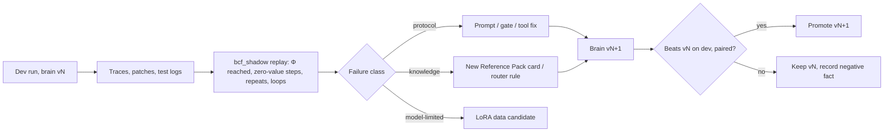

# COMBINED MARKDOWN - combine

_Generated 2026-11-05 15:15:02 | 4 files | folder: D:\stuff\docs\taylor_fv\github\rayrite.github.io\cvx\kaggle2\items\combine_

## Contents

1. 00_gemma4-task-taxonomy-2026-11-02-cc-opus55h.md
2. 01_bcf-e4b-constitution-brain-roadmap-2026-11-02.md
3. 02_local-vs-kaggle-calibration-protocol-2026-11-02.md
4. 03_swegemma-timeouts-scoring-field-guide-2026-11-02.md

---

<!-- ====================================================================== -->
<!-- FILE: 00_gemma4-task-taxonomy-2026-11-02-cc-opus55h.md -->
<!-- ====================================================================== -->

# Gemma 4 Developer Agent — Public Task Taxonomy (2026-11-02)

Classification of all 129 tasks in `published/tasks.jsonl` (fastapi 67, rich 48, requests 13, httpx 1). Fault family is hand-labelled from each issue + reference patch; size, test shape, issue quality, localization and difficulty are computed. Full per-task data: `claude/gemma4-task-taxonomy-2026-11-02.json`.

## Headline findings

- **83/129 are bug or regression fixes.** The rest are features, refactors, deprecations, docs, tooling and hardening. The hidden set is Python bug-fix tasks, so measure on the bug-shaped subset.
- **35 issues are thin** (<120 chars after stripping the PR template, or link-only). Problem statements are PR descriptions, not bug reports. 27 of 48 rich tasks are thin.
- **71 issues name neither a changed file nor a changed function**, so localization dominates.
- **58 reference fixes are 1 file and ≤10 lines**; median churn is 12 lines.
- **Type & Introspection (F1) is the largest family** (20): unions/Annotated, stringified annotations, wraps/partial, duck typing.
- **59 tasks sit in 20 fix chains.** C07 is a reversal: requests_6644 adds leading-slash collapsing and requests_7315 removes it, so a PeVIN memo must key on base_commit.

## Fault families and sub-categories

| Code | Family / sub-category | Tasks |
|---|---|---|
| **F1** | **Type & Introspection** | **20** |
| 1.1 | Annotation evaluation & namespaces | 5 |
| 1.2 | Union / Optional / Annotated unpacking | 5 |
| 1.3 | Callable unwrapping (wraps, partial, class) | 4 |
| 1.4 | Duck typing & attribute/protocol detection | 6 |
| **F8** | **Control-Flow Logic** | **16** |
| 8.1 | Empty / None edge guard | 5 |
| 8.2 | Option or argument not propagated | 5 |
| 8.3 | Wrong predicate / branch condition | 4 |
| 8.4 | Wrong constant, value or order | 2 |
| **F12** | **New Capability & Restructure** | **13** |
| 12.1 | Public API addition | 7 |
| 12.2 | Config option addition | 2 |
| 12.3 | Tooling & scripts | 1 |
| 12.4 | Performance | 2 |
| 12.5 | Internal re-architecture | 1 |
| **F2** | **Input Parsing & Matching** | **12** |
| 2.1 | Multi-value & alias key mapping | 4 |
| 2.2 | Header & value parsing | 2 |
| 2.3 | URL / host / path matching | 3 |
| 2.4 | Regex pattern coverage | 3 |
| **F3** | **Text, Unicode & Terminal** | **12** |
| 3.1 | Cell width & grapheme segmentation | 7 |
| 3.2 | Control codes, escapes & markup | 3 |
| 3.3 | Line / newline splitting | 1 |
| 3.4 | Bytes vs characters | 1 |
| **F4** | **Rendering & Layout** | **12** |
| 4.1 | Style composition & inheritance | 4 |
| 4.2 | Padding & width arithmetic | 2 |
| 4.3 | Markdown element rendering | 3 |
| 4.4 | Templates & default values | 3 |
| **F6** | **Schema & Contract Generation** | **9** |
| 6.1 | $ref / model remapping & separation | 3 |
| 6.2 | Security schemes & OAuth scopes | 3 |
| 6.3 | Schema field / content definitions | 3 |
| **F5** | **State, Mutation & Caching** | **8** |
| 5.1 | Shared-object mutation / aliasing | 4 |
| 5.2 | Stale cache or cache key | 2 |
| 5.3 | Cycles & unbounded recursion | 2 |
| **F9** | **Dependency & Platform Compat** | **8** |
| 9.1 | Upstream API drift | 4 |
| 9.2 | Deprecation & removal | 4 |
| **F7** | **Lifecycle, I/O & Environment** | **7** |
| 7.1 | Resource cleanup, streaming & connections | 2 |
| 7.2 | Startup / shutdown hooks | 1 |
| 7.3 | TTY & environment detection | 3 |
| 7.4 | I/O errors (broken pipe) | 1 |
| **F10** | **Errors & Diagnostics** | **5** |
| 10.1 | Error message & context clarity | 3 |
| 10.2 | Exception serialization protocol | 1 |
| 10.3 | Wrong status code / exception type | 1 |
| **F11** | **Security Hardening** | **4** |
| 11.1 | Input validation tightening | 2 |
| 11.2 | Output escaping / injection | 1 |
| 11.3 | Secure-default configuration | 1 |
| **F13** | **Documentation** | **3** |
| 13.1 | Docs example fix | 3 |

## Change type

Bug fix: 75, Enhancement: 16, Feature: 11, Regression fix: 8, Security hardening: 4, Compatibility: 4, Deprecation / removal: 3, Docs: 3, Performance: 2, Refactor: 2, Tooling: 1

## Fix size

XS: 58, S: 25, M: 31, L: 15

_XS ≤1 src file & ≤10 lines; S ≤1 file & ≤40; M ≤3 files & ≤150; L otherwise_

## Issue quality

Rich: 30, Moderate: 64, Thin: 35

_Thin <120 chars after template stripping or link-only; Rich has code block or >900 chars_

## Localization

symbol named: 35, file named: 23, not named: 71

## Difficulty (heuristic prior)

Easy: 34, Medium: 62, Hard: 33

_size(0/1/2/4)+localization(0/1/2)+quality(0/1/2): ≤2 Easy, ≤4 Medium, else Hard_

## Fix chains (date order)

- **C01 Callable unwrapping**: fastapi_9555 → fastapi_5077 → fastapi_9753 → fastapi_14448 → fastapi_14458
- **C02 Stringified annotations**: fastapi_11355 → fastapi_14485
- **C03 Optional sequences**: fastapi_14297 → fastapi_14430
- **C04 Discriminated unions**: fastapi_12942 → fastapi_14512 → fastapi_14479
- **C05 on_event / lifespan**: fastapi_14851 → fastapi_14873
- **C06 Read-proxy detection**: requests_7433 → requests_7502 → requests_7505
- **C07 Leading-slash URLs (reversal)**: requests_6644 → requests_7315
- **C08 Pydantic v1 sunset**: fastapi_14186 → fastapi_14583 → fastapi_14605 → fastapi_14609
- **C09 JSON serialization**: fastapi_14962 → fastapi_14964
- **C10 Router preservation**: fastapi_15745 → fastapi_15763 → fastapi_15785
- **C11 OAuth scopes**: fastapi_14266 → fastapi_5624 → fastapi_14419 → fastapi_14455 → fastapi_14459
- **C12 Parameter aliases**: fastapi_14360 → fastapi_14371
- **C13 Extra multi-value params**: fastapi_14303 → fastapi_14356
- **C14 Cell width / graphemes**: rich_3506 → rich_3521 → rich_3535 → rich_3930 → rich_3944 → rich_3953 → rich_4006
- **C15 Markdown tables**: rich_3064 → rich_3130 → rich_4079
- **C16 TTY env vars**: rich_3675 → rich_3777 → rich_4077
- **C17 Schema remapping**: fastapi_14246 → fastapi_14349 → fastapi_14361
- **C18 Dependency scopes**: fastapi_14262 → fastapi_14301
- **C19 Server-Sent Events**: fastapi_15030 → fastapi_15588
- **C20 Syntax background & padding**: rich_3296 → rich_3782

## 30-task stratified experiment set

Pick a 30-task stratified experiment set from bug-like tasks (bug + regression fixes).
Allocation: proportional to fault family (largest remainder); within a family,
evenly spaced picks across the difficulty-score ordering so Easy/Medium/Hard all appear.

| Task | Fault | Difficulty | Issue |
|---|---|---|---|
| fastapi_11355 | 1.1 Annotation evaluation & namespaces | Medium | Moderate |
| fastapi_14512 | 1.2 Union / Optional / Annotated unpacking | Hard | Moderate |
| fastapi_14430 | 1.2 Union / Optional / Annotated unpacking | Medium | Moderate |
| requests_7502 | 1.4 Duck typing & attribute/protocol detection | Easy | Thin |
| requests_7433 | 1.4 Duck typing & attribute/protocol detection | Easy | Rich |
| fastapi_14356 | 2.1 Multi-value & alias key mapping | Medium | Rich |
| fastapi_14371 | 2.1 Multi-value & alias key mapping | Hard | Moderate |
| fastapi_14786 | 2.2 Header & value parsing | Easy | Rich |
| requests_7427 | 2.3 URL / host / path matching | Medium | Moderate |
| rich_4006 | 3.1 Cell width & grapheme segmentation | Medium | Thin |
| rich_3953 | 3.1 Cell width & grapheme segmentation | Hard | Thin |
| rich_3063 | 3.2 Control codes, escapes & markup | Medium | Thin |
| requests_6589 | 3.4 Bytes vs characters | Easy | Moderate |
| rich_3938 | 4.1 Style composition & inheritance | Hard | Thin |
| rich_3296 | 4.1 Style composition & inheritance | Easy | Moderate |
| rich_3469 | 4.3 Markdown element rendering | Medium | Thin |
| rich_3130 | 4.3 Markdown element rendering | Medium | Moderate |
| fastapi_14463 | 5.1 Shared-object mutation / aliasing | Easy | Rich |
| fastapi_5624 | 5.1 Shared-object mutation / aliasing | Medium | Thin |
| rich_3772 | 5.3 Cycles & unbounded recursion | Hard | Thin |
| fastapi_14361 | 6.1 $ref / model remapping & separation | Medium | Thin |
| fastapi_14459 | 6.2 Security schemes & OAuth scopes | Hard | Moderate |
| fastapi_14266 | 6.2 Security schemes & OAuth scopes | Medium | Moderate |
| fastapi_14099 | 7.1 Resource cleanup, streaming & connections | Hard | Moderate |
| rich_4075 | 8.1 Empty / None edge guard | Hard | Thin |
| rich_3064 | 8.1 Empty / None edge guard | Medium | Thin |
| fastapi_14301 | 8.2 Option or argument not propagated | Easy | Moderate |
| rich_3905 | 8.2 Option or argument not propagated | Easy | Moderate |
| fastapi_11194 | 8.3 Wrong predicate / branch condition | Medium | Moderate |
| fastapi_13786 | 10.3 Wrong status code / exception type | Medium | Rich |

## All tasks

| Task | Type | Fault | Subsystem | Files | +/− | Issue | Loc | Diff | Chain |
|---|---|---|---|---|---|---|---|---|---|
| fastapi_15661 | Tooling | 12.3 | Tooling | 1 | +216/−0 | Thin | not named | Hard |  |
| fastapi_15588 | Security hardening | 11.1 | Responses & SSE | 1 | +18/−5 | Rich | file named | Easy | C19 |
| fastapi_15589 | Security hardening | 11.1 | Params & request parsing | 1 | +4/−0 | Moderate | not named | Medium |  |
| fastapi_15030 | Feature | 12.1 | Responses & SSE | 4 | +525/−35 | Moderate | not named | Hard | C19 |
| fastapi_14962 | Performance | 12.4 | Responses & SSE | 2 | +49/−6 | Moderate | symbol named | Medium | C09 |
| fastapi_15280 | Feature | 12.1 | Routing & app | 1 | +71/−1 | Thin | symbol named | Medium |  |
| fastapi_14964 | Deprecation / removal | 9.2 | Responses & SSE | 1 | +44/−8 | Moderate | file named | Medium | C09 |
| fastapi_15023 | Docs | 13.1 | Docs | 0 | +18/−8 | Thin | not named | Hard |  |
| fastapi_14986 | Security hardening | 11.2 | OpenAPI generation | 2 | +25/−9 | Rich | symbol named | Easy |  |
| fastapi_14978 | Security hardening | 11.3 | Params & request parsing | 2 | +81/−1 | Thin | not named | Hard |  |
| requests_7505 | Bug fix | 1.4 | Request body prep | 2 | +9/−7 | Moderate | symbol named | Medium | C06 |
| requests_7502 | Bug fix | 1.4 | Request body prep | 1 | +3/−1 | Thin | symbol named | Easy | C06 |
| requests_7433 | Regression fix | 1.4 | Request body prep | 1 | +3/−3 | Rich | symbol named | Easy | C06 |
| requests_7427 | Bug fix | 2.3 | Proxy, auth & header utils | 1 | +4/−2 | Moderate | not named | Medium |  |
| requests_7315 | Bug fix | 2.3 | Adapters & URLs | 1 | +0/−2 | Rich | symbol named | Easy | C07 |
| requests_7328 | Bug fix | 5.3 | Sessions & redirects | 1 | +1/−2 | Moderate | not named | Medium |  |
| requests_7309 | Bug fix | 2.2 | Proxy, auth & header utils | 1 | +6/−9 | Moderate | not named | Medium |  |
| requests_7205 | Bug fix | 8.1 | Proxy, auth & header utils | 1 | +1/−1 | Moderate | not named | Medium |  |
| rich_4070 | Performance | 12.4 | Console | 9 | +71/−57 | Rich | symbol named | Medium |  |
| rich_4077 | Bug fix | 7.3 | Console | 1 | +3/−0 | Thin | symbol named | Easy | C16 |
| rich_4079 | Bug fix | 4.3 | Markdown | 1 | +4/−3 | Thin | not named | Medium | C15 |
| rich_4076 | Bug fix | 3.3 | ANSI, markup & highlighting | 1 | +3/−3 | Thin | not named | Medium |  |
| rich_4075 | Bug fix | 8.1 | Console | 1 | +12/−3 | Thin | not named | Hard |  |
| rich_4006 | Bug fix | 3.1 | Cells, text & segments | 1 | +33/−12 | Thin | symbol named | Medium | C14 |
| fastapi_14258 | Enhancement | 10.1 | Routing & app | 1 | +4/−0 | Moderate | not named | Medium |  |
| fastapi_14851 | Compatibility | 9.1 | Lifecycle & middleware | 1 | +153/−4 | Moderate | not named | Hard | C05 |
| fastapi_14873 | Regression fix | 7.2 | Lifecycle & middleware | 1 | +11/−10 | Rich | symbol named | Easy | C05 |
| fastapi_13920 | Enhancement | 1.1 | Dependency injection | 1 | +4/−0 | Moderate | not named | Medium |  |
| fastapi_14794 | Enhancement | 8.3 | Dependency injection | 1 | +3/−2 | Rich | symbol named | Easy |  |
| fastapi_14786 | Bug fix | 2.2 | Security | 1 | +1/−1 | Rich | symbol named | Easy |  |
| fastapi_14492 | Docs | 13.1 | Docs | 0 | +1/−1 | Moderate | not named | Medium |  |
| fastapi_14479 | Enhancement | 10.1 | Params & request parsing | 1 | +1/−1 | Rich | symbol named | Easy | C04 |
| fastapi_14463 | Bug fix | 5.1 | OpenAPI generation | 1 | +2/−1 | Rich | not named | Easy |  |
| fastapi_12942 | Bug fix | 1.2 | Pydantic compat layer | 1 | +3/−0 | Rich | not named | Easy | C04 |
| fastapi_14099 | Bug fix | 7.1 | Lifecycle & middleware | 3 | +346/−131 | Moderate | file named | Hard |  |
| fastapi_14609 | Deprecation / removal | 9.2 | Pydantic compat layer | 18 | +192/−1855 | Moderate | file named | Hard | C08 |
| fastapi_14372 | Refactor | 5.1 | Dependency injection | 2 | +4/−3 | Rich | not named | Medium |  |
| fastapi_14349 | Bug fix | 6.1 | Pydantic compat layer | 1 | +6/−6 | Moderate | not named | Medium | C17 |
| fastapi_14512 | Bug fix | 1.2 | Pydantic compat layer | 1 | +48/−4 | Moderate | not named | Hard | C04 |
| fastapi_14487 | Docs | 13.1 | Docs | 0 | +5/−2 | Moderate | not named | Medium |  |
| fastapi_11355 | Bug fix | 1.1 | Dependency injection | 1 | +9/−2 | Moderate | not named | Medium | C02 |
| fastapi_14485 | Regression fix | 1.1 | Dependency injection | 1 | +13/−6 | Moderate | not named | Medium | C02 |
| fastapi_14482 | Bug fix | 8.2 | Pydantic compat layer | 1 | +25/−7 | Moderate | not named | Medium |  |
| fastapi_14306 | Enhancement | 10.1 | Routing & app | 2 | +121/−16 | Rich | symbol named | Easy |  |
| fastapi_14458 | Regression fix | 1.3 | Dependency injection | 1 | +6/−1 | Moderate | symbol named | Easy | C01 |
| fastapi_14459 | Bug fix | 6.2 | Security | 3 | +49/−22 | Moderate | not named | Hard | C11 |
| fastapi_14448 | Bug fix | 1.3 | Dependency injection | 2 | +82/−24 | Rich | not named | Medium | C01 |
| fastapi_14455 | Bug fix | 6.2 | OpenAPI generation | 1 | +11/−2 | Moderate | not named | Medium | C11 |
| fastapi_9753 | Enhancement | 1.3 | Dependency injection | 1 | +5/−2 | Moderate | not named | Medium | C01 |
| fastapi_14430 | Bug fix | 1.2 | Pydantic compat layer | 1 | +2/−2 | Moderate | not named | Medium | C03 |
| fastapi_5077 | Enhancement | 1.1 | Dependency injection | 1 | +4/−2 | Rich | symbol named | Easy | C01 |
| fastapi_9555 | Enhancement | 1.3 | Dependency injection | 1 | +14/−8 | Rich | not named | Medium | C01 |
| fastapi_14361 | Bug fix | 6.1 | Pydantic compat layer | 1 | +1/−1 | Thin | file named | Medium | C17 |
| fastapi_13207 | Bug fix | 6.3 | Pydantic compat layer | 1 | +12/−2 | Moderate | not named | Medium |  |
| fastapi_14360 | Bug fix | 2.1 | Params & request parsing | 1 | +1/−2 | Moderate | not named | Medium | C12 |
| fastapi_14356 | Bug fix | 2.1 | Params & request parsing | 1 | +9/−2 | Rich | not named | Medium | C13 |
| fastapi_5624 | Bug fix | 5.1 | Security | 1 | +3/−1 | Thin | not named | Medium | C11 |
| fastapi_14419 | Bug fix | 5.2 | Dependency injection | 2 | +42/−20 | Moderate | not named | Hard | C11 |
| fastapi_14301 | Bug fix | 8.2 | Dependency injection | 1 | +4/−1 | Moderate | symbol named | Easy | C18 |
| fastapi_14262 | Feature | 12.1 | Dependency injection | 7 | +196/−70 | Rich | symbol named | Medium | C18 |
| fastapi_14266 | Bug fix | 6.2 | Security | 1 | +8/−10 | Moderate | not named | Medium | C11 |
| fastapi_14246 | Regression fix | 6.1 | Pydantic compat layer | 1 | +24/−4 | Moderate | not named | Medium | C17 |
| fastapi_14186 | Compatibility | 9.1 | Pydantic compat layer | 10 | +266/−98 | Rich | file named | Hard | C08 |
| fastapi_9425 | Enhancement | 1.1 | Dependency injection | 1 | +2/−0 | Moderate | not named | Medium |  |
| fastapi_13713 | Enhancement | 12.2 | OpenAPI generation | 2 | +31/−0 | Moderate | symbol named | Medium |  |
| fastapi_14077 | Compatibility | 9.1 | OpenAPI generation | 2 | +5/−6 | Moderate | not named | Hard |  |
| rich_3718 | Regression fix | 4.1 | Panel, table & layout | 1 | +3/−4 | Moderate | file named | Easy |  |
| rich_3934 | Bug fix | 8.1 | Live & progress | 2 | +17/−3 | Thin | file named | Hard |  |
| rich_3953 | Bug fix | 3.1 | Cells, text & segments | 1 | +16/−10 | Thin | not named | Hard | C14 |
| rich_3944 | Bug fix | 3.1 | Cells, text & segments | 1 | +1/−1 | Thin | not named | Medium | C14 |
| rich_3942 | Enhancement | 4.4 | Markdown | 2 | +43/−27 | Thin | file named | Hard |  |
| rich_3938 | Bug fix | 4.1 | Console | 2 | +40/−5 | Thin | not named | Hard |  |
| rich_3882 | Bug fix | 8.2 | Prompt | 1 | +1/−1 | Moderate | symbol named | Easy |  |
| rich_3894 | Bug fix | 1.4 | Pretty, repr & inspect | 1 | +4/−0 | Rich | not named | Easy |  |
| rich_3935 | Bug fix | 4.2 | Panel, table & layout | 1 | +13/−3 | Thin | not named | Hard |  |
| rich_3905 | Bug fix | 8.2 | Live & progress | 1 | +4/−3 | Moderate | symbol named | Easy |  |
| rich_3930 | Feature | 3.1 | Cells, text & segments | 26 | +12170/−544 | Rich | not named | Hard | C14 |
| httpx_3672 | Enhancement | 7.1 | Server & connection pool | 7 | +57/−22 | Moderate | symbol named | Hard |  |
| fastapi_14791 | Bug fix | 6.3 | OpenAPI generation | 1 | +2/−0 | Moderate | not named | Medium |  |
| fastapi_15800 | Feature | 12.1 | Routing & app | 2 | +649/−5 | Moderate | symbol named | Hard |  |
| fastapi_15785 | Feature | 12.1 | Routing & app | 2 | +66/−15 | Moderate | symbol named | Medium | C10 |
| fastapi_14371 | Bug fix | 2.1 | Params & request parsing | 4 | +46/−16 | Moderate | not named | Hard | C12 |
| fastapi_14605 | Enhancement | 9.2 | Routing & app | 7 | +28/−16 | Moderate | symbol named | Hard | C08 |
| fastapi_15763 | Regression fix | 8.1 | Routing & app | 1 | +10/−3 | Moderate | not named | Medium | C10 |
| fastapi_14583 | Deprecation / removal | 9.2 | Pydantic compat layer | 2 | +24/−0 | Thin | not named | Hard | C08 |
| fastapi_15745 | Refactor | 12.5 | Routing & app | 3 | +939/−291 | Rich | symbol named | Medium | C10 |
| fastapi_14297 | Bug fix | 1.2 | Pydantic compat layer | 1 | +7/−0 | Rich | file named | Easy | C03 |
| fastapi_14303 | Bug fix | 2.1 | Params & request parsing | 1 | +6/−2 | Rich | not named | Easy | C13 |
| fastapi_13537 | Regression fix | 8.3 | Params & request parsing | 1 | +2/−1 | Rich | not named | Easy |  |
| fastapi_14953 | Enhancement | 6.3 | Pydantic compat layer | 2 | +102/−2 | Rich | file named | Medium |  |
| fastapi_13786 | Bug fix | 10.3 | Security | 4 | +176/−83 | Rich | symbol named | Medium |  |
| fastapi_14616 | Bug fix | 1.2 | Params & request parsing | 1 | +10/−2 | Rich | not named | Medium |  |
| fastapi_11194 | Bug fix | 8.3 | Params & request parsing | 1 | +3/−4 | Moderate | not named | Medium |  |
| requests_6757 | Compatibility | 9.1 | Compat layer | 2 | +16/−1 | Moderate | not named | Hard |  |
| requests_6629 | Bug fix | 10.2 | Exceptions | 1 | +10/−0 | Moderate | symbol named | Easy |  |
| requests_6644 | Bug fix | 2.3 | Adapters & URLs | 1 | +3/−0 | Moderate | not named | Medium | C07 |
| requests_6589 | Bug fix | 3.4 | Proxy, auth & header utils | 1 | +3/−0 | Moderate | symbol named | Easy |  |
| requests_6592 | Enhancement | 8.4 | Status codes | 1 | +1/−1 | Moderate | not named | Medium |  |
| rich_3180 | Bug fix | 3.1 | Cells, text & segments | 2 | +89/−38 | Moderate | not named | Hard |  |
| rich_3486 | Feature | 12.1 | Traceback | 3 | +74/−24 | Thin | file named | Hard |  |
| rich_3777 | Feature | 7.3 | Console | 2 | +12/−1 | Moderate | not named | Hard | C16 |
| rich_3468 | Bug fix | 7.4 | Console | 1 | +36/−6 | Thin | not named | Hard |  |
| rich_3782 | Bug fix | 4.2 | Syntax | 1 | +24/−5 | Thin | symbol named | Medium | C20 |
| rich_3772 | Bug fix | 5.3 | Traceback | 1 | +29/−16 | Thin | file named | Hard |  |
| rich_3296 | Bug fix | 4.1 | Syntax | 1 | +1/−3 | Moderate | file named | Easy | C20 |
| rich_3675 | Feature | 7.3 | Console | 2 | +28/−13 | Moderate | not named | Hard | C16 |
| rich_3676 | Feature | 12.1 | Traceback | 2 | +12/−1 | Thin | not named | Hard |  |
| rich_3518 | Bug fix | 8.2 | Panel, table & layout | 1 | +1/−1 | Moderate | file named | Easy |  |
| rich_3535 | Bug fix | 2.4 | Cells, text & segments | 2 | +7/−1 | Moderate | not named | Hard | C14 |
| rich_3521 | Bug fix | 3.1 | Cells, text & segments | 1 | +16/−19 | Thin | file named | Medium | C14 |
| rich_3506 | Bug fix | 3.1 | Cells, text & segments | 1 | +15/−2 | Thin | file named | Medium | C14 |
| rich_3480 | Bug fix | 5.1 | Cells, text & segments | 1 | +2/−2 | Thin | symbol named | Easy |  |
| rich_3472 | Bug fix | 1.4 | Pretty, repr & inspect | 1 | +3/−1 | Thin | not named | Medium |  |
| rich_3454 | Bug fix | 2.4 | ANSI, markup & highlighting | 1 | +1/−1 | Moderate | symbol named | Easy |  |
| rich_3471 | Bug fix | 3.2 | Cells, text & segments | 1 | +1/−0 | Thin | symbol named | Easy |  |
| rich_3470 | Bug fix | 8.3 | Console | 1 | +1/−1 | Thin | not named | Medium |  |
| rich_3469 | Bug fix | 4.3 | Markdown | 1 | +1/−1 | Thin | not named | Medium |  |
| rich_3052 | Feature | 12.2 | Prompt | 1 | +29/−5 | Rich | file named | Easy |  |
| rich_3278 | Bug fix | 3.2 | ANSI, markup & highlighting | 1 | +1/−0 | Moderate | file named | Easy |  |
| rich_2943 | Bug fix | 5.2 | Style & export | 1 | +1/−1 | Thin | not named | Medium |  |
| rich_2725 | Bug fix | 8.4 | Panel, table & layout | 1 | +5/−5 | Rich | file named | Easy |  |
| rich_3105 | Bug fix | 4.4 | Style & export | 1 | +1/−1 | Thin | not named | Medium |  |
| rich_3130 | Bug fix | 4.3 | Markdown | 1 | +5/−7 | Moderate | file named | Medium | C15 |
| rich_3043 | Bug fix | 4.4 | Style & export | 1 | +1/−1 | Moderate | not named | Medium |  |
| rich_3067 | Bug fix | 2.4 | ANSI, markup & highlighting | 1 | +1/−1 | Moderate | not named | Medium |  |
| rich_3006 | Bug fix | 1.4 | Pretty, repr & inspect | 1 | +1/−1 | Moderate | file named | Easy |  |
| rich_3064 | Bug fix | 8.1 | Markdown | 1 | +8/−9 | Thin | file named | Medium | C15 |
| rich_3063 | Bug fix | 3.2 | ANSI, markup & highlighting | 1 | +3/−1 | Thin | not named | Medium |  |
| rich_3061 | Enhancement | 4.1 | Cells, text & segments | 1 | +67/−24 | Moderate | symbol named | Medium |  |


---

<!-- ====================================================================== -->
<!-- FILE: 01_bcf-e4b-constitution-brain-roadmap-2026-11-02.md -->
<!-- ====================================================================== -->

# BCF-E4B: Constitution v2, Brain v2, and the Road to December 2

**Serial:** PLAN-003 · **Date:** 2026-11-02 · **Status:** Tier C (proposed; nothing here is ratified until Cooly accepts it)
**Builds on:** `BCF-Gemma4-Competition-Plan.md` (Sep 28), `bcf-intel-update-2026-10-15.md` (BRAIN-001, decisions D-01…D-10), `gemma4-playbook-critique-2026-10-15.md`, `faultprint-deep-dive.md`, `bcf-shadow-guide.md`, `gemma4-task-taxonomy-2026-11-02.md/.json`.
**Relationship to earlier docs:** additive. This document introduces Constitution v2 and BRAIN-002 (an E4B profile of BRAIN-001). It does not edit any earlier file, so no diff journal is required for them. Where it overrides an earlier line, §12 (Errata) says so explicitly.

> **Evidence tags used throughout.** **[Primary]** stated in an official competition document or the Gemma 4 technical report / model card. **[Measured]** computed by us from data (the task file, our own runs). **[Community]** reported by another participant or public repo, unconfirmed. **[Derived]** arithmetic on tagged numbers. **[Hypothesis]** a design bet to be tested. Every number in a future paper must trace to a [Primary] or [Measured] source with a receipt ID.

> **SME panel convened for this document.** Software-engineering agent researcher (SWE-bench, Agentless, SWE-agent), programming-languages theorist (lattices, monotone frameworks, fixed points), debugging-methodology specialist (wolf-fence, delta debugging, fault localization), small-model post-training engineer (LoRA/QLoRA, rejection sampling, expert iteration), inference/serving engineer (vLLM, multi-LoRA, quantization), evaluation statistician (paired tests, power), and an OSINT analyst for source reliability.

---

## Table of contents

0. [How to read this document](#0-how-to-read-this-document)
1. [Executive summary](#1-executive-summary)
2. [Ground truth: the contest and the E4B model as they stand on Nov 2](#2-ground-truth-the-contest-and-the-e4b-model-as-they-stand-on-nov-2)
3. [Constitution v2: the BCF formalized](#3-constitution-v2-the-bcf-formalized)
4. [BRAIN-002: the BCF brain tailored to E4B](#4-brain-002-the-bcf-brain-tailored-to-e4b)
5. [Testing and evaluating the brain](#5-testing-and-evaluating-the-brain)
6. [The improvement loop: how x becomes x′ between versions](#6-the-improvement-loop-how-x-becomes-x-between-versions)
7. [LoRA track (separate): fine-tuning E4B and wiring adapters into the brain](#7-lora-track-separate-fine-tuning-e4b-and-wiring-adapters-into-the-brain)
8. [Calendar: Nov 2 → Dec 2, two tracks, one GPU](#8-calendar-nov-2--dec-2-two-tracks-one-gpu)
9. [Risk register](#9-risk-register)
10. [Verify-first checklist](#10-verify-first-checklist)
11. [Decisions proposed for ratification](#11-decisions-proposed-for-ratification)
12. [Errata against earlier project docs](#12-errata-against-earlier-project-docs)
13. [Glossary](#13-glossary)
14. [Sources](#14-sources)

---

## 0. How to read this document

The document has three layers, and you can stop after any of them.

- **Layer 1 (sections 1–2):** what changed, what the model can and cannot do, and the one-paragraph plan.
- **Layer 2 (sections 3–4):** the formal framework and the concrete brain. Section 3 is the theory: it turns the Constitution and the "every input produces value" principle into definitions you can measure. Section 4 is the engineering: the agent tree, prompts, skills, disk memory and configuration for E4B.
- **Layer 3 (sections 5–8):** the testing pyramid, the improvement loop, the LoRA track and the calendar. These are the operational parts you will execute day by day.

Terms that may be unfamiliar are defined the first time they appear and collected again in the glossary (section 13).

---

## 1. Executive summary

### 1.1 Is the BCF coherent and testable?

**Yes, once two things are made precise.** The Constitution as written is a set of good engineering instincts. To become a *framework* (something that can be implemented, measured and falsified), each article needs (a) a mechanism that exists in the competition sandbox and (b) a metric with a pass condition. Section 3 supplies both for all seven articles.

The "every input generates an output of value" principle is the most interesting part, and it is also the part that needs the most careful restatement. Read literally, "x′ is asymptotically greater than x" cannot hold for code itself: some steps make code worse, and code quality is bounded (a task is either resolved or not). It *can* hold for a different quantity: the agent's **state of knowledge about the task**. If every step must either raise a measurable progress level or add a verified fact (including a negative one, such as "this hypothesis is false"), then knowledge rises monotonically, and because the space of facts about one task is finite, the process must converge. This is exactly the structure of a **monotone framework** from compiler theory, where an analysis that only ever moves "up" a lattice of finite height is guaranteed to terminate. Section 3.1 builds this out and turns it into the **Φ-ratchet**, the core mechanism of BCF v2.

The "handed to another machine" idea also formalizes cleanly. It is a **baton protocol**: each component (a sub-agent within a task, a brain version between submissions, a model generation between LoRA rounds) receives a structured baton with a known value and must return one of equal or higher value, or the handoff is rejected and the previous baton is kept. That is "always preserve working code" applied at every level of the system, which is where the name *Batonic* earns its keep.

### 1.2 The E4B reality check

E4B is permitted in this contest (host announcement 2026-10-11; harness README updated 2026-10-13) **[Community report of Primary sources]**, and it is fast and cheap to fine-tune. It is also much weaker than the 31B at exactly the skills a coding agent needs:

| Capability (Gemma 4 technical report, thinking mode) | E4B | 12B | 31B |
|---|---|---|---|
| Terminal Bench Hard | **8.0** | 18.0 | 36.0 |
| LiveCodeBench v6 | 52.0 | 72.0 | 80.0 |
| IFBench (instruction following) | **44.0** | 74.0 | 76.0 |
| Tau2 telecom (multi-step tool use) | **18.4** | 54.4 | 69.3 |
| MRCR v2 8-needle (long-context retrieval) | 25.4 | n/a | 66.4 |

**[Primary]**: the technical report; MRCR from the model card / BenchLM comparison.

The most useful public evidence is a controlled study of an agent that ran both models on the same SWE tasks **[Community]**:

- Resolve rate **12% (E4B) vs 50% (31B)**; fail-to-pass progress 22% vs 62%.
- Localization (patch touches a gold file) **60% vs 84%**.
- **63% of E4B's `edit_file` calls failed**, mostly *search == replace* no-ops (the model "edits" a line to itself), versus 0–4% for 31B.
- **78% of E4B's failures happened after it had already found the right file.** When the 31B was handed E4B's own context right before E4B's first gold-file edit, the 31B resolved 19 of 24 tasks and E4B resolved 2 of 24 (paired 17–0).
- E4B tends to **stop early** (mean 17 turns vs 28.8) rather than loop.

**What that means for the brain.** E4B's bottleneck is *writing the fix*, then *finding the fix site*, then *persistence*. It is not looping. The brain must therefore move work out of the model's free-form reasoning and into **deterministic tools** (edit validation, checkpointing, test gating, call-path tracing), keep the prompt **short** because instruction-following is weak, and use **LoRA aimed at the edit step**. BRAIN-002 is built around those three moves.

### 1.3 Recommendation on the model choice

Build and tune the brain on E4B, because iteration is fast and LoRA is affordable on the RTX 5090. But **do not commit the final submission to E4B by default.** Put a **variant gate** in the calendar (§5.6): on the stratified 30-task set, compare E4B+BCF, E4B+BCF+LoRA, and 12B+BCF (and 31B+BCF if time allows) at equal wall-clock. Two final submissions are allowed, so a sensible portfolio is one E4B entry (the research story, the paper's subject) and one entry on whichever variant scores best. Adapters do not transfer across variants, so this decision also fixes which model the LoRA track trains for. That is why the gate sits early (Nov 7).

### 1.4 The plan in one paragraph

**Nov 2–6:** re-sync to the October harness, serve E4B locally, measure baseline A0 on the 30-task set and the full public set, build the Φ-ratchet toolkit (`bcf.py`: checkpoint, gate, repro+FaultPrint, atomize, clean room), and run the first ablations. **Nov 7:** variant gate. **Nov 7–11:** paper (deadline Nov 12) on real measurements: the task taxonomy as a resource, the Φ-ladder as a measurement instrument, and A0→A4 ablations on E4B. **In parallel from Nov 3:** the LoRA track builds its data pipeline (31B teacher trajectories plus E4B self-trajectories, rejection-sampled, chain-aware splits), proves an adapter loads in the scorer's vLLM, trains an edit-focused adapter, and goes through go/no-go gates. **Nov 25:** entry deadline (confirm). **Nov 26–Dec 1:** full-length timing rehearsal and the two final submissions.

---

## 2. Ground truth: the contest and the E4B model as they stand on Nov 2

### 2.1 Contest facts that shape every decision

| Fact | Value | Tag / source |
|---|---|---|
| Deadlines (23:59 UTC) | Paper **Nov 12**; entry and team merger **Nov 25**; final **Dec 2** | [Primary] Overview |
| Submissions | **1 per day**; up to **2 finals** | [Primary] Rules §2.2 |
| Hidden set | ~120 Python tasks from **private** repos, ~60 public / ~60 private; private decides prizes | [Primary]/Staff |
| Run envelope | **12 h for all tasks**, sequential, includes sandbox setup, excludes validation; an overrun may zero the run | [Primary]; Staff |
| Allowed bases | one per submission: 31B, 12B, E4B, E2B, all `-it-qat-w4a16-ct` | Host announcement 2026-10-11 [Community report]; our Sep 29 README copy still says 31B only → **verify** |
| Serving | vLLM, 4× L4, TP=4, `max_model_len=32768`, thinking on by default, `max_loras=8`, `max_lora_rank=128` | [Primary] README §3 |
| Context compaction | ~14,336-token threshold, keeps the last 5 events verbatim (notebook config) | [Primary] notebook; scorer equality [Hypothesis] |
| Tools | 9 built-ins (`run_command`, `read_file`, `edit_file`, `write_file`, `submit_patch`, `get_status`, `search_similar_code`, `get_code_neighbors`, `get_code_subgraph`) plus skill scripts | [Primary] |
| Custom code | only as skill scripts (run in the task container, debit time); ADK `FunctionTool` is rejected | [Primary] Overview; Staff |
| Size | submission < 3 GiB including adapters | [Primary] |
| Output limits | command output 5,000 chars; `read_file` 150 lines / 10,000 chars | [Primary] |
| Grading | patch applied in a fresh container; test files and runner configs the agent touched are **reset**; hidden tests must pass with exit 0 | [Primary] README §8 |
| `submit_patch` | free (no tool-call charge), works after calls run out if time remains; empty patch = 0 | [Primary] |

### 2.2 The E4B model, explained

**What "E4B" means.** Gemma 4 E4B has about **8 billion total parameters but 4.5 billion "effective" parameters**. The difference comes from **Per-Layer Embeddings (PLE)**, a design inherited from Gemma 3n: each decoder layer gets its own small per-token embedding table. A table lookup costs almost nothing compared with a matrix multiply, so those parameters add knowledge capacity without adding much compute. The practical meaning: E4B *thinks* like a ~4.5B model and *runs* at roughly that cost **[Primary]**.

**Attention layout.** E4B interleaves **local sliding-window attention** (each token sees only the previous 512 tokens) with **global attention** in a 5:1 ratio. The final layer is always global. Long-range information therefore has to pass through the few global layers, which is one reason long-context retrieval is weak (MRCR 25.4) **[Primary]**. The design lesson: **don't make E4B find a needle in 20K tokens of transcript.** Keep the working set small and put the important facts in the most recent messages or on disk, where the agent re-reads them.

**Quantization.** The competition checkpoint is **QAT W4A16**: weights stored in 4-bit, activations in 16-bit, trained with **quantization-aware training** so that quality stays close to bf16 **[Primary]**. This matters for LoRA (section 7.3): the adapter you train will run on top of 4-bit QAT weights, not on the bf16 weights you may train against.

**Thinking and tools.** Thinking is enabled by a `<|think|>` token and appears in a `<|channel>thought … <channel|>` block. Tool calls use `<|tool_call>call:…<tool_call|>`. The harness runs vLLM with the `gemma4` tool and reasoning parsers and `enable_thinking: true` **[Primary]**. Google recommends `temperature 1.0, top_p 0.95, top_k 64` for this family **[Primary]**. A participant found 0.4–1.0 slightly better than 0.0–0.2 on the 31B **[Community]**.

**Memory footprint.** About 9 GB in bf16 and far less in W4A16 **[Primary]**. On 4× L4 with TP=4, the weights are a small fraction of 96 GB, which leaves room for KV cache and up to 8 LoRA adapters.

### 2.3 What the evidence says E4B gets wrong, and the design response

| Observed weakness | Evidence | BRAIN-002 response |
|---|---|---|
| Edit step fails (no-op edits, wrong place) | 63% failed `edit_file` calls; 78% of failures occur after finding the right file [Community] | Deterministic edit guard and Φ-gate in `bcf.py`; an edit-focused LoRA; "read the exact lines, then edit" protocol |
| Localization weaker | 60% vs 84% gold-file touch [Community] | `atomize` call-path tracer turns a failing repro into a ranked list of suspect functions; navigator sub-agent |
| Weak instruction following | IFBench 44 vs 76 [Primary] | Short prompt (≤ ~600 words) with a few numbered rules; push enforcement into tools |
| Weak long multi-step tool use | Tau2 telecom 18.4 vs 69.3 [Primary] | One fixed protocol (the Φ-ladder) instead of open planning; a single multi-purpose skill entry point |
| Stops early | 17 vs 28.8 mean turns [Community] | Φ-gate refuses "done" below Φ6 while budget remains; budget governor gives explicit "you have X% left" |
| Weak long-context retrieval | MRCR 25.4; 512-token local window [Primary] | Disk baton (`/tmp/bcf/baton.json`) re-read at every phase boundary; compact tool outputs |

### 2.4 What the public task set tells us about the hidden set

From this morning's taxonomy of the 129 public tasks **[Measured]**:

- 83 of 129 are bug or regression fixes. The rest are features, refactors, docs and tooling. Tune on the bug-shaped subset.
- 35 issues are "thin" (under 120 characters once the PR template is removed). 71 issues name neither a changed file nor a changed function, so localization is the first problem.
- 58 reference fixes touch one file and change at most 10 lines. The median fix changes 12 lines, so the prior should be **a small, surgical diff**. That is good news for E4B: the edits it must write are short.
- The largest fault family is **Type & Introspection** (20 tasks: `Union`/`Optional`/`Annotated`, stringified annotations, `functools.wraps`/`partial`, duck typing). That is knowledge a small model may lack and a reference pack can supply (Article III).
- 59 tasks sit in 20 fix chains. That matters for data splits (section 7.4.5).

The hidden repos are private, so repo-specific knowledge will not transfer; fault-mechanism knowledge will.

---

## 3. Constitution v2: the BCF formalized

### 3.1 The value axiom: from "x′ > x" to the Φ-ratchet

#### 3.1.1 Restating the principle

Your text: *"every input generates an output of value no matter how small. So x′ is asymptotically greater than x. The output of x′ can be handed to another machine capable of generating the next higher value of output."*

There are three claims inside it:

1. **Non-negativity:** no step is wasted; each produces *some* value.
2. **Monotonicity:** value never goes down from one step to the next.
3. **Composability:** the output of one step is a valid input to another machine, which continues the climb.

The difficulty is choosing *what* "value" measures. If value means "quality of the code in `/workspace`," claim 2 is false: experiments sometimes break things. The fix is to separate two objects:

- the **artifact** (the code), which may go up or down during exploration, and
- the **knowledge state** (what the agent has established about the task), which can be made to go only up.

The ratchet then connects them: **the artifact the agent *keeps* is always the best one it has verified so far.** Exploration can go downhill; what is *retained* cannot.

#### 3.1.2 The knowledge state

Define the agent's state at step *t* as

  **K_t = (Φ_t, E_t, B_t)**

where

- **Φ_t ∈ {0,…,8}** is the **progress level**, the highest rung of the ladder below that the agent has *verified* (not merely claimed);
- **E_t** is the set of **established facts**, both positive ("`foo()` returns `None` when the header is empty") and negative ("hypothesis H2, a missing `strip()`, is false: the repro still fails after adding it"). Each fact carries evidence (a command and its output fingerprint);
- **B_t** is the **best checkpoint**: the stored diff with the highest Φ reached so far.

**The Φ-ladder** (each rung is a binary, machine-checkable condition; that is your "binary Definition of Done" tenet, applied at every stage rather than only at the end):

| Φ | Rung | Verified by |
|---|---|---|
| 0 | Nothing established | — |
| 1 | **Spec**: symptom, expected behaviour, acceptance command written to the baton | `bcf.py` schema check |
| 2 | **Repro**: a command that fails *for the stated reason* (fingerprinted) | exit ≠ 0 and the FaultPrint class matches the spec |
| 3 | **Suspect file(s)** named with evidence (trace frame, grep hit, graph neighbor) | evidence pointer present |
| 4 | **Suspect function + causal hypothesis** ("X because Y") | hypothesis recorded, not in E as already falsified |
| 5 | **Candidate edit** applied; changed files compile; diff is non-trivial | `py_compile`; old ≠ new; diff non-empty |
| 6 | **Repro passes** | repro exit 0 |
| 7 | **No regression**: repro passes *and* nearby existing tests (same module) pass | targeted pytest exit 0 |
| 8 | **Gate passed and submitted** | `bcf.py gate` returns PERMIT; `submit_patch` called |

#### 3.1.3 The value order and the zero-value step

Order knowledge states **lexicographically**: K′ ≥ K if Φ′ > Φ, or if Φ′ = Φ and E′ ⊇ E. A step is **productive** if K_{t+1} > K_t (it raised Φ or added at least one new established fact), and **zero-value** otherwise.

This gives a precise, testable version of your principle:

> **Axiom V (value monotonicity).** Every step must be productive. A zero-value step is a defect of the protocol, and it is measured.

Examples of zero-value steps, all detectable from traces: re-reading a file range already read without an intervening edit, an `edit_file` whose `old_string == new_string` (E4B's signature failure), re-running a test whose fingerprint and diff are unchanged, a "fix" that the loop detector scores ≥ 0.8 similar to an already-falsified one.

Note what *is* productive even though it looks like failure: a falsified hypothesis. If a candidate fix makes no difference to the repro, the agent learned something true ("not H2"). This is the honest form of "every input generates an output of value no matter how small." The value is in **E**, not in the code.

#### 3.1.4 Why it must converge (the monotone-framework argument)

In compiler theory, a **dataflow analysis** iterates a function over a **lattice** (a partially ordered set where any two elements have a least upper bound). If the function is **monotone** (it never moves an element down) and the lattice has **finite height** (no infinite strictly rising chain, the *ascending chain condition*), iteration must reach a **fixed point** in finitely many steps. This is the Kildall / Kam–Ullman result that guarantees every compiler's analyses terminate.

The BCF knowledge state fits that mould:

- the order on K is a partial order, and the join of two states is the higher Φ with the union of facts;
- Φ is bounded by 8, and for one task, at the granularity the agent uses, the set of distinct verifiable facts is finite;
- Axiom V says each step moves strictly up.

So the number of productive steps is bounded, and a protocol that enforces Axiom V **cannot loop forever**. That is your "asymptotic" intuition made exact. The climb is monotone and bounded, so it converges (the order-theory cousin of the monotone convergence theorem from analysis). In practice the budget ends the climb first. The guarantee that matters is the other one: **no step is wasted repeating the past**, because repetition is by definition not an upward move.

> **Analogy.** A mountaineer roped to fixed anchors. They may climb down a few metres to try another line, but the rope (the checkpoint B) never lets them fall below the highest anchor they have placed, and every attempt, even a failed one, leaves a note on the map (E) so nobody tries the same dead-end gully twice.

#### 3.1.5 The ratchet rule (Article I made exact)

> **Rule R (ratchet).** The working tree may be changed freely during exploration, but at every gate (before a new hypothesis, at the 70% budget mark, and before `submit_patch`) the tree is restored to B_t if its verified Φ is below Φ(B_t). `submit_patch` is only ever called on the best checkpoint.

Rule R is why BCF can afford **best-of-N within a task**: E4B can try three different fixes, each starting from a clean tree, and the gate submits whichever reached the highest Φ. A small model's high variance becomes an asset instead of a risk.

#### 3.1.6 The baton: "handed to another machine"

A **baton** is the serialized knowledge state, small enough to pass between components and survive context compaction:

```json
{
  "pevin": "BCF1.E4B.fastapi.a3f9c2e1.P6.07",
  "phi": 6,
  "spec": {"symptom": "...", "expected": "...", "accept_cmd": "python -m pytest -q --tb=short /tmp/bcf/test_repro.py"},
  "repro": {"cmd": "...", "status": "pass", "fp_class": "F1.2/TypeError"},
  "suspects": [{"file": "fastapi/_compat/v2.py", "symbol": "serialize_sequence_value", "evidence": "atomize#3"}],
  "facts": [
    {"id": "E1", "kind": "neg", "claim": "H1 (missing None check) is false", "evidence": "run#4 fp unchanged"},
    {"id": "E2", "kind": "pos", "claim": "origin is types.UnionType on 3.10 syntax", "evidence": "atomize#3"}
  ],
  "checkpoints": [{"id": "ck2", "phi": 6, "patch": "/tmp/bcf/ck2.patch", "sha": "9f2c41…"}],
  "budget": {"time_left_pct": 41, "calls_left": 23}
}
```

The **PeVIN** field is a compact, checkable identifier in the spirit of your VIN idea: framework version, model, repo, task hash, phase, sequence. A component receiving the baton can verify it (the checkpoint's SHA matches its content), decide quickly what is settled (facts with evidence) and avoid redoing work (memoization). Inside one task, three relays use it: **navigator → fixer → gate**. Between brain versions and model generations the same idea scales up (section 6).

### 3.2 The seven articles, one by one

Each article below has four parts: the **statement** (lightly edited from your text), the **formal definition**, the **mechanism** in this contest, and the **test** that would show it is working or not.

#### Article I. Preserve working code (single point of contact, gated permission)

**Statement.** Working code is never lost. Exactly one component has write authority. Every change passes a risk gate before it is kept.

**Formal definition.** (a) Rule R above. (b) **Single point of contact (SPOC):** in the agent tree, only the root *fixer* agent holds `edit_file`, `write_file` and `submit_patch`; sub-agents are read-only and communicate by updating the baton. (c) **Gated permission:** a deterministic function `gate(diff, baton) → {PERMIT, REVISE, REVERT}` computed from a risk score.

**Risk score (initial weights, to calibrate on dev).** Blocking conditions (any one ⇒ REVERT to best checkpoint):

- changed file fails `python -m py_compile`;
- untracked files inside `/workspace` (scratch leak; they would enter the patch);
- edits to test files or runner configs (they will be reset by the grader anyway, so a fix that depends on them is a fake fix);
- repro still failing while a checkpoint with Φ ≥ 6 exists;
- a previously passing nearby test now fails (regression).

Soft risk points (sum ≥ 3 ⇒ REVISE: shrink the diff or justify it): more than 2 source files touched (+1 each beyond 2); more than 40 changed lines (+1); a `def` signature changed (+1); a public name removed (+2); a broad `except` added (+1).

**Mechanism.** `bcf.py gate` (a skill script) computes the score from `git diff --stat`, `git status --porcelain`, `py_compile`, the stored repro, and a targeted test run on the changed module's tests. It writes the verdict into the baton. The prompt rule is only "call `bcf.py gate` before `submit_patch`." The arithmetic and the blocking happen in code, which matters because E4B follows long rule lists poorly.

**Why not git commits for checkpoints?** `submit_patch` diffs against `_swegemma_baseline` *or falls back to `HEAD`* **[Primary]**. If the baseline ref were missing in some environment, a commit made by the agent would silently drop changes from the patch. Checkpoints are therefore stored as patch files in `/tmp/bcf/` and restored with `git checkout -- . && git apply`. That is safe whichever diff base the harness uses.

**Test.** From traces: (i) *regression-at-submit rate*: the share of submitted patches whose Φ is lower than the best Φ reached in that task (target: 0); (ii) *scratch-leak rate* (target: 0); (iii) *gate precision*: of REVERT verdicts, the share where the reverted state would indeed have failed grading (measured on dev, where hidden tests are known).

#### Article II. Document at the highest necessary fidelity

**Statement.** The development process is recorded at whatever fidelity triage will need, and no more.

**Formal definition.** *Adaptive fidelity:* one line per productive step by default (the baton fact list plus a one-line journal entry); full fidelity (raw output saved to `/tmp/bcf/raw/<n>.log` and referenced by pointer) whenever a step fails, falsifies a hypothesis, or triggers a gate. "Necessary" is defined operationally: **a post-mortem must be able to reconstruct why each hypothesis was abandoned, from the baton alone.**

**Mechanism.** In-task: the baton and journal on disk (compaction-proof); `bcf.py` saves full logs automatically and returns only a short summary plus a pointer (the "pointers, not transcripts" design from the FaultPrint deep dive). Offline: the harness already writes full ATIF traces, patches and test logs per task **[Primary]**. `bcf_shadow` replays them.

**Test.** *Reconstruction rate*: on a sample of 20 dev traces, can a reviewer (you, or a separate model) name the reason each hypothesis was dropped from the baton alone? Target ≥ 90%. *Token cost of documentation*: journal and baton tokens as a share of total (target ≤ 10%).

#### Article III. The developer reference as source of truth, in an LLM-friendly form

**Statement.** The full developer reference is always available in a form the model can consume, and every diagnosis can be traced back to it.

**Formal definition.** The **source-of-truth set** for a task is: (1) the repository at `base_commit`; (2) the *installed* dependency sources in the container (for example the exact `pydantic` and `starlette` versions the tests import); (3) the Python standard library and language semantics; (4) a curated **Reference Pack** shipped as skill resources. A claim in the baton about how a construct behaves is *grounded* if it cites one of these: a `file:line`, an `inspect.getsource` output, or a Reference Pack card ID.

**Mechanism.** The sandbox is offline, so "the reference" must either be in the container or ship in the submission. Two pieces:

- **Live reference via introspection.** `bcf.py ref <dotted.name>` prints the signature, docstring, source file and line, and the first ~60 lines of source of any importable object, using `inspect` against the *installed* versions. This is the most faithful reference possible, because it is literally what the tests will run.
- **Reference Pack (skill resources).** About 30 short cards, one per fault sub-category in the taxonomy, each under 250 tokens: the construct, its precise semantics, the classic bug, the minimal correct pattern, and a one-line test idea. The highest-value cards follow the taxonomy: `typing.get_origin/get_args` with `Union` vs `types.UnionType`; `Annotated` unwrapping; `inspect.signature(eval_str=True)` and `NameError` on `TYPE_CHECKING` names; `functools.partial`/`wraps` unwrapping; `isinstance` vs `hasattr` for proxy objects; East Asian width and grapheme clusters; `copy` vs `deepcopy` for nested schema dicts; frozen dataclasses and hashing. They are loaded only when the router (Article IV) classifies the task into that family, which protects the small context.

**Test.** *Grounding rate*: the share of hypotheses in the baton with a source citation (target ≥ 80%). *Card lift*: an ablation (A3) with and without the pack, reported per family. Cards should help most on F1 (Type & Introspection) if the thesis is right.

#### Article IV. Search discipline and atomic decomposition

**Statement.** Use binary search, breadth-first and depth-first search as the situation requires. There is always a tool that breaks an issue into atomic elements traceable to the source of truth.

**Formal definition.** Three search modes, each with a trigger:

- **Breadth-first (BFS)** over the **suspect frontier**, when the issue names no code (71 of 129 public tasks): candidate symbols from the issue's identifiers, `grep`, `search_similar_code` (symbol-name queries only), expanded one hop with `get_code_neighbors`. The navigator scores the frontier and returns the top 3.
- **Depth-first (DFS)** down the **failing call path**, when a repro exists: follow the traceback or the traced path from the entry point to the first function whose output contradicts the spec.
- **Binary search (wolf-fence)** on long call paths or long functions, when DFS is ambiguous: probe the midpoint of the path, check whether the state there is already wrong, and halve. This is the *wolf-fence algorithm* (Gauss, 1982): put a fence across the middle of Alaska, listen for the howl, keep the half with the wolf. It finds the first bad point in O(log n) probes.

**The atomic decomposition tool.** `bcf.py atomize "<repro command>"` runs the repro under a `sys.settrace` tracer limited to the repository's own package (not the stdlib, not site-packages) and returns a compact call path, one line per call: `module.function(arg types) → return type | exception`, each with `file:line`. That is the issue broken into its **atoms** (the individual calls and values on the failure path), each traced to source. Because it uses a tracer, it needs **no edits to `/workspace`** (Article I) and costs one tool call. Its output feeds DFS directly, and its midpoint gives the first wolf-fence probe.

For input-driven bugs, the same tool can apply **delta debugging** (Zeller's *ddmin*): shrink a failing input (a string, a list of parameters) to a minimal one that still fails. This is useful for the Unicode, regex and parsing families (F2, F3).

**Mode router.** A deterministic first pass maps the issue text and the first failure fingerprint to a fault family (keyword and exception-class rules derived from the taxonomy: `TypeError: issubclass()` → F1.2; `width`, `wrap`, `emoji`, `CJK` → F3.1; `deepcopy`, `duplicate` → F5.1; and so on). It then loads the matching Reference Pack card and suggests the starting search mode. This is your thesis ("classify errors into exception classes to narrow the search") as a concrete, testable component.

**Test.** *Localization@3*: is a gold-patch function among the navigator's top 3 suspects (computable on dev from reference patches)? Target: beat A0's rate by a margin outside noise. *Router accuracy*: the share of dev tasks routed to their labelled family (the taxonomy JSON is the answer key). *Probes per localization*.

#### Article V. The Clean Room

**Statement.** There is always a clean-room tool for constructing and trying candidate solutions from the current context and the atomic constructs.

**Formal definition.** A **clean room** is an isolated copy in which candidate changes are assembled and evaluated without touching the working tree. Two levels:

1. **Micro clean room (construct level):** `bcf.py cleanroom expr "<python snippet>"` executes a small standalone experiment in a fresh interpreter, with the repository importable, to confirm a semantic fact before editing. Example: does `get_origin(list[int] | None)` return `types.UnionType` here? The result enters E as an established fact.
2. **Macro clean room (patch level):** `bcf.py cleanroom patch <ckpt>` creates `git worktree add /tmp/bcf/cr HEAD`, applies the candidate patch there, and runs the repro with that worktree first on `sys.path`. It reports Φ5–Φ7 for the candidate without the working tree ever holding an unverified change.

**A caution to verify.** The package is installed in *editable* mode pointing at `/workspace` **[Primary]**, so the worktree must be put first on `PYTHONPATH`, and you must confirm (with `python -c "import pkg; print(pkg.__file__)"`) that the import really resolves to `/tmp/bcf/cr`. If that proves fragile for some layouts (`src/` vs flat), fall back to *checkpoint–apply–test–restore* in `/workspace` itself, which is just as safe under Rule R.

**Test.** *Clean-room fidelity*: on dev, does the macro clean room's Φ7 verdict agree with the same patch evaluated in `/workspace`? Target 100%; any disagreement is a bug in the tool. *Pre-edit fact rate*: how often a micro experiment changed the hypothesis before an edit was made.

#### Article VI. Root cause analysis and post-mortem checkpoints

**Statement.** RCA and post-mortems are built in, so the workflow learns and improves.

**Formal definition.** Two timescales, because the contest imposes them: containers are wiped between tasks, and the 12-hour run has no memory across tasks **[Primary]**.

- **In-task RCA (seconds):** every failed test run goes through FaultPrint (`bcf.py repro`). A *NEW* fingerprint triggers a one-line "why" (the causal hypothesis, Φ4). A *REPEAT* means the last edit did not touch the cause, so the hypothesis is falsified and recorded as a negative fact. A *LOOP* (the diff is ≥ 0.8 similar to a failed attempt) blocks the edit and demands a different hypothesis. After a fix passes, **re-fingerprint**: a new failure where the old one vanished is evidence of a **masked fault** (the first bug was hiding a second), which is your whitepaper's masking concept, made observable.
- **Between-version post-mortem (hours):** after every dev run, `bcf_shadow` replays traces and produces the failure taxonomy (stage reached on the Φ-ladder, zero-value steps, repeats, loops). Those findings become prompt edits, new Reference Pack cards, router rules and LoRA training data (section 6).

**Test.** *Repeat-failure rate* and *loop rate* per task, from shadow replay; the *masked-fault detection count* (the number of times re-fingerprinting revealed a second signature after the first was fixed).

#### Article VII. Effort and thinking adjustment

**Statement.** Speed versus quality is tuned to external constraints.

**Formal definition.** Three dials, each tied to a measurable constraint:

1. **Per-task budget** (`eval_config.yaml`): set by the tail rule from the measured duration distribution (intel update §5) so that the 12-hour total is safe at 2σ.
2. **In-task governor:** `get_status` at each Φ boundary. With more than 60% of time left, run the normal flow; at 30–60%, open no new hypothesis and finish the current one; below 30% (or when a `budget_warning` appears), restore the best checkpoint and gate-submit.
3. **Per-agent thinking budget:** ADK lets each agent have its own `generate_content_config` **[Primary]**. The navigator needs little deliberation (it gathers evidence); the fixer needs more at Φ4–Φ5 (hypothesis and edit); the gate needs none (it is a script). For E4B, start with navigator 1,024 and fixer 2,048 thinking tokens, and keep `max_output_tokens` at 8,192 so a long thought cannot truncate an `edit_file` call (the harness's first nudge type exists because of exactly that failure **[Primary]**).

**Test.** The duration distribution with its tail (share of tasks reaching the cap); the truncated-tool-call rate; resolution versus thinking budget on a two-point sweep.

### 3.3 Edits to the original text, made for coherence

| Original | v2 reading | Why |
|---|---|---|
| "x′ is asymptotically greater than x" | Knowledge is **monotone and bounded**, so it converges; code is protected by the ratchet | Code quality cannot be monotone during exploration; knowledge can |
| "Single point of contact" | Exactly one agent holds write tools and `submit_patch` | Makes the claim checkable from the agent YAML |
| "Gated permission algorithm to determine the risks" | `gate()` with blocking conditions and a calibrated risk score | Turns judgment into a function with a measurable precision |
| "Full developer reference" | Live introspection of installed versions plus a small Reference Pack | The sandbox is offline; "full" docs cannot ship and would overflow a 32K context |
| "Self-learning and self-improving" | In-task RCA, and between-version improvement; no cross-task memory during a scored run | Containers are wiped; learning happens between submissions |

---

## 4. BRAIN-002: the BCF brain tailored to E4B

BRAIN-001 (intel update §4) defined five stores. BRAIN-002 keeps the structure and re-tunes each store for a 4.5B-effective model.

### 4.1 Architecture

```mermaid
flowchart TB
    subgraph Root["fixer (root LlmAgent) — SPOC: only agent with edit/write/submit"]
        P[Strategic store: short constitution prompt]
        A1[adapter: patch_lora (optional, LoRA track)]
    end
    subgraph Nav["navigator (AgentTool, read-only)"]
        P2[Navigator prompt]
        A2[adapter: nav_lora (optional)]
    end
    subgraph Skills["skills/bcf (scripts run in task container)"]
        S1[bcf.py spec | repro | atomize | ref | cleanroom | checkpoint | restore | gate | status]
        S2[Reference Pack cards]
        S3[Router rules]
    end
    subgraph Disk["/tmp/bcf (outside the patch)"]
        D1[baton.json]
        D2[journal.md]
        D3[ck*.patch, raw/*.log, faultprint state]
    end
    Root -->|agent_tool| Nav
    Root --> Skills
    Nav --> Skills
    Skills <--> Disk
    Root -->|submit_patch on best checkpoint| Out[(patch)]
```

**Why a root LlmAgent and not a fixed SequentialAgent pipeline?** The harness drives the root agent in a loop with nudges until `submit_patch` is called **[Primary]**. A free-form root agent fits that loop natively, while a `SequentialAgent` root would rerun the entire pipeline on each nudge. The protocol is still enforced, but by the gate tool and the baton rather than by the agent graph. A fixed "Agentless-style" pipeline (localize → repair → validate, with no free choice of next action) remains a valid ablation for E4B, because weak planners often do better on rails. It is rung A4b in §5.5.

**Why only one sub-agent?** Each extra agent adds handoff cost and another prompt for a weak instruction-follower to obey. The navigator earns its place because it keeps exploration output (file reads, search results) out of the fixer's context; the README recommends this pattern explicitly **[Primary]**. The verifier role is a script (the gate), not a model, which follows from your own learning that self-scoring cannot produce rejections.

### 4.2 Store by store

#### 4.2.1 Strategic store: the constitution prompt for E4B

Design constraints: under ~600 words; numbered steps rather than prose; each rule tied to a tool so compliance can be checked; no rule that a script already enforces. A first draft:

```markdown
You fix one bug in a Python repository at /workspace. Work in this exact order.
Your memory is the file /tmp/bcf/baton.json. Read it with `bcf.py status` whenever you are unsure what to do next.

1. SPEC. Run `bcf.py spec "<one-line symptom>" "<expected behaviour>"`.
2. REPRO. Write a minimal failing test to /tmp/bcf/test_repro.py (never inside /workspace).
   Run it with `bcf.py repro`. It must FAIL for the reason in your spec.
   If you cannot reproduce within 6 tool calls, go to step 3 anyway.
3. LOCATE. Ask the navigator for the top 3 suspect functions, or run `bcf.py atomize`.
   Use `bcf.py ref <name>` to read the real source of any library function you are unsure about.
4. HYPOTHESIS. State one cause in one sentence: "X happens because Y in function Z".
5. EDIT. Use read_file on the exact lines first. Then edit_file with old_string copied exactly
   from that output. new_string must differ from old_string. Keep the change small.
6. TEST. Run `bcf.py repro`. If it says REPEAT or LOOP, your hypothesis was wrong:
   run `bcf.py restore`, write a NEW hypothesis, go to step 4.
   If it passes, run `bcf.py checkpoint`.
7. FINISH. Run `bcf.py gate`. If PERMIT, call submit_patch. If REVERT, it has already
   restored your best version: call submit_patch. Never finish without submit_patch.

Rules: never edit test files or pytest.ini/conftest.py. Never pass lists as tool arguments.
Search with symbol names (e.g. `parse_header`), not sentences. Run pytest with -q --tb=short.
```

Every line costs E4B attention, so the prompt deliberately omits everything the tools enforce (risk scoring, budget arithmetic, scratch-file cleanup).

#### 4.2.2 Working memory: the baton on disk

Section 3.1.6 gave the schema. Two operating rules matter for E4B:

- **Write through tools, not by hand.** E4B producing valid JSON by hand is a failure point. `bcf.py` subcommands update the baton, so the model only supplies short strings.
- **Re-read at boundaries.** `bcf.py status` prints a ~150-token summary: Φ, spec, best checkpoint, last three facts, budget left. After compaction (~14K tokens), this is how the plan survives.

#### 4.2.3 Tooling store: `skills/bcf`

One skill with one script and subcommands. A single entry point means E4B has to learn one tool, not eight. All arguments are **scalar strings** (D-05) because array arguments are the shape reported to hang the scorer's vLLM tool parser **[Community]**.

| Subcommand | Does | Article |
|---|---|---|
| `spec "<symptom>" "<expected>"` | Creates baton, Φ1 | II |
| `repro [cmd]` | Runs the repro (default `/tmp/bcf/test_repro.py`) with `-q --tb=short`, FaultPrint-classifies, NEW/REPEAT/LOOP/PASS, updates Φ2/Φ6, saves raw log | IV, VI |
| `atomize [cmd]` | Traced call path of the repro (repo frames only), wolf-fence midpoint suggestion | IV |
| `ref <dotted.name>` | Signature, doc, `file:line`, source head of an installed object | III |
| `cleanroom expr "<code>"` / `cleanroom patch <ck>` | Micro / macro clean room | V |
| `checkpoint` / `restore [ck]` | Save current diff with its Φ; restore best or named | I |
| `gate` | Risk score and blockers; PERMIT / REVISE / REVERT; restores best on REVERT | I |
| `status` | Compact baton summary and budget | II, VII |
| `card <family>` | Prints the Reference Pack card for a family code | III |

FaultPrint v2 and the winnowing loop detector already exist, and their parser has been validated on real failing output from six competition tasks (`bcf-shadow-guide.md`). `bcf.py repro` wraps the existing `faultprint_check.py` draft. The new code is `atomize`, `ref`, `cleanroom`, `checkpoint/restore`, `gate`, and the router: roughly 600–900 lines of standard-library Python, each piece unit-testable offline.

#### 4.2.4 Declarative store: the Reference Pack

Thirty cards, one per taxonomy sub-category, prioritized by frequency in the public set and by how likely each is to transfer to private repos. Format (target ≤ 250 tokens each):

```markdown
# F1.2 Union / Optional / Annotated unpacking
Construct: typing.get_origin / get_args; X | Y (3.10+) is types.UnionType, NOT typing.Union.
Classic bug: `if get_origin(t) is Union:` misses `int | None`. Annotated[T, ...] hides T one level down.
Correct pattern: `origin in (Union, types.UnionType)`; unwrap Annotated via get_args(t)[0] first.
Check: `bcf.py cleanroom expr "import typing,types; print(typing.get_origin(int|None))"`
```

The router loads one or two cards per task. Cards are written by hand from the taxonomy's evidence, but **must be repo-agnostic** (the BRAIN-001 B-06 gate): no fastapi- or rich-specific content.

#### 4.2.5 Situational store: graph and embeddings

Unchanged from BRAIN-001 apart from ownership. Only the navigator gets `search_similar_code` and `get_code_neighbors`; nobody gets `get_code_subgraph` (D-04). Pre-flight check: embeddings are non-empty, and a known symbol returns itself in the top-k.

#### 4.2.6 Procedural store: LoRA

Section 7. Two candidate adapters: **patch_lora** on the fixer (the edit step, E4B's documented bottleneck) and **nav_lora** on the navigator (localization). Up to 8 adapters can be served **[Primary]**, so per-role adapters cost nothing at serve time.

### 4.3 The task protocol with budget allocation

The Φ-ladder doubles as a time budget. As starting points (to be tuned on dev):

| Phase | Target Φ | Share of task budget | If not reached |
|---|---|---|---|
| Spec + repro | Φ2 | ≤ 25% | Skip to localization with Φ1 (hypothesis-driven fix; intel SR-B2) |
| Localize + hypothesize | Φ4 | ≤ 50% cumulative | Take the navigator's top suspect and proceed |
| Edit + test loop (best-of-N) | Φ6–7 | ≤ 85% cumulative | Stop opening hypotheses |
| Gate + submit | Φ8 | remaining | Always submit the best checkpoint |

### 4.4 Configuration sketch

These are sketches against the schema in HARNESS_README §2 **[Primary]**. Field names follow the README; **compile them with `adk-submission` locally before trusting them** (verify item V-04).

**`agent.yaml`**

```yaml
name: bcf_fixer
model: gemma-4-e4b-it-qat-w4a16-ct
# adapter: patch_lora          # LoRA track; leave commented until it passes its gate
instruction: !include prompts/fixer.md
tools:
  - read_file
  - edit_file
  - write_file
  - run_command
  - get_status
  - submit_patch
  - agent_tool:
      config_path: sub_agents/navigator.yaml
      skip_summarization: true
skills:
  - skills/bcf
generate_content_config: !include configs/fixer_sampling.yaml
```

**`sub_agents/navigator.yaml`**

```yaml
name: bcf_navigator
model: gemma-4-e4b-it-qat-w4a16-ct
# adapter: nav_lora
description: Read-only. Given a bug description, returns the 3 most likely functions to change, with evidence.
instruction: !include ../prompts/navigator.md
tools:
  - read_file
  - search_similar_code
  - get_code_neighbors
skills:
  - ../skills/bcf
generate_content_config: !include ../configs/navigator_sampling.yaml
```

(Whether `!include` and `skills` paths in a sub-agent file resolve relative to that file is stated for `!include` in the Overview **[Primary]**; confirm it for `skills` too.)

**`configs/fixer_sampling.yaml`** (starting point)

```yaml
temperature: 0.7
top_p: 0.95
top_k: 64
max_output_tokens: 8192
thinking_config:
  include_thoughts: true
  thinking_budget: 2048
```

**`eval_config.yaml`** (never ship without it: D-01)

```yaml
evaluation:
  max_time_minutes: 6        # placeholder; set by the tail rule from the E4B duration distribution
  max_tool_calls: 60
  max_turns: 120
  timeout_seconds: 240
```

E4B is faster per call than the 31B, so the same minutes buy more tool calls. That is the main lever a small model has: **more attempts and more verification inside the same 12 hours.** Measure the speed first; don't assume a multiplier.

### 4.5 E4B-specific tactics, ranked by expected value

1. **Edit guard and checkpoint ratchet** (deterministic, cheap, targets the 63% failed-edit problem).
2. **Best-of-N hypotheses within a task**, with the gate choosing the best checkpoint. Turns variance into coverage.
3. **Atomize-driven localization** (no edits needed, one call, directly attacks the 60% localization rate).
4. **Short prompt plus tool-enforced protocol** (instruction following is weak).
5. **Router plus Reference Pack** (knowledge a 4.5B model lacks, delivered only when relevant).
6. **patch_lora** (section 7), if it passes its gates.
7. **Thinking budget split** between navigator and fixer.

---

## 5. Testing and evaluating the brain

### 5.1 The evaluation pyramid

A full agent run is slow and noisy. Most questions can be answered lower down, faster and more precisely. Build the pyramid bottom-up and only climb when the lower level passes.

| Level | What | Speed | Answers |
|---|---|---|---|
| **L0 Unit** | pytest for every `bcf.py` subcommand on fixtures (real failing outputs already exist from six tasks); adapter loads in vLLM; `adk-submission` compiles the package | seconds | "Does the tool do what it says?" |
| **L1 Component** | Isolated capabilities on frozen inputs: **Edit Gym**, **Localization Bench**, router accuracy, FaultPrint precision, tool-call validity | minutes | "Is the model or the component good at this one step?" |
| **L2 Agent (dev)** | Full `swegemma eval` on the dev split, 1–3 seeds | hours | "Does the whole brain resolve more tasks?" |
| **L3 Held-out** | Frozen 30-task experiment set; leave-one-repo-out (LORO) for LoRA | hours | "Does it generalize?" (paper numbers) |
| **L4 Kaggle** | 1 submission/day on the hidden public half | ~1–2 days latency | "Does it survive the real environment and the 12-hour envelope?" |

#### 5.1.1 Edit Gym (new, L1): the most important component test for E4B

The public study found E4B's gap is in the edit step. So measure the edit step directly, without the noise of a full run. For each dev task:

1. Take the reference patch. For each hunk, build a prompt in the **exact harness format** (system prompt, tool declarations), containing the issue, the full function that the gold patch changes (as `read_file` output with line numbers), and the instruction "make the fix."
2. Let the model emit one `edit_file` call. Apply it in a scratch copy.
3. Score four binary outcomes: valid tool-call syntax; `old_string` matches uniquely; old ≠ new; **hidden tests pass** (run the task's `test_patch`).

This is the "stage swap" design from the public study, made into a reusable benchmark. Its value is enormous: hundreds of edit trials per hour instead of a few full tasks, and it directly measures what patch_lora is meant to fix. It is also a credible **resource contribution** for the paper ("Tasks & Benchmarks" is a named paper-track topic **[Primary]**).

#### 5.1.2 Localization Bench (L1)

Inputs: issue text (and, optionally, the repro's atomize output). Output: the navigator's ranked suspects. Score **Localization@1/@3** against the gold patch's changed functions (extracted from the diff's `@@` context and `def` lines, as the taxonomy script already does). This isolates the navigator and nav_lora.

### 5.2 Datasets and splits

| Split | Content | Use | Rule |
|---|---|---|---|
| **Held-out (H30)** | The 30-task stratified experiment set (★ in the taxonomy) | Paper results, variant gate, LoRA final check | Never tuned on, never trained on |
| **Chain-quarantine (Q19)** | 19 tasks that share a fix chain with an H30 task **[Measured]** | Excluded from LoRA training; allowed for dev runs | Prevents leakage: a later fix in a chain reveals the code region of an earlier one |
| **Dev (D80)** | Remaining 80 tasks (37 bug-shaped) | Tuning prompts, tools, thresholds | Report per-family, not only overall |
| **LORO folds** | Train on fastapi+requests+httpx, test on rich; and the reverse | LoRA generalization | The hidden set is private repos; LORO is the closest proxy |
| **Synthetic (S)** | Bug-injected tasks from other pure-Python repos (§7.4.3) | LoRA training data | Never used for headline numbers |

### 5.3 Metrics catalogue

**Outcome:** resolve rate (Wilson 95% CI); empty-patch rate; patch-apply failure rate.
**Φ-ladder:** distribution of the highest Φ reached per task, which shows *where* the brain stops. The paper's key figure: a stacked bar per ablation rung.
**Value monotonicity (Axiom V):** zero-value step rate = zero-value steps ÷ all steps; no-op edit rate; repeat-read rate.
**Protocol health:** regression-at-submit rate (target 0); scratch-leak rate (target 0); truncated tool-call rate; malformed-argument rate.
**Efficiency:** wall-clock per task with tail share at cap; tool calls; tokens; tokens per Φ-step gained.
**Component:** Edit Gym pass@1; Localization@3; router accuracy; FaultPrint precision; gate precision.

### 5.4 Statistics: what can and cannot be detected

With small task counts, honest statistics decide what you are allowed to claim. Computed **[Derived]**:

**Uncertainty on a single resolve rate (Wilson 95%).**

| n | resolved | rate | 95% CI |
|---|---|---|---|
| 30 | 3 | 10% | 3%–26% |
| 30 | 6 | 20% | 10%–37% |
| 30 | 9 | 30% | 17%–48% |
| 83 | 9 | 11% | 6%–19% |
| 129 | 15 | 12% | 7%–18% |

**Paired comparison (exact McNemar, two-sided α = 0.05).** What counts is the number of tasks that flip. If configuration B solves *b* tasks that A does not, and A solves *c* that B does not:

| c (flips against B) | B needs b ≥ | net gain needed |
|---|---|---|
| 0 | 6 | 6 |
| 1 | 8 | 7 |
| 2 | 10 | 8 |
| 3 | 12 | 9 |

**Consequences.** On H30 alone, only large effects (around +6 net tasks, i.e. +20 points) are detectable. So: (1) make **dev-split paired tests** (80 tasks, multiple seeds) the main evidence for decisions; (2) use **component benchmarks** (Edit Gym, with hundreds of trials) where small effects are detectable; (3) report H30 with intervals and discordant counts, never as a bare percentage. A participant observed an identical-config swing of 7 tasks out of 129 **[Community]**, so anything smaller than ~7 tasks on the full set is noise until seeds say otherwise.

### 5.5 The ablation ladder for E4B

One change per rung, same tasks, same budget, same seed set.

| Rung | Configuration | Question |
|---|---|---|
| **A0** | Starter-style E4B agent, no BCF | Baseline |
| **A1** | + Constitution prompt (short) + baton/journal via `bcf.py spec/status` | Does the protocol help a weak instruction-follower at all? |
| **A2** | + Φ-ratchet: `checkpoint/restore/gate` (best-of-N enabled) | Does preserving working code raise resolves and remove regressions-at-submit? |
| **A3** | + FaultPrint `repro` + `atomize` + router + Reference Pack | Does exception-class routing narrow the search (your thesis)? |
| **A4** | + navigator AgentTool with graph tools | Does delegated, read-only exploration help E4B? |
| **A4b** | A3 on rails (fixed localize → repair → validate pipeline) | Do rails beat free choice for a small model? |
| **A5** | + patch_lora (and nav_lora) | Does post-training add beyond scaffolding? |

The paper (Nov 12) can realistically report **A0–A3 (plus A4 if time allows)** on H30 and D80 with Φ-ladder distributions. A5 belongs to the main track and to future work in the paper, unless it is ready by Nov 9.

### 5.6 The variant gate (Nov 7)

Run on H30 at equal **wall-clock** budget (the constraint that matters in the real run): E4B-A3, 12B-A3, and if possible 31B-A3. Decision rule:

- If 12B (or 31B) beats E4B-A3 by ≥ 6 net tasks on H30, **or** by a clear margin on D80 across 2 seeds, the main-track final #1 uses that variant. E4B continues as final #2 and as the paper subject.
- If E4B-A3 is within noise of the larger model at equal wall-clock, E4B gets both finals, because it can carry LoRA cheaply and spend its speed on best-of-N.

Since adapters are base-specific, the gate also decides which base the LoRA track trains for after Nov 7. Until then it trains for E4B.

---

## 6. The improvement loop: how x becomes x′ between versions

The baton idea (§3.1.6) also describes how the whole system improves. There are three relays, each with a ratchet.

### 6.1 Relay 1: run → post-mortem → brain version



**The ratchet applies to the brain itself.** A new version is promoted only if it beats the incumbent on a paired dev comparison. Otherwise it is rejected and the reason is recorded. That is Article I at the system level, and it stops the most common failure of solo prompt engineering: drifting through changes that feel better but are worse.

**Failure classes from the Φ-ladder.** Where a task stopped tells you which store to change:

| Stopped at | Typical cause | Store to change |
|---|---|---|
| Φ0–1 | Prompt misread, tool-format errors | Strategic store; tool-call LoRA data |
| Φ2 | Cannot reproduce | Repro card ("how to write a minimal pytest for X"), atomize |
| Φ3–4 | Wrong localization | Router rules, navigator, nav_lora |
| Φ5 | Edit fails or is a no-op | Edit guard; patch_lora |
| Φ6 not 7 | Fix breaks neighbours | Gate regression check, cards on side effects |
| Φ7 but unresolved | Fixed the repro, not the real bug (hidden test differs) | Spec quality; "check sibling call sites" (clone check from FaultPrint §4.4) |

### 6.2 Relay 2: teacher → student (31B → E4B)

The 31B trajectories that succeed are batons of higher value than anything E4B produces alone. Distilling them into E4B is the "hand x′ to another machine" principle applied to models. This is the core of the LoRA track (§7).

### 6.3 Relay 3: model generation → model generation (expert iteration)

E4B + adapter v1 attempts tasks; its verified successes join the training pool; adapter v2 trains on the larger pool; and so on. This is **expert iteration**, also known as **rejection-sampling fine-tuning** or **STaR** (self-taught reasoner). It is the closest practical realization of "x′ asymptotically greater than x" for a model. The verified-success pool grows monotonically, because nothing is ever removed from it. The model's score is *not* guaranteed to rise (it can overfit), so each generation passes the same ratchet: promote only if it beats the incumbent on LORO and H30.

---

## 7. LoRA track (separate): fine-tuning E4B and wiring adapters into the brain

This track runs in parallel with the brain work and has its own gates. It can fail without hurting the main track: if it never passes its gate, the submission simply ships without an adapter.

### 7.1 What LoRA can and cannot fix

**LoRA (Low-Rank Adaptation)** freezes the base weights and learns, for selected weight matrices W, a low-rank update ΔW = B·A (with A of shape r × d and B of shape d × r, r ≪ d). It is cheap to train, small to ship, and swappable per agent.

Realistic expectations for a 4.5B-effective model with a few thousand examples:

- **Can fix: behaviour and format.** Copying `old_string` exactly, never emitting a no-op edit, always running the repro after an edit, emitting scalar tool arguments, calling `submit_patch`, not stopping at Φ5. These are *policy* habits, and the public study suggests they cause most of E4B's losses.
- **Can partly fix: local reasoning patterns.** Common fix shapes (add a guard, unwrap `Annotated`, deep-copy a shared dict) learned from many examples.
- **Cannot fix: missing world knowledge or deep reasoning at scale.** That is what the Reference Pack and introspection tools are for.

So the training target is **behavioural**: teach E4B to *act* like the 31B at the edit step.

### 7.2 Hard constraints from the harness

| Constraint | Value | Tag |
|---|---|---|
| Format | PEFT LoRA directory: `adapter_config.json` + `adapter_model.safetensors`; staff also reported `README.md` and `training_args.bin` expected | [Primary]; Staff |
| File types | `.safetensors` only for weights; pickle-based `.bin`/`.pt` weights are rejected by the validator | [Primary] |
| Rank | ≤ 128 (`max_lora_rank`) | [Primary] |
| Count | ≤ 8 adapters served | [Primary] |
| Size | Everything < 3 GiB | [Primary] |
| Serving | vLLM with `--enable-lora`; adapter applied on the **QAT W4A16** base | [Primary] |
| Sample adapters | Shaped for 31B; must be removed when switching variant | [Community] |

**A contradiction to resolve early (V-07).** Staff reportedly expect `training_args.bin` in the adapter folder, while the README's extension allow-list rejects `.bin` files. Test this with a one-adapter dummy submission before investing in training.

### 7.3 Choosing the training base: the train/serve mismatch

The adapter is trained against some base weights and served on the W4A16 QAT weights. If the two differ, the learned ΔW is slightly "aimed" at the wrong W. Options, in order of preference:

1. **Train on the bf16 QAT weights** (the unquantized checkpoint that the W4A16 model was quantized from; the model card says an unquantized QAT checkpoint exists **[Primary]**). This minimizes mismatch: the 4-bit serve weights are a rounding of exactly these weights.
2. Train with **QLoRA** on a 4-bit load of the QAT weights. That is close to the serve condition, but the 4-bit formats differ (bitsandbytes NF4 vs compressed-tensors W4A16).
3. Train on standard bf16 `gemma-4-E4B-it` (staff pointed to unquantized variants for LoRA training **[Community report of Staff]**). Simplest, with the largest mismatch.

Whichever you pick, **always evaluate the adapter served exactly as the scorer serves it** (vLLM, W4A16 base, same parsers). Training loss is not the metric.

### 7.4 Data pipeline

#### 7.4.1 Sources, by priority

1. **31B teacher trajectories** on D80 + Q19 (never H30), with the BCF brain (A3 config) so the trajectories demonstrate the protocol. Gemma-to-Gemma training is the cleanest licensing position: staff allowed self-generated data from the 31B **[Community report of Staff]**, and D-09 already excludes proprietary-model distillation.
2. **E4B self-trajectories**, sampled at higher temperature (k = 4–8 per task); keep verified successes. These are on-policy, because they match the student's own distribution, which tends to transfer better than off-policy teacher data.
3. **Synthetic bug tasks** (necessary, because the clean pool is only 80 public tasks, 37 of them bug-shaped **[Measured]**). Follow the SWE-smith idea: take pure-Python repos whose tests run offline (well-tested libraries without native extensions), inject bugs drawn from the taxonomy's mechanisms (drop a `None` guard, use `copy` instead of `deepcopy`, check `typing.Union` but not `types.UnionType`, an off-by-one in width arithmetic, a missing propagation of a keyword argument), keep only mutations that make at least one existing test fail, and let the teacher solve them. Write the issue text in the **thin PR-title style** the real tasks use (35 of 129 are under 120 characters), so the model learns to cope with poor issue text. Check each repo's license (prefer MIT/BSD/Apache, per Rules §2.6). Public SWE-style datasets (for example SWE-Gym or SWE-smith releases) are an alternative source if their environments can be built offline and their licenses allow it. Verify both before use.

#### 7.4.2 Rejection sampling and filtering

Keep a trajectory only if **all** of these hold: the patch resolves the task (hidden tests pass in Container B); no test or config files were touched; no scratch leak; the trajectory contains no malformed tool call; and it has **no zero-value steps** (Axiom V, measured by `bcf_shadow`). The last filter matters: it trains the student on *efficient* climbs, not on lucky ones.

For **edit-step data** (the patch_lora target), additionally extract every `edit_file` call that (a) applied cleanly, (b) was followed by a repro pass, and (c) survived to the final patch. Each becomes a single-turn example with the full preceding context. That yields many more examples than whole trajectories do.

#### 7.4.3 Conversion: traces to training conversations

The harness writes ATIF v1.7 traces **[Primary]**. Convert each one into the **exact token sequence vLLM sees at inference**: the same system prompt, the same tool declarations, the gemma4 tool-call tokens, and the same handling of thoughts. Three rules:

1. **Template fidelity.** Render with the same chat template the scorer's vLLM uses (`gemma4` parsers, `enable_thinking: true`). A template mismatch is the most common reason a fine-tune "works in training and fails in serving" **[Primary: Unsloth guidance]**.
2. **Thinking.** The scorer runs with thinking on, so train **with** thought blocks in the current turn (D-06 already requires this). Follow Gemma's convention for history: drop prior thoughts from history except on tool-call turns **[Primary: model card]**. Verify against how ADK and vLLM actually build the prompt, by logging a real request.
3. **Loss masking.** Compute loss only on model turns (thoughts + tool calls + final text), never on tool outputs or the harness prompt (`train_on_responses_only`-style masking).

#### 7.4.4 Size targets

Aim for 1,500–4,000 edit-step examples and 200–600 full trajectories for a first adapter. Small but clean beats large but noisy for behavioural targets. These numbers are starting points **[Hypothesis]**. The Edit Gym learning curve (§7.7) tells you whether more data helps.

#### 7.4.5 Contamination and leakage guards

- H30 never appears in any training set, as task, trajectory or synthetic seed.
- The 19 chain-quarantine tasks never appear in training **[Measured list in §5.2]**.
- Synthetic tasks built from the four public repos are excluded from LORO test folds of the same repo.
- Deduplicate examples by normalized diff fingerprint (winnowing), so near-identical fixes do not inflate the data.

### 7.5 Adapter portfolio

| Adapter | Agent | Trained on | Goal |
|---|---|---|---|
| **patch_lora** (first) | fixer | Edit-step examples + full fixer trajectories | Edit validity, correct fix shape, protocol adherence |
| **nav_lora** (second, optional) | navigator | Issue → ranked suspects (from gold patches) + navigator trajectories | Localization@3 |
| **protocol_lora** (fallback) | fixer | Full trajectories only | If patch_lora overfits to single edits |

### 7.6 Training recipe on the RTX 5090 (starting values)

| Setting | Start | Notes |
|---|---|---|
| Method | bf16 LoRA (E4B LoRA ~17 GB per Unsloth) or QLoRA (~10 GB) | 32 GB card; long sequences raise memory, so use gradient checkpointing |
| Target modules | Language model `q,k,v,o,gate,up,down` projections | Exclude vision/audio towers and the PLE embedding tables (keeps the adapter small and vLLM-compatible) |
| Rank / alpha | r = 16, α = 32 (sweep 8/16/32) | E4B adapters are tens of MB; size is not the constraint, overfitting is |
| LR / schedule | 1e-4, cosine, 3% warmup | Unsloth examples use 2e-4; go lower for long runs |
| Epochs | 1–2 | Watch Edit Gym, not loss |
| Max length | 16K first; 32K only if trajectories need it | Matches the scorer's 32K context |
| Batch | 1 × grad-accum 8–16 | — |
| Seeds | 2 per config for anything you will report | — |

Known pitfalls reported by Unsloth for E2B/E4B **[Primary: Unsloth docs]**: losses around 13–15 are normal for these multimodal checkpoints; an older bug made `use_cache=False` (forced by gradient checkpointing) produce garbage logits, so check that your library version includes the fix; and strip the extra `<bos>` from templated text.

### 7.7 Evaluation and go/no-go gates for the LoRA track

| Gate | Test | Pass condition |
|---|---|---|
| **G0 Load** | Dummy adapter → local vLLM (scorer flags) → one task; then one Kaggle submission with a dummy adapter | Loads, no errors, score not below the no-adapter baseline beyond noise |
| **G1 Format** | 200 Edit Gym prompts | Malformed calls ≤ base; no-op edits ≤ half of base |
| **G2 Edit skill** | Edit Gym pass@1 (hidden tests) on D80-derived prompts, LORO folds | Significant paired gain (McNemar on trials) in both LORO directions |
| **G3 Agent** | Full A3 + adapter vs A3 on D80, 2 seeds | ≥ +5 net tasks summed over seeds, no rise in regressions-at-submit |
| **G4 Held-out** | A3 + adapter on H30 | Not worse than A3; report with Wilson CI |
| **G5 Timing** | Full 129-task timed run at Kaggle speed | Total within the 12-hour tail rule |

Fail at any gate means the adapter stays out of the submission, the reason is recorded (negative fact), and the next round's data is adjusted.

### 7.8 Integration into the brain

- One line per agent: `adapter: patch_lora` on the fixer, `adapter: nav_lora` on the navigator.
- **The prompt stays the same as the one used in training.** Changing the prompt after training undoes part of what the adapter learned. Freeze the prompt before final adapter training, or retrain after any prompt change.
- Ship the adapter only after G0–G5, and keep a no-adapter configuration as one of the two finals unless the adapter's advantage is unambiguous.

### 7.9 Stretch goals (only if G3 passes early)

- **DPO on edit pairs.** For the same context, a successful edit (chosen) vs a failed or no-op edit (rejected). Direct Preference Optimization needs no reward model and suits exactly the edit failure the study found.
- **Expert iteration round 2** with adapter v1 generating on-policy successes.
- **RL (GRPO) with test-pass reward.** The most powerful option and the most expensive. Realistically out of scope before Dec 2 on one GPU; mention it in the paper as future work.

---

## 8. Calendar: Nov 2 → Dec 2, two tracks, one GPU

**GPU contention is the binding constraint.** One RTX 5090 cannot serve a 31B teacher, run E4B evaluations and train adapters at the same time. The calendar time-slices it: evaluations by day, teacher generation and training overnight. **Kaggle notebook GPUs** (where your weekly quota allows) can run extra teacher generation or full timing rehearsals in parallel; verify the quota and the hardware available to you.

### 8.1 Brain track (main) and paper

| Dates | Work | Exit gate (binary) |
|---|---|---|
| **Nov 2–3** | Download the **October** HARNESS_README and wheelhouse; diff against our Sep 29 copy (record changes). Serve `gemma-4-e4b-it-qat-w4a16-ct` locally with scorer flags. Confirm E4B in `ALLOWED_MODEL_NAMES` (V-01). Run A0-E4B on H30 overnight with a generous cap. | A0-E4B H30 receipt + duration distribution |
| **Nov 3–4** | Build `bcf.py` core (`spec/status/checkpoint/restore/gate/repro`) with L0 tests. **Kaggle sub #1: A0-E4B with a safe cap** (checks the real environment). | L0 green; sub #1 queued |
| **Nov 4–5** | A1, A2 on H30 + D80 (1 seed each). Build `atomize`, `ref`, router, first 12 Reference Pack cards (F1, F8, F2 families first). | A1/A2 receipts |
| **Nov 5–6** | A3 on H30 + D80; second seed for A0 and best rung. 12B-A3 (and 31B-A3 if feasible) on H30 for the variant gate. Edit Gym v1 built from D80. | A3 receipts; variant runs done |
| **Nov 7** | **Variant gate** (§5.6). **Freeze the paper candidate** (tag the commit). | Decision written in the ledger |
| **Nov 7–10** | Paper: taxonomy resource + Φ-ladder instrument + A0–A3 (A4 if ready) with Φ distributions, Edit Gym baseline, honest limitations. Claims audit (every number → receipt). | Draft complete Nov 9; claims audit passed |
| **Nov 11** | **Submit paper** (deadline Nov 12 23:59 UTC; keep the 12th for emergencies). | Submitted |
| **Nov 12–18** | A4, A4b; tail-rule cap from measured E4B durations; Kaggle subs #2–#4 (best rung, safe cap). | Best non-adapter config identified |
| **Nov 19–24** | Integrate the adapter if G3 passed; Kaggle subs with adapter. **Confirm entry before Nov 25** (rules accepted). | Entry confirmed; adapter decision made |
| **Nov 25–28** | Full-length timing rehearsal at Kaggle speed (129 tasks, plus a 20% harder-set inflation check). | Total ≤ 11 h at 2σ |
| **Nov 29–Dec 1** | Final submissions: **safe** (lower cap, highest finish probability) and **aggressive** (adapter and/or larger cap, or the other variant). **Select both as finals.** | Two finals selected |
| **Dec 2** | Buffer only. | — |

### 8.2 LoRA track (parallel)

| Dates | Work | Exit gate |
|---|---|---|
| **Nov 3–4** | **G0**: dummy E4B adapter (r=8) loads in local vLLM with scorer flags; resolve the `training_args.bin` question (V-07). | Adapter loads locally |
| **Nov 4–7** | Trace→conversation converter; template-fidelity test (render one conversation, compare token-for-token with a logged real vLLM request). Teacher generation overnight: 31B-A3 on D80+Q19 (k=1–2). | Converter verified; first teacher successes |
| **Nov 7–10** | Synthetic task builder (2–3 offline-testable repos, taxonomy-derived mutations); E4B self-sampling (k=4) overnight. | ≥ 1,000 verified edit-step examples |
| **Nov 10–13** | Train patch_lora v1 (2 seeds overnight). **G1, G2** on Edit Gym (LORO). | G2 pass or documented fail |
| **Nov 13–17** | **G3** full agent on D80; if pass, **G4** on H30. Dummy-adapter Kaggle submission if not done (G0 on the real scorer). | G3/G4 decision |
| **Nov 17–22** | Round 2: expert iteration with v1 (and DPO edit pairs if G3 passed early). nav_lora only if time allows. | v2 beats v1 on D80, or stop |
| **Nov 22–24** | **Freeze prompt + adapter**; G5 timing. | Adapter in or out, decided by Nov 24 |

### 8.3 Submission slots

About 29 daily slots remain (Nov 3–Dec 1), but queue latency means **about 10–12 informative results**. Spend them on questions the local harness cannot answer: the real environment, the real timing, the real adapter loading, and the final two configurations. Log each in `ledger.jsonl` *before* submitting, with its question.

---

## 9. Risk register

| Risk | Likelihood | Impact | Mitigation |
|---|---|---|---|
| E4B too weak to compete even with BCF | High | High | Variant gate Nov 7; portfolio of two finals |
| E4B not actually in the scorer's allow-list | Low–Med | High | V-01: one cheap A0-E4B submission on Nov 3 |
| Adapter fails to load on the scorer (format, `.bin`, module names) | Med | Med | G0 locally Nov 3–4; dummy-adapter Kaggle submission before investing in training |
| Skill-script argument shape differs from assumptions | Med | Med | V-03 on day 1; fallback: call `python3 <skill path>/bcf.py` via `run_command` if the path is reachable |
| Train/serve mismatch makes LoRA gains vanish | Med | Med | Train on bf16 QAT weights; evaluate only as served |
| Overfitting to four public repos | High | Med | LORO, synthetic repos, chain quarantine, H30 never trained |
| 12-hour overrun zeroes the run | Med | Critical | `eval_config` always; tail-rule cap; full timing rehearsal |
| Paper deadline squeezes experiments | High | Med | Paper scope fixed to A0–A3 + taxonomy + Edit Gym; LoRA as future work |
| One GPU, three workloads | High | Med | Day/night slicing; Kaggle GPUs for teacher runs |
| Clean-room imports resolve to `/workspace` (editable install) | Med | Low | Check `pkg.__file__`; fallback to checkpoint–apply–restore |
| Prompt changed after adapter training | Med | Med | Prompt freeze before final training (§7.8) |

---

## 10. Verify-first checklist

| ID | Question | How | By |
|---|---|---|---|
| V-01 | Is `gemma-4-e4b-it-qat-w4a16-ct` in the scorer's allow-list? | Read the live Model Selection page and topic 748287; submit A0-E4B | Nov 3 |
| V-02 | What changed in the October HARNESS_README and wheelhouse? | Download; diff against our Sep 29 copy; save to the project | Nov 2 |
| V-03 | `run_skill_script` argument shape, working directory, Python path; does it count as a tool call? | One-skill smoke test locally | Nov 3 |
| V-04 | Do `skills:` and `!include` resolve relative to sub-agent files? | Compile with `adk-submission` | Nov 3 |
| V-05 | Does `_swegemma_baseline` exist in Container A? | `git rev-parse _swegemma_baseline` in a smoke task | Nov 3 |
| V-06 | Does a `git worktree` in `/tmp` plus `PYTHONPATH` import the worktree copy? | `python -c "import pkg; print(pkg.__file__)"` | Nov 4 |
| V-07 | Adapter files: is `training_args.bin` required, and is it rejected? | Dummy adapter compile + local load + Kaggle dummy submission | Nov 4 |
| V-08 | Which E4B weights (bf16 QAT vs standard bf16) are published for LoRA training? | Kaggle model page / HF | Nov 4 |
| V-09 | Are the entry and rules acceptance confirmed on your account? | Kaggle UI | Nov 3 (deadline Nov 25) |
| V-10 | E4B tokens/sec on 4×L4 vs 5090 | Timed task both ways (Kaggle notebook) | Nov 6 |

---

## 11. Decisions proposed for ratification

| ID | Decision | Reversible |
|---|---|---|
| D-11 | Constitution v2 (§3) replaces the informal Constitution as BCF doctrine (Tier C → B on acceptance) | Yes |
| D-12 | Axiom V and the Φ-ladder are the primary in-task instrument; every run reports the Φ distribution | Yes |
| D-13 | Rule R (ratchet): `submit_patch` only on the best checkpoint; checkpoints as patch files in `/tmp/bcf` | Yes |
| D-14 | SPOC: only the root fixer holds write tools and `submit_patch` | Yes |
| D-15 | One skill, one script (`bcf.py`), scalar string arguments only | Yes |
| D-16 | Brain development on E4B; final variant decided at the Nov 7 gate | — |
| D-17 | Splits fixed: H30 held-out, Q19 chain-quarantine, D80 dev; LORO for LoRA | — |
| D-18 | Edit Gym and Localization Bench are first-class benchmarks (and a paper resource) | Yes |
| D-19 | LoRA data: Gemma-only (31B teacher + E4B self) + synthetic tasks; rejection sampling with the zero-value-step filter | Yes |
| D-20 | Brain and adapter promotion only by paired win over the incumbent (the ratchet applied to the system) | — |

---

## 12. Errata against earlier project docs

| Doc | Old | New | Why |
|---|---|---|---|
| `BCF-Gemma4-Competition-Plan.md` §2 | "`gemma-4-31b…` for every agent" | One base per submission from 31B/12B/E4B/E2B; E4B is this plan's development base | Host announcement 2026-10-11 (verify V-01) |
| same, §4.1 | Three sub-agents (analyzer, planner, implementer) + validator tool | One root fixer + one read-only navigator; validation is the `gate` script | E4B instruction-following; SPOC |
| `bcf-intel-update-2026-10-15.md` §4.1 SR-B1 thresholds | Prompt-level thresholds | Same thresholds, enforced in `bcf.py status/gate`, not by prompt | IFBench 44 |
| same, §6 queue (E0–E4) | 31B-centred | Superseded by the E4B ladder A0–A5 (§5.5) and the variant gate | Model choice |
| same, §7 calendar | Oct 15–Dec 2 | Superseded by §8 here | Date |
| `HARNESS_README.md` (project copy, Sep 29) | 31B only; `ALLOWED_MODEL_NAMES = {31b}` | Outdated: an Oct 13 revision lists four variants [Community report] | Replace the copy after V-02 |

---

## 13. Glossary

| Term | Meaning |
|---|---|
| **Ablation ladder** | A sequence of configurations, each adding one component to the previous one, so the gain of each component can be attributed |
| **AgentTool** | An ADK construct that wraps a sub-agent so the parent can call it like a tool and receive only its final answer |
| **Ascending chain condition** | In a partially ordered set, no infinite strictly increasing sequence exists. It guarantees that monotone iteration terminates |
| **ATIF** | The trajectory trace format the harness writes (v1.7): steps, thoughts, tool calls, token usage |
| **Baton** | BCF's serialized knowledge state, passed between components and stored on disk |
| **Best-of-N** | Generating several candidates and keeping the best according to a verifier; here, several hypotheses per task chosen by the gate |
| **Chain quarantine** | Excluding tasks that share a fix chain with held-out tasks from training, to prevent leakage |
| **Clean room** | An isolated environment for assembling and testing candidates without touching the working tree |
| **Delta debugging (ddmin)** | Zeller's algorithm for shrinking a failing input to a minimal failing input |
| **DPO** | Direct Preference Optimization: fine-tuning on (chosen, rejected) pairs without a separate reward model |
| **Expert iteration / RFT / STaR** | Repeatedly sampling, keeping verified successes, and fine-tuning on them |
| **Fixed point** | A state that an update function maps to itself; where a monotone analysis stops |
| **Lattice** | A partially ordered set in which any two elements have a least upper bound (join) and greatest lower bound (meet) |
| **LoRA / QLoRA** | Low-Rank Adaptation: learning a low-rank update to frozen weights. QLoRA does it on a 4-bit-quantized base |
| **LORO** | Leave-one-repo-out: train on some repositories, test on an unseen one |
| **McNemar test** | A paired test on two classifiers' disagreements: counts tasks where only A or only B succeeds |
| **Monotone framework** | Compiler-theory framework (Kildall 1973; Kam & Ullman 1977) in which monotone transfer functions on a finite-height lattice guarantee termination |
| **PLE (Per-Layer Embeddings)** | Gemma 3n/4 design giving each layer its own small token-embedding table; adds capacity cheaply, hence "effective" vs total parameters |
| **QAT** | Quantization-aware training: training with simulated low precision so the quantized model keeps its quality |
| **Rejection sampling** | Keeping only generated samples that pass a check (here: the task's hidden tests) |
| **SPOC** | Single point of contact: exactly one agent holds write authority |
| **Tail rule** | Choosing the per-task cap so that total time stays within budget at mean + 2σ, from the measured duration distribution |
| **W4A16** | 4-bit weights with 16-bit activations |
| **Wilson interval** | A confidence interval for a proportion that behaves well with small n and rates near 0 or 1 |
| **Wolf-fence algorithm** | Gauss (1982): binary search for a bug by checking the midpoint of a path and keeping the half where the fault is |
| **Zero-value step** | A step that neither raises Φ nor adds a new established fact; a violation of Axiom V |

---

## 14. Sources

**Project documents:** `HARNESS_README.md` (Sep 29 copy), `Kaggle-01-Overview.md`, `Kaggle-04-OfficialRules.md`, `gemma4-competition-playbook-2026-10-15.md`, `gemma4-playbook-critique-2026-10-15.md`, `bcf-intel-update-2026-10-15.md`, `faultprint-deep-dive.md`, `bcf-shadow-guide.md`, `BCF-Gemma4-Competition-Plan.md`, `gemma4-task-taxonomy-2026-11-02.md/.json`.

**External:**
- Gemma 4 Technical Report (arXiv 2607.02770): https://arxiv.org/html/2607.02770v1
- Model card, `google/gemma-4-E4B-it-qat-w4a16-ct`: https://huggingface.co/google/gemma-4-E4B-it-qat-w4a16-ct
- E4B vs 31B stage analysis (sidecar issue #332): https://github.com/nedonatelli/sidecar/issues/332
- Model-variant rules discussion (gemma-agent-lab issue #24): https://github.com/jwj1342/gemma-agent-lab/issues/24
- Competition guide listing four variants: https://reconscribe.com/gemma-4-developer-agent-competition-2026/
- E4B 129-task baseline launch (results not yet published): https://github.com/emiliodavola/kaggle-gemma-agent/pull/121
- Unsloth Gemma 4 fine-tuning guide: https://unsloth.ai/docs/models/gemma-4/train
- Benchmark comparison 31B vs E4B: https://benchlm.ai/compare/gemma-4-31b-vs-gemma-4-e4b
- Kaggle competition data page: https://www.kaggle.com/competitions/gemma-4-developer-agent/data

**Classic references (for the paper's related work):** Kildall, *A Unified Approach to Global Program Optimization* (POPL 1973); Kam & Ullman, *Monotone Data Flow Analysis Frameworks* (Acta Informatica 1977); Gauss, *The Wolf Fence Algorithm for Debugging* (CACM 1982); Zeller & Hildebrandt, *Simplifying and Isolating Failure-Inducing Input* (TSE 2002); Hu et al., *LoRA* (2021); Dettmers et al., *QLoRA* (2023); Zelikman et al., *STaR* (2022); Rafailov et al., *DPO* (2023); Xia et al., *Agentless* (2024); Wang, *An Industrial-Strength Audio Search Algorithm* (ISMIR 2003); Schleimer, Wilkerson & Aiken, *Winnowing* (SIGMOD 2003).


---

<!-- ====================================================================== -->
<!-- FILE: 02_local-vs-kaggle-calibration-protocol-2026-11-02.md -->
<!-- ====================================================================== -->

# Local-vs-Kaggle Calibration Protocol (E4B)

**Serial:** PROT-001 · **Date:** 2026-11-02 · **Status:** Tier C (proposed)
**Kit:** `calib_prepare.py`, `calib_run.py`, `calib_compare.py` (all in `bcf-calib-kit.zip`)
**Feeds:** PLAN-003 (`bcf-e4b-constitution-brain-roadmap-2026-11-02.md`) §5 testing pyramid, §8 calendar (Nov 2–6), verify items V-01, V-02 and V-10.

> **Evidence tags.** **[Primary]** from the official harness README, Getting Started notebook or Rules. **[Measured]** from our task taxonomy. **[Hypothesis]** a design assumption this protocol tests. **VERIFY** marks a detail that could not be checked without running the harness.

---

## 1. What this protocol answers

Your workstation and Kaggle grade a patch with the same code, but they *produce* patches under different conditions: different GPUs, possibly different software, a different sandbox, and no 12-hour limit locally. This protocol measures how much those differences matter, using the same 10 tasks, the same agent folder and the same script on both machines. It answers four questions:

| # | Question | Why it matters | Output |
|---|---|---|---|
| Q1 | **How much slower is Kaggle's 4× L4 than the RTX 5090 for E4B?** | Per-task caps are in minutes. A cap tuned on the 5090 is too short on Kaggle by exactly this factor | Speed ratio **r** (Kaggle seconds ÷ local seconds, per model request) |
| Q2 | **Do outcomes agree beyond ordinary run-to-run noise?** | If yes, local dev runs are a faithful proxy for Kaggle apart from speed. If no, something else differs (versions, sandbox, flags) and must be found before local numbers are trusted | Agreement within Kaggle, within local, and across |
| Q3 | **How long is per-task sandbox setup on Kaggle, and server start?** | Setup is charged to the 12 hours but invisible to your per-task cap **[Primary: README §7.1]** | `setup_s`, `fixed_s` for the tail rule |
| Q4 | **Does E4B load and run on Kaggle's stack at all?** | It is the first real-environment test of the model choice (V-01), at zero cost to your daily submission slots | Run completes with no errors |

A Kaggle **notebook** run does not use one of your daily competition submissions. It uses notebook GPU quota instead (section 8).

---

## 2. Design

### 2.1 The arms

| Tag | Machine | Sandbox | Purpose |
|---|---|---|---|
| **K1, K2** | Kaggle notebook, 4× L4, tensor parallel 4 | `subprocess` (what the official notebook uses) | Kaggle speed, and Kaggle's own run-to-run noise |
| **L1, L2** | RTX 5090, tensor parallel 1 | `subprocess` | Local speed, and local run-to-run noise |
| **L3** (optional) | RTX 5090 | `docker` (your normal setup) | Isolates the sandbox effect: compare L3 with L1/L2 |
| **S-K, S-L** (optional) | both | CLI `--skip-agent-patch` | Measures per-task setup alone (Q3) |

### 2.2 Why two runs per platform

This is the key design decision, and it is worth understanding. An agent run at temperature above zero is a random process. Two runs of the *same* configuration on the *same* machine will disagree on some tasks; one participant saw a 7-task swing on 129 tasks with nothing changed **[Community]**. So a Kaggle-vs-local disagreement means nothing on its own. What matters is whether **cross-platform agreement is lower than within-platform agreement**. Two runs per platform give you that baseline: K1–K2 and L1–L2 tell you how much disagreement is "just noise", and the four cross pairs (K1–L1, K1–L2, K2–L1, K2–L2) are then judged against it.

### 2.3 What is held constant, and why

| Setting | Value | Reason |
|---|---|---|
| Agent folder | One folder made by `calib_prepare.py`, byte-identical on both machines (the manifest records its SHA-256) | Removes "different agent" as an explanation |
| Model | `gemma-4-e4b-it-qat-w4a16-ct`, the QAT W4A16 checkpoint | A bf16 E4B would behave differently from what the scorer serves |
| vLLM flags | Parsers `gemma4`, `max_model_len 32768`, LoRA enabled (`max_loras 8`, `max_lora_rank 128`), `gpu_memory_utilization 0.80` | Mirrors the scorer's settings in README §3.1 (the notebook uses 0.90; the README's scorer value is 0.80) |
| Context compaction | `compaction_interval 5`, threshold 14,336, keep 5 | The README states 5 for the scorer; the notebook uses 15. Using 5 on both sides mirrors the documented scorer **[Primary, with a discrepancy]** |
| Concurrency | 1 (tasks run one at a time) | The scorer is sequential **[Staff]**; concurrency slows tasks unevenly |
| Sampling | temperature 0.7, top_p 0.95, top_k 64, seed 1234, max_output 8,192, thinking 2,048 | The brain plan's starting values. A fixed seed helps a little, but GPU numerics still differ |
| Budgets | 12 min, 80 tool calls, 200 turns, 240 s command timeout | Generous, so most tasks end naturally and you see real durations instead of the cap |
| Harness code | The competition wheelhouse on both machines | Same `swegemma`, `adk-submission`, `google-adk`, `vllm` versions; the manifest records them so you can confirm |

### 2.4 How speed is measured

Comparing raw task durations would mix two things: hardware speed, and the fact that the two runs take *different trajectories* (one run may need 12 model calls, the other 30). `calib_run.py` reads vLLM's own counters (`/metrics`) before and after each task, giving the number of **model requests** and **generated tokens** per task. The speed ratio is then computed **per model request**:

  r = (Kaggle seconds per request) ÷ (local seconds per request)

That isolates the hardware and serving difference from trajectory length. `calib_compare.py` reports the pooled ratio, the per-task median with its interquartile range, and recommends the **75th percentile** of per-task ratios as a deliberately pessimistic value for setting caps.

---

## 3. The 10 calibration tasks

All ten are bug or regression fixes from the **dev pool**. None is in the held-out 30 (H30) or the 19-task chain quarantine (Q19), so calibration never touches the tasks reserved for paper numbers **[Measured: checked against the taxonomy JSON]**. They span three repos, all three difficulty levels, small to large fixes, and thin to rich issue text, so the speed ratio is measured on a realistic mix of short and long trajectories.

| Task | Repo | Difficulty (score) | Fix size | Issue | Fault sub-category |
|---|---|---|---|---|---|
| `fastapi_14458` | fastapi | Easy (1) | XS · 1 file · +6/−1 | Moderate | 1.3 Callable unwrapping (wraps, partial, class) |
| `fastapi_13537` | fastapi | Easy (2) | XS · 1 file · +2/−1 | Rich | 8.3 Wrong predicate / branch condition |
| `requests_7315` | requests | Easy (0) | XS · 1 file · +0/−2 | Rich | 2.3 URL / host / path matching |
| `rich_3454` | rich | Easy (1) | XS · 1 file · +1/−1 | Moderate | 2.4 Regex pattern coverage |
| `fastapi_14616` | fastapi | Medium (3) | S · 1 file · +10/−2 | Rich | 1.2 Union / Optional / Annotated unpacking |
| `fastapi_14482` | fastapi | Medium (4) | S · 1 file · +25/−7 | Moderate | 8.2 Option or argument not propagated |
| `requests_7309` | requests | Medium (4) | S · 1 file · +6/−9 | Moderate | 2.2 Header & value parsing |
| `rich_4076` | rich | Medium (4) | XS · 1 file · +3/−3 | Thin | 3.3 Line / newline splitting |
| `rich_3934` | rich | Hard (5) | M · 2 files · +17/−3 | Thin | 8.1 Empty / None edge guard |
| `rich_3180` | rich | Hard (5) | M · 2 files · +89/−38 | Moderate | 3.1 Cell width & grapheme segmentation |

`httpx_3672` is deliberately left out: it is the only httpx task, and spending a calibration slot on a single-task repo adds little.

---

## 4. The kit

| File | Runs on | Does |
|---|---|---|
| `calib_prepare.py` | Either (standard library only) | Copies `sample_submission/`, sets every declared model to E4B, removes `adapter:` lines and the `adapters/` folder (the sample's adapters are shaped for 31B), writes the fixed `configs/sampling.yaml` and `eval_config.yaml`, and writes **`CHANGES.md`**, a full unified diff of every change (your data-preservation rule) |
| `calib_run.py` | Both machines, inside the wheelhouse Python | Starts vLLM with the scorer's flags via `adk_submission.VllmServer` (as the official notebook does), runs each task through `swegemma.evaluate.Evaluator`, scrapes vLLM counters before and after each task, and writes `manifest.json` and `calib.jsonl` (one line per task, appended as each finishes) |
| `calib_compare.py` | Anywhere (standard library only) | Reads the runs and prints the Markdown report: per-task table, speed ratio, agreement, patch identity, and the tail-rule cap table |

`calib_prepare.py` and `calib_compare.py` were tested on mock inputs. `calib_run.py` mirrors the API calls in the official Getting Started notebook line for line, but it could not be executed outside the wheelhouse environment. The first local run is its real test (section 5, step 3 starts with a one-task smoke run).

---

## 5. Step by step

### Step 0. Prerequisites (once)

- Competition data, wheelhouse and harness venv set up as in `BCF-Local-Setup-and-First-Submission-Plan.md` Part 1.
- Download the October revision of `HARNESS_README.md` and the current wheelhouse (V-02). The calibration only means something if both machines run the same wheelhouse version; the manifest records it.
- E4B weights locally (inside WSL2, in the harness venv's Python or the `kaggle` pipx venv):

```bash
python - <<'EOF'
import kagglehub
print(kagglehub.model_download("google/gemma-4/other/gemma-4-e4b-it-qat-w4a16-ct"))
EOF
ln -s "<printed path>" ~/gemma4/models/gemma-4-e4b-it-qat-w4a16-ct
grep -A3 quantization_config ~/gemma4/models/gemma-4-e4b-it-qat-w4a16-ct/config.json
```

  Note the version number in the printed path and make sure the Kaggle notebook attaches **the same version** (VERIFY).

### Step 1. Build the calibration agent (local)

```bash
mkdir -p ~/gemma4/tools/calib && cd ~/gemma4/tools/calib
unzip -o ~/Downloads/bcf-calib-kit.zip        # or wherever you saved it inside WSL2
python3 calib_prepare.py --sample-dir ~/gemma4/data/sample_submission \
    --out ~/gemma4/submissions/CAL_e4b --model-name gemma-4-e4b-it-qat-w4a16-ct
cat ~/gemma4/submissions/CAL_e4b/CHANGES.md
cd ~/gemma4/submissions && git add -A && git commit -qm "CAL_e4b: calibration agent (E4B, fixed sampling and budgets)"
```

Read `CHANGES.md` once. The script exits with code 1 if any agent config still declares a model other than E4B; then fix that YAML by hand.

### Step 2. Package the kit for Kaggle

The Kaggle notebook needs the three scripts and the `CAL_e4b` folder. Upload them as a **private** Kaggle dataset (competition rules forbid sharing competition material with non-participants; this dataset contains only your own files, but keep it private anyway).

```bash
mkdir -p /tmp/bcf-calib-kit && cd /tmp/bcf-calib-kit
cp ~/gemma4/tools/calib/calib_*.py .
cp -r ~/gemma4/submissions/CAL_e4b agent_e4b
cat > dataset-metadata.json <<'EOF'
{"title": "bcf-calib-kit", "id": "<your-kaggle-username>/bcf-calib-kit", "licenses": [{"name": "other"}]}
EOF
kaggle datasets create -p /tmp/bcf-calib-kit            # first time; it is private by default
# later updates: kaggle datasets version -p /tmp/bcf-calib-kit -m "update"
```

### Step 3. Local runs L1, L2 (and L3)

Start with a **one-task smoke run** to prove `calib_run.py` works on your machine before committing hours:

```bash
source ~/gemma4/venvs/harness/bin/activate
cd ~/gemma4/tools/calib
python3 calib_run.py --data-dir ~/gemma4/data --agent-dir ~/gemma4/submissions/CAL_e4b \
  --model-path ~/gemma4/models/gemma-4-e4b-it-qat-w4a16-ct --model-name gemma-4-e4b-it-qat-w4a16-ct \
  --tag SMOKE --out-dir ~/gemma4/results/calib --sandbox subprocess --tp 1 --gpu-util 0.80 \
  --compaction-interval 5 --task-ids requests_7315
cat ~/gemma4/results/calib/SMOKE/calib.jsonl
```

Check three things in that line: `duration_s` is a number; `d_requests` and `d_gen_tokens` are numbers rather than `null` (if `null`, see VERIFY C-03); and there is no `error`. Then the real runs, inside `tmux` so a closed terminal cannot kill them:

```bash
for TAG in L1 L2; do
  python3 calib_run.py --data-dir ~/gemma4/data --agent-dir ~/gemma4/submissions/CAL_e4b \
    --model-path ~/gemma4/models/gemma-4-e4b-it-qat-w4a16-ct --model-name gemma-4-e4b-it-qat-w4a16-ct \
    --tag $TAG --out-dir ~/gemma4/results/calib --sandbox subprocess --tp 1 --gpu-util 0.80 \
    --compaction-interval 5
done
# optional sandbox arm
python3 calib_run.py ... --tag L3 --sandbox docker     # same flags otherwise
```

Each run starts its own vLLM server and stops it at the end. Make sure nothing else is using port 8000 or the GPU (no other vLLM, no LoRA training) while these run, because a shared GPU distorts the speed measurement.

### Step 4. Kaggle runs K1, K2

Create a new notebook on the competition page (**Code → New Notebook**), then:

1. **Settings:** Accelerator **GPU L4 × 4**; Internet **off** (matches the offline scorer).
2. **Add Input:** the competition dataset; the dataset `metric/gemma-4-developer-agent-wheelhouse`; the model **Gemma 4 → `gemma-4-e4b-it-qat-w4a16-ct`** (the same version as local); and your private `bcf-calib-kit`.
3. **Cell 1, wheelhouse install:** copy section 1 of the official Getting Started notebook verbatim (the cell that symlinks the wheels into `/tmp/wheelhouse` and runs `pip install --no-deps --force-reinstall`). Do not improvise this cell; matching the scorer's packages is the point.
4. **Cell 2, find your paths** (Kaggle's input layout changed in October, so check rather than guess):

```python
!ls /kaggle/input /kaggle/input/* | head -50
```

5. **Cell 3, the runs:**

```python
KIT = "/kaggle/input/datasets/<your-username>/bcf-calib-kit"   # adjust to what Cell 2 printed
!cp -r {KIT}/agent_e4b /kaggle/working/agent_e4b
for tag in ["K1", "K2"]:
    !python {KIT}/calib_run.py \
      --data-dir /kaggle/input/competitions/gemma-4-developer-agent \
      --agent-dir /kaggle/working/agent_e4b \
      --model-path '/kaggle/input/models/google/gemma-4/other/gemma-4-e4b-it-qat-w4a16-ct/*' \
      --model-name gemma-4-e4b-it-qat-w4a16-ct \
      --tag {tag} --out-dir /kaggle/working/calib --sandbox subprocess --gpu-util 0.80 \
      --compaction-interval 5
```

   The agent folder is copied to `/kaggle/working` because inputs are read-only and the official notebook does the same. Leave `--tp` unset: it defaults to all visible GPUs (4).

6. **Save Version → Save & Run All (Commit).** Committing runs the notebook in the background and keeps `/kaggle/working/calib/` as the version's output, so a closed browser tab cannot lose the results. Download `K1/` and `K2/` from the Output tab into `~/gemma4/results/calib/`.

### Step 5. Setup time (optional but recommended)

The 12-hour envelope includes per-task container setup, but your per-task cap does not **[Primary]**. Measure it directly with Phase 2 only, which repeats the same seven setup steps without running the agent:

```bash
time swegemma eval --tasks ~/gemma4/data/tasks.jsonl --snapshots-dir ~/gemma4/data/snapshots \
  --submission-dir ~/gemma4/submissions/CAL_e4b --results-dir ~/gemma4/results/calib/S-L \
  --sandbox subprocess --skip-agent-patch \
  --task-ids fastapi_14458 fastapi_13537 requests_7315 rich_3454 fastapi_14616 \
             fastapi_14482 requests_7309 rich_4076 rich_3934 rich_3180
```

Run the same command in a Kaggle notebook cell (with Kaggle paths) for S-K. Total time ÷ 10 approximates setup plus verification per task on each machine. Verification is excluded from the 12 hours, so this slightly *over*-estimates setup, which is the safe direction. Also read `server_start_s` from each `manifest.json`: that is the one-off model-load time, part of `--fixed-s`.

### Step 6. Compare

```bash
cd ~/gemma4/results/calib
python3 ~/gemma4/tools/calib/calib_compare.py \
  --run K1=K1/calib.jsonl --run K2=K2/calib.jsonl \
  --run L1=L1/calib.jsonl --run L2=L2/calib.jsonl --run L3=L3/calib.jsonl \
  --kaggle K1,K2 --local L1,L2 \
  --durations ~/gemma4/results/A0e4b_dev_s1/calib.jsonl \
  --setup-s <from step 5, Kaggle> --fixed-s <server start + 600> \
  > calibration_report.md
```

`--durations` takes the per-task durations of your larger local dev run (for example the A0-E4B baseline over the 80 dev tasks, run with `calib_run.py --task-ids <all dev ids>` so its format matches). Omit it on the first pass if that run does not exist yet: sections 1–4 of the report work without it.

### Step 7. Record

Append rows to `~/gemma4/results/RECEIPTS.md`, one per run, citing each `manifest.json` (its `agent_tree_sha256`, versions and timestamps), plus one row for `calibration_report.md` with r, the agreement figures and the chosen caps. Commit `calibration_report.md` next to the run folders.

---

## 6. Reading the report: decision rules

### 6.1 Speed ratio r (Q1)

- **Use it** to convert every local duration to Kaggle time before choosing caps. The report's section 5 does that and prints an **aggressive** cap (fits 11 h as measured) and a **safe** cap (fits even if unresolved tasks take 20% longer on the harder hidden set).
- **r belongs to the model + hardware + vLLM settings**, not to the agent. Prompt or tool changes alter how many requests a task needs, not how long each request takes, so r stays valid across brain versions. **Recalibrate** if you change the base model (12B, 31B), add a LoRA adapter (it adds a little compute per token), change `max_model_len` or `gpu_memory_utilization`, or the wheelhouse changes.
- **Sanity check:** the per-task interquartile range should be narrow (for example 2.4–2.9). A very wide range means something besides hardware varies per task, such as prefix-cache hits or long prompts. Then prefer the generated-tokens-per-second slowdown line.

### 6.2 Fidelity (Q2)

Compare the three mean agreements in report section 3:

| Pattern | Reading | Action |
|---|---|---|
| Cross-platform agreement ≈ within-platform agreement (within ~10 points) and resolved counts similar | Differences are sampling noise. **Local is a faithful proxy apart from speed** | Do all tuning locally; use Kaggle submissions only for final real-environment checks |
| Kaggle resolves fewer, and its failed tasks hit the time or call cap more often | Speed difference, already captured by r | Re-run the local arm with caps divided by r (a "Kaggle-speed emulation" run) to confirm the gap closes |
| Kaggle resolves fewer without hitting caps, or `error` appears on one platform only | **A real environment difference** (versions, sandbox, flags) | Diff the two `manifest.json` version blocks; check `results/logs/` for that task on both sides; do not trust local numbers until resolved |
| L3 (docker) differs from L1/L2 (subprocess) | Sandbox effect (memory limit, isolation) | Use `subprocess` locally for fidelity to the notebook stack; keep Docker for safety checks only |

**Statistical honesty.** With 10 tasks, one agreement percentage is uncertain by roughly ±30 points, and McNemar's test cannot reach significance unless 6 or more tasks flip in one direction. This protocol is a **smoke-level fidelity check plus a precise speed measurement**. r is precise, because it is averaged over hundreds of model requests. If the agreement pattern is ambiguous, rerun with 20 tasks (add 10 more dev tasks, same rules: not H30, not Q19).

### 6.3 Setup and fixed time (Q3)

Plug the Kaggle per-task setup into `--setup-s` and the server start plus about 10 minutes of slack into `--fixed-s`. If setup is large (for example over 45 s per task), it eats a meaningful share of the 12 hours: 120 × 45 s = 1.5 h.

### 6.4 Model loads (Q4)

If K1 completes with no `error` lines and non-empty patches on some tasks, E4B loads and runs on Kaggle's stack. That is strong evidence for V-01, though only a real competition submission proves the scorer's allow-list accepts it.

---

## 7. Fill-in summary table

Copy into `RECEIPTS.md` or the paper's appendix once the report exists.

| Metric | Kaggle (K1, K2) | Local (L1, L2) | Local Docker (L3) | Notes |
|---|---|---|---|---|
| Resolved (of 10), per run | | | | |
| Mean agreement, within platform | | | n/a | |
| Mean agreement, cross platform | | | | |
| Seconds per model request (pooled) | | | | |
| Generated tokens per second | | | | |
| **Speed ratio r** (75th percentile, K/L) | | | | used for caps |
| Per-task setup, s (step 5) | | | | |
| Server start, s (manifest) | | | | |
| Tasks at cap (of 10) | | | | |
| Errors | | | | |
| Aggressive / safe cap, Kaggle minutes | | | | from report §5 |
| Wheelhouse / vLLM version (manifest) | | | | must match |

---

## 8. Cost and timing

| Item | Estimate | Basis |
|---|---|---|
| One run (10 tasks, 12-min cap) | ~1–2.5 h worst case: model load + 10 × (setup + agent ≤ 12 min + verification) | Budgets in §2.3 |
| Kaggle GPU for K1 + K2 | ≤ ~5 h worst case, likely 2–3 h | Kaggle notebook sessions run up to 12 h; your weekly GPU quota limits how often (VERIFY the quota shown in your account) |
| Local for L1 + L2 (+ L3) | ~2–5 h | Overnight |
| Competition submission slots used | **0** | Notebook runs are not submissions |

Fits the PLAN-003 calendar: local smoke run Nov 2–3, Kaggle K1/K2 and local L1/L2 overnight Nov 3–4, report Nov 4. The A0-E4B dev run (Nov 2–3) supplies the `--durations` file for the cap table.

---

## 9. VERIFY list

| ID | Check | How |
|---|---|---|
| C-01 | `Evaluator.evaluate_task` result exposes `resolved`, `test_exit_code`, `agent_patch`, `tool_calls`, `duration_seconds` (names taken from the official notebook) | The SMOKE run's `calib.jsonl` line; missing fields appear as `null` |
| C-02 | What `duration_seconds` covers (agent only, or setup + agent + verification) | Compare it with `wall_s` in the same line. Either way the ratio is fair, because both platforms run the same code; it matters only for interpreting absolute times |
| C-03 | vLLM metric names in the wheelhouse version (`vllm:generation_tokens_total`, `vllm:prompt_tokens_total`, `vllm:request_success_total`) | `curl -s localhost:8000/metrics \| grep -E "generation_tokens\|request_success"` while a server runs; if renamed, edit `METRIC_NAMES` in `calib_run.py` (and record the edit in the kit's diff journal) |
| C-04 | `VllmServer` exposes `base_url` and a stop method | SMOKE run; the notebook confirms `base_url` |
| C-05 | Kaggle input paths (October layout: `/kaggle/input/datasets/...`, `/kaggle/input/models/...`) | Cell 2 listing |
| C-06 | Same E4B model version locally and on Kaggle | Compare version folder names; `config.json` hash |
| C-07 | `swegemma eval --skip-agent-patch` runs without a model server | Step 5; if it insists on one, start vLLM first |
| C-08 | Whether the harness writes inside `--agent-dir` | If yes, that is why the Kaggle cell copies it to `/kaggle/working` |

---

## 10. Glossary

| Term | Meaning |
|---|---|
| **Arm** | One experimental condition (machine + sandbox), run with everything else held fixed |
| **Speed ratio r** | Kaggle seconds per model request ÷ local seconds per model request; converts local durations to Kaggle time |
| **Within-platform agreement** | How often two runs on the *same* machine reach the same resolved outcome; the noise baseline |
| **Cross-platform agreement** | The same measure between a Kaggle run and a local run |
| **Tail rule** | Choosing the per-task cap so that the 12-hour total still fits at mean + 2 standard deviations over ~120 tasks |
| **Censoring** | When a run stops at the cap, its true duration is unknown, only "at least the cap". Local runs with a 12-minute cap censor the longest tasks, so caps above about 12 ÷ r Kaggle minutes are extrapolations |
| **Prometheus counters** | The `/metrics` endpoint vLLM exposes; monotonically increasing totals whose before/after difference gives per-task requests and tokens |
| **Tensor parallelism (TP)** | Splitting each layer's weights across GPUs; 4 on Kaggle, 1 on the 5090. It adds communication between GPUs, which is one reason small models do not speed up proportionally on more GPUs |


---

<!-- ====================================================================== -->
<!-- FILE: 03_swegemma-timeouts-scoring-field-guide-2026-11-02.md -->
<!-- ====================================================================== -->

# swegemma Field Guide: Timeouts, Scoring Failures, and How Other Teams Lost Runs

**Serial:** PRIMER-002 · **Date:** 2026-11-02 · **Status:** Teaching document + proposed checklist (Tier C)
**Companions:** PRIMER-001 (`harness-primer-2026-11-02.md`, the nine tools in depth), PLAN-003 (`bcf-e4b-constitution-brain-roadmap-2026-11-02.md`), PROT-001 (`local-vs-kaggle-calibration-protocol-2026-11-02.md`), and the October playbook and critique.

---

## 0. Where this information comes from, and how far to trust it

**What I could not do today.** Kaggle's discussion pages render only in a live browser; direct fetches return page metadata and nothing else. Your Chrome extension was not connected to this session, so I could not open the board itself. Rather than guess, this guide combines three layers of evidence and tags every claim with its layer:

| Tag | Meaning | Coverage |
|---|---|---|
| **[Staff]** | A Kaggle staff or host answer on the board, as recorded in our Oct 15 playbook (63 threads read in full, Oct 2–14) | Up to Oct 14 |
| **[Official]** | The competition Overview, Rules, or `HARNESS_README.md` (our project copy is the **Sep 29** version) | Static |
| **[Community ×N]** | A participant report; **×N** = number of *independent* public repos or write-ups reporting the same fact | Oct 9 – Nov 1 |
| **[Derived]** | Arithmetic on tagged numbers | — |
| **[Inference]** | My reading of documented behaviour; not stated anywhere; worth a local test | — |

**The gap.** Board activity from Oct 15 to today is covered only through what other teams copied into their own repos. Two items below (the bonus prize and the `gpu_memory_utilization` value) are important enough that you should confirm them on Kaggle yourself (§9, V-11 and V-12). If you reconnect the Chrome extension, I can read the newest threads directly and update this guide.

> **SME panel convened.** Evaluation-infrastructure engineer (Kaggle code competitions, sandboxes), inference engineer (vLLM serving, tool-call parsers), reliability engineer (timeouts, queueing, failure budgets), applied statistician (tail risk, score noise), and an OSINT analyst (source independence, dating, corroboration).

---

## 1. What changed since the October playbook

| # | Change | Evidence | What it means for you |
|---|---|---|---|
| 1 | **$10,000 Small Model Bonus**: awarded to the highest-ranked submission using **E2B or E4B**; it must be **one of your two final submissions**. Total prize pool becomes **$110,000** | [Community ×3]: two repos cite the Prizes page and thread **751104** "Bonus Prize: Small Model Development ($10,000)"; a third repo states the same rule. One mid-October repo says no extra prizes exist, which fits the bonus being added after mid-October | Your E4B track now has its own prize, in a much smaller field. **One of your two finals should be an E4B entry** regardless of how the variant gate (PLAN-003 §5.6) comes out. **Verify V-11** |
| 2 | **Four base models allowed** (31B, 12B, E4B, E2B, all `-it-qat-w4a16-ct`) since **Oct 11**, thread **748287**. One model for every agent and sub-agent. Same hardware, same 12 hours | [Community ×4], citing the host announcement; staff said smaller variants run "on the same hardware with the same 12-hour limit" | Settles V-01 in principle; a first E4B submission confirms it in practice |
| 3 | **HARNESS_README revised Oct 13** (55,940 bytes vs our 49,356-byte Sep 29 copy) | [Community ×2] | Our project copy is stale. Replace it (V-02) |
| 4 | **`gpu_memory_utilization` conflict**: one team reports the Oct 13 README documents **0.90**; another team's scorer-mirror script uses **0.80**; the official notebook uses 0.90 | [Community ×1 each, conflicting] | PROT-001 currently defaults to 0.80. Read the Oct 13 README and set the calibration flag to match (V-12). It changes KV-cache size, not correctness |
| 5 | **Wheelhouse v31** (re-published 2026-10-12): `swegemma 0.2.11`, `adk-submission 0.2.13`, `vllm 0.19.1` (re-hashed), `torch 2.10.0`, `transformers 5.13.1`, `compressed-tensors 0.15.0.1` | [Community ×2] | Pin your local environment to exactly these. Notebooks that hard-check wheel hashes broke twice on re-publishes (`WheelhouseMismatch`) |
| 6 | **12B needs a vLLM `hf-overrides` setting**, already in the starter notebook | [Community ×2] | Only matters if the variant gate picks 12B |
| 7 | **Real failure messages observed** (section 3): "Your submission notebook exceeded the allowed runtime" (status COMPLETE, empty score); "Notebook Threw Exception" (compile failure); COMPLETE with a non-empty error description | [Community ×1 each, with submission IDs or PRs] | Know what each message means and which fence failed |
| 8 | **Queue**: staff reported waits over 15 hours in early October, then a fix plus a pending-submission limit. You cannot submit again until the previous submission finishes scoring | [Community ×2, citing staff]; [Staff] in the playbook | Your real cadence is slower than one per day. Do not plan on the last day |
| 9 | **Scores in the wild**: the unmodified starter scored **0.03**; a popular public notebook ("V10") is reported at **0.22**, with exact reproductions at **0.17** and **0.15** | [Community ×1–2] | 0.22 vs 0.17 for the *same* agent is ~3 tasks on the ~60-task public split: noise. Never conclude from one submission |

---

## 2. The scoring run, explained as two clocks

Almost every timeout story on the board comes from confusing two different clocks. Understanding them is the core of this primer.

### 2.1 The global clock (12 hours, one per submission)

When you submit, Kaggle runs your submission notebook on a 4× L4 machine. One clock starts and covers, in order **[Official; Staff]**:

1. **Notebook start-up**: installing the wheelhouse, loading the model into vLLM. Staff confirmed vLLM start-up counts against the 12 hours **[Community ×1, citing staff]**.
2. **For each of the ~120 hidden tasks, one after another** (tasks are sequential on a single vLLM server **[Staff 743063]**):
   - **Container A setup** (snapshot extraction, editable install, test dependencies, baseline commit): charged to the 12 hours, **not** to your per-task cap **[Official README §7.1]**.
   - **The agent session**: charged to both the 12 hours and your per-task cap.
3. **Phase 2 verification** (Container B, hidden tests): **excluded** from the 12 hours **[Official]**. It still takes time: about 2 hours when every task has a patch **[Staff 743663]**, plus a fixed 300-second pytest timeout per task **[Staff 748428]**.

What happens if the global clock runs out: staff said overrunning **errors the whole run**; a change to score unfinished tasks as 0 was "being reconsidered" but never confirmed **[Staff 743063, 743964]**. On Oct 28 one team's submission ended with status COMPLETE, an **empty score**, and the message *"Your submission notebook exceeded the allowed runtime"* **[Community ×1, submission 57718689]**. Treat an overrun as **a zero for the whole submission and a lost day**.

### 2.2 The per-task clock (your `eval_config.yaml`)

Inside each task, your `eval_config.yaml` sets four fences **[Official; Staff 743063]**:

| Key (under `evaluation:`) | Fences | If omitted, the scorer uses |
|---|---|---|
| `max_time_minutes` | Agent wall-clock per task (setup excluded) | **60 min** |
| `max_tool_calls` | Gated tool calls (`submit_patch` and `get_status` are free) | **100** |
| `max_turns` | Model turns | **500** |
| `timeout_seconds` | Each single `run_command` | **300 s** |

Two facts about these fences, both from staff:

- **They have no effect on scoring.** The grader sees only patches **[Staff 748428]**. They exist purely to stop one task from eating the shared 12 hours.
- **The defaults are fatal.** 60 minutes × ~120 tasks = 120 hours **[Derived]**. A submission without `eval_config.yaml` is almost certain to overrun.

### 2.3 How the two clocks interact

The global clock is the sum of the per-task clocks plus the overheads per-task caps do not see:

  **T_total = T_startup + Σ (setup_i + agent_i)   ≤ 12 h**

with each agent_i ≤ your cap C (plus a small overshoot, §4.3). Every timeout story on the board is one of these three terms going wrong:

- **Startup** underestimated: someone copied large files, installed packages, or loaded a big model slowly.
- **Setup** ignored: the cap looked safe, but 120 × setup ate an hour.
- **Agent** caps sized wrong: for 60 tasks instead of 120, for a faster GPU, for concurrent execution, or by the mean when the tail decides.

---

## 3. The failure catalogue

Each entry gives the **symptom** you see on Kaggle, the **mechanism**, the **evidence**, and the **prevention**. Codes are for cross-reference in the checklist (§6).

### 3.1 Timeouts (the global clock runs out)

**T1. No or oversized `eval_config.yaml`.**
*Symptom:* "exceeded the allowed runtime", empty score.
*Mechanism:* defaults of 60 min and 100 calls per task.
*Evidence:* [Official]; [Community ×3] teams wrote "default 60 min/task would time out the submission".
*Prevention:* always ship `eval_config.yaml`; a pre-submit check that fails the build if it is missing or if the worst-case formula (§4.1) exceeds the guard.

**T2. Caps sized for the wrong task count.**
*Mechanism:* 12 h ÷ 60 tasks looks like 12 minutes per task; the run actually covers ~60 public + ~60 private = ~120.
*Evidence:* [Staff 744258] on the split; a participant timed out exactly this way **[Community, playbook 746169]**.
*Prevention:* size for **125 tasks** (the "~120" is approximate; a small margin is cheap).

**T3. Caps tuned on a faster machine or with concurrency.**
*Mechanism:* local runs on an RTX 5090, or Kaggle notebook runs with `concurrency 4`, finish tasks faster or in parallel. The scorer is sequential on 4× L4.
*Evidence:* one team's local 129-task E4B run uses an **18-minute cap with concurrency 4** inside a notebook guard **[Community ×1]**. As a submission, an 18-minute cap on 120 sequential tasks has a worst case of **36 hours** **[Derived]**. Local guards are not scorer guards.
*Prevention:* convert local times with the measured speed ratio r (PROT-001); compute the worst case with **concurrency 1**.

**T4. Mean-based caps that ignore the tail.**
*Mechanism:* most tasks finish early, but a hidden set filtered to be hard pushes more tasks to the cap.
*Evidence:* participant data: a 6-minute cap caused mass session timeouts, a 15-minute cap resolved the most in one sweep, and 20–60-minute caps wasted budget on stuck tasks **[Community, playbook 746250]**.
*Prevention:* choose between the **worst-case rule** (safe final) and the **tail rule** (aggressive final), §4.

**T5. Per-task setup not budgeted.**
*Mechanism:* setup is outside `max_time_minutes` but inside the 12 hours.
*Evidence:* [Official README §7.1 + Overview]; one team assumed **20% sandbox overhead** **[Community ×1]**.
*Prevention:* measure it (PROT-001 step 5) and include it in the formula.

**T6. A single command that runs for minutes.**
*Mechanism:* `run_command` may run up to `timeout_seconds` (default 300 s). Running the whole test suite, a dev server, or an interactive program burns the task.
*Evidence:* [Official]; teams cut `timeout_seconds` to 180–240 s **[Community ×3]**.
*Prevention:* set `timeout_seconds` to 120–180; prompt rule "targeted tests only"; wrap risky commands in `timeout 60 …`; pytest with `-x -q --tb=short`.

**T7. The vLLM tool-call parser hang.**
*Mechanism:* in vLLM 0.19.1 (the scorer's pinned version, still pinned in wheelhouse v31), a malformed **array-valued** tool argument can send the `gemma4` parser into an infinite loop. In about 10% of one participant's fuzzing cases, the request never returns.
*Evidence:* [Community, playbook 746336]; no staff reply.
*Why it is worse than an ordinary timeout* **[Inference]**: the per-task clock is enforced by the harness *between* model and tool calls. A model request that never returns may not be interruptible, so one hung task can stall every task behind it until the global clock expires.
*Prevention:* never expose `get_code_subgraph` (the only built-in tool with a list argument; PLAN-003 D-04); skill scripts take scalar strings only (D-05).

**T8. Thinking overflow and truncated tool calls.**
*Mechanism:* a long thought plus a large `edit_file` hits `max_output_tokens`; the tool call is cut off; the harness sends a nudge; turns and minutes are spent re-trying.
*Evidence:* [Official README §5.3, §10.1]; the README's own advice is `thinking_budget` 4,096 with `max_output_tokens` 16,384.
*Prevention:* bounded thinking (E4B: 2,048; one team runs 31B at 256), and the rule "one hunk per edit". Do **not** disable thinking: one participant's 31B resolution fell from ~37% to ~18% with thinking off **[Community, playbook 746250]**.

**T9. Start-up bloat.**
*Mechanism:* anything the notebook does before tasks start is on the global clock: copying large inputs, unpacking archives, extra installs, or a model path that fails and retries.
*Evidence:* one team flags "a wrong model path in the Kaggle notebook would fail the load and waste quota" **[Community ×1]**.
*Prevention:* keep the submission notebook to the official cells; no copies of data; fail fast on a wrong path.

**T10. Queue time (not your clock, but your calendar).**
*Mechanism:* submissions wait in a queue before running; waits of 22–46 hours were reported in October, over 15 hours by staff's own account.
*Evidence:* [Community, playbook 748443/748500]; [Community ×2, citing staff]. Whether queue time counts toward the 12 hours was never answered; the only claim is that it does not **[Open]**.
*Prevention:* plan for one result every ~2 days; never rely on a submission in the last 48 hours; select finals by Nov 30.

### 3.2 Scoring failures (the run finishes, the score is zero or missing)

**S1. Compile failure: "Notebook Threw Exception".**
Known triggers:
- Listing `run_skill_script` or `load_skill_resource` under an agent's `tools:` raises **`ToolNotFoundError`**; they are not in the closed tool registry **[Community ×2]**. Attach skills through the agent's `skills:` field only, and confirm by compiling locally which skill tools ADK then exposes (V-13).
- Disallowed file types in the zip (for example `.sh` scripts) **[Community ×1]**. Allowed: `.yaml .yml .md .txt .py .json .safetensors` **[Official]**.
- `thinking_level` set in `generate_content_config` on vLLM: it is dropped or mis-mapped; use `include_thoughts` + `thinking_budget` **[Official]**.
- Forbidden generation-config fields (`tools`, `system_instruction`, `http_options`, `safety_settings`, `response_schema`) **[Official]**.
- Zero or two root configs; symlinks; `..` in `!include`; a nested `submission/` folder inside the zip **[Official; Staff 743964]**.
- An ADK 2.x-only feature (the scorer runs google-adk 1.36.1) **[Staff 743800]**.
- ADK `FunctionTool` (custom Python tools are rejected; custom logic must be skill scripts) **[Staff 743573]**.

**S2. Model and adapter errors.**
- A model name not on the allow-list. Example seen in a public repo: pinning `gemma-4-e4b-it` (the **bf16 alias**, registered for local evaluation only) instead of `gemma-4-e4b-it-qat-w4a16-ct` **[Official README §3.3; Community ×1]**. The local CLI accepts it; the scorer will not **[Inference from Official]**.
- Two different base models across agents → `ParticipantVisibleError` **[Official]**.
- Leaving the starter's **31B-shaped dummy adapters** in place after switching to E4B **[Community ×3]**.
- Adapter folder incomplete or wrong format: staff reportedly expect `adapter_config.json`, `adapter_model.safetensors`, `README.md`, `training_args.bin` **[Staff 743275]**, while the README rejects `.bin` files. Unresolved; test with a dummy adapter before relying on one (PLAN-003 V-07).

**S3. The submission "completes" but carries an error.**
A status of COMPLETE with a non-empty error description is a failure, not a success **[Community ×1]**. Always open the submission details, not just the status.

**S4. Empty patches.**
The agent never edits, edits outside `/workspace`, or makes no-op edits. An empty patch is a guaranteed 0 for that task **[Official]**. Small models are especially prone (PLAN-003 §2.3: no-op edits and early stopping). Fallback extraction grades whatever is in the working tree even without `submit_patch` **[Official]**, so a half-made edit can still score, and an unverified bad edit can still cost.

**S5. Patches that apply but cannot pass.**
- Edits to tests or runner configs (`conftest.py`, `pytest.ini`, `pyproject.toml`, `setup.cfg`, `tox.ini`, `*.pth` …) are **reset before grading** **[Official README §8.2]**.
- Tests that end up **skipped** count as not passed **[Official]**.
- Fixes that break a previously passing test (`PASS_TO_PASS`) fail **[Official]**.

**S6. Patches that fail to apply.**
All four apply passes fail, typically after generated or binary files, formatter churn across whole files, or line-ending rewrites **[Official README §8.2; Inference on causes]**. Keep diffs small; never run formatters over files.

**S7. Data and environment surprises.**
- Code graphs miss `async def` functions; hosts say private repos are barely affected and will not be patched **[Staff 745998]**.
- Embedding files once downloaded as 0 bytes; semantic search then returns nothing **[Community, playbook 742911]**.
- Locally only: missing `pytest`/`pytest-timeout` makes every task fail verification; a wrong `prometheus-fastapi-instrumentator` version makes vLLM return HTTP 500 on every request **[Community ×1]**. These do not affect the scorer, but they poison local baselines.

### 3.3 Noise mistaken for signal

Not a failure of the run, but the most expensive failure of *judgment* on the board:

- One task on the ~60-task public split is worth about **1.7 points**.
- The same configuration swung **55 → 48** resolved on 129 tasks between runs **[Community, playbook 746250]**.
- The same public notebook is reported at **0.22, 0.17 and 0.15** **[Community ×1–2]**.

Read any single leaderboard number as "± about 3 tasks".

---

## 4. Designing the per-task budget so the run cannot overrun

### 4.1 The worst-case rule (use it for the safe final)

Because tasks run **sequentially** and the caps are **hard**, the worst case is not a statistical guess. It is a sum you can compute:

  **T_worst = T_startup + N × (C + s + ε)**

where N is the task count (use 125), C the cap in minutes, s per-task setup, and ε a per-task overshoot allowance (§4.3). Require T_worst ≤ the guard (11 hours leaves 1 hour of slack for unknowns).

Worked numbers **[Derived; s and startup are assumptions until PROT-001 measures them]**:

| Startup | Setup s | Overshoot ε | Max cap C for T_worst ≤ 11 h, N = 125 |
|---|---|---|---|
| 20 min | 30 s | 0.5 min | **4.1 min** |
| 20 min | 45 s | 0.5 min | **3.9 min** |
| 30 min | 45 s | 0.5 min | **3.8 min** |
| 20 min | 30 s | 0 min | **4.6 min** |

Formula used: C = (660 − startup) / 125 − s/60 − ε, in minutes.

**What other teams chose** **[Community]**, checked against the worst-case rule at N = 125:

| Team source | Cap / calls / turns / cmd timeout | Worst case at N = 125, startup 20 min, setup + overshoot 0.5 min | Verdict |
|---|---|---|---|
| Public repo A | 4.5 min / 45 / 70 / 300 s | ≈ 10.8 h | Safe (their own estimate: 11.0 h) |
| Public repo B (compile-fix PR) | 4.5 min / 40 / 60 / 180 s | ≈ 10.8 h | Safe |
| Public repo C | 6 min (360 s) / 24 calls | ≈ 13.9 h | Relies on most tasks finishing early |
| Public repo D | 8 min / 28 calls / 300 s | ≈ 18 h | Relies heavily on early finishes |
| Starter sample | 1 min / 10 / 50 | ≈ 3.5 h | Safe but starves every task |
| No eval_config | 60 min / 100 / 500 | ≈ 126 h | Certain overrun |

The worst-case rule gives a **guarantee**; it also means short caps. For E4B, which is faster per request, a 4-minute cap may buy as many model calls as 8–10 minutes of 31B. PROT-001's speed ratio tells you exactly how many.

### 4.2 The tail rule (use it for the aggressive final)

If most tasks finish well before the cap, a larger cap fits on average. PLAN-003 §5 and PROT-001 §6.1 already implement the **tail rule**: from your measured duration distribution at Kaggle speed, require mean + 2 standard deviations of the total ≤ the guard. It permits caps of roughly 6–10 minutes when the distribution is favourable, at a small, quantified risk of overrun. Use it for at most **one** of your two finals.

### 4.3 The overshoot allowance ε

The per-task cap is checked by the harness between steps **[Inference]**. A model request already running (up to `max_output_tokens` of generation) or a command already started may finish after the cap. `run_command`'s timeout shrinks to the remaining session time, with a floor of 5 seconds **[Official]**, which limits command overshoot. Model-call overshoot is bounded by your largest generation: at, say, 30–60 tokens per second on 4× L4 for a long thought plus tool call, a few thousand tokens can mean 30–90 seconds. Measure it: in PROT-001 runs, compare each task's recorded duration with its cap. Then set ε from the largest overshoot seen, not the average.

### 4.4 The second fence: tool calls

Minutes are the binding fence; tool calls are a second, cheaper one that stops a task "exploring forever" before the clock does. A sensible coupling **[Derived]**: max_tool_calls ≈ C × 60 ÷ (median seconds per tool-call cycle at Kaggle speed). Participant data on the 31B shows halving calls from 50 to 25 cut runtime 29% but lost 14 tasks **[Community, playbook 746250]**, so do not set it so low that it binds before the clock for ordinary tasks.

### 4.5 E4B-specific budget notes

- **Speed buys verification.** If E4B is about 2–3× faster per request than 31B on 4× L4 (measure it; do not assume), the same 4-minute cap allows the full Φ-ladder protocol (spec → repro → localize → edit → test → gate) with room for a second hypothesis.
- **E4B stops early**, so most tasks will end far below the cap **[Community, PLAN-003 §1.2]**. That makes the tail rule more attractive for E4B than for 31B, which tends to run to the cap.
- **Start-up is shorter** (smaller weights), which slightly raises the safe cap. Measure `server_start_s` in PROT-001's manifest.

---

## 5. Prevention design inside the agent

The budget fences protect the 12 hours. These agent-side habits protect each task's score and keep tasks from reaching the fences:

| Habit | Prevents | Where it lives in BRAIN-002 |
|---|---|---|
| Free `get_status` at every phase boundary; finish when under 30% of time remains | T4, S4 | `bcf.py status` / Article VII |
| Restore the best verified checkpoint, then `submit_patch`, before time runs out | S4, S5 | Rule R ratchet, `bcf.py gate` |
| Targeted tests with `-x -q --tb=short`, `timeout 60` wrappers | T6 | Strategic prompt; `bcf.py repro` |
| Scalar arguments only; no `get_code_subgraph` | T7 | D-04, D-05 |
| Bounded thinking; one hunk per edit | T8 | `configs/*_sampling.yaml` |
| Scratch files only in `/tmp`; no edits to tests or configs | S5 | Gate blocking conditions |
| Never `git commit` inside `/workspace` | S4 (lost changes) | Checkpoints as patch files |
| Read exact lines right before each edit; reject no-op edits | S4 | Edit guard |

---

## 6. Pre-submission checklist (binary; every item must pass)

Run it on the exact zip you will upload. Items marked **[auto]** should be a script; the rest take a minute by hand.

**Package (S1, S2)**
1. [auto] Exactly one root config at the zip root; no nested folder; no symlinks; no `..` in `!include`.
2. [auto] Only allowed extensions; total size < 3 GiB.
3. [auto] Every agent declares the **same** model, and it is an allowed `-it-qat-w4a16-ct` name (not a bf16 alias).
4. [auto] No `run_skill_script` / `load_skill_resource` / unknown names under any `tools:` list.
5. [auto] `generate_content_config` has no forbidden fields and no `thinking_level`; it has `include_thoughts: true` and a `thinking_budget`.
6. [auto] No leftover adapters from another base; every adapter folder is complete (V-07 settles the exact file list).
7. Compiles locally with the v31 wheelhouse (`compile_submission`), and a two-task local run finishes (PRIMER-001 §8).

**Budget (T1–T6, T9)**
8. [auto] `eval_config.yaml` present, all four keys under `evaluation:`.
9. [auto] Worst-case formula (§4.1) at N = 125 with measured s, startup and ε ≤ 11 h, **or** this is the designated aggressive final and the tail rule passes.
10. `timeout_seconds` ≤ 180.
11. The submission notebook is the official cell sequence with only your paths changed; no data copies.

**Behaviour (T7, T8, S4, S5)**
12. `get_code_subgraph` absent from every agent's tools.
13. On the last local dev run: empty-patch rate, truncated-tool-call nudges, and scratch-leak rate recorded, and none worse than the previous submission's.
14. No patch in the dev run touches test files or runner configs.

**Operations (T10, S3, noise)**
15. This submission answers **one** question, written in `ledger.jsonl` before upload, with the zip SHA-256.
16. The previous submission has finished scoring.
17. After scoring: open the submission details; COMPLETE + error text = failure; record score, wall time if shown, and status.
18. Do not change direction on a difference under ~3 tasks (≈ 5 points) on the public board.

---

## 7. Operating calendar for submissions (Nov 2 → Dec 2)

| Window | Submission purpose | Notes |
|---|---|---|
| Nov 3–5 | **E4B baseline (A0-E4B), safe worst-case cap** | Proves E4B is accepted (V-01) and measures a real Kaggle runtime. Zero-risk config |
| Nov 6–12 | Best brain rung (A2/A3), safe cap | One question per slot; the paper does not depend on these |
| Nov 13–24 | Variant-gate winner; then adapter (if LoRA passes G0–G4) | Adapter submissions only after a dummy-adapter submission has scored |
| **Nov 25** | **Entry deadline**: confirm rules are accepted | Hard gate |
| Nov 26–29 | Full timing rehearsal configs; last *new* submissions | Queue waits make Nov 30–Dec 2 unreliable |
| **By Nov 30** | **Select two finals**: (A) your best overall config, safe cap; (B) **best E4B config** (for the Small Model Bonus; may be the same as A if A is E4B, in which case B is the aggressive E4B variant) | V-11 confirms the bonus rule |

---

## 8. Corrections to our own documents

Per your data-preservation rule, none of these files is edited here; each needs a versioned change with a diff journal when you accept it.

| Doc | Current text | Correction | Basis |
|---|---|---|---|
| PROT-001 §2.3, `calib_run.py` default | `gpu_memory_utilization` 0.80 "mirrors the scorer" | Use whatever the **Oct 13** README states (reported 0.90); keep the flag explicit on both machines | §1 item 4; V-12 |
| PLAN-003 §1.3, §5.6 variant gate | Final #2 depends on the gate | **One final should be E4B** for the Small Model Bonus, whatever the gate says | §1 item 1; V-11 |
| PLAN-003 §4.4 config sketch | Skills attached via `skills:` | Correct, and add: never list `run_skill_script`/`load_skill_resource` in `tools:` (ToolNotFoundError); verify which skill tools ADK exposes | §3.2 S1; V-13 |
| PLAN-003 §8.3 | ~10–12 informative results | Same, but treat Nov 30–Dec 2 as unusable for new results | §3.1 T10 |
| `HARNESS_README.md` (project copy) | Sep 29 version, 31B only | Replace with the Oct 13 revision | §1 item 3; V-02 |
| PRIMER-001 §10.3 | "E4B allowed: Pending V-01" | "Allowed per host announcement Oct 11 (748287); confirm with the first E4B submission" | §1 item 2 |

---

## 9. Verify-first items added by this guide

| ID | Question | How |
|---|---|---|
| V-11 | Does the official Prizes page list the $10,000 Small Model Bonus, and does it require the E2B/E4B entry to be one of your two finals? | Read the Overview → Prizes section and thread 751104 |
| V-12 | What `gpu_memory_utilization` does the Oct 13 README give for the scorer? | Read the downloaded README §3.1 |
| V-13 | With `skills:` attached, which skill tools does the compiled agent expose, under which names, and do skill calls count as tool calls? | Local compile, then one task; inspect the trace's tool names |
| V-14 | Overshoot ε: how far past `max_time_minutes` does a task run in practice? | PROT-001 runs: compare each task's duration with its cap |
| V-15 | Is the "exceeded the allowed runtime" outcome still a zero for the whole submission, or are unfinished tasks now scored as 0? | Re-read 743063 / 743964 / 747519 for later staff posts |

---

## 10. Glossary

| Term | Meaning |
|---|---|
| **Global clock** | The 12-hour limit on the whole submission run, including start-up and per-task setup, excluding verification |
| **Per-task clock** | Your `eval_config.yaml` fences on each task's agent session |
| **Worst-case rule** | Choosing caps so that even if every task runs to its cap, the total fits; a guarantee, not an estimate |
| **Tail rule** | Choosing caps so the total fits at mean + 2σ of the measured duration distribution; allows larger caps at a quantified risk |
| **Overshoot (ε)** | Time a task runs past its cap because a model call or command was already in flight |
| **Queue time** | Waiting before your submission starts running; affects your calendar, and possibly not the 12-hour clock |
| **Closed tool registry** | The host's list of allowed tool names; any other name in `tools:` fails compilation |
| **bf16 alias** | A model name (e.g. `gemma-4-e4b-it`) registered for local evaluation only; not accepted for scoring |
| **Independent corroboration (×N)** | The same fact reported by N sources that did not copy each other; the OSINT standard for trusting a secondhand claim |

---

## 11. Sources

**Project documents:** `gemma4-competition-playbook-2026-10-15.md` (63 board threads, Oct 2–14, with thread numbers), `gemma4-playbook-critique-2026-10-15.md`, `HARNESS_README.md` (Sep 29 copy), `Kaggle-01-Overview.md`, `Kaggle-03-GettingStarted.md`, `Kaggle-04-OfficialRules.md`, PRIMER-001, PLAN-003, PROT-001.

**Community sources (Oct 9 – Nov 1):**
- [emiliodavola/kaggle-gemma-agent issue #120](https://github.com/emiliodavola/kaggle-gemma-agent/issues/120): runtime-exceeded submission, thread 751104, Oct 13 README size, `gpu_memory_utilization` note
- [emiliodavola/kaggle-gemma-agent PR #121](https://github.com/emiliodavola/kaggle-gemma-agent/pull/121): E4B 129-task run with 18-min cap and concurrency 4
- [Peoplerepabulic/kaggle-gemma4-developer-agent](https://github.com/Peoplerepabulic/kaggle-gemma4-developer-agent) and [docs/checklist.md](https://github.com/Peoplerepabulic/kaggle-gemma4-developer-agent/blob/main/docs/checklist.md): Small Model Bonus, starter score 0.03, 12B hf-overrides
- [kevin9327/KaggleGemma4DevAgent2026](https://github.com/kevin9327/KaggleGemma4DevAgent2026): Small Model Bonus; bf16 alias example
- [mangeshraut712/Hindai PR #32](https://github.com/mangeshraut712/Hindai/pull/32): "Notebook Threw Exception", ToolNotFoundError, `.sh` files, budget fix
- [Zhiyilang/gemmapilot](https://github.com/Zhiyilang/gemmapilot): budget arithmetic, skill-tool compile failure
- [Ditt-A/The-Gemma-4-Developer-Agent](https://github.com/Ditt-A/The-Gemma-4-Developer-Agent): COMPLETE-with-error rule; scores 0.15 / 0.17 / 0.22
- [M4-on-Github/Gemma4_Dev_Agent_Kaggle](https://github.com/M4-on-Github/Gemma4_Dev_Agent_Kaggle): 4.5 min / 45 / 70 / 300 s, worst case 11 h
- [johnsonhk88 repo](https://github.com/johnsonhk88/kaggle-Google-The-Gemma-4-Developer-Agent-Competition): 8 min / 28 calls
- [fatu/gemma4-dev-agent](https://github.com/fatu/gemma4-dev-agent): pinned v31 versions, local failure modes
- [jwj1342/gemma-agent-lab issue #5](https://github.com/jwj1342/gemma-agent-lab/issues/5) and [#24](https://github.com/jwj1342/gemma-agent-lab/issues/24): wheelhouse re-publishes, variant rules
- [reconscribe.com guide](https://reconscribe.com/gemma-4-developer-agent-competition-2026/): staff statements on vLLM start-up, smaller variants, queue

