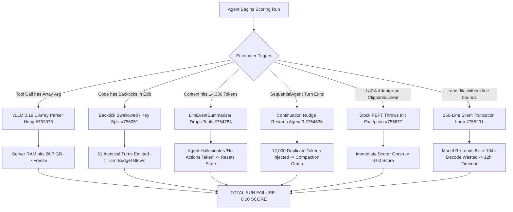

# Executive Summary of Discussion-Board Intelligence
**Document Version:** 2026-11-05 (Comprehensive Synthesis Across All Intel Sweeps)  
**Target Repository:** `input/kagglecomp/`  
**Primary Sources Analyzed:** `intel_20260930`, `intel_20261002`, `intel_20261006`, `intel_20261012`, `intel_20261031`, `intel_20261031_crossexam`, `intel_20261105`  
**Competition:** Google DeepMind — The Gemma 4 Developer Agent Competition (Kaggle Featured Prediction Competition)  
**Host & Staff Contacts:** Ryan Holbrook (Kaggle Staff), Dustin (Kaggle Staff), Elan Markowitz (Google DeepMind Host), Ashley Oldacre (Kaggle Staff)  

---

## Executive Overview & Strategic Orientation

Across the 305 total discussion threads and five major intelligence sweeps between September 30 and November 5, 2026, the competitive landscape has evolved from early environment discovery into an unforgiving, high-stakes engineering challenge. 

While the field has surged to **4,808 teams**, an astounding **90.99% of all participants (4,375 teams) sit at a score of exactly 0.00**. This near-universal failure rate is not driven by model cognitive limitations, but by **catastrophic, unhandled runtime failure modes**: vLLM tool-parser infinite loops, backtick-induced JSON key swallowing, harness context duplication, memory-swelling context compaction wipes, and hard 12-hour timeout kills.

At the top of the leaderboard, Grandmaster **Yurnero** stands alone at **Rank 1 with 0.29** (~17 tasks solved out of ~58 public evaluation tasks), having broken through the long-standing **0.24 Gold ceiling** (~14 tasks solved, shared by 9 teams). Yurnero has definitively confirmed that **fine-tuned LoRA adapters are viable and state-of-the-art**, directly contradicting community skepticism—provided strict computational budget constraints and exact model packaging rules are satisfied.

This document serves as the master operational digest. The most recent, mission-critical findings are presented immediately below, followed by targeted sections detailing exact implications for **local testing**, **analytics and leaderboard math**, **the submission pipeline**, **pertinent tasks and bonus tracks**, and a full **chronological intelligence matrix**.

---

## 1. Latest & Most Consequential Intelligence (November 2026 Frontier)

### 1.1 Leaderboard State & Competitive Dynamics (As of 2026-11-05)
* **Pinnacle (Rank 1):** Yurnero at **0.29** (18 submissions, solo GM). Confirmed 17/58 public tasks solved.
* **Gold Tier Cutoff (Ranks 2–10):** Nine teams tied at **0.24** (14/58 tasks). Three new jumpers (**tammam alasha**, **Pınar Aksoy**, **Takumu Hata**) broke into Gold between Nov 4 and Nov 5, jumping from 0.18 to 0.24 (+3 tasks).
* **The High Pack (Ranks 11–16):** Six teams at **0.22** (13/58 tasks).
* **Medal Cutoff Reality:**
  - **Gold Cutoff:** Rank 18 (Score: `0.22`, decided entirely by earlier submission timestamp).
  - **Silver Cutoff:** Rank 212 (Score: `0.20`).
  - **Bronze Cutoff:** Rank 433 (Score: `0.01`!). **Any score > 0.00 automatically places a team in the top 9% of the entire competition.**
  - **The Zero-Score Mass:** 4,375 teams (90.99%) have failed to solve a single evaluation task.

```
+-----------------------------------------------------------------------------------------+
|                               LEADERBOARD PYRAMID (N = 4,808)                          |
+-----------------------------------------------------------------------------------------+
| [0.29] Rank 1 (1 team)       --> Yurnero (LoRA + SFT frontier)                          |
| [0.24] Ranks 2-10 (9 teams)  --> Gold Tier ceiling (14 tasks)                           |
| [0.22] Ranks 11-16 (6 teams) --> Frontier wrapper engineering / Gold tie-break zone      |
| [0.10 - 0.20] Ranks 17-212   --> Silver Tier (solid prompt/tool setups)                 |
| [0.01 - 0.09] Ranks 213-433  --> Bronze Tier (functional agents, high timeout rate)     |
| [0.00] Ranks 434-4,808       --> 4,375 TEAMS (90.99%): HARNESS & TIMEOUT CASUALTIES     |
+-----------------------------------------------------------------------------------------+
```

---

### 1.2 The Top 6 Fatal Failure Modes Killing 91% of Submissions

Synthesized across the latest forum post-mortems and bug reports, these six defects explain why almost the entire field is flatlined at zero:



#### 1. The `edit_file` Backtick Key Swallowing Defect (Thread #756051 — 2026-11-05)
* **The Incident:** Contributor `joe_qrq` reported runs where `edit_file` systematically failed across **51 consecutive turns** without emitting the mandatory `old_string` parameter, trapped in a self-reinforcing autoregressive loop.
* **The Root Cause:** When Gemma 4 emits code inside `new_string` that contains backticks or complex line breaks, the parser misinterprets the backtick as a string terminator. It swallows the subsequent key identifier (`,old_string:`) directly into the payload text of `new_string`. The subsequent line of code (e.g., `class EndpointContext...`) is mistakenly promoted into a JSON dictionary key!
* **Harness Response:** The harness responds: `"mandatory input parameters are not present: old_string"`. Because this failure turn is appended to conversation history, Gemma 4 autoregressively repeats the identical broken structure 51 times until the per-task 60-turn budget is completely exhausted.
* **Prescriptive Rule:** **Immediately deprecate multi-string replacement tools (`old_string`/`new_string`).** Switch to single-argument heredoc patchers or line-numbered replacements `(start_line, end_line, replacement_text)`.

#### 2. vLLM 0.19.1 Synchronous Server Freeze on Array Arguments (Thread #753973 — 2026-10-29 to 2026-11-05)
* **The Incident:** Reported by `haji bolot` and corroborated on 2026-11-05 by `MarchFederico` and `cc`. When an agent emits a tool call containing a Python array (`list[str]`), if any element contains a closing square bracket `]` that is not escaped by Gemma's proprietary `<|"|>` delimiters (e.g. `args:["Optional[int]"]` or `args:["run","x = a[0]"]`), the vLLM 0.19.1 tool parser enters an **infinite loop on the main asyncio event loop**.
* **Impact:** The inference server's memory consumption balloons to **26.7 GB RAM**, completely freezing all HTTP request processing and ignoring `SIGTERM`.
* **Scorer Consequence:** The client has a 600-second read timeout. Task $K$ hangs. Tasks $K+1, \dots, 120$ cannot reach the dead server. **The entire submission receives a 0.00 score.**
* **Prescriptive Rule:** **Strictly eliminate all array/list arguments (`list[str]`) from every tool schema in `agent.yaml`.** All arguments exposed to Gemma 4 must be flat scalar strings (e.g., `cmd: str`, `path: str`).

#### 3. The LoRA Zero-Score Collapse vs. Yurnero's Confirmation (Threads #755677 & #755611 — Nov 2026)
* **The Incident:** Kaggle Grandmaster Luca Massaron submitted two high-effort LoRA adapters on `gemma-4-31b-it-qat-w4a16-ct` (Rank-16 SFT: 509 MB; Rank-4 SVD: 127 MB). While his zero-shot baseline scored **0.18**, both LoRA adapters scored **0.00**.
* **Root Causes Revealed:**
  1. *`Gemma4ClippableLinear` Incompatibility:* Unquantized Gemma 4 checkpoints wrap linear layers in custom `Gemma4ClippableLinear` modules. Stock HuggingFace PEFT `_create_new_module` throws an unhandled `ValueError`, crashing the submission before Task 1 begins.
  2. *Token & Latency Inflation (Kapil Chopra):* Functioning LoRA adapters cause Gemma 4 to output **+45% more tokens per turn** and add **+29% per-call latency**. At standard budgets (8 min/task, 4096 thinking), 120 tasks take $\approx 15.0\text{ hours}$, blowing through Kaggle's hard **12-hour evaluation kill switch**.
* **The Counter-Proof from Rank 1:** Grandmaster Yurnero (Rank 1, 0.29) intervened: *"It is possible to score > 0 with a LoRA adapter."*
* **The Operational Fix:** To survive, LoRA submissions must:
  - Package weights in the exact directory tree: `adapters/<adapter_name>/adapter_model.safetensors` and `adapter_config.json`.
  - Enforce tight execution limits: **$\le 6.0$ minutes per task** and `thinking_budget: 2048`.

#### 4. The Continuation Nudge Context Duplication Bug (Thread #754636 — 2026-10-31 to 2026-11-01)
* **The Incident:** Discovered by `Murugesan Narayanaswamy`. In Google ADK `agent_runner.py`, when a `SequentialAgent` is executing (e.g. Stage 1 Locator $\to$ Stage 2 Solver), if a turn exits before patch submission, the harness continuation nudge (`"Please continue solving the task..."`) is **routed back to `sub_agents[0]` (the locator)** instead of the currently active solver agent.
* **Impact:** `sub_agents[0]` restarts from scratch, re-scanning the workspace and injecting **10,000 to 12,000 duplicate tokens** into the prompt. This triggers immediate context overflow or premature compaction.
* **Prescriptive Rule:** **Do not use multi-agent SequentialAgent pipelines.** Maintain a single, monolithic `LlmAgent`.

#### 5. `LlmEventSummarizer` Drops All Tool Calls and Responses (Thread #754783 — 2026-11-01)
* **The Incident:** Discovered by `carlesoctav`. During ADK automatic context compaction (`EventsCompactionConfig`), `LlmEventSummarizer._format_events_for_prompt()` extracts history using `if part.text: text += part.text`.
* **Impact:** Because tool calls are stored in `part.function_call` and tool responses in `part.function_response` (where `part.text` is `None` or empty), **the summarizer drops 100% of all tool executions, command outputs, and diffs**.
* **Hallucination Loop:** The summarizer generates: *"Task assigned, but no actions or code changes have been made yet."* The model reads this summary, believes it has executed nothing, and resets its search from turn 1.
* **Prescriptive Rule:** **Disable automatic ADK compaction.** Manage context truncation manually via scratchpad state or strict token budgets.

#### 6. The 150-Line `read_file` Truncation Trap (Thread #755291 — 2026-11-03)
* **The Incident:** XingLing's trace audit revealed that `read_file` silently truncates responses at 150 lines without warning the model. On large files (e.g. `fastapi/params.py`, 754 lines), Gemma 4 called `read_file` 6 consecutive times without line bounds, burning 1,152 duplicate tokens and never seeing the bug.
* **Prescriptive Rule:** Prompt the agent to locate symbols with `grep` or `find`, and enforce explicit line ranges `read_file(path, start_line, end_line)`.

---

## 2. Direct Impact on Local Testing & Evaluation (CV Architecture)

### 2.1 Resolving the Local CV vs. Leaderboard Anti-Correlation
Historically, competitors reported strong anti-correlation between local validation and the public leaderboard (e.g., 508shuto: local CV 0.316 $\to$ LB 0.03; Isaka Tsuyoshi: local CV 0.24 $\to$ LB 0.10). 

The root causes have been completely unpacked across threads #743973, #744370, and #751487:
1. **Plain Notebook / Docker Sandbox Inconsistencies:** The official `swegemma` grader running inside a default local Kaggle notebook passes only **52 of 129 public gold patches** (fastapi passes only 10/67). Missing system dependencies and wheel collisions cause local tests to fail even on perfect code.
2. **The Calibrated Sandbox Fix (Zbigniew Kirchner #751487):** Rebuilding a local grading environment that mirrors Kaggle's production Docker container (clean venvs, exact competition wheels, Python 3.12/3.13 alignment) restores gold patch pass rates to **127 of 129 tasks** (fastapi 66/67, rich 47/48, requests 13/13, httpx 1/1).
3. **Host Confirmation on Test Set Integrity (Ryan Holbrook #744370, #747248):** Host Ryan Holbrook explicitly confirmed:
   > *"I can confirm that the hidden tasks validate at 100% with a 'gold patch' submission."*
   > *"None of the published training repositories appear in the test set."*
   The public evaluation harness failures are local configuration artifacts; the private evaluation environment is healthy.

### 2.2 The 11 Structurally Unsolvable Public Tasks (True Public Ceiling $\approx 0.91$)
Audits by Aridio Silva (#755554) and Luxshan Thavarasa (#754586) proved that approximately 11 public tasks cannot pass in the scoring sandbox even with the author's gold reference patch:

| Task ID | Failure Symptom | Sandbox Root Cause |
|---|---|---|
| `fastapi_14186` | Required test skipped | Patch defines `@needs_pydanticv1` and `@needs_pydanticv2`. Sandbox installs only Pydantic 2.13.4. V1 tests skip. The verifier marks any skipped required test as FAIL. |
| `rich_3486` | Required test skipped | Test patch contains `skipif < 3.11` and `skipif >= 3.11`. Exactly one condition skips under any Python interpreter. Verifier marks skipped test as FAIL. |
| `rich_3472` | AssertionError | Python 3.13 formats `AttributeError` across multiple lines; gold test asserts Python 3.12 single-line format string. |
| `requests_6589` | `OSError: Network unreachable` | Test connects to external IP expecting HTTP timeout; Docker `network_mode: none` aborts connect instantly. |
| `requests_6592` | `OSError: Network unreachable` | Docker network isolation prevents test completion. |
| `requests_6629` | `OSError: Network unreachable` | Docker network isolation prevents test completion. |
| `requests_6757` | `OSError: Network unreachable` | Docker network isolation prevents test completion. |
| `requests_7328` | `OSError: Network unreachable` | Docker network isolation prevents test completion. |
| `requests_7433` | `OSError: Network unreachable` | Docker network isolation prevents test completion. |
| `requests_7502` | `OSError: Network unreachable` | Docker network isolation prevents test completion. |
| `requests_7505` | `OSError: Network unreachable` | Docker network isolation prevents test completion. |

> [!IMPORTANT]
> **Validation Rule:** Mask these 11 tasks out of local benchmark denominators. On the ~58 public evaluation tasks, ~5 tasks are unsolvable. **The true maximum reachable public score is $\approx 0.91$ (53/58 tasks), not 1.00.**

### 2.3 Local vLLM Inference Flags & Version Pitfalls
To prevent local-vs-remote runtime divergence:
* **`--reasoning-config` Flag Required (#745059):** Stock vLLM rejects `thinking_token_budget` unless started with `--reasoning-config`. Without this flag, 100% of tasks fail locally with 0 tool calls. (The Kaggle scorer starts with this flag enabled).
* **Gemma 4 12B Serving Override (#748287):** When evaluating `gemma-4-12b-it-qat-w4a16-ct`, vLLM requires explicit CLI overrides:
  `--hf-overrides '{"architectures": ["Gemma4ForCausalLM"], "model_type": "gemma4"}'`
  The official submission scorer already has this patch applied.
* **Wheelhouse v30 Dependencies (#747914, #748323):** Python 3.12.13 pin is required. Installing on Python 3.13 breaks nine `cp312` precompiled wheels.

---

## 3. Direct Impact on Analytics & Competition Modeling

### 3.1 Leaderboard Scoring Mathematics & Truncation Exactness
Kaggle calculates public leaderboard scores using **exact truncation (floor)** rather than rounding:
$$\text{Display Score} = \left\lfloor \frac{\text{Passed Tasks}}{58} \times 100 \right\rfloor \div 100 \quad \left(1 \text{ task} \approx 0.01724\right)$$

This formula mathematically dictates the exact leaderboard structure:
* **17 tasks:** $\lfloor 17/58 \times 100 \rfloor / 100 = \mathbf{0.29}$ (Rank 1 — Yurnero)
* **14 tasks:** $\lfloor 14/58 \times 100 \rfloor / 100 = \mathbf{0.24}$ (Ranks 2–10 — Gold Tier)
* **13 tasks:** $\lfloor 13/58 \times 100 \rfloor / 100 = \mathbf{0.22}$ (Ranks 11–16)
* **12 tasks:** $\lfloor 12/58 \times 100 \rfloor / 100 = \mathbf{0.20}$ (Ranks 17–212)
* **11 tasks:** $\lfloor 11/58 \times 100 \rfloor / 100 = \mathbf{0.18}$
* **10 tasks:** $\lfloor 10/58 \times 100 \rfloor / 100 = \mathbf{0.17}$
* **Structural Score Holes:** The scores `0.16`, `0.19`, `0.21`, `0.23`, `0.25`, `0.26`, `0.27`, and `0.28` **can never exist**. No integer between 0 and 58 divided by 58 truncates to these numbers.

### 3.2 Public Evaluation Noise Model & Statistical Significance
Extensive empirical testing by Adam Johnson (#753524, 200+ runs) and Harshit Kumar established the noise profile of the evaluation harness:
* **Measured Variance ($\sigma$):** $\sigma \approx 1.0\text{ task}$ per 7-task draw, which scales to **$\approx 2.0\text{ tasks}$ ($\approx \pm 0.035$ score delta) on the 58-task public set**.
* **Same-Code Variance:** Byte-identical submission archives resubmitted on different days have varied by up to 2 tasks (e.g., scoring 0.17 on Day 1, and 0.20 on Day 2).
* **Statistical Clustering:** The entire band from `0.15` to `0.24` (ranks 2 through 2,300) represents a single overlapping statistical cluster. Single-task changes ($+0.01$ or $+0.02$) provide zero confidence of genuine architectural progress.
* **Tie-Breaking Rule:** All medal boundaries fall inside tied score blocks. Kaggle breaks ties strictly by **earliest submission timestamp**.

### 3.3 Task Difficulty Ceiling & Teacher Distillation Realities
* **The Multi-File Barrier (#753524):** Adam Johnson's analysis of all 129 public tasks revealed that **35 of 38 multi-file tasks have never been solved by any competitor**. Single-file localization and editing represent virtually all solved tasks on the leaderboard.
* **Teacher Model Parity (#747168):** Controlled experiments comparing trajectory generation across teacher models showed negligible variance:
  - DeepSeek V4 Pro: 58/124 solved
  - Qwen 3.6 27B: 59/123 solved
  - Gemma 4 31B: 54/124 solved
  48 tasks were solved by no teacher. Distillation provides marginal returns; prompt precision, tool reliability, and runtime survival dominate performance.

---

## 4. Direct Impact on the Submission Process & Operational Logistics

### 4.1 The Hard 12-Hour Scoring Limit
* **Hard Global Timeout (#743063, #745805, #747519):** Host Ryan Holbrook officially confirmed that **unfinished tasks will NOT be scored as 0**. 
* **Catastrophic Failure:** If total evaluation runtime exceeds 12.0 hours (43,200 seconds), **the entire notebook terminates with `Notebook Timeout` and receives an official score of 0.00**. Partial progress is completely lost, and the team's daily submission slot is consumed.
* **Task Budget Arithmetic:** 
  The evaluation evaluates the **full hidden test set (both public and private splits $\approx 120$ tasks)** in a single run:
  $$\text{Budget Per Task} = \frac{12.0 \text{ hours} \times 60 \text{ min}}{120 \text{ tasks}} = \mathbf{6.0 \text{ minutes per task}}$$
* **Compulsory `eval_config.yaml` Settings:**
  - `max_time_minutes: 5.5` or `6.0` (Hard ceiling per task; never set higher).
  - `max_turns: 40` to `60` (Prevents runaway tool loops).
  - `max_tool_calls: 30` to `40`.

### 4.2 Queue Delays & The One-Pending Submission Limit
* **Queue Congestion (#747519, #755527, #756044):** 4× L4 GPU demand across Kaggle (exacerbated by ARC-2) has created queue delays ranging from **24 to 34+ hours**.
* **Pending Submission Limit:** Teams are restricted to **exactly 1 in-flight pending submission** at any time. If a submission queues for 30 hours, no new submissions can be made, effectively reducing submission throughput to one every 1.5 to 2 days.
* **Queue Time vs. Run Time:** Queue time does **not** count toward the 12-hour evaluation budget.
* **System Errors / Batch Rescoring:** Submissions failing due to infrastructure errors ("Kaggle Error" or queue drops $>15\text{ h}$) are automatically reprocessed by backend batch scripts. **Do not burn support tickets or panic-resubmit.**

### 4.3 Two Final Submissions Rule (Host Ruling #752220)
* Host Elan Markowitz confirmed:
  > *"A team's private leaderboard score is the better of the private leaderboard scores of its two selected Final Submissions. There's no downside to selecting a second submission."*
* **Strategic Hedge:** Teams must select two distinct submissions before deadline:
  1. **Slot 1 (Main Podium Hedge):** Monolithic Gemma 4 31B with proven, hardened tool execution and 5.5-minute task caps.
  2. **Slot 2 (Small Model Bonus Hedge):** Gemma E4B or E2B submission targeting the $10,000 bonus.

### 4.4 Model Family & Packaging Rules
* **No Model Mixing (#748287):** All agents and sub-agents within a submission must use the exact same base model variant (`31b`, `12b`, `e4b`, or `e2b`). Mixing variants (e.g. 31B solver with 12B locator) is strictly prohibited.
* **Test File Edit Stripping (#748323):** Wheelhouse v30 automatically strips all modifications made to test directories (`tests/`) prior to patch grading. Agents editing test files to force a green test suite will produce an empty patch.

---

## 5. Pertinent Side Tracks & Bonus Opportunities

### 5.1 The $10,000 Small Model Development Bonus (Thread #751104)
* **Prize Terms:** $10,000 cash awarded to the highest-ranking private-set submission utilizing **Gemma E2B or Gemma E4B** (`-it-qat-w4a16-ct`).
* **Eligibility Rules:** Must be one of the team's two officially selected final submissions. LoRA fine-tuning is permitted. Fully cross-eligible with the main leaderboard and Paper Track.
* **Competitive Reality:** Leaderboard sweeps show that **virtually zero teams have submitted working E2B/E4B entries**. The dedicated tracking notebook (`ryanholbrook/gemma-4-developer-agent-small-model-leaderboard`) has shown negligible traffic.
* **Winning Target:** Because the frontier 31B model solves 17 tasks and 25% of the pool is dead, an E4B agent solving **4 to 6 tasks (`0.06` to `0.10`)** is strongly positioned to win the $10,000 prize.
* **Critical E4B Caveats:**
  - *Format Error (#752128):* Multiple competitors encountered `"Submission Scoring Error: incorrect format"` when submitting E4B bundles identical to working 31B configs. Verify packaging locally.
  - *Character Drop Bug (#753277):* QAT 4-bit Gemma E4B has a known tensor scale flaw that drops trailing characters during verbatim text copy operations. Avoid exact-match string editors on E4B.

### 5.2 The $35,000 Paper Track Hackathon (Closes 2026-11-12)
* **Hard Deadline:** **2026-11-12 11:59 PM UTC** (Closes 18 days *before* the main competition deadline of 2026-12-02!).
* **Prize Purse:** $35,000 total ($15,000 / $10,000 / $10,000).
* **Format:** 3,000-word maximum PDF writeup evaluated across five dimensions (0–5 scale): **Novelty, Quality, Relevance, Verifiability, Clarity**.
* **Key Strategic Asset:** The empirical failure modes, noise measurements ($\sigma \approx 2$), dead-task censuses, and formal verification masking proofs extracted from these forum threads provide the exact empirical ground truth the Paper Track rubric rewards.

---

## 6. Master Chronological Intelligence Matrix (All Intel Sweeps)

| Intel Wave | Window Covered | Key Architectural Discoveries & Events | Impact on Strategy |
|---|---|---|---|
| **Wave 1** (`intel_20260930`) | Launch to 2026-09-30 | • Host confirms 100% gold patch pass on hidden tasks (#744370)<br>• LoRA fails: KV collapse (46k $\to$ 7.6k) and silent weight zeroing (#743508, #744331)<br>• Double-JSON escaping causes 62% edit failure (#744272)<br>• Thinking thoughts dropped between turns (`reasoning` vs `reasoning_content`) (#744354)<br>• 12h overrun fails whole run (#743063) | Gated LoRA exploration. Hardened tool argument escaping. Set initial per-task time limits. |
| **Wave 2** (`intel_20261006`) | 2026-10-02 to 2026-10-06 | • Wheelhouse v28 active<br>• Host confirms private tasks touch NO `async def` functions (#745998)<br>• Open-weight trajectory distillation permitted (#746046)<br>• Context overflow at 14,336 compaction threshold empties patches (#745977)<br>• Graph tools audit: TF-IDF beats embeddings (52% vs 9% top-10 recall) (#745731)<br>• Six public tasks proven unwinnable without unseen test names (#745855) | Excluded async graph optimization. Banned code restatements. Set usable prompt ceiling at 32k - max_output_tokens. |
| **Wave 3** (`intel_20261012`) | 2026-10-06 to 2026-10-12 | • Wheelhouse v30 released (swegemma 0.2.11)<br>• Scoring queue crisis (33h wait); 1-pending submission limit introduced (#747519)<br>• Host reconsiders "0 for unfinished tasks"—12h hard kill remains (#745805)<br>• New models: 12B, E4B, E2B allowed; 12B needs `--hf-overrides` (#748287)<br>• `thinking_budget: 0` becomes only switch to disable thinking (#747914)<br>• Edits to `tests/` stripped by harness (#748323)<br>• Teacher distillation yields negligible delta across models (#747168) | Adopted single-model family constraint. Budgeted strictly for 120 tasks within 12h. Prepared for long submission queues. |
| **Wave 4** (`intel_20261031`) | 2026-10-12 to 2026-10-31 | • 0.24 ceiling broken: Yurnero reaches 0.29 (Rank 1)<br>• Mathematical validation of score truncation formula and score holes<br>• Noise model established ($\sigma \approx 2\text{ tasks}$)<br>• $10,000 Small Model Bonus announced (#751104)<br>• Two final submissions rule confirmed: better private score taken (#752220)<br>• vLLM 0.19.1 array parser infinite loop discovered (#753973)<br>• Zbigniew Kirchner calibrates local sandbox to 127/129 pass rate (#751487) | Established strict noise filter for CV. Formulated two-submission hedge strategy (31B + E4B). Initiated array-free tool schemas. |
| **Wave 5** (`intel_20261105`) | 2026-10-31 to 2026-11-05 | • 4,808 teams; 90.99% sit at 0.00<br>• Tool serialization catastrophe: backtick swallowing in `edit_file` (#756051)<br>• vLLM array hang corroborated with 26.7 GB memory leak (#753973)<br>• LoRA paradox solved: Luca Massaron 0.00 vs Yurnero 0.29 (#755677)<br>• Continuation nudge bug wipes SequentialAgent state (#754636)<br>• LlmEventSummarizer drops all tool history during compaction (#754783)<br>• Unresolvable sandbox tasks formalized (`fastapi_14186` Pydantic v1/v2 conflict) (#755554)<br>• 76% decode time audit; 150-line `read_file` silent truncation (#755291)<br>• Miranda releases `gemma4-swe-agent` (Apache 2.0 heredoc editor) (#755172) | Complete migration to single-argument heredoc patcher. Elimination of SequentialAgent and compaction. Enforced 5.5 min / 2048 thinking budgets. |

---

## 7. Actionable Pre-Submission & Engineering Checklist

Before building, testing, or submitting any candidate agent bundle, verify compliance against every mandatory check below:

### A. Tool Schema & Serialization Safety
- [ ] **Zero Array Parameters:** Inspect `agent.yaml`. Confirm that **no parameter uses `type: array` or `list[...]`**. All arguments (commands, file paths) must be flat scalar strings to prevent the vLLM 0.19.1 hang (#753973).
- [ ] **Single-Argument File Editor:** Replace any `(filepath, old_string, new_string)` tools with a **single-argument heredoc patcher** (e.g. `apply_patch(patch_text: str)`) or line-index editor `(start_line, end_line, content)` to eliminate backtick key swallowing (#756051).
- [ ] **Bounded File Reading:** Prohibit naked `read_file` calls. Mandate `start_line` and `end_line` bounds, or prompt the model to use `grep` first, avoiding the 150-line truncation trap (#755291).
- [ ] **No Code Echoing:** Include hard prompt instructions: *"Do not restate or echo code from the file. Formulate your plan in two sentences and call the patch tool."* (Saves up to 104s decode per turn).

### B. Agent Architecture & Context Management
- [ ] **Monolithic Agent Only:** Use a single `LlmAgent`. **Do not use `SequentialAgent`** (avoids continuation nudge state wiping #754636).
- [ ] **Disable ADK Compaction:** Do not configure `EventsCompactionConfig` (avoids `LlmEventSummarizer` tool deletion #754783 and compaction prompt overflows #745977).
- [ ] **Prompt Envelope Bounding:** Ensure total context never exceeds $32,768 - \text{max\_output\_tokens}$ ($32,768 - 4,096 = 28,672\text{ tokens}$).

### C. Execution Budgets & Timeouts (`eval_config.yaml`)
- [ ] `max_time_minutes: 5.5` or `6.0` (Guarantees $120 \times 6.0\text{ min} = 12.0\text{ hours}$ maximum run time, preventing catastrophic `Notebook Timeout`).
- [ ] `thinking_budget: 2048` in `configs/sampling.yaml` (Prevents 100-second reasoning stalls while retaining deduction quality).
- [ ] `max_output_tokens: 4096` (Prevents 400 Bad Request context overflow).
- [ ] `max_turns: 40` to `60`.
- [ ] `max_tool_calls: 30` to `40`.

### D. LoRA Adapter Validation (If Submitting an Adapter)
- [ ] **Directory Structure:** Weights must be stored at `adapters/<adapter_name>/adapter_model.safetensors` with `adapter_config.json`.
- [ ] **Target Modules:** Verify that adapter targets unquantized linear weights and does not invoke unpatched PEFT on `Gemma4ClippableLinear` (#755677).
- [ ] **End-to-End Latency Benchmark:** Local verification on 4× L4 GPUs must demonstrate total per-task wall-clock time $\le 5.5\text{ minutes}$ under adapter decode overhead (+29% latency).

### E. Operational & Logistics Rules
- [ ] **Lead Time Planning:** Submit candidate models with at least **36 hours of lead time** to account for Kaggle's 28–34 hour queue delay.
- [ ] **Final Picks Configured:** Before the competition close, explicitly select **both final submissions** on Kaggle's submission portal (Hedge: 1 Monolithic 31B + 1 E4B Bonus run).
- [ ] **Paper Track Submission:** Finalize and upload the 3,000-word PDF writeup before **2026-11-12 11:59 PM UTC**.

