# COMBINED MARKDOWN - combine

_Generated 2026-11-05 18:59:17 | 4 files | folder: D:\stuff\docs\taylor_fv\github\rayrite.github.io\cvx\kaggle2\items\combine_

## Contents

1. 01_Executive_Summary_and_Competition_Dossier.md
2. 02_Comprehensive_Tab_by_Tab_Intelligence_Report.md
3. 03_Operational_Guide_Public_Notebook_and_Project_Link.md
4. 04_Strategic_Playbook_and_Award_Targeting.md

---

<!-- ====================================================================== -->
<!-- FILE: 01_Executive_Summary_and_Competition_Dossier.md -->
<!-- ====================================================================== -->

# Executive Summary & Competition Dossier: Google - The Gemma 4 Developer Agent Paper Track

**Competition Title:** Google - The Gemma 4 Developer Agent Paper Track  
**Platform:** Kaggle  
**Direct URL:** [https://www.kaggle.com/competitions/gemma-4-developer-agent-paper](https://www.kaggle.com/competitions/gemma-4-developer-agent-paper)  
**Host / Sponsor:** Google LLC & Google DeepMind  
**Research Focus:** Advancing state-of-the-art agentic software engineering using the open-weights Gemma 4 model ecosystem  
**Total Dedicated Prize Pool:** $35,000 USD  
**Paper Submission Deadline:** November 12, 2026 at 11:59 PM UTC  
**License Requirement:** Open Source Apache 2.0  

---

## 1. Executive Briefing & Context

The **Google - The Gemma 4 Developer Agent Paper Track** is a premier research companion track hosted on Kaggle alongside the primary *Google - The Gemma 4 Developer Agent Competition*. 

While the main prediction competition evaluates automated coding agents strictly on automated execution metrics (e.g., benchmark bug resolution rates, patch generation fidelity, and code execution passes within an evaluation harness), the **Paper Track** evaluates the scientific, architectural, and methodological foundations behind building autonomous software engineering agents.

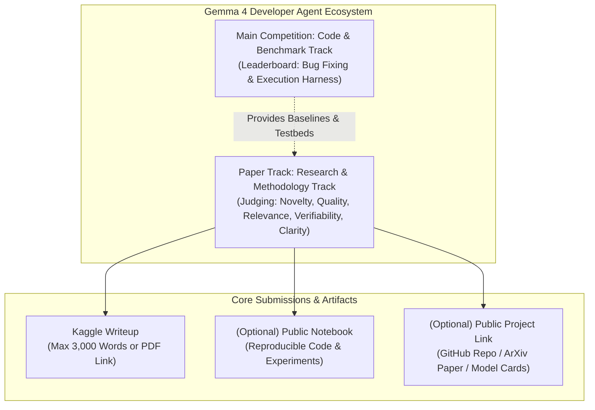

### Strategic Objectives
1. **Accelerate Open-Source Agentic SWE:** Drive empirical discoveries and novel scaffolding techniques that allow local, small-to-medium open-weights models (such as Gemma 4 E2B, E4B, 12B, and MoE variants) to rival proprietary Frontier models on complex codebase tasks.
2. **Bridge Architectural Gaps:** Foster innovations in parameter-efficient fine-tuning (PEFT/LoRA), reinforcement learning (RL) from code execution feedback, Abstract Syntax Tree (AST) code-graph construction, semantic skeletonization, and repository context compaction.
3. **Formalize Benchmarking & Tool Interfaces:** Document reusable datasets, reproducible evaluation protocols, and domain-specific tool suites for developer agents.

---

## 2. Core Metadata & Key Specifications

| Parameter | Specification | Details |
| :--- | :--- | :--- |
| **Track Name** | Google - The Gemma 4 Developer Agent Paper Track | Official Kaggle Research Paper Track |
| **Parent Competition** | Google - The Gemma 4 Developer Agent Competition | Leaderboard prediction track running in parallel |
| **Primary Host** | Google LLC / Google DeepMind | Lead coordinators: Ryan Holbrook, Elan Markowitz, Bryan Perozzi |
| **Submission Format** | Kaggle Writeup (Platform Native) | Max 3,000 words in editor OR arXiv-ready PDF via Public Project Link |
| **Dedicated Prize Pool** | $35,000 USD | Distributed across 3 distinct award categories |
| **Maximum Team Size** | 5 Members | Team mergers permitted up to merger deadline |
| **Daily Submission Limit** | 5 Submissions / Day | Applies to draft iterations and submissions |
| **Final Submissions for Judging** | Maximum 2 Writeups | Selected explicitly by the team prior to deadline |
| **Winning License** | Open Source Apache 2.0 | Code and artifacts must be openly accessible |
| **Key Milestones** | September 22, 2026 – November 12, 2026 | Paper track closes November 12, 2026 (11:59 PM UTC) |

---

## 3. Competition Timeline & Deadlines

The Paper Track operates on a compressed schedule compared to the main prediction track to allow the Google DeepMind judging committee to review papers, evaluate empirical validity, and coordinate presentations for Google-sponsored events (such as NeurIPS workshops).

| Date / Milestone | UTC Timestamp | Scope / Action Required | Status |
| :--- | :--- | :--- | :--- |
| **Competition Launch** | September 22, 2026 | Rules opened, starter kits released | Active |
| **Paper Track Submission Deadline** | **November 12, 2026 (11:59 PM UTC)** | **Final write-up submission and notebook freeze** | **Critical Target (1 Week)** |
| **Main Track Rule Acceptance Deadline** | November 25, 2026 (11:59 PM UTC) | Rules acceptance cutoff for main track | Pending |
| **Main Track Team Merger Deadline** | November 25, 2026 (11:59 PM UTC) | Team formation lock for main track | Pending |
| **Main Track Final Submission** | December 2, 2026 (11:59 PM UTC) | Final code submission for prediction leaderboard | Pending |
| **Winner Announcements & NeurIPS Expo** | December 2026 | Award presentation and spotlight invitations | Post-Evaluation |

---

## 4. Prize Allocation Structure

The Paper Track awards $35,000 in dedicated cash prizes to incentivize diverse scientific and engineering contributions:

| Award Category | Prize Amount | Target Scope & Profile |
| :--- | :--- | :--- |
| **Overall Best Paper** | **$15,000 USD** | Highest cumulative score across all five judging criteria. Recognizes transformative theoretical or empirical breakthroughs in agentic software engineering. |
| **Best New Resource** | **$10,000 USD** | Awarded to exceptional contributions providing open datasets, specialized benchmarks, code-graph toolkits, AST-parsing frameworks, or evaluation environments. |
| **Best New Application** | **$10,000 USD** | Awarded to outstanding real-world system designs, interactive developer tools, specialized multi-agent orchestrations, or end-to-end bug fixing applications using Gemma 4. |
| **Total Dedicated Pool** | **$35,000 USD** | Note: A single writeup can be considered for multiple categories, but may win only one award. |

---

## 5. Official Evaluation Framework & Rubric

Every submitted paper is evaluated by a specialized expert committee from Google DeepMind and Kaggle. Each paper receives a score from **0 (lowest) to 5 (highest)** across five weighted dimensions, which are averaged for a final composite score:

| Evaluation Dimension | Scale | Core Evaluation Questions & Focus Areas |
| :--- | :--- | :--- |
| **1. Novelty** | 0 to 5 | Does the research introduce fresh concepts, unique architectures, or deepen theoretical understanding of existing methods? Does it uncover non-obvious properties of Gemma 4? |
| **2. Quality** | 0 to 5 | How rigorous are the experiments? Are baselines fair and sound? Is the approach generalizable beyond competition-specific quirks to broader software engineering challenges? |
| **3. Relevance** | 0 to 5 | How significant is the research to the field of agentic machine learning and autonomous developer agents? Does it offer actionable impact for the practitioner community? |
| **4. Verifiability** | 0 to 5 | Are implementation details, training setups, datasets, and prompts sufficiently documented? Can the findings be reproduced independently using the public notebook and code? |
| **5. Clarity** | 0 to 5 | Is the paper well-structured, clear, concise, and academically rigorous? Does it feature intuitive diagrams, well-organized tables, and unambiguous prose? |

---

## 6. Official Citation & Organization Committee

The official BibTeX citation provided by Kaggle lists the core Google DeepMind and Kaggle research and engineering teams directing this initiative:

```bibtex
@misc{gemma-4-developer-agent-paper,
  author = {Elan Markowitz and Bryan Perozzi and Benedek Rózemberczki and Glenn Cameron and Hadi Hemmati and Yuchen Li and Michael Galkin and Majid Farhadi and Ryan Holbrook and Ashley Oldacre},
  title = {Google - The Gemma 4 Developer Agent Paper Track},
  publisher = {Kaggle},
  year = {2026},
  url = {https://www.kaggle.com/competitions/gemma-4-developer-agent-paper}
}
```

### Lead Organizers & Academic Roles
- **Ryan Holbrook & Ashley Oldacre:** Kaggle Competitions & Community Lead; Creator of the official baseline notebooks and evaluation harness.
- **Bryan Perozzi, Elan Markowitz & Benedek Rózemberczki:** Google DeepMind Research Scientists specializing in Graph Neural Networks, Code Representation, and Large Language Model Reasoning.
- **Michael Galkin & Majid Farhadi:** Knowledge Graphs and Structured Reasoning Experts at Google DeepMind.
- **Hadi Hemmati, Yuchen Li & Glenn Cameron:** Software Engineering Agents, Automated Program Repair, and Benchmark Infrastructure Specialists.


---

<!-- ====================================================================== -->
<!-- FILE: 02_Comprehensive_Tab_by_Tab_Intelligence_Report.md -->
<!-- ====================================================================== -->

# Comprehensive Tab-by-Tab Intelligence Report: Google - The Gemma 4 Developer Agent Paper Track

**Target URL:** [https://www.kaggle.com/competitions/gemma-4-developer-agent-paper](https://www.kaggle.com/competitions/gemma-4-developer-agent-paper)  
**Track Type:** Academic / Empirical Research Track via Kaggle Writeups  
**Analysis Date:** November 5, 2026  

---

## 1. Overview Tab Intelligence (`/overview`)

The **Overview** tab serves as the central administrative and scientific charter for the paper track. It is subdivided into five critical sub-sections: *Description*, *Evaluation*, *Timeline*, *Prizes*, and *Citation*.

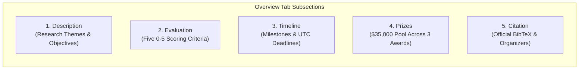

### 1.1 Description & Scientific Focus Areas
The paper track challenges participants to formulate, document, and publish original research that advances the operational frontier of autonomous software engineering agents. Unlike the main benchmark competition which is purely quantitative, the paper track emphasizes methodological clarity, architectural innovation, and reproducible science.

The official documentation highlights four primary research pillars:

| Research Pillar | Technical Focus | Core Research Questions |
| :--- | :--- | :--- |
| **1. Tuning & Optimization** | PEFT, LoRA, QLoRA, and Reinforcement Learning (RL / DPO / PPO) | How can small-to-midsize open models (e.g., Gemma 4 E2B, E4B) be fine-tuned specifically for multi-turn software engineering tasks? How can reward modeling be constructed from compiler feedback, test suite passes, and static analysis diagnostics? |
| **2. Code Comprehension** | Repository Parsing, Code Graphs, AST Embeddings, Semantic Slicing | What data structures enable local models with limited context windows to navigate million-line repositories? How can Abstract Syntax Trees (AST) and Call Graphs be transformed into compact, high-signal representations? |
| **3. Graph Reasoning** | Knowledge Graphs, Dependency Graphs, Multi-Hop Reasoning | How can LLMs reason over complex structural relationships across heterogeneous files, inheritance chains, and API boundaries without hallucinating nonexistent imports or signatures? |
| **4. Tasks & Benchmarks** | Novel SWE Benchmarks, Evaluation Datasets, Diagnostic Suites | What novel evaluation setups, auxiliary tasks, or synthetic datasets can measure specific agent competencies (e.g., bug localization, patch synthesis, regression testing, lint compliance)? |

### 1.2 Evaluation Rubric & Scoring System
Submissions are evaluated through Kaggle Writeups by an expert panel of Google DeepMind scientists and Kaggle engineers. Each submission is scored independently on a **0.0 to 5.0 scale** across five equally weighted criteria, and the composite score is the arithmetic mean of these values:

$$\text{Final Score} = \frac{\text{Novelty} + \text{Quality} + \text{Relevance} + \text{Verifiability} + \text{Clarity}}{5}$$

| Evaluation Dimension | Scoring Scale | Weight | Operational Evaluation Standard |
| :--- | :---: | :---: | :--- |
| **Novelty** | 0.0 – 5.0 | 20% | Does the paper propose original algorithms, architectures, or empirical discoveries? Does it reveal previously uncharacterized properties of Gemma 4 or challenge established agent paradigms? |
| **Quality** | 0.0 – 5.0 | 20% | Are experimental methodologies rigorous? Are baselines state-of-the-art and compared fairly? Does the proposed approach generalize across different languages, repos, and scales, or is it an overfit heuristic? |
| **Relevance** | 0.0 – 5.0 | 20% | What is the tangible impact of the research on real-world software engineering and agentic machine learning? Can practitioners adopt the techniques to build more effective coding assistants? |
| **Verifiability** | 0.0 – 5.0 | 20% | Are all datasets, training procedures, prompts, hyperparameters, and evaluation scripts transparently documented? Does the attached **Public Notebook** run cleanly end-to-end to reproduce reported results? |
| **Clarity** | 0.0 – 5.0 | 20% | Is the paper lucidly written, logically sequenced, and academically disciplined? Are figures, architectural schematics, tables, and mathematical formalisms crisp and informative? |

**Tie-Breaking Mechanism:** In the event of a tie in cumulative score between two or more entries, the writeup submitted earlier (based on Kaggle UTC timestamp) takes precedence.

### 1.3 How to Submit & Writeup Guidelines
The submission mechanics are integrated into Kaggle's native **Writeups** system:
- **Maximum Length:** 3,000 words if drafted in the Kaggle Writeup editor (excluding references and appendices). Alternatively, participants may submit an arXiv-ready PDF (standard double-column or single-column conference format) hosted externally via the **Public Project Link**.
- **Mandatory Structural Sections:**
  1. *Title and Subtitle:* Clear, descriptive formulation of the research topic.
  2. *Abstract:* High-level summary of the problem, hypothesis, method, and empirical findings.
  3. *Introduction:* Background, motivation, problem statement, and enumerated contributions.
  4. *Methods & Scaffolding:* Formal architectural description, algorithms, prompt designs, and tool interfaces.
  5. *Experiments & Results:* Empirical validation, baseline comparisons, ablations, and error analysis.
  6. *Related Works & Citations:* Academic contextualization with formal references.
- **Attachment Fields in Writeup Modal:**
  - `(Optional) Public Notebook`: Direct link or selection of a committed public Kaggle notebook.
  - `(Optional) Public Project Link`: External URL pointing to code repositories, arXiv PDFs, or model weights.

---

## 2. Code Tab Intelligence (`/code`)

The **Code** tab serves as the repository of reproducible code artifacts, baseline implementations, and shared community notebooks supporting the competition.

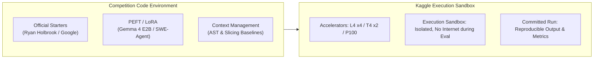

### 2.1 Official Starters & Reference Baselines
1. **"Getting Started - Gemma 4 Developer Agent" (Official Starter by Ryan Holbrook & Kaggle Hosts):**
   - Implements the foundational evaluation harness and benchmark loader.
   - Parses `tasks.jsonl` problem instances, spins up repository environments, and executes candidate patches.
   - Provides a reference baseline with naive tool calling and prompt templates.
2. **"Gemma 4 E2B LoRA Fine-Tuning & SWE-Agent Baseline":**
   - Demonstrates parameter-efficient fine-tuning (PEFT) on Gemma 4 E2B using LoRA adapters.
   - Integrates with the SWE-agent scaffolding (search, view, edit, bash execution tools).
   - Establishes training configurations for limited GPU memory (e.g., Kaggle L4 / T4 x2 environments).
3. **"Can Gemma 4 Become a Software Engineer? (Context Safety Baseline)":**
   - Focuses on prompt engineering, system instructions, and multi-turn context compaction.
   - Documents baseline public leaderboard performance (achieving ~0.18 bug resolution score on benchmark splits).
   - Details guardrails to prevent agent infinite loops and malformed diff generation.

### 2.2 Model Ecosystem & Hardware Environment
Participants in the paper track leverage the Google Gemma 4 family of models, accessible via Kaggle Models:
- **Gemma 4 E2B:** Ultra-lightweight 2-billion parameter model optimized for fast local edge inference and lightweight tool execution.
- **Gemma 4 E4B:** 4-billion parameter model striking a balance between memory efficiency and reasoning capacity; primary candidate for the Small Model research focus.
- **Gemma 4 12B:** Midsize dense model with robust reasoning and multi-turn coding capabilities.
- **Gemma 4 26B-A4B / 31B (MoE & Dense Variants):** High-capacity architectures for deep codebase comprehension and complex architectural planning.

### 2.3 Kaggle Notebook Constraints & Best Practices
- **Compute Acceleration:** Kaggle provides GPU instances (NVIDIA L4 x4, Tesla T4 x2, or P100) and TPU v3-8 instances subject to weekly quotas (30 hours/week).
- **Session Lifetimes:** Interactive sessions time out after 9 hours (or 12 hours for batch commits).
- **Network Access:** Notebooks during public exploration have internet access enabled, but official competition evaluations execute in fully air-gapped / isolated sandboxes.
- **Reproducibility Requirement:** To score high on *Verifiability*, notebooks must be committed via **"Save & Run All (Commit)"** so that all training logs, evaluation outputs, and graphs are permanently rendered in the public view.

---

## 3. Discussion Tab Intelligence (`/discussion`)

The **Discussion** tab is an active forum where Google DeepMind organizers, Kaggle staff, and international research teams debate technical challenges, clarify competition rules, and share architectural insights.

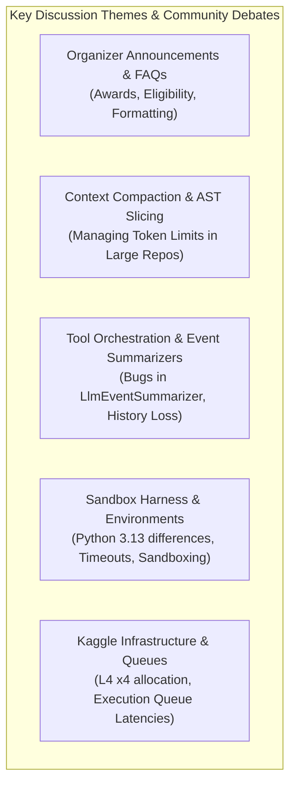

### 3.1 Key Organizer Clarifications & FAQs
1. **Submission Limits for Writeups:**
   - Teams can author multiple draft writeups, but **at most two (2) writeups** may be marked as final submissions for judging before the November 12, 2026 deadline.
2. **Award Eligibility Constraints:**
   - A single writeup can be nominated across multiple categories (e.g., both Best Paper and Best New Resource), but a single team/writeup **can win only one prize**. This ensures prize distribution across distinct research teams.
3. **Cross-Evaluation of Special Categories:**
   - Submissions for *Best New Resource* and *Best New Application* are judged against the same five foundational pillars (Novelty, Quality, Relevance, Verifiability, Clarity), but the panel contextualizes the criteria specifically for software artifacts (e.g., software engineering robustness, documentation, API clarity) versus pure theoretical papers.

### 3.2 Dominant Technical Hurdles & Engineering Discussions
1. **Context Window Bottlenecks & Token Budget Exhaustion:**
   - A major community pain point is that real-world repository files easily exceed model context windows (even 8k/16k tokens).
   - Discussions revolve around AST-based semantic skeletonization (stripping function bodies while retaining class/method signatures and docstrings) and Tree-sitter query integration to feed compact summaries into Gemma 4.
2. **Event Summarization Bugs (`LlmEventSummarizer`):**
   - Participants identified critical bugs in baseline agent summarizers where multi-turn history compression unintentionally dropped previous tool call invocations and environment responses.
   - This caused models to repeatedly hallucinate tool arguments or enter infinite retry loops. Fixing the summarization pipeline has been a major topic of technical exchange.
3. **Harness & Python 3.13 Runtime Discrepancies:**
   - Issues raised regarding discrepancies between local development environments and Kaggle's Docker evaluation containers (e.g., Python 3.13 AST changes, sub-process pipe blocking, and non-deterministic test runners).
4. **Queue Latency and GPU Quota Management:**
   - As deadlines approach, Kaggle L4 x4 submission queues experience elevated latency. Organizers advised participants to pre-commit companion notebooks early rather than waiting for the final hours.

---

## 4. Rules Tab Intelligence (`/rules`)

The **Rules** tab establishes the binding legal agreement governing eligibility, intellectual property, team structures, and code sharing.

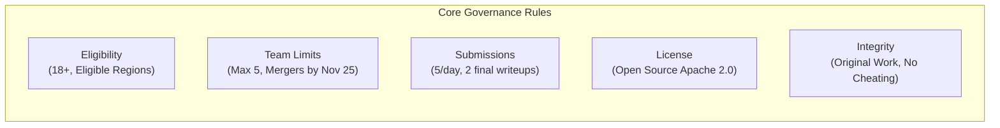

### 4.1 Eligibility & Participation Requirements
- **Age Requirement:** Participants must be at least 18 years old (or the legal age of majority in their jurisdiction of residence).
- **Sanctioned Jurisdictions:** Individuals residing in countries or regions under United States OFAC trade sanctions (e.g., Cuba, Iran, North Korea, Syria, Crimea/Donetsk/Luhansk regions) are ineligible to participate or receive prizes.
- **Account Policy:** Each participant is strictly permitted **only one Kaggle account**. Operating multiple accounts, spoofing identities, or submitting from alternate accounts results in immediate disqualification and platform banning.

### 4.2 Team Formation & Merger Regulations
- **Team Size Limit:** Teams may consist of **1 to 5 members**.
- **Team Mergers:** Permitted up to the Team Merger Deadline (November 25, 2026 for the broader competition, though paper submissions lock on November 12, 2026).
- **Submission Cap on Mergers:** A team merger is valid only if the combined submission count of the merging teams does not exceed the maximum allowable submission cap for the duration of the competition.
- **Independent Teams:** Private sharing of code, insights, or writeup drafts outside of an officially registered Kaggle team is strictly prohibited.

### 4.3 Intellectual Property & Open Source Licensing
- **Winner Licensing:** To receive cash prizes, winners must grant Google LLC and the public an irrevocable, royalty-free, non-exclusive license under the **Apache 2.0 Open Source License** for all submission code, models, and writeups.
- **Commercial Use:** The competition data and winner deliverables are licensed for broad research and commercial use under Apache 2.0 terms.
- **Open Access:** Submissions cannot rely on proprietary, closed-source tools or unreleased private APIs that would prevent independent verification or public open-source release.

### 4.4 Academic Integrity & Originality Mandates
- **Original Work:** All papers must document original, unpublished research. Plagiarism, fabricating experimental metrics, or re-submitting previously published conference papers is cause for immediate disqualification.
- **Citation of Prior Art:** Reused open-source libraries (e.g., SWE-agent, Aider, Tree-sitter, LangChain, DSPy) must be explicitly cited and differentiated from the author's novel contributions.
- **AI-Assisted Writing:** While AI tools may assist in drafting, all empirical claims, experiments, and technical analyses must be authentic and verifiable.

---

## 5. Comparative Summary Across All Four Tabs

| Metric / Dimension | Overview Tab | Code Tab | Discussion Tab | Rules Tab |
| :--- | :--- | :--- | :--- | :--- |
| **Primary Purpose** | Scientific Charter, Evaluation Rubric & Prizes | Reproducible Notebooks, Baselines & Environments | Community Exchange, Technical Troubleshooting & FAQs | Legal Terms, Eligibility & Compliance Governance |
| **Key Deliverables** | 3,000-word Writeup, PDF paper link | Runnable Kaggle Notebooks, LoRA configs | Issue reports, workarounds, design patterns | Signed acceptance, Apache 2.0 license grant |
| **Enforcement Body** | DeepMind Review Panel | Kaggle Automated Kernel Sandbox | Community Moderators & Hosts | Kaggle Compliance & Legal Counsel |
| **Critical Deadline** | November 12, 2026 (11:59 PM UTC) | Active during research phase | Continuous through post-competition | Acceptance required prior to entry |
| **Strategic Weight** | Defines how to score high across 5 pillars | Proves Verifiability & Quality scores | Uncovers common pitfalls to avoid | Prevents administrative disqualification |


---

<!-- ====================================================================== -->
<!-- FILE: 03_Operational_Guide_Public_Notebook_and_Project_Link.md -->
<!-- ====================================================================== -->

# Operational Guide: Creating and Linking the (Optional) Public Notebook & Project Link

**Target Competition:** Google - The Gemma 4 Developer Agent Paper Track  
**Reference URL:** [https://www.kaggle.com/competitions/gemma-4-developer-agent-paper/overview](https://www.kaggle.com/competitions/gemma-4-developer-agent-paper/overview)  
**Submission Mechanism:** Kaggle Writeups Editor with Linked Artifacts  

---

## 1. Architectural Role of Optional Links in Kaggle Writeups

When submitting an academic research writeup for the Gemma 4 Developer Agent Paper Track, the Kaggle submission interface provides two dedicated attachment fields:
1. **`(Optional) Public Notebook`**
2. **`(Optional) Public Project Link`**

While labeled *(Optional)* in the UI, attaching both artifacts is **practically essential for competitive submissions**. The Google DeepMind review panel evaluates entries against five criteria, two of which are directly determined by these artifacts:

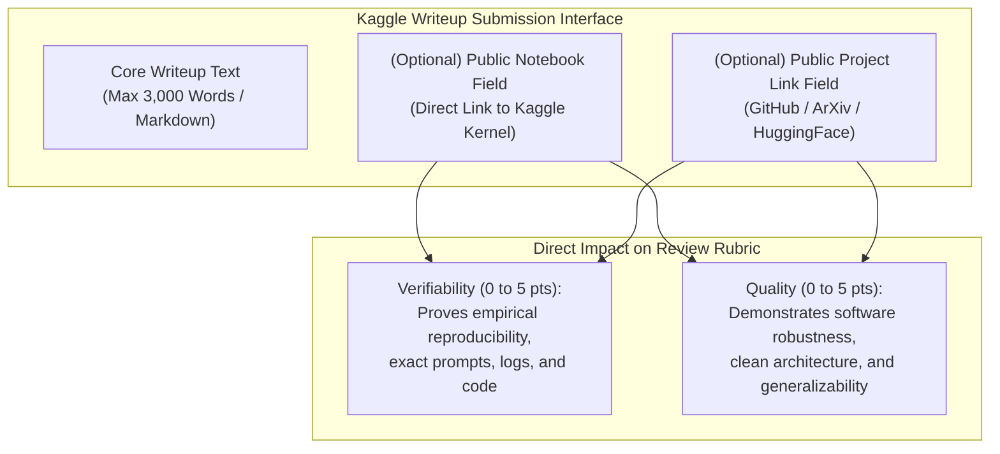

- **Verifiability (20% of total score):** Judges must verify that the claims made in the paper are authentic, that experiments actually ran, that prompts and token compaction algorithms function, and that evaluation metrics were not hallucinated.
- **Quality (20% of total score):** Demonstrates modular software design, comprehensive documentation, and production readiness beyond isolated toy scripts.

---

## 2. Step-by-Step Guide: Creating the (Optional) Public Notebook

A Kaggle Public Notebook provides an interactive, cloud-executable companion to your research paper. Follow this exact workflow to create, execute, verify, and publish your notebook.

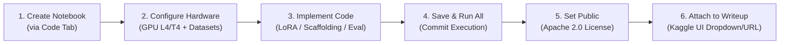

### Step 2.1: Initialize the Notebook
1. Navigate directly to the competition page: [https://www.kaggle.com/competitions/gemma-4-developer-agent-paper](https://www.kaggle.com/competitions/gemma-4-developer-agent-paper).
2. Click on the **Code** tab.
3. Click the blue **"New Notebook"** button in the upper-right corner.
   *(Alternatively, from anywhere on Kaggle, click the left sidebar `+ Create` button and select `New Notebook`.)*
4. In the notebook editor, click on the untitled header at the top left to give your notebook a descriptive title, e.g.:
   `Gemma-4-DevAgent-Paper-Companion: AST-Graph Scaffolding & Evaluation`

### Step 2.2: Configure Environment, Accelerator & Attached Models
On the right-hand **Notebook Settings** panel:
1. **Accelerator:** Click `Accelerator` and choose your GPU based on your experimental scope:
   - For Gemma 4 E2B / E4B inference & LoRA training: Select **GPU T4 x2** or **GPU L4 x4**.
   - For larger models or heavy tokenization: Select **GPU L4 x4**.
2. **Environment:** Keep `Always use latest environment` selected.
3. **Internet Toggle:** Turn `Internet` **ON** during development and dependency installation.
4. **Attach Model Weights:**
   - Under the `Input` section on the right sidebar, click **`+ Add Input`**.
   - Switch to the **Models** tab in the search dialog.
   - Search for `gemma-4` (e.g., `google/gemma-4-e2b` or `google/gemma-4-e4b`).
   - Click **`Add`** to attach the model directory directly into `/kaggle/input/`.
5. **Attach Benchmark Data:**
   - Click **`+ Add Input`** again and search for the main competition dataset `gemma-4-developer-agent`.
   - Click **`Add`** to gain access to `tasks.jsonl` and test repositories.

### Step 2.3: Recommended Research Companion Notebook Structure
Structure your notebook into logical, well-documented markdown and code sections to maximize *Clarity* and *Verifiability*:

| Notebook Section | Purpose | Best Practice Content |
| :--- | :--- | :--- |
| **1. Header & Executive Summary** | Contextual orientation | Title, authors, writeup cross-reference, abstract, and hardware requirements. |
| **2. Environment & Dependencies** | Reproducible setup | Pinned dependencies (`pip install --quiet vllm peft transformers tree-sitter`). |
| **3. Model & Adapter Loading** | Weight verification | Load Gemma 4 base model in bfloat16 / 4-bit NF4 with attached LoRA adapter weights. |
| **4. Scaffolding & AST Slicing** | Core algorithmic novelty | Python implementation of AST parser, semantic tree trimmer, and prompt builder. |
| **5. Multi-Turn Agent Loop** | Execution demonstration | Step-by-step execution on a representative SWE problem from the benchmark dataset. |
| **6. Benchmark Evaluation Loop** | Quantitative verification | Automated evaluation script measuring patch syntax validity and test execution passes. |
| **7. Metric Visualizations** | Visual proof | Matplotlib/Seaborn plots reproducing the exact figures and ablations in your writeup. |

### Step 2.4: Save & Run All (The Mandatory Commit)
> [!IMPORTANT]
> Do NOT simply perform a "Quick Save". A Quick Save does not execute code or generate persistent outputs. Reviewers will see blank cell outputs unless they manually spend their own GPU quota running your notebook.

1. Click the **"Save Version"** button in the upper right.
2. Under **Version Type**, select **"Save & Run All (Commit)"**.
3. Click **"Save"**.
4. A small status pop-up in the lower-left corner will indicate that a background commit session has started.
5. Wait for the run to complete successfully (green checkmark). You can click on the version log to verify that all cells executed without throwing uncaught exceptions.

### Step 2.5: Set Visibility to Public & Apply Apache 2.0 License
1. Once the commit finishes, click **"Share"** in the upper right header.
2. In the sharing dialog:
   - Change **Privacy** from `Private` to **`Public`**.
   - Under **License**, select **`Apache 2.0`** (strictly required by competition rules for winning eligibility).
   - Under **Tags**, add relevant tags: `gemma-4`, `nlp`, `agents`, `software-engineering`, `research`.
3. Click **"Save"**.
4. Copy the public URL from the address bar (format: `https://www.kaggle.com/<your-username>/<notebook-slug>`).
5. Open an Incognito / Private browser tab and navigate to the URL to confirm that anyone can view the fully executed outputs without logging into Kaggle.

---

## 3. Step-by-Step Guide: Creating the (Optional) Public Project Link

The **Public Project Link** connects your Kaggle writeup to external repositories, formal LaTeX PDFs, or interactive hosted services. Depending on your primary contribution, select the appropriate implementation path below.

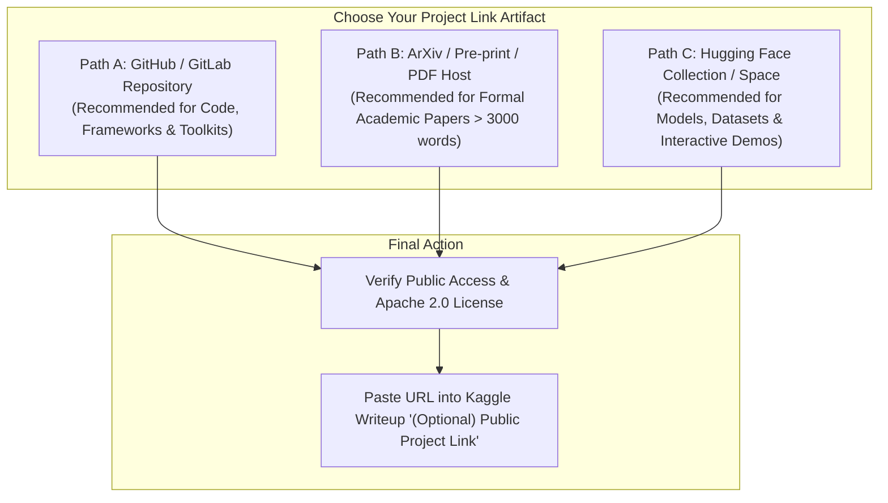

### Path A: GitHub Public Repository (Recommended for Code, Toolkits & Frameworks)
If you have engineered a novel agent architecture, AST tool, or training framework:
1. **Create Repository:** Create a new repository on GitHub (e.g., `https://github.com/<username>/gemma4-developer-agent-framework`).
2. **Set Visibility:** Ensure the repository is explicitly set to **Public**.
3. **Add License:** Include a top-level `LICENSE` file containing the standard **Apache License 2.0** text.
4. **Standard Repository Hierarchy:**
   ```text
   ├── README.md               # Overview, architecture diagram, reproduction steps
   ├── LICENSE                 # Apache 2.0
   ├── requirements.txt        # Pinned python dependencies
   ├── pyproject.toml          # Package installation config
   ├── configs/                # Scaffolding prompts, LoRA hyperparameters
   │   ├── agent_config.yaml
   │   └── lora_e4b.yaml
   ├── src/                    # Modular source code
   │   ├── agent.py            # Main multi-turn reasoning loop
   │   ├── ast_slicer.py       # Syntax tree skeletonization engine
   │   ├── code_graph.py       # Knowledge graph / dependency builder
   │   └── tools.py            # Sandbox execution tools (bash, edit, view)
   ├── eval/                   # Benchmark evaluation harness scripts
   └── notebooks/              # Exported Jupyter notebook (.ipynb)
   ```
5. **Craft a Standout README.md:**
   - Include a one-paragraph summary referencing the Kaggle Gemma 4 Developer Agent Paper Track.
   - Embed an architectural diagram showing how your agent interacts with Gemma 4.
   - Provide exact CLI reproduction commands (e.g., `pip install -e .` followed by `python eval/run_benchmark.py --model gemma-4-e4b`).

### Path B: arXiv Preprint or External Formal PDF Paper Link
If your research is written as a formal conference paper formatted in LaTeX (e.g., NeurIPS, ICML, or ICLR templates) exceeding the 3,000-word inline limit:
1. **Format Paper:** Typeset your paper using standard single-column or double-column academic conference templates.
2. **Include Mandatory Sections:** Abstract, Introduction, Related Work, Method/Architecture, Experiments & Baselines, Limitations, Broader Impact, and References.
3. **Hosting Options:**
   - **arXiv / TechRxiv:** Submit to arXiv under `cs.SE` (Software Engineering) or `cs.AI` (Artificial Intelligence). Use the abstract URL: `https://arxiv.org/abs/26XX.XXXXX`.
   - **GitHub Release PDF:** Compile your paper into `paper.pdf`, create a GitHub Release in your public repo (e.g., `v1.0.0-kaggle-paper`), upload the PDF as an asset, and copy the direct download link.
   - **Google Drive (Publicly Shared):** Upload `paper.pdf` to Google Drive. Right-click -> `Share` -> Set General access to `Anyone with the link can view` -> Copy link.

### Path C: Hugging Face Collection / Space / Model Cards
If your paper contributes fine-tuned weights or an interactive application:
1. **Model Hub:** Upload your LoRA adapter weights or merged 4-bit / 8-bit GGUF models to Hugging Face (e.g., `https://huggingface.co/<username>/gemma-4-e4b-swe-lora`).
2. **Model Card:** Include detailed prompt templates, training datasets, compute hardware, and evaluation scores.
3. **Interactive Demo:** Host a live demo on Hugging Face Spaces using Gradio, allowing judges to test code-graph queries interactively.

---

## 4. Attaching Artifacts in the Kaggle Writeups Editor

Once both artifacts are created, verified, and set to Public, follow these steps to attach them to your official competition entry:

```mermaid
sequenceDiagram
    autonumber
    actor Participant as Research Team
    participant KaggleUI as Kaggle Writeups Editor
    participant ReviewPanel as DeepMind Review Panel

    Participant->>KaggleUI: Navigate to competition /writeups
    Participant->>KaggleUI: Click '+ New Writeup'
    Participant->>KaggleUI: Input Title, Subtitle, and 3000-word Markdown
    Participant->>KaggleUI: Select committed Public Notebook in '(Optional) Public Notebook'
    Participant->>KaggleUI: Paste GitHub/ArXiv URL into '(Optional) Public Project Link'
    Participant->>KaggleUI: Click 'Publish / Submit'
    KaggleUI->>ReviewPanel: Submission registered for 0-5 Rubric Evaluation
```

1. **Access Writeups Tab:** Navigate to [https://www.kaggle.com/competitions/gemma-4-developer-agent-paper/writeups](https://www.kaggle.com/competitions/gemma-4-developer-agent-paper/writeups).
2. **Create New Writeup:** Click the blue **"+ New Writeup"** button in the top right.
3. **Populate Core Fields:**
   - **Title:** e.g., *SkelAgent: Repository-Scale AST Slicing and Graph Reasoning with Gemma 4 E4B*
   - **Subtitle:** e.g., *Parameter-Efficient Adaptation for Local Autonomous Software Engineering Agents*
   - **Writeup Body:** Paste your formatted markdown text (Abstract, Method, Experiments, Citations).
4. **Attach the Public Notebook:**
   - Scroll to the bottom of the writeup editor to the **"(Optional) Public Notebook"** attachment field.
   - Click the dropdown menu. Kaggle will automatically list your public notebooks. Select your committed notebook.
   - *If using a direct URL, paste the full URL: `https://www.kaggle.com/<username>/<notebook-slug>`.*
5. **Attach the Public Project Link:**
   - In the **"(Optional) Public Project Link"** input box, paste your public GitHub repository URL, arXiv paper URL, or Hugging Face Space URL.
6. **Save Draft & Preview:** Click **"Save Draft"** and then **"Preview"** to verify that markdown tables, LaTeX equations, and attached link badges render cleanly.
7. **Official Submission:** Click **"Publish / Submit"** to officially register your entry. Ensure this is completed before **November 12, 2026 at 11:59 PM UTC**.

---

## 5. Pre-Flight Verification & Quality Checklist

Before finalizing your writeup submission, audit your assets against this quality checklist:

| Verification Item | Pass Criteria | How to Verify |
| :--- | :--- | :--- |
| **Notebook Visibility** | Set to `Public` | Open notebook link in an Incognito / Private window without Kaggle login. |
| **Notebook Execution State** | Fully committed with cell outputs | Confirm version is `Version X (Save & Run All)`, graphs and logs visible without manual execution. |
| **Model Weights Accessibility** | Attached models load cleanly | Check cell output where `AutoModelForCausalLM` or vLLM loads weights from `/kaggle/input/`. |
| **External Link Visibility** | Accessible to any external reviewer | Confirm GitHub repo is Public, Google Drive sharing is "Anyone with link", arXiv is live. |
| **License Compliance** | Apache License 2.0 explicitly declared | Check that GitHub repo has `LICENSE` file and Kaggle Notebook license is set to Apache 2.0. |
| **Writeup Word Count** | Under 3,000 words in editor | Exclude references; ensure text fits comfortably within platform editor limits. |
| **Final Submission Selection** | Marked as one of the 2 final entries | Go to team submission management and verify writeup is flagged for judging. |


---

<!-- ====================================================================== -->
<!-- FILE: 04_Strategic_Playbook_and_Award_Targeting.md -->
<!-- ====================================================================== -->

# Strategic Playbook & Award Targeting: Google - The Gemma 4 Developer Agent Paper Track

**Target Competition:** Google - The Gemma 4 Developer Agent Paper Track  
**URL:** [https://www.kaggle.com/competitions/gemma-4-developer-agent-paper](https://www.kaggle.com/competitions/gemma-4-developer-agent-paper)  
**Total Dedicated Prize Purse:** $35,000 USD  
**Paper Submission Deadline:** November 12, 2026 (11:59 PM UTC)  

---

## 1. Deconstructing the Prize Categories & Strategic Targeting

The $35,000 prize purse is distributed across three distinct categories. Understanding the specific archetype and evaluation preference for each category is essential for tailoring your writeup, notebook, and repository.

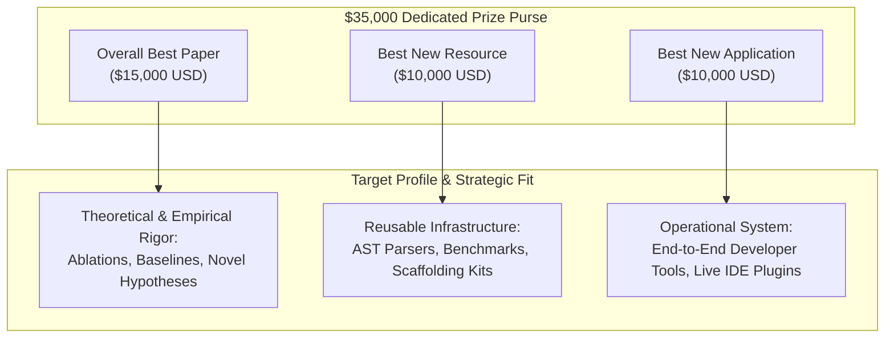

### 1.1 Category Archetypes & Recommended Angles

| Award Category | Purse | Profile Archetype | Winning Strategic Angle & Differentiator |
| :--- | :---: | :--- | :--- |
| **Overall Best Paper** | **$15,000** | High academic rigor, deep empirical analysis, novel agentic paradigm | **"Small-Footprint Agentic Scaling":** Demonstrating that a finely tuned Gemma 4 E4B model with structured AST-graph retrieval outperforms or matches unconstrained 70B+ models on real-world bug fixing benchmarks, with exhaustive ablations on context compaction and tool design. |
| **Best New Resource** | **$10,000** | Open-source software toolkit, reusable dataset, diagnostic benchmark | **"CodeGraph-Skel: High-Throughput Semantic Graph Builder":** An open-source Python library integrating Tree-sitter and NetworkX to generate sub-token semantic skeletons of multi-language repositories, drastically reducing context overhead for local LLMs. |
| **Best New Application** | **$10,000** | End-to-end usable agent system, developer CLI/IDE integration | **"PatchPilot: Local Autonomous Developer Agent with Gemma 4":** A lightweight CLI tool that indexes local git repos, generates reproducible reproduction tests from issue descriptions, and iteratively synthesizes verified bug patches on consumer GPUs. |

> [!TIP]
> **Single Award Constraint:** The rules specify that while a writeup may be considered for multiple categories, a team can win only **one prize**. If your work introduces both a novel method and a reusable library, structure your paper to compete for the *Overall Best Paper* while explicitly highlighting your standalone toolkit for *Best New Resource* consideration.

---

## 2. Aligning with Google DeepMind's Research Priorities

The competition organizers (including Elan Markowitz, Bryan Perozzi, and Ryan Holbrook) have distinguished research backgrounds in Graph Neural Networks (GNNs), structured reasoning, and open-source model optimization. Submissions that directly engage with their core research interests will resonate strongly during evaluation:

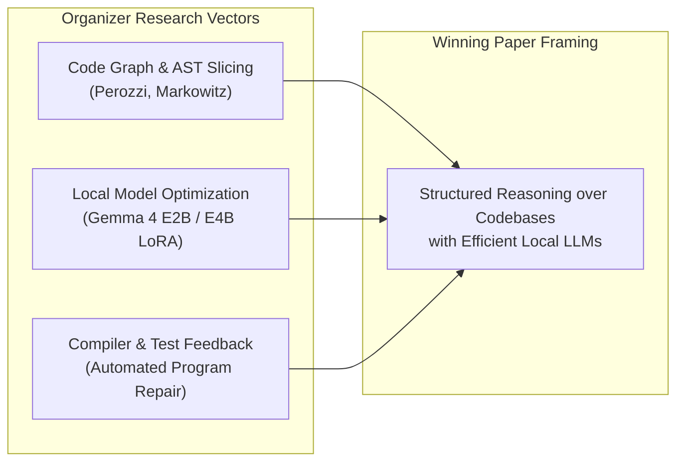

### High-Priority Research Themes
1. **Bridging the Context Gap with Structural Representations:**
   - Raw file concatenation fails on complex codebases. Papers showing how to build dependency graphs (call trees, import graphs, type hierarchies) and feed them into Gemma 4 without exceeding token limits score exceptionally high on *Novelty* and *Quality*.
2. **Mitigating Scaffolding Failure Modes:**
   - As documented on the Kaggle discussion boards, baseline agents often degrade due to summarization bugs (`LlmEventSummarizer` dropping context), malformed diff syntax, or infinite tool-calling loops.
   - Formulating robust state-machine controllers, self-healing tool retry loops, or syntax-constrained decoding provides immediate practical value (*Relevance*).
3. **Small Model Viability (E2B and E4B):**
   - Google is keen to prove that Gemma 4 models can run agentic workflows locally on developer laptops or single-GPU workstations. Demonstrating high SWE benchmark pass rates using Gemma 4 E2B or E4B with LoRA adapters directly fulfills host objectives.

---

## 3. High-Scoring Kaggle Writeup Structure & Word Allocation

The Kaggle Writeup has a hard ceiling of **3,000 words** when authored within the platform editor. Below is an optimal structural layout calibrated against the five judging dimensions:

| Writeup Section | Target Word Count | Primary Rubric Mapping | Recommended Content & Framing |
| :--- | :---: | :--- | :--- |
| **Title & Subtitle** | ~25 words | Clarity, Novelty | Crisp, informative title featuring method name, model variant, and core breakthrough. |
| **Abstract** | ~200 words | Clarity, Relevance | Self-contained executive summary: problem, hypothesis, proposed architecture, and headline empirical metric (e.g., "+34% pass rate over baseline"). |
| **1. Introduction & Motivation** | ~400 words | Relevance, Novelty | Why local agentic SWE matters; hardware and token bottlenecks of large repos; limitation of naive prompting; three enumerated scientific contributions. |
| **2. Architecture & Scaffolding** | ~800 words | Novelty, Quality | Formal system specification: AST slicing algorithm, context management, tool interfaces, prompt schemas, and fine-tuning setup (PEFT/LoRA). |
| **3. Experimental Setup & Baselines** | ~400 words | Quality, Verifiability | Benchmark dataset description (`tasks.jsonl`), hardware configurations (L4/T4), evaluation metrics, and comparison against official Ryan Holbrook baselines. |
| **4. Empirical Results & Ablations** | ~600 words | Quality, Verifiability | Quantitative comparison tables, ablation studies isolating AST contribution vs. baseline, error analysis of failure modes, and execution latency. |
| **5. Limitations & Future Work** | ~250 words | Quality, Clarity | Candid discussion of edge cases (e.g., dynamic imports, multi-repo dependencies) and hardware constraints. |
| **6. Reproducibility & Artifacts** | ~150 words | Verifiability | Direct cross-references to the attached **Public Notebook** and **Public Project Link** with execution commands. |
| **References & Citations** | Excluded | Clarity, Relevance | Academic BibTeX citations covering Gemma 4, SWE-bench, Tree-sitter, LoRA, and prior agent frameworks. |

---

## 4. Final Submission Checklist for November 12, 2026

Ensure every administrative and technical requirement is satisfied well before the deadline:

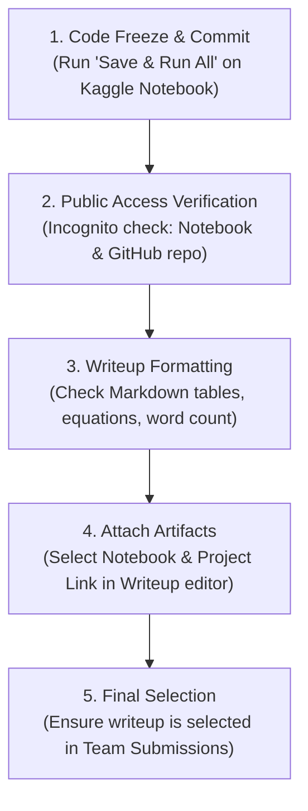

### Comprehensive Verification Checklist

- [ ] **1. Kaggle Rules Accepted:** All team members have clicked "Accept Rules" on the competition page.
- [ ] **2. Team Composition Locked:** Team size does not exceed 5 members.
- [ ] **3. Companion Notebook Committed:** The Kaggle Notebook has been executed via **"Save & Run All (Commit)"** and shows completed outputs for all cells.
- [ ] **4. Notebook Visibility Public:** Privacy setting changed from `Private` to `Public` with `Apache 2.0` license selected.
- [ ] **5. External Project Link Active:** GitHub repository is set to Public, contains an Apache 2.0 `LICENSE` file, an informative `README.md`, and clean reproduction steps.
- [ ] **6. Writeup Section Compliance:** Writeup contains Title, Subtitle, Abstract, Introduction, Method/Experiments, and Citations.
- [ ] **7. Word Count Verification:** Inline text is under the 3,000-word limit.
- [ ] **8. Links Attached in Editor:** The `(Optional) Public Notebook` and `(Optional) Public Project Link` fields are populated and verified.
- [ ] **9. Writeup Published & Selected:** Writeup is published and designated as one of the maximum two final submissions for team judging.
- [ ] **10. Deadline Adherence:** Submission finalized prior to **November 12, 2026 at 11:59 PM UTC**.

