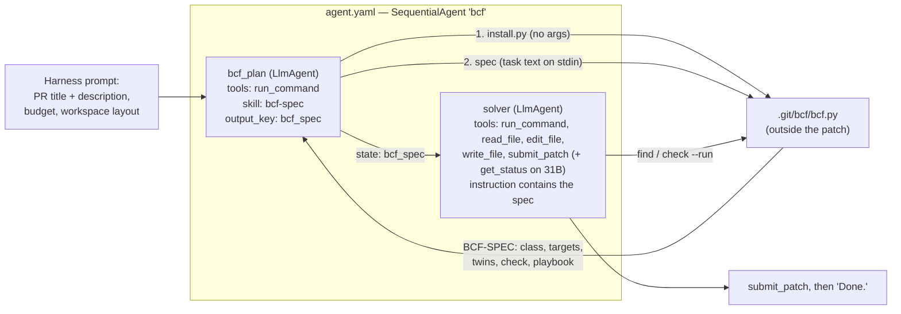

# COMBINED MARKDOWN - combine

_Generated 2026-11-10 13:10:30 | 5 files | folder: D:\stuff\docs\taylor_fv\github\rayrite.github.io\cvx\kaggle2\items\combine_

## Contents

1. 00_README-cc-fable52.md
2. 01_Task1_Problem_Taxonomy_and_Root_Cause_Analysis.md
3. 02_Task2_BCF_Brain_Design_and_Justification.md
4. 03_Research_Sources_and_Grounding.md
5. 04_Additional_Insights_and_BCF_Tuning_Levers.md

---

<!-- ====================================================================== -->
<!-- FILE: 00_README-cc-fable52.md -->
<!-- ====================================================================== -->

# BCF brain: problem taxonomy and dual-track submission (2026-11-10)

Deliverables for the two tasks on the Gemma 4 Developer Agent Competition dataset.

## Read in this order

| File | What it is |
|---|---|
| [01_Task1_Problem_Taxonomy_and_Root_Cause_Analysis.md](01_Task1_Problem_Taxonomy_and_Root_Cause_Analysis.md) | **Task 1, single file.** Categories and sub-categories for all 129 public tasks, root-cause analysis of every task that repairs a defect, cross-cutting insights, and defects in the dataset itself |
| [02_Task2_BCF_Brain_Design_and_Justification.md](02_Task2_BCF_Brain_Design_and_Justification.md) | **Task 2.** The BCF brain, the two tracks, the helper, design evidence, risks, and the gated plan toward both leaderboards |
| [03_Research_Sources_and_Grounding.md](03_Research_Sources_and_Grounding.md) | External research: what was read, how reliable it is, what it changed |
| [04_Additional_Insights_and_BCF_Tuning_Levers.md](04_Additional_Insights_and_BCF_Tuning_Levers.md) | Follow-up: reachability tiers, further root-cause patterns, and the parts of the brain to adjust for a higher score |

## Code

| Path | What it is |
|---|---|
| `submission_31b/`, `submission_31b.zip` | Gemma 4 31B bundle in the requested hierarchy (+ `eval_config.yaml`) |
| `submission_e4b/`, `submission_e4b.zip` | Gemma 4 E4B bundle |
| `submission_31b_noskills/`, `submission_e4b_noskills/` (+ zips) | Same files, without the `skills:` declaration on `bcf_plan` (see report 02 §7.1) |
| `src/` | Sources the bundles are built from: `tracks/31b`, `tracks/e4b`, `skills/bcf-spec` |
| `tools/build_bundles.py` | Builds the bundles and runs the static lint |
| `analysis/` | Hand labels (`labels.py`), feature extraction, report generator, helper evaluation and their outputs |

## Status in one paragraph

The bundles build and pass a static lint; the helper was run on all 129 public snapshots (category agreement 94%, a gold file in its first three targets for 77%). Nothing has been run with a Gemma model, compiled with the competition wheelhouse, or scored on Kaggle. **Decision (user, 2026-11-10): the scored bundles are the `_noskills` variants.** The variants that declare the skill stay as lab builds. Report 02 §7.1 gives the facts behind the choice; §9 lists everything not verified.


---

<!-- ====================================================================== -->
<!-- FILE: 01_Task1_Problem_Taxonomy_and_Root_Cause_Analysis.md -->
<!-- ====================================================================== -->

# 01 — Problem dataset: taxonomy and root-cause analysis

*Gemma 4 Developer Agent Competition, public task file `tasks.jsonl` (129 tasks). Prepared 2026-11-10. Every count in this file is computed by script from the task file; the category labels and root-cause statements are hand-written from reading each task's statement and gold patch. Scripts and label file: `analysis/` in this folder.*

## 1. What was examined, and the main findings

**Scope.** All 129 tasks in the local copy of the competition data (`input/kagglecomp/kagglecomp_data_package/tasks.jsonl`, taken from the 21.9 GB competition ZIP). Each task has a problem statement, a gold patch, a test patch, a repository and a base commit. `hints_text` is empty for all 129. The hidden scoring set is not available; everything below describes the public tasks only.

**Findings that drive the design in report 02:**

1. **The "problem" is a merged pull request, not an issue report.** The statement is the PR title and description. 37 (29%) tasks give no usable description beyond the title (a bare title, or a title plus a link that cannot be opened offline).
2. **Most tasks are small defect repairs.** 84 (65%) are defect repairs; counting hardening, compatibility and docs fixes, 99 (77%) repair some wrong behaviour. 91 (71%) change a single file and 60 (47%) change 10 lines or fewer.
3. **The statement rarely says where to edit.** Only 10 (8%) statements name a gold file and 28 (22%) name a changed function or class. Finding the right function is the first hurdle, especially in FastAPI.
4. **Edits concentrate in a few engine files.** `fastapi/dependencies/utils.py` is changed by 27 tasks, `fastapi/routing.py` by 16, `fastapi/_compat/v2.py` by 13 and `fastapi/openapi/utils.py` by 12.
5. **Seven recurring defect mechanisms cover all 84 defect-repair tasks** (section 4). Each has a typical one-to-five-line fix shape, which is what the BCF playbooks encode.
6. **Tasks come in chains.** At least 15 tasks fix, extend or reverse an earlier task in the same code (section 6.1). Two tasks ask for opposite behaviour of the same two lines, so knowledge of the library's current state can mislead; the snapshot is the only truth.
7. **A share of tasks is out of reach for a 7-minute agent.** 7 tasks need more than 300 changed lines or brand-new multi-file subsystems (section 3.3), and several public tasks cannot pass even with the gold patch in a stock local environment (section 7).

## 2. Dataset profile

| Repository | Tasks | Share | PR dates | Defect repair | New capability | Maintenance | Hardening | Docs example |
|---|---:|---:|---|---:|---:|---:|---:|---:|
| fastapi | 67 | 52% | 2025-09 to 2026-06 | 33 | 14 | 11 | 6 | 3 |
| rich | 48 | 37% | 2023-07 to 2026-04 | 40 | 7 | 1 | 0 | 0 |
| requests | 13 | 10% | 2023-12 to 2026-06 | 11 | 1 | 1 | 0 | 0 |
| httpx | 1 | 1% | 2025-09 to 2025-09 | 0 | 1 | 0 | 0 | 0 |
| **All** | 129 | 100% | 2023-07 to 2026-06 | 84 | 23 | 13 | 6 | 3 |

**Statement and patch features (all 129 tasks):**

| Feature | Tasks | Note |
|---|---:|---|
| Statement is title only (no usable body) | 37 (29%) | 57% of these are Rich tasks of the form *title + "Fixes &lt;issue link&gt;"* |
| Statement contains a code block | 18 (14%) | Usually a reproduction; almost all in FastAPI and Requests |
| Statement contains a traceback or error text | 10 (8%) |  |
| Statement contains a link | 82 (64%) | The sandbox has no network, so links add nothing |
| Statement names a gold file | 10 (8%) |  |
| Statement names a changed function or class | 28 (22%) |  |
| Gold patch touches one file | 91 (71%) |  |
| Gold patch changes 10 lines or fewer | 60 (47%) | Added plus removed lines |
| Gold patch touches `docs_src/` | 15 (12%) | FastAPI only; tests import the example modules |
| Gold patch creates new files | 11 (9%) |  |
| Test patch only modifies existing test files | 85 (66%) | The existing test file shows the expected style |
| Test patch only adds new test files | 32 (25%) | No visible test for the behaviour |
| Test patch does both | 12 (9%) |  |

FastAPI titles begin with a gitmoji that states the PR type (67 of 67 FastAPI tasks). Rich descriptions often carry the PR template with a ticked "Bug fix" or "New feature" box. Both are reliable, machine-readable class signals and `bcf.py` uses them.

## 3. Taxonomy

### 3.1 Categories and sub-categories

The first level is the **intent of the pull request**. The second level is the **mechanism** for defect repairs and the **kind of change** for the rest. Each task has exactly one label.

| Category | Code | Sub-category | Tasks | Share | Examples |
|---|---|---|---:|---:|---|
| BUG — Defect repair | BUG-VALUE | Wrong value, key, argument or variable used | 18 | 14.0% | rich_4079, fastapi_14360, fastapi_14356 |
| BUG — Defect repair | BUG-COND | Missing or wrong condition / uncovered path | 15 | 11.6% | requests_7205, rich_4075, fastapi_14349 |
| BUG — Defect repair | BUG-TEXT | Regex, parsing or string normalisation | 13 | 10.1% | requests_7427, requests_7315, requests_7309 |
| BUG — Defect repair | BUG-ALGO | Loop, index, arithmetic or aggregation logic | 11 | 8.5% | rich_4006, fastapi_14455, rich_3953 |
| BUG — Defect repair | BUG-STATE | Shared state, aliasing, cache, ordering or lifetime | 10 | 7.8% | requests_7328, fastapi_14873, fastapi_14463 |
| BUG — Defect repair | BUG-PROTO | Runtime protocol / duck-typing gap | 9 | 7.0% | requests_7505, requests_7502, requests_7433 |
| BUG — Defect repair | BUG-TYPE | Typing / annotation introspection gap | 8 | 6.2% | fastapi_12942, fastapi_14512, fastapi_11355 |
| FEAT — New capability | FEAT-SUPPORT | Accept a new input form | 7 | 5.4% | fastapi_13920, fastapi_14794, fastapi_9753 |
| FEAT — New capability | FEAT-PARAM | New parameter, option, alias or environment variable | 6 | 4.7% | fastapi_14978, fastapi_13713, requests_6592 |
| FEAT — New capability | FEAT-API | New method, function or class | 4 | 3.1% | fastapi_15280, httpx_3672, fastapi_15785 |
| FEAT — New capability | FEAT-SUBSYS | New multi-file subsystem | 4 | 3.1% | fastapi_15030, fastapi_14262, rich_3930 |
| FEAT — New capability | FEAT-BEHAV | Changed default output or appearance | 2 | 1.6% | rich_3942, fastapi_14953 |
| MAINT — Maintenance | MAINT-COMPAT | Dependency or Python-version compatibility | 4 | 3.1% | fastapi_14851, fastapi_14186, fastapi_14077 |
| MAINT — Maintenance | MAINT-DEPR | Deprecation / warning plumbing | 3 | 2.3% | fastapi_14964, fastapi_14605, fastapi_14583 |
| MAINT — Maintenance | MAINT-REFAC | Internal refactor with behaviour kept | 2 | 1.6% | fastapi_14372, fastapi_15745 |
| MAINT — Maintenance | MAINT-PERF | Performance | 2 | 1.6% | fastapi_14962, rich_4070 |
| MAINT — Maintenance | MAINT-REMOVE | Removal of supported behaviour | 1 | 0.8% | fastapi_14609 |
| MAINT — Maintenance | MAINT-TOOL | Repository tooling script | 1 | 0.8% | fastapi_15661 |
| HARD — Hardening | HARD-MSG | Clearer error or diagnostic | 3 | 2.3% | fastapi_14258, fastapi_14479, fastapi_14306 |
| HARD — Hardening | HARD-VALID | Stricter input validation | 2 | 1.6% | fastapi_15588, fastapi_15589 |
| HARD — Hardening | HARD-SEC | Escaping / information-exposure fix | 1 | 0.8% | fastapi_14986 |
| DOCS — Documentation example | DOCS-EXAMPLE | docs_src example edit | 3 | 2.3% | fastapi_15023, fastapi_14492, fastapi_14487 |

| Category | Tasks | Share | What the agent must do |
|---|---:|---:|---|
| BUG — Defect repair | 84 | 65% | Find the faulty statement and correct it; behaviour elsewhere must not change |
| FEAT — New capability | 23 | 18% | Add a name, option or accepted input form exactly as the PR describes it |
| MAINT — Maintenance | 13 | 10% | Deprecate, keep compatible, refactor, speed up or remove; visible behaviour is fixed by the PR text |
| HARD — Hardening | 6 | 5% | Add a check, a clearer message or an escape; keep the exception type |
| DOCS — Documentation example | 3 | 2% | Edit the example module under `docs_src/` that the tests import |

### 3.2 Other classification axes

**Patch size class** (from the gold patch; added plus removed lines, all files):

| Size | Definition | Tasks | Share | BUG | FEAT | MAINT | HARD | DOCS |
|---|---|---:|---:|---:|---:|---:|---:|---:|
| XS | 1 file, 3 lines or fewer | 30 | 23% | 26 | 2 | 0 | 1 | 1 |
| S | 1 file, 4 to 15 lines | 38 | 29% | 31 | 4 | 0 | 2 | 1 |
| M | up to 3 files, up to 60 lines | 34 | 26% | 19 | 6 | 6 | 2 | 1 |
| L | up to 300 lines | 20 | 16% | 7 | 8 | 4 | 1 | 0 |
| XL | more than 300 lines | 7 | 5% | 1 | 3 | 3 | 0 | 0 |

**Statement information class** (after removing HTML comments, the PR template, check-box lists and links):

| Class | Definition | Tasks | fastapi | rich | requests | httpx | BUG | FEAT | MAINT | HARD | DOCS |
|---|---|---:|---:|---:|---:|---:|---:|---:|---:|---:|---:|
| TITLE | Title only, or title plus a link | 37 | 15 | 21 | 1 | 0 | 31 | 2 | 2 | 0 | 2 |
| SHORT | Under 400 characters of description | 46 | 19 | 20 | 6 | 1 | 24 | 13 | 6 | 2 | 1 |
| MEDIUM | 400 to 1,500 characters | 34 | 22 | 6 | 6 | 0 | 25 | 4 | 3 | 2 | 0 |
| LONG | More than 1,500 characters | 12 | 11 | 1 | 0 | 0 | 4 | 4 | 2 | 2 | 0 |

**Functional domain** (where in the library the change lives):

| Repository | Tasks | Domains (tasks) |
|---|---:|---|
| fastapi | 67 | OpenAPI (10); annotations (9); dependencies (8); routing (5); request params (4); pydantic compat (4); forms (4); docs_src (3); OAuth2 scopes (3); SSE (2); router events (2); security (2); dependency lifetime (2); release tooling (1); response serialisation (1); responses (1); OpenAPI / Swagger UI (1); request body (1); errors (1); starlette compat (1); static frontend (1); warnings (1) |
| rich | 48 | console (6); markdown (5); cells / unicode (5); table (3); traceback (3); text (3); ansi (2); prompt (2); syntax (2); segment (2); highlighter (2); export (2); imports (1); file proxy (1); panel (1); live (1); inspect (1); progress (1); wrapping (1); pretty (1); style (1); repr (1); markup (1) |
| requests | 13 | request body (4); URL handling (2); proxies (1); redirects (1); headers (1); auth (1); urllib3 compat (1); exceptions (1); status codes (1) |
| httpx | 1 | server / parser (1) |

### 3.3 Sub-category by size: where the reachable tasks are

| Sub-category | Tasks | XS | S | M | L | XL | XS or S |
|---|---:|---:|---:|---:|---:|---:|---:|
| BUG-VALUE | 18 | 7 | 7 | 2 | 2 | 0 | 78% |
| BUG-COND | 15 | 6 | 5 | 4 | 0 | 0 | 73% |
| BUG-TEXT | 13 | 8 | 4 | 1 | 0 | 0 | 92% |
| BUG-ALGO | 11 | 0 | 2 | 7 | 2 | 0 | 18% |
| BUG-STATE | 10 | 3 | 3 | 1 | 2 | 1 | 60% |
| BUG-PROTO | 9 | 1 | 6 | 1 | 1 | 0 | 78% |
| BUG-TYPE | 8 | 1 | 4 | 3 | 0 | 0 | 62% |
| FEAT-SUPPORT | 7 | 1 | 4 | 2 | 0 | 0 | 71% |
| FEAT-PARAM | 6 | 1 | 0 | 4 | 1 | 0 | 17% |
| FEAT-API | 4 | 0 | 0 | 0 | 4 | 0 | 0% |
| FEAT-SUBSYS | 4 | 0 | 0 | 0 | 1 | 3 | 0% |
| FEAT-BEHAV | 2 | 0 | 0 | 0 | 2 | 0 | 0% |
| MAINT-COMPAT | 4 | 0 | 0 | 2 | 1 | 1 | 0% |
| MAINT-DEPR | 3 | 0 | 0 | 2 | 1 | 0 | 0% |
| MAINT-REFAC | 2 | 0 | 0 | 1 | 0 | 1 | 0% |
| MAINT-PERF | 2 | 0 | 0 | 1 | 1 | 0 | 0% |
| MAINT-REMOVE | 1 | 0 | 0 | 0 | 0 | 1 | 0% |
| MAINT-TOOL | 1 | 0 | 0 | 0 | 1 | 0 | 0% |
| HARD-MSG | 3 | 1 | 1 | 0 | 1 | 0 | 67% |
| HARD-VALID | 2 | 0 | 1 | 1 | 0 | 0 | 50% |
| HARD-SEC | 1 | 0 | 0 | 1 | 0 | 0 | 0% |
| DOCS-EXAMPLE | 3 | 1 | 1 | 1 | 0 | 0 | 67% |
| **All** | 129 | 30 | 38 | 34 | 20 | 7 | 53% |

The XS and S tasks (68, one file and at most 15 lines) are the realistic target for both model tracks. The XL tasks are: fastapi_15030, fastapi_14099, fastapi_14609, fastapi_14186, rich_3930, fastapi_15800, fastapi_15745.

### 3.4 Classification of every task

Size = patch size class; Files = files in the gold patch; ± = added/removed lines; Info = statement information class.

| Task | PR date | Class | Domain | Size | Files | ± | Info | PR title |
|---|---|---|---|---|---:|---:|---|---|
| fastapi_11194 | 2025-09-20 | BUG-ALGO | forms | S | 1 | +3/-4 | MEDIUM | Fix validation error when `File` is declared after `Form` parameter |
| fastapi_14455 | 2025-12-04 | BUG-ALGO | OpenAPI | S | 1 | +11/-2 | TITLE | Fix OpenAPI security scheme OAuth2 scopes declaration, deduplicate security schemes with differ… |
| fastapi_13207 | 2025-12-02 | BUG-COND | OpenAPI | S | 1 | +12/-2 | SHORT | Fix OpenAPI schema support for computed fields when using `separate_input_output_schemas=False` |
| fastapi_13537 | 2025-12-02 | BUG-COND | forms | XS | 1 | +2/-1 | MEDIUM | Fix support for form values with empty strings interpreted as missing (`None` if that's the def… |
| fastapi_14266 | 2025-10-31 | BUG-COND | OpenAPI | M | 1 | +8/-10 | TITLE | Fix security schemes in OpenAPI when added at the top level app |
| fastapi_14349 | 2025-11-13 | BUG-COND | OpenAPI | S | 1 | +6/-6 | SHORT | Fix handling of JSON Schema attributes named "$ref" |
| fastapi_14361 | 2025-12-02 | BUG-COND | OpenAPI | XS | 1 | +1/-1 | TITLE | Avoid accessing non-existing "$ref" key for Pydantic v2 compat remapping |
| fastapi_15763 | 2026-06-15 | BUG-COND | routing | S | 1 | +10/-3 | TITLE | Fix bug, allow empty path in path operation in prefixless router |
| fastapi_14448 | 2025-12-04 | BUG-PROTO | dependencies | L | 2 | +82/-24 | MEDIUM | Fix support for functools wraps and partial combined, for async and regular functions and class… |
| fastapi_14458 | 2025-12-05 | BUG-PROTO | dependencies | S | 1 | +6/-1 | MEDIUM | Fix using class (not instance) dependency that has `__call__` method |
| fastapi_14099 | 2025-09-29 | BUG-STATE | dependency lifetime | XL | 5 | +346/-131 | SHORT | Fix support for `StreamingResponse`s with dependencies with `yield` or `UploadFile`s, close aft… |
| fastapi_14419 | 2025-11-30 | BUG-STATE | OAuth2 scopes | L | 2 | +42/-20 | MEDIUM | Cache dependencies that don't use scopes and don't have sub-dependencies with scopes |
| fastapi_14459 | 2025-12-04 | BUG-STATE | OAuth2 scopes | L | 3 | +49/-22 | MEDIUM | Fix OAuth2 scopes in OpenAPI in extra corner cases, parent dependency with scopes, sub-dependen… |
| fastapi_14463 | 2026-02-04 | BUG-STATE | OpenAPI | XS | 1 | +2/-1 | LONG | Fix OpenAPI duplication of `anyOf` refs for app-level responses with specified `content` and `m…` |
| fastapi_14873 | 2026-02-09 | BUG-STATE | router events | M | 1 | +11/-10 | MEDIUM | Fix `on_startup` and `on_shutdown` parameters of `APIRouter` |
| fastapi_5624 | 2025-11-30 | BUG-STATE | OAuth2 scopes | S | 1 | +3/-1 | TITLE | Fix hierarchical security scope propagation |
| fastapi_14786 | 2026-02-04 | BUG-TEXT | security | XS | 1 | +1/-1 | LONG | Strip whitespaces from `Authorization` header credentials |
| fastapi_11355 | 2025-12-04 | BUG-TYPE | annotations | S | 1 | +9/-2 | SHORT | Fix evaluating stringified annotations in Python 3.10 |
| fastapi_12942 | 2025-10-08 | BUG-TYPE | annotations | XS | 1 | +3/-0 | MEDIUM | Fix tagged discriminated union not recognized as body field |
| fastapi_14297 | 2025-12-02 | BUG-TYPE | annotations | S | 1 | +7/-0 | MEDIUM | Fix optional sequence handling in `serialize sequence value` with Pydantic V2 |
| fastapi_14430 | 2025-12-02 | BUG-TYPE | annotations | S | 1 | +2/-2 | SHORT | Fix optional sequence handling with new union syntax from Python 3.10 |
| fastapi_14482 | 2025-12-10 | BUG-TYPE | pydantic compat | M | 1 | +25/-7 | TITLE | Fix handling arbitrary types when using `arbitrary_types_allowed=True` |
| fastapi_14485 | 2025-12-10 | BUG-TYPE | annotations | M | 1 | +13/-6 | TITLE | Fix support for `if TYPE_CHECKING`,  non-evaluated stringified annotations |
| fastapi_14512 | 2025-12-12 | BUG-TYPE | annotations | M | 1 | +48/-4 | TITLE | Fix support for tagged union with discriminator inside of `Annotated` with `Body()` |
| fastapi_14616 | 2026-02-05 | BUG-TYPE | forms | S | 1 | +10/-2 | MEDIUM | Fix using `Json[list[str]]` type (issue #10997) |
| fastapi_13786 | 2025-11-24 | BUG-VALUE | security | L | 11 | +176/-83 | LONG | Use `401` status code in security classes when credentials are missing |
| fastapi_14246 | 2025-10-29 | BUG-VALUE | OpenAPI | M | 1 | +24/-4 | TITLE | Fix separation of schemas with nested models introduced in 0.119.0 |
| fastapi_14301 | 2025-11-08 | BUG-VALUE | dependencies | S | 1 | +4/-1 | MEDIUM | Fix `Depends(func, scope='function')` for top level (parameterless) dependencies |
| fastapi_14303 | 2025-12-02 | BUG-VALUE | forms | S | 1 | +6/-2 | LONG | Fix parsing extra `Form` parameter list |
| fastapi_14356 | 2025-12-02 | BUG-VALUE | request params | S | 1 | +9/-2 | MEDIUM | Fix parsing extra non-body parameter list |
| fastapi_14360 | 2025-12-02 | BUG-VALUE | request params | XS | 1 | +1/-2 | MEDIUM | Fix Query\Header\Cookie parameter model alias |
| fastapi_14371 | 2025-12-12 | BUG-VALUE | request params | L | 4 | +46/-16 | SHORT | Fix parameter aliases |
| fastapi_14791 | 2026-02-04 | BUG-VALUE | OpenAPI | XS | 1 | +2/-0 | MEDIUM | Update `ValidationError` schema to include `input` and `ctx` |
| fastapi_15280 | 2026-04-01 | FEAT-API | routing | L | 2 | +71/-1 | TITLE | Add support for `@app.vibe()` |
| fastapi_15785 | 2026-06-18 | FEAT-API | routing | L | 2 | +66/-15 | SHORT | Add `iter_route_contexts()` for advanced use cases that used to use `router.routes` (e.g. Jupyv… |
| fastapi_14953 | 2026-02-21 | FEAT-BEHAV | OpenAPI | L | 4 | +102/-2 | LONG | Fix JSON Schema for bytes, use `"contentMediaType": "application/octet-stream"` instead of `"fo…` |
| fastapi_13713 | 2025-09-20 | FEAT-PARAM | OpenAPI | M | 2 | +31/-0 | MEDIUM | Add OpenAPI `external_docs` parameter to `FastAPI` |
| fastapi_14978 | 2026-02-23 | FEAT-PARAM | request body | L | 3 | +81/-1 | TITLE | Add `strict_content_type` checking for JSON requests |
| fastapi_14262 | 2025-11-03 | FEAT-SUBSYS | dependency lifetime | L | 10 | +196/-70 | LONG | Add support for dependencies with scopes, support `scope="request"` for dependencies with `yiel…` |
| fastapi_15030 | 2026-03-01 | FEAT-SUBSYS | SSE | XL | 9 | +525/-35 | SHORT | Add support for Server Sent Events |
| fastapi_15800 | 2026-06-20 | FEAT-SUBSYS | static frontend | XL | 8 | +649/-5 | SHORT | Add support for `app.frontend("/", directory="dist")` and `router.frontend("/", directory="dist…` |
| fastapi_13920 | 2026-02-05 | FEAT-SUPPORT | annotations | S | 1 | +4/-0 | SHORT | Add support for PEP695 `TypeAliasType` |
| fastapi_14794 | 2026-02-05 | FEAT-SUPPORT | dependencies | S | 1 | +3/-2 | MEDIUM | Allow `Response` type hint as dependency annotation |
| fastapi_5077 | 2025-12-02 | FEAT-SUPPORT | annotations | S | 1 | +4/-2 | LONG | Add support for wrapped functions (e.g. `@functools.wraps()`) used with forward references |
| fastapi_9425 | 2025-09-20 | FEAT-SUPPORT | annotations | XS | 1 | +2/-0 | SHORT | Allow `None` as return type for bodiless responses |
| fastapi_9555 | 2025-12-02 | FEAT-SUPPORT | dependencies | M | 1 | +14/-8 | LONG | Handle wrapped dependencies |
| fastapi_9753 | 2025-12-02 | FEAT-SUPPORT | dependencies | S | 1 | +5/-2 | MEDIUM | Allow using dependables with `functools.partial()` |
| fastapi_14077 | 2025-09-16 | MAINT-COMPAT | starlette compat | M | 3 | +5/-6 | MEDIUM | Upgrade Starlette supported version range to &gt;=0.40.0,&lt;0.49.0 |
| fastapi_14186 | 2025-10-20 | MAINT-COMPAT | pydantic compat | XL | 10 | +266/-98 | MEDIUM | Fix internal Pydantic v1 compatibility (warnings) for Python 3.14 and Pydantic 2.12.1 |
| fastapi_14851 | 2026-02-06 | MAINT-COMPAT | router events | L | 1 | +153/-4 | SHORT | Re-implement `on_event` in FastAPI for compatibility with the next Starlette, while keeping bac… |
| fastapi_14583 | 2025-12-21 | MAINT-DEPR | pydantic compat | M | 2 | +24/-0 | TITLE | Add deprecation warnings when using `pydantic.v1` |
| fastapi_14605 | 2025-12-26 | MAINT-DEPR | warnings | L | 7 | +28/-16 | SHORT | Add a custom `FastAPIDeprecationWarning` |
| fastapi_14964 | 2026-02-22 | MAINT-DEPR | responses | M | 1 | +44/-8 | SHORT | Deprecate `ORJSONResponse` and `UJSONResponse` |
| fastapi_14962 | 2026-02-22 | MAINT-PERF | response serialisation | M | 3 | +49/-6 | TITLE | Serialize JSON response with Pydantic (in Rust), when there's a Pydantic return type or respons… |
| fastapi_14372 | 2025-11-19 | MAINT-REFAC | dependencies | M | 2 | +4/-3 | MEDIUM | Make the result of `Depends()` and `Security()` hashable, as a workaround for other tools inter… |
| fastapi_15745 | 2026-06-14 | MAINT-REFAC | routing | XL | 4 | +939/-291 | LONG | Refactor internals to preserve `APIRouter` and `APIRoute` instances |
| fastapi_14609 | 2025-12-27 | MAINT-REMOVE | pydantic compat | XL | 20 | +192/-1855 | SHORT | Drop support for `pydantic.v1` |
| fastapi_15661 | 2026-05-31 | MAINT-TOOL | release tooling | L | 1 | +216/-0 | SHORT | Automate release preparation |
| fastapi_14258 | 2026-02-10 | HARD-MSG | routing | S | 1 | +4/-0 | SHORT | Show a clear error on attempt to include router into itself |
| fastapi_14306 | 2025-12-06 | HARD-MSG | errors | L | 2 | +121/-16 | LONG | Improve tracebacks by adding endpoint metadata |
| fastapi_14479 | 2026-02-04 | HARD-MSG | dependencies | XS | 1 | +1/-1 | LONG | Improve error message for invalid query parameter type annotations |
| fastapi_14986 | 2026-02-24 | HARD-SEC | OpenAPI / Swagger UI | M | 2 | +25/-9 | MEDIUM | Refactor logic to handle OpenAPI and Swagger UI escaping data |
| fastapi_15588 | 2026-05-23 | HARD-VALID | SSE | M | 1 | +18/-5 | MEDIUM | Validate Server Sent Event fields to avoid applications from sending broken data |
| fastapi_15589 | 2026-05-23 | HARD-VALID | request params | S | 1 | +4/-0 | SHORT | Do not accept underscore headers when using `convert_underscores=True` (the default) |
| fastapi_14487 | 2025-12-10 | DOCS-EXAMPLE | docs_src | S | 1 | +5/-2 | TITLE | Update docs about re-raising validation errors, do not include string as is to not leak informa… |
| fastapi_14492 | 2026-02-04 | DOCS-EXAMPLE | docs_src | XS | 1 | +1/-1 | SHORT | Fix example of license identifier in documentation |
| fastapi_15023 | 2026-02-27 | DOCS-EXAMPLE | docs_src | M | 1 | +18/-8 | TITLE | Update docs for responses and new stream with `yield` |
| rich_3061 | 2023-07-29 | BUG-ALGO | text | L | 1 | +67/-24 | SHORT | Extend tabs with styles |
| rich_3180 | 2023-11-14 | BUG-ALGO | wrapping | L | 2 | +89/-38 | MEDIUM | Fix double-width characters disappearing when wrapping |
| rich_3506 | 2024-09-28 | BUG-ALGO | segment | M | 1 | +15/-2 | SHORT | fix split cells |
| rich_3521 | 2024-10-04 | BUG-ALGO | segment | M | 1 | +16/-19 | TITLE | Segment.split_cells fix |
| rich_3772 | 2025-06-19 | BUG-ALGO | traceback | M | 1 | +29/-16 | TITLE | Fix traceback recursion |
| rich_3935 | 2026-01-23 | BUG-ALGO | table | M | 1 | +13/-3 | TITLE | fix for padding width |
| rich_3938 | 2026-01-23 | BUG-ALGO | console | M | 2 | +40/-5 | TITLE | fix background style with soft wrap |
| rich_3953 | 2026-02-01 | BUG-ALGO | cells / unicode | M | 1 | +16/-10 | TITLE | Fix ZWJ and edge cases |
| rich_4006 | 2026-02-19 | BUG-ALGO | cells / unicode | M | 1 | +33/-12 | TITLE | fix for infinite loop in split_graphemes |
| rich_3006 | 2023-07-29 | BUG-COND | repr | XS | 1 | +1/-1 | SHORT | Fixed issue with custom classes (fixes #2875) |
| rich_3064 | 2023-07-29 | BUG-COND | markdown | M | 1 | +8/-9 | TITLE | fix for markdown table |
| rich_3468 | 2024-08-26 | BUG-COND | console | M | 1 | +36/-6 | SHORT | handle broken pipe |
| rich_3469 | 2024-08-26 | BUG-COND | markdown | XS | 1 | +1/-1 | TITLE | fix superfluous space |
| rich_3470 | 2024-08-26 | BUG-COND | console | XS | 1 | +1/-1 | TITLE | Fix record and capture |
| rich_3905 | 2026-01-23 | BUG-COND | progress | S | 1 | +4/-3 | MEDIUM | Update progress.py |
| rich_3934 | 2026-01-22 | BUG-COND | live | M | 2 | +17/-3 | TITLE | empty live |
| rich_4075 | 2026-04-11 | BUG-COND | console | S | 1 | +12/-3 | SHORT | empty with end |
| rich_3472 | 2024-08-26 | BUG-PROTO | pretty | S | 1 | +3/-1 | TITLE | fix for missing field in dataclass |
| rich_3894 | 2026-01-23 | BUG-PROTO | inspect | S | 1 | +4/-0 | MEDIUM | Handle unusual __qualname__ in inspect |
| rich_4077 | 2026-04-12 | BUG-PROTO | file proxy | XS | 1 | +3/-0 | TITLE | proxy isatty |
| rich_2943 | 2024-07-01 | BUG-STATE | style | XS | 1 | +1/-1 | TITLE | Clear hashed cache when clearing meta. |
| rich_3130 | 2023-09-17 | BUG-STATE | markdown | S | 1 | +5/-7 | SHORT | Fix markdown table rendering issue with inline styles/links |
| rich_3480 | 2024-09-06 | BUG-STATE | text | S | 1 | +2/-2 | TITLE | fix infinite loop in append |
| rich_3063 | 2023-07-29 | BUG-TEXT | markup | S | 1 | +3/-1 | TITLE | Fix escaping trailing backslash |
| rich_3067 | 2023-07-31 | BUG-TEXT | highlighter | XS | 1 | +1/-1 | SHORT | Allow tilde in URL (fixes #3057) |
| rich_3278 | 2024-07-01 | BUG-TEXT | ansi | XS | 1 | +1/-0 | MEDIUM | Strip problematic private escape sequences |
| rich_3454 | 2024-08-26 | BUG-TEXT | highlighter | XS | 1 | +1/-1 | SHORT | Fix [BUG] @ breaks highlighting in hyperlink #3327 |
| rich_3471 | 2024-08-26 | BUG-TEXT | text | XS | 1 | +1/-0 | TITLE | Fixed exception in append_tokens |
| rich_3535 | 2024-10-22 | BUG-TEXT | cells / unicode | M | 2 | +7/-1 | SHORT | Regex error |
| rich_4076 | 2026-04-12 | BUG-TEXT | ansi | S | 1 | +3/-3 | TITLE | preserve newlines |
| rich_2725 | 2024-07-01 | BUG-VALUE | table | S | 1 | +5/-5 | MEDIUM | fix table rendering order of box elements |
| rich_3043 | 2023-07-29 | BUG-VALUE | export | XS | 1 | +1/-1 | SHORT | Fix the HTML export template |
| rich_3105 | 2023-11-07 | BUG-VALUE | export | XS | 1 | +1/-1 | TITLE | Fix #3104 |
| rich_3296 | 2024-07-01 | BUG-VALUE | syntax | S | 1 | +1/-3 | SHORT | fix(syntax): include padding with background color override |
| rich_3518 | 2024-10-04 | BUG-VALUE | table | XS | 1 | +1/-1 | SHORT | fix(table): highlight columns added by add_row |
| rich_3718 | 2025-06-24 | BUG-VALUE | panel | S | 1 | +3/-4 | SHORT | fix(panel): fix title missing panel background |
| rich_3782 | 2025-06-23 | BUG-VALUE | syntax | M | 1 | +24/-5 | TITLE | Syntax padding |
| rich_3882 | 2026-01-23 | BUG-VALUE | prompt | XS | 1 | +1/-1 | SHORT | Fix raw markup printed on prompt errors sometimes |
| rich_3944 | 2026-01-24 | BUG-VALUE | cells / unicode | XS | 1 | +1/-1 | TITLE | fix fonts |
| rich_4079 | 2026-04-12 | BUG-VALUE | markdown | S | 1 | +4/-3 | TITLE | Inline table code |
| rich_3486 | 2024-09-11 | FEAT-API | traceback | L | 3 | +74/-24 | SHORT | report fine grained error locations |
| rich_3942 | 2026-01-24 | FEAT-BEHAV | markdown | L | 2 | +43/-27 | SHORT | Update to markdown styles |
| rich_3052 | 2024-07-01 | FEAT-PARAM | prompt | M | 1 | +29/-5 | SHORT | Case insensitive prompt choices |
| rich_3675 | 2025-03-28 | FEAT-PARAM | console | M | 2 | +28/-13 | SHORT | TTY_COMPATIBLE |
| rich_3777 | 2025-06-23 | FEAT-PARAM | console | M | 2 | +12/-1 | SHORT | TTY_INTERACTIVE env var |
| rich_3930 | 2026-01-22 | FEAT-SUBSYS | cells / unicode | XL | 26 | +12170/-544 | MEDIUM | Handle graphemes |
| rich_3676 | 2025-03-28 | FEAT-SUPPORT | traceback | M | 2 | +12/-1 | SHORT | Notes |
| rich_4070 | 2026-04-11 | MAINT-PERF | imports | L | 9 | +71/-57 | LONG | perf: reduce Console and RichHandler import time by deferring unused imports |
| requests_7205 | 2026-02-13 | BUG-COND | auth | XS | 1 | +1/-1 | MEDIUM | Fix empty netrc entry usage |
| requests_6629 | 2024-02-22 | BUG-PROTO | exceptions | S | 1 | +10/-0 | MEDIUM | Fix #6628 - JSONDecodeError are not deserializable |
| requests_7433 | 2026-05-12 | BUG-PROTO | request body | S | 1 | +3/-3 | MEDIUM | Fix `prepare_body` stream detection for `__getattr__`-based file wrappers |
| requests_7502 | 2026-06-08 | BUG-PROTO | request body | S | 1 | +3/-1 | TITLE | Fix `_encode_files` detection for `__getattr__`-based file wrappers |
| requests_7505 | 2026-06-09 | BUG-PROTO | request body | M | 2 | +9/-7 | MEDIUM | Add hasattr checks for remaining protocol isinstance checks |
| requests_7328 | 2026-04-05 | BUG-STATE | redirects | XS | 1 | +1/-2 | MEDIUM | Prevent Response self-reference in redirect history |
| requests_6589 | 2024-02-23 | BUG-TEXT | request body | XS | 1 | +3/-0 | SHORT | Enhance `super_len` to count encoded bytes for str |
| requests_6644 | 2024-02-23 | BUG-TEXT | URL handling | XS | 1 | +3/-0 | SHORT | Trim excess leading path separators |
| requests_7309 | 2026-03-30 | BUG-TEXT | headers | S | 1 | +6/-9 | SHORT | Fix malformed value parsing for Content-Type |
| requests_7315 | 2026-05-10 | BUG-TEXT | URL handling | XS | 1 | +0/-2 | MEDIUM | Preserve leading slashes in request path_url |
| requests_7427 | 2026-05-11 | BUG-TEXT | proxies | S | 1 | +4/-2 | SHORT | Port bpo-39057 to Requests |
| requests_6592 | 2023-12-16 | FEAT-PARAM | status codes | XS | 1 | +1/-1 | SHORT | "TOO_EARLY" type definition for status code 425 |
| requests_6757 | 2024-07-30 | MAINT-COMPAT | urllib3 compat | M | 2 | +16/-1 | SHORT | Test on urllib3 1.26.x |
| httpx_3672 | 2025-09-19 | FEAT-API | server / parser | L | 7 | +57/-22 | SHORT | Server connection handling. |

## 4. Root-cause analysis of the defect-repair tasks

This section covers the 84 BUG tasks, grouped by mechanism. Section 5 covers the 15 further tasks in other categories whose PR also repairs wrong behaviour. "Fault location" is the first non-docs file of the gold patch and the function that encloses its first hunk.

### 4.1 BUG-COND — Missing or wrong condition / uncovered path (15 tasks)

- **Mechanism.** A branch, guard or comparison does not cover a case that occurs in practice. The code path for the reported input exists but takes the wrong turn, or an assert/`[]` access assumes something that is not always true.
- **How it shows in the statement.** The title names a situation ("when disabled", "empty", "with end", "non-existing key") rather than a wrong value.
- **Typical fix.** Add one clause to an existing `if`, add an early return, replace `==` by `is`, or guard an `assert`/key access. Median gold patch: one hunk.
- **Size.** XS 6, S 5, M 4. Single-file: 14 of 15.

| Task | Fault location | Root cause | Fix shape | Size |
|---|---|---|---|---|
| fastapi_13207 | `fastapi/_compat/v2.py` (near `get_schema_from_model_field`) | With separate_input_output_schemas=False the schema was generated in validation mode, which omits @computed_field properties. | cond extend | S (+12/-2) |
| fastapi_13537 | `fastapi/dependencies/utils.py` (near `process_fn`) | Regression from 12134. Extra-field collection tested `key not in values`; a declared field sent as an empty string had been dropped from values, so it was re-added as an extra and overrode the default. | cond fix | XS (+2/-1) |
| fastapi_14266 | `fastapi/dependencies/utils.py` (near `get_dependant`) | A security requirement was recorded only while iterating a parent's parameters; a security scheme used directly as a top-level (app/router/decorator) dependency was never recorded and vanished from OpenAPI. | move logic | M (+8/-10) |
| fastapi_14349 | `fastapi/_compat/v2.py` (near `_replace_refs`) | _replace_refs assumed schema['$ref'] is always a string reference. A model with a field literally named '$ref' makes that value a dict (a property schema), and .split() failed. | type guard | S (+6/-6) |
| fastapi_14361 | `fastapi/_compat/v2.py` (near `_remap_definitions_and_field_mappings`) | _remap_definitions_and_field_mappings read schema['$ref'] for every field schema; inline (non-reference) schemas have no '$ref' key and raised KeyError. | guard extend | XS (+1/-1) |
| fastapi_15763 | `fastapi/routing.py` (near `read_users`) | Regression from 15745. The empty-path check read path/name from the raw route object; for routes carried by a route context those attributes live on the context, so a legal empty path was rejected. | branch add | S (+10/-3) |
| rich_3006 | `rich/repr.py` (near `auto_rich_repr`) | auto_rich_repr compared param.default == param.empty; `==` calls a custom __eq__ on the default (which may raise or return a non-bool). Identity is required. | one token | XS (+1/-1) |
| rich_3064 | `rich/markdown.py` (near `__rich_console__`) | A Markdown table without header or body hit `assert self.header is not None`. | guard add | M (+8/-9) |
| rich_3468 | `rich/console.py` (near `render_lines`) | Writing to a closed pipe raised BrokenPipeError out of Console._check_buffer; add an on_broken_pipe hook that silences output and exits. | try except + method | M (+36/-6) |
| rich_3469 | `rich/markdown.py` (near `__rich_console__`) | Markdown emitted a blank separator before inline nodes as well as block nodes. | cond extend | XS (+1/-1) |
| rich_3470 | `rich/console.py` (near `_write_buffer`) | With record=True inside capture(), _write_buffer recorded segments at every nesting level, so text was recorded twice. | cond extend | XS (+1/-1) |
| rich_3905 | `rich/progress.py` (near `start`) | Progress.stop() stopped the live display and printed a newline even when disable=True. | guard add | S (+4/-3) |
| rich_3934 | `rich/live.py` (near `stop`) +1 more | Live.stop() printed a closing newline even when nothing had been rendered. | cond extend + property | M (+17/-3) |
| rich_4075 | `rich/console.py` (near `print`) | Console.print() with no objects always substituted NewLine(), ignoring end=''. | branch add | S (+12/-3) |
| requests_7205 | `src/requests/utils.py` (near `get_netrc_auth`) | Python 3.11+ netrc returns ('', '', '') for an entry without credentials; the tuple is truthy, so an empty Authorization header was sent. | cond extend | XS (+1/-1) |

### 4.2 BUG-VALUE — Wrong value, key, argument or variable used (18 tasks)

- **Mechanism.** The control flow is right but the wrong datum is used: a missing argument that should be passed on, the name where the alias is needed, a stale literal, a tuple in the wrong order, the last value of a multi-value mapping.
- **How it shows in the statement.** The title names a property that comes out wrong ("alias", "highlight", "background", "status code", "schema").
- **Typical fix.** Replace one name, key or literal, or add one argument at a call site. Often a single token.
- **Size.** XS 7, S 7, M 2, L 2. Single-file: 16 of 18.

| Task | Fault location | Root cause | Fix shape | Size |
|---|---|---|---|---|
| fastapi_13786 | `fastapi/security/api_key.py` (near `__init__`) +3 more | Security classes returned 403 when credentials were missing; the HTTP-correct code is 401 with WWW-Authenticate. Adds make_not_authenticated_error to each class (11 files). | multi file logic | L (+176/-83) |
| fastapi_14246 | `fastapi/_compat/v2.py` (near `get_definitions`) | Regression in 0.119.0. get_definitions rebuilt nested models as ModelFields without the validation/serialization mode, so -Input/-Output schema separation was lost for nested models. | mode plumbing | M (+24/-4) |
| fastapi_14301 | `fastapi/dependencies/utils.py` (near `get_parameterless_sub_dependant`) | get_parameterless_sub_dependant did not pass depends.scope on, so scope='function' was ignored for decorator-level dependencies. | arg add | S (+4/-1) |
| fastapi_14303 | `fastapi/dependencies/utils.py` (near `process_fn`) | Extra form fields were read with FormData.items() (last value only); repeated extra fields lost values. | getlist | S (+6/-2) |
| fastapi_14356 | `fastapi/dependencies/utils.py` (near `request_params_to_args`) | Extra parameters were read with MultiDict.items(), which yields only the last value per key; repeated extra query/header values were lost. | getlist | S (+9/-2) |
| fastapi_14360 | `fastapi/dependencies/utils.py` (near `request_params_to_args`) | Values for Query/Header/Cookie parameter models were stored under field.name while Pydantic validates by alias, so aliased fields were reported missing. | one token | XS (+1/-2) |
| fastapi_14371 | `fastapi/_compat/v2.py` (near `alias`) +3 more | validation_alias / serialization_alias were ignored when reading parameters and when naming them in OpenAPI; only `alias` was used. | multi file logic | L (+46/-16) |
| fastapi_14791 | `fastapi/openapi/utils.py` | The hand-written ValidationError schema lacked the `input` and `ctx` keys that Pydantic v2 errors contain. | dict entry add | XS (+2/-0) |
| rich_2725 | `rich/table.py` (near `_render`) | The tuple of box segments listed (foot, head, mid) in a different order from the index used to pick them, so the wrong box characters were drawn. | reorder | S (+5/-5) |
| rich_3043 | `rich/_export_format.py` | The HTML export template had &lt;html&gt; after &lt;head&gt;. | literal change | XS (+1/-1) |
| rich_3105 | `rich/_export_format.py` | The HTML export template's &lt;code&gt; element did not inherit the &lt;pre&gt; font, so browsers used their default monospace font. | literal change | XS (+1/-1) |
| rich_3296 | `rich/syntax.py` (near `__rich_console__`) | The Padding around Syntax used the theme background instead of the effective base style, so a background_color override did not cover the padding. | one token | S (+1/-3) |
| rich_3518 | `rich/table.py` (near `add_cell`) | Columns created implicitly by add_row were built as Column(_index=index) without the table's highlight flag. | arg add | XS (+1/-1) |
| rich_3718 | `rich/panel.py` (near `__rich_console__`) | The title was styled with partial_border_style (border only) instead of the merged panel style + border style, so the title lost the panel background. Reverts 7a38204. | var swap | S (+3/-4) |
| rich_3782 | `rich/syntax.py` (near `_SyntaxHighlightRange`) | Syntax stored padding as given; code that read it expected a 4-tuple. Padding is now unpacked on set through a descriptor. | normalise add | M (+24/-5) |
| rich_3882 | `rich/prompt.py` (near `on_validate_error`) | on_validate_error printed the error without markup=True, so with a console created with markup=False the tags appeared literally. | arg add | XS (+1/-1) |
| rich_3944 | `rich/cells.py` (near `get_character_cell_size`) | A code point above the last table entry returned width 0; unassigned/private-use glyphs (icon fonts) occupy one cell. | literal change | XS (+1/-1) |
| rich_4079 | `rich/markdown.py` (near `__init__`) | TableDataElement.on_text applied context.current_style to a Text built from the fragment and appended it; the style was attached to the wrong object for inline code in table cells. Append the str with the style directly. | branch split | S (+4/-3) |

### 4.3 BUG-STATE — Shared state, aliasing, cache, ordering or lifetime (10 tasks)

- **Mechanism.** Two uses share an object that one of them mutates, or a cached value outlives the data it was computed from, or statements run in an order that lets a later one overwrite an earlier one, or a resource is released before its last user.
- **How it shows in the statement.** Words such as "duplicate", "accumulate", "propagate", "twice", "after the response", "cache", "self-reference", "infinite loop in append".
- **Typical fix.** Copy before mutating (`list(x)`, `copy.deepcopy`, `.copy()` on the iterated list), reset or extend a cache key, or move one statement.
- **Size.** XS 3, S 3, M 1, L 2, XL 1. Single-file: 7 of 10.

| Task | Fault location | Root cause | Fix shape | Size |
|---|---|---|---|---|
| fastapi_14099 | `fastapi/applications.py` (near `Item`) +2 more | Dependencies with yield (and UploadFile handles) were closed when the endpoint returned, before a StreamingResponse had been sent, so the stream used closed resources. Fix moves exit-stack ownership into a middleware/wrapper that closes after the response. | multi file logic | XL (+346/-131) |
| fastapi_14419 | `fastapi/dependencies/models.py` (near `Dependant`) +1 more | The dependency cache key always included the security scopes, so a dependency that does not use scopes was re-run once per scope set. | cache key | L (+42/-20) |
| fastapi_14459 | `fastapi/dependencies/models.py` (near `_impartial`) +2 more | Security requirements were stored on a cached sub-dependant; a scheme reached once without scopes and once under a parent with scopes shared one cache entry, so OpenAPI showed the wrong scopes. | multi file logic | L (+49/-22) |
| fastapi_14463 | `fastapi/openapi/utils.py` (near `get_openapi_path`) | get_openapi_path used additional_response.copy() (shallow). The nested content/schema dicts were shared with the app-level responses definition, so each route that processed the response appended to the same anyOf list and duplicates accumulated. | deepcopy | XS (+2/-1) |
| fastapi_14873 | `fastapi/routing.py` (near `__init__`) | Regression from 14851. APIRouter.__init__ set self.on_startup / self.on_shutdown before calling super().__init__(), and the Starlette Router constructor then overwrote them with empty lists; handlers passed to FastAPI(on_startup=[...]) never ran. | move statement | M (+11/-10) |
| fastapi_5624 | `fastapi/dependencies/utils.py` (near `get_dependant`) | use_security_scopes.extend(...) mutated the list object shared with the parent and sibling dependencies, so scopes leaked sideways through the dependency tree. | copy not mutate | S (+3/-1) |
| rich_2943 | `rich/style.py` (near `clear_meta_and_links`) | Style.clear_meta_and_links copied the cached _hash from the original; the copy differs, so its hash was stale. | one token | XS (+1/-1) |
| rich_3130 | `rich/markdown.py` (near `TableDataElement`) | TableDataElement.on_text replaced self.content with each new fragment, so only the last inline fragment of a cell survived; also a missing comma made get("style" ""). | accumulate | S (+5/-7) |
| rich_3480 | `rich/text.py` (near `append`) | Text.append(text) iterated text._spans while appending to self._spans; when a Text was appended to itself the list grew during iteration and never ended. | copy not mutate | S (+2/-2) |
| requests_7328 | `src/requests/sessions.py` (near `resolve_redirects`) | resolve_redirects appended the response to hist and then set resp.history = hist[1:], which made the intermediate response reference itself. | reorder | XS (+1/-2) |

### 4.4 BUG-TEXT — Regex, parsing or string normalisation (13 tasks)

- **Mechanism.** A regular expression or a split/strip/partition call does not match the full input language: a missing character in a class, matching without a boundary, a normalisation applied in one path but not its sibling.
- **How it shows in the statement.** The title names characters or text shapes ("tilde", "@", "trailing backslash", "newlines", "leading slashes", "whitespace", "malformed").
- **Typical fix.** Edit the pattern or the single string call. The fix is local, but the choice of pattern needs the example from the task.
- **Size.** XS 8, S 4, M 1. Single-file: 12 of 13.

| Task | Fault location | Root cause | Fix shape | Size |
|---|---|---|---|---|
| fastapi_14786 | `fastapi/security/utils.py` (near `get_authorization_scheme_param`) | get_authorization_scheme_param split on the first space with partition() and returned the remainder unstripped, so 'Bearer   token ' produced credentials with surrounding spaces. | one token | XS (+1/-1) |
| rich_3063 | `rich/markup.py` (near `escape_backslashes`) | escape() left a single trailing backslash, which then escaped whatever markup followed. | branch add | S (+3/-1) |
| rich_3067 | `rich/highlighter.py` (near `ReprHighlighter`) | The URL regex character class lacked '~'. | regex fix | XS (+1/-1) |
| rich_3278 | `rich/ansi.py` | The ANSI tokenizer regex did not recognise private two-byte escapes (ESC followed by 0x30-0x3F), so they leaked into the text. | regex fix | XS (+1/-0) |
| rich_3454 | `rich/highlighter.py` (near `ReprHighlighter`) | The URL regex character class lacked '@', so highlighting stopped at the first '@'. | regex fix | XS (+1/-1) |
| rich_3471 | `rich/text.py` (near `append_tokens`) | Text.append_tokens did not strip control codes, unlike append(); cell positions were then wrong and an exception followed. | normalise add | XS (+1/-0) |
| rich_3535 | `rich/cells.py` +1 more | The fast-path regex for single-width text had a wrong upper bound (\u006f instead of \u007e) and a missing range dash, so ordinary ASCII such as 'p'..'~' took the slow path. | regex fix | M (+7/-1) |
| rich_4076 | `rich/ansi.py` (near `decode`) | AnsiDecoder.decode used str.splitlines(), which drops empty trailing lines and splits on extra separators; blank lines in terminal output disappeared. | split change | S (+3/-3) |
| requests_6589 | `src/requests/utils.py` (near `super_len`) | super_len returned len(str), the number of characters, not encoded bytes, so Content-Length was too small for non-ASCII bodies. | encode add | XS (+3/-0) |
| requests_6644 | `src/requests/adapters.py` (near `request_url`) | A path starting with '//' was passed to urllib3, which re-parsed it as an authority (host) component. | normalise add | XS (+3/-0) |
| requests_7309 | `src/requests/utils.py` (near `get_encodings_from_content`) | _parse_content_type_header gave a parameter without '=' the value True instead of ignoring it. | cond fix | S (+6/-9) |
| requests_7315 | `src/requests/adapters.py` (near `request_url`) | request_url collapsed leading '//' in the path to '/', which changes the resource and breaks signed S3 URLs. (Reverts the change made in 6644.) | delete | XS (+0/-2) |
| requests_7427 | `src/requests/utils.py` (near `get_proxy`) | should_bypass_proxies matched no_proxy entries with endswith(), so 'example.com' also matched 'notexample.com'. Match on domain boundaries. | cond fix | S (+4/-2) |

### 4.5 BUG-ALGO — Loop, index, arithmetic or aggregation logic (11 tasks)

- **Mechanism.** The loop or arithmetic itself is wrong: an index that does not advance, an off-by-one position estimate, mixing character counts with cell widths, recursion without a visited set, appending where merging is needed.
- **How it shows in the statement.** "Infinite loop", "recursion", "split", "wrap", "width", "padding", "deduplicate".
- **Typical fix.** Rewrite the loop body or the index formula. These are the largest BUG patches (none is XS) and the ones that most need a reproduction script.
- **Size.** S 2, M 7, L 2. Single-file: 9 of 11.

| Task | Fault location | Root cause | Fix shape | Size |
|---|---|---|---|---|
| fastapi_11194 | `fastapi/dependencies/utils.py` (near `_extract_form_body`) | _extract_form_body decided whether to read files by looking only at body_fields[0]; with Form declared before File the bytes were never read. | loop var | S (+3/-4) |
| fastapi_14455 | `fastapi/openapi/utils.py` (near `get_openapi_security_definitions`) | get_openapi_security_definitions appended one entry per requirement, so the same scheme with different scopes appeared several times instead of once with merged scopes. | accumulate dict | S (+11/-2) |
| rich_3061 | `rich/text.py` (near `right_crop`) | Text.expand_tabs rebuilt the string from plain parts and discarded span offsets, so the inserted spaces were unstyled. | loop rewrite | L (+67/-24) |
| rich_3180 | `rich/_wrap.py` (near `words`) +1 more | divide_line tracked position in characters while widths are in cells; a double-width character at the wrap boundary was dropped. | loop rewrite | L (+89/-38) |
| rich_3506 | `rich/segment.py` (near `is_control`) | The initial position estimate used len(text) - 1, an off-by-one that made the first guess overshoot. | arith fix | M (+15/-2) |
| rich_3521 | `rich/segment.py` (near `_split_cells`) | Segment._split_cells walked forward from an estimated position and could cut inside a double-width character or miss the cut; rewritten as a converge-on-cut loop. | loop rewrite | M (+16/-19) |
| rich_3772 | `rich/traceback.py` (near `extract`) | Traceback.extract followed __cause__/__context__ and exception groups without a visited set; a cycle (an exception that is its own cause, or a group containing itself) recursed forever. | visited set | M (+29/-16) |
| rich_3935 | `rich/table.py` (near `__rich_console__`) | Column padding collapse used max(0, pad_left - pad_right) only for columns after the first and ignored pad_edge, giving wrong widths with asymmetric padding. | arith fix | M (+13/-3) |
| rich_3938 | `rich/console.py` (near `print`) +1 more | With soft_wrap the print style was applied over the whole segment stream including newlines, so the background ran to the terminal edge. Apply the style per line and emit the newline unstyled. | loop rewrite + helper | M (+40/-5) |
| rich_3953 | `rich/cells.py` (near `get_character_cell_size`) | get_character_cell_size's binary search and _cell_len's iterator handling mis-measured control characters and ZWJ sequences at string edges. | loop rewrite | M (+16/-10) |
| rich_4006 | `rich/cells.py` (near `_cell_len`) | split_graphemes did not advance the index when a zero-width joiner or variation selector came first or last in the string, so the loop never ended. | index fix | M (+33/-12) |

### 4.6 BUG-TYPE — Typing / annotation introspection gap (8 tasks)

- **Mechanism.** Code that inspects type annotations handles `X` but not an equivalent spelling of `X`: `Annotated[...]`, `X | None` versus `Optional[X]`, string annotations, PEP 695 aliases, `Json[...]`.
- **How it shows in the statement.** The title names a typing construct. All 8 tasks are in FastAPI's parameter analysis and Pydantic compatibility code.
- **Typical fix.** Normalise the new spelling next to the existing checks (unwrap, add `UnionType`, `eval_str=True` with a `NameError` fallback).
- **Size.** XS 1, S 4, M 3. Single-file: 8 of 8.

| Task | Fault location | Root cause | Fix shape | Size |
|---|---|---|---|---|
| fastapi_11355 | `fastapi/dependencies/utils.py` (near `get_flat_params`) | inspect.signature(call) leaves `from __future__ import annotations` strings unevaluated; on Python 3.10+ eval_str=True is needed. | arg add | S (+9/-2) |
| fastapi_12942 | `fastapi/_compat.py` (near `field_annotation_is_complex`) | field_annotation_is_complex did not look through Annotated[...]; a tagged discriminated union wrapped in Annotated was classed as a scalar and treated as a query parameter instead of a body. | unwrap add | XS (+3/-0) |
| fastapi_14297 | `fastapi/_compat/v2.py` (near `copy_field_info`) | The sequence-serialisation path called issubclass on Optional[List[bytes]]; the origin is Union, not a class, hence TypeError. | unwrap add | S (+7/-0) |
| fastapi_14430 | `fastapi/_compat/v2.py` (near `copy_field_info`) | The optional-sequence check compared origin only to typing.Union; `list[bytes] \| None` has origin types.UnionType and was missed. | cond extend | S (+2/-2) |
| fastapi_14482 | `fastapi/_compat/v2.py` (near `ModelField`) | ModelField built its TypeAdapter without the owning model's config, so fields of arbitrary types failed even when the model set arbitrary_types_allowed=True. | config plumbing | M (+25/-7) |
| fastapi_14485 | `fastapi/dependencies/utils.py` (near `get_flat_params`) | Regression from 11355. eval_str=True raises NameError for names imported only under `if TYPE_CHECKING`; fall back to the unevaluated signature. | try except | M (+13/-6) |
| fastapi_14512 | `fastapi/_compat/v2.py` (near `__post_init__`) | ModelField rebuilt Annotated[annotation, *metadata, field_info]; passing the original FieldInfo again duplicated its metadata (including the discriminator) and broke tagged unions inside Annotated with Body(). | rebuild fieldinfo | M (+48/-4) |
| fastapi_14616 | `fastapi/dependencies/utils.py` (near `_validate_value_with_model_field`) | A Form field typed Json[list[str]] was classed as a sequence field, so getlist() wrapped the JSON string in a list and Pydantic's Json validator rejected it. | cond extend | S (+10/-2) |

### 4.7 BUG-PROTO — Runtime protocol / duck-typing gap (9 tasks)

- **Mechanism.** A runtime check on an object's shape is too narrow: `isinstance` against a Protocol misses `__getattr__` proxies, `inspect` checks miss `functools.wraps`/`partial` layers, a wrapper lacks a method its wrapped object has, an attribute has an unexpected type.
- **How it shows in the statement.** The title names a wrapper or dunder: `__getattr__`, `functools.partial`, `wraps`, `__call__`, `isatty`, `__qualname__`, pickling.
- **Typical fix.** Widen the check the way the standard library does (`or hasattr`, `inspect.unwrap`, peel `partial`), or add the missing delegate method; repeat at each call site.
- **Size.** XS 1, S 6, M 1, L 1. Single-file: 7 of 9.

| Task | Fault location | Root cause | Fix shape | Size |
|---|---|---|---|---|
| fastapi_14448 | `fastapi/dependencies/models.py` (near `_uses_scopes`) +1 more | Callable introspection unwrapped functools.wraps OR partial, not both and not in any order; wrapped partials of async/generator callables were misclassified. | helper extract | L (+82/-24) |
| fastapi_14458 | `fastapi/dependencies/models.py` (near `is_gen_callable`) | Regression. is_coroutine_callable / is_gen_callable inspected `__call__` on the object even when the dependency is a class; a class whose __call__ is async was treated as a coroutine function although calling the class only constructs it. | guard add | S (+6/-1) |
| rich_3472 | `rich/pretty.py` (near `iter_attrs`) | Pretty-printing a dataclass read every declared field with getattr; a field that was deleted or never set raised AttributeError. | guard extend | S (+3/-1) |
| rich_3894 | `rich/_inspect.py` (near `_get_signature`) | _get_signature assumed __qualname__ is a str; objects with a non-string __qualname__ crashed inspect(). | type guard | S (+4/-0) |
| rich_4077 | `rich/file_proxy.py` (near `flush`) | FileProxy wraps a file but did not define isatty(); callers asking the proxy got the io.TextIOBase default (False). | method add | XS (+3/-0) |
| requests_6629 | `src/requests/exceptions.py` (near `__init__`) | JSONDecodeError inherits from both InvalidJSONError (IOError) and json's JSONDecodeError; pickling used IOError.__reduce__ by MRO, which drops the arguments the JSON error needs. | method add | S (+10/-0) |
| requests_7433 | `src/requests/models.py` (near `prepare_body`) | prepare_body used isinstance(data, Iterable); wrappers that proxy __iter__ through __getattr__ were not detected as streams (regression from 2.33.1). | cond extend | S (+3/-3) |
| requests_7502 | `src/requests/models.py` (near `_encode_files`) | _encode_files used isinstance(fp, SupportsRead); __getattr__-based file wrappers were not recognised as readable. | cond extend | S (+3/-1) |
| requests_7505 | `src/requests/_types.py` (near `SupportsRead`) +1 more | isinstance(x, SupportsRead) on a runtime Protocol is False for objects that expose read() through __getattr__ (proxies); two more call sites had the bare isinstance check. | helper extract | M (+9/-7) |

## 5. Root causes in the other categories

These 15 tasks are labelled FEAT, HARD, MAINT or DOCS by intent, but their pull request also corrects behaviour that was wrong or would break.

| Task | Class | Fault location | Root cause | Fix shape | Size |
|---|---|---|---|---|---|
| fastapi_14794 | FEAT-SUPPORT | `fastapi/dependencies/utils.py` (near `analyze_param`) | analyze_param applied the special handling for Request/Response/etc. before looking at Depends and asserted `depends is None`, so Annotated[Response, Depends(...)] raised AssertionError. | cond extend | S |
| fastapi_5077 | FEAT-SUPPORT | `fastapi/dependencies/utils.py` (near `get_flat_params`) | get_typed_signature took __globals__ from the wrapper; forward references of a functools.wraps-decorated function must be resolved in the wrapped function's module. | unwrap add | S |
| fastapi_9425 | FEAT-SUPPORT | `fastapi/dependencies/utils.py` (near `get_typed_annotation`) | A stringified return annotation "None" evaluated to NoneType and was used as a response model, which forbids 204 responses. | guard add | XS |
| fastapi_9555 | FEAT-SUPPORT | `fastapi/dependencies/models.py` (near `_uses_scopes`) | Coroutine/generator detection ran on the wrapper object; decorated (wraps) async or generator dependencies were run as plain sync functions. | unwrap add | M |
| fastapi_9753 | FEAT-SUPPORT | `fastapi/dependencies/models.py` (near `_uses_scopes`) | inspect.unwrap does not look through functools.partial, so partial() of async or class dependables was misclassified. | unwrap add | S |
| fastapi_14077 | MAINT-COMPAT | `fastapi/exception_handlers.py` (near `request_validation_exception_handler`) +1 more | Starlette 0.48 deprecates HTTP_422_UNPROCESSABLE_ENTITY; importing it now warns. Use the literal 422. | literal change | M |
| fastapi_14186 | MAINT-COMPAT | `fastapi/_compat/__init__.py` +9 more | fastapi._compat imported pydantic.v1 unconditionally; on Python 3.14 with Pydantic 2.12.1 that import warns. Move v1 imports behind a may_v1 shim (10 files). | multi file logic | XL |
| requests_6757 | MAINT-COMPAT | `src/requests/compat.py` +1 more | super_len encoded str as UTF-8 for every urllib3; urllib3 1.26 encodes bodies as latin-1, so the length was wrong there. Adds compat.is_urllib3_1. | flag add + cond | M |
| fastapi_14258 | HARD-MSG | `fastapi/routing.py` (near `read_users`) | include_router(self) recursed without a clear error; add an assert with an exact message. | guard add | S |
| fastapi_14479 | HARD-MSG | `fastapi/dependencies/utils.py` (near `analyze_param`) | The assert that rejects unsupported Query parameter types had no message, so start-up failed with a bare AssertionError. | message add | XS |
| fastapi_14986 | HARD-SEC | `fastapi/applications.py` (near `openapi`) +1 more | (1) The per-request root_path was inserted into the shared self.servers list, so one request permanently changed the cached schema for all later requests. (2) Swagger UI init values were embedded with json.dumps without escaping &lt;, &gt;, &, allowing script injection. | state copy + escape helper | M |
| fastapi_15588 | HARD-VALID | `fastapi/sse.py` (near `EventSourceResponse`) | ServerSentEvent only rejected NUL in `id`; `event` and `id` accepted CR/LF, so a value copied from a request could inject extra SSE fields into the stream. | validator add | M |
| fastapi_15589 | HARD-VALID | `fastapi/dependencies/utils.py` (near `request_params_to_args`) | In request_params_to_args the converted header name (x-token) was marked processed but the original alias (x_token) was not, so with a model that allows extras the underscore spelling was still accepted as an extra header. | one line add | S |
| fastapi_14487 | DOCS-EXAMPLE |  | Docs example returned str(exc) of a RequestValidationError, leaking input values; build the message from exc.errors() instead. | docs src edit | S |
| fastapi_14492 | DOCS-EXAMPLE |  | Docs example declared licence name Apache 2.0 with SPDX identifier MIT. | literal change | XS |

The remaining 30 tasks add or restructure code without repairing a defect. What each one must build:

| Task | Class | What must be built | Size | Files |
|---|---|---|---|---:|
| fastapi_15280 | FEAT-API | New decorator FastAPI.vibe(path, prompt=...) (an April-1 PR); the hidden test fixes its exact signature and error behaviour. | L | 2 |
| fastapi_15785 | FEAT-API | New public iter_route_contexts()/RouteContext replacing private helpers; OpenAPI generation switched to it. | L | 2 |
| httpx_3672 | FEAT-API | Five listed changes: add HTTPParser keep-alive query, rename complete to reset (returns bool), read requests to completion on keep-alive, close streams and swallow KeyboardInterrupt on server exit. src/httpx is generated from src/ahttpx, so each edit is needed in both trees. | L | 7 |
| rich_3486 | FEAT-API | Show PEP 657 fine-grained error ranges in tracebacks: new style, Syntax.stylize_range(style_before=...), frame column data. | L | 3 |
| fastapi_14953 | FEAT-BEHAV | Change the JSON Schema for bytes from format: binary to contentMediaType: application/octet-stream; add an example. | L | 4 |
| rich_3942 | FEAT-BEHAV | Change default Markdown styles and heading rendering; hidden tests are snapshot strings. | L | 2 |
| fastapi_13713 | FEAT-PARAM | New FastAPI(openapi_external_docs=...) passed through to get_openapi as externalDocs. | M | 2 |
| fastapi_14978 | FEAT-PARAM | New strict_content_type flag on FastAPI, APIRouter and routes: JSON bodies without a JSON Content-Type are rejected unless the flag is False. | L | 3 |
| requests_6592 | FEAT-PARAM | Add the alias too_early for status 425 in the codes table. | XS | 1 |
| rich_3052 | FEAT-PARAM | New case_sensitive option on Prompt/Confirm.ask and check_choice. | M | 1 |
| rich_3675 | FEAT-PARAM | New environment variable TTY_COMPATIBLE (0/1); also NO_COLOR and FORCE_COLOR treat an empty value as unset. | M | 2 |
| rich_3777 | FEAT-PARAM | New environment variable TTY_INTERACTIVE (0/1) that overrides force_interactive. | M | 2 |
| fastapi_14262 | FEAT-SUBSYS | New Depends(..., scope='function'\|'request') with a second exit stack, DependencyScopeError and docs_src examples (10 files). | L | 10 |
| fastapi_15030 | FEAT-SUBSYS | New fastapi/sse.py module (EventSourceResponse, ServerSentEvent), routing support for generator endpoints, OpenAPI support and five docs_src examples. | XL | 9 |
| fastapi_15800 | FEAT-SUBSYS | New app.frontend()/router.frontend() to serve a built front-end directory with fallback rules (8 files). | XL | 8 |
| rich_3930 | FEAT-SUBSYS | Grapheme-aware cell widths: new generated rich/_unicode_data package (one table per Unicode version), new cell-length algorithm (26 files). | XL | 26 |
| fastapi_13920 | FEAT-SUPPORT | analyze_param did not unwrap PEP 695 `type X = ...` aliases (TypeAliasType), so Annotated metadata inside the alias was ignored. | S | 1 |
| rich_3676 | FEAT-SUPPORT | Render Exception.__notes__ (PEP 678) under the exception message; new traceback.note style. | M | 2 |
| fastapi_14851 | MAINT-COMPAT | The next Starlette removes on_event/on_startup/on_shutdown; re-implement them inside FastAPI's APIRouter (vendored lifespan context managers) with unchanged behaviour. | L | 1 |
| fastapi_14583 | MAINT-DEPR | Emit a DeprecationWarning when a pydantic.v1 model is used as a parameter or response model. | M | 2 |
| fastapi_14605 | MAINT-DEPR | New FastAPIDeprecationWarning(UserWarning) used in place of DeprecationWarning in 7 files. | L | 7 |
| fastapi_14964 | MAINT-DEPR | Mark ORJSONResponse and UJSONResponse deprecated with typing_extensions.deprecated and FastAPIDeprecationWarning; exact warning category and text are tested. | M | 1 |
| fastapi_14962 | MAINT-PERF | Add ModelField.serialize_json and a routing fast path that dumps JSON bytes with Pydantic's Rust serializer when a response model or return type exists. | M | 3 |
| rich_4070 | MAINT-PERF | Move rarely used imports inside functions in 9 modules to cut import time; behaviour must not change. | L | 9 |
| fastapi_14372 | MAINT-REFAC | Depends/Security dataclasses were mutable and unhashable; make them frozen and replace the in-place `depends.dependency = ...` with dataclasses.replace. | M | 2 |
| fastapi_15745 | MAINT-REFAC | Rewrite include_router to keep APIRouter/APIRoute instances instead of cloning routes (about 900 changed lines in routing.py). | XL | 4 |
| fastapi_14609 | MAINT-REMOVE | Remove all pydantic.v1 support code (20 files, about 500 deleted lines) and raise an error when a pydantic.v1 model is used. | XL | 20 |
| fastapi_15661 | MAINT-TOOL | New CLI script scripts/prepare_release.py (typer app: parse version, bump, rewrite release notes). Nothing exists to edit; the whole file is new. | L | 1 |
| fastapi_14306 | HARD-MSG | Validation errors did not say which endpoint raised them; add EndpointContext (function, path, file, line) to the exception classes and fill it in routing. | L | 2 |
| fastapi_15023 | DOCS-EXAMPLE | Edit a docs_src example (stream_data tutorial002): use the file as a context manager and add a `yield from` endpoint. The test imports the example module. | M | 1 |

## 6. Cross-cutting insights

### 6.1 Task chains: later tasks repair or reverse earlier ones

| Earlier task | Later task | Relation | Lesson for an agent |
|---|---|---|---|
| requests_6644 | requests_7315 | 6644 adds two lines that collapse a leading `//` in the path; 7315 deletes exactly those lines | The two tasks want opposite behaviour. Only the PR text and the snapshot decide; prior knowledge of the library does not |
| requests_6589 | requests_6757 | 6589 makes `super_len` count UTF-8 bytes; 6757 restricts that to urllib3 2.x | A fix can be too broad; later tests pin the narrower rule |
| requests_7433 | requests_7502, requests_7505 | The same Protocol-versus-proxy defect fixed at one call site, then a second, then the rest | After fixing one call site, grep for siblings of the same check |
| rich_3506 | rich_3521 | 3506 patches the position estimate in `Segment._split_cells`; 3521 rewrites the loop a week later | A one-line arithmetic patch may pass its own test and still be wrong |
| rich_3130 | rich_4079 | Both fix how Markdown table cells collect inline text; 4079 corrects the style handling introduced by 3130 | Read what the surrounding code does with styles before appending |
| rich_3067 | rich_3454 | The URL highlighter regex gains `~`, then `@` | Character-class fixes are minimal by convention: add only the reported character |
| rich_3953, rich_3944 | rich_4006 | Cell-width edge cases after the grapheme rewrite (rich_3930), ending with an infinite loop fix | New subsystems are followed by small edge-case repairs in the same function |
| fastapi_14851 | fastapi_14873 | Re-implementing `on_event` introduced an initialisation-order bug fixed three days later | Check statement order around `super().__init__()` |
| fastapi_11355 | fastapi_14485 | `eval_str=True` fixed stringified annotations and broke `TYPE_CHECKING` imports | Add a fallback rather than removing the first fix |
| fastapi_14297 | fastapi_14430 | Optional-sequence handling covered `Union` but not `X \| Y` | When handling one spelling of a type, handle its equivalents |
| fastapi_9555, fastapi_9753 | fastapi_14448, fastapi_14458 | Unwrapping of wrapped and partial callables, generalised, then a regression fix for classes with `__call__` | The same helper is touched four times; small, careful edits |
| fastapi_14356 | fastapi_14303 | The same multi-value loss (`items()` versus `getlist()`), first for query/header, then for forms | Twin code paths carry twin bugs |
| fastapi_15745 | fastapi_15763, fastapi_15785 | A 900-line routing refactor followed by a regression fix and a public API on top of it | The base snapshot of later tasks already contains the refactor |

### 6.2 Where the edits land

| Gold file | Tasks that edit it | Sub-categories seen |
|---|---:|---|
| fastapi/dependencies/utils.py | 27 | ALGO, COMPAT, COND, DEPR, MSG, PROTO, REFAC, REMOVE, STATE, SUBSYS, SUPPORT, TYPE, VALID, VALUE |
| fastapi/routing.py | 16 | API, COMPAT, COND, DEPR, MSG, PARAM, PERF, REFAC, REMOVE, STATE, SUBSYS |
| fastapi/_compat/v2.py | 13 | BEHAV, COMPAT, COND, PERF, REMOVE, TYPE, VALUE |
| fastapi/openapi/utils.py | 12 | ALGO, API, COMPAT, DEPR, PARAM, REFAC, REMOVE, STATE, SUBSYS, VALUE |
| fastapi/applications.py | 7 | API, PARAM, REFAC, SEC, STATE, SUBSYS |
| rich/console.py | 7 | ALGO, COND, PARAM, PERF |
| fastapi/dependencies/models.py | 7 | PROTO, STATE, SUBSYS, SUPPORT |
| rich/cells.py | 6 | ALGO, SUBSYS, TEXT, VALUE |
| src/requests/utils.py | 5 | COMPAT, COND, TEXT |
| rich/segment.py | 5 | ALGO, PERF, TEXT |
| rich/markdown.py | 5 | BEHAV, COND, STATE, VALUE |
| fastapi/params.py | 5 | DEPR, REFAC, REMOVE, SUBSYS, VALUE |

In FastAPI, the public-API files (`applications.py`, `param_functions.py`, `params.py`) mention every feature in long docstrings, but defects are repaired in the engine files above. A keyword search that counts docstrings ranks the wrong file first; `bcf.py` therefore counts executable code only and weights files by how much branching logic they contain.

### 6.3 Fix shapes

| Fix shape (gold patch) | Tasks | Share |
|---|---:|---:|
| multi-file or large change | 34 | 26% |
| extend or add a condition / guard | 26 | 20% |
| one token or one argument | 19 | 15% |
| add a method, helper or parameter | 13 | 10% |
| unwrap / normalise input | 13 | 10% |
| copy, reorder or move a statement | 11 | 9% |
| loop or arithmetic rewrite | 9 | 7% |
| regex edit | 4 | 3% |

### 6.4 Other patterns

- **Twin edits.** httpx_3672 needs every edit in both `src/ahttpx` (source) and `src/httpx` (generated by `scripts/unasync`). FastAPI docs examples exist in several variants of one tutorial number (`tutorial003.py`, `_an.py`, `_an_py39.py`, `_an_py310.py`); fastapi_13786 changes four variants of one example.
- **Exact names and messages are tested.** New public names (`strict_content_type`, `openapi_external_docs`, `FastAPIDeprecationWarning`, `TTY_COMPATIBLE`, `case_sensitive`, `too_early`), warning categories and assertion messages appear verbatim in hidden tests. A semantically right patch with a different name scores zero.
- **Snapshot output tests.** Rich rendering tasks and FastAPI OpenAPI tasks are checked against exact strings or schema dictionaries. fastapi_14791 adds two dictionary entries and its test patch touches 29 test files.
- **Title-only Rich tasks.** 21 of the 48 Rich statements are title-only, typically "fix …" plus an issue link. The link cannot be opened in the sandbox, so the behaviour must be inferred from the title, the target function and its existing tests.
- **Tests usually extend an existing file.** For 85 (66%) the test patch only modifies existing test files, so the neighbouring tests already in the snapshot show which function is exercised and in what style.
- **Regressions are common.** Five statements use the word regression or name the change that introduced the defect, and the chains in 6.1 show more. The faulty lines are then recent and often carry a comment that points to the earlier change.

## 7. Defects in the dataset and its environment

These are errors in the benchmark material itself, as opposed to the library defects above. "Verified here" means checked against the task file in this session; "earlier audit" refers to this project's dated notes, which were checked against the competition ZIP at the time.

| Item | Affected | Root cause | Effect | Status |
|---|---|---|---|---|
| Malformed last hunk in a test patch | httpx_3672 | The final hunk of `test_patch` has a line count that `git apply` rejects; only the GNU `patch` fallback (pass 4 of the harness) applies it | Local replays that use plain `git apply` fail to apply the tests | Earlier audit (2026-10-13 replay harness) |
| Gold patch needs the network | requests_6589, requests_6592, requests_7328 | Their target test file contacts httpbin-style servers; the sandbox has no network | The gold patch does not pass offline, so these tasks cannot be used to validate a local setup | Earlier audit (forum thread 754586, 2026-11-05) |
| Wheel selection ignores version pins | 57 of 67 FastAPI tasks; 53 pytest; 43 sqlmodel | `sandbox/setup.py` strips version constraints and installs the highest wheel per package (for example Starlette 1.6.0 against older pins) | Gold patches fail locally for reasons unrelated to the patch | Earlier audit (2026-10-06) |
| Missing wheels | FastAPI snapshots that import `annotated_doc`; `h11`; `typing-inspection` | No wheel for these packages in the public wheelhouse | Import errors in local runs. fastapi_13920's gold patch itself adds `from typing_inspection.typing_objects import is_typealiastype` | Earlier audit (2026-10-06); the import line is verified here |
| Version-sensitive gold patch | rich_3296 | The gold patch passes with Pygments 2.17.2 and fails with the 2.21.0 wheel that the setup script picks | A correct patch can be scored as wrong locally | Earlier audit (2026-10-06) |
| Statement does not describe the tested change | requests_6757 | The title is "Test on urllib3 1.26.x" (a CI change); the tested code change is a new `is_urllib3_1` flag used in `super_len` | The task cannot be solved from its statement alone | Verified here |
| Statements with no behavioural content | 37 tasks (title-only class) | The PR body is a link, a template or empty; examples: "Fix #3104", "fix fonts", "Notes" | The expected behaviour is under-determined; the hidden test is the only specification | Verified here |
| Contradictory task pair | requests_6644 and requests_7315 | Successive upstream decisions on the same two lines | An agent that relies on memory of the library fixes one and breaks the other | Verified here |
| Non-serious feature | fastapi_15280 | An April-1 pull request (`@app.vibe()`) | The tested behaviour cannot be inferred from engineering sense, only from the PR text | Verified here |
| Hints field unused | all 129 | `hints_text` is empty everywhere | The `## Hints` prompt section never appears | Verified here |
| Code-graph tool gaps | all repositories with graph data | The pre-built graph indexes no `async def` and has no real caller edges; embedding search is nearly flat | The three graph tools add little; BCF does not declare them | Earlier audit (2026-10-13) |

## 8. What this means for an agent (bridge to report 02)

| Observation | Consequence for the BCF brain |
|---|---|
| 65% defect repairs, 53% of all tasks are one file and at most 15 lines | Optimise for a small, exact edit made early; forbid whole-file rewrites; treat large tasks as partial-credit-free and cap the time spent on them |
| Only 8% of statements name the file | Give the model a ranked list of files and functions with line ranges before it spends calls on search |
| Class is readable from the title (gitmoji, template tick box, verbs) | Classify with rules in a helper script, not with model reasoning |
| Seven defect mechanisms with stable fix shapes | Attach a two-to-three-line playbook per sub-category to the spec |
| Names, messages and warning classes are tested verbatim | Extract names the task introduces and tell the solver to spell them exactly |
| Twin files and sibling call sites | List twins in the spec; tell the solver to repeat the edit |
| Test edits are discarded; stray files pollute the patch | A pre-submit check that reports discarded files, stray files and syntax errors |
| 29% title-only statements | Tell the model to infer behaviour from the target function and its existing tests, and to make the narrowest change |

### Appendix A — How well the rule-based classifier in `bcf.py` reproduces these labels

| Measure (129 public tasks) | Result |
|---|---|
| Category agrees with the hand label | 121 of 129 (94%) |
| Category and sub-category agree | 101 of 129 (78%) |
| A gold source file is the first ranked target | 76 of 128 (59%) |
| A gold source file is in the first 2 targets | 90 of 128 (70%) |
| A gold source file is in the first 3 targets | 99 of 128 (77%) |
| A gold source file is in the first 5 targets | 108 of 128 (84%) |
| Longest run time for one task (laptop, Windows) | 1.1 s |

These figures are **in-sample**: the rules were written while looking at the same 129 tasks, and the labels are one analyst's judgement. Expect lower agreement on the hidden tasks. One task (fastapi_15661) has no pre-existing gold source file and is excluded from the ranking rows.

| Split | Value | Tasks | Gold file ranked first | Gold file in first 3 |
|---|---|---:|---:|---:|
| Patch size | XS | 30 | 60% | 87% |
| Patch size | S | 38 | 58% | 79% |
| Patch size | M | 34 | 53% | 65% |
| Patch size | L | 19 | 74% | 84% |
| Patch size | XL | 7 | 57% | 71% |
| Statement info | TITLE | 37 | 41% | 59% |
| Statement info | SHORT | 45 | 62% | 80% |
| Statement info | MEDIUM | 34 | 71% | 88% |
| Statement info | LONG | 12 | 75% | 92% |


---

<!-- ====================================================================== -->
<!-- FILE: 02_Task2_BCF_Brain_Design_and_Justification.md -->
<!-- ====================================================================== -->

# 02 — The BCF brain: design, code and justification (31B and E4B tracks)

*Batonic Coding Framework (BCF), prepared 2026-11-10. Companion to report 01 (taxonomy and root causes) and report 03 (research sources). Source tags: [D] measured on the 129 public tasks in this session; [SRC] read in google-adk 1.36.1 source; [HR] the competition's HARNESS_README; [P] this project's earlier dated notes; [W] web source listed in report 03.*

## 1. Summary

**What was built.** Two ready-to-zip submission bundles with the requested hierarchy, one per model track, plus the helper that powers them:

| Deliverable | Path | State |
|---|---|---|
| 31B bundle | `submission_31b/` and `submission_31b.zip` | Built; passes the static lint |
| E4B bundle | `submission_e4b/` and `submission_e4b.zip` | Built; passes the static lint |
| Same bundles without a `skills:` declaration | `submission_31b_noskills/`, `submission_e4b_noskills/` (+ zips) | Built; passes the static lint |
| Helper: classify + spec + find + check | `src/skills/bcf-spec/scripts/bcf.py` (standard library only) | Tested on all 129 public snapshots |
| Installer | `src/skills/bcf-spec/scripts/install.py` (no arguments) | Tested locally through the exact command in the prompts |
| Builder and lint | `tools/build_bundles.py` | Run; 4 of 4 variants pass |

**What the brain does.** A planning agent (`bcf_plan`) installs the helper, feeds it the task text and gets back a BCF-SPEC: the task class out of 22 sub-categories, a ranked list of files and functions with line ranges, twin files, a test command and a two-to-three-line playbook for that class. The spec is stored in session state as `bcf_spec`. A solving agent (`solver`) reads it, makes the edit, runs a pre-submit check and submits.

**Measured, on the 129 public tasks [D]:**

| Measure | Result |
|---|---|
| Helper's category matches the hand label | 121 of 129 (94%) |
| Category and sub-category match | 101 of 129 (78%) |
| A gold source file is the helper's first target | 76 of 128 (59%) |
| A gold source file is in the first 3 targets | 99 of 128 (77%) |
| Same, for one-file tasks of at most 15 lines (the XS and S classes) | 56 of 68 (82%) |
| Helper run time per task (laptop) | 1.2 s at most |
| Spec length | median 1,510 characters (31B), 805 (E4B) |

These are in-sample figures (rules written against the same tasks).

**What has not been done.** Nothing here has run with a Gemma model, with the competition wheelhouse, or on the Kaggle scorer. No resolve-rate number exists for these bundles. The claims in section 8 about leaderboard position are a plan with gates, not a result. Section 9 lists every open check.

**Decision taken (user, 2026-11-10): submit the `_noskills` variants to the scorer.** Background: the requested layout declares a skill. This project's standing rule since 2026-11-05 (action A1) is that scorer bundles declare no skills, because any declared skill exposes `run_skill_script`, whose array arguments can hang the scorer's vLLM 0.19.1 parser and zero a whole run [P]. I built both: the default bundles follow your layout and confine the skill tools to the short planning agent; the `_noskills` variants keep the same files and helper but drop the declaration. My recommendation is in section 7.1.

## 2. Architecture



### 2.1 Files

```text
submission/
├── agent.yaml                  SequentialAgent: bcf_plan -> solver
├── eval_config.yaml            budgets (the one file added to the requested tree; see 2.2)
├── sub_agents/
│   ├── bcf_plan.yaml           LlmAgent, tools [run_command], skills [skills/bcf-spec], output_key bcf_spec
│   └── solver.yaml             LlmAgent, instruction includes the optional state key bcf_spec
├── prompts/
│   ├── bcf_plan.md             Step 0 already planned? / 1 install / 2 spec / 3 confirm / 4 reply
│   └── solver.md               spec block, then read / edit / twins / check / finish
└── skills/
    └── bcf-spec/
        ├── SKILL.md            when and how to use the helper
        └── scripts/
            ├── install.py      copies bcf.py into <repo>/.git/bcf/ (no arguments)
            └── bcf.py          classify + spec + show + find + check (stdlib only)
```

### 2.2 Deviations from the requested tree, and why

| Deviation | Reason |
|---|---|
| `eval_config.yaml` added at the root | Without it the harness defaults apply: 60 minutes, 100 tool calls and 500 turns per task [HR §7.1]. At about 120 hidden tasks that cannot finish inside the 12-hour limit, and an overrun zeroes the run [P] |
| Sampling is written inline in each sub-agent YAML | Keeps the tree as requested (no `configs/` folder) and lets the planner use a smaller output and thinking budget than the solver |
| `bcf.py` has three commands beyond classify and spec (`show`, `find`, `check`) | They are the helper functions the solver uses after planning; all are in the one requested file |

## 3. The brain, stage by stage

### 3.1 Classify (deterministic, in `bcf.py`)

The class is read from signals that report 01 found to be reliable, in this order:

| Order | Signal | Example | Coverage on public tasks [D] |
|---|---|---|---|
| 1 | Gitmoji at the start of the title | bug emoji means defect; sparkles means new capability; recycle means refactor | All 67 FastAPI tasks |
| 2 | Conventional-commit prefix | `fix(panel): …`, `perf: …` | A few Rich tasks |
| 3 | Ticked box in the PR template | `- [x] Bug fix`, `- [x] New feature` | Many Rich tasks |
| 4 | Verb and noun rules on the title | deprecate, upgrade, "error message", validate, fix, "add support", ALL_CAPS variable | Everything else |
| 5 | Body cues | "Fixes #123", a body starting with "Adds …", a list of three or more bullets | Fallback |
| 6 | Sub-category cue words (defects only) | "infinite loop" gives ALGO; "regex", "strip" give TEXT; "annotation", "Union" give TYPE; "partial", "`__getattr__`" give PROTO; "cache", "duplicate" give STATE | Weighted vote |

The model is not asked to classify. A 4B-class model spends tokens and makes errors on a judgement that a 40-line rule table gets right 94% of the time at the category level.

### 3.2 Locate (deterministic, in `bcf.py`)

| Step | What it does | Why (evidence) |
|---|---|---|
| Extract signals | Back-ticked names (weight 3), CamelCase / snake_case / dunder / ALL_CAPS identifiers (2), file paths (6), title words (1.5); title counts double | Only 8% of statements name a file, 22% a changed symbol [D]; every hint must be used |
| Count executable code only | Comments and multi-line strings are removed before counting | FastAPI's public-API files mention every feature in docstrings; counting them ranked the wrong file first. With folder matching, this moved top-1 from 52% to 55% [D] |
| Inverse document frequency | A name used in few files scores higher | Standard retrieval practice |
| File-name and folder match | "markdown" matches `markdown.py`; "OpenAPI" matches `fastapi/openapi/` | Rich modules are named after features; 37% of tasks are Rich |
| Logic-density weight | Score × (0.55 + 0.45 × min(1, branches / 30)) | Defects are repaired where the branching is, not where names are declared. With the fallback below, top-1 rose from 55% to 59% and top-5 from 77% to 84% [D] |
| Fallback | If fewer than 3 files match in code, comments and docstrings are searched for the remaining slots | Title-only tasks often share words only with docstrings |
| Symbols | Inside each ranked file, up to 3 functions or classes with line ranges | `read_file` returns at most 150 lines [HR §6.2]; a line range saves a call |
| Twins | Sibling package trees (`ahttpx`/`httpx`) and numbered `docs_src` variants | httpx_3672 and the FastAPI docs tasks need the same edit in several files [D] |
| New names | Back-ticked names from the task that exist nowhere in the source | Hidden tests use the exact new names [D] |

### 3.3 Playbooks: one per sub-category

Each of the 22 sub-categories has a 31B playbook (three lines) and an E4B playbook (two lines) plus a "done when" line, all stored in `bcf.py` (`PLAYBOOK`). The table gives the core instruction and the helper's measured agreement and ranking for that class.

| Class | Public tasks | Core instruction in the playbook | Sub-category matched | Gold file in first 3 |
|---|---:|---|---:|---:|
| BUG-COND | 15 | Find the branch for the reported case; add one clause, an early return, or `is` for `==` | 15/15 | 11/15 |
| BUG-VALUE | 18 | Trace the value one hop; pass the missing argument, swap the name/key, fix the literal | 8/18 | 14/18 |
| BUG-STATE | 10 | Find the mutation of something shared; copy first, extend the cache key, or move the statement | 6/10 | 9/10 |
| BUG-TEXT | 13 | Read the exact pattern; make the smallest edit; try the task's example in `/tmp` | 11/13 | 10/13 |
| BUG-ALGO | 11 | Reproduce first under `timeout 20`; rewrite only the faulty loop body or index | 11/11 | 7/11 |
| BUG-TYPE | 8 | Handle the new annotation form beside the existing ones (unwrap `Annotated`, add `UnionType`, `eval_str` with fallback) | 8/8 | 5/8 |
| BUG-PROTO | 9 | Widen the runtime check (`or hasattr`, `inspect.unwrap`, peel `partial`); repeat at every call site | 8/9 | 9/9 |
| FEAT-PARAM | 6 | Copy a sibling option end to end; exact name; default keeps old behaviour | 5/6 | 6/6 |
| FEAT-API | 4 | Exact public name and signature beside the closest sibling; do every bullet | 3/4 | 3/4 |
| FEAT-SUPPORT | 7 | Normalise the new input form into the supported one at the top of the function | 6/7 | 4/7 |
| FEAT-SUBSYS | 4 | Large: create the core names so the task's example imports; submit early | 0/4 | 2/4 |
| FEAT-BEHAV | 2 | Change the named default or template only; old-output tests may fail | 1/2 | 1/2 |
| HARD-VALID | 2 | Add the check beside sibling checks; same exception type | 2/2 | 2/2 |
| HARD-MSG | 3 | Add the requested text at the raise/assert; keep the exception type | 3/3 | 3/3 |
| HARD-SEC | 1 | Escape at the point of output; never mutate shared configuration per request | 1/1 | 1/1 |
| MAINT-COMPAT | 4 | Literal or version flag instead of the changed import; keep the old version working | 3/4 | 3/4 |
| MAINT-DEPR | 3 | Exact warning class and category; copy an existing deprecation | 3/3 | 2/3 |
| MAINT-REFAC | 2 | Change only the named internal property; `dataclasses.replace` after freezing | 1/2 | 2/2 |
| MAINT-PERF | 2 | Apply the one named technique; output must be identical | 1/2 | 2/2 |
| MAINT-REMOVE | 1 | Large: raise the named error when the removed feature is used; do not mass-delete | 1/1 | 1/1 |
| MAINT-TOOL | 1 | Create the new script beside siblings; importable without side effects | 1/1 | n/a |
| DOCS-EXAMPLE | 3 | Edit the module under `docs_src/`, every variant with the same number | 3/3 | 2/3 |

Weak spots are visible and stated: BUG-VALUE versus BUG-COND is hard to tell from a title (8 of 18), and FEAT-SUBSYS is never recognised from the text (0 of 4). In both cases the neighbouring playbook that is applied instead gives compatible advice.

### 3.4 Plan (`bcf_plan`)

| Step | 31B | E4B |
|---|---|---|
| 0. Already planned? | If a BCF-SPEC is already in the conversation, repeat its key lines, no tool call | Same |
| 1. Install | One fixed `run_command` line; `run_skill_script` only as a fallback with two plain text values | One fixed `run_command` line; no skill-tool fallback |
| 2. Spec | `bcf.py spec` with the task text in a quoted heredoc | `bcf.py spec --track e4b` |
| 2B. Helper missing | Manual class table (5 categories) + one grep | One grep + a five-line spec |
| 3. Confirm | Up to 2 reads of the first target; may switch to target 2; writes EDIT PLAN | None: copies the helper output unchanged |
| 4. Reply | Spec of at most 25 lines; saved as `bcf_spec` | Helper output, about 800 characters |
| Budget | At most 4 calls, about 1 minute | At most 3 calls |

### 3.5 Solve (`solver`)

| Stage | Rule | Evidence |
|---|---|---|
| Read | Only the spec's line ranges; never the same lines twice | 150-line cap on `read_file` [HR]; SWE-agent's ablation found a 100-line window beat full-file views [W] |
| Edit early | First edit by the 6th solver call (31B) or 5th (E4B); narrowest edit by the 9th or 8th | Earlier project evidence: 54% empty patches in one control run; solved runs edit earlier [P] |
| Edit safely | `edit_file` with three arguments; 1 to 6 lines of `old_string`; never rewrite a file | E4B fails by rewriting whole files and editing the wrong file [P]; 53% of public tasks need at most 15 lines in one file [D] |
| Malformed edit | 31B: single-argument heredoc replace; E4B: resend once, shorter | 51 of 51 malformed calls repeated in one field report [P] |
| Twins | Repeat the edit in every listed twin | Section 6.4 of report 01 |
| Check | `bcf.py check --run` (31B) or `bcf.py check` (E4B) | Test and config edits are discarded and stray files enter the patch [HR §8, §10] |
| Finish | `submit_patch`, then the single word "Done." | Ends the session immediately [HR §5.3]; avoids nudges |
| Stop rule | On `budget_warning`, stop exploring and submit | The warning appears at 10 remaining calls [HR §6] |

## 4. Helper reference (`bcf.py`)

| Command | Input | Output | Used by |
|---|---|---|---|
| `spec [--track e4b]` | Task text on stdin (saved to `.git/bcf/task.txt`) | BCF-SPEC text; also `spec.txt` and `spec.json` under `.git/bcf/` | `bcf_plan` |
| `classify` | Task text on stdin | CLASS, CUES, TASK TEXT, TITLE lines | `bcf_plan` (optional) |
| `show` | none | Saved spec, short form | Either agent after a restart |
| `find NAME` | A function, class or `Class.method` name | Definitions with line ranges, up to 14 uses, tests that mention it | `solver` |
| `check [--run]` | none | Changed files; discarded test/config edits; stray files; syntax errors; whole-file-rewrite warning; with `--run`, the matching `tests/test_<module>.py` | `solver` |

Properties that matter in the harness:

| Property | How it is met |
|---|---|
| Never appears in the patch | Lives in `.git/bcf/`; `git diff` and `git add -N .` ignore `.git/` (verified: `git status` stays clean after install and spec) [D] |
| No array-valued tool arguments | Every command is one `run_command` string; task text travels in a quoted heredoc |
| Output under the 5,000-character cap | 31B spec capped at 3,600 characters, E4B at 1,500; longest observed 2,004 and 963 [D] |
| No curly braces in output | Braces are replaced by parentheses, so a spec can never be mistaken for a template key; 0 of 129 specs contained a brace [D] |
| Never crashes a turn | Every command is wrapped; an internal error prints one line telling the agent to continue without the helper |
| Offline, standard library only | `ast`, `re`, `os`, `subprocess`, `json`, `math`, `pathlib`; the lint rejects any other import |

## 5. Two tracks

| Setting | 31B track (main prize) | E4B track (small-model bonus) | Reason for the difference |
|---|---|---|---|
| Model alias | `gemma-4-31b-it-qat-w4a16-ct` | `gemma-4-e4b-it-qat-w4a16-ct` | One model per bundle [HR §3.2]; E4B alias as used in this project's S0 bundle [P] |
| Time / calls / turns / command timeout | 7 min / 30 / 80 / 180 s | 5 min / 26 / 60 / 120 s | Starting values: the project's v1a and S0 r2 anchors plus 2 calls for planning [P] |
| Planner output / thinking tokens | 4,096 / 2,048 | 2,048 / 512 | The E4B planner only copies a spec |
| Solver output / thinking tokens | 8,192 / 4,096 | 4,096 / 1,024 | As in the anchors [P] |
| Temperature, top-p, seed | 0.2, 0.95, 7 | 0.2, 0.95, 7 | Project anchors [P]. Google's model card recommends 1.0 / 0.95 / top-k 64 in general [W]; low temperature is a deliberate choice for stable tool calls and should be re-tested |
| Planner reasoning | Confirms the first target, writes EDIT PLAN | None; relays the helper | Official scores: LiveCodeBench v6 80.0% (31B) vs 52.0% (E4B); tool-use benchmark average 76.9% vs 42.2% [W]. The small model should not be asked to judge |
| Spec size | Up to 5 targets, 3 symbols each, 3 playbook lines | 2 targets, 2 symbols each, 2 playbook lines | Shorter context for the small model |
| Prompt size | 4,060 + 3,578 characters | 1,660 + 2,235 characters | Same |
| Solver tools | 6 (with `get_status`) | 5 | Fewer tools, fewer malformed calls |
| Check | `check --run` (hygiene + one test file) | `check` (hygiene only) | E4B has less time; a failing unrelated test tends to derail it |
| Skill-tool fallback for install | Yes, two plain text values | No | The E4B prompt never mentions the skill tool. In the default variant the tool is still listed for the planner; only the `_noskills` variant removes it |

## 6. Why this design: evidence

| Design choice | Evidence |
|---|---|
| Deterministic classification and localisation in a script | Class signals are machine-readable [D]. Agentless reached 32% on SWE-bench Lite with a fixed localise-repair-validate pipeline at lower cost than agents of its time [W]. On the scorer, model calls are the scarce resource: about 1.6 to 1.7 times slower than an RTX PRO 6000 [P] |
| A ranked list with line ranges instead of free exploration | One failure study attributes 40% of sampled failures to faulty localisation; another, on frontier models, only 7% [W]. For weaker models and statements that name no file, localisation is the larger risk; the helper reaches 77% top-3 with zero model calls [D] |
| Short, class-specific playbooks | Seven mechanisms cover all 84 defect tasks, each with a stable fix shape (report 01 §4) [D] |
| Small-edit discipline and early edit | 71% single-file, 47% at most 10 lines [D]; small models fail by rewriting files [P] |
| Pre-submit check | Discarded test edits and stray files are documented harness behaviour [HR]. SWE-agent's edit-time lint was worth 3 points in its ablation [W]; `check` gives the same guard (syntax) once, before submit |
| Planner and solver as separate agents | Requested layout. Benefit: the planner's tool list is one tool, so the first, most template-like calls are the simplest. Cost: section 7.2 |
| Optional state key in the solver prompt | In ADK 1.36.1 a missing non-optional key raises `KeyError`; a key ending in `?` renders as empty text [SRC `instructions_utils.py`] |
| No curly braces anywhere else in the prompts | The templating regex treats any `{identifier}` as a state key; the lint enforces this [SRC] |
| `submit_patch` only on the solver | Once a patch is submitted the harness ends the session at the end of the turn [HR §5.3]; a planner must not be able to end the task |
| No graph tools | The graph has no `async def` nodes and no real caller edges; declaring the tools adds a "use these" paragraph to the prompt [P] |

## 7. Risks and how the design handles them

### 7.1 Declared skill versus the parser hang (your decision)

| Fact | Source |
|---|---|
| Declaring any skill adds `list_skills`, `load_skill`, `load_skill_resource` and `run_skill_script` to that agent's tools, plus a system paragraph telling the model it must call `load_skill` | [SRC `skill_toolset.py`] |
| `run_skill_script` takes `skill_name`, `file_path` and optional `args` (object or array of strings), `short_options`, `positional_args` (array) | [SRC] |
| With no code executor configured it returns error code `NO_CODE_EXECUTOR`. Whether the scorer configures one is unknown | [SRC]; open question [P] |
| vLLM pull request 41991 ("Fix infinite loop and array boundary issues in tool parser", merged 2026-05-08) fixes the Gemma 4 parser hang on array arguments; the scorer's vLLM 0.19.1 predates it | [W GitHub API]; [P] |
| Two freezes were reported in about 830 tasks run with skill agents | [P forum 753973] |

What the default bundles do about it: the skill is declared on `bcf_plan` only, which runs for a few calls; the prompts say not to call `load_skill`; the install path is `run_command`; the skill-tool fallback exists only on 31B and names two plain text values. This lowers the exposure but does not remove it: the tool is still in the planner's tool list on every task.

The `_noskills` bundles remove the declaration. Everything else is identical, and the helper still installs through `run_command` wherever the submission folder is readable from the sandbox shell.

**Decided 2026-11-10: the `_noskills` variants are the scored bundles.** The recommendation had been to submit the `_noskills` variant unless the 5090 dry run shows (a) the compiled planner really needs the skill tool to reach the helper and (b) 300 or more local tasks with zero hangs on the unpatched parser, which is the project's existing gate G-SK. Keep the default variant as the lab build.

### 7.2 Other risks

| Risk | Likelihood and effect | Handling | Still open |
|---|---|---|---|
| The sequential pipeline restarts at `bcf_plan` after every nudge | Certain when the solver ends a turn without `submit_patch`: the runner falls back to the root agent because a `SequentialAgent` parent is not transferable, and the root starts again at its first sub-agent [SRC `runners.py`, `sequential_agent.py`] | Planner Step 0 answers from the conversation with no tool call; `bcf_spec` is rewritten with the key lines; the solver is told to continue, not restart, and never to end a turn with text only | Whether Gemma follows Step 0 reliably; cost per restart in seconds |
| Shared budget | The planner spends 2 to 4 of 30 (or 26) calls and up to a minute | Hard limits in the planner prompt; +2 calls in `eval_config.yaml` | Net effect on resolve rate versus the single-agent anchors |
| The helper cannot be installed | Docker sandbox: the shell cannot see the submission folder, so the `run_command` path fails; then only the skill tool could install, and only if a code executor exists | `BCF_MISSING` leads to a manual spec; both prompts work without the helper | Which sandbox the scorer uses (unanswered on the forum [P]); the submission path at run time (`/kaggle/working/submission` per [HR §3.1]) |
| Context compaction drops the spec | Compaction starts at 14,336 tokens [HR §7.2]; summaries are written by the same model [SRC `compaction.py`] | The spec is in the solver's system instruction (state survives compaction), not only in history | — |
| `output_key` not written | Only a final response with non-thought text is saved [SRC `llm_agent.py`] | Optional key; solver has its own three-line fallback | — |
| 12-hour limit | 120 tasks × 7 min = 14.0 h worst case; the same exposure as the project's v1a bundle, rated AMBER [P] | Early-submit rules; "Done." stop rule | Run `project_12h.py` on a local dry run before each submission |
| `skills:` path form | `skills/bcf-spec` (root-relative) follows the harness description "relative paths … within the submission archive" [HR §2.3]; not compiled here | — | Compile with `adk_submission` on the 5090 before any submission |
| In-sample tuning | Helper rules were written against the public tasks | Rules are generic (no task-specific strings); weak classes are reported | Held-out check: the hidden set is the first real test |
| Wrong target ranked first | 41% of tasks [D] | 2 to 5 targets are listed; prompts say the list is a ranking and name `find` | — |

## 8. How BCF can reach the top of both boards

### 8.1 Where the boards stood (2026-11-05 snapshot [P])

| Board | Top | Prize-relevant lines | In tasks out of 58 |
|---|---|---|---|
| Main (31B) | 0.29 (one team); nine teams at 0.24 | Gold-medal line 0.22; silver 0.20; bronze 0.18 | 17; 14; 13; 12; 11 |
| Small model (E2B/E4B) | 0.10, shared by 12 teams | Bonus goes to the best private score among E2B/E4B finals | 6 |

The public score moves in steps of one task (1.72 points). Passing the main-board leader takes 18 of 58 public tasks; leading the small-model board takes 7. BCF had no scored submission at that date, and a live refresh of the boards was not possible in this session (section 9).

### 8.2 Why the levers point at the right tasks

| Lever | Tasks it addresses on the public set [D] | Mechanism |
|---|---|---|
| Ranked targets with line ranges | 68 XS/S tasks, 82% of which have the gold file in the helper's first 3 | Removes most search calls; leaves the budget for the edit and the check |
| Class playbook | 84 defect tasks in 7 mechanisms | Tells the model the usual fix shape, so it edits one to five lines instead of redesigning |
| Exact new names | The FEAT-PARAM, FEAT-API, MAINT-DEPR and HARD-MSG tasks (16) | Hidden tests use the names verbatim |
| Twins | httpx_3672 and the docs-example tasks | A half-applied edit fails |
| Pre-submit check | All tasks | Removes zero-score outcomes from stray files, syntax errors and no-edit submissions |
| Early edit + stop rule | All tasks | Converts time-outs into scored patches; keeps the run inside 12 hours |

For E4B the same levers matter more, because the helper does the two things the small model does worst in this project's field reports: choosing the file and deciding what kind of change to make [P]. The solver's job shrinks to reading a given line range and making a small edit there.

### 8.3 The honest position

There is no measured resolve rate for these bundles, so no ranking can be promised. Three things could make the design lose to the simpler single-agent anchors: restarts of the sequential pipeline, the planner's share of a tight time budget, and a helper that fails to install on the scorer. The plan below is built to find that out locally before any scorer slot is spent.

### 8.4 Gated plan

| Step | Where | Pass condition | If it fails |
|---|---|---|---|
| G1. Compile | 5090 PC, competition wheelhouse | Both bundles compile; the tool list of each agent is printed and matches section 2 | Fix the `skills:` path or switch to `_noskills` |
| G2. Install probe | 5090, 5 tasks, same sandbox mode as the Kaggle notebook | The first planner call prints `BCF_INSTALLED` | Learn the real submission path; set it in the prompt; if unreachable, helper logic cannot run on the scorer and BCF falls back to its manual spec |
| G3. Behaviour probe | 5090, the project's 20-task dry-run list | No parser hang; planner uses at most 4 calls; restart rate and Step 0 behaviour recorded | Tighten prompts; for E4B drop to the single-agent anchor if restarts dominate |
| G4. Paired comparison | 5090, at least 60 public tasks, equal scorer-equivalent time | BCF beats the anchor (v1a for 31B, S0 r2 for E4B) by at least 2 tasks | Keep the anchor as the scored bundle; move the helper's spec text into the anchor's prompt path instead |
| G5. Time projection | `project_12h.py` at k = 1.7 on the G4 rows | GREEN or AMBER | Cut `max_time_minutes` |
| G6. Scorer | One shared queue (18 to 32 h per run [P]) | First scored BCF entry | Use the result to re-fit k and the caps |
| G7. Finals | By the entry deadline | Select one best 31B and one best E4B submission by hand (private score is the better of the two finals; the bonus needs an E4B final) [P] | — |

## 9. Not done, and not verified

- No run with any Gemma model; no resolve rate; no timing on the scorer or the 5090.
- The bundles were not compiled with `adk_submission` (the wheelhouse is not on this machine). The YAML was parsed with a local loader that mimics `!include`; field names follow the harness reference and the sample submission.
- Whether the scorer provides a code executor for skill scripts, which sandbox it uses, and where the submission folder is at run time are unknown.
- The existing `preflight_static.py` does not understand a `SequentialAgent` root (it reports the root's missing `model` as a failure); `tools/build_bundles.py` covers the same checks for these bundles.
- The competition forum and leaderboards were not re-read: the four research subagents stopped on the account's usage limit and page fetching is broken in this environment. Board figures are from the 2026-11-05 sweep. Web facts in report 03 come from search-result summaries plus source files fetched directly; each is marked.
- Hand labels in report 01 are one analyst's reading of each task and were not second-checked.

## 10. How to rebuild and check

Rebuild all four bundles and run the lint:

```bash
python tools/build_bundles.py --no-skills
```

Re-measure the helper on the public snapshots (needs the extracted snapshot sources, see `analysis/extract_py.py`):

```bash
python analysis/eval_bcf.py src/skills/bcf-spec/scripts/bcf.py <snapshots-dir> 31b
```

The scripts in `analysis/` are copies of the working scripts and still use this project's scratch-folder paths; adjust the paths at the top of each before re-running.

Try the helper by hand inside any git repository:

```bash
python src/skills/bcf-spec/scripts/bcf.py spec < task.txt
```


---

<!-- ====================================================================== -->
<!-- FILE: 03_Research_Sources_and_Grounding.md -->
<!-- ====================================================================== -->

# 03 — Research sources and grounding

*Prepared 2026-11-10 with the deep-and-wide research workflow. This file records what was looked up outside the competition data, how reliable each item is, and what it changed in the BCF design.*

## 1. Scope, and how the research actually ran

**Question.** Which facts about Google ADK, Gemma 4, the vLLM parser and published coding-agent research should shape a plan-then-solve bundle for this competition, for a 31B and an E4B model?

**How it ran.** The workflow calls for one research subagent per angle. Four were started and all four stopped on the account's usage limit before writing results; the page-fetch tool is also broken in this environment. The research was therefore done in the main session by two routes:

| Route | Reliability | Used for |
|---|---|---|
| Official source files downloaded with `curl` and read directly | High: primary source, exact version | google-adk `v1.36.1` (the version in the competition wheelhouse per this project's notes); GitHub API record of vLLM pull request 41991 |
| Web search result summaries | Medium: the search tool returns a summary of the pages, not the pages; numbers below are as summarised and were not re-read on the source page | Gemma 4 documentation, SWE-agent, Agentless, failure studies |
| This project's dated notes and the competition's HARNESS_README | High for the harness document; forum-derived items as of 2026-11-05 | Scorer behaviour, budgets, leaderboard |

Not covered: a fresh sweep of the competition forum and leaderboards (planned as the fourth angle), and the research literature on small models beyond what the searches returned.

## 2. Findings

### 2.1 Google ADK 1.36.1 (read in source)

| # | Finding | Where | Effect on BCF |
|---|---|---|---|
| A1 | For a new user message the runner picks the agent to run by walking back through events; a sub-agent qualifies only if it and every ancestor have `disallow_transfer_to_parent` and it is false. A `SequentialAgent` has no such attribute, so the runner falls back to the root | `runners.py`, `_find_agent_to_run`, `_is_transferable_across_agent_tree` | Every harness nudge re-enters the pipeline at the root |
| A2 | `SequentialAgent._run_async_impl` starts at index 0 unless a saved agent state exists, which is only written when the app is resumable | `agents/sequential_agent.py` | After a nudge `bcf_plan` runs again. The planner prompt has a no-tool Step 0 for this |
| A3 | Instruction templating uses the regex `{+[^{}]*}+`. A valid identifier that is in state is replaced; one that is missing raises `KeyError`; a name ending in `?` is optional and becomes empty text; non-identifier content is left as is. The injected value is not templated again | `utils/instructions_utils.py`, `inject_session_state` | The solver uses the optional form of the key; prompts contain no other braces; the build lint ports this function and renders both prompts with and without the key |
| A4 | `output_key` is written only when the event is a final response that has non-thought text; it is overwritten on each such response | `agents/llm_agent.py`, `__maybe_save_output_to_state` | A planner turn that ends without text leaves the key unset, hence the optional key and the solver's own fallback |
| A5 | Events from another agent are shown to the current agent as user content beginning "For context:" with "[agent] said: …" | `flows/llm_flows/contents.py` | The solver sees the planner's tool output in history as well as in its instruction |
| A6 | `SkillToolset` injects a system paragraph saying the model must call `load_skill` when a skill seems relevant, followed by the skill list | `tools/skill_toolset.py`, `_DEFAULT_SKILL_SYSTEM_INSTRUCTION`, `process_llm_request` | The planner prompt states that the skill's instructions are already included and `load_skill` is not needed; SKILL.md is short in case it is loaded anyway |
| A7 | `run_skill_script` requires `skill_name` and `file_path`; `args` may be an object or an array of strings; `positional_args` is an array | same file, `RunSkillScriptTool._get_declaration` | The fallback call names exactly the two required text values |
| A8 | With no code executor on the toolset or the agent, `run_skill_script` returns error code `NO_CODE_EXECUTOR` | same file | The skill-tool install route may not exist on the scorer; the `run_command` route is primary |
| A9 | Skill names must be lower-case kebab-case of at most 64 characters; descriptions at most 1,024 characters | `skills/models.py` | Enforced by the build lint |
| A10 | Compaction summaries are produced by an `LlmEventSummarizer` built from the agent's own model | `apps/compaction.py`, `apps/llm_event_summarizer.py` | Summaries cost model time and can lose detail; the spec is kept in the system instruction, which compaction does not touch |

### 2.2 vLLM Gemma 4 tool-call parser

| # | Finding | Source | Effect on BCF |
|---|---|---|---|
| V1 | Pull request 41991, "[Bugfix][Gemma4] Fix infinite loop and array boundary issues in tool parser", merged 2026-05-08. Its description names a nested-array bracket counter that ignores the string delimiter and two bare-value branches without a zero-progress guard that "let malformed input deadlock the parser" | GitHub API record of the pull request, fetched 2026-11-10 | Confirms the hang is an array-argument parsing defect |
| V2 | The scorer serves with vLLM 0.19.1; this project's earlier reading is that the fix first ships in 0.21.0 | Project notes of 2026-11-05 (not re-verified today) | Any tool with array parameters is a run-level risk; BCF's own commands use string arguments only |

### 2.3 Gemma 4 (official pages, via search summaries)

| # | Finding | Source | Effect on BCF |
|---|---|---|---|
| G1 | Context window: 128K tokens for E2B and E4B, 256K for 12B, 26B A4B and 31B. The scorer caps all models at 32,768 | [Gemma 4 model card](https://ai.google.dev/gemma/docs/core/model_card_4); harness reference | The scorer's cap, not the model's, is binding |
| G2 | LiveCodeBench v6: 80.0% (31B), 52.0% (E4B), 44.0% (E2B) | Model card, as summarised by search | A large coding gap between the tracks: the E4B planner relays, the 31B planner reasons |
| G3 | Agentic tool-use benchmark average: 76.9% (31B), 42.2% (E4B). A launch table for one split gives 86.4% and 57.5% | Model card and [The Decoder](https://the-decoder.com/googles-gemma-4-is-now-available-with-apache-2-0-licensing-for-the-first-time/), as summarised; the two tables differ in scope | E4B gets fewer tools, shorter prompts and fixed command lines to copy |
| G4 | Recommended sampling on the model card: temperature 1.0, top-p 0.95, top-k 64. Third-party guides use near-greedy settings for tool calls | Model card; third-party guides | BCF keeps the project's tested 0.2 and flags it for an A/B test |
| G5 | Tool calls use dedicated tokens and a string-delimiter token around every string value; the call body is written with braces | [Prompt formatting guide](https://ai.google.dev/gemma/docs/core/prompt-formatting-gemma4); [function calling guide](https://ai.google.dev/gemma/docs/capabilities/text/function-calling-gemma4) | Explains why brackets inside unquoted array elements confuse a parser; string-only arguments are the safe subset |
| G6 | Thinking is switched by a control token in the system turn; in multi-turn use thoughts are normally dropped from history, except between tool calls of one turn | [Thinking mode guide](https://ai.google.dev/gemma/docs/capabilities/thinking); prompt formatting guide | Plans made only in thought do not persist across harness turns; BCF persists the plan as text in state |
| G7 | E4B is described as 4.5B effective parameters (8B with embeddings) | [Hugging Face launch post](https://huggingface.co/blog/gemma4) | — |

### 2.4 Published evidence on coding agents (via search summaries)

| # | Finding | Source | Effect on BCF |
|---|---|---|---|
| S1 | SWE-agent ablation on SWE-bench Lite with GPT-4 (full system 18.0%): editing without lint 15.0%; no edit tool 10.3%; 30-line file viewer 14.3%; full-file viewer 12.7%; iterative search 12.0%; full history 15.0% | [Yang et al., NeurIPS 2024](https://arxiv.org/abs/2405.15793) | Windowed reads with line ranges; a syntax guard before submit; a single summarised target list instead of iterative search |
| S2 | Agentless: a fixed pipeline of hierarchical localisation, repair and patch validation reached 27.3% on Lite at $0.34 per task in its first version and 32.0% at $0.70 in the published version | [Xia et al.](https://dl.acm.org/doi/10.1145/3715754) | Supports doing localisation as a fixed step before any agentic editing |
| S3 | mini-swe-agent, a bash-only agent of about 100 lines, was reported at 65% on SWE-bench Verified at launch and above 74% with later frontier models | [mini-swe-agent repository](https://github.com/swe-agent/mini-swe-agent); [SWE-bench site](https://www.swebench.com/) | With a strong model a minimal tool set suffices; BCF keeps tools few and puts structure into the spec rather than into extra tools |
| S4 | Failure studies disagree on how much is localisation: 40.0% faulty localisation and 26.7% wrong or partial patch in one 30-task sample; about 7% localisation in a 243-failure analysis of frontier models, with incomplete fixes the largest group | [AgentForge](https://arxiv.org/pdf/2604.13120); a blog summary of a study on mini-SWE-agent (study not named in the summary) | Both matter. BCF spends script time on localisation and model time on the fix; the playbooks target incomplete fixes (twins, sibling call sites) |
| S5 | "An Empirical Study on Failures in Automated Issue Solving" organises failures into localisation, repair, and iteration/validation; pipeline tools fail early, agentic tools late | [arXiv 2509.13941](https://arxiv.org/pdf/2509.13941) | A pipeline needs a recovery path when its first stage is wrong: the spec lists several targets and says it is a ranking |
| S6 | SWE-agent-LM-32B (fine-tuned Qwen 2.5 Coder 32B) reached 40.2% on Verified; running into run limits accounts for 53% of its failures | [SWE-smith](https://arxiv.org/html/2504.21798v1) | Open-weight models of this size lose mostly to limits, not to lack of ideas: early-edit and stop rules matter |
| S7 | In SWE-Bench Pro a 32B open model had a 42.0% tool-error rate, the highest of the models tested | [Scale AI report](https://static.scale.com/uploads/654197dc94d34f66c0f5184e/SWEAP_Eval_Scale%20(9).pdf) | Fewer tools, exact command lines, and a recovery rule for malformed edit calls |

## 3. Disagreements and open questions

- **How much of failure is localisation?** 40% in one small sample of an agent framework, 7% for frontier models on a bash-only agent (S4). The populations differ. For this competition, with 8% of statements naming a file and a small model on one track, BCF assumes localisation is material; the G4 paired comparison in report 02 will show whether the ranked targets pay for the planner's time.
- **Sampling temperature.** Google recommends 1.0; this project and third-party tool-calling guides use 0.1 to 0.2 (G4). Unresolved; cheap to test locally.
- **Tool-use benchmark figures for Gemma 4** appear in two forms that cover different splits (G3). Both show the same ordering.
- **Does the scorer run skill scripts?** ADK needs a code executor (A8). The harness document lists skills as an optional part of a submission but does not say how scripts are executed. Unanswered on the forum as of 2026-11-05.
- **Which vLLM release first contains pull request 41991?** Taken from earlier project notes, not re-checked today (V2).

## 4. Sources

Primary, read directly:

- google/adk-python at tag `v1.36.1`: `src/google/adk/runners.py`, `agents/sequential_agent.py`, `agents/llm_agent.py`, `utils/instructions_utils.py`, `flows/llm_flows/contents.py`, `tools/skill_toolset.py`, `skills/models.py`, `skills/prompt.py`, `apps/compaction.py`, `apps/llm_event_summarizer.py` — https://github.com/google/adk-python/tree/v1.36.1
- vLLM pull request 41991 — https://github.com/vllm-project/vllm/pull/41991
- Competition `HARNESS_README.md` (in the competition data package)

Via search summaries:

- [Gemma 4 model card](https://ai.google.dev/gemma/docs/core/model_card_4), [model overview](https://ai.google.dev/gemma/docs/core), [prompt formatting](https://ai.google.dev/gemma/docs/core/prompt-formatting-gemma4), [thinking mode](https://ai.google.dev/gemma/docs/capabilities/thinking), [function calling](https://ai.google.dev/gemma/docs/capabilities/text/function-calling-gemma4) — Google AI for Developers
- [Gemma 4 Technical Report](https://arxiv.org/html/2607.02770v1) — arXiv
- [Welcome Gemma 4](https://huggingface.co/blog/gemma4) — Hugging Face
- [Google's Gemma 4 is now available with Apache 2.0 licensing](https://the-decoder.com/googles-gemma-4-is-now-available-with-apache-2-0-licensing-for-the-first-time/) — The Decoder
- [SWE-agent: Agent-Computer Interfaces Enable Automated Software Engineering](https://arxiv.org/abs/2405.15793) — NeurIPS 2024
- [Demystifying LLM-Based Software Engineering Agents (Agentless)](https://dl.acm.org/doi/10.1145/3715754) — ACM
- [mini-swe-agent](https://github.com/swe-agent/mini-swe-agent) and [SWE-bench leaderboards](https://www.swebench.com/)
- [An Empirical Study on Failures in Automated Issue Solving](https://arxiv.org/pdf/2509.13941) — arXiv
- [AgentForge](https://arxiv.org/pdf/2604.13120) — arXiv
- [SWE-smith](https://arxiv.org/html/2504.21798v1) — arXiv
- [SWE-Bench Pro](https://static.scale.com/uploads/654197dc94d34f66c0f5184e/SWEAP_Eval_Scale%20(9).pdf) — Scale AI
- [Why Local LLMs Fail at Agentic Coding in 2026](https://capitalandcompute.net/blog/why-local-llms-fail-agentic-coding/) — blog


---

<!-- ====================================================================== -->
<!-- FILE: 04_Additional_Insights_and_BCF_Tuning_Levers.md -->
<!-- ====================================================================== -->

# 04 — Additional insights on the problem set, and what to adjust in the BCF brain

*Prepared 2026-11-10 as a follow-up to reports 01 and 02. Part A adds findings from a second pass over the 129 public tasks (script: `analysis/extra.py`, output `analysis/extra.json`). Part B lists the parts of the BCF brain that can be adjusted, ranked by expected effect on the score. Counts are measured on the public tasks; expected effects in Part B are reasoned estimates, not measurements, because no bundle has run with a model yet.*

## Summary

- **About a third of the public set is the realistic target.** 45 of 129 tasks (35%) are small, described in words, need no unstated names, and have the gold file in the helper's first three targets. The public leader solved 29% of the leaderboard tasks, so a winning 31B entry has to convert most of this group; the E4B bonus needs about a third of it.
- **The helper's weakest link is the function, not the file.** When the right file is in the first three targets, a changed function is among the listed symbols only 65% of the time.
- **A correct fix often breaks visible tests.** In 46 tasks (36%) the hidden test patch rewrites lines of existing test files. The pre-submit test run can therefore push the model to undo a correct fix.
- **Small tasks never need a guessed name.** Every task whose tests use a name that is in neither the repository nor the statement is medium or larger. For small tasks the right instruction is "invent no new public names".
- **Many defects are asymmetries.** In at least 17 defect tasks the correct handling already exists in a sibling function or branch a few lines away; the fix is to copy it.
- **Highest-value adjustments** (Part B): function-level targeting, expected-failure handling in the check, a tests-as-specification mode for title-only tasks, a sibling hint in the playbooks, and an early exit for large tasks.

## Part A — Additional insights

### A1. Reachability tiers

Each task is placed in the first tier whose condition it meets, read from the bottom of the table upward (large first, then unstated names, then title-only).

| Tier | Condition | Tasks | Share | One file, at most 15 lines | Gold file in helper's first 3 | By repository |
|---|---|---:|---:|---:|---:|---|
| A. Described, small or medium | Statement has a description; patch up to 60 lines and 3 files; no unstated names | 63 | 49% | 50 | 55 | fastapi 31, rich 21, requests 11 |
| B. Title-only, small or medium | As A, but the statement is only a title or a link | 32 | 25% | 18 | 19 | rich 20, fastapi 11, requests 1 |
| C. Unstated name, medium | Tests use a name introduced by the gold patch that is in neither the repository nor the statement | 7 | 5% | 0 | 4 | fastapi 5, rich 1, requests 1 |
| D. Large | Patch over 60 lines or over 3 files | 27 | 21% | 0 | 21 | fastapi 20, rich 6, httpx 1 |

What follows from it:

| Observation | Meaning |
|---|---|
| Tier A, one file and at most 15 lines, gold file in the first 3: **45 tasks (35%)** | The core target. A changed function is also among the listed symbols for 23 of the 40 core tasks where the gold function can be identified |
| Tier B: gold file in the first 3 for only 19 of 32 (59%) | Title-only tasks are lost at localisation first; 15 of the helper's 30 top-3 misses are title-only |
| Tier D: 27 tasks (21%) | Time spent here is mostly wasted. On a 12-hour run, an early exit on these tasks is what pays for a longer cap elsewhere |
| Helper top-3 by repository: requests 12 of 13, fastapi 54 of 67 (81%), rich 32 of 48 (67%) | Rich is the weakest repository for the helper, mainly because its statements are short |

If the hidden tasks resemble the public ones, the 58-task public leaderboard would contain about 20 core-target tasks. The leader's 17 of 58 shows how little slack there is: on the main board the remaining gains must come from Tier B and from the Tier A tasks the helper currently mis-ranks.

### A2. A correct fix often breaks visible tests

| Measure | Tasks |
|---|---:|
| Hidden test patch removes or rewrites lines in an existing test file | 46 (36%) |
| …and the rewritten lines include an assertion or comparison | 13 (10%) |
| Test patch adds `pytest.raises` or `pytest.warns` checks | 15 |
| Test patch uses inline snapshots | 13 |
| Test functions added per task (median) | 1 |

The harness replaces the test files after the agent finishes, so the tests the agent can run are the old ones. For roughly a third of tasks some old test is edited by the hidden patch, and for one in ten an old assertion itself changes. A model that runs the old test file after a correct fix can see a failure and revert. The current prompts warn about this in one sentence; A2 says that sentence carries a lot of weight and deserves tool support (B2).

### A3. Names: what must be exact and what must not be invented

- In 29 tasks the tests use at least one identifier that the gold patch introduces and that exists nowhere in the snapshot.
- In 24 of those, at least one such word is also absent from the statement. This count is an upper bound: the word match also catches message words and test-local names. All 24 are medium, large or extra-large patches; **none is a one-file patch of 15 lines or fewer.**
- Consequence: for small tasks, public names never have to be guessed, so any new public name the model invents is a risk with no upside. For medium and large feature work, names in the statement must be copied exactly, and tasks whose names are not in the statement are close to unwinnable.

### A4. Shape of the gold edits

| Measure (source files only, docs examples excluded) | Tasks |
|---|---:|
| Patch replaces lines (removes and adds) | 107 (83%) |
| Patch only adds lines | 21 (16%) |
| Patch only deletes lines | 1 |
| One edit site (one hunk) | 55 (43%) |
| Two edit sites | 23 (18%) |
| Three or more edit sites | 48 (37%) |
| Defect repairs that replace lines | 72 of 84 |

Two points. First, most defect repairs change existing lines; the fix is rarely "add a new block and leave the old code". Second, 55% of tasks need two or more separate edits, and `edit_file` makes one replacement per call, so the number of edit calls is often 2 to 4 even for small tasks. The early-edit rule should count the first edit, and the budget should leave room for the rest.

### A5. Root-cause pattern: asymmetry with a sibling

Re-reading the root causes in report 01, a recurring origin is that one code path has the right handling and its sibling does not. The fix copies handling that is already in view.

| Task | The sibling that already does it right |
|---|---|
| fastapi_14303 | Query and header extras were fixed with `getlist` in fastapi_14356; the form path still used `items()` |
| fastapi_14356 | Declared parameters were read with `getlist`; extras with `items()` |
| fastapi_14301 | `get_sub_dependant` passed `scope`; `get_parameterless_sub_dependant` did not |
| fastapi_14430 | `Union` was handled; `X \| Y` was not |
| fastapi_12942 | Other annotation helpers unwrap `Annotated`; `field_annotation_is_complex` did not |
| fastapi_14360 | The value was read by alias and stored by name |
| fastapi_14246 | Top-level fields carried their mode; nested model fields were rebuilt without it |
| fastapi_15589 | The converted header name was marked as processed; the original alias was not |
| fastapi_11194 | Other loops visit every body field; this one looked at the first only |
| requests_7502, requests_7505 | `prepare_body` got the `hasattr` fallback in requests_7433; `_encode_files` and two more sites did not |
| rich_3471 | `Text.append` strips control codes; `append_tokens` did not |
| rich_3518 | Columns from `add_column` receive `highlight`; columns created by `add_row` did not |
| rich_3905 | `Progress.start` honours `disable`; `stop` did not |
| rich_3882 | Other prompt output is printed with markup on; the error path was not |
| rich_4077 | `FileProxy` forwards `write` and `flush`; `isatty` was missing |
| rich_3063 | Backslashes before tags were escaped; a trailing backslash was not |

Seventeen tasks in this table, about one defect repair in five. The practical rule: before designing a fix, look at the function next door that handles the same data and copy what it does.

### A6. Why the model is likely to fail, by tier

These are predicted failure causes derived from the data above and from field reports in this project's notes; they are the hypotheses the local runs should confirm or reject.

| Tier | Most likely failure | Evidence | Lever |
|---|---|---|---|
| A | Edits the right file but the wrong function, or fixes one of several sites | Function listed 65% of the time; 55% of tasks have 2 or more edit sites | B1, B4 |
| A | Reverts a correct fix after an old test fails | A2 | B2 |
| B | Wrong file, or no idea what behaviour is wanted | Top-3 only 59%; nothing in the statement | B3 |
| C | Right behaviour, wrong name | A3 | None that is cheap |
| D | Runs out of time with a partial patch | Size | B5 |
| All (E4B) | Whole-file rewrite, malformed edit call, text-only turn that restarts the pipeline | Project notes; ADK restart behaviour (report 03, A1 and A2) | B8, B9 |

## Part B — What can be adjusted in the BCF brain

Each lever names the file and place to change, why it should help, and how to tell whether it did. "Offline" means it can be measured on the 129 snapshots with `analysis/eval_bcf.py` or `analysis/extra.py` in about 90 seconds, with no GPU. "Model" means it needs paired local runs on the 5090 (same tasks, same budget, with and without the change).

### B-summary

| # | Lever | Where | Tasks it can affect | Test | Effort |
|---|---|---|---|---|---|
| B1 | Function-level targeting | `bcf.py`: `locate`, symbol ranking | About a third of tasks where the file is right but the function is not listed | Offline | Medium |
| B2 | Expected-failure handling in the check | `bcf.py`: `cmd_check`; solver prompts | 46 tasks whose old tests change | Model | Medium |
| B3 | Tests-as-specification for title-only tasks | `bcf.py`: `build_spec`; planner prompt | 32 Tier B tasks | Offline, then model | Medium |
| B4 | Sibling hint and sibling sweep | `bcf.py`: `PLAYBOOK`, `cmd_check` | About 17 asymmetry defects and multi-site fixes | Model | Small |
| B5 | Early exit on large tasks | `bcf.py`: size estimate; solver prompts; `eval_config.yaml` | 27 Tier D tasks; frees time for the rest | Model + time projection | Small |
| B6 | Planner step count and spec size | `prompts/bcf_plan.md`; `--track` output | All tasks (time) | Model | Small |
| B7 | Target count for E4B | `bcf.py`: `build_spec` | 9 tasks where the gold file is third | Model | Trivial |
| B8 | Restart cost | `prompts/bcf_plan.md` Step 0; `bcf.py show` | Every task that takes a nudge | Model | Small |
| B9 | Edit protocol for E4B | `prompts/solver.md` (E4B) | E4B edit failures | Model | Small |
| B10 | Sampling and thinking budgets | `sub_agents/*.yaml` | All tasks | Model | Trivial |
| B11 | Merge confusable playbooks; tighten new-name rule | `bcf.py`: `PLAYBOOK`, `new_names` | 18 + 15 tasks in BUG-VALUE and BUG-COND; all small tasks | Offline for the rule; model for effect | Small |
| B12 | Locator weights for Rich | `bcf.py`: `locate`, `stem_match` | 16 Rich misses | Offline | Medium |
| B13 | Per-class budgets | `eval_config.yaml` is global; only prompt-level budgets can differ | All | Model | Small |

### B1. Function-level targeting

- **Now.** For each ranked file the helper lists up to three symbols, chosen by how many task words occur in their bodies. When the file is right, a changed function is listed in 60 of 92 cases.
- **Adjust.** (a) Score methods by name match with title words ("append", "stop", "split_cells") more strongly than by body matches. (b) Penalise whole-class entries, which cost a slot and give a range too long to read. (c) For 31B list five symbols for the first target and two for the rest. (d) Print the line of the strongest match inside each symbol so the solver can read a 60-line window around it.
- **Measure.** `analysis/extra.py` reports the function hit rate; target 80% or more given the right file.
- **Why it should raise the score.** Reading the wrong 150 lines costs a call and often anchors the model on the wrong function.

### B2. Expected-failure handling in the check

- **Now.** `check --run` (31B) runs `tests/test_<module>.py` and prints one generic sentence if it fails. E4B does not run tests.
- **Adjust.** (a) For each failing test, print whether its body mentions a symbol or string the agent changed; label those "expected: this test pins the old behaviour" and the others "regression". (b) Optionally compare with the baseline: run the same test file on `git stash` once and report only tests that newly fail. This costs one more test run, so make it 31B-only and time-boxed. (c) In the solver prompt, replace "keep your fix" with a concrete rule: revert only if a newly failing test does not mention anything you changed.
- **Measure.** Model runs; count reverts of correct patches in traces on the 46 affected tasks.
- **Risk.** Baseline comparison doubles check time. Start with (a) and (c).

### B3. Tests as the specification for title-only tasks

- **Now.** Title-only tasks get one NOTE line telling the 31B model to read the target function and its tests.
- **Adjust.** When the statement is title-only, have `build_spec` search the existing test files for the title words and the target symbols, and print the two or three closest test function names with their file and line. Those tests show how the function is called and what output style is asserted; the hidden test is almost always a new neighbour of them (85 tasks only modify existing test files). Also use the matching test file name as locator evidence: a title word that matches `tests/test_<x>.py` points to module `x`.
- **Measure.** Offline: top-3 on the 32 Tier B tasks (now 19). Then model runs.

### B4. Sibling hint and sibling sweep

- **Now.** Three playbooks mention sibling functions; the check does not look for them.
- **Adjust.** (a) Add one line to every defect playbook: "look at the neighbouring function that handles the same data; if it already does this correctly, copy its handling". (b) In `cmd_check`, take the lines the agent removed, and report other places in the source where the same expression still occurs ("the old pattern remains at 2 more places"). This targets the chains in report 01 §6.1, where one call site was fixed and its twins were left.
- **Measure.** Model runs on the 17 asymmetry tasks and the multi-site tasks.

### B5. Early exit on large tasks

- **Now.** The spec prints "SIZE: large" only for three sub-categories that the classifier rarely detects.
- **Adjust.** Estimate size from signals that are available: number of bullets and code blocks in the statement, number of new names, sub-category, and whether the top targets span several folders. When the estimate is large, the spec tells the solver to implement the first listed item, submit by a fixed call number, and stop. Then lower `max_time_minutes` only if the time projection needs it.
- **Measure.** `project_12h.py` on local rows; resolve rate on Tier D is expected to stay near zero either way, so the gain is time.
- **Caution.** A wrong "large" label on a small task costs a solve. Tune the estimate offline against the size classes first (27 large tasks are known).

### B6. Planner step count and spec size

- **Now.** 31B planner: install, spec, up to two confirmation reads, then a rewritten spec with an EDIT PLAN. E4B planner: install, spec, relay.
- **Adjust.** Variant P2: the 31B planner also relays the helper output and leaves confirmation to the solver. This saves one to two calls and the tokens of rewriting the spec, at the cost of the EDIT PLAN. Variant P3: fold install and spec into one command line so the planner needs one call.
- **Measure.** Paired model runs: P1 (current) against P2 and P3 at equal time. This is the cleanest test of whether a reasoning planner earns its share of the budget.

### B7. Target count for E4B

- **Now.** E4B sees two targets (gold file present for 70% of tasks); 31B sees five (84%).
- **Adjust.** Three targets raise coverage to 77% for about 60 more characters of spec.
- **Measure.** Model runs; watch for the small model reading all three instead of editing.

### B8. Restart cost

- **Now.** After a nudge the pipeline restarts at the planner, which is told to repeat key lines from the conversation without a tool call.
- **Adjust.** If traces show the planner ignores Step 0 and re-runs the helper, make re-running cheap and safe instead of forbidden: the planner's first command becomes `bcf.py show`, which prints the saved spec in under a second when it exists and a clear "no spec yet" line when it does not. One call per restart is a known cost; a confused planner is not.
- **Measure.** Count restarts and planner calls per restart in local traces.

### B9. Edit protocol for E4B

- **Now.** `edit_file` with one to six lines of `old_string`; one retry on a malformed call.
- **Adjust.** Options to compare: (a) require a `read_file` of the exact lines immediately before each edit; (b) cap `old_string` at three lines; (c) give E4B a helper command that performs a line-range replacement from a heredoc, so the model supplies only new text and two line numbers. Option (c) removes exact-match failures but needs a new `bcf.py` command and careful testing.
- **Measure.** Malformed and failed edit counts per task in traces.

### B10. Sampling and thinking budgets

| Setting | Now | Alternatives worth one paired run each |
|---|---|---|
| Temperature | 0.2 on both agents | 0.0 for the planner; 0.6 and Google's recommended 1.0 for the solver |
| Solver thinking budget | 4,096 (31B), 1,024 (E4B) | 2,048 for 31B; 512 and 2,048 for E4B |
| Planner thinking budget | 2,048 (31B), 512 (E4B) | 0 for a relay-only planner |
| Seed | 7 | Two more seeds, to learn the run-to-run spread before reading any other comparison |

Measure the seed spread first. A difference between two variants that is smaller than the spread between two seeds is noise.

### B11. Merge confusable playbooks; tighten the new-name rule

- The classifier separates BUG-VALUE from BUG-COND poorly (8 of 18 correct for VALUE). Give both the same combined playbook ("find the branch or the value; change one clause or one name"), so a wrong label costs nothing.
- For tasks the helper estimates as small, add the line "create no new public names" and print NEW NAMES only for names written in back-ticks in the title. A3 shows small tasks never need more.

### B12. Locator weights for Rich

- Rich misses are short titles such as "fix fonts" or "preserve newlines". Adjustments to try offline: match title words against method names across all classes; match against words in the module docstring's first line; treat `rich/console.py`, `rich/text.py`, `rich/cells.py`, `rich/segment.py` and `rich/markdown.py` as fallback targets when nothing matches, since they are the most edited Rich files in the public set.
- The last item is a prior learned from the public tasks. It may not transfer to the hidden set; keep it behind a flag and judge it on held-out evidence only.

### B13. Per-class budgets

`eval_config.yaml` sets one budget for all tasks, so class-specific limits can only be expressed in the spec ("this class: first edit by call 4"). Defect classes with one-token fixes (TEXT, VALUE, COND, PROTO) can take a tighter edit deadline than ALGO, which needs a reproduction first.

### Order of work

| Step | Levers | Needs | Why this order |
|---|---|---|---|
| 1 | B1, B3, B11, B12 | Laptop only | Measurable today on the snapshots; they improve the spec before any model time is spent |
| 2 | Compile and install probes (report 02, gates G1 to G3) | 5090 | Nothing else matters if the helper cannot be reached on the scorer |
| 3 | B10 seed spread, then B6 | 5090 | Establishes the noise level and whether the planner earns its budget |
| 4 | B2, B4, B8, B9 | 5090 | Behavioural fixes, read from traces |
| 5 | B5, B7, B13 | 5090 + time projection | Budget shaping once behaviour is stable |

## What this document does not show

- No lever has been tested with a model. The expected effects are reasoning from task statistics.
- The tier boundaries are choices (60 lines, 3 files); moving them changes the counts.
- The unstated-name count is a word-level heuristic and overstates the true number.
- The asymmetry table is hand-compiled from the root-cause notes in report 01 and may be incomplete.

