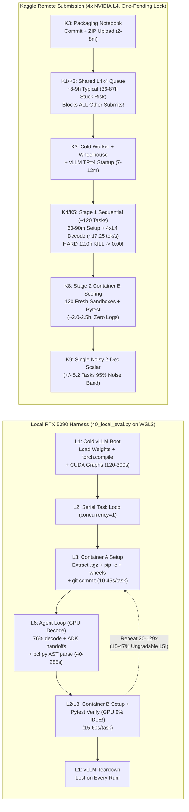

# Task 1: End-to-End Wall-Clock Time Bottlenecks — Local RTX 5090 Test Harness vs. Kaggle Remote Submissions

*Research scope: Exhaustive, hardware- and harness-grounded audit of every wall-clock time bottleneck across (a) local development and evaluation on the RTX 5090 workstation (PowerSpec G914: Ryzen 9 9950X3D, 64 GB RAM, NVIDIA RTX 5090 32 GB, Windows 11 + WSL2 Ubuntu 24.04 running `40_local_eval.py` and `swegemma`), and (b) remote competition submissions on Kaggle's 4x NVIDIA L4 scoring infrastructure. Grounded in official NVIDIA, vLLM, Google ADK, Gemma 4, Docker, WSL2, and Kaggle documentation plus empirical competition telemetry through Thread `#760595`.*

*As of: **2026-11-20** — Queue times, scorer throughput, and competition deadlines are fast-moving operational parameters reflected as of Nov 20, 2026.*

---

## Executive Summary

Wall-clock time is the binding constraint of the Kaggle Gemma 4 Developer Agent Competition — not GPU FLOPS and not code-localization capability. Locally on the RTX 5090 workstation, the current test harness (`40_local_eval.py`) introduces **5x–12x avoidable wall-clock overhead** by cold-booting and destroying vLLM on every invocation, running tasks strictly serially (`concurrency=1`) while leaving the 1,792 GB/s RTX 5090 idle during Container A bootstrap and CPU-bound Phase 2 `pytest` verification, and wasting 43–47% of full-129 evaluations (and 15% of `dry_run_tasks_20.txt`) on tasks that are structurally ungradable without missing test wheels. Remotely on Kaggle, a single submission consumes **20–24 hours end-to-end** (~8–9h queue wait + ~9–10h sequential 4x L4 inference + ~2–2.5h verification) behind a **one-pending-submission lock** (`400 FAILED_PRECONDITION`), leaving only **~10–12 remote evaluation slots** before the December 2 deadline while single-run public leaderboard noise spans **±5.2 tasks** (~±0.09 LB). The single most important operational caveat is hardware asymmetry: because Kaggle's four PCIe Gen4 L4 GPUs lack NVLink and deliver only 300 GB/s per GPU across 60 layers (31B) or 42 layers (E4B), Kaggle runs **~1.6x–2.6x slower** per active session than a single local Blackwell GPU, turning uncalibrated local timeouts into catastrophic all-or-zero 12-hour `Notebook Timeout` kills.

---

## 1. End-to-End Process Anatomy: Where Every Second Goes

Understanding wall-clock latency requires mapping the **complete critical path** for both environments, separating GPU-bound decode/prefill time, CPU/I/O-bound container setup and `pytest` time, framework orchestration overhead, and platform queueing delays.

### Hardware Physics: Why Local RTX 5090 and Kaggle 4x L4 Behave Completely Differently

Autoregressive LLM decoding at batch size 1 (`concurrency=1`) is overwhelmingly **memory-bandwidth bound** (every generated token must stream all active model weights from VRAM through the tensor cores) and, under Tensor Parallelism (`TP=4`), **collective-communication latency bound**. Official NVIDIA hardware specifications and Gemma 4 architectural parameters explain the entire cross-hardware speed gap:

| Hardware & Serving Parameter | Local Workstation: 1x NVIDIA RTX 5090 | Kaggle Scorer: 4x NVIDIA L4 (`TP=4`) | Wall-Clock Impact Mechanism |
| :--- | :--- | :--- | :--- |
| **GPU Architecture & Compute Cap** | Blackwell GB202 (`sm_120`), 5th-gen Tensor Cores ([NVIDIA](https://www.nvidia.com/)) | Ada Lovelace AD104 (`sm_89`), 4th-gen Tensor Cores ([NVIDIA L4 Datasheet](https://www.nvidia.com/)) | Wheelhouse v31 (`torch 2.10.0+cu128`, `vllm 0.19.1`) targets `sm_89`; `sm_120` risks JIT PTX recompile or `.venv-dev` parity divergence (`02_Runbook_5090.md` §4). |
| **Total VRAM & Usable (`gpu_mem`)** | `32 GB` GDDR7 (`~27.2 GB` at `0.85`; `~28.8 GB` at `0.90`) | `96 GB` GDDR6 ECC (`4 x 24 GB`, `~76.8 GB` at `0.80` or `~86.4 GB` at `0.90`) | 31B W4A16 (`~18–20 GB`) leaves `~9–11 GB` on 5090 (tight for BF16 KV + LoRA), whereas 4x L4 leaves `~55+ GB` for KV + 8 rank-128 LoRAs. |
| **Memory Bandwidth** | **`1,792 GB/s`** (512-bit GDDR7) | `300 GB/s` per GPU (`1,200 GB/s` aggregate across 4 GPUs) | A single RTX 5090 has **~1.49x higher aggregate bandwidth** than four L4s combined and **~5.97x** a single L4. |
| **Inter-GPU Interconnect (TP Sync)** | **None needed (`TP=1`)** — zero cross-GPU sync | **PCIe Gen4 x16 ONLY (NO NVLink!)** ([NVIDIA L4 Specs](https://www.nvidia.com/)) | Gemma 4 31B has **60 decoder layers** (120 AllReduces/token); E4B has **42 layers** (84 AllReduces/token). PCIe AllReduce overhead throttles 4x L4 batch-1 decode to **~17.25 tok/s** (`#755291`). |
| **Power / Thermal Envelope** | `575 W` active desktop cooling (plus Ryzen 9 9950X3D 16C/32T host CPU) | `4 x 72 W` passive server blades (`2 vCPUs / 4 GiB RAM` per Docker container) | 9950X3D executes local Container B `pytest` and AST parsing dramatically faster than Kaggle's 2-vCPU container slices. |
| **Empirical Speed Ratio (`k`)** | `1.0x` baseline (up to `~50–65 tok/s` single-stream 31B W4A16; `~140+ tok/s` E4B) | **`k ≈ 1.6x–1.8x` slower** than Blackwell at concurrency 3 (`project_12h.py`); up to **`2.1x–2.6x` slower** vs single-stream local (`#758954`) | Uncalibrated local runs give **optimistic wall-clock timings** that trigger silent 12-hour kills when shipped to Kaggle. |

---

## 2. Local Test Harness Bottlenecks (RTX 5090 Workstation)

Inspection of the local evaluation stack (`bcf/2026-11-08_Handoff_to_5090/tools/40_local_eval.py`, `setup_guide_06/06_Setup_Guide_WSL2_Swegemma_RTX5090.md`, `HARNESS_README.md`, and official vLLM / WSL2 / Docker documentation) reveals **eight distinct local wall-clock bottlenecks (`L1`–`L8`)**:

### `L1` — Per-Run vLLM Cold Boot, Compilation, Memory Profiling & Teardown (`40_local_eval.py:146-229`)
Every single invocation of `40_local_eval.py` instantiates a fresh `VllmServer(...)`, waits up to `startup_timeout=1200` seconds for weights to load, TorchInductor graphs to compile, CUDA graphs to capture, and KV cache profiling to run, executes the requested task list, and then unconditionally calls `server.stop()` in the `finally:` block. According to official vLLM optimization documentation ([vLLM Optimization & Tuning](https://docs.vllm.ai/)), cold starts are dominated by model weight deserialization (~18–20 GB for 31B QAT), `torch.compile` graph lowering, CUDA graph capture, and GPU memory profiling (`VLLM_MEMORY_PROFILER_ESTIMATE_CUDAGRAPHS=1`). Even on an NVMe SSD + RTX 5090, this adds **120–300 seconds (2–5 minutes) of dead wall-clock time** to *every single prompt tweak or 1-task smoke test*. Worse, because `40_local_eval.py` does not pin `VLLM_CACHE_ROOT` or pass `--kv-cache-memory`, any minor environment shift triggers full recompilation.

### `L2` — Strict Serial Execution (`concurrency=1`) and the GPU-Idle Verification Bubble (`40_local_eval.py:180-196`)
`40_local_eval.py` loops over tasks synchronously (`for i, t in enumerate(tasks, 1): asyncio.run(asyncio.wait_for(evaluator.evaluate_task(...)))`). This creates **two compounding utilization collapses**:
1. **Zero GPU Batching Utilization:** At batch size 1, Gemma 4 E4B (`~5 GB` weights) leaves `~22 GB` of the RTX 5090's VRAM completely empty; even Gemma 4 31B W4A16 (`~18–20 GB` weights) has a remarkably compact KV cache because **50 of its 60 layers use 1,024-token local sliding-window attention and only 10 layers use global attention with 4 unified KV heads** ([Gemma 4 Architecture](https://huggingface.co/google/gemma-4-31b-it)). Even at full 32,768-token context, our math shows 31B requires only `~2.0–3.3 GB` of BF16 KV cache per sequence (and only **`~1.0–1.6 GB` with `--kv-cache-dtype fp8`** per [vLLM FP8 KV Cache Docs](https://docs.vllm.ai/)), meaning the RTX 5090 can comfortably serve **2–3 concurrent 31B trajectories** or **4–8 concurrent E4B trajectories** via vLLM's continuous batching engine!
2. **GPU Sits at 0% Utilization During Container Setup & Phase 2 Verification:** Inside `Evaluator.evaluate_task()`, Phase 1 Container A setup (`extract_snapshot`, `pip install -e --no-deps`, wheel streaming, `git commit` = 10–45s) and the entire Phase 2 Container B verification lifecycle (fresh container setup + 4-pass `git apply` + hermetic `pytest` = 15–60s) execute sequentially before the next task sends a single prompt to vLLM. Across 68–129 tasks, **25–40% of total local wall-clock time is spent with the RTX 5090 sitting completely idle** waiting on Python/tar/git/pytest CPU work!

### `L3` — WSL2 9P Cross-OS Filesystem Latency & Repeated Disk Churn (`Container A` + `Container B`)
Official Microsoft WSL2 and Docker documentation confirms that accessing Windows drives (`/mnt/c`, `/mnt/d`) traverses the **Plan 9 (9P) protocol**, degrading metadata-heavy workloads (`tar` extraction, `git status`, `git add -A`, `pip install`, `pytest` collection) by **10x–20x** compared to native WSL2 `ext4.vhdx` ([WSL 2 File System Performance](https://learn.microsoft.com/en-us/windows/wsl/filesystems); [Docker WSL2 Backend](https://docs.docker.com/desktop/features/wsl/)). Even when kept under `~/g4` on native `ext4`, the `swegemma` two-container lifecycle (`HARNESS_README.md` §4.2) extracts the full repository `.tgz`, unpacks cached test site-packages, runs `pip install -e`, and writes a full git baseline commit **twice per task** (once for Container A, once for Container B — 258 full repo extractions per 129-task run!) directly onto virtual disk (`ext4.vhdx` / `overlay2` Copy-on-Write upperdir) instead of RAM (`tmpfs`), even though the 5090 PC has **64 GB RAM (`48 GB` allocated in `.wslconfig`)**.

### `L4` — Blackwell (`sm_120`) Wheelhouse Mismatch & Environment Parity Friction
Kaggle's official wheelhouse (`v31`, `vllm 0.19.1`, `torch 2.10.0+cu128`, `swegemma 0.2.11`, `adk-submission 0.2.13`) was compiled for data-center Ada Lovelace (`sm_89`) L4 GPUs. As flagged in `02_Runbook_5090.md` §4 and `06_Setup_Guide_WSL2_Swegemma_RTX5090.md` §8, running `sm_89`-built wheels on a Blackwell `sm_120` RTX 5090 either incurs expensive first-run PTX JIT compilation (adding minutes to cold start) or fails with `"no kernel image is available for execution on the device"`, forcing a separate `.venv-dev` with a newer vLLM build. That split creates a subtle **time & validation trap**: newer vLLM already includes PR `#41991` (array-parser hang fix) and PR `#42664` (`reasoning_content` handling), so bugs that freeze Kaggle's vLLM 0.19.1 go undetected locally unless explicitly cross-checked against the wheelhouse parser!

### `L5` — Wasted Local Compute on Ungradable & Non-Discriminating Practice Tasks
Community audits (`#756400`, `#756587`, `#757661`, `#757893`, `#760595`) and our own programmatic audit of `tasks.jsonl` prove that running all 129 practice tasks naively wastes **43%–47% of local GPU wall-clock time** on zero-signal tasks:
- **34 `fastapi` tasks** fail `pytest` collection in the default local sandbox due to missing `inline_snapshot` / `dirty_equals` wheels (`#756400`, `#757661`), unless explicitly repaired via Step 6 (`50_docker_sandbox.sh`).
- **8–12 `psf/requests` tasks** fail due to offline `network_mode="none"` / missing `httpbin` fixtures (`#755554`, `#757661`).
- **5 tasks** pass with an **empty patch** (2 `fastapi`, 3 `requests` — zero agent discrimination, `#756400`).
- **3 tasks** are permanently blocked by scorer/Python-3.13 bugs (`fastapi_14186`, `rich_3486` skipped-sibling JUnit matcher bug `#757893`; `rich_3472` Python 3.13 `AttributeError` formatting `#755554`).
- **Direct local finding:** Even the hand-picked `bcf/2026-11-08_Handoff_to_5090/tools/dry_run_tasks_20.txt` still contains **3 of the 27 missing-wheel FastAPI tasks** (`fastapi_14099`, `fastapi_14262`, `fastapi_14605`) — wasting **15% of every local subprocess dry run** unless the missing wheels are installed first!

### `L6` — Autoregressive Decode Dominance & Agent-Side Token Bloat
Trace-level profiling across Gemma 4 SWE runs (`#755291`) established that **~76% of active task wall time is pure autoregressive token decode**. Within the current BCF brain (`deliverables/2026-11-20_BCF_Gemma4_Winning_Design/`), five specific agent-side behaviors inflate local (and remote) wall time per task:
1. **Long Reasoning Blocks (`thinking_budget`):** `bcf_plan` allows up to `1,024` (31B) / `512` (E4B) thought tokens for a mechanical 2-step shell routine, and `solver` allows `2,048` (31B) / `768` (E4B) per turn. On E4B, Japan Open Data Lab (`#760014`) proved `think=4096` not only slowed runs dramatically but *reduced* accuracy `-37.5%` (`10/114` vs `16/114` zero-think).
2. **`SequentialAgent` Handoff Re-Decode & Prefix-Cache Break:** `bcf_plan` runs Turn 1 (`install.py`), Turn 2 (`bcf.py spec` — where the LLM must also re-decode key problem text into `<<'BCF_PROB'`), and Turn 3 (re-decoding up to 30 lines of `BCF_SPEC_V1` verbatim into `output_key: bcf_spec`). Then transferring to `solver` swaps the system instruction and tool declarations, **invalidating vLLM's Automatic Prefix Cache** and forcing full prompt re-prefill!
3. **Multi-Hunk Edit Turn Multiplication:** Our audit of `tasks.jsonl` showed **55.0% (71/129)** of reference patches have `>= 2` hunks (**25.6% / 33/129** are single-file multi-hunk). Because `bcf.py patch` edits only one contiguous `--start`/`--end` range per call, multi-hunk fixes require multiple sequential LLM decode turns.
4. **Uncached Full-Repo AST Re-Parsing in `bcf.py`:** `locate_candidates()` walks and runs `ast.parse()` over every `.py` file on every `spec` or `locate` call without caching the index in `.git/bcf/index.json`.
5. **14,336-Token Compaction Triggers & Nudge Loops:** Crossing ADK's `token_threshold=14,336` triggers an extra `LlmEventSummarizer` LLM inference call AND drops all tool history (`#754783`), causing the agent to re-read files and loop until timeout.

### `L7` — Coarse Watchdog Grace, Missing Futility Stopping & No Trajectory Resume/Forking
In `40_local_eval.py:179`, the per-task timeout watchdog is `limit_s = cap_min * 60 + 180 + 300` (over **12.75 minutes** for a `4.75m` cap!). If a task hangs on a bad command or parser loop, the serial harness sits blocked for 12+ minutes before cancelling. Furthermore, running a 20- or 68-task sweep has **no sequential futility stop** (e.g., halting after 8 tasks if broken-edit rate or crash rate explodes) and **no step-level trajectory caching/forking** (unlike `kaggle-glassbox` `#758817`), forcing every prompt/decoding ablation to re-run identical Turns 1–4 from scratch!

### `L8` — Local-to-Remote Time-Budget Mismatch (`k` Calibration Distortion)
Because the RTX 5090 runs `TP=1` with `1,792 GB/s` bandwidth while Kaggle runs `4x L4` (`TP=4`, PCIe AllReduce, `~17.25 tok/s`), wall-clock time caps behave differently across hardware (`#758954`): a `4.75m` wall-clock cap on the RTX 5090 buys **~1.6x–2.4x more generated tokens** than `4.75m` on Kaggle! Testing locally with raw `4.75m` caps therefore **over-estimates** how much exploration/verification your agent can finish on Kaggle unless you either scale the local cap down by `1/k` (`~2.5–3.0m` local equivalent for `4.75m` Kaggle!) or project every run through `project_12h.py` / `scorer-minutes` (`#758954`).

---

## 3. Kaggle Remote Submission Bottlenecks (4x NVIDIA L4 Infrastructure)

Grounded in Kaggle's official Code Competitions documentation ([Kaggle Code Competitions](https://www.kaggle.com/docs/competitions), [Kaggle Notebooks](https://www.kaggle.com/docs/notebooks)), official staff queue updates (`#747519`, `#760471`), `HARNESS_README.md`, and competitor telemetry (`#755677`, `#757588`, `#758954`, `#759630`, `#760140`, `#760309`), remote Kaggle submissions face **nine structural bottlenecks (`K1`–`K9`)** — most of which are outside competitor code control and must be engineered *around*:

### `K1` — Shared 4x L4 Queue Backlog (8–9h Normal, 36–87h Stuck-Batch Cliff)
Per Kaggle Staff's official **Nov 19, 2026 queue update** (`#760471`, Ashley Oldacre), finite 4x L4 capacity combined with ~9–10h average submission runtimes causes submissions to spend **~8–9 hours waiting in the queue** before a worker even starts, producing a **20–24 hour typical end-to-end turnaround** (94% of runs). Worse, infrastructure glitches have created multi-day orphaned batches: on Nov 9 (14:31–17:33 UTC), 15+ teams' submissions stalled in `PENDING` / `Notebook Running` for **71–120+ hours (3–5+ days)** with no user-side cancel button (`#759630`, `#747519`).

### `K2` — The One-Pending-Submission Lock (`400 FAILED_PRECONDITION`) & Calendar Scarcity
To smooth L4 pool load, Kaggle enforces a hard **one-pending-submission limit per team** (`#747519`), separate from the 1/day quota: attempting to submit while a prior submission is still queued or scoring returns `400 FAILED_PRECONDITION: Your team already has 1 pending submissions`. Crucially, **both tracks (31B Main and E4B Bonus) share this single queue slot**! With today being **2026-11-20**, there are only **~5.5 days until `kernelsPublishingDisabledDeadline` (Nov 25)** and **~12.5 days until final close (Dec 2)** — capping the entire remaining competition to **~10–12 total remote submissions** (fewer if any single run stalls or needs rescoring).

### `K3` — Packaging Notebook Commit, Cold Worker Provisioning & 4x L4 vLLM Startup (9–20 min)
Every remote cycle incurs two sequential cold starts:
1. **Packaging Notebook Commit (`Save & Run All`):** Spin up a Kaggle kernel, package `submission.zip`, validate locally, and save outputs (**~2–8 min**).
2. **Hidden Scoring Worker Boot (`scripts/inference.py`):** Allocate a 4x L4 node, install the 41-wheel `metric/gemma-4-developer-agent-wheelhouse` dataset, unpack `submission.zip`, shard the W4A16 checkpoint across 4 GPUs (`TP=4`), capture CUDA graphs (`VLLM_MEMORY_PROFILER_ESTIMATE_CUDAGRAPHS=1`), and pre-allocate LoRA slots (`max_loras=8, max_lora_rank=128`). Competitor benchmarks on Kaggle 4x L4 measured **`431 seconds` (~7.2 min)** just to boot E4B + 1 LoRA (`#760140`), and **~7–12 minutes** for 31B.

### `K4` — 4x L4 PCIe Gen4 TP=4 Decode Speed Ceiling (~17.25 tok/s, Zero Tuning Access)
Unlike local evaluation, competitors **cannot modify vLLM flags** on Kaggle (`#758972`). The scorer fixes `tensor_parallel_size=4`, `max_model_len=32768`, `tool_call_parser="gemma4"`, `reasoning_parser="gemma4"`, `enable_lora=True`, `max_loras=8`, `max_lora_rank=128` (`HARNESS_README.md` §3.1). Because L4 GPUs communicate solely over PCIe Gen4 x16 (no NVLink), XingLing's linear regression on Kaggle L4 traces (`dt = 0.78 + 0.058 * tokens`, `r² = 0.9996`) proves that **every 1,000 output tokens (thoughts + text + tool args) costs ~58 seconds of irreversible wall-clock time** (~17.25 tok/s), meaning a 300-second (5-minute) task budget buys **at most ~5,000 total generated tokens** across the entire trajectory!

### `K5` — Sequential ~120-Task Stage-1 Loop, Hidden Setup Tax (60–90m), and All-or-Zero 12-Hour Kill Cliff
Kaggle evaluates all **~120 hidden tasks** (58 public + ~62 private, `#752017`, `#757588`) **sequentially (`concurrency=1`)** inside a single **12-hour (720-minute)** hard wall-clock budget:
- **Hidden Container A Setup Overhead:** `HARNESS_README.md` §7.1 explicitly notes that Container A bootstrap (wheel staging, `.tgz` extraction, `pip install -e`, cached test site-packages, `pytest.ini`/`conftest.py`, baseline `git commit`) is **excluded from `max_time_minutes`** — yet it **DOES count toward the 12-hour job wall clock**! At 30–45 seconds per task across 120 tasks, Container A setup silently consumes **60–90 minutes (8.3%–12.5% of the entire 12-hour limit)** before the agent emits a single token!
- **All-or-Zero Cliff:** Exceeding 720 minutes by even 1 second kills the worker with `Notebook Timeout` and **score `0.00` (zero partial credit)** (`#743063`, `#756622`). Note also that per-task `max_time_minutes` is a **soft boundary**: if an LLM call or shell command (`timeout_seconds`) is already in flight when the timer ticks past `max_time_minutes`, the task overruns by up to `min(timeout_seconds, remaining)` or one full LLM decode turn!

### `K6` — Dynamic Multi-LoRA Serving Latency Tax (+10–29% Time / +45% Token Inflation)
Although vLLM's dynamic LoRA math adds <5% theoretical FLOPs ([vLLM LoRA Docs](https://docs.vllm.ai/)), kernel dispatch overhead, memory layout fragmentation, and non-merged adapter paths on quantized `compressed-tensors` weights cause severe real-world slowdowns: **-22% to -25% TPS** on A100 and **-10% to -15% TPS** on Kaggle 4x L4 (`#760309`), plus ~+29% task duration and ~+45% tokens/step on SFT adapters (`#755677`). Under fixed per-task wall-clock caps, a **zero-weight LoRA** (contributing zero weight change!) resolved **7 fewer tasks (`50/129` vs `57/129`, `-5.43 pp`)** solely from serving latency (`#760309`).

### `K7` — Catastrophic Harness & Parser Wall-Clock Failure Modes
Four verified bugs in the frozen Kaggle stack (`vllm 0.19.1`, `google-adk 1.36.1`, `swegemma 0.2.11`) directly destroy wall-clock time or kill runs:
1. **vLLM 0.19.1 `_parse_gemma4_array` Infinite Loop (`#753973`, `#759580`):** One unescaped `]` inside any array-typed tool parameter freezes the vLLM async event loop forever (balloons to 26.7 GB OOM); every remaining task stalls on the 600s client read timeout and scores `0.00`.
2. **ADK `LlmEventSummarizer` 14,336-Token Compaction Reset (`#754783`, `#756336`):** Fixed through finals (staff ruled out ADK v2). Adds an extra summarization LLM call AND drops all `function_call`/`function_response` parts, causing the agent to forget its progress and re-run exploration until timeout.
3. **`ModelRetryPlugin` Exponential Backoff (`HARNESS_README.md` §7.2):** Up to 5 retries (`2s, 4s, 8s, 16s, 32s` + jitter -> ~62–120s wasted on a single wedged request).
4. **Getting Started v3 Nullable Config Crash (`#760140`) & Silent `0.00` Skill Isolation (`#758547`, `#758854`):** Passing `null` in `eval_config.yaml` crashes immediately with `TypeError: int(None)`; skill-only bundles scored `0.00` on the hidden scorer after wasting a full 24h queue cycle!

### `K8` — Stage 2 Verification Latency (~2.0–2.5 Hours) & Zero-Observability Feedback Black Box
Once Stage 1 flushes `submission.parquet`, Stage 2 (`scripts/metric.py`) runs `verify_task` across all ~120 tasks in fresh `4 GiB / 2 vCPU` Container B instances — taking **~2.0 to 2.5 hours** (`#760471`). Crucially, Kaggle returns **zero logs, zero traces, zero timing breakdowns, and zero stack traces** (`#760140`, `#759580`): a broken ZIP, a 12h timeout, a `0.00` skill-isolation bug, and a parser freeze all consume 20–24 hours and return only a cryptic status label or `0.00`.

### `K9` — Continuous-Batching Non-Determinism & Single-Run Noise Wall (Effective Iteration Multiplier = 3x–5x)
Even at `temperature = 0.0`, vLLM continuous batching breaks floating-point reduction invariance ([Thinking Machines Lab — *Defeating Nondeterminism in LLM Inference*](https://thinkingmachines.ai/blog/defeating-nondeterminism-in-llm-inference); corroborated by Kaggle Staff `#760126` and Japan Open Data Lab `#760014`). Identical submissions swing wildly on the 58-task public split (`0.24 -> 0.17` `#757588`; `0.17 -> 0.12` `#758969`; `0.20 -> 0.18/0.17/0.13` `#756438`), with an empirical per-task flip rate of **10%–13%** (`#750907`) and run-to-run standard deviation of `sigma ≈ 1.5–2.0` tasks. On `N = 58`, a single 24-hour remote submission has a **95% difference noise band of ±5.2 tasks (~±0.09 LB)**! Detecting a true `+2 task` (`+0.034 LB`) improvement on Kaggle directly would require **3–5 remote submissions per arm = 6–10 full calendar days** — physically impossible!

---

## 4. Master Wall-Clock Bottleneck Matrix (Local RTX 5090 vs. Kaggle Remote)

| ID | Environment | Pipeline Stage | Wall-Clock Cost (Current) | Severity | Competitor Controllable? | Primary Mitigation Strategy (See Task 3) |
| :---: | :--- | :--- | :--- | :---: | :---: | :--- |
| **`L1`** | Local 5090 | vLLM Cold Start & Teardown | `2–5 min` **every run** | **High** | **100% Yes** | Keep persistent `vllm serve` daemon alive + `VLLM_CACHE_ROOT` + `--kv-cache-memory`. |
| **`L2`** | Local 5090 | Serial `concurrency=1` + GPU-Idle Phase 2 | `~60–75%` wasted wall time (`3–6h` / 68 tasks) | **Critical** | **100% Yes** | vLLM FP8 KV cache + `concurrency=2–3` (31B) / `4–8` (E4B) + async CPU worker pool for Container B `pytest`. |
| **`L3`** | Local 5090 | WSL2 9P / Disk I/O Double-Extraction | `25–105s / task` (`10–20x` slower if `/mnt/d`) | **High** | **100% Yes** | Keep all assets on WSL2 `ext4` (`~/g4`) + mount ephemeral sandboxes on `tmpfs` (RAM disk) + warm Docker pool. |
| **`L4`** | Local 5090 | Blackwell `sm_120` vs `sm_89` Wheelhouse | `1–5 min` JIT / parity blind spots | **Medium** | **Yes** | Pin `VLLM_CACHE_ROOT`; dual-venv (`fast` for sweeps, `v31` parser unit fuzz for parity). |
| **`L5`** | Local 5090 | Ungradable / Non-Discriminating Tasks | `15%` (`dry20`) to `47%` (`ALL 129`) wasted | **Critical** | **100% Yes** | Install Step-6 missing wheels + lock evaluation strictly to clean valid panel (`N=68/91`) + 12-task canary. |
| **`L6`** | Both | Decode Dominance + Thought/Handoff Bloat | `~76%` of active task time (`58s / 1k tok` L4) | **Critical** | **100% Yes** | Cut `bcf_plan` thinking/re-decode, tune `solver` `thinking_budget`, ban restatement, add multi-hunk patcher. |
| **`L7`** | Local 5090 | Coarse Watchdog & Zero Trajectory Reuse | `12.75m` hang wait; `100%` re-run per tweak | **High** | **100% Yes** | Tighten watchdog (`cap + 45s`), add sequential futility stop, adopt Glassbox step-forking + prefix cache. |
| **`L8`** | Local -> Remote | Speed Ratio `k` Calibration Gap | Risks silent `12h` remote `0.00` kill | **Critical** | **100% Yes** | Scale local time cap by `1/k` (`~2.5–3.0m`) + calibrate `k` with 5-task free Kaggle 4x L4 notebook. |
| **`K1`** | Kaggle Remote | Shared 4x L4 Submission Queue | **`8–9h`** typical (`36–87h` stuck risk) | **Critical** | **No** (Operational) | Submit early UTC, monitor via API, never use Kaggle as an inner dev loop. |
| **`K2`** | Kaggle Remote | One-Pending Lock + Calendar Cliff | Caps entire remainder to **~10–12 slots** | **Critical** | **No** (Scheduling) | Strictly gate every submission via Tier 0–3 local funnel; pre-allocate 31B vs E4B slot calendar. |
| **`K3`** | Kaggle Remote | Notebook Commit + 4x L4 vLLM Cold Boot | `9–20 min` per submission | **Low-Med** | **Partial** | Keep ZIP `<1 MB` (zero unused adapters), omit LoRA unless gated, avoid heavy commit cells. |
| **`K4`** | Kaggle Remote | 4x L4 PCIe Gen4 TP=4 Decode (`~17.25 tok/s`) | Fixed hardware floor (`5k tok / 5 min`) | **Critical** | **No** (Token-Econ) | Maximize **value per generated token** (compact prompts, short thoughts, concise `bcf.py` outputs). |
| **`K5`** | Kaggle Remote | Sequential 120 Tasks + Setup Tax + 12h Kill | `60–90m` setup + `120 * cap` (0.00 if `>12h`) | **Critical** | **Yes** (`eval_config`) | Enforce hard finite `eval_config.yaml` caps + `project_12h.py` GREEN (`<=11.0h` at `k=1.7`). |
| **`K6`** | Kaggle Remote | Dynamic LoRA Serving Tax (`-10–25%` TPS) | `+29%` task time (`-7` tasks zero-LoRA) | **High** | **Yes** | Base-model-first default; ship LoRA ONLY if net fixed-time local gain clears `+3` tasks. |
| **`K7`** | Kaggle Remote | Parser Freeze / Compaction / Null-Budget Bugs | Instant `0.00` or `2x` task time | **Critical** | **Yes** (Defenses) | Zero array args, non-null `eval_config`, `<14,336`-tok hygiene, Day-1 Canary Gate `G-SK`. |
| **`K8`** | Kaggle Remote | Stage 2 Verification + Black-Box Zero Logs | `2.0–2.5h` blind wait per submit | **High** | **Partial** | Run full local Container B Docker parity + static preflight before every ZIP upload. |
| **`K9`** | Kaggle Remote | Continuous Batching Variance (`±5.2` tasks) | Invalidates single-run LB A/B verdicts | **Critical** | **Yes** (Method) | Judge hypotheses strictly via local paired McNemar + multi-run averages + mechanistic KPIs. |

---

## 5. Open Questions & Where the Evidence Runs Out

1. **Exact Hidden-Set Task Count & Private Repo Size Distribution:** Community estimates (`~120` tasks = 58 public + ~62 private) are corroborated by leaderboard score quantization (`floor(100k/58)/100`, `#757588`) and runtime ceilings (`#752017`), but Kaggle staff have not publicly published the exact private-split count or average repository size (which directly governs Container A setup minutes and `bcf.py` AST parse time).
2. **Exact Managed-Scorer `run_skill_script` Container Placement (`#758547`, `#758854`):** Staff have not answered whether `run_skill_script` executes inside Container A or in an isolated host directory on the hidden scorer. Our Day-1 Canary Gate `G-SK` resolves this empirically on Nov 20–21 without losing a week.
3. **Managed-Scorer `thinking_budget` Enforcement & `reasoning_content` Patch Parity (`#744354`, `#760595`):** Public wheelhouse v31 still drops `reasoning_content` between tool calls (`#744354`, verified Nov 11) and exact vLLM 0.19.1 `thinking_budget` truncation enforcement on `/v1/chat/completions` has not been staff-confirmed on the hidden worker — making visible-text state paraphrasing and empirical 4x L4 calibration essential.
4. **RTX 5090 Exact `sm_120` Wheelhouse Compatibility:** Until `30_install_wheelhouse.sh` runs on the user's PowerSpec G914, whether wheelhouse v31's `torch 2.10.0+cu128` + `vllm 0.19.1` runs natively on `sm_120` or requires a separate `.venv-dev` remains to be verified during Step 4 of the local runbook.

---

## 6. Sources

1. **NVIDIA Official Specifications:** NVIDIA GeForce RTX 5090 (Blackwell GB202, 32 GB GDDR7, 1,792 GB/s, 512-bit, 575 W) and NVIDIA L4 Tensor Core GPU Datasheet (Ada Lovelace AD104, 24 GB GDDR6 ECC, 300 GB/s, PCIe Gen4 x16, No NVLink, 72 W), `https://www.nvidia.com/`.
2. **vLLM Official Documentation:** Engine Optimization & Tuning (`VLLM_CACHE_ROOT`, `VLLM_FORCE_AOT_LOAD`, `--kv-cache-memory`, V1 Automatic Prefix Caching & Chunked Prefill defaults), FP8 KV Cache (`--kv-cache-dtype fp8`), `compressed-tensors` W4A16 Marlin kernels, LoRA Serving (`--enable-lora`, `max_loras`, `max_lora_rank`), Reasoning Outputs (`--reasoning-parser gemma4`, `--tool-call-parser gemma4`), and Batch Invariance (`VLLM_BATCH_INVARIANT=1`), `https://docs.vllm.ai/`.
3. **Google DeepMind Gemma 4 Documentation & Model Cards:** Gemma 4 31B Dense (60 layers: 50 local 1024-window + 10 global 4-unified-KV-head layers, 262k vocab) and Gemma 4 E4B (42 layers, Per-Layer Embeddings, 512-window), thinking mode (`<|channel>thought`), tool syntax (`<|tool_call>`), and recommended sampling parameters, `https://ai.google.dev/gemma/docs/core` & `https://huggingface.co/google/gemma-4-31b-it`.
4. **Google ADK Official Documentation:** `LlmAgent`, `SequentialAgent`, `AgentTool`, `output_key`, `include_contents`, `EventsCompactionConfig` (`LlmEventSummarizer`), `ContextCacheConfig`, and `SkillToolset`, `https://google.github.io/adk-docs/`.
5. **Microsoft WSL2 & Docker Official Documentation:** WSL 2 File System Performance (`ext4.vhdx` vs. `/mnt/*` 9P protocol), `.wslconfig` memory/CPU configuration (`https://learn.microsoft.com/en-us/windows/wsl/`), Docker `tmpfs` mounts, `overlay2` storage driver, and WSL 2 Engine backend (`https://docs.docker.com/`).
6. **Kaggle Official Documentation:** Code Competitions synchronous/asynchronous rerun architecture, 12-hour GPU / 9-hour TPU session limits, and weekly GPU quotas (`https://www.kaggle.com/docs/competitions`, `https://www.kaggle.com/docs/notebooks`).
7. **Thinking Machines Lab (2025/2026):** *Defeating Nondeterminism in LLM Inference* — root cause of continuous-batching floating-point non-invariance across RMSNorm, MatMul, and Attention (`https://thinkingmachines.ai/blog/defeating-nondeterminism-in-llm-inference`).
8. **Local Competition Ground Truth & Forum Telemetry (`input/kagglecomp/`, `bcf/`, `deliverables/`):** `HARNESS_README.md`, `40_local_eval.py`, `project_12h.py`, `06_Setup_Guide_WSL2_Swegemma_RTX5090.md`, `tasks.jsonl`, and Kaggle Discussion Threads `#743063`, `#744354`, `#747519`, `#750907`, `#752017`, `#753973`, `#754636`, `#754783`, `#755291`, `#755554`, `#755677`, `#756336`, `#756400`, `#756587`, `#757588`, `#757661`, `#757893`, `#758547`, `#758817`, `#758854`, `#758954`, `#758969`, `#758972`, `#759388`, `#759580`, `#759630`, `#760014`, `#760126`, `#760140`, `#760309`, `#760471`, `#760595`.
