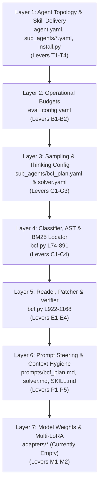

# Task 2: Current BCF Brain Tuning Levers & Ranked Impact-Effort Analysis

*Research scope: Exhaustive file-by-file, line-by-line engineering audit of the current dual-track **Batonic Coding Framework (BCF)** brain (`deliverables/2026-11-20_BCF_Gemma4_Winning_Design/submission_31b/` and `submission_e4b/`), identifying every juncture where parameters, topology, scripts, prompts, or adapters can be tuned to improve resolution rate and wall-clock efficiency, followed by a transparent quantitative Impact-Effort analysis ranking all **24 tuning levers**.*

*As of: **2026-11-20** | Current BCF Brain Audited: `submission_31b/` (9 files, 29,527 B ZIP) & `submission_e4b/` (9 files, 26,767 B ZIP), plus `tasks.jsonl` (129 tasks) and competition telemetry through `#760595`.*

---

## Executive Summary

Line-by-line inspection of the current BCF brain (`agent.yaml`, `eval_config.yaml`, `sub_agents/*.yaml`, `prompts/*.md`, `skills/bcf-spec/SKILL.md`, `install.py`, and all 1,324 lines of `bcf.py`) uncovers **24 distinct, concrete tuning levers across 7 architectural layers**. Crucially, our code audit exposed **four high-impact hidden defects/headroom gaps** inside the current BCF implementation that can be fixed immediately at near-zero engineering cost: (1) `bcf.py:721` truncates every source file at `raw[:24000]` (~600 lines) during BM25 indexing, blinding lexical retrieval to **38.8% (50/129)** of reference patch locations; (2) `bcf.py patch` only supports a single contiguous line range per call, while **55.0% (71/129)** of tasks require `>= 2` hunks (**25.6%** single-file multi-hunk); (3) `bcf_plan -> solver` currently pays a 3-turn handoff + verbatim `BCF_SPEC_V1` re-decode tax (~20–35s on 4x L4) + vLLM prefix-cache invalidation + unverified `#758547` skill-isolation exposure; and (4) `bcf_plan.yaml` still allocates `1,024` (31B) / `512` (E4B) thinking tokens to a purely mechanical 2-step shell routine, while `solver.yaml` omits `top_k` and `presence_penalty` and caps `max_time_minutes` conservatively at `4.75m` / `4.25m`. Executing the **Top 8 Quick Wins (Quadrant 1)** first offers an estimated **+2.5 to +5.0 tasks/58** lift with minimal engineering effort, whereas LoRA adapters (`M1`, `M2`) rank near the bottom due to high effort and proven 10–25% serving TPS penalties (`#760309`).

---

## 1. Architecture Map: All 7 Tuning Junctures in the Current BCF Brain

---

## 2. Detailed Inventory of All 24 Tuning Levers (Exact Locations & Mechanics)

### Layer 1 — Multi-Agent Topology, State Flow & Tool Surface (`agent.yaml`, `sub_agents/*.yaml`, `install.py`)

- **`T1` — Canary-Gated Topology Switch (`SequentialAgent + skills/bcf-spec` vs. Monolithic Single-`LlmAgent`):**
  - *Exact location:* `submission_*/agent.yaml`, `sub_agents/*.yaml`, `skills/bcf-spec/`.
  - *Current state:* 2-stage `SequentialAgent(bcf_plan -> solver)` with `skills: [skills/bcf-spec]` on `bcf_plan`.
  - *Tuning mechanism:* Threads `#758547` and `#758854` warn that `run_skill_script` may execute outside Container A on the hidden scorer, and `#760126` (Murugesan) reported `SequentialAgent` lagging single-agent `system.md` on LB (`0.10` vs `0.15–0.18`). Moreover, switching from `bcf_plan` to `solver` changes the system prompt and tool schema, **invalidating vLLM's Automatic Prefix Cache** and adding ~20–35s of re-decode overhead per task (plus another 20–35s on every continuation nudge `#754636`). Test `SequentialAgent + bcf-spec` against a **Zero-Skill Monolithic `LlmAgent`** (embedding an inline 15-line Python heredoc syntax-guarded patcher + verification protocol directly into `solver.md` — zero handoff, 100% vLLM prefix-cache hit across every turn, zero skill-isolation risk!).
- **`T2` — Eliminate `bcf_plan` Problem Re-Decode & Verbose Spec Echo:**
  - *Exact location:* `prompts/bcf_plan.md:28-44`, `sub_agents/bcf_plan.yaml:18-21`.
  - *Current state:* `bcf_plan` asks the LLM to `<paste concise key text...>` into `<<'BCF_PROB'` (re-decoding the problem statement at 17.25 tok/s) AND then re-decode the entire 30-line `BCF_SPEC_V1` stdout verbatim into `output_key: bcf_spec`.
  - *Tuning mechanism:* Trim `BCF_SPEC_V1` output format in `bcf.py:format_spec_card()` to **<= 15 ultra-dense lines (~180 tokens)**, instruct `bcf_plan` to pass only `5–10` extracted symbols/keywords via `--text "..."` (instead of pasting paragraphs into a heredoc!), and store full details in `.git/bcf/last_spec.json` for `solver` to query on demand. Saves **25–45 seconds/task** on 4x L4!
- **`T3` — Read-Only `AgentTool(skip_summarization: true)` Explorer Sub-Agent (31B Track Only):**
  - *Exact location:* `submission_31b/sub_agents/solver.yaml:9-15` (and new `sub_agents/explorer.yaml`).
  - *Current state:* All `read_file` and `run_command` exploration outputs accumulate inside `solver`'s main context window, pushing long tasks past ADK's `14,336`-token compaction wipe (`#754783`).
  - *Tuning mechanism:* Per `HARNESS_README.md` §10.4 and Google ADK docs (`AgentTool`), wrapping a read-only explorer (`read_file` + `run_command` search only) with `skip_summarization: true` isolates noisy multi-file reads from `solver`'s history. *Caution:* Only viable on 31B; `#760014` proved nested tool wrappers hurt E4B (`1 -> 29` schema errors).
- **`T4` — Surgical Tool-Surface Pruning (`write_file` & `edit_file` Exposure):**
  - *Exact location:* `sub_agents/solver.yaml:9-15`.
  - *Current state:* `solver.yaml` exposes 6 tools (`run_command`, `read_file`, `edit_file`, `write_file`, `get_status`, `submit_patch`).
  - *Tuning mechanism:* (a) Removing `write_file` from `solver.yaml` **physically eliminates** the `write_file("/tmp/repro.py") -> /workspace/tmp/repro.py` patch-pollution trap (`#760595`) while saving tool-schema tokens (creating new files via bash heredoc still works!). (b) On E4B (if `bcf-spec` passes Canary `G-SK`), test removing `edit_file` so E4B *cannot* fall back to char-dropping JSON edits (`#753277`), forcing 100% syntax-guarded `bcf.py patch`!

### Layer 2 — Evaluation Budgets & Time Allocation (`eval_config.yaml`)

- **`B1` — Empirical `max_time_minutes` Calibration (Risk-Adjusted Headroom vs. Hard-Task Solves):**
  - *Exact location:* `submission_31b/eval_config.yaml:8` (`4.75`), `submission_e4b/eval_config.yaml:8` (`4.25`).
  - *Current state:* Sized for the **adversarial 100%-timeout worst case** (`120 * 4.75m + 90m setup + 7m boot = 11.12h`).
  - *Tuning mechanism:* In reality, solved tasks finish in **~1.5–2.5 minutes** (E4B median `91s` in `#760595`; 31B mean `~2.5–3.5m`), NOT 100% timeouts! Alex Ust's empirical 101-task distribution (`project_12h.py`) showed `6.0m`–`7.0m` completes in `~10.7–11.6h` at `k=1.7` while capturing medium-hard tasks that die right at `4.75m`. Sweep `5.25 / 5.75 / 6.0 min` (31B) and `4.5 / 5.0 min` (E4B) locally and verify **GREEN (`<= 11.0h`)** on `project_12h.py` using actual measured `dry_run_rows.jsonl` timing distributions (never blindly push past `6.0m` without 4x L4 `k` calibration!).
- **`B2` — `max_tool_calls`, `max_turns`, and `timeout_seconds` Balancing:**
  - *Exact location:* `eval_config.yaml:6-9` (`60s / 28 calls / 45 turns` on 31B; `45s / 26 calls / 40 turns` on E4B).
  - *Current state:* `max_tool_calls >= 20` properly enables `budget_warning` at `<= 10` calls left (`HARNESS_README` §6).
  - *Tuning mechanism:* Test `max_tool_calls` in `{22, 26, 30}` (lower cap shifts the built-in `budget_warning` earlier — e.g., at call 12 of 22 vs call 18 of 28, nudging rambling trajectories to commit edits earlier!). Raise `timeout_seconds` slightly (`60s -> 90s` on 31B) while keeping `bcf.py verify --timeout 35` so a legitimate slow `pytest` collection on a large private repo doesn't abort prematurely.

### Layer 3 — Generation, Thinking & Sampling Controls (`sub_agents/*.yaml`)

- **`G1` — Stage-Specific `thinking_budget` Sweep (Highest Speed + Accuracy Lever!):**
  - *Exact location:* `sub_agents/bcf_plan.yaml:20` (`1024` 31B / `512` E4B), `sub_agents/solver.yaml:21` (`2048` 31B / `768` E4B).
  - *Current state:* `bcf_plan` burns up to 1,024 thinking tokens on a purely deterministic 2-command script! Meanwhile on E4B, `#760014` showed `zero-think` (`16/114`) edged out `think=768–1024` (`15/114`) and crushed `think=4096` (`10/114`), and Abhimanu Bhagwati found zero-think is **3.3x faster** (`02_New_Test_Harnesses`).
  - *Tuning mechanism:*
    - Immediately slash `bcf_plan` `thinking_budget` to **`128–256` (31B)** and **`64–128` (E4B)** (keep `include_thoughts: true` so tool-call JSON syntax never collapses `3 -> 132`, `#760014`).
    - Run a paired sweep on `solver` `thinking_budget`: **`{1024, 1536, 2048}` (31B)** and **`{256, 512, 768, 1024}` + `0 (with include_thoughts: true)` (E4B)**. Every 500 saved thinking tokens per turn across 10 turns recovers **~290 seconds (~4.8 minutes!)** on 4x L4!
- **`G2` — Sampling Hyperparameters (`temperature`, `top_k`, `top_p`, `presence_penalty`, `seed`):**
  - *Exact location:* `sub_agents/bcf_plan.yaml:15-18`, `sub_agents/solver.yaml:16-19`.
  - *Current state:* Sets only `temperature` (`0.1 / 0.2` on 31B; `0.1 / 0.15` on E4B) and `top_p: 0.95`. Omits `top_k`, `presence_penalty`, `frequency_penalty`, and `seed`.
  - *Tuning mechanism:* Official Gemma 4 docs recommend `top_k: 64` and `top_p: 0.95` ([Gemma 4 Docs](https://ai.google.dev/gemma/docs/core)); public competitor ablations (`shimauchu`, `02_New_Test_Harnesses`) achieved `0.20–0.22` by raising `temperature` from `0.2 -> 0.4` (helping escape greedy edit loops!), whereas `T=0.6` degraded E4B to `0.03` (`#758969`). Test **`top_k: 64`**, **`temperature ∈ {0.15, 0.25, 0.35}`** (31B) / **`{0.1, 0.2}`** (E4B), and a mild **`presence_penalty: 0.05–0.15`** (specifically to break 38-repeat verbatim retry loops `#756051`, `#756433` without distorting code syntax!).
- **`G3` — `max_output_tokens` Safety Floor Validation:**
  - *Exact location:* `sub_agents/bcf_plan.yaml:18` (`2048`/`1536`), `sub_agents/solver.yaml:19` (`8192`/`4096`).
  - *Current state:* Well-calibrated to `#760014` (never `<4096` on `solver`).
  - *Tuning mechanism:* Verify `max_output_tokens >= thinking_budget + 3072` on all tracks (so a full thought block + large heredoc patch never truncates `<|tool_call|>`). Test bumping E4B `solver` from `4096 -> 5120` if any trace shows `finish_reason=LENGTH` during large patches.

### Layer 4 — `bcf.py` Classification, AST & BM25 Localization Engine (`bcf.py:74-891`)

- **`C1` — Remove `raw[:24000]` & `content[:16000]` Truncation Blind Spots + Cache AST/BM25 Index:**
  - *Exact location:* `bcf.py:721` (`raw[:24000]`), `bcf.py:867` (`content[:16000]`), `bcf.py:764` (uncached full-repo `_parse_file_symbols`).
  - *Current state:* **Verified major defect:** Our programmatic scan of `tasks.jsonl` proved **50 of 129 tasks (38.8%)** patch code past line 600 (~24 KB), and **21 of 129 (16.3%)** past line 1,000 (~40 KB)! Truncating BM25 body indexing at 24 KB blinds `bcf.py` to error messages, docstrings, and symbol references in the bottom half of large files (`fastapi/routing.py`, `rich/console.py`, etc.). Additionally, calling `bcf.py locate` after `bcf.py spec` re-parses the entire repository AST from scratch.
  - *Tuning mechanism:* Raise body tokenization cap to full file (or `120,000` chars with chunked BM25 per top-level class/function!), raise test-file scan cap to `64,000` chars, and serialize the parsed repo index to `.git/bcf/repo_index.json` (built once on `spec`, reused in `<50ms` on every `locate` call!). Zero GPU needed to tune and verify!
- **`C2` — Add Module-Level Constants/Assignments (`ast.Assign`/`AnnAssign`) & `git grep` Hybrid Fallback:**
  - *Exact location:* `bcf.py:666-729` (`_parse_file_symbols`), `bcf.py:752-844` (`locate_candidates`).
  - *Current state:* `_parse_file_symbols()` only indexes `ast.ClassDef`, `ast.FunctionDef`, and `ast.AsyncFunctionDef` — missing module-level constants, lookup tables, regexes, `TypeAlias`, and `__all__` (TRAP-6: 15 tasks in `bcf-traps-and-brain-patterns-2026-11-08.md`!).
  - *Tuning mechanism:* Index top-level `ast.Assign` / `ast.AnnAssign` targets with exact line numbers, add a `git grep -n` literal search pass when `signals["sparse_prompt"]` or `conf == "LOW"`, and include exact line numbers for literal substring matches (like `self._parser.complete`!).
- **`C3` — Refine `SUBCATEGORY_RULES` Weights, Generalize Vocabulary & Blend Secondary Playbooks:**
  - *Exact location:* `bcf.py:74-640` (`SUBCATEGORY_RULES`, `classify_issue`), `bcf.py:796` (`stream_image` string!).
  - *Current state:* Achieves `65.9%` primary / `62.8%` sub top-1 / `75.2%` sub top-2 on all 129 tasks. Notice a subtle leak at line 796 (`"stream_image"`, a FastAPI tutorial name) and line 487 (`"license_info"`), plus `classify_issue()` only outputs the primary playbook even when `secondary_subcategory` is close in score.
  - *Tuning mechanism:* Scrub any training-repo-specific tokens (`stream_image`) for pure unseen-repo generalization; tune weights on `tasks.jsonl` using leave-one-repo-out CV (train weights on 3 repos, evaluate on held-out 4th repo!); emit 1 bonus bullet from `secondary_subcategory` whenever `sec_sc >= 0.7 * best_sc`; add `DC-11` Non-Destructive Aliasing triggers to `SPEC_CHANGE_RISK`.
- **`C4` — AST Import-Graph Test-File Matching (`TARGET_TESTS` Precision):**
  - *Exact location:* `bcf.py:846-877`.
  - *Current state:* Matches test files purely by filename stem (`routing` in `test_routing.py`) and literal symbol substring hits in the first 16 KB.
  - *Tuning mechanism:* Parse `import` / `from X import Y` lines inside `test_*.py` files (cheap regex or AST) and score test files that directly import the top candidate module/symbol. Directly addresses `#760595`'s finding that 45 of 133 baseline `pytest` calls ran the wrong/non-existent test path!

### Layer 5 — `bcf.py` File Reading, Atomic Patching & Verification Gate (`bcf.py:922-1168`)

- **`E1` — Multi-Hunk Atomic Patching (`patch --multi`) & ±5-Line Fuzzy Anchor Recovery:**
  - *Exact location:* `bcf.py:952-1028` (`cmd_patch`).
  - *Current state:* Accepts only one `--start S --end E` range per invocation, and `--check-anchor` fails hard if line numbers shift by even 1 line after an earlier edit. Yet **55.0% (71/129)** of dataset tasks require `>= 2` hunks (**25.6%** single-file multi-hunk)!
  - *Tuning mechanism:* Support a clean multi-hunk stdin protocol (e.g., `<<<HUNK start:end>>>` delimiters applied bottom-to-top in one atomic write + single `ast.parse`/`py_compile` gate!) AND auto-adjust line ranges by `±5` lines when `--check-anchor` matches uniquely nearby. Cuts multi-hunk edits from 2–4 tool calls down to **1 tool call**!
- **`E2` — Enhanced `bcf.py verify`: Exact Submodule Import, Static Undefined-Name AST Check & Before/After Test Delta:**
  - *Exact location:* `bcf.py:1057-1168` (`cmd_verify`).
  - *Current state:* (a) Smoke-imports only the top-level package (`import fastapi`), missing lazy submodule `ImportError`/`NameError` inside `fastapi/routing.py`! (b) Runs only `ast.parse` + `py_compile`, missing `NameError`/`UnboundLocalError` (which caused part of the 12/83 broken edits in `#760595`!). (c) Runs `pytest` only *after* edits, without distinguishing pre-existing failures from newly introduced regressions (`#760014`, `#760595`).
  - *Tuning mechanism:*
    1. Import the **exact modified module path** (`importlib.import_module("pkg.submod")`) in addition to top-level package.
    2. Add a 30-line pure-stdlib **AST scope checker** (`UndefinedName` / `UnboundLocal` / duplicate kwargs check) inside `patch` and `verify`!
    3. Pass `--maxfail=3` to `pytest` (stops runaway test failures in 2s instead of timing out at 35s!) and add an optional `--delta` mode that runs the exact same failing test node against a temporary `git worktree` / clean copy of `HEAD` (avoiding `#760595`'s dangerous `git stash` trap!) so the agent sees `BASELINE: PASS -> PATCHED: FAIL (REGRESSION!)` vs `BASELINE: FAIL -> PATCHED: PASS (FIXED!)`.
- **`E3` — Symbol-Targeted Reader (`bcf.py read --symbol <Name>`) & Track-Specific Slice Caps:**
  - *Exact location:* `bcf.py:922-949` (`cmd_read`, hard-coded `120` lines / `6,000` chars).
  - *Current state:* Requires manual line numbers and uses the same `120` lines / `6,000` chars cap for both 31B and E4B.
  - *Tuning mechanism:* Add `bcf.py read <filepath> --symbol <Class.method>` (using cached AST line bounds + 10 lines of surrounding context) so `solver` reads exact function bodies in 1 call with zero wasted context. Tune default cap to `100` lines / `4,500` chars on E4B (stays further under 14,336 compaction) vs `140` lines / `7,500` chars on 31B.
- **`E4` — Persistent Edit-Retry Deduplication & Loop Circuit Breaker in `.git/bcf/`:**
  - *Exact location:* `bcf.py:952-1028` (`cmd_patch`), `.git/bcf/history.jsonl`.
  - *Current state:* No memory of prior failed edits across tool calls. Thread `#756433` proved **~75% of failed edits on small models verbatim-repeat a prior failed edit**, and `#756051` saw 38 identical retries burning 51 calls!
  - *Tuning mechanism:* Append SHA-256 hashes of `(filepath, start, end, new_text)` and error outcomes into `.git/bcf/patch_log.jsonl`. If the model repeats an identical patch or fails syntax rollback twice on the same file, emit an explicit, forceful recovery banner: `LOOP_BREAKER: Identical patch failed twice -> STOP repeating; re-read L{start-10}-L{end+10} or switch strategy!`

### Layer 6 — System Prompts & Behavioral Steering (`prompts/bcf_plan.md`, `prompts/solver.md`, `SKILL.md`)

- **`P1` — Anti-Compaction & Reasoning-Drop Visible-Text Paraphrasing Rule:**
  - *Exact location:* `prompts/solver.md:6-10` (31B & E4B).
  - *Current state:* Warns against restating code, but does **not** instruct the agent to emit a 1–2 sentence structured state note in visible assistant text (`part.text`).
  - *Tuning mechanism:* Both ADK compaction (`#754783` — drops `function_call`/`function_response`, keeps ONLY `part.text`) and wheelhouse v31 (`#744354` — drops `reasoning_content` between tool calls) preserve **visible assistant text**! Add a strict 1-line micro-checkpoint rule before every edit/verify tool call: *"Before each edit/verify tool call, write ONE line (`STATE: file=X, cause=Y, next=Z`) in visible text — never echo code."*
- **`P2` — Strict Anti-Echo Decode Throttling (`SR-11`) & Early-Edit Commitment Tuning:**
  - *Exact location:* `prompts/solver.md:8-9` (31B: call 10; E4B: call 8).
  - *Current state:* First edit by call 10 (31B) / call 8 (E4B); anti-compaction mentions not restating code in thoughts.
  - *Tuning mechanism:* Explicitly ban echoing file contents, diffs, or tracebacks in *either* thoughts or visible responses (`SR-11`: saves up to 104s on a single turn `#755291`), and ablate the early-edit deadline (`call 6` vs `call 8` on E4B; `call 8` vs `call 10` on 31B) — remember Nir Aberman (`#752848`) found solved runs commit their first edit by calls 3–6!
- **`P3` — Bake `DC-11` Non-Destructive Aliasing & Anti-Self-Reversion Into `solver.md`:**
  - *Exact location:* `prompts/solver.md:55` (31B) / `47` (E4B).
  - *Current state:* Mentions `SPEC_CHANGE_RISK` briefly in Phase 3, but omits `DC-11` (keeping `old_name = new_name` backward-compatible aliases when renaming APIs/parameters across TRAP-1's 45 tasks).
  - *Tuning mechanism:* Add a crisp 2-line rule: *"When renaming or deprecating a public function/parameter/class, preserve a backward-compatible alias (`old_name = new_name`) unless the issue explicitly demands `AttributeError`/`ImportError` on the old name."*
- **`P4` — Prompt Compression & Track-Specific Cognitive Load Pruning (Especially E4B):**
  - *Exact location:* `prompts/solver.md` (`5,768 B` / `~1,442 tok` on 31B; `2,759 B` / `~689 tok` on E4B) & `SKILL.md` (`2,449 B` / `1,058 B`).
  - *Current state:* 31B total `.md` prompt/skill text is `~2,654` tokens; E4B is `~1,218` tokens.
  - *Tuning mechanism:* Thread `#758969` & `#760014` proved E4B degrades sharply under long 31B-style prompts (`0.03` vs `0.08`). Test a **hyper-lean E4B prompt (`<= 400 tokens`)** containing strictly the 4 mechanical rules + command syntax, letting `BCF_SPEC_V1` carry dynamic task context.
- **`P5` — Early-Submit & Unsolvable Fast-Bail Guard (`DC-16`):**
  - *Exact location:* `prompts/solver.md:58-63`.
  - *Current state:* Tells agent to submit when `budget_warning` arrives (`<=10` calls left) or `<60s` left, but has no fast-bail for impossible offline-network tasks or verified dead-end loops.
  - *Tuning mechanism:* If `verify` shows `COMPILE_OK` + `IMPORT_OK` + `/tmp/repro.py` passes + targeted `pytest` passes, instruct immediate `submit_patch()` (no extra "just checking" turns that burn 60–120s and risk introducing regressions!). Conversely, if a test requires live external internet (`OSError: Network unreachable` on an external host), do not waste 4.75 minutes debugging offline Docker networking.

### Layer 7 — Model Weights & Multi-LoRA Adapters (`adapters/`)

- **`M1` — Thought-Preserving Behavioral LoRA (`r=8–16`, Base-Parity-Gated):**
  - *Exact location:* `submission_*/adapters/solver_lora/` + `adapter: solver_lora` in `sub_agents/solver.yaml`.
  - *Current state:* Intentionally omitted (Base-Model-First).
  - *Tuning mechanism:* Only justified if trained on trajectories with **100% intact `<|channel>thought...<channel|>` tokens** (`#758968` — omitting thoughts collapses reasoning to `0/109`), targeting `q/k/v/o/gate/up/down_proj` (never `Gemma4ClippableLinear` embedding wrappers `#755677`), and explicitly optimizing **token brevity** (cutting 1,000–1,500 output tokens/task to pay back vLLM's 10–15% 4x L4 LoRA TPS tax `#760309`). High effort, high risk of overfitting to the 4 training repos.
- **`M2` — Training-Free Analytical Weight-Edit / Copy-Fix LoRA (`per_layer_model_proj` / SVD):**
  - *Exact location:* `submission_e4b/adapters/copyfix_lora/`.
  - *Current state:* Omitted.
  - *Tuning mechanism:* Community tests (`#753277`, `#758821`, `#760595`) showed fewer escaping/copy errors in micro-benchmarks but **zero measurable resolve-rate gain** (`0.06` vs `0.06`), plus unresolved competition legality (`#756792`, `#759848` — zero staff ruling on non-gradient analytical adapters!). Deprioritize unless staff rules favorably and local multi-run CV beats `bcf.py patch` alone.

---

## 3. Impact-Effort Analysis & Master Ranked Priority Table

### Scoring Methodology (Transparent & Reproducible)

Every lever is scored on three grounded dimensions:
- **Impact (`1`–`5`):** Expected combined lift on **unseen private resolution rate** (in tasks/58) and **wall-clock efficiency** (headroom below 12h): `5` = catastrophic failure prevention or `+1.5 to +3.0` tasks/58; `4` = `+0.8 to +1.5` tasks/58 or `>25%` speed gain; `3` = `+0.4 to +0.8` tasks/58; `2` = `+0.1 to +0.4` tasks/58 or narrow edge-case gain; `1` = marginal/uncertain.
- **Effort (`1`–`5`):** Engineering time + local GPU validation cost + regression/breakage risk: `1` = `<30 min` edit, 0-GPU testable or trivial YAML swap; `2` = `1–3h` stdlib Python/prompt edit + fast local A/B; `3` = `0.5–1 day` implementation + multi-run paired validation; `4` = `1–2 days` complex harness/architecture validation; `5` = `3+ days` data curation, GPU training, parity debugging, and legal/timeout risk.
- **Confidence Weight (`0.5`–`1.0`):** Strength of empirical evidence (official docs + multi-team replication = `1.0`; single-team evidence = `0.8`; theoretical/unverified = `0.6`; legally/empirically contested = `0.5`).
- **Priority Score:** `(Impact × Confidence) / Effort` (higher = execute sooner!).
- **Quadrant Classification:** **Q1 Quick Win** (`Impact >= 3.5, Effort <= 2.5`), **Q2 Strategic Bet** (`Impact >= 3.5, Effort > 2.5`), **Q3 Fill-In** (`Impact < 3.5, Effort <= 2.5`), **Q4 Avoid / Defer** (`Impact < 3.5, Effort > 2.5`).

### Master Ranked Table of All 24 BCF Brain Tuning Levers

| Rank | ID | Tuning Lever & Exact BCF Location | Impact (1-5) | Effort (1-5) | Conf. | Priority Score | Quadrant | Track Focus | Expected Lift / Wall-Clock Effect |
| :---: | :---: | :--- | :---: | :---: | :---: | :---: | :---: | :---: | :--- |
| **1** | **`G1`** | **Stage-Specific `thinking_budget` Sweep** (`bcf_plan.yaml:20`, `solver.yaml:21`) | `5.0` | `1.0` | `1.0` | **5.00** | **Q1 Quick Win** | **Both** (Huge on E4B!) | `-25% to -50%` wall time + `+0.5 to +2.0` tasks/58 (`#760014`) |
| **2** | **`C1`** | **Fix `raw[:24000]` / `[:16000]` Cutoff + Cache AST Index** (`bcf.py:721,764,867`) | `4.5` | `1.0` | `1.0` | **4.50** | **Q1 Quick Win** | **Both** | Restores lexical recall on **38.8% (50/129)** deep patches; `<50ms` repeat `locate` |
| **3** | **`P1`** | **Anti-Compaction & Reasoning-Drop 1-Line Visible Paraphrase** (`prompts/solver.md`) | `4.0` | `1.0` | `0.9` | **3.60** | **Q1 Quick Win** | **Both** | Neutralizes `#754783` compaction wipe + `#744354` v31 thought drop |
| **4** | **`T2`** | **Zero-Echo `bcf_plan` Spec Compression & Keyword-Only CLI** (`prompts/bcf_plan.md`, `bcf.py:1174`) | `4.0` | `1.2` | `0.95` | **3.17** | **Q1 Quick Win** | **Both** | Saves `25–45s/task` pure decode on 4x L4; halves spec tokens |
| **5** | **`P2`** | **Strict Anti-Echo Ban (`SR-11`) & Early-Edit Deadline Sweep** (`prompts/solver.md:8-9`) | `3.5` | `1.0` | `0.9` | **3.15** | **Q1 Quick Win** | **Both** | Cuts up to `76%` decode restatement waste (`#755291`); lowers empty patches |
| **6** | **`B1`** | **Empirical `max_time_minutes` Calibration via `project_12h.py`** (`eval_config.yaml:8`) | `4.5` | `1.5` | `0.95` | **2.85** | **Q1 Quick Win** | **31B Primary** | Captures minute-5–6 hard solves while guaranteeing `<=11.0h` at `k=1.7` |
| **7** | **`T4`** | **Prune `write_file` (Both) & Test Removing `edit_file` (E4B)** (`sub_agents/solver.yaml:9-15`) | `3.5` | `1.2` | `0.95` | **2.77** | **Q1 Quick Win** | **Both** (High E4B) | Hard-eliminates `/workspace/tmp/` pollution (`#760595`) & E4B char-drop |
| **8** | **`T1`** | **Canary-Gated `SequentialAgent+Skill` vs. Monolithic Single-`LlmAgent`** (`agent.yaml`) | `5.0` | `2.0` | `1.0` | **2.50** | **Q1 Quick Win** | **Both** | Eliminates `#758547` 0.00 skill risk, prefix-cache breaks & nudge loops |
| **9** | **`P3`** | **Bake `DC-11` Non-Destructive Aliasing & Anti-Self-Reversion** (`prompts/solver.md`) | `3.5` | `1.2` | `0.85` | **2.48** | **Q1 Quick Win** | **Both** | Prevents self-reversion on spec-change / rename tasks (TRAP-1) |
| **10** | **`E4`** | **Persistent Edit-Retry Dedupe & Loop Circuit Breaker** (`bcf.py:952` + `.git/bcf/`) | `4.0` | `1.5` | `0.9` | **2.40** | **Q1 Quick Win** | **Both** (Huge E4B) | Breaks ~75% verbatim failed-edit retry loops (`#756433`, `#756051`) |
| **11** | **`E2`** | **Submodule Import + AST Scope Check + `--maxfail=3` + Delta Verify** (`bcf.py:1057`) | `4.5` | `2.0` | `0.95` | **2.14** | **Q1 Quick Win** | **Both** | Catches `NameError`/`UnboundLocalError` & submodule errors (`#760595`); stops regressions |
| **12** | **`G2`** | **Sampling Tuning: `top_k: 64`, `temperature` Sweep & `presence_penalty`** (`solver.yaml`) | `3.5` | `1.5` | `0.85` | **1.98** | **Q1 Quick Win** | **Both** | Breaks repetition spirals; aligns with Gemma 4 official `top_k=64` |
| **13** | **`P4`** | **Prompt Compression & E4B Cognitive-Load Pruning (`<=400 tok`)** (`prompts/solver.md`) | `3.5` | `1.5` | `0.8` | **1.87** | **Q1 Quick Win** | **E4B Primary** | Prevents E4B instruction overload (`#758969`, `#760014`); trims prefill |
| **14** | **`E1`** | **Multi-Hunk Atomic Patching (`--multi`) + ±5-Line Fuzzy Anchor** (`bcf.py:952-1028`) | `4.5` | `2.2` | `0.9` | **1.84** | **Q1 Quick Win** | **31B Primary** | Directly accelerates **55.0% (71/129)** multi-hunk tasks; prevents line drift |
| **15** | **`C2`** | **Index Module Constants (`ast.Assign`) + `git grep` Sparse Fallback** (`bcf.py:666-844`) | `3.0` | `1.5` | `0.9` | **1.80** | **Q3 Fill-In** | **Both** | Fixes AST blindness on constants/configs (TRAP-6: 15 tasks) |
| **16** | **`B2`** | **`max_tool_calls` (Warning Timing) & `timeout_seconds` Balancing** (`eval_config.yaml`) | `3.0` | `1.5` | `0.85` | **1.70** | **Q3 Fill-In** | **Both** | Shifts built-in `budget_warning` trigger earlier; prevents pytest timeout |
| **17** | **`C4`** | **AST Import-Graph Test-File Matching** (`bcf.py:846-877`) | `3.5` | `2.0` | `0.9` | **1.58** | **Q1 Quick Win** | **Both** | Cuts the 45/133 wrong-path `pytest` invocations (`#760595`) |
| **18** | **`C3`** | **Leave-One-Repo-Out Rule Weight Tuning & Multi-Label Playbooks** (`bcf.py:74-640`) | `3.0` | `2.0` | `0.85` | **1.28** | **Q3 Fill-In** | **Both** | Scrubs `stream_image` leak; raises unseen-repo classification recall (`0 GPU`) |
| **19** | **`E3`** | **Symbol-Targeted `bcf.py read --symbol` & Track Slice Caps** (`bcf.py:922-949`) | `2.5` | `1.8` | `0.85` | **1.18** | **Q3 Fill-In** | **Both** | Saves 1–2 search/read calls per task; lowers compaction rate |
| **20** | **`G3`** | **`max_output_tokens` Floor Verification (`4096 -> 5120` E4B Check)** (`solver.yaml:19`) | `2.0` | `1.5` | `0.8` | **1.07** | **Q3 Fill-In** | **E4B** | Guards against rare `finish_reason=LENGTH` truncation on large heredocs |
| **21** | **`P5`** | **Early-Submit on Green Gate & Network-Task Fast-Bail (`DC-16`)** (`prompts/solver.md`) | `2.5` | `1.8` | `0.75` | **1.04** | **Q3 Fill-In** | **Both** | Recovers wasted minutes on verified wins and impossible offline tasks |
| **22** | **`T3`** | **Read-Only `AgentTool(skip_summarization: true)` Explorer** (`sub_agents/explorer.yaml`) | `3.5` | `3.5` | `0.7` | **0.70** | **Q2 Strategic Bet** | **31B Only** | Isolates context below 14,336 cliff, but risks extra latency & `#760126` gap |
| **23** | **`M1`** | **Thought-Preserving Brevity LoRA (`r=8–16`, Parity-Gated)** (`adapters/`) | `3.5` | `5.0` | `0.6` | **0.42** | **Q2/Q4 High Risk** | **31B / E4B** | Must overcome `-10–25%` TPS tax (`#760309`) & avoid 4-repo overfitting |
| **24** | **`M2`** | **Training-Free Analytical / SVD Copy-Fix Weight Adapter** (`adapters/`) | `1.5` | `4.0` | `0.5` | **0.19** | **Q4 Avoid** | **E4B Only** | Null live evidence (`#760595`, `#758821`) + unresolved legality (`#756792`) |

---

## 4. Track-Specific Execution Priorities: Gemma 4 31B vs. Gemma 4 E4B

Because Gemma 4 31B (\$65,000 Main Track, ceiling `0.24` = `14/58`) and Gemma 4 E4B (\$10,000 Bonus Track, ceiling `0.12` = `7/58`) fail at fundamentally different junctures, tune the two tracks with separate lever bundles rather than mirror changes:

| Track | Primary Bottleneck in Current BCF | Top 5 Immediate Levers to Bundle First | Levers to Explicitly SKIP on This Track |
| :--- | :--- | :--- | :--- |
| **Gemma 4 31B** (`submission_31b`) | **Wall-clock headroom on multi-hunk / medium-hard tasks**, prefix-cache breaks on `bcf_plan -> solver`, deep-file BM25 cutoff (`>24 KB`), and `SequentialAgent` / skill-isolation uncertainty on the hidden scorer. | **`T1`** (Day-1 Canary Gate `G-SK` + Monolithic A/B), **`G1`** (`bcf_plan` `think=128–256`; `solver` `1024–2048` sweep), **`B1`** (`max_time_minutes` `4.75 -> 5.5–6.0m` if `project_12h` GREEN), **`C1 + E1`** (uncapped cached BM25 + multi-hunk atomic patcher), **`E2 + P1`** (submodule import + AST scope check + 1-line paraphrase). | **`M2`** (analytical weight edits), **`M1`** (unless all Q1 levers plateau and >=5 days remain), aggressive prompt deletion (31B benefits from rich sibling-sweep guidance). |
| **Gemma 4 E4B** (`submission_e4b`) | **Broken edits (12/83 failures), verbatim edit retries (~75%), unreadable `pytest` runs (96/133), thought-loop spirals (`>1024` tokens), and prompt cognitive overload (`#760014`, `#760595`).** | **`G1`** (`solver` `think ∈ {0, 256, 512, 768}` with `include_thoughts: true`; `bcf_plan` `think=64`), **`T4 + E4`** (remove `write_file` + test removing `edit_file` + persistent retry loop breaker), **`E2`** (exact submodule import + AST scope check + `--maxfail=3`), **`P4 + T2`** (hyper-lean `<=400`-token `solver.md` + ultra-compact `BCF_SPEC_V1`), **`T1`** (Canary-gated monolithic fallback if skills isolate). | **`T3`** (`AgentTool` — nested schemas multiply E4B errors `1 -> 29` `#760014`), **`M1` / `M2`** (LoRA distillation from 31B hurt E4B `6.0 -> 4.5` `#760014`), **`B1 > 5.0m`** (E4B solves in `90–160s` and rarely benefits from long exploration). |

---

## 5. Open Questions & Verification Requirements

1. **Will `T1` (`SequentialAgent` + `skills/bcf-spec`) Execute Inside Container A on the Hidden Scorer?** If Day-1 Canary Gate `G-SK` proves `bcf.py` does NOT materialize in `/workspace/.git/bcf/` on Kaggle, Levers `C1–C4` and `E1–E4` (inside `bcf.py`) immediately shift into a lightweight inline Python heredoc helper embedded in the Monolithic `LlmAgent` prompt (`T1` Tier-2 Contingency) so zero tuning work is lost!
2. **Does `G1` (`thinking_budget`) Truncate Hard or Soft in vLLM 0.19.1?** Local trace inspection on the RTX 5090 (measuring max thought character length at `thinking_budget: 256` vs `768` vs `2048`) must verify whether vLLM 0.19.1 enforces `thinking_budget` mechanically or whether prompt-level sentence caps (`P2`) must reinforce it (`#760595` §7).
3. **Interaction Between `T4` (Removing `edit_file`) and E4B Tool-Calling Distribution:** `#760014` warns that removing/altering a small model's familiar flat tool surface can sometimes hurt tool compliance; therefore, `T4` (`edit_file` removal on E4B) MUST be tested via paired local A/B rather than assumed beneficial!

---

## 6. Sources

1. **Audited BCF Brain Source Code (`deliverables/2026-11-20_BCF_Gemma4_Winning_Design/`):** `submission_31b/` and `submission_e4b/` (`agent.yaml`, `eval_config.yaml`, `sub_agents/bcf_plan.yaml`, `sub_agents/solver.yaml`, `prompts/bcf_plan.md`, `prompts/solver.md`, `skills/bcf-spec/SKILL.md`, `scripts/install.py`, `scripts/bcf.py` lines 1–1324).
2. **Dataset & Empirical Code Audits (`scratch/2026-11-20_bottlenecks_levers_iteration/compute_metrics.py`, `input/kagglecomp/kagglecomp_data_package/tasks.jsonl`):** Verified 129-task distributions (`38/129` multi-file, `71/129` multi-hunk, `33/129` single-file multi-hunk, `50/129` touching lines `>600` past `bcf.py`'s `raw[:24000]` cutoff).
3. **Official Framework & Model Docs:** Google ADK (`https://google.github.io/adk-docs/` — `SequentialAgent`, `AgentTool`, `output_key`, `EventsCompactionConfig`, `SkillToolset`), Google AI Gemma 4 (`https://ai.google.dev/gemma/docs/core` — `top_k=64`, `top_p=0.95`, thinking mode), vLLM (`https://docs.vllm.ai/` — Automatic Prefix Caching, LoRA overhead, `gemma4` parsers).
4. **SWE-bench Literature & Competition Intel:** *Agentless* (`arxiv.org/abs/2407.01489`), *mini-swe-agent* (`mini-swe-agent.com`), and Kaggle Competition Threads `#744354`, `#752848`, `#753277`, `#753973`, `#754636`, `#754783`, `#755291`, `#755677`, `#756051`, `#756433`, `#756792`, `#758547`, `#758821`, `#758854`, `#758968`, `#758969`, `#759848`, `#760014`, `#760126`, `#760309`, `#760595`.
