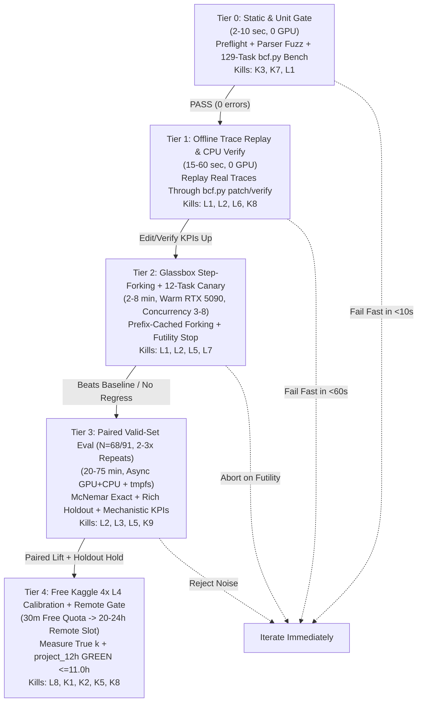

# Task 3: Fast Iteration & High-Signal Feedback Loop Playbook (Mitigating All Local & Remote Time Bottlenecks)

*Research scope: Actionable engineering architecture, multi-fidelity evaluation funnel, statistical noise-defeating methodology, and 12-day remote Kaggle slot execution plan designed to test BCF hypotheses in seconds to minutes locally on the RTX 5090 workstation while avoiding every local (`L1–L8`) and remote (`K1–K9`) wall-clock bottleneck identified in Task 1.*

*As of: **2026-11-20** | Target Hardware: Local PowerSpec G914 (Ryzen 9 9950X3D 16C/32T, 64 GB RAM, NVIDIA RTX 5090 32 GB, WSL2 Ubuntu 24.04) + Kaggle Remote 4x L4 Scorer + Free Kaggle 30h/wk GPU Quota.*

---

## Executive Summary

With only **~10–12 remote Kaggle submission cycles** remaining before December 2 and a **±5.2-task 95% noise band** on any single public leaderboard score, treating Kaggle as a hypothesis-testing loop is mathematically guaranteed to fail. Instead, you can achieve **10–30 high-confidence iteration cycles per day** on the RTX 5090 PC by combining three interlocking engineering shifts: **(1) Local Harness Re-Architecture (5x–12x wall-clock speedup)** — decouple a persistent vLLM server (`0s` boot per tweak), activate FP8 KV cache + `concurrency=2–3` (31B) / `4–8` (E4B), run CPU-bound Phase 2 `pytest` verification asynchronously on a dedicated Ryzen 9950X3D worker pool using `tmpfs` RAM-disk sandboxes, and mask out all ungradable/empty-pass tasks; **(2) A 5-Tier Multi-Fidelity Testing Pyramid** — validate 80% of script/prompt/edit changes in **2 seconds to 5 minutes** using zero-GPU static/replay checks and **Glassbox trajectory step-forking** (leveraging vLLM Automatic Prefix Caching) before ever running a full 68-task paired sweep; and **(3) Variance-Controlled Promotion Gates** — rank variants using **paired McNemar discordant pairs + mechanistic intermediate KPIs** (10x higher SNR than binary resolve rate) across an unseen-repo holdout (`Textualize/rich`), and calibrate remote 12-hour budgets for free using Kaggle's 30h/week 4x L4 notebook quota before spending a single 24-hour submission slot.

---

## 1. Bottleneck-to-Mitigation Architecture Map

Every strategy below directly neutralizes specific Task-1 bottlenecks (`L1–L8` and `K1–K9`):

---

## 2. Supercharging the Local RTX 5090 Harness (5x–12x Speedup Over `40_local_eval.py`)

Before running large sweeps, apply **five concrete upgrades** to the local RTX 5090 harness so every GPU second generates maximum experimental signal:

### Upgrade 1 — Decouple a Persistent Warm vLLM Server (Eliminates `L1`: 2–5 min -> `0s`)
Never start and stop `VllmServer` inside `40_local_eval.py`! Launch vLLM **once per model** in a dedicated `tmux` pane inside WSL2 and point your local evaluator to `http://127.0.0.1:8000/v1` via a `--reuse-server` flag:
- **Persist `torch.compile` Cache:** Export `VLLM_CACHE_ROOT=~/g4/.vllm_cache` so even after a reboot, vLLM skips TorchInductor graph recompilation ([vLLM Optimization Docs](https://docs.vllm.ai/)).
- **Skip Startup Profiling:** After the first clean boot logs its available KV cache size, pass `--kv-cache-memory <bytes>` on future restarts to bypass CUDA-graph memory profiling ([vLLM Docs](https://docs.vllm.ai/)).
- **Automatic Prefix Caching (APC):** vLLM V1 enables `--enable-prefix-caching` and chunked prefill by default ([vLLM V1 Docs](https://docs.vllm.ai/)). Keeping the server warm means repeated system prompts, tool schemas, and forked trajectory prefixes stay hot in GPU KV blocks across consecutive runs!

### Upgrade 2 — Enable FP8 KV Cache + Multi-Task Continuous Batching (Eliminates `L2`: 2.5x–6x Throughput)
Gemma 4's hybrid attention (50 local 1,024-token sliding-window layers + only 10 global layers with 4 unified KV heads on 31B; 42 layers / 512-token window on E4B) keeps KV memory remarkably small. Passing `--kv-cache-dtype fp8` halves KV cache VRAM ([vLLM FP8 KV Docs](https://docs.vllm.ai/)) and unlocks parallel continuous batching on the 32 GB RTX 5090:

| Model Track on RTX 5090 (32 GB) | Recommended Local vLLM Flags | Safe Local Concurrency | Expected Effective Speedup vs. Serial `40_local_eval.py` | Parity Note |
| :--- | :--- | :---: | :---: | :--- |
| **Gemma 4 E4B W4A16** (`~5 GB` weights) | `--gpu-memory-utilization 0.88 --max-model-len 32768 --max-num-seqs 8` (BF16 KV already fits easily!) | **`4`–`8` parallel tasks** | **~4.5x–7.0x faster** (68 tasks in **~15–25 min**!) | Keep `VLLM_BATCH_INVARIANT=0` for speed during sweeps; drop to `concurrency=1` for timing calibration. |
| **Gemma 4 31B W4A16** (`~18–20 GB` weights) | `--gpu-memory-utilization 0.90 --kv-cache-dtype fp8 --max-model-len 32768 --max-num-seqs 4` | **`2`–`3` parallel tasks** | **~2.5x–3.5x faster** (68 tasks in **~45–75 min**!) | On `sm_120`, if any Triton kernel hits shared-memory limits, revert KV cache to `auto` (still fits `concurrency=2` at typical `<16k` context). |

### Upgrade 3 — Decouple GPU Phase 1 From CPU Phase 2 (`9950X3D` Async Worker Pool, Eliminates `L2` Idle Bubble)
In `40_local_eval.py`, `evaluate_task()` holds the GPU slot hostage while Container B extracts a fresh repo and runs `pytest`. Instead, split the runner into **two asynchronous queues**:
1. **GPU Producer Pool (`N_gpu = 2–3` on 31B; `4–8` on E4B):** Runs ONLY Container A setup + agent inference -> immediately writes `<instance_id>.patch` and grabs the next task!
2. **CPU Verifier Pool (`N_cpu = 8–12` workers on the 16-core / 32-thread Ryzen 9 9950X3D):** Consumes completed patches in the background and runs Phase 2 Container B `verify_task` (`pytest` + JUnit XML) completely in parallel with ongoing GPU inference!
- **Bonus:** Keep the RTX 5090 at **>90% sustained GPU utilization** instead of ~50–60%, and also allows **0-GPU instant re-grading** if you ever tweak verification or sandbox wheel pins!

### Upgrade 4 — RAM-Disk (`tmpfs`) Ephemeral Sandboxes & Native WSL2 `ext4` Hygiene (Eliminates `L3`)
Your PowerSpec G914 allocates `48 GB RAM` to WSL2 (`.wslconfig`). Mount an **8–12 GB `tmpfs`** inside WSL2 (`sudo mount -t tmpfs -o size=10G tmpfs /mnt/ram_sandbox`) and route `--sandbox subprocess` temp dirs (`TMPDIR=/mnt/ram_sandbox`) or Docker `--tmpfs /workspace:rw,exec,size=2g` into memory ([Docker `tmpfs` Docs](https://docs.docker.com/engine/storage/tmpfs/)). Combined with `reuse_containers=True` warm pooling and keeping `~/g4` strictly off `/mnt/d`, snapshot extraction + `git add -A` + `pytest` I/O drops from `25–105s` to **`~4–12s` per task**!

### Upgrade 5 — Repair Local Sandbox & Lock Clean Stratified Evaluation Panels (Eliminates `L5` & `L8`)
1. **Install the 4 missing test wheels once** (`50_docker_sandbox.sh`: `inline-snapshot`, `dirty-equals`, `pytest-httpbin`, `typing-inspection`, plus closure `asttokens`, `executing` `#757661`) and run a one-time **0-GPU Gold + Empty Control Sweep** over all 129 tasks (~5–8 min on 12 CPU threads) to generate your machine's exact ground-truth `valid_tasks_local.txt` (gold=PASS, empty=FAIL — typically **~91–108 clean tasks** after wheel repair, or **68 tasks** without extra wheels).
2. **Immediately replace the 3 broken FastAPI tasks in `dry_run_tasks_20.txt`** (`fastapi_14099`, `fastapi_14262`, `fastapi_14605`) if running without Step-6 wheels, and **partition your valid tasks into two immutable splits** to prevent training-repo overfitting (mirroring `#760014`):
   - **Dev Tuning Split (`dev_tune`):** Clean valid tasks from `fastapi` + `requests` + `httpx` (use freely for prompt/playbook/parameter tuning).
   - **Unseen-Repo Proxy Holdout (`holdout_rich`):** Clean valid tasks from `Textualize/rich` (**39 tasks**! Completely separate codebase style/domain — NEVER tune keywords or prompt phrasing specifically for `rich`; use it strictly to validate out-of-domain transfer to Kaggle's unseen private repos!).
3. **Calibrate Local Time Caps (`L8`):** When running `40_local_eval.py` locally to simulate Kaggle's `4.75m` (31B) or `4.25m` (E4B) cap, pass a **scaled local cap (`cap_local = cap_kaggle / k_est`)** (e.g., `~2.8m`–`3.0m` local for `4.75m` Kaggle at `k ≈ 1.6–1.7`), OR log per-turn token counts and evaluate resolve rate under a **simulated token-budget cutoff (`~4,900` generated tokens for `4.75m` on 4x L4 per XingLing's law `dt = 0.78 + 0.058 * tokens`)**!

---

## 3. The 5-Tier Multi-Fidelity Testing Pyramid (Kill Bad Ideas in Seconds)

Never jump straight from editing a prompt or script to a 129-task sweep or a 24-hour Kaggle submission. Route every hypothesis through the cheapest tier capable of falsifying it:

| Tier | Wall-Clock Time | Compute Used | What You Test Here | Exact Promotion Gate to Next Tier |
| :---: | :---: | :--- | :--- | :--- |
| **Tier 0: Static, Schema & Unit Gate** | **`2–10 sec`** | **0 GPU** (CPU only) | `validate_and_package_bcf.py` (hierarchy, non-null `eval_config`, single model, zero array tools, kebab skill, UTF-8 LF, ZIP clean); zero-GPU `_parse_gemma4_args` `sys.settrace` fuzz guard (`#759580`); `bcf.py` offline 129-task classifier + AST/BM25 Recall@5 benchmark (`C1–C4`, `E1–E4`). | `0` errors, `0` warnings, Recall@5 `>=` baseline, `bcf.py` unit tests 100% PASS. |
| **Tier 1: Offline Trace Replay & CPU Grading** | **`15–60 sec`** | **0 GPU** (CPU only) | Replay saved failed patches / edit calls from prior traces through upgraded `bcf.py patch` / `bcf.py verify` + Container B (same technique as `v5_replay` & `#756433`), plus fake-LLM scripted end-to-end smoke check (`BiVelio` pattern). | Broken-edit catch rate improves; `0` protected-path leaks; `0` crashes in Docker parity mode. |
| **Tier 2: Glassbox Step-Forking + 12-Task Borderline Canary** | **`2–8 min`** | **Warm RTX 5090** (Prefix-Cached!) | **(a) Step-Forking (`#758817`):** Replay recorded turns 1–k verbatim (instant vLLM prefix-cache hit!) and fork 5–10 prompt/sampling variants (`G1`, `G2`, `P1–P4`) right at the failure point (e.g., edit turn or verify turn)! **(b) 12-Task Borderline Canary:** Stratified 12 tasks (`~30–60%` baseline solve rate) with **futility early-stop** (abort at task 6 if empty-patch `>30%`, crash `>0`, or broken-edit rate regresses). | Positive directional delta on forked failure cases + `0` hangs/crashes + mechanistic KPIs move in expected direction. |
| **Tier 3: Paired Valid-Set A/B (`N=68–91`, `2–3` Repeats)** | **`20–75 min`** | **Warm RTX 5090** (`concurrency 2–8` + Async CPU) | Interleaved paired evaluation (`A, B, A, B` on same warm server) across `dev_tune` + untouched `holdout_rich`. Score **paired McNemar discordant pairs (`n01` vs `n10`)**, 2–3 run average, AND `project_12h.py` at `k = 1.7`. | Net `>= +2` tasks mean lift (or equal solves with `>= 20%` faster time / lower variance), **non-negative on `holdout_rich`**, and `project_12h` **GREEN (`<=11.0h`)**. |
| **Tier 4: Free 4x L4 Calibration -> Remote Kaggle Slot** | **`30m` free quota -> `20–24h` remote** | **Kaggle 4x L4** (Notebook Quota -> Submission Slot) | **(a) Calibration (Zero Submission Slot!):** Run 5 stratified tasks in a forked Getting Started **Kaggle 4x L4 notebook** (uses weekly 30h GPU quota!) to measure exact live `k = t_4xL4 / t_5090`, verify `thinking_budget` truncation, and verify `vllm 0.19.1` parity! **(b) Remote Submit:** Upload ZIP only when calibrated `project_12h` is **GREEN (`<=11.0h`)**. | Live Kaggle score confirms stability and beats/matches promotion bar without timeout or `0.00` anomaly. |

---

## 4. Defeating Statistical Noise: How to Tell Real Gains From Luck

Continuous batching creates a **~10–13% per-task random flip rate** even at `temperature = 0.0` (`#750907`, `#760014`). Our exact binomial / McNemar noise calculation explains why naive A/B testing wastes days:

| Evaluation Set Size (`N` Tasks) | 1-Run Paired Diff Noise SD (`sqrt(N * 0.12)`) | 1-Run 95% Noise Band (`±1.96 * SD`) | 3-Run Avg Paired Diff Noise SD | 3-Run 95% Noise Band | Practical Statistical Verdict Rule |
| :--- | :---: | :---: | :---: | :---: | :--- |
| **Dry-Run Canary (`N = 20`)** | `1.55` tasks | `±3.0` tasks | `0.89` tasks | `±1.8` tasks | Use ONLY for **crash/hang screening & mechanistic KPIs**, never to declare a `±2`-task winner! |
| **Public Kaggle LB (`N = 58`)** | `2.64` tasks (`±0.046 LB`) | **`±5.2` tasks (`±0.090 LB`)** | `1.52` tasks (`±0.026 LB`) | `±3.0` tasks (`±0.052 LB`) | **Never reject or adopt an idea from one LB score** (`#757588`, `#760201`). |
| **Local Valid-Only (`N = 68`)** | `2.86` tasks | `±5.6` tasks | `1.65` tasks | **`±3.2` tasks** | **Sweet spot for local promotion:** 2–3 paired repeats detect real `+3–4` task gains reliably! |
| **Local Repaired Gradable (`N = 91`)** | `3.30` tasks | `±6.5` tasks | `1.91` tasks | `±3.7` tasks | Highest local statistical power after Step-6 wheel install; maximizes discordant pairs (`n01 + n10`). |

### Four Practical Variance-Reduction Rules
1. **Track 6 Mechanistic Leading Indicators Alongside Binary Resolve Rate:** Binary pass/fail has huge variance, whereas **intermediate failure-funnel counters** move cleanly on just 15–20 tasks (`#760595`):
   - `broken_edit_rate` (`SyntaxError`/`IndentationError`/`NameError`/`UnboundLocalError` in Phase 2 — target `0%`)
   - `empty_patch_rate` (target `< 8%`)
   - `readable_pytest_rate` (fraction of post-edit `pytest` runs returning explicit pass/fail count — target `> 90%`)
   - `repeat_failed_edit_rate` (identical failed edit calls — target `0%`)
   - `compaction_trigger_rate` (fraction of tasks crossing `14,336` tokens — target `< 15%`)
   - `median_calls_to_first_edit` & `p90_seconds_per_task` (ensuring headroom under 12h!)
   A change that moves binary score `+1` while cutting `broken_edit_rate` from `14% -> 2%` and `p90_seconds` by `-25%` is a **high-confidence real win**, whereas a `+2` binary jump with zero mechanistic movement is likely batching luck!
2. **Always Interleave Paired Arms (`A, B, A, B`) & Use McNemar Exact Test on Discordant Pairs:** Never compare Tuesday's baseline run against Thursday's candidate run under different GPU temperatures/loads. Run `A` and `B` interleaved on the exact same task list and inspect the discordant table (`n01` = B wins / A loses vs `n10` = A wins / B loses) — inspect *every* `n10` regression trace manually to catch unintended side effects before merging!
3. **Diagnostic Determinism Mode (`VLLM_BATCH_INVARIANT=1` or `concurrency=1` + `T=0.0`):** When debugging a subtle single-task regression (e.g., why `solver` suddenly dropped an edit on `rich_3454`), isolate that single task at `concurrency=1` (or `VLLM_BATCH_INVARIANT=1`, accepting the ~30–60% throughput cost strictly for 1-task root-cause debugging, [vLLM Batch Invariance Docs](https://docs.vllm.ai/)).
4. **Bundle Orthogonal Quick Wins Into Cohesive Releases:** Rather than spending 6 separate 3-repeat sweeps testing 6 tiny tweaks one by one, verify each Tier-0/Tier-2 lever independently for zero regressions, then bundle **3–4 orthogonal Q1 wins** (e.g., `C1 + E1 + E2 + E4` in `bcf.py v2`, or `G1 + P1 + P2 + T2` in `prompts/config v2`) into one high-effect-size (`+4 to +6` tasks!) Tier-3 paired sweep so the signal cleanly towers over the noise floor!

---

## 5. Optimal 12-Day Execution Calendar (2026-11-20 -> 2026-12-02)

Respecting the **1-pending-submission lock**, **20–24h turnaround**, **Nov 25 23:59 UTC publishing lock**, and **dual-track (\$65K 31B + \$10K E4B)** goals:

| Window | Local RTX 5090 Parallel Sprint (Fast Inner Loop) | Kaggle Remote Action (Gated Outer Loop — ~10–12 Slots Total) | Decision / Go-No-Go Gate |
| :--- | :--- | :--- | :--- |
| **Day 1 (Nov 20)** | Stand up persistent vLLM + `tmpfs` + async Phase-2 runner + Step-6 missing wheels + 0-GPU Gold/Empty audit -> freeze `dev_tune` & `holdout_rich`. | **Slot 1 (Canary Gate `G-SK`):** Submit current `submission_31b.zip` (Nov 20 baseline) immediately. Also run a free 30m **Kaggle 4x L4 calibration notebook** (5 tasks each for 31B & E4B -> measure exact `k`!). | Confirms whether `skills/bcf-spec` materializes in Container A on the hidden scorer AND locks empirical `k`. |
| **Day 2 (Nov 21)** | Implement **Q1 Bundle A (`bcf.py v2`: `C1` uncapped cached BM25, `E1` multi-hunk patcher, `E2` submodule+AST verify, `E4` retry breaker)** -> verify in Tier 0–1 (0 GPU, <5 min)! If Canary `G-SK` scored `0.00`, port to Zero-Skill Monolithic (`T1`) immediately! | **Slot 2 (E4B Anchor Lock):** Submit current `submission_e4b.zip` (or Monolithic E4B if `G-SK` failed) to lock an early timestamp on the Small-Model Bonus LB (`0.12` tie-breaker!). | Establishes live baselines on BOTH Main (31B) and Bonus (E4B) leaderboards. |
| **Day 3–4 (Nov 22–23)** | Run **Q1 Bundle B (`G1` thinking sweep, `T2` zero-echo spec, `P1/P2/P3` paraphrase + anti-echo + `DC-11`, `T4` tool pruning, `G2` `top_k=64`/temp)** via Glassbox step-forking (Tier 2) + 2-repeat paired Tier 3 (`dev_tune` + `holdout_rich`) on both 31B and E4B. | **Slot 3 (31B v2):** Ship best 31B (`Bundle A + B`, `B1` calibrated cap) once Tier-3 clears `>= +2` tasks & `project_12h` GREEN. **Slot 4 (E4B v2):** Ship lean-prompt (`P4`) + `G1` E4B v2. | Target: break `0.24` (`15+/58` = `0.25+`) on 31B and `0.12` (`8+/58` = `0.13+`) on E4B! |
| **Day 5–6 (Nov 24–25)** | **Pre-Nov-25 Publishing Lock Check:** Run 3-repeat Tier-3 paired ablation on `SequentialAgent` vs Monolithic (`T1`) + `C2/C4` import-graph test matching + `B1/B2` budget fine-tuning. Ensure all submission notebooks exist before **`2026-11-25 23:59 UTC`** (`#759388`). | **Slot 5 (31B v3)** & **Slot 6 (E4B v3):** Lock refined dual-track contenders; verify zero crashes/timeouts across both tracks. | Notebook publishing lock cleared cleanly; top-tier candidate live on both tracks. |
| **Day 7–9 (Nov 26–28)** | Deep trace forensic error analysis on remaining `holdout_rich` failures (Tier 2 step-forking). Optionally evaluate **Strategic Bet `T3` (`AgentTool` explorer on 31B)** OR a tightly scoped **thought-preserving brevity LoRA (`M1`)** *strictly* against the base model under identical fixed wall-clock caps! | **Slots 7–9:** Promote ONLY candidates that decisively beat v3 across `3` local paired repeats + `holdout_rich`. If `M1`/`T3` fails local gate, use Slots 7–9 for **variance-confirmation repeats** of your top 31B & E4B champions! | Separates true mean lift (`μ`) from single-run luck before final freeze. |
| **Day 10–12 (Nov 29–Dec 2)** | **Code Freeze (Nov 29):** Zero risky refactors. Final stress test (`project_12h` GREEN `<= 10.75h` at `k=1.8` pessimistic buffer for private-split safety) + `validate_and_package_bcf.py` SHA-256 verification. | **Slots 10–11 (Final Safety / Tie-Break Confirmation)** -> **Final Selection Before `2026-12-02 23:59 UTC`:** Check **Slot 1 = Best 31B BCF** (\$65K Main) and **Slot 2 = Best E4B BCF** (\$10K Small-Model Bonus — mandatory checkbox!). | Guaranteed `<12h` private-set completion on both selected finals with maximum unseen-repo robustness! |

---

## 6. Automated Monitoring & Operational Hygiene (Never Lose a Slot)

1. **Automated Kaggle Submission Poller:** Run a lightweight local cron/Task-Scheduler script every 15 minutes (`kaggle competitions submissions -c gemma-4-developer-agent --csv`) that pings you the instant a submission transitions from `PENDING` to `COMPLETE` (saving 2–8 hours of idle gap between finishing a run and submitting the next slot, inspired by `#760201`'s submission sensor!).
2. **Stuck-Queue Escalation Protocol:** If a submission remains `PENDING` past **30 hours** (beyond the 24h 94th-percentile window in `#760471`), immediately check the leaderboard timestamps for a cohort stall (`#759630`) and report the exact submission ID in Thread `#747519` + Kaggle Support the same day.
3. **Immutable Experiment Ledger:** Log every local Tier-2/3 run and remote Tier-4 submission in a single append-only JSONL/Markdown ledger (`run_id`, `git_sha`, `zip_sha256`, `track`, `panel_id`, `repeats`, `resolved_mean`, `mcnemar_p`, `holdout_rich`, `broken_edit_rate`, `empty_patch_rate`, `compaction_rate`, `p50_s`, `p90_s`, `proj_12h_k17`, `kaggle_lb_score`). Never overwrite results or compare across mismatched panels.

---

## 7. Open Questions & Constraints to Monitor

1. **Free Kaggle 4x L4 Weekly Quota Availability:** Confirm remaining weekly GPU hours in Kaggle Account Settings before running the 5-task `k` calibration notebook (remember: interactive/commit calibration notebooks consume the 30h/week quota, whereas official competition scoring reruns do **not** consume personal GPU quota).
2. **Post-Nov-25 Private Notebook Version Submissions (`#759388`):** Staff have not formally answered whether new private versions of an *already-created* notebook can be committed and submitted between Nov 25 and Dec 2 (historically allowed on Kaggle Code Competitions, while *publishing* new public notebooks is disabled). Creating and validating your clean packaging notebooks for both 31B and E4B **before Nov 25 23:59 UTC** hedges both interpretations completely.
3. **Renting Cloud GPUs (\$300 Pre-Approved Cap, Ask First):** With the optimized local RTX 5090 pipeline running 68 tasks in ~45–75 min (31B) and ~15–25 min (E4B), you likely **do not need rented GPUs at all** unless you pursue a large 3-repeat multi-arm LoRA ablation (`M1`) — saving both budget and setup time!

---

## 8. Sources

1. **vLLM Official Documentation:** Persistent `vllm serve`, `VLLM_CACHE_ROOT`, `--kv-cache-memory`, V1 Automatic Prefix Caching (`enable_prefix_caching=True` default), `--kv-cache-dtype fp8`, `--max-num-seqs`, and `VLLM_BATCH_INVARIANT=1` (`https://docs.vllm.ai/`).
2. **Docker & Microsoft WSL2 Official Documentation:** Docker `tmpfs` mounts (`https://docs.docker.com/engine/storage/tmpfs/`), `overlay2` storage driver, WSL 2 native `ext4` vs. 9P (`/mnt/*`), and `.wslconfig` memory sizing (`https://learn.microsoft.com/en-us/windows/wsl/`).
3. **Statistical Evaluation & Paired Binary Testing:** McNemar's Exact Test, paired variance reduction, and discordant-pair sample size planning (`Connor` / `Miettinen` approximations) for SWE-bench LLM agent evaluations; *Defeating Nondeterminism in LLM Inference* (`https://thinkingmachines.ai/blog/defeating-nondeterminism-in-llm-inference`).
4. **Kaggle Official Documentation & Competition Engineering Precedents:** Kaggle Code Competitions & Weekly GPU Quotas (`https://www.kaggle.com/docs/`), `kaggle-glassbox` trajectory step-forking (`#758817`), `scorer-minutes` cross-GPU cap calibration (`#758954`), `ResearchForge` submission sensor (`#760201`), Japan Open Data Lab unseen-repo `rich` holdout & 10-run variance protocol (`#760014`), E4B mechanistic trace funnel (`#760595`), Staff queue update (`#760471`), `project_12h.py` (`k = 1.7`), and `02_New_Test_Harnesses_and_Eval_Tools.md` (Abhimanu Bhagwati 4x L4 local A/B notebook, Kirill Pshinnik Gold/Empty gate).
