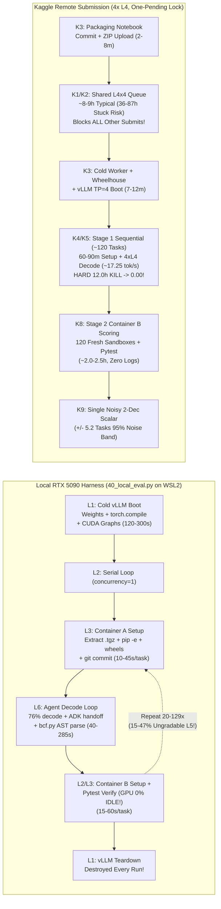
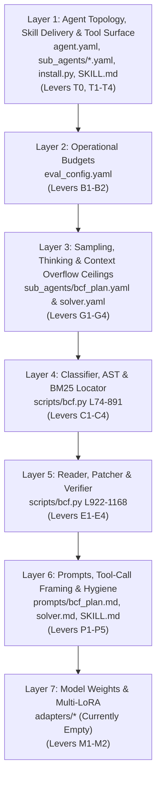
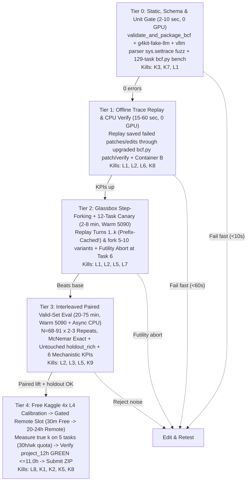

# Task 2: Wall-Clock Bottlenecks (2a), BCF Brain Tuning Levers & Impact-Effort Ranking (2b), and Fast Iteration Strategies (2c)

*Research scope: Unified, code-grounded engineering analysis of (2a) every wall-clock time bottleneck in the local RTX 5090 test harness (`40_local_eval.py` / `swegemma`) and Kaggle remote 4x L4 submissions; (2b) every tuning juncture in the current dual-track Batonic Coding Framework (BCF) brain (`deliverables/2026-11-20_BCF_Gemma4_Winning_Design/submission_31b/` and `submission_e4b/`) ranked via quantitative Impact-Effort analysis—incorporating **two newly discovered P0/P1 implementation bugs** uncovered during today's line-by-line audit; and (2c) concrete rapid-iteration architectures and variance-controlled feedback loops that bypass every bottleneck from (2a).*

*As of: **2026-11-20** | Remaining Clock: **5.5 days** to `kernelsPublishingDisabledDeadline` (`2026-11-25 23:59 UTC`) and **12.5 days** (~10–12 remote slots) to final close (`2026-12-02 23:59 UTC`).*

---

## Executive Summary

Wall-clock latency—not GPU FLOPS and not code-localization capability—is the binding engineering constraint across both the local PowerSpec G914 RTX 5090 workstation and Kaggle's 4x L4 remote scorer. **(2a)** Locally, `40_local_eval.py` wastes **5x–12x wall-clock time** through per-run vLLM cold boots (`2–5 min`), strict serial `concurrency=1` execution (leaving the 1,792 GB/s RTX 5090 idle during Container A setup and CPU-bound Phase 2 `pytest`), virtual-disk double extraction, and 15%–47% ungradable local practice tasks; remotely, Kaggle's **20–24h turnaround** behind a **one-pending-submission lock**, **~17.25 tok/s** PCIe TP=4 decode floor, **60–90m** hidden Container A setup tax, all-or-zero **12h kill cliff**, and **±5.2-task** single-run LB noise make Kaggle completely unusable as an inner iteration loop. **(2b)** Auditing all 9 files of `submission_31b/` and `submission_e4b/` (including all 1,324 lines of `bcf.py` and ADK 1.36.1's `skill_toolset.py`) maps **26 concrete tuning levers across 7 architectural layers**, crowned by **two urgent P0/P1 code fixes discovered in this audit**: (`T0`) fixing the `script_path` vs. `file_path` `RunSkillScriptTool` parameter bug and `bcf_plan` heredoc truncation, and (`G4`) reducing 31B `solver.yaml` `max_output_tokens` from `8192 -> 4096/5120` to prevent 32,768-token HTTP 400 patch wipes alongside prose-bound tool prompts. **(2c)** Combining a persistent FP8-KV vLLM daemon, decoupled Ryzen 9950X3D async Phase 2 verification, `tmpfs` RAM-disk sandboxes, a **5-Tier Multi-Fidelity Testing Pyramid** (2s static checks -> 2m Glassbox step-forking -> paired McNemar `dev_tune` + `holdout_rich` sweeps), and free Kaggle 4x L4 `k` calibration unlocks **10–30 high-signal iterations per day** while reserving remote slots strictly for gated promotions.

---

## Subtask 2a: Wall-Clock Time Bottlenecks — Local RTX 5090 Harness vs. Remote Kaggle 4x L4

### 2a.1 End-to-End Critical Path Map

### 2a.2 Hardware Physics Asymmetry: PowerSpec G914 (1x RTX 5090) vs. Kaggle Scorer (4x L4 `TP=4`)

Autoregressive decoding at batch size 1 is **memory-bandwidth bound** and, under `TP=4` without NVLink, **PCIe collective-communication latency bound**:

| Hardware / Serving Parameter | Local: 1x NVIDIA RTX 5090 (PowerSpec G914) | Remote: Kaggle 4x NVIDIA L4 (`TP=4`) | Wall-Clock Consequence |
| :--- | :--- | :--- | :--- |
| **GPU Architecture / Compute Cap** | Blackwell GB202 (`sm_120`), 5th-gen Tensor Cores ([NVIDIA](https://www.nvidia.com/)) | Ada Lovelace AD104 (`sm_89`), 4th-gen Tensor Cores ([NVIDIA L4](https://www.nvidia.com/)) | Wheelhouse v31 (`torch 2.10.0+cu128`, `vllm 0.19.1`) targets `sm_89`; `sm_120` may trigger PTX JIT delay or require `TORCH_CUDA_ARCH_LIST="12.0"` build. |
| **VRAM Footprint & KV Headroom** | `32 GB` GDDR7 (`~27.2–28.8 GB` usable; `~9–11 GB` free on 31B) | `96 GB` GDDR6 ECC (`4 x 24 GB`, `~76.8–86.4 GB` usable; `~55+ GB` free) | On 5090, preallocating 8 rank-128 LoRA slots starves KV cache (`40_local_eval.py` disables LoRA when unused). |
| **Memory Bandwidth** | **`1,792 GB/s`** (512-bit GDDR7) | `300 GB/s` per GPU (`1,200 GB/s` aggregate) | Single RTX 5090 delivers **1.49x** the aggregate bandwidth of 4x L4 and **5.97x** a single L4. |
| **Inter-GPU Sync (`TP` AllReduce)** | **Zero (`TP=1`)** | **PCIe Gen4 x16 ONLY (No NVLink)** | 31B has 60 layers (120 AllReduces/token); E4B has 42 layers (84 AllReduces/token). Locks 4x L4 single-stream decode to **`~17.25 tok/s`** (`dt = 0.78 + 0.058 * tokens`, `#755291`). |
| **Host CPU & Sandbox Quota** | Ryzen 9 9950X3D (16C/32T, 5.7 GHz, 64 GB DDR5) | 2 vCPUs / 4 GiB RAM per Docker container (`HARNESS_README` §4.1) | Local Container B `pytest` and AST parsing run dramatically faster than Kaggle's 2-vCPU slices. |
| **Empirical Speed Ratio (`k`)** | `1.0x` baseline (`~50–65 tok/s` 31B; `~140+ tok/s` E4B) | **`k ≈ 1.6x–1.8x` slower** vs Blackwell at `c=3` (`project_12h.py`); up to **`2.1x–2.6x`** vs single-stream (`#758954`) | Raw local wall-clock caps grossly underestimate remote 4x L4 time, triggering silent 12h `0.00` kills unless scaled by `k`! |

### 2a.3 Complete Registry of All 17 Wall-Clock Bottlenecks (`L1–L8` Local, `K1–K9` Remote)

| ID | Env. | Pipeline Stage & Exact Location | Measured Wall-Clock Cost | Severity | Controllable? | Root Mechanism & Grounded Source |
| :---: | :--- | :--- | :--- | :---: | :---: | :--- |
| **`L1`** | Local 5090 | vLLM Cold Start & Teardown (`40_local_eval.py:146-229`) | **`2–5 min`** *every single run* | **High** | **100% Yes** | Instantiates and destroys `VllmServer` per invocation; no `VLLM_CACHE_ROOT` or `--kv-cache-memory` persistence ([vLLM Docs](https://docs.vllm.ai/)). |
| **`L2`** | Local 5090 | Serial `concurrency=1` + GPU-Idle Phase 2 Bubble (`40_local_eval.py:180-196`) | **`~60–75%`** wasted wall time (`3–6h` / 68 tasks) | **Critical** | **100% Yes** | Leaves 5090 batching unused (31B fits 2–3 seqs with FP8 KV; E4B fits 4–8) AND keeps GPU 0% idle during Container A setup (`10–45s`) + Container B `pytest` (`15–60s`). |
| **`L3`** | Local 5090 | WSL2 9P Cross-OS I/O & Double Disk Extraction (`HARNESS_README` §4.2) | **`25–105s / task`** (`10–20x` slower on `/mnt/d`) | **High** | **100% Yes** | Windows `/mnt/*` traverses 9P ([WSL2 Docs](https://learn.microsoft.com/en-us/windows/wsl/filesystems)); even on `ext4`, `swegemma` extracts repo `.tgz` + installs + commits *twice* per task onto virtual disk instead of `tmpfs`. |
| **`L4`** | Local 5090 | Blackwell `sm_120` vs. Wheelhouse `sm_89` Kernel Mismatch | **`1–5 min`** JIT or split-venv friction | **Medium** | **Yes** | Wheelhouse v31 targets `sm_89`; `sm_120` incurs first-run PTX JIT or forces separate `.venv-dev` (creating parser parity blind spots vs `vllm 0.19.1`). |
| **`L5`** | Local 5090 | Ungradable & Non-Discriminating Tasks (`tasks.jsonl`, `dry_run_tasks_20.txt`) | **`15%`** (`dry20`) to **`47%`** (`ALL 129`) wasted GPU time | **Critical** | **100% Yes** | Without C2–C4 wheel/pin repair, ~34 FastAPI + 8–12 `requests` + 5 empty-pass + 3 verifier-blocked tasks produce zero discrimination (`#756400`, `#757661`, `#760595`); even `dry_run_tasks_20.txt` contains 3 missing-wheel FastAPI tasks! |
| **`L6`** | Both | Decode Dominance (`~76%` time) + BCF Handoff / Multi-Hunk / Bug-Retry Bloat | **`58s / 1k tok`** on L4; **`+20–45s/task`** `bcf_plan` overhead | **Critical** | **100% Yes** | `bcf_plan` burns up to 1,024 thinking tokens + pastes `{problem_description}` into heredoc + re-decodes 30-line `BCF_SPEC_V1` + breaks vLLM prefix cache on transfer to `solver`; `bcf.py patch` is single-hunk while **55.0% (71/129)** of tasks have `>=2` hunks; `bcf.py` re-parses full repo AST uncached; **new bug:** `script_path` vs `file_path` wastes a failed tool call on every task! |
| **`L7`** | Local 5090 | Coarse Watchdog (`cap + 480s`) & Zero Step-Forking / Futility Stop (`40_local_eval.py:179`) | **`12.75 min`** hang wait; **`100%`** full re-run per tweak | **High** | **100% Yes** | Serial watchdog stalls 12+ min on a wedged task; no early futility abort on broken variants; every prompt tweak replays identical Turns 1–4 instead of forking (`#758817`). |
| **`L8`** | Local -> Remote | Uncalibrated Local-to-Remote Speed Factor `k` (`#758954`) | Risks silent **`12h` remote `0.00`** kill | **Critical** | **100% Yes** | `4.75m` on RTX 5090 buys `1.6x–2.4x` more tokens than `4.75m` on Kaggle 4x L4; local runs overstate solve rates under fixed time caps unless scaled by `1/k` (`~2.8m`). |
| **`K1`** | Kaggle Remote | Shared 4x L4 Submission Queue Backlog (`#747519`, `#760471`) | **`8–9h`** typical (**`71–120h`** Nov 9 stuck wave) | **Critical** | **No** (Ops) | High volume + 9–10h average runs across finite L4x4 pool; Nov 9 orphaned batch locked 15+ teams out for 5–7 days (`#759630`). |
| **`K2`** | Kaggle Remote | One-Pending-Submission Lock (`400 FAILED_PRECONDITION`) & Calendar Cliff | Caps remainder to **`~10–12` total slots** (both tracks share 1 slot!) | **Critical** | **No** (Sched.) | Cannot enqueue a second run while one is `PENDING` (`#759322`); `2026-11-25 23:59 UTC` disables notebook publishing; `2026-12-02 23:59 UTC` closes finals. |
| **`K3`** | Kaggle Remote | Packaging Commit + Cold 4x L4 Worker & vLLM TP=4 Boot (`#760140`) | **`9–20 min`** (`2–8m` commit + `7–12m` vLLM boot) | **Low-Med** | **Partial** | Installing 41 wheels, sharding weights across 4 L4s, CUDA graph capture (`431s` measured for E4B + 1 LoRA in `#760140`). |
| **`K4`** | Kaggle Remote | 4x L4 PCIe Gen4 TP=4 Fixed Decode Floor (`#755291`, `#758972`) | **`~17.25 tok/s`** (`~5,000` max tokens per 5m task) | **Critical** | **No** (Token-Econ) | Competitors cannot tune vLLM flags on Kaggle; every wasted 1,000 thought/echo tokens permanently burns 58s of wall clock. |
| **`K5`** | Kaggle Remote | Sequential ~120-Task Stage 1 + Hidden Setup Tax + All-or-Zero 12h Kill (`#743063`) | **`60–90m`** setup + `120 × cap`; **`>720m` = `0.00`** | **Critical** | **Yes** (`eval_config`) | Container A setup is excluded from `max_time_minutes` (`HARNESS_README` §7.1) yet counts against the 12h hard kill; soft per-task cap overruns by 1 active turn/command! |
| **`K6`** | Kaggle Remote | Dynamic Multi-LoRA Serving Penalty (`#755677`, `#760309`) | **`-10% to -25%`** TPS; **`+29%`** duration (`-7` tasks zero-LoRA) | **High** | **Yes** | Unoptimized default LoRA kernels + non-merged quantized paths cut solved tasks `-5.43 pp` even with all-zero B matrices (`#760309`). |
| **`K7`** | Kaggle Remote | Frozen Stack Bugs (Parser Freeze, Compaction Wipe, HTTP 400, Null Config, Skill Isolation) | Instant **`0.00`** or **`2x`** task bloat | **Critical** | **Yes** (Defenses) | vLLM 0.19.1 `_parse_gemma4_array` OOM (`#753973`), ADK 14,336-tok tool drop (`#754783`), `prompt + max_output_tokens > 32768` HTTP 400 patch wipe (`gemma4-swe-kit`), `int(None)` crash (`#760140`), skill `0.00` (`#758547`). |
| **`K8`** | Kaggle Remote | Stage 2 Verification Latency & Zero-Observability Black Box (`#760471`, `#760140`) | **`2.0–2.5 hours`** blind wait | **High** | **Partial** | 120 fresh Container B runs return zero logs, traces, or stack traces—failures waste a full 24h cycle with no diagnostic clue. |
| **`K9`** | Kaggle Remote | Continuous-Batching Non-Determinism & Single-Run Noise Wall (`#757588`, `#760014`, `#760126`) | **`±5.2` tasks** 95% diff band (`3x–5x` iteration tax) | **Critical** | **Yes** (Method) | Even at `T=0.0`, continuous batching flips 10–13% of tasks (`sigma ≈ 1.5–2.0` on 58 tasks); single LB deltas under `0.05` are pure noise. |

---

## Subtask 2b: BCF Brain Tuning Levers & Ranked Impact-Effort Analysis

### 2b.1 Architecture Map: All 7 Tuning Layers of the Current BCF Brain

Auditing every file inside `deliverables/2026-11-20_BCF_Gemma4_Winning_Design/` (`submission_31b/` and `submission_e4b/`) identifies **26 concrete tuning levers across 7 architectural layers**:

### 2b.2 Newly Discovered Critical Levers (Added From Today's Deep Audit)

Before ranking all 26 levers, note **two critical P0/P1 code-level levers** uncovered by cross-checking `submission_31b/` and `submission_e4b/` against `adk_1.36.1_skill_toolset.py` and `gemma4-swe-kit`:

1. **`T0` (P0 Critical Fix — `script_path` -> `file_path` Bug + `bcf_plan` Heredoc Overflow & Nudge-Echo Protection):**
   - *Exact locations:* `prompts/bcf_plan.md:24` (31B), `prompts/bcf_plan.md:17` (E4B), `skills/bcf-spec/SKILL.md:15` (31B), `SKILL.md:11` (E4B), `sub_agents/bcf_plan.yaml:18`.
   - *Defect proven from source:* In `adk_1.36.1_skill_toolset.py:735,781`, `RunSkillScriptTool` requires **`file_path`**, NOT `script_path`—passing `script_path` returns `INVALID_ARGUMENTS: Argument 'file_path' is required.` on 100% of calls! Simultaneously, `bcf_plan.md` instructs the model to paste `{problem_description}` into `<<'BCF_PROB'` under `max_output_tokens: 1536` (E4B) / `2048` (31B), which truncates `<|tool_call>` on long prompts (up to `10,095` chars in `fastapi_14463`)! Fix immediately: switch `script_path` -> `file_path` (if keeping skills), raise `bcf_plan` `max_output_tokens` to `>= 3072`, pass only 6–10 extracted keywords via `--text "..."` (never pasting paragraphs), and guard nudge re-entry from corrupting `session.state["bcf_spec"]`.
2. **`G4` (P1 High-Impact Fix — 31B `max_output_tokens: 8192 -> 4096/5120` HTTP 400 Patch-Wipe Prevention + Prose-Bound Tool Prompting):**
   - *Exact locations:* `submission_31b/sub_agents/solver.yaml:19`, `prompts/bcf_plan.md`, `prompts/solver.md`.
   - *Defect proven from `gemma4-swe-kit` measurements:* (a) vLLM returns **HTTP 400** whenever `prompt_tokens + max_output_tokens > 32,768`, which `swegemma` turns into `"Sandbox execution error"` and an **EMPTY patch** (even discarding an earlier `submit_patch`!). With Getting Started's `compaction_interval=15`, `max_output_tokens: 8192` leaves only `24,576` prompt tokens; reducing 31B `solver` `max_output_tokens` to `4096` (or `5120`) immediately buys **`+3,072` to `+4,096` tokens of overflow headroom** (up to `28,672` prompt tokens)! (b) `gemma4-swe-kit` proved across 96 replays of 16 real malformed-call contexts that fenced `bash` examples in prompts cause Gemma 4 to emit raw shell commands as tool names (`<|tool_call>call:python3 ...<tool_call|>`) **31% of the time (30/96)** versus **5% (5/96)** when rewritten as prose explicitly bound to `run_command`!

### 2b.3 Complete Impact-Effort Scoring Formula & Master Ranked Table (All 26 Levers)

Each lever is scored transparently on three dimensions:
- **Impact (`1`–`5`):** Combined expected lift on unseen private resolution rate (tasks/58) and survival/wall-clock safety (`5` = eliminates catastrophic `0.00`/patch-wipe failure or `+1.5 to +3.0` tasks/58; `4` = `+0.8 to +1.5` tasks/58 or `>25%` speed gain; `3` = `+0.4 to +0.8` tasks/58; `2` = `+0.1 to +0.4` tasks/58; `1` = marginal).
- **Effort (`1`–`5`):** Implementation + local validation effort + regression risk (`1` = `<30 min`, 0-GPU or YAML tweak; `2` = `1–3h` stdlib Python/prompt edit + Tier 2 A/B; `3` = `0.5–1 day` + Tier 3 sweep; `4` = `1–2 days` multi-component architecture; `5` = `3+ days` data/training/parity risk).
- **Confidence (`0.5`–`1.0`):** Empirical evidence strength (`1.0` = source-code/multi-team verified; `0.85–0.95` = strong telemetry; `0.6–0.75` = single-team/theoretical; `0.5` = contested/legally unruled).
- **Priority Score:** `(Impact × Confidence) / Effort`. **Quadrants:** **Q1 Quick Win** (`Impact >= 3.5, Effort <= 2.5`), **Q2 Strategic Bet** (`Impact >= 3.5, Effort > 2.5`), **Q3 Fill-In** (`Impact < 3.5, Effort <= 2.5`), **Q4 Avoid / Defer** (`Impact < 3.5, Effort > 2.5`).

| Rank | ID | Tuning Lever & Exact BCF Location | Impact (1-5) | Effort (1-5) | Conf. | Priority Score | Quadrant | Track Focus | Quantified Lift / Wall-Clock Effect |
| :---: | :---: | :--- | :---: | :---: | :---: | :---: | :---: | :---: | :--- |
| **1** | **`T0`** | **Fix `script_path` -> `file_path` Bug + `bcf_plan` Heredoc Overflow Guard** (`prompts/bcf_plan.md`, `SKILL.md`, `bcf_plan.yaml:18`) | `5.0` | `0.8` | `1.00` | **6.25** | **Q1 Quick Win (P0!)** | **Both** | Fixes 100% `RunSkillScriptTool` `INVALID_ARGUMENTS` failure & stops `<|tool_call>` truncation on long prompts! |
| **2** | **`G1`** | **Stage-Specific `thinking_budget` Sweep** (`bcf_plan.yaml:20` `1024/512 -> 128/64`; `solver.yaml:21` `1024–2048` 31B / `0–768` E4B) | `5.0` | `1.0` | `1.00` | **5.00** | **Q1 Quick Win** | **Both** (Huge E4B) | `-25% to -50%` wall time + `+0.5 to +2.0` tasks/58 (`#760014`). |
| **3** | **`C1`** | **Remove `raw[:24000]` / `[:16000]` Cutoff + Cache AST Index** (`bcf.py:721,764,867`) | `4.5` | `1.0` | `1.00` | **4.50** | **Q1 Quick Win** | **Both** | Unblinds lexical recall on **38.8% (50/129)** deep patches (`>L600`); `<50ms` repeat `locate`. |
| **4** | **`G4`** | **Lower 31B `solver` `max_output_tokens` (`8192 -> 4096/5120`) + Rewrite Fenced Shell Blocks as Prose Bound to `run_command`** (`solver.yaml:19`, `prompts/*.md`) | `4.5` | `1.0` | `0.95` | **4.28** | **Q1 Quick Win (P1!)** | **Both** (31B HTTP 400!) | Adds `+4,096` tok headroom against HTTP 400 patch-wipe AND cuts malformed tool calls **`31% -> 5%`** (`gemma4-swe-kit`)! |
| **5** | **`P1`** | **Anti-Compaction 1-Line Visible-Text State Paraphrase** (`prompts/solver.md`) | `4.0` | `1.0` | `0.90` | **3.60** | **Q1 Quick Win** | **Both** | Survives ADK 14,336-tok tool wipe (`#754783`) via `part.text` persistence. |
| **6** | **`T2`** | **Zero-Echo `bcf_plan` Spec Compression (`<=15` Lines) & Keyword-Only `--text` CLI** (`prompts/bcf_plan.md`, `bcf.py:1174`) | `4.0` | `1.2` | `0.95` | **3.17** | **Q1 Quick Win** | **Both** | Saves **`25–45s/task`** pure L4 decode; eliminates problem re-decode and shrinks spec tokens by 50%. |
| **7** | **`P2`** | **Strict Anti-Echo Ban (`SR-11`) & Early-Edit Deadline Sweep (`call 6–8`)** (`prompts/solver.md:8-9`) | `3.5` | `1.0` | `0.90` | **3.15** | **Q1 Quick Win** | **Both** | Eliminates up to `104s` single-turn code-restatement stalls (`#755291`); lowers empty patches. |
| **8** | **`B1`** | **Empirical `max_time_minutes` Calibration (`4.75 -> 5.5–6.0m` 31B; `4.25 -> 4.5–5.0m` E4B) via `project_12h.py`** (`eval_config.yaml:8`) | `4.5` | `1.5` | `0.95` | **2.85** | **Q1 Quick Win** | **31B Primary** | Captures min-5–6 hard solves while mathematically guaranteeing `<=11.0h` GREEN at `k=1.7`. |
| **9** | **`T4`** | **Prune `write_file` (Both) & A/B Removing `edit_file` (E4B)** (`sub_agents/solver.yaml:9-15`) | `3.5` | `1.2` | `0.95` | **2.77** | **Q1 Quick Win** | **Both** (High E4B) | Physically blocks `/workspace/tmp/` patch pollution (`#760595`) and E4B char-drop (`#753277`). |
| **10** | **`T1`** | **Zero-Skill Monolithic Single-`LlmAgent` vs. `SequentialAgent+Skill` Canary A/B** (`agent.yaml`, `sub_agents/`, `skills/`) | `5.0` | `2.0` | `1.00` | **2.50** | **Q1 Quick Win (P0 Risk!)** | **Both** | Eliminates residual `run_skill_script` array-arg parser freeze (`#753973`), hidden-scorer skill `0.00` (`#758547`), `SequentialAgent` LB drop (`#760126`), and prefix-cache break! |
| **11** | **`P3`** | **Bake `DC-11` Non-Destructive Aliasing (`old = new`) & Anti-Self-Reversion** (`prompts/solver.md`) | `3.5` | `1.2` | `0.85` | **2.48** | **Q1 Quick Win** | **Both** | Stops agent from reverting valid spec-change/rename fixes when legacy visible tests fail (`#760014`). |
| **12** | **`E4`** | **Persistent Edit-Retry SHA-256 Dedupe & Loop Circuit Breaker** (`bcf.py:952` + `.git/bcf/patch_log.jsonl`) | `4.0` | `1.5` | `0.90` | **2.40** | **Q1 Quick Win** | **Both** (Huge E4B) | Breaks ~75% verbatim failed-edit retry loops (`#756433`, `#756051`). |
| **13** | **`E2`** | **Upgrade `bcf.py verify`: Submodule Import + `PYTHONSAFEPATH=1 -s` + AST Scope Check + `--maxfail=3` + Delta Verify** (`bcf.py:1057`) | `4.5` | `2.0` | `0.95` | **2.14** | **Q1 Quick Win** | **Both** | Catches `NameError`/`UnboundLocalError`/submodule errors (`#760595`), aligns with Container B flags, and separates regressions from baseline fails. |
| **14** | **`G2`** | **Sampling Tuning: `top_k: 64`, `temperature` Sweep (`0.15–0.35`) & Mild `presence_penalty` (`0.05–0.15`)** (`solver.yaml`) | `3.5` | `1.5` | `0.85` | **1.98** | **Q1 Quick Win** | **Both** | Matches official Gemma 4 `top_k=64` recommendation and breaks repetitive token loops without distorting syntax. |
| **15** | **`P4`** | **E4B Cognitive-Load Prompt Compression (`<=400` Tokens)** (`submission_e4b/prompts/solver.md`) | `3.5` | `1.5` | `0.80` | **1.87** | **Q1 Quick Win** | **E4B Primary** | Prevents E4B instruction degradation (`0.03` vs `0.08`, `#758969`, `#760014`). |
| **16** | **`E1`** | **Multi-Hunk Atomic Patching (`--multi`) + ±5-Line Fuzzy Anchor Recovery** (`bcf.py:952-1028`) | `4.5` | `2.2` | `0.90` | **1.84** | **Q1 Quick Win** | **31B Primary** | Directly accelerates **55.0% (71/129)** multi-hunk tasks; prevents line-shift failures. |
| **17** | **`C2`** | **Index Module Constants (`ast.Assign`/`AnnAssign`) + `git grep` Sparse Fallback** (`bcf.py:666-844`) | `3.0` | `1.5` | `0.90` | **1.80** | **Q3 Fill-In** | **Both** | Fixes AST blindness on module constants/regexes/configs (15 dataset tasks). |
| **18** | **`B2`** | **`max_tool_calls` (`22–30`, shifting `budget_warning` trigger) & `timeout_seconds` (`60 -> 90s` 31B)** (`eval_config.yaml`) | `3.0` | `1.5` | `0.85` | **1.70** | **Q3 Fill-In** | **Both** | Fires built-in `budget_warning` earlier to force commit; prevents premature pytest kills on slow repos. |
| **19** | **`C4`** | **AST Import-Graph Test-File Matching (`TARGET_TESTS`)** (`bcf.py:846-877`) | `3.5` | `2.0` | `0.90` | **1.58** | **Q1 Quick Win** | **Both** | Cuts the 45/133 wrong-path `pytest` invocations measured in `#760595`. |
| **20** | **`C3`** | **Leave-One-Repo-Out Rule Weight Tuning, Scrub `stream_image` Leak & Secondary Playbook Blend** (`bcf.py:74-640,796`) | `3.0` | `2.0` | `0.85` | **1.28** | **Q3 Fill-In** | **Both** | Removes subtle FastAPI token leak (`stream_image`) and boosts unseen-repo Top-1 classification (0 GPU). |
| **21** | **`E3`** | **Symbol-Targeted `bcf.py read --symbol <Class.method>` & Track Slice Caps (`100` E4B / `140` 31B)** (`bcf.py:922-949`) | `2.5` | `1.8` | `0.85` | **1.18** | **Q3 Fill-In** | **Both** | Saves 1–2 search/read calls per task; lowers compaction trigger rate. |
| **22** | **`G3`** | **E4B `max_output_tokens` Floor Verification (`4096 -> 5120` Check)** (`submission_e4b/sub_agents/solver.yaml:19`) | `2.0` | `1.5` | `0.80` | **1.07** | **Q3 Fill-In** | **E4B** | Protects against `finish_reason=LENGTH` truncation on multi-line heredoc patches (`#760014`). |
| **23** | **`P5`** | **Early-Submit on Green Gate & Network-Task Fast-Bail (`DC-16`)** (`prompts/solver.md`) | `2.5` | `1.8` | `0.75` | **1.04** | **Q3 Fill-In** | **Both** | Stops wasteful post-green "double-check" turns and offline-network debugging loops. |
| **24** | **`T3`** | **Read-Only `AgentTool(skip_summarization: true)` Explorer Sub-Agent** (`sub_agents/explorer.yaml`) | `3.5` | `3.5` | `0.70` | **0.70** | **Q2 Strategic Bet** | **31B Only** | Keeps long reads out of `solver` context, but risks sub-agent context overflow (uncompacted!) & `#760126` gap; NEVER use on E4B (`1 -> 29` schema errors `#760014`). |
| **25** | **`M1`** | **Thought-Preserving Brevity LoRA (`r=8–16`, Base-Parity-Gated)** (`adapters/`) | `3.5` | `5.0` | `0.60` | **0.42** | **Q2/Q4 High Risk** | **31B / E4B** | Must preserve `<\|channel>thought` 100% (`#758968`), avoid `Gemma4ClippableLinear` (`#755677`), and overcome `-10–25%` TPS tax (`#760309`). |
| **26** | **`M2`** | **Training-Free Analytical / SVD Copy-Fix LoRA** (`adapters/`) | `1.5` | `4.0` | `0.50` | **0.19** | **Q4 Avoid** | **E4B Only** | Null live gain (`#758821`, `#760595`) + unresolved legality (`#756792`, `#759848`). |

---

## Subtask 2c: Fast Iteration & Rapid Feedback-Loop Strategies (Mitigating Every Bottleneck in 2a)

### 2c.1 Five Local RTX 5090 Harness Upgrades (5x–12x Faster Inner Loop)

| Upgrade | Bottlenecks Killed | Concrete Implementation on PowerSpec G914 (RTX 5090 32 GB + Ryzen 9 9950X3D + 64 GB RAM) | Measured / Expected Speedup |
| :--- | :---: | :--- | :--- |
| **1. Persistent Warm `vllm serve` Daemon** | `L1`, `L4` | Start `vllm serve` **once** per model in `tmux` with `VLLM_CACHE_ROOT=~/g4/.vllm_cache` + `--kv-cache-memory <bytes>` (after run 1 logs available KV bytes) + vLLM V1 default Automatic Prefix Caching (`--enable-prefix-caching`). Modify `40_local_eval.py` with `--reuse-server http://127.0.0.1:8000/v1` so prompt/script edits incur **`0s`** model reload! | Eliminates **`2–5 min`** dead boot per experiment (infinite speedup on 1-task debug loops!). |
| **2. FP8 KV Cache + Continuous Batching** | `L2` | Launch local vLLM with `--kv-cache-dtype fp8 --max-model-len 32768 --max-num-seqs 4` (`concurrency=2–3` on **31B**, `4–8` on **E4B**). Gemma 4's hybrid attention (50 local 1,024-window layers + only 10 global 4-KV-head layers on 31B) needs only `~1.0–1.6 GB` FP8 KV per 32k stream! Drop to `concurrency=1` only during final timing calibration. | **`2.5x–3.5x`** faster on 31B (`68` tasks in **45–75m**); **`4.5x–7.0x`** faster on E4B (`68` tasks in **15–25m**)! |
| **3. Decoupled GPU Phase 1 + Async Ryzen 9950X3D Phase 2 Pool** | `L2` | Split `Evaluator.evaluate_task()` into two async queues: a **GPU Producer Pool** (`2–3` workers 31B / `4–8` workers E4B) running ONLY Container A + inference -> saving `<id>.patch`, feeding a **CPU Verifier Pool** (`8–12` threads on the 16C/32T 9950X3D) running Container B `pytest` completely asynchronously! | Keeps RTX 5090 at **`>90%`** utilization (eliminates 25–40% GPU-idle verification bubble) and enables **0-GPU instant re-grading**! |
| **4. RAM-Disk (`tmpfs`) Ephemeral Sandboxes + Native `ext4`** | `L3` | Mount a `10–12 GB` `tmpfs` (`sudo mount -t tmpfs -o size=12G tmpfs /mnt/ram_sandbox`) inside WSL2 (or Zorin OS 18) and route `TMPDIR=/mnt/ram_sandbox` (subprocess mode) or Docker `--tmpfs /workspace:rw,exec,size=2g` ([Docker `tmpfs` Docs](https://docs.docker.com/engine/storage/tmpfs/)). Keep all assets off `/mnt/d`. | Cuts double repo extraction + `git` + `pytest` I/O from `25–105s` down to **`4–12s` per task**. |
| **5. C2–C4 Repaired Sandbox + Clean `dev_tune` / `holdout_rich` Splits + `1/k` Cap Scaling** | `L5`, `L8` | Install C2 tiered missing wheels + C3 constraint-aware `setup_local.py` + C4 Pygments 2.17.2, run a one-time **0-GPU Gold + Empty Control Sweep** (~6 min on 12 CPU threads) to lock clean valid tasks (`~91–115`), split into **`dev_tune`** (`fastapi`+`requests`+`httpx`) and untouched **`holdout_rich`** (39–44 unseen-domain tasks!), and enforce `cap_local = cap_kaggle / k_est` (`~2.8m` for `4.75m` Kaggle) or XingLing's **token-budget cutoff** (`~4,900` generated tokens). | Cuts **`15–47%`** wasted compute on ungradable tasks and eliminates local-to-remote timeout illusions! |

### 2c.2 The 5-Tier Multi-Fidelity Testing Pyramid (Falsify Bad Ideas in Seconds)

### 2c.3 Variance-Control & Orthogonal-Bundling Discipline (Defeating `K9`)

Because continuous batching introduces a **10%–13% per-task random flip rate** even at `temperature = 0.0` (`#750907`, `#760014`, `#760126`), follow four hard statistical rules:
1. **Use `g4kit-replay` & Glassbox Step-Forking (`#758817`) for Prompt & Sampling Ablations:** Instead of re-running 68 full tasks for every prompt sentence tweak, capture failure decision points (e.g., malformed tool call, backtick edit, or verification exit) and replay `N = 6` samples per decision point directly against your warm vLLM server (using Automatic Prefix Caching!). Testing 10 prompt variants takes **< 3 minutes** with paired sign-test significance!
2. **Interleave Paired Arms (`A, B, A, B`) + Judge by McNemar Discordant Pairs (`n01` vs `n10`) + 6 Mechanistic KPIs:** Binary resolve rate on `N=20` has a `±3.0`-task 95% noise band (and `±5.2` tasks on `N=58` public LB!). Track intermediate mechanistic counters (`broken_edit_rate`, `malformed_tool_call_rate`, `repeat_failed_edit_rate`, `readable_pytest_rate`, `empty_patch_rate`, `compaction_rate`, `p90_seconds`) which exhibit **10x higher SNR** on small panels.
3. **Bundle 3–4 Tier-0/Tier-2 Verified Quick Wins Into One High-Effect-Size Tier-3 Sweep:** Individual `+0.5`-task tweaks disappear under `±3.2`-task noise; bundling `T0 + G4 + C1 + E1 + E2 + E4` (expected `+3 to +5` tasks) cleanly clears statistical significance on a 2–3 repeat `N=91` local run!
4. **Automate Slot Turnaround (`K1`/`K2`):** Poll `kaggle competitions submissions -c gemma-4-developer-agent --csv` every 15 minutes via cron/Task Scheduler so you immediately detect completion (saving 2–8 hours of idle gap between slots!) and escalate any submission stuck `PENDING > 30h` immediately.

### 2c.4 Execution Sprint Plan (Nov 20 -> Dec 2, Dual-Track Budgeted)

| Window | Local RTX 5090 Fast Inner Loop | Kaggle Remote Gated Action (~10–12 Slots Shared) | Go / No-Go Promotion Gate |
| :--- | :--- | :--- | :--- |
| **Day 1 (Nov 20)** | Stand up persistent vLLM + `tmpfs` + async Phase 2 + C2–C4 sandbox; run 0-GPU Gold/Empty gate -> freeze `dev_tune` & `holdout_rich`. **Immediately patch `T0` (`file_path` bug!) + `G4` (`max_output_tokens` + prose commands) + prepare Zero-Skill Monolithic (`T1`) arm!** | **Free 30m Kaggle 4x L4 Calibration Notebook** (5 tasks each 31B & E4B -> measure exact `k` and verify `run_skill_script` behavior!). **Slot 1:** Submit **Zero-Skill Monolithic 31B** (safe anchor!) OR patched `submission_31b` ONLY after verifying `run_skill_script` in the 4x L4 notebook! | Eliminates blind 24h skill gamble (`#758547`) by checking `run_skill_script` on 4x L4 BEFORE spending Slot 1! |
| **Day 2 (Nov 21)** | Implement **Q1 Bundle A (`bcf.py v2`: `C1` uncapped cached BM25, `E1` multi-hunk, `E2` submodule/AST/`PYTHONSAFEPATH` verify, `E4` retry breaker)** + **`G1` thinking sweep** (`128/64` plan; `1024–2048` 31B / `0–768` E4B) via Tier 0–2! | **Slot 2 (E4B Bonus Anchor):** Submit patched, Tier-2-verified E4B bundle to lock an early timestamp above `0.12` (`8+/58`) on the \$10K Small-Model Bonus LB. | Live verified baselines on BOTH Main (31B) and Bonus (E4B) tracks by Day 2! |
| **Day 3–5 (Nov 22–24)** | Run **Q1 Bundle B (`P1/P2/P3/P4` + `T2` + `T4` + `G2` `top_k=64`/temp + `B1` empirical cap)** via 2–3 repeat interleaved Tier-3 sweeps (`dev_tune` + untouched `holdout_rich`). | **Slots 3–5:** Ship promoted 31B v2/v3 and E4B v2 once Tier-3 beats baseline by `>= +2` tasks mean, `holdout_rich >= 0`, and `project_12h` GREEN (`<=11.0h` at `k=1.7`). | Target: break `0.24` (`15+/58` = `0.25+`) on 31B and `0.12` (`8+/58` = `0.13+`) on E4B! |
| **Day 6 (Nov 25)** | **Pre-`kernelsPublishingDisabledDeadline` (`23:59 UTC`) Lock Check:** Ensure clean packaging notebooks exist for both 31B and E4B (`#759388`). | **Slot 6:** Lock pre-Nov-25 verified champion on primary track. | Publishing deadline cleared with zero risk. |
| **Day 7–10 (Nov 26–29)** | Deep trace forensics on remaining `holdout_rich` failures + `C2/C4` AST constant & import-graph test matching + `B1/B2` fine-tuning. Only test `M1` LoRA if all Q1 levers plateau AND fixed-time local CV clears `+3` tasks! | **Slots 7–10:** Promote only clear Tier-3 winners or run variance-confirmation repeats of best 31B & E4B champions. | Maximize true expected mean $\mu$ on unseen private repos (never chase noisy 1-run spikes). |
| **Day 11–12 (Nov 30–Dec 2)** | **Code Freeze:** Final `project_12h` stress test (`<= 10.75h` at pessimistic `k=1.8`) + `validate_and_package_bcf.py` + `g4kit-fake-llm` smoke pass. | **Slots 11–12 -> Select 2 Final Submissions before `2026-12-02 23:59 UTC`:** **Slot 1 = Best 31B BCF** (\$65K Main) + **Slot 2 = Best E4B BCF** (\$10K Small-Model Bonus — mandatory checkbox!). | Guaranteed `<12h` private-split completion on both finalists! |

---

## Sources

1. **Audited BCF Implementation:** `deliverables/2026-11-20_BCF_Gemma4_Winning_Design/submission_31b/` & `submission_e4b/` (`agent.yaml`, `eval_config.yaml`, `sub_agents/*.yaml`, `prompts/*.md`, `skills/bcf-spec/SKILL.md`, `scripts/install.py`, `scripts/bcf.py`).
2. **Local Harness, ADK & Parity Toolkits:** `bcf/2026-11-08_Handoff_to_5090/reports/evidence/adk_1.36.1_skill_toolset.py` (lines 724–790), `bcf/2026-11-08_Handoff_to_5090/tools/40_local_eval.py`, `project_12h.py`, `tools/gemma4-swe-kit/README.md`, `input/kagglecomp/kagglecomp_data_package/HARNESS_README.md`.
3. **Official Hardware & Serving Docs:** NVIDIA RTX 5090 & L4 Datasheets (`https://www.nvidia.com/`), vLLM Optimization/FP8 KV/APC/Batch-Invariance Docs (`https://docs.vllm.ai/`), Google ADK Docs (`https://google.github.io/adk-docs/`), Gemma 4 Docs (`https://ai.google.dev/gemma/docs/core`), Microsoft WSL2 Filesystem Docs (`https://learn.microsoft.com/en-us/windows/wsl/filesystems`), Docker `tmpfs` Docs (`https://docs.docker.com/engine/storage/tmpfs/`).
4. **Competition Discussion Telemetry (`input/kagglecomp/intel_20261120/`):** Threads `#743063`, `#744354`, `#747519`, `#750907`, `#752017`, `#753277`, `#753973`, `#754636`, `#754783`, `#755291`, `#755677`, `#756051`, `#756400`, `#756433`, `#757588`, `#757661`, `#758547`, `#758817`, `#758854`, `#758954`, `#758968`, `#758969`, `#758972`, `#759388`, `#759580`, `#759630`, `#760014`, `#760126`, `#760140`, `#760309`, `#760471`, `#760595`.
