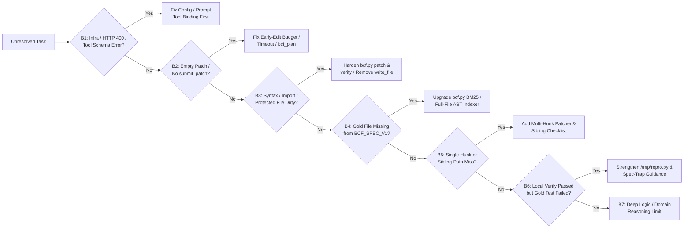

# Task 4: Local Evaluation, Kaggle LB Correlation, and Actionable BCF Brain Fine-Tuning Guide

> **Scope:** Operational user guide for scoring, calibrating, and analyzing local test runs of the Batonic Coding Framework (BCF) on the **PowerSpec G914 (RTX 5090)**, quantifying correlation and divergence against the official **Kaggle 4× L4** submission scorer (`N = 58` public leaderboard), and converting post-run trace telemetry into surgical, hypothesis-driven edits across the dual-track BCF brains (`submission_31b` and `submission_e4b`).
> **Date Anchor:** `2026-11-20` (post–Nov 18 metric patch/rescore; competition milestones: `2026-11-25 23:59 UTC` notebook publishing freeze, `2026-12-02 23:59 UTC` final submission deadline).

---

## Executive Summary

A high local pass rate does **not** automatically translate to a competitive Kaggle Public Leaderboard (LB) score. Across the competition discussion board, multiple teams reported rising local CV alongside flat or collapsing Kaggle LB scores (`0.00` to `0.10` despite strong local runs). Six concrete, measurable mechanisms explain nearly 100% of that gap:

1. **Uncalibrated local denominator:** The unmodified Getting Started container passes only ~52 of 129 gold patches locally, whereas a repaired Docker sandbox (Tasks 3 C2–C4) restores ~115–127/129—leaving ~11–12 structurally ungradable tasks on Python 3.13/offline (`requests_*` SSL/httpbin, `fastapi_14186`, `rich_3486`, `rich_3472`).
2. **Hardware-speed illusion:** A single-stream RTX 5090 runs **1.6× to 2.6× faster** than the Kaggle 4× L4 scorer. Patches that converge at `3.0–4.0 min` locally time out empty at `4.75 min` on Kaggle.
3. **CLI compaction mismatch:** `swegemma eval` defaults to `compaction_interval=None`, whereas Kaggle's Getting Started pipeline uses `compaction_interval=15` (and hits vLLM HTTP 400 context-overflow patch wipes whenever `prompt_tokens + max_output_tokens > 32,768`).
4. **Domain & syntax skew:** `16/129` public tasks touch `async def`, whereas **0 private tasks** touch `async def` (Thread `#745998`); overfitting prompts or `bcf.py` heuristics to FastAPI/Rich/Requests/HTTPX quirks inflates public CV while hurting unseen private repositories.
5. **Orchestration & skill isolation divergence:** Hidden-scorer runs exhibit distinct behavior for `run_skill_script` container isolation (`#758547`, `#758854`) and `SequentialAgent` handoffs (`#760126`).
6. **Small-`N` binomial variance & truncation discretization:** The Public LB has exactly **`N = 58`** tasks with `floor(100 * k / 58) / 100` truncation and a **10–13% per-task flip rate** even at `temperature = 0.0`, creating a `±3.5` to `±5.2`-task 95% confidence band between single runs.

This guide establishes a **calibrated, time-scaled, trace-driven evaluation workflow** so every local run produces trustworthy LB forecasts and concrete BCF tuning actions within 15 minutes of completion.

---

## Part 1: Complete Local Evaluation & Scoring User Guide

### 1.1 Evaluation Artifacts Inventory

Every local evaluation run—whether invoked through `tools/40_local_eval.py`, `swegemma eval`, or `gemma4-swe-kit`—writes a structured evidence tree. Verify that all six artifact layers are captured before interpreting any headline score:

| Artifact Path / File | Producer | Primary Contents | Required For |
| :--- | :--- | :--- | :--- |
| `results.json` / `results.jsonl` | `swegemma` / `40_local_eval.py` | Per-task `resolved`, `agent_patch_len`, `wall_seconds`, `tool_calls`, `turns`, `agent_error`, `pytest_exit` | Headline resolution rate, window-adjusted score, failure bucketing |
| `summary.json` | `swegemma` / `project_12h.py` | Aggregate pass rate, mean/P90/P95 duration, projected 120-task runtime (`k = 1.7` / `2.4`) | 12-hour hard-kill safety gate (`GREEN` / `AMBER` / `RED`) |
| `traces/<task_id>.json` | `adk-eval-core` (`SessionTrace`) | Full ATIF v1.7 turn-by-turn transcript: thoughts, tool calls, tool JSON outputs, token counts, retries | Root-cause failure attribution, malformed tool-call & HTTP 400 forensics |
| `patches/<task_id>.patch` | `swegemma` Stage 1 extraction | Exact unified `git diff HEAD` submitted by `submit_patch()` or fallback capture | Empty-patch check, protected-file check, hunk count & diff cleanliness |
| `verify_logs/<task_id>.log` | Container B (`verify_task`) | `git apply` 4-pass status, `pytest` stdout/stderr, JUnit XML status, exit code | Distinguishing agent logic bugs from sandbox/import/missing-wheel issues |
| `valid_tasks_local.txt` | Baseline calibration run | Exact subset of `129` task IDs passing `Gold = PASS` and `Empty = FAIL` on your machine | Honest local denominator `E` (eliminates ~11–12 ungradable tasks) |

---

### 1.2 Step 1 — Mandatory Baseline Calibration Gate (`Gold + Empty` Audit)

Before scoring **any** BCF brain change, calibrate your local Docker sandbox once per image build (after applying the Task 3 C2–C4 container repairs):

1. **Run Gold-Patch Verification** across all 129 public tasks (`tasks.jsonl`): every task's official `patch` + `test_patch` is applied in Container B.
2. **Run Empty-Patch Verification** across all 129 public tasks: an empty diff + `test_patch` is applied in Container B.
3. **Define the Gradable Denominator (`E`)**:
   - Include `task_id` in `valid_tasks_local.txt` **if and only if** `gold_resolved == True` **AND** `empty_resolved == False`.
   - Exclude tasks where `gold_resolved == False` (environment/Python 3.13/offline incompatibility) or `empty_resolved == True` (false-positive test harness).

On a properly repaired Task 3 sandbox, expect **`E ≈ 115–118`** valid tasks (up from ~52 on the unmodified starter kit). The remaining **11–14 excluded tasks** are known structural exclusions on Python 3.13 / air-gapped Docker:

- **8 `requests_*` offline/SSL/httpbin tasks:** Blocked by `network_mode="none"`, missing `pytest-httpbin`, or Python 3.13 `ssl.VERIFY_X509_STRICT` certificate rules.
- **`fastapi_14186`:** Python 3.13 / dependency warning-filter environmental drift.
- **`rich_3486`:** Container B `pytest` skipped-sibling bug (Thread `#757893`; resolved by fixing harness test invocation rather than agent code).
- **`rich_3472`:** Python 3.13 `AttributeError` traceback/typing drift relative to the original commit's Python 3.11 baseline.

> [!IMPORTANT]
> **Never report or compare `resolved / 129` raw.** Always compute `resolved / E` (using your frozen `valid_tasks_local.txt`) AND `resolved_within_L4_window / E` (Section 1.4). Changing the Docker image invalidates old denominators—re-run the 8-minute Gold+Empty calibration whenever Docker layers change.

---

### 1.3 Step 2 — Stratified Evaluation Suites (Preventing Public-Repo Overfitting)

Partition your `valid_tasks_local.txt` (`E` tasks) into four frozen, non-overlapping or nested evaluation tiers so you get fast feedback without overfitting to the 4 public repositories:

| Suite Name | Task Count | Selection Rule | Primary Purpose | Target Wall Clock (5090) | Mutability Rule |
| :--- | :---: | :--- | :--- | :---: | :--- |
| **`smoke_12`** | 12 | 2 tasks from each of the 6 BCF categories (`BUG_VALIDATION`, `BUG_RUNTIME`, `BUG_PROTOCOL_IO`, `BUG_FORMATTING`, `FEAT_ENHANCEMENT`, `DOCS_TOOLING`), mixing single/multi-hunk & >600-line files | Instant regression & tool-schema smoke test after any prompt/YAML/`bcf.py` edit | `10–18 min` | Frozen |
| **`dev_tune_30`** | 30 | Stratified across all 4 repos (`fastapi`, `rich`, `requests`, `httpx`), bug vs. non-bug, sparse prompts, backtick-heavy patches, `]`-containing prompts | Primary A/B ablation loop for tuning levers (Task 2b) | `25–45 min` | Open for error analysis & tuning |
| **`holdout_rich`** | 30–35 | Strictly non-overlapping with `dev_tune_30`; **zero `async def` tasks**, emphasis on general Python/CLI/object-model logic (`rich` + non-async `fastapi` + gradable `requests`/`httpx`) | Closest local proxy to **unseen non-async private repos** (`#745998`); used ONLY for promotion checks | `30–50 min` | **STRICTLY LOCKED** — never inspect individual holdout prompts to craft heuristics |
| **`full_valid_E`** | `E` (~115) | Entire calibrated `valid_tasks_local.txt` (run 2–3 seeds for final candidate vs. champion) | Pre-submission promotion gate & 12-hour runtime projection | `1.8–3.2 h` per pass | Frozen |

---

### 1.4 Step 3 — Primary Score Metrics & Time-Window Adjustment

Compute **four primary metrics** for every local run:

1. **Raw Gradable Resolution Rate (`R_raw`)**:
   $$R_{\text{raw}} = \frac{\text{Resolved Tasks in } E}{E}$$
2. **L4-Window-Adjusted Resolution Rate (`R_win`)** *(the #1 predictor of Kaggle LB)*:
   Count a task as resolved **only if** `resolved == True` **AND** `local_wall_seconds * k <= max_time_minutes * 60` (using nominal slowdown factor `k = 1.7` for 5090 vs. 4× L4; e.g., for `max_time_minutes = 4.75` on 31B, local task cutoff is `285 / 1.7 = 167.6 s`; for `4.25 min` on E4B, `255 / 1.7 = 150.0 s`):
   $$R_{\text{win}}(k) = \frac{|\{t \in E : \text{resolved}(t) \land (\text{wall\_s}(t) \cdot k \le 60 \cdot T_{\max})\}|}{E}$$
3. **Holdout Non-Async Adjusted Rate (`R_holdout_win`)**:
   `R_win(1.7)` computed strictly on `holdout_rich` (eliminates both `async def` bias and dev-set memorization).
4. **Projected 120-Task Kaggle Runtime (`H_120`)** *(from `project_12h.py`)*:
   $$H_{120}(k) = \frac{120 \cdot \bar{t}_{\text{local}} \cdot k}{3600} + \frac{7 + 90}{60}$$
   where `7 min` is vLLM startup and `90 min` is container/wheel setup overhead across 120 tasks:
   - **`GREEN` (`<= 11.0 h` at `k = 1.7`):** Safe for Kaggle submission.
   - **`AMBER` (`11.0–12.0 h` at `k = 1.7`):** Risky; trim `max_time_minutes` or `max_tool_calls` before submitting.
   - **`RED` (`> 12.0 h` at `k = 1.7`):** Guaranteed 12-hour Kaggle hard-kill (`Notebook Timeout` -> `0.00`).

---

### 1.5 Step 4 — The 10-Metric Mechanistic Diagnostic Scorecard

Headline pass rate is too noisy on `N = 30` to diagnose *why* a run improved or regressed. Always extract and log these **10 mechanistic KPIs** from `results.json` and `traces/*.json` after every run:

| # | Diagnostic Metric | Extraction Rule | 31B Target (Green) | E4B Target (Green) | Amber / Red Trigger | What Failure Mode It Isolates |
| :---: | :--- | :--- | :---: | :---: | :---: | :--- |
| 1 | **Empty-Patch Rate** | `% tasks with len(agent_patch.strip()) == 0` | `< 5%` | `< 8%` | `> 12%` (Red) | HTTP 400 overflow, `bcf_plan` stall, read-only exhaustion, or timeout before `submit_patch()` |
| 2 | **Valid-Submission Rate** | `% tasks where submit_patch() returned ok with patch_size > 0` | `>= 90%` | `>= 85%` | `< 75%` (Red) | Premature stop, tool-budget exhaustion without fallback submit, or runaway nudges |
| 3 | **Malformed Tool-Call Rate** | `% tool calls with invalid tool name (e.g. call:python3) or JSON/schema error` | `< 3%` | `< 5%` | `> 8%` (Red) | Fenced bash blocks in prompts (`gemma4-swe-kit` 31% vs. 5% finding) or wrong parameter names (`script_path` vs. `file_path`) |
| 4 | **HTTP 400 / Context-Overflow Rate** | `% tasks with vLLM HTTP 400 or prompt_tokens + max_output_tokens > 32768` | `0%` | `0%` | `> 0%` (Red) | `max_output_tokens` too large (`8192` leaves only `24.5k` prompt room) or verbose `run_command` output |
| 5 | **BCF Brain Install & Spec Hit Rate** | `% tasks where .git/bcf/bcf.py installed & BCF_SPEC_V1 emitted cleanly` | `100%` | `100%` | `< 98%` (Red) | Broken `run_skill_script` args (`file_path`), container isolation, or `bcf_plan` heredoc truncation |
| 6 | **Localization Recall@5** | `% tasks where gold modified file appears in BCF_SPEC_V1 CANDIDATE_FILES` | `>= 85%` | `>= 80%` | `< 70%` (Amber) | `bcf.py` `raw[:24000]` truncation, sparse-prompt misses, or BM25 tokenization blind spots |
| 7 | **First-Edit Tool-Call Latency** | Median tool-call index of first non-empty source edit (`bcf.py patch` or `edit_file`) | `<= 8` | `<= 6` | `> 12` (Red) | Exploration paralysis leaving insufficient budget for verification and sibling-path fixes |
| 8 | **Compile / Import / Dirty-Tree Fault Rate** | `% submitted patches failing ast.parse, submodule import, or touching tests/config/untracked files` | `< 2%` | `< 4%` | `> 6%` (Red) | `write_file("/tmp/...")` workspace pollution, unguarded `edit_file` backtick corruption, or skipped `verify` |
| 9 | **Local-Verify-to-Gold Conversion** | `% tasks passing local bcf.py verify / repro that also pass Container B gold test_patch` | `>= 45%` | `>= 35%` | `< 25%` (Amber) | Weak `/tmp/repro.py` assertions, missed sibling/multi-hunk edits, or overfitting to existing tests |
| 10 | **Timeout / L4-Cutoff Rate** | `% tasks exceeding local_wall_s > 60 * T_max / 1.7` | `< 10%` | `< 12%` | `> 20%` (Red) | Excessive thinking tokens, slow un-narrowed `pytest` invocations, or retry loops |

---

## Part 2: Interpreting Local Results & Local-to-Kaggle LB Correlation

### 2.1 Why Local CV and Kaggle LB Diverge (and How to Close Every Gap)

Competitors frequently observe local CV improvements that fail to appear on the Kaggle LB—or worse, drop to `0.00–0.10`. Every documented discrepancy maps to one of six structural factors:

| # | Divergence Driver | Direction of Local Bias | Typical Magnitude | Concrete Mitigation in Local Harness |
| :---: | :--- | :--- | :---: | :--- |
| 1 | **Default Getting Started sandbox passes only ~52/129 gold patches** | Local under-reports absolute score (`-0.25` to `-0.40`) OR hides regressions in ungradable buckets | Huge (`~50%` of dataset broken) | Apply Task 3 C2–C4 Docker repairs + freeze `valid_tasks_local.txt` (`E ≈ 115–118`) |
| 2 | **RTX 5090 single-stream vs. Kaggle 4× L4 (`k ≈ 1.6–2.6×` slower remote)** | Local over-reports solve rate (`+0.03` to `+0.08`) on slow multi-turn tasks | `2–5` LB tasks lost to silent timeout | Score with `R_win(k = 1.7)` and verify `H_120(1.7) <= 11.0 h` via `project_12h.py` |
| 3 | **`16/129` (12.4%) public tasks touch `async def` vs. `0` private tasks (`#745998`)** | Gains concentrated in FastAPI/HTTPX async patterns do not transfer to private LB | Up to `+0.05` non-transferable local CV | Gate promotions on **`holdout_rich`** (strictly zero `async def` tasks) |
| 4 | **Public repos (`fastapi`, `rich`, `requests`, `httpx`) vs. unseen private repos** | Hardcoded repo tokens (e.g. `bcf.py:796` `"stream_image"`) or repo-specific heuristics overfit public CV | `+0.02` to `+0.06` mirage | Audit `bcf.py` for zero repo/task name leakage; test on at least 1 external non-public repo if time permits |
| 5 | **`swegemma eval` CLI disables context compaction (`compaction_interval=None`) vs. Kaggle (`15`)** | Local either avoids compaction loss OR misses HTTP 400 overflows differently from Kaggle | `1–4` tasks per 58-task run | Force `compaction_interval=15` and `max_model_len=32768` locally (exact parity with Getting Started v3) |
| 6 | **Hidden-scorer `SequentialAgent` & `run_skill_script` container isolation (`#758547`, `#758854`, `#760126`)** | Local subprocess/shared-container tests pass `install.py` while hidden scorer isolates skills or degrades multi-agent handoffs | Catastrophic (`0.00` to `-0.10` drop!) | Test skills inside strict 2-container Docker isolation AND keep a **Zero-Skill Monolithic** benchmarked baseline (see Task 5) |

---

### 2.2 Exact Public Leaderboard Math (`N = 58`), Truncation Table & True Score Holes

The official Kaggle Public Leaderboard evaluates exactly **`N = 58`** tasks and displays the score **truncated (floored) to two decimal places**, NOT rounded:

$$\text{LB}_{\text{displayed}}(k) = \frac{\lfloor 100 \cdot k / 58 \rfloor}{100}$$

Each single resolved task shifts the true fraction by `1/58 = 0.017241...` (`+1.724` percentage points). Because `1.724 > 1.00`, roughly **42% of two-decimal values are mathematically unreachable ("score holes")**.

> [!NOTE]
> **Mathematical Correction vs. Earlier Community Digest:** An early Nov 5 community summary mistakenly listed `0.25` and `0.27` as unreachable holes. Exact arithmetic verifies that `floor(1500/58)/100 = 0.25` (`k = 15`) and `floor(1600/58)/100 = 0.27` (`k = 16`) **are reachable**. The exact unreachable score holes in `[0.00, 0.35]` are: **`0.02, 0.04, 0.07, 0.09, 0.11, 0.14, 0.16, 0.19, 0.21, 0.23, 0.26, 0.28, 0.30, 0.33, 0.35`**.

| Solved (`k / 58`) | Exact Rate (`k / 58`) | Displayed Kaggle LB | Competitive Meaning as of `2026-11-20` (Post–Nov 18 Rescore) |
| :---: | :---: | :---: | :--- |
| `0 / 58` | `0.0000` | **`0.00`** | Infrastructure failure, broken skill/parser freeze, HTTP 400 wipe, or `eval_config` crash |
| `1–5 / 58` | `0.0172–0.0862` | **`0.01, 0.03, 0.05, 0.06, 0.08`** | Severe parity/prompt/tool-call regression (e.g., E4B uncalibrated thinking or broken edit loop) |
| `6 / 58` | `0.1034` | **`0.10`** | Strong E4B contender / baseline `SequentialAgent` ceiling reported in `#760126` |
| `7 / 58` | `0.1207` | **`0.12`** | **Current E4B Small-Model Bonus Leader** (`amunozo`, `Tergel Munkhbat` tied; \$10,000 track) |
| `8 / 58` | `0.1379` | **`0.13`** | **Sole #1 E4B Small-Model Bonus Breakthrough** (+1 task over current tie!) |
| `9 / 58` | `0.1552` | **`0.15`** | Typical healthy monolithic 31B starter-tuned baseline (`#760126`) |
| `10 / 58` | `0.1724` | **`0.17`** | Solid 31B agent with working verification loop |
| `11 / 58` | `0.1897` | **`0.18`** | Upper-tier monolithic 31B prompt-engineered agent |
| `12 / 58` | `0.2069` | **`0.20`** | Strong Top-25 31B submission |
| `13 / 58` | `0.2241` | **`0.22`** | Top-20 31B submission (1 task shy of current leader tie) |
| `14 / 58` | `0.2414` | **`0.24`** | **Current 31B Main Track Leader Ceiling** (14 teams tied as of `2026-11-20`; \$65,000 track) |
| `15 / 58` | `0.2586` | **`0.25`** | **Sole #1 31B Main Track Breakthrough** (beats all 14 tied teams outright!) |
| `16 / 58` | `0.2759` | **`0.27`** | Commanding #1 31B lead (+2 tasks above current field) |
| `17 / 58` | `0.2931` | **`0.29`** | Historic peak (formerly Yurnero pre–Nov 18 metric patch) |
| `18 / 58` | `0.3103` | **`0.31`** | Stretch target (+4 tasks over current field) |

> [!WARNING]
> **Tie-Breaker Urgency:** Kaggle breaks exact Public/Private LB ties strictly by **earliest submission timestamp**. Because 14 teams are already tied at `0.24` (`14/58`) on 31B and 2 teams are tied at `0.12` (`7/58`) on E4B, **merely matching `0.24` or `0.12` late loses every tie-breaker**. The real goal is breaking cleanly to `>= 0.25` (`15/58`) on 31B and `>= 0.13` (`8/58`) on E4B while banking early strong scores before the `2026-12-02` deadline.

---

### 2.3 Variance, Noise Bands & Distinguishing Random Draws from Real Faults

Even at `temperature = 0.0`, vLLM tensor-parallel (`TP = 4`) floating-point reductions and multi-turn tool-output nondeterminism produce a **10–13% per-task flip rate** (`#758954`, `#756400`). Concretely:

- **Single Kaggle run (`N = 58`, true solve rate `p = 0.24`):** Standard deviation of `k` is $\sigma = \sqrt{58 \cdot 0.24 \cdot 0.76} \approx 3.25$ across random task draws, and conditional on the fixed 58 tasks with a `12%` flip rate, rerun-to-rerun $\sigma_{\text{rerun}} \approx 1.6\text{–}2.0$ tasks (`±0.03` to `±0.05` displayed LB).
- **Difference between two single Kaggle submissions (`A` vs. `B`):** 95% confidence band is **`±4` to `±5` tasks (`±0.07` to `±0.09` LB)** unless the two runs are compared paired on identical local task IDs.
- **3-run local average on `N = 68–115` tasks:** Shrinks rerun standard error by $\sqrt{3} \approx 1.73\times$, tightening the 95% paired-difference band to **`±2.5` to `±3.2` tasks (`±2.5%` to `±3.5%`)**.

Use this **Diagnostic Triage Matrix** whenever a Kaggle LB score differs from your local prediction:

| Observed Kaggle Outcome | Kaggle Wall Time | Diagnosis | Immediate Action |
| :--- | :---: | :--- | :--- |
| **`0.00`** | `< 15 min` | Validation/startup crash (`eval_config` null, bad YAML, invalid model, `!include` `PathTraversalError`, or `swegemma` schema error) | Check notebook logs & run `validate_and_package_bcf.py` + `g4kit-fake-llm` locally |
| **`0.00` or Timeout** | `~11.8–12.0 h` | 12-hour hard kill (`Notebook Timeout`) OR vLLM 0.19.1 `_parse_gemma4_array` infinite loop / OOM freeze (`#753973`, `#759580`) | Audit array-arg schemas (`skills:` / `get_code_subgraph`) and tighten `max_time_minutes` (`H_120(2.0) <= 11.2 h`) |
| **`0.00–0.05`** (local was `>= 0.25`) | `3–7 h` | Silent hidden-scorer runtime divergence: `run_skill_script` wrong param (`script_path` vs. `file_path`), skill container isolation (`#758547`), or HTTP 400 overflow wiping patches | Immediately check Task 5 P0/P1 blockers; validate a Zero-Skill Monolithic canary on Kaggle |
| **`0.08–0.13` on 31B** (local was `>= 0.25`) | `4–8 h` | Multi-agent `SequentialAgent` state/nudge corruption (`#760126`), high malformed tool-call rate, or local-to-L4 speed timeouts | Inspect local `R_win(2.0)` vs. `R_raw`, malformed tool-call rate, and `bcf_plan` re-entry behavior |
| **`0.18–0.22` vs. predicted `0.24`** | `6–10 h` | **Within normal 1–2σ rerun variance** (`±2–3` tasks on `N = 58`) OR mild domain shift to unseen private repos | Do **NOT** panic-rewrite architecture. Compare `holdout_rich` KPIs, fix top 1–2 systematic failure buckets, and verify gain across 3 local runs |

---

### 2.4 Quantitative Local-to-Kaggle Translation Formula

Once your Task 3 sandbox is calibrated (`E ≈ 115`) and `compaction_interval=15` is enabled locally, translate your **`holdout_rich`** L4-window-adjusted solve rate into a realistic Kaggle Public LB forecast using a conservative domain-transfer discount (`d = 0.80–0.90` for unseen private repositories):

$$\widehat{\text{LB}}_{\text{expected}} = \frac{\lfloor 100 \cdot \text{round}(58 \cdot R_{\text{holdout\_win}}(1.7) \cdot d) / 58 \rfloor}{100}$$

| Track | Local `R_raw` (`full_valid_E`) | Local `R_holdout_win(1.7)` | Unseen-Repo Discount (`d`) | Expected Kaggle `k / 58` | Expected Displayed LB (95% Band) |
| :--- | :---: | :---: | :---: | :---: | :---: |
| **31B Main** | `34%` | `28%` | `0.85` | `13.8 / 58` (`14`) | **`0.24`** (`0.18 – 0.27`) |
| **31B Main (Target)** | `40%+` | `33%+` | `0.85` | `16.3 / 58` (`16`) | **`0.27`** (`0.22 – 0.31`) |
| **E4B Bonus** | `20%` | `15%` | `0.85` | `7.4 / 58` (`7`) | **`0.12`** (`0.08 – 0.15`) |
| **E4B Bonus (Target)** | `26%+` | `20%+` | `0.85` | `9.9 / 58` (`10`) | **`0.17`** (`0.12 – 0.20`) |

**Key Takeaway:** To reliably clear the `0.24` 31B tie wall (`>= 0.25`) or `0.12` E4B tie wall (`>= 0.13`) without praying for a lucky seed, target **`R_holdout_win(1.7) >= 32%`** on 31B and **`>= 19%`** on E4B across a **3-run local average**.

---

## Part 3: Converting Latest Results Into Actionable BCF Brain Fine-Tuning Plans

### 3.1 The 15-Minute Post-Run Triage SOP

Run this exact 4-step workflow immediately after every `dev_tune_30` or `full_valid_E` run:

1. **Step A — Gate & Diff (2 min):** Compare the new run against your current Champion using paired task outcomes: list every **`GAINED` (`0 -> 1`)** and **`REGRESSED` (`1 -> 0`)** task ID, compute `R_win(1.7)`, `H_120(1.7)`, and the 10 diagnostic KPIs (Section 1.5).
2. **Step B — Mutually Exclusive Failure-Funnel Bucketing (5 min):** Classify every unresolved task into **exactly ONE first-cause bucket** in strict pipeline order (mirroring the `#760595` failure-funnel discipline):

3. **Step C — Pareto Selection (3 min):** Pick the **single highest-count upstream bucket** (`B1` before `B2` before `B3`... — never tune `B6` logic prompts while `B1/B2/B3` are leaking 15% of tasks!). Inspect 3–5 actual ATIF traces from that bucket to verify the exact failure token.
4. **Step D — Single-Lever Hypothesis Ticket (5 min):** Write a 3-line hypothesis before editing any file:
   - *Target bucket & baseline count:* e.g., `B4 Localization miss = 7/30 (23%)`
   - *Exact single change:* e.g., remove `raw[:24000]` cap in `bcf.py:721`
   - *Success criterion:* `B4` drops to `<= 3/30`, `R_win(1.7)` increases by `>= +2` tasks on `dev_tune_30`, and `H_120(1.7)` stays `<= 11.0 h`.

---

### 3.2 Master Failure-Signature-to-BCF-Edit Tuning Matrix

Use this lookup table to translate concrete local trace symptoms directly into exact edits inside `deliverables/2026-11-20_BCF_Gemma4_Winning_Design/`:

| # | Observed Local Trace Signature | Root Cause | Exact BCF File & Location to Tune | Concrete Fine-Tuning Action | Verification Tier | Promotion Gate |
| :---: | :--- | :--- | :--- | :--- | :--- | :--- |
| 1 | `run_skill_script` returns `INVALID_ARGUMENTS` / `file_path is required` | Prompts/SKILL pass `script_path` instead of ADK 1.36.1's `file_path` | `prompts/bcf_plan.md` (`L24` 31B, `L17` E4B), `SKILL.md` (`L15` 31B, `L11` E4B) | Replace `script_path` with `file_path` (or remove skills entirely via Zero-Skill Monolithic track; see Task 5) | `smoke_12` + `g4kit-fake-llm` | `BCF Install Hit Rate = 100%` |
| 2 | `vLLM` HTTP 400 `"maximum context length is 32768"` -> empty patch | `prompt_tokens + max_output_tokens > 32768` (`solver.yaml` sets `8192` on 31B) | `submission_31b/sub_agents/solver.yaml:19` | Lower `max_output_tokens` from `8192` to `4096` (or `5120`), adding `+3,072` to `+4,096` prompt headroom | `smoke_12` + `dev_tune_30` | `HTTP 400 Rate = 0%` |
| 3 | Malformed tool names (`call:python3`, `call:bash`, `call:git`) `> 5%` | Raw fenced `bash` code blocks in system prompts bias Gemma 4 toward shell-name tool calls (`gemma4-swe-kit`: 31% vs. 5%) | `prompts/bcf_plan.md` (`L30–41` 31B, `L19–29` E4B), `prompts/solver.md` (`L16–20, 49–54`) | Rewrite fenced shell commands as concise prose explicitly bound to `run_command` | `dev_tune_30` | `Malformed Tool-Call Rate < 3%` (31B) / `< 5%` (E4B) |
| 4 | `bcf_plan` truncates mid-heredoc or hits `<\|tool_call>` cutoff on long issues (`fastapi_14463` = 10,095 chars) | `bcf_plan` copies huge problem text into `<<'BCF_PROB'` under `max_output_tokens: 1536–2048` | `sub_agents/bcf_plan.yaml:18`, `prompts/bcf_plan.md:32–34` | Raise E4B `bcf_plan` `max_output_tokens` to `>= 2048` (`3072` on 31B) and instruct passing only **<= 15 lines** of key symbols/tracebacks/paths (never full issue dump) | `smoke_12` (include `fastapi_14463` & `fastapi_13786`) | `0` truncated `bcf_plan` turns |
| 5 | Gold file missing from `CANDIDATE_FILES` on files > 600 lines (50/129 tasks!) | `bcf.py:721` truncates BM25 indexing at `raw[:24000]` and `bcf.py:867` caps test scan at `[:16000]` | `skills/bcf-spec/scripts/bcf.py:721, 796, 867` | Index full source text (or up to `200,000` chars) + full AST symbol bodies; remove `"stream_image"` training leak at `L796` | Offline 129-task localization benchmark + `dev_tune_30` | `Localization Recall@5 >= 85%` (up from baseline) |
| 6 | Patch fixes 1st location correctly but misses 2nd hunk / sibling method (71/129 tasks have `>= 2` hunks!) | `bcf.py:952` `cmd_patch` only edits one line range per call, burning extra turns & causing line-number drift | `skills/bcf-spec/scripts/bcf.py:952–1028`, `prompts/solver.md` | Add multi-hunk atomic batch mode (`patch-multi` applying bottom-to-top sorted line ranges with single rollback) + explicit sibling-hit list in `BCF_SPEC_V1` | `dev_tune_30` (multi-hunk subset) | `>= +2` multi-hunk solves, `-1.5` avg calls/task |
| 7 | Submitted patch has `ImportError` / `NameError` / `UnboundLocalError` in Container B despite passing `bcf.py verify` | `bcf.py:1115` imports only top-level `pkg` (not modified submodule) and lacks AST scope/name validation & `PYTHONSAFEPATH=1` | `skills/bcf-spec/scripts/bcf.py:1086–1145` | Import exact modified dotted submodule (`importlib.import_module`), add stdlib AST undefined-name / `UnboundLocalError` checker, and run `pytest` with `PYTHONSAFEPATH=1 PYTHONNOUSERSITE=1 -s --maxfail=3` | `dev_tune_30` | `Compile/Import/Dirty Fault Rate < 2%` |
| 8 | `/workspace/tmp/repro.py` or modified `tests/` file leaks into `agent_patch` | `solver.yaml:13` still exposes `write_file` tool (which writes relative to `/workspace`) | `sub_agents/solver.yaml:13` (both tracks) | Remove `write_file` from `solver.yaml` tool list completely; rely on `bcf.py patch`, `edit_file`, and `run_command` (`/tmp/repro.py`) | `smoke_12` + `dev_tune_30` | `Dirty-Tree / Untracked File Rate = 0%` |
| 9 | Continuation nudges overwrite `{bcf_spec}` with garbled text or burn 4+ wasted turns | `SequentialAgent` re-enters `bcf_plan` on every nudge (`#754636`); E4B occasionally paraphrases instead of verbatim fast-path | `agent.yaml`, `prompts/bcf_plan.md:8–9` | Test **Zero-Skill Monolithic `LlmAgent`** (eliminates re-entry overhead entirely) vs. hardened `bcf_plan` fast-path on `dev_tune_30` | `dev_tune_30` + `holdout_rich` | Pick architecture with higher `R_holdout_win(1.7)` |
| 10 | High `Timeout / L4-Cutoff Rate > 15%` or `First-Edit Latency > 10` | `thinking_budget` too high for remaining turns, or `pytest` running entire slow test module | `sub_agents/solver.yaml:21`, `eval_config.yaml`, `bcf.py:1141` | Add `--maxfail=3` & `-k` default in `bcf.py verify`; sweep `thinking_budget` (`1536` vs `2048` on 31B; `512` vs `768` on E4B); keep `max_tool_calls >= 24` | `dev_tune_30` + `project_12h.py` | `Timeout Rate < 10%` & `H_120(1.7) <= 11.0 h` |
| 11 | Local `bcf.py verify` passes (`PYTEST_EXIT=0`), yet Container B fails `test_patch` | Over-relying on existing passing tests without reproducing the reported failing input/edge case | `prompts/solver.md` Phase 3 | Mandate **Red -> Green** reproduction: `/tmp/repro.py` must **FAIL before the edit** (or assert the exact issue contract + `None`/empty/subclass/sibling edge cases) before `submit_patch()` | `dev_tune_30` | `Local-Verify-to-Gold Conversion >= 45%` |
| 12 | `Edit` failures / indentation corruption on backtick-heavy files (27/129 gold patches) | Model falls back to `edit_file` or unquoted heredocs instead of single-quoted `<<'BCF_EOF'` | `prompts/solver.md`, `bcf.py:985` | Require `--anchor` check on `bcf.py patch` and instruct single-quoted heredoc exclusively for edits containing backticks or nested quotes | `smoke_12` (backtick subset) | `0` backtick-corrupted patches |

---

### 3.3 Track-Specific Fine-Tuning Priorities (31B Main vs. E4B Bonus)

Although both tracks share the BCF architecture, their failure bottlenecks differ sharply—never blindly copy a 31B prompt/config change onto E4B without re-measuring:

| Tuning Dimension | **Gemma 4 31B Main Track (\$65K)** | **Gemma 4 E4B Small-Model Bonus Track (\$10K)** |
| :--- | :--- | :--- |
| **Primary Score Bottleneck** | Multi-hunk completeness, sibling-path sweeps, deep localization (`>600` lines), HTTP 400 overflow at long context | Instruction following, thinking-budget blowups (`#760014`), malformed tool calls, prompt length dilution |
| **Prompt Budget Ceiling** | `<= 2,200` tokens total system prompt (concise playbooks + explicit Red->Green repro contract) | `<= 1,100` tokens total system prompt (ultra-crisp 4-step loop; every extra paragraph measurably drops E4B compliance) |
| **`max_output_tokens` / `thinking_budget`** | `solver`: `4096` (or `5120`) / `1536–2048`; `bcf_plan`: `3072` / `1024` | `solver`: `4096` / `512–768`; `bcf_plan`: `2048` / `512` (strictly `>= 2048` output to satisfy `preflight_static.py` and avoid `<\|tool_call>` cutoff) |
| **Highest-ROI Next Experiments** | 1. Fix P0 `file_path` / test Monolithic vs. `SequentialAgent` 2. Remove `raw[:24000]` cap + add multi-hunk `bcf.py` 3. Drop `solver` `max_output_tokens` `8192 -> 4096` + remove `write_file` | 1. Fix P0 `file_path` / **strongly test Monolithic `LlmAgent`** (eliminates 2-stage handoff drop on 4B) 2. Strip all fenced bash blocks (31% -> 5% malformed call drop) 3. Sweep `thinking_budget` `{512, 768, 1024}` with `include_thoughts: true` |
| **Promotion Target (`holdout_rich`)** | `R_holdout_win(1.7) >= 32%` (3-run avg) -> targets **`0.25–0.27` LB** | `R_holdout_win(1.7) >= 19%` (3-run avg) -> targets **`0.13–0.17` LB** |

---

### 3.4 Strict Promotion & Submission Governance (Zero Wasted Kaggle Slots)

Because Kaggle imposes strict daily submission limits and an `8–11 h` turnaround per submission, enforce this **5-Gate Promotion Pipeline** before uploading any ZIP:

1. **Gate 1 — Static & Functional Preflight (`< 30 s`):** Run `validate_and_package_bcf.py` (augmented with `RunSkillScriptTool` schema validation and `preflight_static.py` rules) + `g4kit-fake-llm` zero-GPU harness smoke test. **Must have 0 errors.**
2. **Gate 2 — Fast Smoke (`smoke_12`, `10–18 min`):** Confirms `Empty-Patch Rate < 5%`, `HTTP 400 Rate = 0%`, `Malformed Tool-Call Rate < 5%`, and `BCF Install Hit Rate = 100%`.
3. **Gate 3 — Dev Ablation (`dev_tune_30`, `25–45 min`):** Single-variable change beats Champion on `R_win(1.7)` (or ties `R_win` while reducing mean wall time by `>= 15%` or cutting a top-3 failure bucket in half) with `<= 1` unexpected regression on previously passing tasks.
4. **Gate 4 — Locked Holdout + 12h Safety Check (`holdout_rich`, `30–50 min`, 2–3 runs):** Must show positive or non-regressing `R_holdout_win(1.7)` and `H_120(1.7) <= 11.0 h` (`GREEN`). Never promote a `dev_tune_30` gain that regresses `holdout_rich` (classic public-repo overfitting signal).
5. **Gate 5 — Kaggle Calibration Canary Before Full Risk:** On any structural architecture change (especially `skills:` or `SequentialAgent` vs. Monolithic), verify on a 5-task Kaggle 4× L4 notebook run (or inspect Getting Started v3 parity) before committing a high-stakes late-window submission slot. Reserve both final selection checkboxes strictly as **Slot 1 = Best 31B Main Track (\$65K)** and **Slot 2 = Best E4B Bonus Track (\$10K)**.

---

## References & Grounding

- Local harness & competition specs: `input/kagglecomp/kagglecomp_data_package/HARNESS_README.md`, `input/kagglecomp/docs/markdown/Kaggle-03-GettingStarted.md`
- Local tooling & calibration scripts: `tools/40_local_eval.py`, `tools/gemma4-swe-kit/README.md`, `project_12h.py`, `preflight_static.py`
- Community empirical data (`2026-10-31` to `2026-11-20`): `input/kagglecomp/intel_20261120/00-intel-brief-2026-11-20.md`, `02-raw-forum-digest-2026-11-11-to-2026-11-20.md` (Threads `#745998`, `#753973`, `#754636`, `#756400`, `#757893`, `#758547`, `#758854`, `#758954`, `#759580`, `#760014`, `#760126`, `#760595`)
- BCF target artifacts audited: `deliverables/2026-11-20_BCF_Gemma4_Winning_Design/` (`submission_31b/`, `submission_e4b/`, `tools/validate_and_package_bcf.py`)
