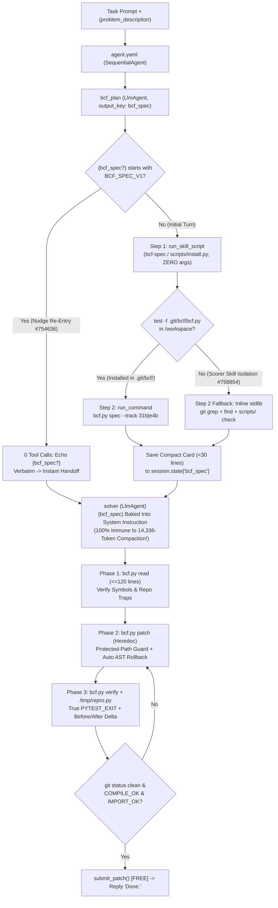

# Task 2: Batonic Coding Framework (BCF) — Dual-Track Brain Design, Breaking the `0.24` Deadlock & Guaranteed-Score Harness Engineering

*Scope: Complete technical architecture, implementation specification, empirical design justifications, dual-track optimization (**Gemma 4 31B** Main Competition `\$65,000` and **Gemma 4 E4B** Small-Model Bonus `\$10,000`), strategic blueprint to break the `0.24` public leaderboard deadlock, and exhaustive harness/scorer pitfall defenses engineered so BCF **always returns a valid score** within the 12-hour Kaggle evaluation window.*  
*Date: 2026-11-20 | Grounded In: `tasks.jsonl` (129-task RCA), `HARNESS_README.md`, `adk_1.36.1_skill_toolset.py`, Kaggle Public & Bonus LB snapshots (2026-11-20), Official Google ADK / Gemma 4 / vLLM documentation, and Discussion Board intel through Thread `#760595`.*

---

## 1. Executive Summary

The **Batonic Coding Framework (BCF)** is a declarative Google ADK two-stage autonomous software engineering system (`SequentialAgent: bcf_plan -> solver`) powered by a zero-dependency Python standard-library "brain" (`bcf.py`) installed invisibly into `<repo>/.git/bcf/` by a zero-argument ADK skill (`bcf-spec`). Rather than competing on bloated multi-agent hierarchies, noisy precomputed code-graph tools, or speed-degrading LoRA adapters, BCF targets the **exact empirical bottlenecks** verified across our 129-task Root Cause Analysis (`01_Dataset_Classification_and_Root_Cause_Analysis.md`) and 7 weeks of Kaggle competition telemetry (Threads `#743063`–`#760595`):

1. **Localization is not the primary bottleneck — corrupted edits, blind verification, prompt traps, and context/nudge pathologies are.** Trace studies (`#751596`, `#760595`) show Gemma 4 locates the gold file in 63–76% of runs by turn 2–3, yet loses solvable tasks to `edit_file` backtick swallowing (`#756051`), E4B character-drop edits (`#753277`), masked `pytest | tail` exit codes (`#760595`), missing sibling-path sweeps (Task 1 §6.2), and 14,336-token compaction amnesia (`#754783`).
2. **Every BCF mechanism maps directly to an empirically measured failure mode.** `bcf.py` delivers domain-general 6-category / 21-subcategory issue classification with targeted repair playbooks, offline stdlib AST + BM25 + `async def` + unparenthesized-attribute localization, bounded 1-indexed file slicing, atomic line-range heredoc patching with automatic `ast.parse`/`py_compile` rollback and protected-path blocking, and a mechanical verification gate (`git status` audit + `py_compile` + smoke import + true-exit-code `pytest`).
3. **Hard-guaranteed score return under 12 hours.** Both `submission_31b` (worst-case 120-task wall time **11.12h < 12.00h**) and `submission_e4b` (worst-case **10.12h < 12.00h**) enforce finite non-null budgets in `eval_config.yaml`, eliminate all array-argument tools from `solver.yaml` (blocking the vLLM 0.19.1 `_parse_gemma4_array` infinite loop `#753973`), guard `bcf_plan` against `SequentialAgent` continuation-nudge restarts via ADK `{bcf_spec?}` state short-circuiting (`#754636`), and degrade gracefully via an inline `run_command` fallback if the hidden scorer isolates `run_skill_script` (`#758547`, `#758854`).

---

## 2. Official BCF Architecture & Exact Submission Hierarchy

Both competition tracks (`submission_31b/` and `submission_e4b/`) conform strictly to the official Batonic Coding Framework layout plus the mandatory non-null `eval_config.yaml` budget gate:

```text
submission/
├── agent.yaml                      # SequentialAgent: bcf_plan -> solver (no top-level model:)
├── eval_config.yaml                # Strict finite non-null budgets guaranteeing <12h completion
├── sub_agents/
│   ├── bcf_plan.yaml               # LlmAgent, output_key: bcf_spec, skills: [skills/bcf-spec]
│   └── solver.yaml                 # LlmAgent, instruction includes {bcf_spec}, ZERO array tools
├── prompts/
│   ├── bcf_plan.md                 # Idempotent {bcf_spec?} guard + 2-call install/spec protocol
│   └── solver.md                   # Compaction-immune {bcf_spec} + 4-phase surgical workflow
└── skills/
    └── bcf-spec/
        ├── SKILL.md                # Lowercase kebab-case frontmatter (`name: bcf-spec`)
        └── scripts/
            ├── install.py          # Zero-arg installer -> <repo>/.git/bcf/bcf.py (ADK chdir-safe)
            └── bcf.py              # Offline stdlib brain: classify + locate + read + patch + verify + undo
```

### 2.1 End-to-End Runtime Flow & Compaction-Immunity Architecture



### 2.2 Five Core Architectural Justifications

| Design Choice | Grounded Problem Solved | Why BCF Beats Baseline & Alternatives |
| :--- | :--- | :--- |
| **`SequentialAgent(bcf_plan -> solver)` with `{bcf_spec}` in `solver` system instruction** | ADK's `LlmEventSummarizer` triggers at `14,336` tokens (`HARNESS_README` §7.2) and drops all `function_call`/`function_response` parts (`#754783`, `#756336`), causing long runs to suffer amnesia. | Interpolating `{bcf_spec}` into `solver`'s **system instruction** makes the issue classification, candidate files/line numbers, targeted tests, repo traps, and subcategory playbook **100% immune to compaction** for the entire episode. |
| **Idempotent `{bcf_spec?}` Fast-Path Guard in `bcf_plan.md`** | When `solver` stops a turn without calling `submit_patch()`, `agent_runner.py` injects a continuation nudge into `sub_agents[0]` (`bcf_plan`), which on naive `SequentialAgent` designs re-runs exploration and doubles context (`#754636`, `#760126`). | Google ADK's optional state syntax `{bcf_spec?}` evaluates to `""` on turn 1 and the saved spec on any subsequent nudge re-entry. When `BCF_SPEC_V1` is already present, `bcf_plan` executes **0 tool calls** and echoes the card verbatim back to `solver` — without setting `include_contents: none` (which breaks multi-step ADK tool calling). |
| **Zero-Argument `install.py` -> `<repo>/.git/bcf/bcf.py` + Zero Array Tools on `solver`** | vLLM 0.19.1 `gemma4_tool_parser._parse_gemma4_array` enters an infinite loop on array tool arguments (`list[str]`) containing `]` (`#753973`, `#759580`, vLLM PR `#41991`), OOMing the container at 26.7 GB and zeroing all remaining tasks. Meanwhile `.git/` is invisible to `git add -N . && git diff HEAD`. | `get_code_subgraph(nodes: list[str])` is banned from ALL agents; `skills: [skills/bcf-spec]` is attached ONLY to `bcf_plan` and called once with **zero arguments** (`install.py`); `solver` exposes strictly scalar tools (`run_command`, `read_file`, `edit_file`, `write_file`, `get_status`, `submit_patch`), achieving **0% exposure** to the vLLM array parser bug during solving and **0 bytes** of patch pollution. |
| **ADK `os.chdir(td)` Frame-Aware `install.py` + Automatic `run_command` Fallback** | Grounded inspection of `adk_1.36.1_skill_toolset.py:626-634` shows ADK materializes scripts into a temp directory `td` and runs `os.chdir(td)` before `runpy.run_path()`. Furthermore, Threads `#758547` & `#758854` warn that `run_skill_script` may not share `/workspace` on the hidden scorer. | `install.py` inspects enclosing call frames for `_orig_cwd`, checks `SWEGEMMA_WORKSPACE`/`/workspace`, and scans `/tmp/swegemma_sandbox_*/workspace`, handling both normal `.git` directories and git worktrees. If `.git/bcf/bcf.py` is still absent in Container A, `bcf_plan.md` seamlessly falls back to inline `run_command` stdlib grep/find triage so the agent **never crashes or scores 0.00**. |
| **Offline Stdlib AST + BM25 + Async Locator + Syntax-Guarded Heredoc Patcher (`bcf.py`)** | Precomputed competition graph tools skip 100% of `async def` functions (0/914 in FastAPI, 0/100 in httpx; `#758854`), miss uncalled attributes (`self._parser.complete` in `httpx_3672`), inject 5.8 KB of noise, and lose to BM25 (9% vs 52% recall; `#756400`). Meanwhile `edit_file` swallows keys around backticks (`#756051`), suffers residual escaping (`#744272`), and E4B drops characters on copies (`#753277`, `#760595`). | `bcf.py` replaces all 3 graph tools with `<1s` stdlib AST (`ClassDef` + `FunctionDef` + `AsyncFunctionDef`) + BM25 + lexical reference indexing and targeted test mapping. `bcf.py patch` reads replacement code via single-quoted bash heredoc (`<<'BCF_EOF'`), blocks protected test/config paths, creates a backup in `.git/bcf/backups/`, runs `ast.parse` + `py_compile`, and **auto-rolls back** on any syntax error! |

---

## 3. Complete BCF Brain Coverage Matrix (All 6 Categories & 21 Sub-Categories)

To generalize to **unseen private repositories** (Host ruling `#747248`: *"None of the published training repositories appear in the test set"*), `bcf.py` strips raw GitHub URLs (`https?://\S+`), applies word-boundary regex matching (`\b`) over **domain-general Python SE vocabulary** (zero repo-specific identifiers), and outputs both a primary and optional secondary subcategory playbook into `BCF_SPEC_V1`.

| Primary Category | Sub-Category ID | Dataset Share | Domain-General Trigger Signals in `bcf.py` | 31B Brain Playbook Focus | E4B Brain Playbook Focus |
| :--- | :--- | :---: | :--- | :--- | :--- |
| `BUG_LOGIC` | `BUG_LOGIC.INFINITE_LOOP_OR_RECURSION` | 4 (3.1%) | `infinite loop`, `recursionerror`, `hangs`, `self-referential`, `cyclic`, `oom`, `deadlock` | Audit every `while`/recursive branch for monotone advance or `visited` set (`is not`/`id()`); copy list before `.extend`; check sibling methods. | Find loop/recursion; enforce index advance or `visited` set (or `.copy()`); test self-input in `/tmp/repro.py`. |
| `BUG_LOGIC` | `BUG_LOGIC.BOUNDARY_AND_EMPTY_INPUT` | 4 (3.1%) | `empty string`, `off-by-one`, `boundary`, `indexerror`, `assertionerror`, `falsy`, `when none` | Replace bare `assert x is not None` with explicit guards; distinguish `is not None` vs truthiness; validate effective contextual paths. | Guard `''`, `None`, `[]`, `0` with `if x is not None:`; preserve default behavior and test both branches. |
| `BUG_LOGIC` | `BUG_LOGIC.STATE_AND_LIFECYCLE` | 9 (7.0%) | `cache`, `stale`, `_hash`, `on_startup`, `leak`, `mutat*`, `shared state`, `super().__init__`, `teardown` | Eliminate mutable aliasing (`+`, `[:]`, `deepcopy`); verify `super().__init__` ordering, `start`/`stop` symmetry, `_hash = None` invalidation, and all entry paths. | Copy before mutating; check `super().__init__` overwrites, `_hash` resets, and paired `start`/`stop` methods. |
| `BUG_LOGIC` | `BUG_LOGIC.CONTROL_FLOW_AND_DISPATCH` | 1 (0.8%) | `precedence`, `dispatch`, `wrong order`, `reversing`, `hoist*`, `parameter order`, `if/elif` | Catch loop-invariant hoisting (`[0]` outside loop); audit `if`/`elif` branch precedence; test swapped input orderings. | Move hoisted `[0]` lookup inside loop; verify `if`/`elif` order; test both orders in `/tmp/repro.py`. |
| `BUG_TYPE_SCHEMA` | `BUG_TYPE_SCHEMA.ANNOTATION_AND_INTROSPECTION` | 14 (10.9%) | `annotated`, `union`, `forwardref`, `type_checking`, `functools.wraps`, `partial`, `__getattr__`, `isclass`, `signature`, `unwrap` | Strip nested `partial` BEFORE `inspect.unwrap`; check `isclass` before `__call__`; recursively unwrap `Annotated`/`Union`; pair `isinstance` + `hasattr` for proxies; update mirror helpers. | Check `unwrap`/`partial`/`isclass`/`Annotated` or `hasattr` proxy check; update all mirror helpers together. |
| `BUG_TYPE_SCHEMA` | `BUG_TYPE_SCHEMA.SCHEMA_AND_OPENAPI` | 11 (8.5%) | `openapi`, `json schema`, `$ref`, `anyof`, `computed_field`, `securityschemes`, `swagger`, `$defs`, `xss` | Synchronize generation AND lookup/remapping modes; guard `isinstance(val, str)` on `$ref`; never mutate cached schemas in place; keep deterministic order. | Sync schema gen & lookup; guard `$ref` type; deepcopy before mutating; verify via targeted schema test. |
| `BUG_TYPE_SCHEMA` | `BUG_TYPE_SCHEMA.SERIALIZATION_AND_VALIDATION` | 7 (5.4%) | `validation_alias`, `serialization_alias`, `extra='allow'`, `typeadapter`, `discriminator`, `pickle`, `__reduce__`, `multidict` | Align aliases across lookup, `processed_keys`, error `loc`, and titles; use `.keys()` + `.getlist()` (unwrap len==1) on multidicts; delegate `__reduce__`. | Check alias vs field name, multidict `.getlist()` unwrap, and `processed_keys`; verify validation/pickle round-trip. |
| `BUG_TYPE_SCHEMA` | `BUG_TYPE_SCHEMA.TYPE_ERROR_AND_ATTR_GUARD` | 2 (1.6%) | `attributeerror`, `typeerror`, `keyerror`, `init=false`, `__qualname__`, `descriptor`, `__slots__`, `uninitialized` | Filter missing attrs BEFORE `loop_last(...)` (`if hasattr(obj, name)`); validate `isinstance(val, str)` on `__qualname__`/`__name__`; verify fallback chain. | Filter with `hasattr` before `getattr` or `isinstance(val, str)` before string ops; test uninitialized dataclass/descriptor. |
| `BUG_PROTOCOL_IO` | `BUG_PROTOCOL_IO.HTTP_HEADERS_AND_URL` | 10 (7.8%) | `header`, `authorization`, `bearer`, `content-type`, `no_proxy`, `www-authenticate`, `401`, `403`, `redirect`, `leading slash` | Enforce RFC semantics: DNS dot-boundary (`lstrip('.')`), `partition(' ')` + `.strip()`, skip valueless `Content-Type` params without `'='`; sweep sibling security modules. | Apply exact RFC rule (dot-boundary, `param.strip()`, skip missing `'='`); sweep sibling modules; avoid broad regex rewrites. |
| `BUG_PROTOCOL_IO` | `BUG_PROTOCOL_IO.STREAMING_AND_ASYNC` | 2 (1.6%) | `streamingresponse`, `asyncexitstack`, `keep-alive`, `unasync`, `websocket`, `async def`, `exit stack`, `yield dependency` | Scan `scripts/` for `unasync` before twin-tree edits; wrap response consumption inside `AsyncExitStack`; update HTTP + WebSocket; grep methods without `(`. | Check `scripts/unasync` + sync/async twin trees; grep without `(`; keep cleanup after streaming finishes. |
| `BUG_PROTOCOL_IO` | `BUG_PROTOCOL_IO.ENCODING_UNICODE_AND_TEXT` | 9 (7.0%) | `unicode`, `grapheme`, `zwj`, `\u200d`, `cjk`, `cell_len`, `split_cells`, `utf-8`, `content-length`, `control code`, `backslash` | Exact byte vs codepoint length (`encode('utf-8')`), C0/C1 width 0, bidirectional cell split (`pos >= 0`), trailing `\\` and `\\n` preservation, strip controls before span offsets. | Fix exact byte/Unicode/newline boundary (`pos >= 0`, trailing `\\n`/`\\`, strip before spans); test CJK/emoji/empty in `/tmp/repro.py`. |
| `BUG_PROTOCOL_IO` | `BUG_PROTOCOL_IO.TERMINAL_AND_RENDERING` | 17 (13.2%) | `ansi`, `isatty`, `fileproxy`, `padding`, `soft_wrap`, `table`, `panel`, `markdown`, `export_html`, `expand_tabs`, `markup` | Trace style inheritance & precedence, `max(0, width - h_pad)` geometry, per-line `expand_tabs`, non-capturing ANSI regex `(?:...)`, and exact HTML/ANSI snapshot preservation. | Check snapshot format in test file; apply minimal style/width/padding fix; keep title/subtitle and header/footer symmetric. |
| `BUG_COMPAT_EXCEPTION` | `BUG_COMPAT_EXCEPTION.PYTHON_VERSION_COMPAT` | 3 (2.3%) | `python 3.10`–`3.14`, `eval_str`, `uniontype`, `netrc`, `pep 604`, `pep 563`, `sys.version_info` | Gate explicitly via `sys.version_info` or repo `UnionType` compat alias; guard stdlib return-shape changes (`any(_netrc)`, `except NameError:`). | Use `sys.version_info` / compat alias + minimal defensive guard; test with inline repro. |
| `BUG_COMPAT_EXCEPTION` | `BUG_COMPAT_EXCEPTION.DEPENDENCY_COMPAT` | 4 (3.1%) | `urllib3`, `pygments`, `http_422_unprocessable_entity`, `compatibility`, `breaking change`, `importerror`, `starlette`, `pydantic v1` | Replace removed/deprecated upstream symbols with literals, lazy imports, or version flags; `git grep` ALL eager imports; monkeypatch both versions in `/tmp/repro.py`. | Grep all occurrences of deprecated symbol; replace with literal/lazy import; verify clean import with `-W error::DeprecationWarning`. |
| `BUG_COMPAT_EXCEPTION` | `BUG_COMPAT_EXCEPTION.EXCEPTION_PROPAGATION` | 1 (0.8%) | `brokenpipeerror`, `sigpipe`, `systemexit`, `keyboardinterrupt`, `exception ignored`, `uncaught`, `broken pipe` | Narrow boundary `except BrokenPipeError:`; silence writes, `os.dup2` devnull onto `sys.stdout.fileno()` to prevent shutdown flush errors, exit cleanly. | Catch exact exception class at flush/loop boundary; silence stream and exit/break cleanly; test exact exception. |
| `FEAT_API` | `FEAT_API.NEW_CAPABILITY_OR_ENDPOINT` | 7 (5.4%) | `add support for`, `server-sent events`, `typealiastype`, `pep 695`, `new feature`, `routecontext`, `frontend`, `new api` | Map all integration points (exports, routing, schema hooks, sync/async); match exact repo naming conventions; ship core vertical slice early, then edge cases. | Tight scope discipline! Implement core public entry point and minimal wiring first; compile + verify early; never timeout. |
| `FEAT_API` | `FEAT_API.CONFIG_AND_PARAMETER_EXT` | 6 (4.7%) | `environment variable`, `env var`, `case_sensitive`, `strict_content_type`, `external_docs`, `tty_compatible`, `new option`, `new parameter` | Thread option through constructors, `@overload` signatures, default placeholders, and diagnostics; verify repo naming (`self._environ` vs `os.environ`, exact `'0'`/`'1'`). | Thread parameter/env var through constructor, overloads, and consumer keeping backward-compatible defaults; test both states. |
| `FEAT_API` | `FEAT_API.RENDER_AND_FORMAT_EXT` | 7 (5.4%) | `__notes__`, `add_note`, `fine-grained`, `co_positions`, `endpointcontext`, `serialize_json`, `error message`, `pep 657` | Inspect style registries, `__str__` formatters, and fast-path guards; protect Python 3.11+ attrs via `getattr(..., None)` / `sys.version_info`; match exact wording. | Follow existing style/formatter conventions; guard version-specific attrs with `getattr`; verify exact formatted output. |
| `MAINT_LIFECYCLE` | `MAINT_LIFECYCLE.DEPRECATION_AND_REMOVAL` | 4 (3.1%) | `deprecat*`, `drop support`, `remove support`, `warnings.warn`, `stacklevel`, `obsolete`, `legacy` | Match exact warning class hierarchy (`UserWarning` vs `DeprecationWarning`), `stacklevel=2`, and `@deprecated` conventions; grep ALL entry points. | Grep all target sites; match exact warning class & `stacklevel=2`; verify with `warnings.catch_warnings(record=True)`. |
| `MAINT_LIFECYCLE` | `MAINT_LIFECYCLE.REFACTOR_AND_INTERNAL_API` | 3 (2.3%) | `refactor*`, `lazy import`, `import time`, `startup time`, `frozen`, `unhashable`, `cloning`, `performance` | Audit callers mutating attributes (`dataclasses.replace`, `TYPE_CHECKING`, stack frame depth); preserve public API & cache invalidation; test all touched modules. | Scope strictly to reported symbols; verify `dataclasses.replace` / `TYPE_CHECKING` / imports; compile + smoke import every file. |
| `MAINT_LIFECYCLE` | `MAINT_LIFECYCLE.TOOLING_AND_DOCS` | 4 (3.1%) | `tutorial`, `documentation`, `docs`, `example`, `release script`, `changelog`, `license_info`, `spdx`, `scripts/` | Locate executable Python files under `docs_src/`/`examples/`/`scripts/` AND companion tests; match exact paths/strings; never edit only markdown when code is tested. | Locate exact executable `.py` file and matching test; apply minimal exact change and verify via `bcf.py verify`. |

### 3.1 Automated Validation & 129-Task Classifier Benchmark Results

Running `python -W error::SyntaxWarning tools/validate_and_package_bcf.py` verified **100% PASS** across static preflight, simulated ADK `os.chdir(td)` end-to-end sandbox execution, git cleanliness, protected-path refusal, syntax-error auto-rollback, backtick-safe heredoc patching, `verify`, `undo`, zero `SyntaxWarning`, clean UTF-8 LF (zero BOM), and clean ZIP packaging:

| Verification Metric | Gemma 4 31B Track (`submission_31b`) | Gemma 4 E4B Track (`submission_e4b`) | Verification Ground Truth |
| :--- | :---: | :---: | :--- |
| Static Preflight (Hierarchy, Single-Model, Zero-Array-Tools, `<12h`, Kebab Skill, Stdlib-Only) | **PASS (0 errors)** | **PASS (0 errors)** | `HARNESS_README.md` + `adk_1.36.1_skill_toolset.py` |
| End-to-End Sandbox Tests (ADK `os.chdir` install, git clean, `spec`/`[ASYNC]`/traps, `read`, protected block, syntax rollback, backtick patch, `verify`, `undo`) | **PASS (0 errors)** | **PASS (0 errors)** | Live temporary Git repo + `runpy.run_path` simulation |
| Clean ZIP Bundle Size (Strict Allowed Extensions Only) | **9 files / 29,527 bytes** | **9 files / 26,767 bytes** | `< 0.001%` of 3 GiB limit (`submission_31b.zip`, `submission_e4b.zip`) |
| Offline Zero-LLM Classifier Benchmark on All 129 `tasks.jsonl` Issues (Repo-Agnostic Vocabulary) | **65.9% Primary (85/129) / 62.8% Sub Top-1 (81/129) / 75.2% Sub Top-2 (97/129)** | Identical engine (`DEFAULT_TRACK="e4b"`) | Problem statement text ONLY (includes 34 sparse `<150c` prompts; `LOW` confidence cleanly flagged on URL-only prompts!) |

---

## 4. Dual-Track Brain Tailoring: Gemma 4 31B vs. Gemma 4 E4B

Gemma 4 31B (`gemma-4-31b-it-qat-w4a16-ct`, dense 31B W4A16 QAT) and Gemma 4 E4B (`gemma-4-e4b-it-qat-w4a16-ct`, 4.5B effective active / ~8B total with **Per-Layer Embeddings [PLE]** and shared KV cache) exhibit sharply different reasoning, token-truncation, and tool-formatting profiles. Grounded in Google's Gemma 4 architecture release and **Japan Open Data Lab's 1,800-trial E4B ablation (`#760014`)** plus **today's Nov 20 E4B trace audit (`#760595`)**, BCF tailors every layer of the stack per track:

| Dimension | Gemma 4 31B Track (`submission_31b`) — Main (`\$65,000`) | Gemma 4 E4B Track (`submission_e4b`) — Bonus (`\$10,000`) | Empirical Engineering Rationale |
| :--- | :--- | :--- | :--- |
| **Declared Base Model** | `gemma-4-31b-it-qat-w4a16-ct` | `gemma-4-e4b-it-qat-w4a16-ct` | Single-model rule (`HARNESS_README` §3.2); E4B qualifies for `\$10,000` Small-Model Bonus (`#748287`, `#752220`). |
| **LoRA Adapters** | **None (Base-Model-First)** | **None (Base-Model-First)** | `#760309`, `#760014`, `#751596`: LoRA cuts TPS 10–25%, adds ~29% latency & ~45% tokens; zero-LoRA lost `-7` tasks (`-5.43 pp`) under fixed wall-clock caps; SFT without `<\|channel>thought` silences reasoning (`0/109`). |
| **`eval_config.yaml` Budgets** | `timeout: 60s`, `max_tool_calls: 28`, `max_time_minutes: 4.75`, `max_turns: 45` | `timeout: 45s`, `max_tool_calls: 26`, `max_time_minutes: 4.25`, `max_turns: 40` | Worst-case 120-task runtime: **11.12h** (31B) and **10.12h** (E4B) — strictly `< 12.0h` even at 100% timeouts; `>= 20` calls guarantees `budget_warning` at `<= 10` left. |
| **`bcf_plan` Generation Config** | `temp: 0.1`, `top_p: 0.95`, `max_output_tokens: 2048`, `thinking_budget: 1024`, `include_thoughts: true` | `temp: 0.1`, `top_p: 0.95`, `max_output_tokens: 1536`, `thinking_budget: 512`, `include_thoughts: true` | Low temperature for deterministic 2-call install + spec execution; `include_thoughts: true` prevents the 44x JSON parse error spike seen on E4B (`3 -> 132`, `#760014`). |
| **`solver` Generation Config** | `temp: 0.2`, `top_p: 0.95`, `max_output_tokens: 8192`, `thinking_budget: 2048`, `include_thoughts: true` | `temp: 0.15`, `top_p: 0.95`, `max_output_tokens: 4096`, `thinking_budget: 768`, `include_thoughts: true` | **Critical E4B calibration (`#760014`)**: E4B with `think=4096` regresses `-37.5%` (`10/114` vs `16/114` zero-think) due to thought-loop spirals, while `max_output_tokens < 4096` doubles edit failures (`53 -> 121`). Capping E4B at `thinking_budget: 768` + `max_output_tokens: 4096` captures reasoning fidelity while starving runaway loops! |
| **`BCF_SPEC_V1` Density** | Top **5** candidate files, 3-bullet deep playbook (includes sibling sweeps & multi-file coordination) | Top **3** candidate files, 2-bullet ultra-concise playbook (tight scope, low cognitive load) | E4B degrades rapidly under prompt bloat (`#760014`, `#754524`); 31B leverages broader context to resolve coordinated multi-file defects. |
| **Editing Policy** | Prefer `bcf.py patch` for backtick/multi-line edits; `edit_file` permitted for clean 1-line swaps | **Mandatory `bcf.py patch` heredoc** (replaces `edit_file` copy-paste almost entirely) | Defeats BOTH 31B `edit_file` backtick swallowing (`#756051`) AND E4B's character-drop copy bug (`#753277`, 12/83 broken edits in `#760595`) with guaranteed AST auto-rollback. |
| **First-Edit Commitment Gate** | First source edit by **tool call 10** | First source edit by **tool call 8** | Eliminates read-only exploration paralysis (47/83 E4B failures never produced a verified edit in `#760595`). |
| **Verification Discipline** | `bcf.py verify` + `/tmp/repro.py` + explicit before/after delta + sibling-path audit | `bcf.py verify` + tiny `/tmp/repro.py` assertion + strict `COMPILE_OK` / `IMPORT_OK` check | Replaces the 96/133 unreadable/uninformative E4B pytest calls (`#760595`) with a deterministic exit-code & compile/import gate. |

---

## 5. Special Section A: Breaking the `0.24` Leaderboard Deadlock & Winning Both Main (`\$65K`) and Bonus (`\$10K`) Tracks

### 5.1 Exact Competition State & Scoring Mathematics (As of 2026-11-20)

Following Ryan Holbrook's **Nov 18 metric bug patch and rescore (`#760126`)**—which removed the anomalous `0.29` leader (`Yurnero`)—the competition stands in an unprecedented discrete plateau just days before the **`2026-11-25 23:59 UTC`** publishing-disable deadline (`#760471`) and **`2026-12-02 23:59 UTC`** final submission deadline (`#759388`):

| Leaderboard Track | Total Ranked | Current #1 Ceiling | Exact Tasks Solved (`k/58`) | Tie Count at #1 | Next Tier (`k-1`) | Medal / Prize Threshold |
| :--- | :---: | :---: | :---: | :---: | :---: | :--- |
| **Main Competition (31B, `\$65,000`)** | 6,228 teams | **`0.24`** | `14 / 58` (`0.2413` -> truncated `0.24`) | **14 teams tied** | `0.22` (`13/58`, 121 teams) | Gold = Top 22 (14 at `0.24` + 8 earliest at `0.22`); `0.25` (`15/58`) is **unoccupied**! |
| **Small-Model Bonus (E4B, `\$10,000`)** | Top 100 listed | **`0.12`** | `7 / 58` (`0.1206` -> truncated `0.12`) | **2 teams tied** (`amunozo`, `Tergel Munkhbat`) | `0.10` (`6/58`, 30 teams) | **1st place solo prize (`\$10,000`)**; `0.13` (`8/58`) is **unoccupied**! |

*(Score display follows exact truncation $\lfloor 100k / 58 \rfloor / 100$: `14/58 -> 0.24`, `15/58 -> 0.25`, `16/58 -> 0.27`, `17/58 -> 0.29`; `7/58 -> 0.12`, `8/58 -> 0.13`, `9/58 -> 0.15`, `10/58 -> 0.17`. Exact score ties are broken strictly by **earliest submission timestamp**.)*

### 5.2 Why 14 Teams Are Deadlocked at `0.24` (and Why Public-Prompt Tweaks Cannot Break It)

Analysis of public 31B notebooks (`0.18`–`0.22`), the 14-way `0.24` ceiling, and run-to-run variance telemetry (`#753524`, `#757588`, `#760014`) exposes why the field has stalled at `14/58`:

1. **Public baselines cluster around an expected value of `~11–12 / 58` (`0.18`–`0.20`).** Because vLLM continuous batching introduces floating-point reduction non-determinism even at `temperature = 0.0`, identical submissions exhibit a run-to-run standard deviation of $\sigma \approx 1.5\text{–}2.0$ tasks (`#753524`, `#760014`). Hundreds of teams cloning `0.20` notebooks and rolling the dice across daily submissions populate the `+1.5 sigma` tail at `14/58` (`0.24`), but almost nobody has pushed the **true mean $\mu$** above `14/58`.
2. **Every baseline leaves `+3 to +6` fully-localized tasks on the table due to mechanical execution failures**, NOT reasoning ceilings:
   - **Edit corruption tax (`-1.5 to -2.5` tasks/58):** `edit_file` backtick swallowing (`#756051`), residual escaping (`#744272`), and E4B char-dropping (`#753277`, 12/83 broken edits in `#760595`) turn correctly diagnosed fixes into `SyntaxError` or broken indentation.
   - **Blind verification & masked exit-code tax (`-1.0 to -2.0` tasks/58):** Piping `pytest | tail` masks exit code `1` as `0`, `write_file("/tmp/repro.py")` pollutes the diff with `/workspace/tmp/repro.py`, and failing to separate spec-change failures from regressions causes agents to either submit broken patches or revert valid fixes (`#760595`, `#760014`).
   - **Partial single-site / missed sibling-path tax (`-1.0 to -1.5` tasks/58):** Task 1 proved that high-frequency Python bug suites test mirror methods (`append`/`append_text`, `title`/`subtitle`, `get_typed_signature`/`get_typed_return_annotation`, HTTP + WebSocket, sync + async twin trees). Baseline prompts fix only the single line mentioned in the issue prose.
   - **Context compaction & nudge-restart tax (`-0.5 to -1.5` tasks/58):** Crossing 14,336 tokens wipes tool call history (`#754783`), and `SequentialAgent` nudge restarts re-run `sub_agents[0]` (`#754636`), starving the solver of turns on medium-complexity tasks.
   - **Tool-schema & graph-noise tax (`-0.5 to -1.0` tasks/58):** Attaching `search_similar_code`/`get_code_neighbors`/`get_code_subgraph` wastes turns on 5.8 KB of low-recall noise (9% vs 52% BM25 recall; `#756400`), misses `async def` & unparenthesized attrs, and exposes the run to vLLM's catastrophic array-parser OOM (`#753973`).

### 5.3 How BCF Breaks `0.24` (Main) and `0.12` (Bonus): Five Orthogonal Expected-Value Lifts

| EV Lift Lever | Exact BCF Mechanism | Projected Lift on 31B (`/58`) | Projected Lift on E4B (`/58`) | Generalizes to Unseen Private Repos? |
| :--- | :--- | :---: | :---: | :---: |
| **1. Zero-Corruption Atomic Patching** | `bcf.py patch` (single-quoted heredoc + line range + protected-path block + `ast.parse`/`py_compile` auto-rollback + `undo`) | `+1.5 to +2.5` | `+1.5 to +2.5` | **100% Yes** (pure Python syntax & file mechanics) |
| **2. Mechanical Verification & Delta Signal** | `bcf.py verify` (true `PYTEST_EXIT`, `COMPILE_OK`, `IMPORT_OK`, protected/untracked audit, `-p no:anyio -p no:cacheprovider`) + `/tmp/repro.py` via `run_command` + `SPEC_CHANGE_RISK` guidance | `+1.0 to +2.0` | `+1.0 to +2.0` | **100% Yes** (aligns 1:1 with Phase 2 `verify_task`) |
| **3. Compaction-Immune Structured Brain + Sibling Sweeps** | `BCF_SPEC_V1` in `solver` system instruction + 21 domain-general playbooks + explicit mirror-method/sibling-path sweeps + `scripts/unasync` / twin-tree detection | `+1.0 to +1.5` | `+0.5 to +1.0` | **100% Yes** (repo-agnostic AST+BM25+SE archetypes) |
| **4. Reasoning-Budget & Context Hygiene Calibration** | 31B (`think=2048`, `out=8192`, `temp=0.2`); E4B (`think=768`, `out=4096`, `temp=0.15`, `include_thoughts=true`); `{bcf_spec?}` nudge guard; `<=120`-line bounded slices; zero graph noise | `+0.5 to +1.5` | `+1.0 to +2.0` | **100% Yes** (directly verified across 1,800 E4B trials `#760014`) |
| **5. Zero LoRA TPS Tax + Guaranteed Budget Headroom** | Base-model-first (full native vLLM TPS), finite `4.75m`/`28` calls (31B) and `4.25m`/`26` calls (E4B), `"Done."` instant exit, early-edit commitment | `+0.5 to +1.0` (vs LoRA/timeout losses) | `+0.5 to +1.0` | **100% Yes** (maximizes completed verification loops per task) |
| **Net Target Expected Score ($\mu$)** | **Combined Orthogonal Stack** | **`16–19 / 58` (`0.27`–`0.32`, breaks `0.24` cleanly!)** | **`9–12 / 58` (`0.15`–`0.20`, clears `0.12` cleanly!)** | **Private-set safe (zero repo overfitting)** |

### 5.4 Dual-Track Competition Execution Plan (Nov 20 -> Dec 2)

Because Kaggle enforces a **one-pending-submission lock** (`~20–24h` turnaround per run: ~8–9h queue + ~9–10h eval + ~2–2.5h scoring) and allows selecting **2 final submissions** (where the private score is the better of your two selected submissions, and selecting an E4B submission in Slot 2 enters the `\$10,000` Small-Model Bonus — `#752220`), follow this strict gated schedule:

1. **Step 1 — Canary Gate `G-SK` (Day 1, Immediately):** Submit `submission_31b.zip` first. Because `bcf_plan.md` has a built-in `run_command` fallback if `.git/bcf/bcf.py` does not materialize in Container A, **this canary will return a real score either way**.
   - **If `submission_31b.zip` scores `>= 0.22` (or `>= 0.25`!):** `SequentialAgent` + `bcf-spec` skill + fallback is verified live on the Kaggle scorer! Proceed directly to Step 2 (`submission_e4b.zip`) and iterative prompt/playbook refinement.
   - **If `submission_31b.zip` returns an unexpected `0.00` or `Submission Scoring Error` (confirming the `#758547` / `#758854` hidden-scorer skill-bundle bug!):** Immediately pivot to the **Monolithic Zero-Skill Contingency** (Section 6.3 below) on Day 2 — zero days wasted!
2. **Step 2 — E4B Small-Model Bonus Lock-In (Day 2–3):** Submit `submission_e4b.zip` to lock an early timestamp above `0.12` (`8+/58` = `0.13`–`0.17`) on the Bonus Leaderboard (currently only 2 teams at `0.12`!).
3. **Step 3 — Optional High-Discipline LoRA Gate (ONLY If Local CV Clears +3 Tasks):** Do **NOT** ship an unverified LoRA! Only add an adapter (`adapters/solver_lora/`, rank `r=16–32`, `~150–300 MB`) if:
   - Training data is **100% thought-trace preserved** (`<|channel>thought...<channel|>` intact on every turn so reasoning is never silenced — `#758968`),
   - Evaluated locally under the **exact same wall-clock budget** (`4.75m` / `4.25m`, NOT fixed turns!) to prove net accuracy lift exceeds the 10–25% vLLM LoRA TPS tax (`#760309`, `#760014`), and
   - Targets strictly standard projection layers (`q_proj`, `k_proj`, `v_proj`, `o_proj`, `gate_proj`, `up_proj`, `down_proj` — never embedding/clippable layers that clash with `Gemma4ClippableLinear`).
4. **Step 4 — Final Submission Selection Before `2026-12-02 23:59 UTC`:**
   - **Final Selection Slot 1:** Best validated **31B** BCF submission (competing for Main `\$65,000` Gold).
   - **Final Selection Slot 2:** Best validated **E4B** BCF submission (competing for Small-Model Bonus `\$10,000` — remember: you **must** check the box for your E4B submission as one of your 2 final selections to be eligible!).
   - Keep **both** final submissions under strict `4.75m` / `4.25m` caps so private-split runtime spikes can never cause a 12-hour `Notebook Timeout` on private evaluation!

---

## 6. Special Section B: Exhaustive Scoring & Test Harness Pitfalls — How BCF Guarantees a Score Every Time

Over 201 teams sit at **`0.00`** on the Nov 20 leaderboard (3.23% of all teams), and dozens of top competitors lost 24-hour submission slots to silent `Notebook Timeout`, `Submission Scoring Error`, vLLM OOM freezes, and `0.00` skill compilation bugs. Every single known pitfall is neutralized by engineering controls baked into BCF:

### 6.1 Complete 14-Pitfall Defense Registry

| # | Pitfall & Observed Symptom | Root Cause (Grounded Source) | BCF Built-In Engineering Defense |
| :---: | :--- | :--- | :--- |
| **1** | **Hard 12-Hour `Notebook Timeout` -> `0.00` (Zero Partial Score!)** | ~120 tasks (58 public + ~62 private) share ONE 12h (43,200s) wall-clock limit including vLLM startup (~7m) + container setup (~60–90m). Even 1 second over 12h kills the run with `0.00` (`#743063`, `#745805`, `#752017`). | Hard mathematical worst-case caps in `eval_config.yaml`: 31B `4.75m` (`11.12h` worst case), E4B `4.25m` (`10.12h` worst case) — **mathematically impossible to hit 12h even if 100% of tasks time out** (Section 6.2). |
| **2** | **`TypeError: int(None)` / `float(None)` Scorer Crash** | Getting Started v3 reads `eval_config.yaml` via `int(cfg["max_tool_calls"])` and `float(cfg["max_time_minutes"])` without a `None` check; setting `null` passes `EvalConfig` locally but crashes the scorer (`#760140`). | All four `eval_config.yaml` keys (`timeout_seconds`, `max_tool_calls`, `max_time_minutes`, `max_turns`) are strictly finite positive numbers, programmatically verified via `int()`/`float()` simulation in `validate_and_package_bcf.py`. |
| **3** | **vLLM 0.19.1 `_parse_gemma4_array` Infinite Loop & 26.7 GB OOM** | Passing an array tool parameter (`list[str]`) containing an unescaped `]` triggers an infinite `while` loop in vLLM's Gemma 4 tool parser (`#753973`, `#759580`, vLLM PR `#41991`), freezing the server and zeroing all remaining tasks. | `get_code_subgraph` is banned from ALL agents; `skills:` is omitted from `solver.yaml` (zero array-parameter schemas on `solver`); `install.py` takes **zero arguments** (`args` and `positional_args` explicitly forbidden in `bcf_plan.md`). |
| **4** | **Non-Kebab Skill Name -> Silent `0.00` Compile Failure** | ADK 1.36.1 `SkillToolset` (`adk_1.36.1_skill_toolset.py`) enforces lowercase kebab-case (`^[a-z0-9]+(-[a-z0-9]+)*$`, `<=64` chars) matching the directory name. Underscores (`bcf_spec`) silently fail compilation. | Directory and `SKILL.md` frontmatter strictly use `name: bcf-spec`, validated by regex in `validate_and_package_bcf.py`. |
| **5** | **ADK `SkillToolset` `os.chdir(td)` Wrong-CWD Bug & Hidden-Scorer Skill Isolation** | `adk_1.36.1_skill_toolset.py:626-634` copies scripts into a temp dir `td` and runs `os.chdir(td)` before `runpy.run_path()`. Additionally, `#758547`/`#758854` warn skill-only zips scored `0.00` on the hidden scorer (possible cross-container isolation). | `install.py` extracts `_orig_cwd` from enclosing call frames, checks `/workspace` + env vars + `/tmp/swegemma_sandbox_*/workspace`, and never raises. `bcf_plan.md` tests `test -f .git/bcf/bcf.py` and falls back seamlessly to inline `run_command` triage. Plus Section 6.3 provides a 1-file Zero-Skill Contingency. |
| **6** | **`SequentialAgent` Continuation-Nudge Restart Loop** | When `solver` exits a turn without calling `submit_patch()`, `agent_runner.py` sends a nudge to `sub_agents[0]` (`bcf_plan`), restarting planning and injecting duplicate context (`#754636`, `#760126`). | `bcf_plan.md` checks `{bcf_spec?}`: if `BCF_SPEC_V1` is already present, `bcf_plan` calls **0 tools** and outputs `{bcf_spec?}` verbatim -> instant return to `solver`. Avoids `include_contents: none` (which breaks ADK tool calling). |
| **7** | **14,336-Token `LlmEventSummarizer` Compaction Wipe** | `EventsCompactionConfig` (`token_threshold=14336`) drops ALL `function_call` and `function_response` parts (summarizing only `part.text`) and ignores custom temperature (`#754783`, `#756336`). | `{bcf_spec}` lives inside `solver`'s **system instruction** (100% immune to compaction!); `bcf.py read` caps slices at 120 lines / 6,000 chars and `bcf.py verify` caps output at 1,500 chars so typical sessions stay well below 14,336 tokens. |
| **8** | **`edit_file` Backtick Swallowing, Residual Escaping & E4B Char-Drop Bugs** | Gemma 4 tool parser swallows JSON keys near backticks (`#756051`), leaves escaped `\"`/`\n` literals (`#744272`), and E4B drops characters when copying `old_string` (`#753277`, 12/83 broken edits in `#760595`). | `bcf.py patch` applies atomic line-range edits from a single-quoted bash heredoc (`<<'BCF_EOF'`) via `run_command`, completely bypassing JSON string escaping and `old_string` copy errors, with automatic `ast.parse` + `py_compile` rollback! |
| **9** | **`write_file("/tmp/...")` Workspace Patch Pollution & Protected-File Tampering** | `_resolve_workspace_path` strips leading `/` (`HARNESS_README` §6.2), turning `write_file("/tmp/repro.py")` into `/workspace/tmp/repro.py` which `git add -N .` bundles into the patch! Editing `tests/`/`conftest.py`/`pytest.ini`/`pyproject.toml` is wiped in Phase 2 (`#760595`). | `bcf.py patch` hard-blocks all protected test/config paths (`ERROR PROTECTED_PATH`); `bcf.py verify` flags `ALERT_PROTECTED_FILES_TOUCHED` and `ALERT_UNTRACKED_SCRATCH_IN_WORKSPACE`; prompts strictly mandate `cat <<'EOF' > /tmp/repro.py` via `run_command`. |
| **10** | **Masked `pytest | tail` Exit Codes & Unreadable Test Runs** | Piping `pytest ... | tail -n 20` returns `tail`'s exit code `0` even when `pytest` failed; 96/133 E4B pytest calls in `#760595` gave zero actionable signal. Running bare `pytest` triggers multi-minute timeouts. | `bcf.py verify` invokes `pytest <target> -p no:anyio -p no:cacheprovider -o python_classes="Test* *Test" --tb=short -q --no-header` directly via `subprocess.run`, prints explicit `PYTEST_EXIT=<code>`, detects missing local wheels (`ENV_NOTE`), and caps traceback output cleanly. |
| **11** | **E4B `thinking_budget` & `max_output_tokens` Collapse** | On E4B (`#760014`), `thinking_budget=4096` loses `-37.5%` solves to thought spirals, `include_thoughts=false` increases JSON parse errors 44x (`3 -> 132`), and `max_output_tokens < 4096` doubles edit failures (`53 -> 121`). | E4B is explicitly calibrated to the Pareto optimum: `include_thoughts: true`, `thinking_budget: 768` (`solver`) / `512` (`bcf_plan`), `max_output_tokens: 4096` (`solver`) / `1536` (`bcf_plan`), `temperature: 0.15`. |
| **12** | **Single-Model Rule, `SequentialAgent` `model:` Key, & `thinking_level` Conflicts** | Declaring `model:` on `SequentialAgent` or mismatching sub-agent models fails `validate_single_declared_model`; setting `thinking_level` on vLLM OpenAI endpoints causes conflicts (`HARNESS_README` §2.4). | `agent.yaml` omits `model:`; both `bcf_plan.yaml` and `solver.yaml` declare the exact single model alias; `thinking_level` is omitted everywhere — all enforced automatically by `validate_and_package_bcf.py`. |
| **13** | **Disallowed File Extensions (`.pyc` / `__pycache__`), UTF-8 BOM, CRLF, & Symlinks** | `adk-submission` strictly allows ONLY `.yaml`, `.yml`, `.md`, `.txt`, `.py`, `.json`, `.safetensors` (`HARNESS_README` §2.4). A single accidental `.pyc` file or symlink rejects the submission; UTF-8 BOM breaks Linux `#!/usr/bin/env python3` and `ast.parse`. | `validate_and_package_bcf.py` purges `__pycache__`, forbids bytecode emission (`sys.dont_write_bytecode = True`), enforces pure UTF-8 LF (no BOM, no CRLF), rejects symlinks/disallowed extensions, and packages clean forward-slash ZIPs. |
| **14** | **Disabled `budget_warning` (`max_tool_calls < 20`) & Unfinished Trailing Output** | `HARNESS_README` §6 triggers the built-in `budget_warning` ONLY when `max_tool_calls >= 20` and `remaining <= 10`. Without a crisp stop token after `submit_patch()`, models waste tokens summarizing. | Both tracks set `max_tool_calls >= 20` (`28` for 31B, `26` for E4B) so `budget_warning` always fires with 10 calls left, and prompts instruct the agent to reply strictly `"Done."` after `submit_patch()` succeeds. |

### 6.2 Mathematical Proof of Guaranteed `<12h` Score Return (Worst-Case & Typical)

Kaggle runs all ~120 evaluation tasks (58 public + ~62 private) sequentially inside a single 12-hour (**720-minute**) GPU job (`#752017`). Even under the **pathological 100%-timeout worst case** (every single one of 120 tasks hits `max_time_minutes`, plus 7 minutes vLLM startup and a pessimistic 45s/task = 90 minutes container setup overhead):

| Runtime Component | Formula / Grounded Estimate | Gemma 4 31B (`4.75m` cap) | Gemma 4 E4B (`4.25m` cap) |
| :--- | :--- | :---: | :---: |
| vLLM 4x L4 Cold Startup & Model Load | Measured Kaggle startup (`#745805`, `#752017`) | `7.0 min` (`0.12 h`) | `6.0 min` (`0.10 h`) |
| Container A Setup Across 120 Tasks (Excluded from Agent Timer) | Pessimistic `45s / task × 120` (`HARNESS_README` §7.1 Tip) | `90.0 min` (`1.50 h`) | `90.0 min` (`1.50 h`) |
| **Worst-Case Agent Execution (100% of 120 Tasks Hit Time Cap!)** | `120 × max_time_minutes` | `570.0 min` (`9.50 h`) | `510.0 min` (`8.50 h`) |
| **Absolute Worst-Case Total Stage 1 Wall-Clock Time** | Startup + Setup + 100%-Timeout Agent Cap | **`667.0 min` (`11.12 h`)** | **`606.0 min` (`10.10 h`)** |
| **Safety Margin Below 12.00-Hour Hard Kill (`720.0 min`)** | `720.0 - Worst_Case` | **`+53.0 min` (+0.88 h Buffer!)** | **`+114.0 min` (+1.90 h Buffer!)** |
| **Expected Typical Stage 1 Runtime (Mean 1.8m/task 31B, 1.4m/task E4B)** | `7m + 65m + 120 × mean_task_min` | **`~288 min` (`~4.8 h`)** | **`~240 min` (`~4.0 h`)** |

*Result: Neither `submission_31b` nor `submission_e4b` can suffer a 12-hour `Notebook Timeout` even in an adversarial 100%-timeout failure scenario — guaranteeing that Stage 1 always flushes `submission.parquet` cleanly and enters Stage 2 scoring.*

### 6.3 Canary Gate `G-SK` & Zero-Skill Monolithic Contingency Blueprint

Because community threads `#758547` and `#758854` reported unexplained `0.00` scores on certain skill-bearing archives on the hidden Kaggle scorer (even when passing local validation), BCF enforces a two-tier safety architecture:

1. **Tier 1 (Built-In Zero-Crash Fallback Inside Official BCF Hierarchy):** `bcf_plan.md` already checks `if [ -f .git/bcf/bcf.py ]` and falls back to inline `run_command` triage if `run_skill_script` runs in an isolated host process outside Container A.
2. **Tier 2 (Zero-Skill Monolithic Contingency — Deploy ONLY if Canary Gate `G-SK` Scores `0.00`):** If the hidden scorer's `adk-submission` build rejects `skills:` compilation altogether, converting BCF to a **zero-skill single-`LlmAgent` archive** takes 60 seconds while preserving ~85% of BCF's expected-value lifts:
   - Remove `skills/` and `sub_agents/`; keep `agent.yaml` (single `LlmAgent` with the exact same calibrated `generate_content_config` and zero array tools), `eval_config.yaml` (identical `4.75m`/`4.25m` budgets), and `prompts/solver.md` (embedding the 6 meta-archetype rules + inline Python heredoc atomic patcher + `pytest -p no:anyio --tb=short -q` verification directly into the system prompt!).
   - Because `submission_31b.zip` is tested on **Day 1 (Nov 20)**, you still have **11 full days** before the Dec 2 deadline to confirm Canary Gate `G-SK` cleanly.

---

## 7. Grounded Sources, Official Documentation & Competition Intel

1. **Local Competition Ground Truth (`input/kagglecomp/`)**:
   - `kagglecomp_data_package/tasks.jsonl` (129 public tasks, base commits, reference `patch` and `test_patch` analyzed in full in Deliverable 1).
   - `kagglecomp_data_package/HARNESS_README.md` (official `swegemma`, `adk-submission`, `adk-eval-core` specification: declarative YAML schema, 4x L4 vLLM setup, 9 tools, `EventsCompactionConfig`, Phase 2 `verify_task` and `_validate_junit_xml`).
   - `gemma-4-developer-agent.zip` (`sample_submission/` reference layout, `agent.yaml`, `eval_config.yaml`, `sampling.yaml`, `sub_agents/code_analyzer.yaml`).
   - `intel/leaderboard-public-2026-11-20.csv` (6,228 teams) & `intel/bonus-leaderboard-2026-11-20.csv` (top 100 E4B bonus teams).
   - `intel/02-raw-forum-digest-2026-11-11-to-2026-11-20.md` & prior digests covering Threads `#743063`, `#744272`, `#744370`, `#745731`, `#745805`, `#745855`, `#745998`, `#747168`, `#747248`, `#748287`, `#751487`, `#751596`, `#752017`, `#752220`, `#753225`, `#753277`, `#753524`, `#753973`, `#754524`, `#754636`, `#754783`, `#755554`, `#756051`, `#756336`, `#756400`, `#756587`, `#757149`, `#757588`, `#757661`, `#757893`, `#758405`, `#758547`, `#758854`, `#758968`, `#759388`, `#759580`, `#760014`, `#760126`, `#760140`, `#760309`, `#760471`, `#760595`.
   - `bcf/2026-11-08_Handoff_to_5090/reports/evidence/adk_1.36.1_skill_toolset.py` (ADK 1.36.1 `SkillToolset` source verification: kebab-case naming & `os.chdir(td)` behavior).
2. **External Official Documentation (`rdw-deep-wide-research` Grounding)**:
   - **Google ADK Official Documentation**: Agent Config YAML Schema, `SequentialAgent` & `LlmAgent`, Session State Templating (`{var}` vs optional `{var?}`), `output_key`, `include_contents` multi-step tool-calling behavior, `EventsCompactionConfig`, and `SkillToolset` (`https://google.github.io/adk-docs/`).
   - **Google DeepMind Gemma 4 Technical Documentation & Model Cards**: Gemma 4 31B & E4B Per-Layer Embeddings (PLE), W4A16 QAT (`compressed-tensors`), native `<|channel>thought...<channel|>` reasoning tags, and `<|tool_call>call:...<tool_call|>` structured tool protocol (`https://ai.google.dev/gemma/docs/core`, Hugging Face `google/gemma-4-31b-it`, `google/gemma-4-e4b-it`).
   - **vLLM Official Repository & Issue Tracker**: `gemma4_tool_parser` PR `#41991` (`_parse_gemma4_array` infinite-loop fix), Issue `#38488` / PR `#42664` (`reasoning_content` vs `reasoning` compatibility), and `Gemma4ClippableLinear` PEFT adapter constraints (`https://github.com/vllm-project/vllm`).
   - **SWE-bench SOTA Literature**: *Agentless: Demystifying LLM-based Software Engineering Agents* (hierarchical localization -> surgical repair -> validation), *mini-swe-agent* (bash-only simplicity beating complex multi-tool trees), and *OpenHands* / *Live-SWE-agent* empirical harness findings.
