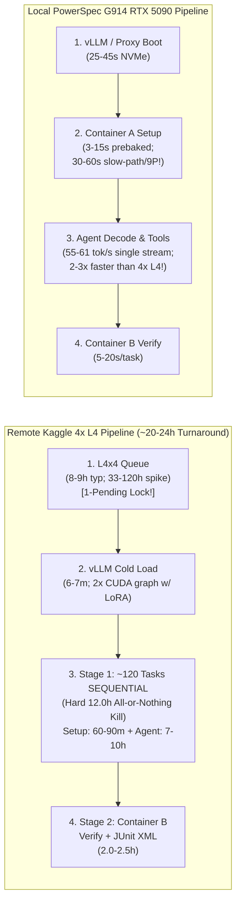

# Task 2: Wall-Clock Bottlenecks (RTX 5090 vs. Kaggle 4× L4), BCF Brain Tuning-Lever Impact–Effort Analysis & High-Velocity Iteration Strategy

*Research scope: Complete wall-clock timing anatomy across local PowerSpec G914 RTX 5090 testing and remote Kaggle 4× L4 submissions, followed by a line-level tuning-lever inventory and Impact–Effort ranking of the current BCF v1/v2 brains (`deliverables/2026-11-20_BCF_Gemma4_Winning_Design/`), and a concrete multi-tier fast-iteration workflow that systematically eliminates every identified time bottleneck.*  
*As of: 2026-11-21 | Grounded In: `HARNESS_README.md`, `tools/gemma4-swe-kit` (`timing.py`, `harness.py`, `logstats.py`, `replay/`), BCF v1 & v2 implementations (`agent.yaml`, `eval_config.yaml`, `sub_agents/*.yaml`, `prompts/*.md`, `bcf.py`, `install.py`), PowerSpec G914 / RTX 5090 benchmarks, and Kaggle Discussion telemetry through Thread `#760595`.*

---

## Executive Summary

Wall-clock time is the **binding competitive constraint** of the Gemma 4 Developer Agent competition—not raw model IQ. On Kaggle's remote 4× NVIDIA L4 scorer, a single submission incurs **20–24 hours of total turnaround** (~8–9h queue wait + ~9–10h Stage 1 execution under a **hard all-or-nothing 12-hour kill switch** + ~2–2.5h Stage 2 verification, `#760471`), locked behind a **one-pending-submission gate** (`400 FAILED_PRECONDITION`). Inside Stage 1, **76% of agent wall time is pure token decode** at just **17.25–35 tok/s** (4× L4 GDDR6 + TP=4 PCIe all-reduce), whereas your local PowerSpec G914 **RTX 5090 (32 GB GDDR7, 1,792 GB/s)** decodes Gemma 4 31B W4A16 at **55–61 tok/s** (~1.8×–2.4× faster per stream!). That asymmetry creates two opposite hazards: locally, slow feedback comes from uncached sandbox setup, WSL2 9P I/O, and running full 129-task sweeps sequentially; remotely, over-budgeted thinking tokens, LoRA TPS overhead (`-10% to -25%`), rejected edit loops, and compaction resets silently drive 120-task runs past 12 hours into `Notebook Timeout` (`0.00`).

Auditing the current BCF v1 and v2 brains exposes **18 concrete, file-level tuning levers**. The top-ranked high-impact / low-effort wins—deployable immediately before the **Nov 25 notebook-publishing freeze**—are: (1) promoting **v2 Zero-Skill Monolith** as the primary safe submission while gating v2-Skill behind a live canary; (2) adding a **new-file creation recipe / `bcf.py create`** (currently missing after v2 dropped `write_file`, affecting 11/129 tasks); (3) patching **`bcf.py` `cmd_verify` / `cmd_patch`** edge bugs (uncaught smoke-import timeout, non-zero exit masking, EOF newline handling, worktree path consistency); (4) adding **visible-text state checkpoints & anti-retry circuit breakers** to survive 14,336-token compaction and `edit_file` loops; and (5) executing a **5-tier fast-iteration pyramid** (`<3s` CPU preflight -> `2m` `g4kit-fake-llm` -> `5m` `g4kit-replay` -> `20m` `smoke_12` -> `60m` sharded `dev_30` + `holdout_rich` with `g4kit-scorer-time` projection) to test 10–15 hypotheses per day locally before committing a single precious 24-hour Kaggle slot.

---

## Subtask 2a: End-to-End Wall-Clock Bottleneck Analysis (Local RTX 5090 vs. Remote Kaggle 4× L4)

### 2a.1 End-to-End Pipeline Timing Anatomy

### 2a.2 Complete Bottleneck Inventory: Where Every Wall-Clock Second Goes

| # | Bottleneck Location & Stage | Local RTX 5090 (PowerSpec G914) Magnitude | Remote Kaggle (4× L4 Scorer) Magnitude | Exact Root Cause & Failure Mechanism |
| :---: | :--- | :--- | :--- | :--- |
| **B1** | **Submission Queue Wait & 1-Pending Gate** *(Pre-Stage 1)* | **0 s** (local GPU always owned) | **8–9 hours** typical (`#760471`); spikes **33–120 hours** (`#747519`, `#759630`) | Shared 4× L4 pool competing with 6,228 teams + ARC-AGI-2; Kaggle enforces `1 pending submission` (`HTTP 400 FAILED_PRECONDITION`), capping real LB feedback to **~1 run per 24h**. |
| **B2** | **vLLM Cold Startup & CUDA-Graph Capture** *(Stage 1 Boot)* | **25–60 s** (once per persistent daemon; keep server running across experiments!) | **6–7.2 min** (`431s` measured `#760140`) every single submission | Sharding weights across 4× L4 (`TP=4`), compiling FlashInfer/Marlin graphs; enabling `--enable-lora` doubles CUDA-graph capture and cuts KV cache to `0.76×` (`36,432 -> 27,712` tokens, `#744331`). |
| **B3** | **Container A/B Bootstrap & Dependency Install** *(Per-Task Overhead)* | **3–8 s/task** if `SWE_PREBAKED=1` + warm pool on ext4; **30–60 s/task** on un-prebaked slow path or WSL2 `/mnt/` 9P! | **30–45 s/task × 120 = 60–90 min** (excluded from `max_time_minutes`, **INCLUDED** in 12h wall clock!) | Tarball extraction (`snapshots/*.tgz`), `pip install -e /workspace --no-deps`, site-packages streaming, `setup.py`, `git commit baseline`. On WSL2 `/mnt/d`, 9P metadata overhead slows `git`/`tar`/`pip` by **5–15×**! |
| **B4** | **Autoregressive Token Decode Bandwidth** *(Inside Agent Loop — #1 Compute Cost)* | **55–61 tok/s** (31B W4A16, 4K–32K ctx on 1,792 GB/s GDDR7); **>140 tok/s** (E4B) | **17.25–35 tok/s** (31B W4A16 on 4× L4 300 GB/s/card + PCIe Gen4 TP=4 all-reduce; `#755291`, `#748287`, `timing.py` conservative fit `25.5 tok/s`) | **76% of agent wall time is pure decode** (`#755291`). Uncapped `thinking_budget=4096` + code restatement (`1,788 tok = 104s` single turn!) drains per-task budgets before any edit occurs. |
| **B5** | **LoRA Adapter Serving Tax** *(Inference Forward Pass)* | **-15% to -25% TPS** + higher VRAM pressure on 32 GB card | **-10% to -25% TPS**, **+29% task latency**, **+45% emitted tokens** (`#760309`, `#755677`) | Default unoptimized vLLM LoRA shrink kernels (`split_k=64`, `#751311`) + CUDA-graph specialization penalty. Even a **zero-weight LoRA lost `-7` tasks (`-5.43 pp`)** under a fixed time cap (`#760309`)! |
| **B6** | **Sequential 1-Task Execution & Event-Loop Blocking** *(Orchestrator)* | `--concurrency N` inside one `swegemma eval` process **blocks ALL concurrent tasks** whenever one `run_command` stalls (`#747168`)! | Strictly **1 task at a time** across ~120 tasks (`58` public + `~62` private, `#746008`, `timing.py`) | `swegemma`'s synchronous `run_command` blocks the asyncio loop (`#747168`). Locally, multi-process sharding (`--shard-index`/`--num-shards`) is required for real parallelism; remotely, sequential execution means every wasted minute compounds directly toward the 12h kill! |
| **B7** | **KV Prefix-Cache Invalidation & Prefill Recomputation** *(Multi-Turn Context)* | Severe under **Ollama raw mode** (`g4kit-proxy` cannot reuse sliding-window KV cache -> full prefill every turn!); minimal under native vLLM APC (`3,395 tok/s` prefill) | Triggered every **ADK Compaction** (`14,336` tokens), every **`SequentialAgent` stage handoff / nudge re-entry**, and every **LoRA adapter switch** (LoRA ID baked into KV hash) | Re-prefilling 16K–24K tokens on 4× L4 adds `4–10 s/call` (`#760309`). In `SequentialAgent`, continuation nudges re-enter `sub_agents[0]` (`bcf_plan`), burning an extra LLM turn and breaking KV prefix continuity (`#754636`). |
| **B8** | **Failed Tool-Call Retry Spirals (Unbudgeted Time Bleed!)** *(Tool Execution)* | Identical to remote (reproduces verbatim!) | **Catastrophic:** ADK-rejected calls (`edit_file` missing `old_string`, `#756051`) do **NOT** increment `tool_calls`, so they loop **27–51×** until wall-clock timeout! | Gemma 4 backtick swallowing (`#756051`, 15–43% `edit_file` failure rate) + E4B verbatim retries (75% of failed edits, `#756433`). Each failed call burns 15–45s of decode time without tripping `max_tool_calls`. |
| **B9** | **Shell & Test-Suite Execution Stalls** *(Inside Container A)* | Bare `pytest` runs 60–300s; `2 vCPU` Docker quota slows heavy test collection | Same (`2 vCPU`, `4 GiB` RAM, `timeout_seconds` cap); plus **600s HTTP read timeout** if vLLM array parser freezes (`#753973`) | Running un-targeted `pytest` instead of `pytest <single_file> -k <expr> --maxfail=3` burns 1–5 min per verification cycle; piping `pytest \| tail` hides failures and forces extra cycles (`#760595`). |
| **B10** | **Stage 2 Phase-2 Verification & Scoring** *(Post-Stage 1)* | **5–25 s/task** (`~15–35 min` for 129 tasks sequentially; `~4–8 min` across 4 parallel CPU workers!) | **2.0–2.5 hours** (`#760471`) | Fresh Container B spin-up, 4-pass patch apply, test reset, `test_patch` apply, and full target `pytest` + JUnit XML validation across ~120 tasks. |

> [!WARNING]
> **The RTX 5090 Speed Illusion (Critical Calibration Trap):** Because your RTX 5090 decodes 31B W4A16 at **~55–61 tok/s** versus Kaggle 4× L4's **~25.5 tok/s** conservative rate (a **~2.2× speed factor**), a local run with `max_time_minutes: 4.75` actually gives the agent the equivalent of **~10.5 Kaggle scorer minutes**! Without scaling local time caps (`--time-scale 0.45–0.55`) or running `g4kit-scorer-time --cap-minutes 4.75`, local tests will **hide** 12-hour Kaggle timeouts!

---

## Subtask 2b: BCF Brain Tuning-Lever Analysis (Impact–Effort Matrix & Ranked Backlog)

### 2b.1 Complete Architectural Map of Adjustable BCF Junctures

Every tunable surface in the current BCF implementations (`deliverables/2026-11-20_BCF_Gemma4_Winning_Design/v1/` and `v2/`) falls into **six control layers**:

1. **Layer 1 — Topology & Tool-Surface Architecture** (`agent.yaml`, `sub_agents/*.yaml`): Monolithic `LlmAgent` vs. `SequentialAgent(bcf_plan -> solver)`, attached tool set (`run_command`, `read_file`, `edit_file`, `get_status`, `submit_patch`, `skills:`), and array-arg schema exposure.
2. **Layer 2 — Operational Budgets & Safety Ceilings** (`eval_config.yaml`): `timeout_seconds`, `max_tool_calls`, `max_time_minutes`, `max_turns` (governing both `<12h` worst-case survival and the `budget_warning` trigger at `max_tool_calls >= 20`).
3. **Layer 3 — Generation & Reasoning Controls** (`generate_content_config` in `agent.yaml` / `sub_agents/*.yaml`): `temperature`, `top_p`, `top_k`, `max_output_tokens`, `thinking_config.thinking_budget`, `include_thoughts`, `presence_penalty`, `frequency_penalty`.
4. **Layer 4 — Prompt Engineering & Behavioral Contracts** (`prompts/system.md`, `prompts/bcf_plan.md`, `prompts/solver.md`, `skills/bcf-spec/SKILL.md`): First-edit commitment rule, new-file creation protocol, retry circuit breaker, visible-text compaction anchors, anti-early-quit verification loop, spec-change heuristics, and zero-fenced-shell prose binding.
5. **Layer 5 — Deterministic Offline Brain Code (`skills/bcf-spec/scripts/bcf.py` & `install.py`)**: 21-subcategory keyword/AST classifier (`SUBCATEGORY_RULES`), BM25 + AST + lexical locator (`locate_candidates`, `k1`/`b`, symbol/path weights, test discovery), bounded reader (`cmd_read` 120L/6000c cap), patcher (`cmd_patch`, `cmd_patch_multi`, missing `cmd_create`, EOF newline guard), and mechanical verifier (`cmd_verify`, `_check_scope_warnings`, timeout handling, exit-code contract).
6. **Layer 6 — Optional Model-Weight Adaptation (`adapters/`)**: Strictly gated PEFT LoRA (`r=8..32`) or analytical weight edits (e.g., `per_layer_model_projection` copy-fix)—ONLY if wall-clock-adjusted EV beats the `-10% to -25%` vLLM LoRA TPS tax!

### 2b.2 Scored Impact–Effort Tuning-Lever Matrix (Ranked #1 to #18)

*Scoring Scale:* **Impact (1–5):** `5` = prevents catastrophic `0.00`/timeout or lifts `>= +2.0` tasks/58; `4` = `+1.0 to +2.0` tasks/58 or major reliability gain; `3` = `+0.5 to +1.0` tasks/58; `2` = `+0.2 to +0.5`; `1` = marginal/exploratory. **Effort (1–5):** `1` = `<30 min` YAML/prompt edit; `2` = `1–3 h` Python script edit + unit tests; `3` = `0.5–1 day` controlled local A/B sweep; `4` = `2–3 days` architecture/tool redesign; `5` = `3–7 days` GPU training/data pipeline. **Priority Ratio** = `(Impact^2) / Effort` (rewarding high-impact surgical wins while penalizing multi-day low-EV bets right before the Nov 25 freeze!).

| Rank | Lever ID & Name | Exact File / Juncture in BCF | Concrete Adjustment / Hypothesis | Impact (1–5) | Effort (1–5) | Priority Score | Risk / Tradeoff |
| :---: | :--- | :--- | :--- | :---: | :---: | :---: | :--- |
| **1** | **L1. Promote v2-Monolith as Primary Champion & Gate v2-Skill via Canary** | `v2/submission_*_monolith/` vs `v2/submission_*/` | Ship `submission_31b_monolith_v2.zip` and `submission_e4b_monolith_v2.zip` first; eliminate 100% of `#758547` skill-isolation `0.00`, `#753973` array-arg parser OOM, and `#760126` `SequentialAgent` LB divergence. Canary v2-Skill only after a safe score is banked! | **5** | **1** | **25.0** | Zero risk; loses `bcf.py` AST/BM25 card unless skill canary passes, which is mitigated by inline prompt workflow. |
| **2** | **L2. Add Safe New-File Creation Protocol & `bcf.py create`** | `prompts/system.md`, `prompts/solver.md`, `bcf.py` (`cmd_create`) | v2 removed `write_file`, and `bcf.py patch` rejects non-existent files—yet **11/129 tasks** create new `.py` files! Add `bcf.py create <path> <<'BCF_EOF'` (protected-path guard + `ast.parse`/`py_compile` rollback) AND explicit prose heredoc creation rule in Monolith `system.md`. | **4** | **1** | **16.0** | Very low; must strictly enforce protected-path guard so agent never creates `tests/` or `/workspace/tmp/`. |
| **3** | **L3. Add `edit_file` Retry Circuit Breaker + Heredoc Auto-Fallback** | `v2/*/prompts/system.md`, `v2/*/prompts/solver.md` | Directly counter `#756051` (51× retry loops) & `#756433` (75% verbatim E4B retries): *"If `edit_file` fails ONCE, NEVER repeat it—re-read target lines and apply via single-quoted Python heredoc (`python3 - <<'PY_EOF'`) with `ast.parse` rollback (or `bcf.py patch`)."* | **4** | **1** | **16.0** | Very low; eliminates unbudgeted wall-time bleed from ADK-rejected calls. |
| **4** | **L4. Harden `bcf.py` `cmd_verify` / `cmd_patch` / Worktree Path Bugs** | `v2/*/scripts/bcf.py:1004,1315,1365,1418`; `v2/*/prompts/solver.md:13-27` | Fix 5 concrete code bugs found in our audit: (1) wrap smoke-import `subprocess.run` in `try/except TimeoutExpired`; (2) return non-zero or print explicit `VERIFY_VERDICT=FAIL` on `IMPORT_FAIL`/`PYTEST_EXIT!=0`/untracked files; (3) unquote `git status --porcelain` paths; (4) ensure newline before EOF append in `cmd_patch`; (5) use `$(git rev-parse --git-dir)/bcf/bcf.py` consistently in `solver.md`. | **4** | **1** | **16.0** | Zero risk; strictly improves reliability and eliminates silent `cmd_verify` crashes/false-OKs. |
| **5** | **L5. Add E4B Anti-Early-Quit Verify-and-Repair Loop** | `v2/submission_e4b_monolith/prompts/system.md`, `v2/submission_e4b/prompts/solver.md` | Counter `#758969` (E4B quits after ~1.8m) & `#760595` (6/12 broken edits submitted despite seeing `SyntaxError`!): mandate `"NEVER call submit_patch while py_compile, import, or /tmp/repro.py fails; fix and re-run at least once unless budget_warning fires."` | **4** | **1** | **16.0** | Low; avoid time-floor bans ("don't submit for 3m" dropped E4B to `0.01` in `#758969`!). Gate strictly on *verification failure*, not clock! |
| **6** | **L6. Visible-Text Compact State Anchoring (Compaction Immunity for Monolith)** | `v2/submission_31b_monolith/prompts/system.md` | In Monolith, there is no `{bcf_spec}` system-instruction anchor. Instruct the agent to keep a **2-line visible plan header** *only on pure-analysis turns* or before major edits (verify via `g4kit-proxy` against `#744844` text+tool-call template bug!), ensuring `LlmEventSummarizer` retains edited files & test state if 14,336-token compaction fires! | **4** | **2** | **8.0** | Medium: MUST test rendered chat template with `g4kit-assets` so visible text + tool call never triggers the `#744844` turn-header bug! |
| **7** | **L7. Calibrate `thinking_budget` & `max_output_tokens` on Paired Panels** | `agent.yaml`, `sub_agents/*.yaml` (`thinking_budget`, `max_output_tokens`, `temperature`) | Sweep **31B**: `think ∈ {1024, 1536, 2048}` × `temp ∈ {0.15, 0.25, 0.4}` (note `#746250` saw 51/129 at `temp=0.4` vs 48 at `0.2`, and `#759329` saw fewer timeouts at lower think!); **E4B**: `think ∈ {0, 512, 768, 1024}` with `max_output_tokens=4096` and `include_thoughts=true` (`#760014`). | **4** | **2** | **8.0** | Low; directly trades decode latency against reasoning depth; measure with `g4kit-scorer-time`! |
| **8** | **L8. Optimize `eval_config.yaml` Per-Task Time/Call Tradeoff** | `v2/*/eval_config.yaml` (`max_time_minutes`, `max_tool_calls`, `timeout_seconds`, `max_turns`) | Current caps (`4.75m`/`28` calls 31B; `4.25m`/`26` calls E4B) guarantee `<12h` at 100% timeouts (`11.12h`/`10.10h`), yet `#746250` showed `25` calls lost 14 tasks vs `50`, while typical tasks finish in `1.8–2.5m`! Test `max_tool_calls ∈ {28, 36, 42}` + `max_time_minutes ∈ {4.75, 5.25, 5.50}` ONLY if `g4kit-scorer-time` proves **95th-percentile 120-task runtime `<= 10.5h`**! | **4** | **2** | **8.0** | **High timeout risk** if `max_time_minutes > 5.0` without empirical P95 verification; never push worst-case expected `H_120 > 10.8h`! |
| **9** | **L9. Embed Compact 6-Archetype Meta-Checklist in Monolith `system.md`** | `v2/submission_31b_monolith/prompts/system.md` | Monolith `system.md` currently lacks the high-yield Python 3.13 trap checks from Task 1 (e.g., `partial` before `unwrap`, `isclass` before `__call__`, `isinstance or hasattr` for proxies, `UnionType`, `deepcopy` on shared dicts, `.getlist()` unwrap, `hasattr` before `loop_last`). Adding a tight 6-bullet (~150-token) checklist transfers BCF's Task 1 RCA into the zero-skill champion! | **4** | **2** | **8.0** | Low; keep under ~180 tokens on 31B and omit/compress to 3 bullets on E4B to avoid prompt bloat (`#758969`, `#760014`). |
| **10** | **L10. Upgrade `bcf.py` Test-File Discovery & AST Call-Graph Neighbors** | `v2/*/scripts/bcf.py:locate_candidates` (lines 753–891) | Improve `bcf.py` locator (currently lexical/BM25 + top-level AST defs): add lightweight stdlib AST **importer/caller cross-referencing** (`ast.ImportFrom` + `ast.Attribute`/`ast.Call` scan) to surface sibling files & test files importing the target module directly (lifting multi-file recall on unseen repos without the 5.8 KB graph-tool noise!). | **3.5** | **2** | **6.1** | Low; keep execution strictly `< 1.0s` on 500-file repos. |
| **11** | **L11. Upgrade `bcf.py` Issue Classifier (65.9% -> 80%+ Domain-General)** | `v2/*/scripts/bcf.py:SUBCATEGORY_RULES` & `classify_issue` (lines 75–641) | Fuse **extracted exception classes** (`TypeError`, `BrokenPipeError`, `RecursionError`, `ValidationError`) and **matched AST/file traits** (`has_async`, `has_getattr`, `has_dataclass`, `has_regex`) into `classify_issue()` rather than keyword text alone—improves classification on the 34 sparse/URL-only prompts! | **3** | **2** | **4.5** | Low; strictly repo-agnostic (no repo/PR names!). |
| **12** | **L12. Refine Monolith Inline Patcher Snippet (`python3 - <<'PY_EOF'`)** | `v2/*/prompts/system.md` | Give a concise 1-sentence prose template for safe atomic Python edits (read lines -> assert anchor -> `ast.parse` -> write -> `py_compile`) so Gemma 4 emits syntactically valid heredoc patchers on first try when backticks appear in target code (`27/129` tasks!). | **3.5** | **2** | **6.1** | Low; keep strictly prose-bound (ZERO triple-backtick `bash` blocks!). |
| **13** | **L13. Add `bcf.py diff-check` / Pre-Submit Hygiene Gate** | `v2/*/scripts/bcf.py:cmd_verify` | Add automated check in `verify` that: (1) prints diff line count (`+add/-rem`), (2) flags accidental edits to `pytest.ini`/`conftest.py`, (3) checks for debug `print(` left in diff, and (4) checks `git diff --check` for whitespace/conflict markers. | **3** | **2** | **4.5** | Zero risk; prevents empty/dirty/broken patches. |
| **14** | **L14. Controlled `AgentTool` (`skip_summarization: true`) Read-Only Explorer Arm** | Optional v3 experimental arm (`sub_agents/locator.yaml`) | Test wrapping read-only file search inside an `AgentTool` (`skip_summarization: true`) per `HARNESS_README` §10.4 to keep noisy `read_file` tokens out of root context—**strictly gated** because sub-agent sessions NEVER compact (`g4kit-proxy` saw 3/5 losses from sub-agent 32K overflows!) and `#760126` flagged multi-agent LB divergence. | **3** | **3** | **3.0** | **High risk** (sub-agent 32K HTTP 400 wipes patch!); cap sub-agent `max_output_tokens=2048` and `max_turns<=6` if tested. |
| **15** | **L15. Add `bcf.py spec` Auto-Repro Skeleton / Before-After Baseline Check** | `v2/*/scripts/bcf.py` | Remember `#760014` Finding 4: forcing E4B to write a failing repro *first* **hurt** (`6.0 -> 3.5` on dev subset!). Keep repro-first optional on E4B (post-edit repro only!), while testing baseline-vs-post-edit delta check strictly on **31B** via clean `git show HEAD:<file>` comparison (NEVER `git stash pop`, `#760595`!). | **2.5** | **2** | **3.1** | Medium: can backfire on E4B if mandatory; apply selectively to 31B only. |
| **16** | **L16. Zero-Weight & Analytical SVD Copy-Fix LoRA Gate (E4B Only)** | `adapters/copyfix_lora/` (`per_layer_model_projection`, `#753277`, `#759848`) | **Pending Host Ruling (`#759848`, `#756792`)!** Analytical rank-128 SVD adapter (3.4 MB) targeting E4B dropped-character copies (`+3` tasks claimed in `#759848`, null in 1 noisy run `#760595`). **DO NOT submit** until (a) host approves non-gradient SVD adapters AND (b) local wall-clock-capped A/B proves net gain exceeds `-10% to -25%` LoRA TPS tax! | **2.5** | **3** | **2.1** | **Rule-compliance risk** (unanswered `#759848`) + LoRA TPS tax (`#760309`). |
| **17** | **L17. On-Policy Rejection-Sampled / Thought-Preserved LoRA (31B / E4B)** | `adapters/solver_lora/` (r=16, `q/k/v/o/gate/up/down_proj`) | Only if trained on **100% thought-preserved** (`<\|channel>thought...<channel\|>`) native trajectories (`#758968`, `#751596`) using `g4kit-render-distill --encoding single` and proven to beat base by **`>= +5.4 pp` under identical wall-clock caps** (`#760309`). | **3** | **5** | **1.8** | **Very high risk/effort**: 4 independent teams (`#751596`, `#758968`, `#760014`, `#760309`) lost to pure base! Deprioritize before Dec 2 unless local CV clears `+3` clean tasks on unseen holdout. |
| **18** | **L18. `ParallelAgent` Multi-Branch Exploration** | `agent.yaml` (`agent_class: ParallelAgent`) | **DO NOT BUILD:** Confirmed broken with tool calls on pinned ADK `1.36.1` (`adk-python#7324`, `#748287`), and staff ruled out ADK v2 migration. | **1** | **4** | **0.25** | Fatal crash / broken tool execution on competition ADK `1.36.1`. |

---

## Subtask 2c: High-Velocity Iteration & Feedback-Loop Strategy (Mitigating Every Bottleneck)

To break the `0.24` (31B) and `0.12` (E4B) ceilings in the **11 days remaining before Dec 2 (and 4 days before the Nov 25 publishing freeze)**, you must **decouple hypothesis testing from the 24-hour Kaggle queue** and from slow full-129-task sweeps.

### 2c.1 The 5-Tier Fast-Iteration Testing Pyramid

| Tier | Tooling / Split | Wall-Clock Time (RTX 5090) | Bottlenecks Eliminated | What Hypotheses It Decides | Promotion Gate to Next Tier |
| :---: | :--- | :---: | :--- | :--- | :--- |
| **Tier 0: Static & Unit Preflight** | `validate_and_package_bcf_v2.py` + `pytest` on `bcf.py` + `g4kit-assets check` | **< 3 seconds** (CPU only) | B1, B2, B3, B4, B10 (zero GPU, zero Docker!) | ZIP layout, single-model check, non-null `eval_config`, zero fenced-bash, ADK `file_path`, stdlib-only, `bcf.py` classifier/locator/patcher/verifier correctness. | **100% PASS (0 errors, 0 `SyntaxWarning`)** |
| **Tier 1: Zero-GPU Harness Plumbing Smoke** | `g4kit-fake-llm` + `g4kit-harness run --n 1` | **15–45 seconds** (CPU only) | B1, B2, B4 (no LLM GPU load!) | End-to-end ADK YAML compilation, `eval_config.yaml` parsing, compaction config wiring, per-agent sampling params, tool-result single-JSON encoding, `submit_patch()` diff extraction. | **100% PASS** (exact expected per-agent `max_output_tokens`, `thinking_budget`, `tools`) |
| **Tier 2: Decision-Point Replay Micro-Bench** | `g4kit-replay` over logged `proxy_full.jsonl` failure states (`N = 6` samples/context) | **3–8 minutes** (persistent vLLM server) | B1, B2, B3, B9, B10 (zero Docker containers, zero multi-turn rollout!) | Prompt rewrites (prose vs fenced shell, retry circuit breaker, edit-format reliability, `thinking_budget` truncation, `temp` sweeps) directly on real failure contexts with **paired sign tests**! | Statistically significant drop in malformed calls / failed edits / truncation (`p < 0.05` on paired sign test) |
| **Tier 3: Stratified Rapid Dev (`smoke_12` -> `dev_30`)** | `g4kit-harness run` (persistent vLLM + prebaked Docker + **2–3 OS-level sharded processes**) + `g4kit-log-stats` + `g4kit-scorer-time` | **`smoke_12`: 8–15 min**; **`dev_30`: 25–45 min** (2× sharded) | B1, B2 (persistent server!), B3 (`SWE_PREBAKED=1`), B6 (multi-process sharding avoids event-loop block `#747168`!) | End-to-end solve rate on clean gold-passable tasks, failure-funnel shifts, compaction/overflow counts, and projected 4× L4 120-task runtime `H_120`. | Zero HTTP 400 overflows, `H_120 <= 11.0h`, AND `>= +2` paired wins on `dev_30` (or `+1` win + measurable mechanism improvement) |
| **Tier 4: Locked Unseen Holdout (`holdout_rich_35`) + Multi-Run Confirmation** | `2×` paired runs on locked `Textualize/rich` clean tasks (zero prompt tuning on holdout!) + optional `OOD-C` (`#758821`, 186 external OSS tasks!) | **1.5–2.5 hours** (overnight unattended batch) | B1 (still zero Kaggle queue!), overfitting to `fastapi`/`requests`, and $\sigma \approx 1.5$ single-run noise! | **True unseen-repository generalization** + multi-run mean & paired McNemar significance before spending a 24-hour Kaggle slot! | Beats current champion on **BOTH** `dev_30` AND `holdout_rich` (averaged over 2 runs) with `H_120 <= 11.2h` |
| **Tier 5: Kaggle 4× L4 Live Canary & Championship Submission** | Upload validated ZIP -> submit to Kaggle | **20–24 hours** (1 slot/day) | N/A (final ground truth) | Live 4× L4 scorer parity (`SequentialAgent` / skill mount canary, private+public `<12h` completion, timestamp tie-break lock-in!). | Bank safe score (`>= 0.24` 31B, `>= 0.13` E4B) before Nov 25 / Dec 2! |

### 2c.2 Six Concrete Anti-Bottleneck Engineering Tactics for the PowerSpec G914

1. **Keep vLLM Running as a Persistent Background Service Across Experiments (Kills B2):** Never restart vLLM between prompt/config iterations! Start one persistent `vllm serve` (or `g4kit-proxy`) instance on `127.0.0.1:8000` (31B or E4B) and point `g4kit-harness run --api-base http://127.0.0.1:8000/v1` at it across 20+ back-to-back experiments, saving `30–60s` per run and warming prefix caches automatically.
2. **Pre-Bake the Docker Sandbox Image (`SWE_PREBAKED=1`) & Warm-Pool Containers on Native ext4 (Kills B3):** Baking the Tier A + Tier B supplemental wheels into `swebench-sandbox:latest` on native ext4 (WSL2 VHDX ext4 or Zorin OS 18 NVMe ext4) cuts per-task container setup from `30–60s` down to **`3–8s`**, saving **40–80 minutes** per 100-task sweep!
3. **Use OS-Level Process Sharding (`--shard-index k --num-shards M`), NOT High `--concurrency` in One Process (Kills B6):** Because `swegemma`'s `run_command` blocks the asyncio event loop (`#747168`), running `--concurrency 4` inside a single Python process freezes all 4 tasks whenever one `pytest` stalls. Instead, launch **2–3 separate OS processes** (sharding `task_idx % M == k`) against the single vLLM server—leveraging your Ryzen 9 9950X3D's 16 cores / 32 threads and 64 GB RAM while vLLM continuous-batches 2–3 streams cleanly!
   - *Timing Calibration Warning:* When running 2–3 concurrent local processes, always compute scorer-projected wall time via **`g4kit-scorer-time`** (from `completion_tokens`, which is invariant to local batching slowdown!) rather than raw local wall clock.
4. **Use `g4kit-replay` & Glassbox Trajectory Forking (`#758817`) for Rapid Prompt Tuning (Kills B3, B4, B9, B10):** Instead of re-running a 4-minute full episode to test whether a prompt change prevents `edit_file` backtick corruption or malformed shell-command tool names, capture 15–30 real failure contexts once in `proxy_full.jsonl` and replay **only that single turn** `N = 6` times per prompt variant with `g4kit-replay`. One full A/B takes **3–5 minutes** with statistically powered paired sign tests!
5. **Run CPU-Only Patch Re-Verification Separately When Tuning Verifiers/Selectors:** Separate patch generation from Phase 2 `verify_task` when iterating on offline `bcf.py` localization or `setup_local.py` pin rules—CPU-only verification across 129 cached patches runs in **`<5 minutes`** across 8 CPU cores on the 9950X3D!
6. **Maintain a Strict One-Variable-Per-Arm Discipline with Automated Run Logs:** Log every Tier 2–4 run into an append-only `experiment_ledger.jsonl` recording `(git_sha, arm_name, split, resolved_clean, resolved_cap_4xL4, H_120, empty_patch_rate, broken_edit_rate, malformed_calls, overflows, notes)`. Never bundle 4 unverified changes into one Kaggle submission; ship atomic verified deltas so you always know what moved the needle.

---

## Open Questions & Sources

- **Open Question — Exact Scorer Concurrency & Container Reuse State:** While `timing.py` and `#746008` establish sequential 1-task execution on Kaggle's 4× L4 scorer, exact container-setup time on private repos (which may have larger tarballs or heavier C extensions than FastAPI/Rich) can vary from `20s` to `60s` per task. BCF therefore budgets a conservative `45s–60s/task` setup allowance (`90–120 min` across 120 tasks).
- **Sources:** `HARNESS_README.md` (§3, §4, §7, §8); `tools/gemma4-swe-kit/` (`README.md`, `timing.py`, `harness.py`, `logstats.py`, `proxy/context.py`, `proxy/budget.py`); `deliverables/2026-11-20_BCF_Gemma4_Winning_Design/` (`v1/`, `v2/`, `02_BCF_Brain_Design_Winning_Strategy_and_Pitfalls.md`); RTX 5090 31B W4A16 benchmarks (`presenc.ai`, `spheron.network` — 55–61 tok/s decode, 3,395 tok/s prefill, 1,792 GB/s GDDR7); Kaggle Intel Threads `#744331`, `#746008`, `#746250`, `#747168`, `#747519`, `#748287`, `#751311`, `#751596`, `#753973`, `#754636`, `#755291`, `#755677`, `#756051`, `#756433`, `#758547`, `#758817`, `#758969`, `#759630`, `#760014`, `#760126`, `#760140`, `#760309`, `#760471`, `#760595`.
