# Task 1: End-to-End Wall-Clock Time Bottlenecks — Local RTX 5090 Workstation vs. Remote Kaggle Scorer

> **Scope**: Identifies, localizes, and quantifies every wall-clock latency bottleneck across (A) local development and benchmarking on the **RTX 5090 (`32 GB GDDR7`, WSL2 Ubuntu 24.04)** and (B) remote submission, queueing, inference, and grading on **Kaggle's 4× NVIDIA L4 (`96 GB GDDR6`, PCIe Gen 4 TP=4)** infrastructure.  
> **Grounded Sources**: `swegemma 0.2.11` (`HARNESS_README.md`), `adk-submission 0.2.13`, `google-adk 1.36.1`, Official vLLM & NVIDIA Blackwell (`sm_120`) / Ada (`L4`) Documentation, and Kaggle Discussion Threads `#747519`, `#751311`, `#757893`, `#758547`, `#758954`, `#758972`, `#759580`, `#760014`, `#760140`, `#760309`, `#760471`, `#760595`.

---

## Executive Summary

Wall-clock time kills SWE-agent progress in two completely different ways:
1. **Locally on the RTX 5090**, naive execution of `40_local_eval.py` over all 129 public tasks takes **6.5 to 11.0 hours per run**—not because the RTX 5090 is slow at token generation (`1,792 GB/s` GDDR7), but because **55%–70% of local wall-clock time is burned outside useful reasoning**: vLLM cold restarts (`3–7 min` each), running 38 locally un-gradable tasks (`1.5–3.1 hours` dead loss), unfiltered `pytest` suite runs (`45–90s` each), WSL2 `/mnt/` 9P or Windows Defender `ext4.vhdx` I/O stalls, and hidden synchronous ADK `LlmEventSummarizer` compaction calls (`15–35s` per trigger).
2. **Remotely on Kaggle**, every submission faces a **20-to-24-hour click-to-score feedback cycle** (`8–9h` L4 queue wait + `6–11h` Stage-1 inference + `2–2.5h` Stage-2 verification, Thread `#760471`) compounded by a **1-pending-submission lock** (`HTTP 400 FAILED_PRECONDITION`), a **1.6×–1.8× per-session hardware slowdown ($k$)** on PCIe-bound 4× L4 GPUs relative to a single Blackwell GPU (`#758954`), and a **hard 12.0-hour cliff** where exceeding `720` minutes forfeits the entire run with zero partial score (`#759388`).

---

## 1. End-to-End Pipeline & Bottleneck Localization Map

```mermaid
flowchart TB
    subgraph Local5090["A. Local Workstation Pipeline (Ryzen 9 9950X3D + RTX 5090 32GB + WSL2)"]
        L_FS["[B-L1 / B-L2] WSL2 Filesystem & Defender Filter<br/>/mnt/d 9P bridge (10-30x slow) vs ~/g4 ext4.vhdx"]
        L_BOOT["[B-L4 / B-L5] vLLM Cold Start on sm_120<br/>Weight load + torch.compile + CUDA graphs (180-420s)"]
        L_VRAM["[B-L6 / B-L7] 32GB VRAM Pinch (31B = ~19GB)<br/>KV cache preemption & Marlin W4A16 batch flip"]
        L_SETUP["[B-L8] Per-Task Sandbox Setup (x2 per task)<br/>Snapshot untar + pip install -e + baseline git commit"]
        L_LOOP["[B-L9..B-L12] Agent Turn Loop + ADK Compaction<br/>LlmEventSummarizer stall (15-35s) + full pytest + 38 ungradable tasks"]
        L_FS --> L_BOOT --> L_VRAM --> L_SETUP --> L_LOOP
    end

    subgraph RemoteKaggle["B. Remote Kaggle Pipeline (4x L4 PCIe TP=4 + Docker 2 vCPU / 4 GiB)"]
        R_PKG["[B-R1] Notebook Save & Zip Export (3-15m)<br/>Avoid running inference during commit!"]
        R_Q["[B-R2 / B-R3] 4x L4 Queue Backlog (8-9h avg)<br/>1-Pending Lock blocks all new submissions!"]
        R_INIT["[B-R5 / B-R6] 4x L4 vLLM Init (~431s) + LoRA Tax<br/>TP=4 CUDA graph capture + 15-29% LoRA TPS loss"]
        R_TP["[B-R4 / B-R7] Stage 1 Inference (120 tasks, <12.0h hard cliff)<br/>PCIe Gen4 TP=4 all-reduce (1.6-1.8x slower) + array parser hang risk"]
        R_VER["[B-R8..B-R10] Container A/B 2-vCPU Throttle + Stage 2 Grade (2-2.5h)<br/>Total turnaround: 20-24 hours per experiment"]
        R_PKG --> R_Q --> R_INIT --> R_TP --> R_VER
    end
```

---

## 2. Local RTX 5090 Harness Bottlenecks (`B-L1` through `B-L12`)

### 2.1 Master Local Bottleneck Inventory & Latency Impact

| ID | Pipeline Stage | Exact Technical Bottleneck | Measured / Expected Time Cost | Root Mechanism |
| :--- | :--- | :--- | :--- | :--- |
| `B-L1` | **WSL2 Storage I/O** | Reading snapshots, repos, or venvs across `/mnt/c` or `/mnt/d` (**Plan 9 / 9P protocol**) | `+15–45s` per task (`+3–5h` / 129 tasks) | Every Python `stat()`, `open()`, `git add`, and `.tgz` untar serializes across the Windows NTFS $\leftrightarrow$ Linux VM boundary (`10×–30×` metadata slowdown vs native `~/g4` on `ext4.vhdx`). |
| `B-L2` | **Windows Host AV** | **Windows Defender (`MsMpEng.exe`)** scanning `ext4.vhdx` block I/O synchronously | `+20–50%` I/O latency on `pytest` & untar | Unpacking 129 snapshots and importing hundreds of `.py` modules inside WSL triggers host-side real-time filter driver scans on `%LOCALAPPDATA%\Packages\...\ext4.vhdx` unless excluded. |
| `B-L3` | **Sandbox Runtime** | **Docker Desktop VM** vs. native WSL Ubuntu Docker Engine vs. `SubprocessSandbox` | `+8–20s` per container × 258 containers (`+35–85m`) | Docker `Container A` + `Container B` creation/overlayfs mount/teardown runs **twice** per task (`258` lifecycles on 129 tasks); `SubprocessSandbox` on `tmpfs` (`/dev/shm`) cuts setup to `<2s`. |
| `B-L4` | **vLLM Cold Start** | Reloading `VllmServer` inside `40_local_eval.py` on every smoke test | **`180–420s` (`3–7 min`) per script launch** | `40_local_eval.py` starts and stops `VllmServer` inside `try/finally` on every invocation—paying 18 GB weight load + `torch.compile` + CUDA graph capture even for a 1-task `60s` test! |
| `B-L5` | **Blackwell `sm_120`** | PyTorch / FlashInfer JIT kernel compilation & `sm_120a` / CDI race conditions | `60–240s` first-run JIT; crash risk if uncached | Uncached Triton/FlashInfer kernels recompile if `~/.cache/vllm` or `TORCHINDUCTOR_CACHE_DIR` is wiped; targeting `120a` instead of `FLASHINFER_CUDA_ARCH_LIST=12.0f` causes illegal-instruction faults. |
| `B-L6` | **32 GB VRAM Pinch (`31B`)** | **KV-Cache Starvation & Preemption** on single 32 GB GPU with `31B` W4A16 | `2×–4×` latency spikes when KV swaps/recomputes | `Gemma 4 31B` W4A16 weights (`~18.5 GiB`) + CUDA graphs/activations (`~3.0 GiB`) leave only **`~5.7 GiB` KV cache** at `--gpu-mem 0.85` (`27.2 GiB`). Enabling `max_loras=8, max_lora_rank=128` or running `--concurrency > 2` exhausts KV blocks and stalls decoding! |
| `B-L7` | **Batch Compute Flip** | **`compressed-tensors` W4A16 Marlin** on-the-fly int4 unpacking under concurrency | `35–55%` per-session TPS drop at batch $\ge 4$ | At batch `1–2`, RTX 5090's `1,792 GB/s` GDDR7 flies (`~75–110 tok/s` on 31B; `~220+ tok/s` on E4B). At high concurrency, int4$\to$bf16 dequantization saturates ALU pipes (`#758954`). |
| `B-L8` | **Container Bootstrap** | `extract_snapshot` + `pip install -e /workspace --no-deps` + wheel streaming + `git commit` | `8–18s` × 2 phases = `16–36s` per task (`~45–75m` / 129) | `container_setup.py` runs 7 sequential setup steps before `Container A` AND repeats all 7 fresh in `Container B` (`HARNESS_README.md` §4.2). |
| `B-L9` | **In-Loop `pytest`** | Unscoped `pytest` runs, `timeout_seconds: 300`, and `sandbox/setup.py` version-pin bugs | `30–90s` per unscoped test call; `300s` on hangs | Running `pytest` on whole `tests/` folders collects 2,500+ tests (truncating summaries at `5,000` chars `#760595`); `timeout_seconds: 300` lets a single hung socket eat the entire task budget. |
| `B-L10` | **Ungradable Dev Tasks** | Evaluating **38 broken/missing-dep local tasks** + **11 unsolvable tasks** (`#760595`) | **`95–190 min` (`1.6–3.2h`) wasted per 129-task sweep** | Locally in `subprocess` mode, 30 FastAPI tasks lack `inline-snapshot`/`dirty-equals`, 8 Requests tasks lack `httpbin` (`#760595`), and `sandbox/setup.py` installs `Starlette 1.6.0` over `<1.0` pins (`local-eval-env-root-causes.md`). |
| `B-L11` | **ADK Compaction Stall** | **Synchronous `LlmEventSummarizer` LLM call** on `EventsCompactionConfig` trigger | **`15–35s` blocking stall every 5 turns** once $>14,336$ tok | When history crosses `token_threshold=14336`, Google ADK pauses the agent turn to run a full `LlmEventSummarizer` prompt+generation pass on the same GPU (`HARNESS_README.md` §7.2)! *(Note: `40_local_eval.py` line 170 used `compaction_interval=15` while scorer uses `5`!)* |
| `B-L12` | **Reasoning & Nudges** | Unbounded `thinking_budget: 4096` + `SequentialAgent` nudge restarts (`#754636`) | `+35–120s` per task (`+40%` failure rate on E4B `#760014`) | Long thinking chains bloat prefill length quadratically across turns, trigger compaction earlier, and hit `MAX_TOKENS` (causing continuation nudges that restart `sub_agents[0]`). |

---

## 3. Remote Kaggle Submission & Scorer Bottlenecks (`B-R1` through `B-R10`)

### 3.1 Why 4× NVIDIA L4 (`96 GB`) Is `1.6×–1.8×` Slower Per Session Than 1× RTX 5090 (`32 GB`)

A critical mistake teams make (`Alex Ust`, `#758954`) is assuming that because Kaggle provides **four** GPUs (`96 GB` total VRAM vs. `32 GB` on one RTX 5090), the remote scorer will run at least as fast as a local workstation. Hardware physics dictates the exact opposite:

| Hardware Parameter | Local 1× RTX 5090 (`TP=1`) | Kaggle Scorer 4× NVIDIA L4 (`TP=4`) | Wall-Clock Consequence |
| :--- | :--- | :--- | :--- |
| **Architecture & TDP** | Blackwell (`sm_120`), `575 W` | Ada Lovelace (`sm_89`), `4 × 72 W = 288 W` | L4 clocks throttle aggressively under sustained 10-hour thermal/power envelopes. |
| **VRAM Bandwidth** | **`1,792 GB/s`** (512-bit GDDR7) | `4 × 300 GB/s = 1,200 GB/s` aggregate GDDR6 | Even with ideal scaling, 4× L4 has **33% less raw memory bandwidth** than a single RTX 5090. |
| **Inter-GPU Interconnect** | **Zero** (`TP=1` stays 100% on-die) | **PCIe Gen 4 x16 (`~32 GB/s` unidirectional, NO NVLink!)** | Across `Gemma 4 31B`'s 60 transformer layers, `TP=4` executes **120 PCIe all-reduce synchronizations per generated token**! |
| **Container CPU Allocation** | up to `24` Zen 5 X3D threads (`5.7 GHz`) | **`2 vCPUs` (`cpu_quota=200_000`) + `4 GiB RAM`** | Inside Container A/B, `bcf.py` AST indexing (`1.1s` locally) and `pytest` collection take **`2.5×–3.5×` longer** on Kaggle. |
| **Net Speed Factor ($k$)** | **`1.00×` Baseline** | **`k = 1.60× – 1.80×` Slower Wall-Clock** | A task taking `3.0 min` on RTX 5090 takes **`4.8 – 5.4 min`** on the Kaggle scorer (`project_12h.py`). |

### 3.2 Complete Remote Kaggle Bottleneck Breakdown

| ID | Remote Stage | Typical Duration | Worst-Case / Failure Mode | Impact on Iteration Velocity & Score |
| :--- | :--- | :--- | :--- | :--- |
| `B-R1` | **Submission Notebook Commit** | `3 – 15 min` | `9+ hours` if user accidentally runs local eval inside `Save & Run All`! | Pure packaging notebooks (zipping `submission/` only) finish in `<3 min` on CPU without touching weekly GPU quota. |
| `B-R2` | **4× L4 Hardware Queue Wait** | **`8.0 – 9.0 hours`** (`#760471`) | `38 – 110 hours` during cluster outages (e.g., Nov 9 batch `#759630`) | Finite L4 pool × 6,228 teams × 9–10h average runs creates an unavoidable multi-hour queue before `inference.py` even starts. |
| `B-R3` | **1-Pending-Submission Lock** | Blocks until `B-R2` + `B-R4` + `B-R10` finish | **`20 – 24+ hours` total slot lockout** (`HTTP 400 FAILED_PRECONDITION`) | You **cannot** enqueue tomorrow's submission while yesterday's is still queued or running (`#760471`). Slow 11.5h bundles effectively cut your remaining submission opportunities in half! |
| `B-R5` | **Scorer vLLM Cold Start** | **`~431 seconds` (`7.2 min`)** (`#760140`) | `>1,200s` engine startup timeout if LoRA/CUDA graph OOMs | Measured on Kaggle 4× L4 (`TP=4`, `max_model_len=32768`, `vLLM 0.19.1`): fixed 7.2-minute tax before Task #1 begins. |
| `B-R6` | **LoRA Serving Overhead (`--enable-lora`)** | **`+15% to +29%` per-task duration** | `-7 tasks` (`57/129 -> 50/129`) on a **zero-B LoRA** (`#760309`)! | Default unoptimized `NVIDIA_L4` `split_k=64` Triton LoRA shrink kernel (`#751311`, `#759514`) lowers TPS from `53` to `41 tok/s` and adds non-deterministic atomic-add variance! |
| `B-R7` | **`gemma4` Array Parser Infinite Loop** | Instant worker freeze $\to$ **12h timeout** | `0.00` / `Error` on the entire 120-task submission (`#759580`, `#753973`) | Unpatched `gemma4_tool_parser.py` spins infinitely on `args: ["..."]` in `run_skill_script` or `get_code_subgraph`. |
| `B-R8` | **2-vCPU / 4-GiB Container Sandbox** | `+10–25s` per task on `pytest` & git | Exit code `137` (`SIGKILL` OOM) if parallel test workers exceed `4 GiB` | Never run `pytest -n auto` inside Container A (`4 GiB` ceiling OOMs); always run single-process targeted `pytest <single_test_file> -q`. |
| `B-R9` | **Stage-1 12.0-Hour Hard Cliff** | `5.5 – 11.1 hours` (BCF) vs `12.0h+` (naive) | **Total loss of submission** (`Notebook Timeout` = no score `#759388`) | Any bundle whose `max_time_minutes` > `6.5m` (31B) risks crossing `12.0h` when $k=1.7\times$ scorer slowdown hits hard unseen repos (`Alex Ust` 8-min bundle timed out). |
| `B-R10` | **Stage-2 Container B Grading** | **`2.0 – 2.5 hours`** (`#760471`) | Truncated JUnit XML if stdout > `10 MiB` (`#757893`) | Runs *after* the 12h inference stage to score `submission.parquet` across ~120 tasks, adding another 2–2.5 hours before your score posts. |

---

## 4. Key Bottleneck Synthesis: Where Time Actually Goes

Comparing a **Naive Workflow** against the **BCF Optimized Workflow** illustrates why addressing these 22 bottlenecks is the foundation for every score improvement in Tasks 2–5:

| Metric | Naive Competitor Workflow | BCF Optimized Workflow | Wall-Clock Speedup |
| :--- | :--- | :--- | :--- |
| **1-Task Local Prompt/Script Tweak (RTX 5090)** | `6.5 min` (`300s` vLLM restart + `90s` run) | **`35 – 55 sec`** (Persistent vLLM daemon + `/dev/shm` sandbox) | **`7.5× – 11×` faster** |
| **Mechanism Check Across Categories (RTX 5090)** | `8.5 hours` (all 129 tasks incl. 38 broken) | **`11 – 16 min`** (`Canary-12` clean gradable panel, `--concurrency 2`) | **`32× – 46×` faster** |
| **Statistically Powered A/B Eval (RTX 5090)** | `8.5 hours × 2 = 17.0 hours` | **`32 – 45 min`** (`Dev-30` paired McNemar panel + SPRT early stop) | **`23× – 32×` faster** |
| **Kaggle Stage-1 Scorer Runtime (120 Tasks)** | `9.5 – 12.4 hours` (high timeout & 24h slot lock) | **`~5.8h` (`31B`) / `~3.8h` (`E4B`)** (`GREEN` on `project_12h.py` @ $k=1.7$) | **`~40%` faster + `0%` timeout risk** |
