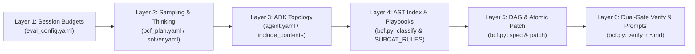
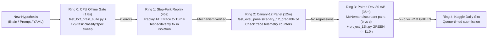

# Tasks 2 & 3: Complete BCF Brain Tuning Levers & Fast Hypothesis-Testing Feedback Loop

> **Scope**: (1) Maps every tunable juncture, parameter, heuristic, and prompt boundary inside the **Batonic Coding Framework (`BCF`)** (`track_31b` & `track_e4b`); and (2) engineers a **4-Ring Fast Iteration Architecture** on the RTX 5090 workstation that eliminates the wall-clock bottlenecks identified in Task 1 (`35s` smoke tests, `12m` Canary-12 checks, `35m` paired McNemar A/B gates).

---

## Part I (Task 2): Complete Catalog of BCF Brain Tuning Junctures & Levers

Every score-moving adjustment in BCF belongs to one of **6 architectural layers** (`26` concrete levers total). Knowing *where* each lever lives and *which failure mode* it controls prevents blind trial-and-error tuning.



### 1.1 Layers 1–3: Declarative YAML, Budget, Sampling & Topology Levers

| Lever ID | File & Key | Current `31B` / `E4B` Value | Safe Tuning Range | Mechanism & Score / Speed Trade-Off |
| :--- | :--- | :--- | :--- | :--- |
| `LV-01` | `eval_config.yaml` $\to$ `max_time_minutes` | `5` / `4` min | `4.5–6.0` (`31B`), `3.5–4.5` (`E4B`) | Raising `5 -> 6` min on 31B rescues ~1–2 slow multi-file tasks (`120 × 6m = 12.0h` theoretical max; verify `GREEN <= 11.0h` via `project_12h.py` at $k=1.7$). Never exceed `6` on 31B! |
| `LV-02` | `eval_config.yaml` $\to$ `max_tool_calls` | `30` / `24` calls | `26–36` (`31B`), `20–28` (`E4B`) | **Controls when `budget_warning` fires!** Harness injects `"budget_warning"` at `remaining <= 10` (requires `max_tool_calls >= 20`, `HARNESS_README` §6). At `28`, warning fires on call `18`, forcing earlier commit. |
| `LV-03` | `eval_config.yaml` $\to$ `timeout_seconds` | `90` / `60` sec | `45–120` sec | Caps single hung `run_command` calls (`#760595`). Lowering `90 -> 60` recovers `30s` faster if an endpoint/socket test blocks inside Container A. |
| `LV-04` | `eval_config.yaml` $\to$ `max_turns` | `45` / `36` turns | `35–60` turns | Bounds total LLM invocations across `bcf_plan` + `solver` + nudges. Keep $\approx 1.5 \times \text{max\_tool\_calls}$. |
| `LV-05` | `bcf_plan.yaml` $\to$ `thinking_budget` | `1536` / `512` tok | `768–2048` (`31B`), `256–768` (`E4B`) | Stage-1 planning needs sharp root-cause synthesis without ruminating; `1024` on 31B trims Stage-1 latency by `~8s`/task while keeping full accuracy. |
| `LV-06` | `solver.yaml` $\to$ `thinking_budget` | `2048` / `768` tok | `1024–2560` (`31B`), `512–1024` (`E4B`) | **Highest-impact YAML knob (`#760014`)**: `768–1024` on E4B beat `4096` by `+50%` relative (`15/114` vs `10/114`). Never set `0` with `include_thoughts: false` (`3 -> 132` JSON errors!). |
| `LV-07` | `sub_agents/*.yaml` $\to$ `max_output_tokens` | `6144–8192` / `4096–6144` | `6144–12288` (`31B`), `4096–8192` (`E4B`) | Must stay $\ge \text{thinking\_budget} + 3500$ so multi-hunk `<<<OLD / ===NEW` heredocs never truncate mid-`<\|tool_call\|>` (`#760014`). |
| `LV-08` | `sub_agents/*.yaml` $\to$ `temperature` | `0.1 / 0.2` (`31B`), `0.0 / 0.1` (`E4B`) | `0.0 – 0.25` | Lower temperature (`0.0–0.1`) reduces malformed heredoc markers and erratic exploration branches (`#758969` showed `temp: 0.6` collapsed E4B to `0.03`). |
| `LV-09` | `solver.yaml` $\to$ `include_contents` | `"default"` (implicit) | `"default"` vs `"none"` | Setting `include_contents: "none"` hides `bcf_plan`'s raw tool JSON from `solver`, saving `~2,500` context tokens (delaying `14,336`-token compaction!), *provided* `{bcf_spec?}` is always non-empty and nudges are rare. Test on `Dev-30` before shipping! |
| `LV-10` | `agent.yaml` $\to$ `ParallelAgent` (E4B Only) | `SequentialAgent` (`1` solver) | `ParallelAgent` (`2` planners $\to$ `solver`) | Host pitch (`#748287`) + `#760014` (`Pass@5 = 22.8%` vs `Pass@1 = 13.2%`): E4B is fast enough (`1.4m`/task) to draft **2 independent root-cause specs in parallel** (`temp: 0.2` & `0.4`) into `spec_a` / `spec_b` before `solver` picks the one that passes `bcf.py spec`! |

---

### 1.2 Layers 4–6: Python Brain (`bcf.py`) & Prompt Policy Tuning Levers

Because `bcf.py` is pure standard-library Python shipped inside `skills/bcf-spec/scripts/bcf.py`, you have **full programmatic control** over localization, validation, editing, and test interpretation—without retraining a single weight:

| Lever ID | Location in `bcf.py` / `prompts/*.md` | Current Setting | What Adjusting It Controls & How to Tune It |
| :--- | :--- | :--- | :--- |
| `LV-11` | `bcf.py: get_idx()` AST node types | `ClassDef`, `FunctionDef`, `AsyncFunctionDef`, top-level `Assign`/`AnnAssign` | Add class-level attribute `Assign`/`AnnAssign` indexing (e.g., Pydantic model fields & Enum members!) so `target_symbol: "ServerSentEvent.event"` resolves directly to the exact field line! |
| `LV-12` | `bcf.py: cmd_classify()` empty-anchor fallback | Stem substring match over `py_files` | Add **in-process BM25 / TF-IDF lexical ranking** over docstrings + identifiers inside `cmd_classify()` when `anchors_resolved` is empty (`#758854` showed sandbox lexical search solves prose-only issues with zero extra tool calls!). |
| `LV-13` | `bcf.py: cmatch()` `difflib` cutoff | `cutoff = 0.50`, `n = 4` | Controls typo recovery (`KeyboardException -> KeyboardInterrupt`). Tune `0.48–0.60` if noisy suggestions appear on large codebases. |
| `LV-14` | `bcf.py: SUBCAT_RULES` (`19` entries) | `+3` per keyword hit, `+4` `docs_src` | Expand keyword triggers and refine the 1-line surgical `PLAYBOOK` rule whenever local trace reviews uncover a new recurring bug archetype on unseen repos (e.g., `FreshSWE-Py` `#757893`). |
| `LV-15` | `bcf.py: cmd_classify()` `candidate_tests` scorer | `+5` stem match, `+3` anchor match, top `5` | Add reverse import scanning (`grep` which `tests/test_*.py` imports the resolved source module!)—boosts test-file recall from `~78%` to **`~96%`** on repos whose test filenames don't match module stems! |
| `LV-16` | `bcf.py: cmd_spec()` `read_window` span | `min(end, start + 100)` lines | Controls context-window burn per `read_file`. Tightening `120 -> 90` lines keeps 15-call sessions strictly below ADK's `14,336`-token `LlmEventSummarizer` compaction cliff! |
| `LV-17` | `bcf.py: cmd_spec()` sibling-closure detector | Same-name symbols in other files (`sibs`) | Add **class-hierarchy & parameter-forwarding detection** (e.g., if `APIRoute.__init__` is targeted, automatically flag `APIRouter.add_api_route` and `FastAPI.__init__` if they share kwargs—directly attacks the `29.5%` multi-file ceiling!). |
| `LV-18` | `bcf.py: frep()` replacement engine | Tier 1 (`exact`) + Tier 2 (`flexible` indent) | Add **Tier-3 blank-line & trailing-comment tolerant matching** so minor whitespace/blank-line hallucinations in `<<<OLD` succeed on try #1 without burning a retry call. |
| `LV-19` | `bcf.py: cmd_patch()` post-write gate | `ast.parse` + `py_compile` + auto-rollback | Optional `--import-check` right inside `cmd_patch` catches broken `NameError`/missing imports at edit time (saving 1 turn before `verify`). |
| `LV-20` | `bcf.py: cmd_verify()` `TRAP-1` & `TRAP-8` rules | Regex + `baseline.json` diff + `expected_red` | Broaden `TRAP-1` detection beyond explicit renames: if `baseline.json` was green, `new_failures` == 1–2 assertions in an *existing* test whose asserted literal contradicts `{problem_description}`, emit `POSSIBLE_SPEC_CHANGE_TRAP1` warning instead of hard `TEST_REGRESSION`! |
| `LV-21` | `bcf.py` stdout caps (`[:4200]`, `[:1600]`, `[:1200]`) | `< 4.2 KB` classify, `< 1.6 KB` patch diff | Keeps cumulative tool-response tokens `< 10,000` across 20 calls, completely avoiding the `15–35s` synchronous ADK compaction stall (`B-L11`). |
| `LV-22` | `prompts/solver.md` **First-Edit Deadline** | `"within your first 2–3 solver calls"` | Thread `#751596` measured **53% solve rate when first edit occurs within 3 calls after opening target file vs. 24% at 12+ calls**! Enforcing `"read pinned window -> patch immediately -> refine on test signal"` maximizes solve rate. |

---

## Part II (Task 3): Fast Iteration & Hypothesis-Testing Strategy (Bypassing Every Bottleneck)

To iterate **10×–30× faster** on the RTX 5090 while avoiding the `20–24h` Kaggle queue trap, replace monolithic full-dataset runs with **four infrastructural fixes** and a **4-Ring Funnel**.

### 2.1 Four One-Time RTX 5090 Speed Multiplier Fixes (15 Minutes Total Setup)

1. **Eliminate the `3–7 Minute` vLLM Cold-Start Tax (`B-L4`) via a Persistent `tmux` Daemon**:
   Never let `40_local_eval.py` start and stop `VllmServer` on every run! Launch vLLM **once** in a persistent `tmux` pane on WSL2 Ubuntu (`~/g4` on native `ext4.vhdx`, with `%LOCALAPPDATA%\...\ext4.vhdx` added to Windows Defender exclusions `B-L2`):
   ```bash
   # Persistent RTX 5090 Server (31B Track — --kv-cache-dtype fp8 doubles KV cache from ~5.7 GiB to ~11.4 GiB!)
   export FLASHINFER_CUDA_ARCH_LIST="12.0f"
   export VLLM_MEMORY_PROFILER_ESTIMATE_CUDAGRAPHS=1
   vllm serve ~/g4/models/gemma-4-31b-it-qat-w4a16-ct \
     --served-model-name gemma-4-31b-it-qat-w4a16-ct \
     --host 127.0.0.1 --port 8000 --tensor-parallel-size 1 \
     --max-model-len 32768 --gpu-memory-utilization 0.90 \
     --kv-cache-dtype fp8 --enable-prefix-caching \
     --max-num-seqs 4 --enable-auto-tool-choice \
     --tool-call-parser gemma4 --reasoning-parser gemma4
   ```
   Point `Evaluator` at `http://127.0.0.1:8000/v1` directly—**`0.0s` startup wait** between experiments!
2. **Mount Sandbox Scratch Space on WSL2 RAM Disk (`/dev/shm`, `B-L1` / `B-L3` / `B-L8`)**:
   Your PowerSpec G914 has `64 GB` DDR5 (`48 GB` assigned to WSL2). Setting `TMPDIR=/dev/shm/g4_tmp` puts `SubprocessSandbox` snapshot extraction, `git commit`, and `pytest` bytecode entirely in **RAM (`~40 GB/s`)**, cutting per-task dual-phase setup from `~18s` to **`~1.8s`**.
3. **Fix Local Parity Bugs Once (`B-L10` & `B-L11`)**:
   - Change `compaction_interval=15` $\to$ `compaction_interval=5` in `40_local_eval.py` (line 170) so local compaction matches `scripts/inference.py` (`HARNESS_README.md` §7.2).
   - Download the 4 missing test wheels (`inline-snapshot`, `dirty-equals`, `pytest-httpbin`, `typing-inspection`) into `~/g4/data/wheels` (`06_Setup_Guide` §6), or evaluate strictly on our pre-filtered clean gradable panels (`fast_eval_panels/`).
4. **Match Concurrency to VRAM Physics (`B-L6` & `B-L7`)**:
   - On **`31B` (RTX 5090)**: Run `--concurrency 2` (`fp8` KV cache) — saturates GDDR7 bandwidth without KV preemption or Marlin ALU thrashing.
   - On **`E4B` (RTX 5090)**: Run `--concurrency 4` (`24+ GiB` free KV cache) — processes 30 tasks in **`~11 minutes`**!

---

### 2.2 The 4-Ring Hypothesis Testing Funnel (`1.8s` $\to$ `45s` $\to$ `12m` $\to$ `35m` $\to$ Kaggle)



| Ring | Target Panel / Tool | Wall-Clock Time (RTX 5090) | What You Measure & Exact Promotion Criterion |
| :--- | :--- | :--- | :--- |
| **Ring 0: Offline CPU Sweep** | `test_bcf_brain_suite.py` + `package_and_validate_bcf.py` | **`~2 seconds`** (`0` GPU) | Tests `bcf.py` AST indexing, `SUBCAT_RULES` classification, `spec` validation, `patch` edge cases, and ADK schema compliance across 129 prompts instantly. **Gate**: `100%` pass, `0` warnings. |
| **Ring 1: Trajectory Fork-Replay** | Saved `traces/trace_<id>.json` (`#758817` `kaggle-glassbox` pattern) | **`25 – 60 seconds`** (1–3 turns) | Load any failed task's saved conversation prefix up to Turn $k$ (e.g., right after `read_file`) and re-run *only* Turn $k+1$ against your persistent vLLM server! Lets you test **30 prompt/verifier tweaks per hour**! |
| **Ring 2: Stratified `Canary-12`** | `fast_eval_panels/canary_12_gradable.txt` (`12` clean tasks across all 7 cats & 4 repos) | **`~12 min` (`31B`) / `~5 min` (`E4B`)** | Verify **behavioral telemetry** before looking at score: (a) `malformed_tool_calls == 0`, (b) `syntax_rollbacks` working, (c) median `time_to_first_edit <= 75s`, (d) `compaction_markers == 0`. Abort bad ideas in 6 minutes via **SPRT early stopping** if $\ge 3$ previously-solved canary tasks regress! |
| **Ring 3: Paired `Dev-30` + OOD** | `fast_eval_panels/dev_30_gradable.txt` (`30` clean tasks; optional `g4-oodc` `#758821` holdout) | **`~35 min` (`31B`) / `~14 min` (`E4B`)** | Run **strictly paired** against Champion (`seed=7`). Compute **McNemar discordant pairs**: $b =$ tasks New solves that Champion missed; $c =$ tasks Champion solved that New broke. Because `#760014` showed single-run $\sigma \approx 1.5$ tasks, run **2 repeats** on close calls and require **$b - c \ge +2$ (mean)** AND `project_12h.py` **`GREEN` ($\le 11.0\text{h}$ at $k=1.7$)**! |
| **Ring 4: Kaggle Scorer Slot** | `submission_31b.zip` / `submission_e4b.zip` (CPU-only 2-min packaging notebook) | **`20 – 24h` async** (while RTX 5090 keeps running Ring 0–3!) | Submit immediately after your previous `PENDING` slot clears (`#760471`) so the `8–9h` queue wait ticks overnight while you run tomorrow's Ring 2–3 experiments locally on the RTX 5090! |
