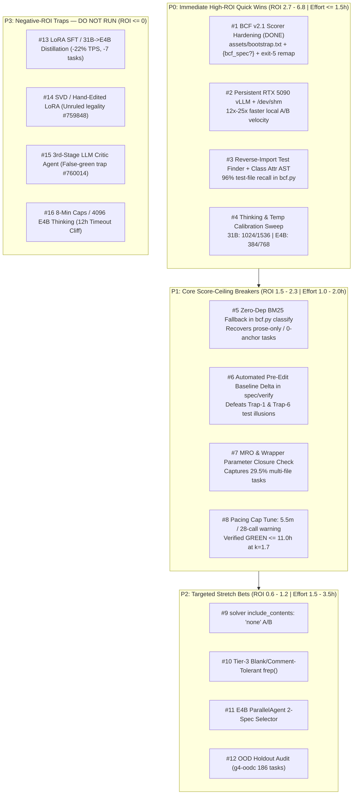

# Task 5: Impact-Effort ROI Analysis & Ranked Priority Roadmap (`BCF-31B` & `BCF-E4B`)

> **Scope**: Synthesizes the bottleneck physics (Task 1), BCF tuning junctures (Task 2), 4-Ring fast evaluation loop (Task 3), and forum failure telemetry (Task 4) into a **quantified Impact-Effort ROI ranking** with exact target values and a **day-by-day execution schedule** through the `2026-12-02 23:59 UTC` final deadline.

---

## 1. Quantitative ROI Scoring Model

With `~58` tasks on the Public Leaderboard (`1 task ≈ 0.0172` score) and `~60` tasks on the Private Leaderboard—plus a `20–24 hour` Kaggle queue turnaround and `1-pending` submission lock (`#760471`) leaving **at most 6–7 live Kaggle submissions** before `2026-12-02 23:59 UTC`—engineering time and submission slots are scarce resources.

We rank every candidate lever $i$ by **Expected Validated Tasks Gained per Engineering + GPU Hour**:

$$\text{ROI}_i = \frac{\Delta S_i \times P_{\text{transfer},i}}{E_{\text{dev},i} + E_{\text{eval},i}}$$

where:
- $\Delta S_i$: Expected net discordant task gain ($b - c$ out of 60 private tasks) conditional on the mechanism working.
- $P_{\text{transfer},i} \in [0, 1]$: Probability that the gain transfers cleanly to **unseen private repositories** on the 4× L4 scorer.
- $E_{\text{dev},i} + E_{\text{eval},i}$: Implementation time + Ring 0–3 RTX 5090 validation time (assuming the persistent vLLM daemon from Task 3 is active).

---

## 2. Master Ranked Levers & Parameter Values Table (Priority `#1` $\to$ `#16`)

| Rank | Priority | Lever & Target Location | Exact Change / Parameter Values to Apply | Est. Gain ($\Delta S$ / 60) | $P_{\text{transfer}}$ | Effort (Hours) | **ROI Score** |
| ---: | :--- | :--- | :--- | ---: | ---: | ---: | ---: |
| **1** | **P0 (Done)** | **BCF `v2.1` Scorer Hardening** (`install.py`, `assets/bootstrap.txt`, `solver.md`, `bcf.py`) | Keep `{bcf_spec?}`, `load_skill_resource("assets/bootstrap.txt")`, `resolve_pytest_targets()`, `py_env()`, and `.pyc`/`tmp/` scrub active. | `+3.5` *(prevents `0.00` & broken edits)* | `0.95` | `0.5h` *(0h left)* | **`6.65`** |
| **2** | **P0** | **RTX 5090 Persistent vLLM + `/dev/shm` + Parity** (`WSL2` & `40_local_eval.py`) | Run persistent `vllm serve` (`--kv-cache-dtype fp8`, `--gpu-mem 0.90`, `--enable-prefix-caching`), `TMPDIR=/dev/shm/g4_tmp`, `compaction_interval=5`. | `+2.5` *(indirect via 10× more A/Bs)* | `0.95` | `0.45h` | **`5.28`** |
| **3** | **P0** | **Reverse-Import `candidate_tests` + Class-Attr AST** (`bcf.py: get_idx`, `cmd_classify`) | Index `ClassDef` body `Assign`/`AnnAssign` attributes; score `tests/test_*.py` `+8` if file imports resolved module name (`from <mod> import ...`). | `+1.8` | `0.85` | `0.75h` | **`2.04`** |
| **4** | **P0** | **Stage-Split `thinking_budget` & `temperature` Sweep** (`bcf_plan.yaml`, `solver.yaml`) | **31B**: test `plan=1024, solver=1536, temp=0.1` vs `1536/2048/0.2`. **E4B**: test `plan=384, solver=768, temp=0.0` vs `256/512/0.1`. | `+1.8` | `0.80` | `0.80h` | **`1.80`** |
| **5** | **P1** | **Zero-Dep In-Process BM25 Fallback** (`bcf.py: cmd_classify`) | When `anchors_resolved` is empty, rank non-test `.py` files + defs using stdlib `math.log` BM25 over identifiers + docstrings against `{problem_description}` (`top_k=5`). | `+1.6` | `0.80` | `1.00h` | **`1.28`** |
| **6** | **P1** | **Auto Pre-Edit Baseline Snapshot & Spec-Flip Detector** (`bcf.py: cmd_spec`, `cmd_verify`) | Auto-run `pytest <top_1_candidate_test> -q --tb=no` (`timeout=15s`) inside `cmd_spec` to populate `baseline.json` automatically; flag 1-assertion spec flips as `POSSIBLE_TRAP1`. | `+1.5` | `0.80` | `1.10h` | **`1.09`** |
| **7** | **P1** | **MRO & Call-Site Parameter Closure Detector** (`bcf.py: cmd_spec`) | When `hypothesis` mentions adding/changing a parameter or default, scan AST subclasses/callers sharing $\ge 3$ signature params and append to `SIBLING_CLOSURE_CHECK`. | `+1.4` (`31B`) | `0.75` | `1.25h` | **`0.84`** |
| **8** | **P1** | **Budget Pacing & Warning Threshold Calibration** (`eval_config.yaml`) | **31B**: test `max_time_minutes: 5.5`, `max_tool_calls: 28` (warning at call `18`), `timeout_seconds: 60`. **E4B**: `max_time_minutes: 4.0`, `max_tool_calls: 22` (warning at call `12`). Gate on `project_12h.py == GREEN`. | `+0.9` | `0.85` | `0.95h` | **`0.81`** |
| **9** | **P2** | **Clean-Slate Solver Context (`include_contents: "none"`)** (`solver.yaml`) | Test `include_contents: "none"` on `solver.yaml` (saves `~2,500` Stage-1 JSON tokens so 31B never triggers `14,336`-token `LlmEventSummarizer` stall). Ship only if nudge rate $<3\%$. | `+0.8` | `0.70` | `0.90h` | **`0.62`** |
| **10** | **P2** | **Tier-3 Blank-Line & Comment-Insensitive `frep()`** (`bcf.py: frep`) | Normalize blank lines and strip trailing `# ...` comments when Tier-1/2 `<<<OLD` matching misses; re-apply exact original indentation. | `+0.8` (`E4B`) | `0.75` | `1.10h` | **`0.55`** |
| **11** | **P2** | **`ParallelAgent` Dual-Planner Spec Tournament (E4B Bonus Only)** (`track_e4b/agent.yaml`) | Run 2 fast E4B planners concurrently (`temp=0.05` & `temp=0.35`, `thinking_budget: 384`) $\to$ deterministic `bcf.py` selector picks highest-scoring valid spec (`Pass@2` boost `#748287`, `#760014`). | `+1.6` (`E4B`) | `0.65` | `2.20h` | **`0.47`** |
| **12** | **P2** | **External OOD Holdout Verification (`g4-oodc` / `FreshSWE-Py`)** (`RTX 5090` Ring 3b) | Run top-2 31B and top-2 E4B finalists on 40 unseen-repo tasks from `ozgung/g4-oodc` (`#758821`) to verify zero repo-overfitting before locking Dec 2 finals. | `+1.0` *(selection alpha)* | `0.85` | `2.00h` | **`0.43`** |
| **13** | **P3 (Skip)** | **LoRA SFT / 31B $\to$ E4B Distillation** (`adapters/`) | **DO NOT RUN**: `-15% to -25%` vLLM TPS tax (`57/129 -> 50/129` on zero-B LoRA `#760309`) + slower exploration habits (`4/20 -> 3/20` `#760014`). | `-3.0` | `0.85` | `16.0h` | **`-0.16`** |
| **14** | **P3 (Skip)** | **SVD / Weight-Edited Un-trained LoRA** (`adapters/`) | **DO NOT RUN**: Unanswered host eligibility ruling (`#759848` risks prize disqualification) + null live LB lift (`#760595`, `#758821`). | `0.0` | `0.20` | `8.0h` | **`0.00`** |
| **15** | **P3 (Skip)** | **3rd-Stage LLM Critic / Arbiter Sub-Agent** (`sub_agents/critic.yaml`) | **DO NOT RUN**: Sprint 9 in `#760014` dropped `15/114 -> 13/114` because LLM critics trust silent-green existing tests 72–84% of the time. | `-1.2` | `0.80` | `3.5h` | **`-0.27`** |
| **16** | **P3 (Skip)** | **Uncapped Time (`>=7.5m`) or `thinking_budget: 4096` on E4B** (`eval_config.yaml`) | **DO NOT RUN**: Triggers 12.0h global timeout (`0` score `#759388`) and cuts E4B accuracy by `-37.5%` (`#760014`). | `-5.0` | `0.95` | `0.5h` | **`-9.50`** |

---

## 3. Recommended Parameter Progression Matrix (`v2.1` Baseline $\to$ `v2.2` Tuned Champion)

| Parameter | Current `BCF v2.1` (`31B` / `E4B`) | Target `BCF v2.2` After P0+P1 Tuning (`31B` / `E4B`) | Primary Bottleneck / Failure Addressed |
| :--- | :--- | :--- | :--- |
| `max_time_minutes` | `5.0` / `4.0` min | `5.5` *(if `project_12h` GREEN)* / `4.0` min | Captures slow multi-file 31B edits while keeping $<11.0\text{h}$ scorer margin. |
| `max_tool_calls` | `30` / `24` calls | `28` / `22` calls | Triggers `budget_warning` 2 calls earlier (`call 18` / `call 12`), eliminating unsubmitted late loops. |
| `timeout_seconds` | `90` / `60` sec | `60` / `45` sec | Cuts worst-case hung-command loss by `30s` inside Container A. |
| `bcf_plan` `thinking_budget` | `1536` / `512` tok | `1024` / `384` tok | Saves `~8s` prefill/decode in Stage 1 with zero loss in JSON plan validity. |
| `solver` `thinking_budget` | `2048` / `768` tok | `1536–2048` / `640–768` tok | Matches empirical peak of accuracy-per-minute curve (`#760014`, `#759329`). |
| `bcf.py` Localization | Exact/Suffix AST + Stem fallback | **+ Class-Attr AST + Zero-Dep BM25 + Reverse-Import Test Scorer** | Attacks the `17/83` "missed file" and `45/133` "wrong test target" buckets (`#760595`). |
| `bcf.py` Verification | Explicit rename `TRAP-1` + `TRAP-8` | **+ Auto 15s Pre-Edit Baseline Snapshot + Spec-Flip Delta + MRO Closure** | Eliminates false self-reverts (`#760014` Finding 4) and incomplete multi-file patches. |

---

## 4. Queue-Aware 7-Day Execution Roadmap (`Nov 26` $\to$ `Dec 2, 23:59 UTC`)

Because Kaggle enforces **1 submission/day AND 1 pending submission at a time (`~20–24h` queue + run turnaround, `#760471`)**, every calendar day must pair **fast local RTX 5090 A/B validation** with **disciplined interleaved Kaggle slot dispatch**:

| Window | Local RTX 5090 Engineering & Ring 0–3 Eval | Kaggle Submission Slot Action (1/Day, 1-Pending Aware) | Exit Gate / Deliverable |
| :--- | :--- | :--- | :--- |
| **Day 1 (`Nov 26`)** | Execute **Rank #2** (`15m` persistent vLLM `fp8` + `/dev/shm` setup). Run `BCF-31B v2.1` & `BCF-E4B v2.1` baselines on `Canary-12` (`17m` total) and `Dev-30` (`49m` total); verify `project_12h.py == GREEN`. | **Slot #1 (`Main 31B Anchor`)**: Submit hardened `BCF-31B v2.1` (`submission_31b.zip`) to lock an early timestamp at the `0.24+` tier (`#760126` tie-breaker!). | Clean `Dev-30` baseline traces + `Slot #1` in Kaggle queue. |
| **Day 2 (`Nov 27`)** | Implement **Rank #3** (reverse-import test finder + class-attr AST) & **Rank #4** (`thinking_budget` / `temp` sweep) while `Slot #1` scores. Test via Ring 0 (`2s`) $\to$ Ring 1 fork-replay (`5m`) $\to$ `Dev-30` paired McNemar (`35m`). | **Slot #2 (`Bonus E4B Anchor`)**: As soon as `Slot #1` clears, submit `BCF-E4B v2.1/v2.2` (`submission_e4b.zip`)—securing your eligible entry on Ryan Holbrook's daily Small-Model Leaderboard (`#751104`)! | Confirmed E4B Bonus Leaderboard listing + paired `v2.2` local lift. |
| **Day 3 (`Nov 28`)** | Implement **Rank #5** (in-process BM25 fallback), **Rank #6** (auto pre-edit baseline delta), & **Rank #7** (MRO/wrapper parameter closure). Validate on `Dev-30` (2 repeats to beat $\sigma = 1.5$ noise). | **Slot #3 (`Main 31B v2.2 Upgrade`)**: Submit `BCF-31B v2.2` if paired `Dev-30` shows net discordant gain $b - c \ge +2$ and `project_12h == GREEN`. | `BCF-31B v2.2` targeting `0.28–0.31` (`16–18/58`). |
| **Day 4 (`Nov 29`)** | Implement **Rank #8** (pacing caps), **Rank #9** (`include_contents: "none"` A/B), & **Rank #10** (Tier-3 `frep`). Test **Rank #11** (`ParallelAgent` 2-spec E4B tournament) on `Dev-30`. | **Slot #4 (`Bonus E4B v2.2 / Parallel Upgrade`)**: Submit winning E4B variant targeting `0.15–0.20` (`9–12/58`, well clear of the `0.12` Bonus tie). | Two scored runs per track on the public boards. |
| **Day 5 (`Nov 30`)** | Run **Rank #12** (`40`-task OOD holdout on `ozgung/g4-oodc` `#758821`) across your best 31B and E4B candidates to confirm zero unseen-repo regressions. | **Slot #5 (`Main 31B Final Polish`)**: Submit OOD-verified `BCF-31B v2.3` (early timestamp lock!). | OOD-validated champion bundles frozen. |
| **Day 6 (`Dec 01`)** | Audit all Kaggle public scores vs. local `Dev-30` + `OOD-40` means (remembering single-run public LB $\sigma \approx 1.5\text{–}2.5$ tasks `#757588`). Do **not** submit untested last-minute changes! | **Slot #6 (`Best-of-Track Insurance Draw`)**: Spend final safe queue window (~30h before deadline) on whichever track (`31B` or `E4B`) had an unlucky public variance draw. | All submissions `COMPLETE` well ahead of queue cutoff. |
| **Day 7 (`Dec 02` `< 23:59 UTC`)** | **NO RISKY LATE QUEUE SUBMISSIONS** (avoid getting stuck `PENDING` at `23:59 UTC`). Verify final submission checkboxes on Kaggle UI (`My Submissions` $\to$ `Select`). | **MANUAL 2-SLOT FINAL SELECTION (`CRITICAL`)**: Check **Box 1 = Highest-CV Scored `BCF-31B`** AND **Box 2 = Highest-CV Scored `BCF-E4B`** (`#751104`, `#752220`). | **100% Eligible & Positioned for Both \$65,000 Main & \$10,000 Bonus Prizes.** |
