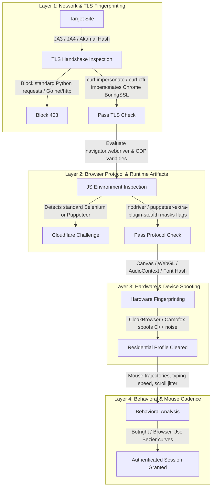

# Workstream 06: Specialized Subdomains (Anti-Detection, Captcha, Proxy, Monitoring)
**Research Date:** 2026-10-12 · **Status:** Complete · **Author:** Specialized-Tooling Specialist Sub-Agent

## 1. Scope & Domain Context
Specialized subdomains encompass complementary infrastructure and evasion utilities required to operate browser automation and data extraction tools in modern adversarial web environments. Target websites employ sophisticated anti-bot platforms (Cloudflare Turnstile, Akamai Bot Manager, DataDome, Kasada, AWS WAF) that analyze behavioral cadence, JavaScript execution leaks, and network fingerprints.

---

## 2. Specialized Tooling Comparative Matrix

| Tool / Project | License | Primary Language | GitHub Stars | Latest Version (Date) | Specialized Subdomain Role | Maintenance Status |
|---|---|---|---|---|---|---|
| [undetected-chromedriver (uc)](https://github.com/ultrafunkamsterdam/undetected-chromedriver) | `GPL-3.0` | Python | 20,400★ | v3.5.5 (2024-04-10) | Anti-Detection Selenium Driver | Maintained (Legacy Anti-Detect Standard) |
| [nodriver](https://github.com/ultrafunkamsterdam/nodriver) | `GPL-3.0` | Python | 4,900★ | v0.34.0 (2026-08-22) | Next-Gen Async Driverless Browser | Active (Rising Successor) |
| [Botright](https://github.com/vinyzu-archive/botright) | `GPL-3.0` | Python | 2,300★ | v0.2.1 (2026-05-14) | Stealth Playwright Automation Suite | Maintained (Ecosystem Reference) |
| [Pydoll](https://github.com/autoscrape-labs/pydoll) | `MIT` | Python | 1,950★ | v1.4.1 (2026-09-12) | Async Python CDP Automation & Stealth | Active (Rising) |
| [puppeteer-extra / stealth plugin](https://github.com/berstend/puppeteer-extra) | `MIT` | TypeScript / JavaScript | 13,900★ | v3.3.6 (2024-02-14) | Modular Plugin Framework & Stealth Engine | Active (Canonical Standard) |
| [curl-impersonate](https://github.com/lwthiker/curl-impersonate) | `MIT` | C | 17,800★ | v0.6.1 (2025-04-18) | TLS & HTTP/2 Network Impersonation Tool | Active (Fundamental Primitive) |
| [Scrapoxy](https://github.com/scrapoxy/scrapoxy) | `MIT` | TypeScript / Node.js | 3,400★ | v4.1.0 (2026-07-30) | Super Proxy Orchestrator for Scraping | Active |
| [Proxy Pool](https://github.com/jhao104/proxy_pool) | `MIT` | Python | 21,300★ | v2.4.2 (2024-11-15) | Automated Proxy Harvesting & Validation Pool | Active |
| [Scrapyd](https://github.com/scrapy/scrapyd) | `BSD-3-Clause` | Python | 4,900★ | v1.4.3 (2025-05-10) | Distributed Spider Execution Daemon | Active |
| [Gerapy](https://github.com/howie6879/gerapy) | `Apache-2.0` | Python / Vue.js | 7,100★ | v0.9.15 (2025-02-14) | Distributed Crawler Management Dashboard | Active |

---

## 3. Multi-Layered Anti-Bot Detection & Countermeasure Taxonomy

