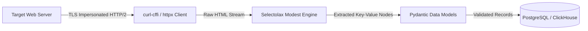
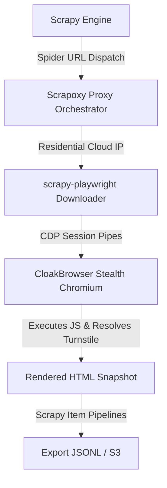
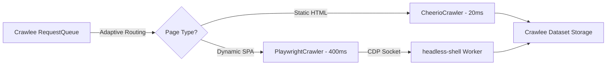
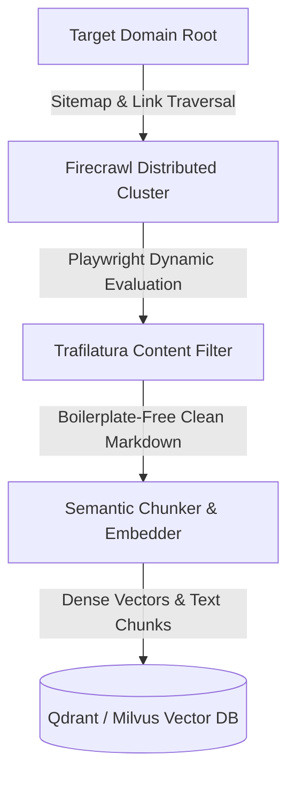
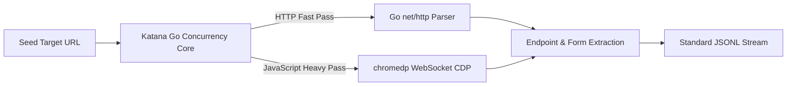

# Workstream 07: Ecosystem Stacks and Layered Dependencies
**Research Date:** 2026-10-12 · **Status:** Complete · **Author:** Stack Architect Sub-Agent

## 1. Scope & Objective
Modern web harvesting systems rarely operate in isolation. Production architectures compose multi-tiered toolchains that link HTTP engines, headless browsers, proxy orchestrators, and parser pipelines. This workstream documents five canonical architectural stacks covering common deployment scenarios in 2026.

---

## 2. Canonical Stack Architectures

### Stack A: Ultra-Fast Lightweight Python Scraping (No Browser Overhead)
- **Primary Use Case:** High-volume structured scraping of static or server-rendered sites (e.g., e-commerce, directory aggregators) at 1,000+ pages/minute.
- **Components:** `curl-cffi` / `httpx` (HTTP/2 + TLS Impersonation) + `selectolax` (High-speed C parser) + `Pydantic` (Schema validation).

### Stack B: Resilient Headless Python Automation with Stealth
- **Primary Use Case:** Scraping dynamic Single-Page Applications protected by modern Cloudflare Turnstile or DataDome challenges.
- **Components:** `scrapy` + `scrapy-playwright` + `CloakBrowser` / `Camofox` + `Scrapoxy` (Rotating proxy mesh).

### Stack C: Modern TypeScript / Node.js Crawling Suite
- **Primary Use Case:** Enterprise Node.js crawling workflows with built-in auto-retry queues and proxy switching.
- **Components:** `apify/crawlee` + `microsoft/playwright` + `Chrome for Testing (headless-shell)` + `cheerio`.

### Stack D: Web-to-LLM Autonomous Knowledge Harvesting
- **Primary Use Case:** Ingesting full corporate documentation sites or news properties into clean Markdown for RAG embedding.
- **Components:** `firecrawl/firecrawl` (or `unclecode/crawl4ai`) + `adbar/trafilatura` (Boilerplate removal) + `Ollama` / `vLLM` (Semantic enrichment).

### Stack E: High-Throughput Compiled Distributed Go Spider
- **Primary Use Case:** High-speed security reconnaissance, domain topology mapping, and asset discovery.
- **Components:** `projectdiscovery/katana` + `chromedp/chromedp` + `jhao104/proxy_pool`.

