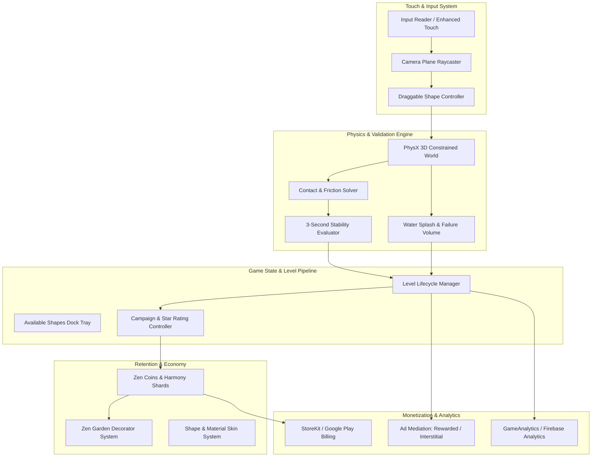

# Executive Summary & Hybrid-Casual Architecture: "Zen Stacker: Art of Balance"

## 1. Executive Summary & Vision Statement

### 1.1 High-Concept Pitch
**"Zen Stacker: Art of Balance"** is a modern, tactile hybrid-casual physics puzzler developed for iOS and Android in **Unity 6 (6.5 LTS)**. Reimagining the acclaimed WiiWare/Wii U/Switch physics classic *Art of Balance* by Shin'en Multimedia, the game transposes contemplative Zen aesthetics, intricate wooden and glass balance puzzles, and dynamic water physics into an accessible, one-handed mobile experience. 

Players are presented with an assortment of geometric shapes and must stack all pieces upon unstable platforms floating above tranquil pools of water. Once the final shape is released, a tense yet meditative **3-second stability countdown** begins. If the tower holds without a single block tumbling into the water, the puzzle is solved.

### 1.2 Market Positioning: The Hybrid-Casual Evolution
The casual mobile puzzle market has evolved rapidly from hyper-casual throwaway mechanics into sustainable, high-LTV **hybrid-casual** architectures. Pure hyper-casual stacking games suffer from punishing Day-7 retention drop-offs (<7%) and reliance on low-eCPM interstitial ad spam. Conversely, traditional puzzle games frequently introduce friction through overly complex rule sets.

"Zen Stacker" occupies the high-growth intersection between hyper-accessible tactile physics and deep mid-core meta progression:
1. **Hyper-Accessible Core**: Zero-text onboarding, intuitive one-finger drag-and-drop mechanics, immediate physical feedback, and bite-sized 45-to-90-second play sessions.
2. **Tactile Delight ("Juice")**: Real-time water ripples, authentic wood-clack audio, tactile haptic clicks on 45° rotation snapping, and dynamic glass cracking under excessive load.
3. **Mid-Core Progression Meta**: Progression currency earned from clearing stages is invested into the **Zen Garden Sanctuary**—a customizable 3D hub where players restore koi ponds, bonsai trees, stone lanterns, and shrines.
4. **Balanced Hybrid Monetization**: Non-intrusive rewarded video boosts (e.g., "Rewind Fatal Drop", "Zen Stabilizer"), capped interstitials, and cosmetic In-App Purchases (IAP) such as custom wood finishes, koi fish breeds, and an optional "Zen Pass" seasonal progression track.

---

## 2. Competitive Landscape & Target Benchmarks

### 2.1 Competitive Matrix

| Competitor / Benchmark | Primary Genre | Input / Control Paradigm | Physics Simulation Model | Meta Progression Layer | Primary Monetization | D1 / D7 Retention Benchmarks |
| :--- | :--- | :--- | :--- | :--- | :--- | :--- |
| **Art of Balance (Original WiiWare/Switch)** | Premium Console Physics Puzzle | Motion Pointer / Stylus / Analog Stick | 2.5D Planar PhysX-style Rigid Body | Linear World Progression | One-time Premium ($8.99 - $11.99) | N/A (Console Buy-to-Play) |
| **Blockudoku / Woodoku** | Casual Block Grid | 2D Drag-to-Grid | Grid Discrete (Non-Physics) | High-Score Leaderboards, Themed Journeys | Heavy Interstitials + Ad-Free IAP | D1: 42%, D7: 16% |
| **Jenga (Mobile)** | 3D Physics Puzzle | 3D Orbit & Tap-Drag | Full 3D Physics Rigid Body | Minimal Arcade Unlockables | Ads + Paid Upgrades | D1: 28%, D7: 9% |
| **Sandtrix / Casual Fall Puzzlers** | Falling Block Hybrid | Touch Steering | Cellular Automata / Soft-body | Linear Level Paths | Interstitial Ads + Rewarded Revives | D1: 34%, D7: 12% |
| **Zen Stacker (This Project)** | **Hybrid-Casual Physics Puzzler** | **1-Finger Drag + Dual Thumb Rotate** | **PhysX 3D Planar Constrained** | **Zen Garden Decorator & Skin Collection** | **Hybrid: Rewarded (45%), IAP (35%), Interstitial (20%)** | **D1: 48%, D7: 21%, D30: 8%** |

### 2.2 Target Key Performance Indicators (KPIs)

| Metric | Target Value | Industry Benchmark (Top 25% Hybrid-Casual) | Optimization Strategy |
| :--- | :--- | :--- | :--- |
| **Day 1 (D1) Retention** | $\ge 48.0\%$ | $40.0\% - 44.0\%$ | Sub-3-second load times, instant tactile feedback, zero-friction FTUE (first 5 levels win streak). |
| **Day 7 (D7) Retention** | $\ge 21.0\%$ | $15.0\% - 18.0\%$ | Unlocking the Zen Garden meta at Level 10; daily streak rewards; progressive introduction of fragile glass and fulcrums. |
| **Day 30 (D30) Retention** | $\ge 8.5\%$ | $5.5\% - 7.5\%$ | Monthly "Zen Pass" season tiers, 200+ campaign stages, and global Daily Zen Challenge leaderboards. |
| **Average Session Length** | $6.5 - 8.5\text{ min}$ | $5.0 - 6.0\text{ min}$ | "One more puzzle" psychological loop; quick level resets without ad penalties on first retry. |
| **Sessions Per Daily Active User** | $3.5 - 4.2$ | $2.8 - 3.2$ | Natural coffee-break/transit cadence; push notifications for completed Zen Garden fountain coins. |
| **Average Revenue Per Daily Active User (ARPDAU)**| $\$0.16 - \$0.24$ (US Tier 1) | $\$0.10 - \$0.15$ | High rewarded-video opt-in (Rewind, Stabilizer) + $2.99 "Ad-Free" conversion hook. |
| **Crash Rate / ANR Rate** | $< 0.1\%$ | $< 0.5\%$ | Rigid PhysX memory clamping, object pooling, zero per-frame garbage generation in FixedUpdate. |

---

## 3. High-Level System Architecture

The game is engineered around decoupled, single-responsibility C# systems utilizing Unity 6's Universal Render Pipeline (URP) and modern ScriptableObject architectures.

### 3.1 Architectural Core Tenets
1. **Decoupled Physics & Presentation**: Physics calculations occur in `FixedUpdate` (50 Hz / 60 Hz) locked strictly to the 2D Cartesian plane $(X, Y)$ with $Z$ coordinates frozen. Render transforms interpolate smoothly on mobile displays (up to 120 Hz on ProMotion / 120Hz OLED).
2. **Data-Driven Level Generation**: Levels, shapes, platforms, and hazards are serialized as lightweight ScriptableObjects (`LevelDataSO`, `ShapeDataSO`). New content can be delivered over-the-air via Unity Addressables without requiring binary client updates.
3. **Event-Driven Architecture**: Core systems interact exclusively via typed C# Actions and ScriptableObject Events (`OnShapePickedUp`, `OnShapePlaced`, `OnStabilityCountdownBegan`, `OnTowerCollapsed`, `OnLevelCompleted`), preventing monolithic manager spaghetti.
4. **Zero-Allocation Game Loop**: Object pooling is implemented for all rigidbodies, water ripple particle bursts, glass fracture shards, and floating score popups. Per-frame Garbage Collection (GC) allocations are kept at 0 bytes during active gameplay.

---

## 4. Deliverable Structure & Roadmap

This comprehensive blueprint is organized into specialized production modules:

- **Module 01: Unity 6 Project and Mobile Build Settings** ([01-unity6-project-and-mobile-build-settings.md](file:///d:/stuff/ai-misc/_bsh2026/vscode_project01/46-wide_research_test_gemini/deliverables/2026-10-13-art-of-balance-unity-hybrid-casual-gdd-tech-spec/01-unity6-project-and-mobile-build-settings.md)): Universal Render Pipeline (URP) Forward+, Metal and Vulkan low-level API tuning, PhysX 3D project configuration for rock-solid stacking, ASTC texture compression, and thermal throttling mitigations.
- **Module 02: Core Gameplay, Physics, and Touch Mechanics** ([02-core-gameplay-physics-and-touch-mechanics.md](file:///d:/stuff/ai-misc/_bsh2026/vscode_project01/46-wide_research_test_gemini/deliverables/2026-10-13-art-of-balance-unity-hybrid-casual-gdd-tech-spec/02-core-gameplay-physics-and-touch-mechanics.md)): Tactile one-finger drag with finger-occlusion offset, ergonomic dual-thumb 45° rotation buttons, the mathematical 3-second stability verification engine, and water failure detection.
- **Module 03: Shapes, Materials, and Special Mechanics Taxonomy** ([03-shapes-materials-and-special-mechanics-taxonomy.md](file:///d:/stuff/ai-misc/_bsh2026/vscode_project01/46-wide_research_test_gemini/deliverables/2026-10-13-art-of-balance-unity-hybrid-casual-gdd-tech-spec/03-shapes-materials-and-special-mechanics-taxonomy.md)): Comprehensive physical catalog of geometric shapes, fragile breaking glass mechanics, heavy stone, bouncy rubber, magnetic polarity, ticking spirit blocks, and gravity inverters.
- **Module 04: Platforms, Hazards, and Level Archetypes** ([04-platforms-hazards-and-level-archetypes.md](file:///d:/stuff/ai-misc/_bsh2026/vscode_project01/46-wide_research_test_gemini/deliverables/2026-10-13-art-of-balance-unity-hybrid-casual-gdd-tech-spec/04-platforms-hazards-and-level-archetypes.md)): Buoyant floating dishes, teeter-totters/seesaw fulcrums, connected balance scales, moving kinematic bases, and campaign/endless/daily level progression rules.
- **Module 05: 3D Asset Pipeline in Blender and ProBuilder** ([05-3d-asset-pipeline-blender-and-probuilder.md](file:///d:/stuff/ai-misc/_bsh2026/vscode_project01/46-wide_research_test_gemini/deliverables/2026-10-13-art-of-balance-unity-hybrid-casual-gdd-tech-spec/05-3d-asset-pipeline-blender-and-probuilder.md)): Complete modeling workflows, edge beveling for tactile specular highlights, center-of-mass alignment, PBR texture baking, ProBuilder in-engine greyboxing, and custom Shader Graph shaders for water and wood.
- **Module 06: Hybrid-Casual Monetization, Meta-Progression, and LiveOps** ([06-hybrid-casual-monetization-meta-and-liveops.md](file:///d:/stuff/ai-misc/_bsh2026/vscode_project01/46-wide_research_test_gemini/deliverables/2026-10-13-art-of-balance-unity-hybrid-casual-gdd-tech-spec/06-hybrid-casual-monetization-meta-and-liveops.md)): Rewarded ad mechanics, non-punitive interstitial pacing, Zen Garden decorating meta, IAP economy, FTUE friction elimination, and haptic/audio game feel ("juice").
- **Master Guide** ([art-of-balance-unity-hybrid-casual-master-guide.md](file:///d:/stuff/ai-misc/_bsh2026/vscode_project01/46-wide_research_test_gemini/deliverables/2026-10-13-art-of-balance-unity-hybrid-casual-gdd-tech-spec/art-of-balance-unity-hybrid-casual-master-guide.md)): The unified single-source technical reference manual.
