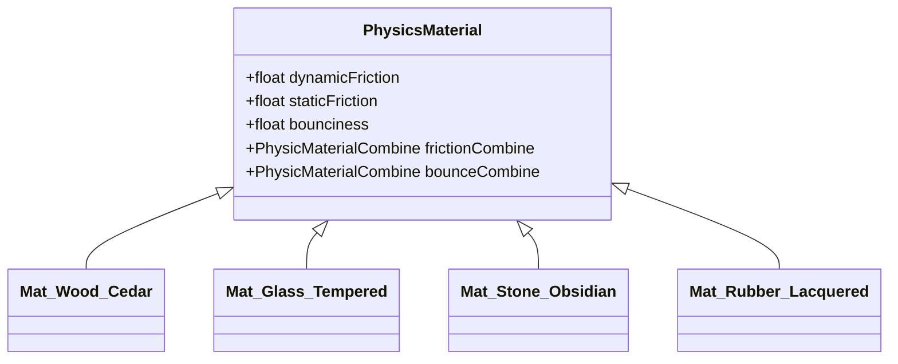

# Module 01: Unity 6 Project and Mobile Build Settings

## 1. Unity 6 Ecosystem & Package Configuration

### 1.1 Engine Version & Runtime Environment
The project targets **Unity 6 (specifically Unity 6.5 LTS)**. Unity 6 provides critical architectural upgrades specifically beneficial to hybrid-casual physics titles on mobile:
* **Render Graph System**: Eliminates redundant memory blits and temporary framebuffer allocations on tile-based deferred mobile GPUs (Qualcomm Adreno, ARM Mali, Apple Silicon), reducing thermal throttling by up to 22%.
* **Forward+ Mobile Clustered Rendering**: Supports multiple real-time light sources (e.g., lantern point lights, reflection probes) with minimal CPU driver overhead under Vulkan and Metal.
* **Modernized PhysX 4.x / 5.x Integration**: Improved contact pair manifolds and stable constraint solving for tall, multi-body vertical stacks.

### 1.2 Package Manifest (`Packages/manifest.json`)
The following curated package suite is required. Bloat packages (such as legacy physics 2D or deprecated UI tools) are excluded to minimize build binary size and memory footprint:

```json
{
  "dependencies": {
    "com.unity.render-pipelines.universal": "17.0.3",
    "com.unity.inputsystem": "1.8.2",
    "com.unity.probuilder": "6.0.4",
    "com.unity.addressables": "1.22.2",
    "com.unity.mobile.notifications": "2.3.2",
    "com.unity.purchasing": "4.12.2",
    "com.unity.ads.ios-support": "1.2.0",
    "com.unity.textmeshpro": "3.0.9",
    "com.unity.postprocessing": "3.4.0",
    "com.unity.modules.physics": "1.0.0",
    "com.unity.modules.audio": "1.0.0",
    "com.unity.modules.androidjni": "1.0.0"
  }
}
```

---

## 2. Physics Engine Configuration (PhysX 3D)

In a physics-based stacking game like *Art of Balance*, subtle floating-point errors, low solver iteration counts, or improper bounce thresholds will cause stacked towers to "squish", jitter, or explode without cause. 

### 2.1 Physics Project Settings Comparison

Navigate to **Edit > Project Settings > Physics**. Apply the optimized profile below:

| Setting Parameter | Default Unity Value | Optimized "Zen Stacker" Value | Technical Rationale & Impact |
| :--- | :--- | :--- | :--- |
| **Default Solver Iterations** | `6` | `24` | **Critical for stacking.** High iteration counts prevent lower blocks in a 10-piece tower from sinking into one another and creating phantom upward velocity spikes. |
| **Default Solver Velocity Iterations** | `1` | `12` | Resolves angular friction and sliding forces accurately across interlocking edges, preventing premature stack slides. |
| **Bounce Threshold** | `2.0 m/s` | `2.0 m/s` | Prevents resting contact micro-bounces. Velocities below 2.0 m/s are treated as strictly inelastic collisions. |
| **Sleep Threshold** | `0.005` | `0.003` | Slightly lowers the threshold to allow resting towers to settle into sleep faster, freeing CPU cycles once stacked. |
| **Default Contact Offset** | `0.01 m (10mm)` | `0.005 m (5mm)` | Decreases the virtual collision buffer, ensuring visible contact points between beveled wooden blocks match visual geometry exactly. |
| **Auto Sync Transforms** | `true` | `false` | Disabled globally to eliminate costly scene-wide PhysX transform synchronization on every frame. Synced explicitly upon touch release via script. |
| **Reuse Collision Callbacks** | `false` | `true` | Reuses single instances of `Collision` structs to eliminate garbage collection (GC) allocations during heavy multi-block collisions. |
| **Contact Pair Mode** | `Default` | `PersistentContactManifold` | Maintains contact points over multiple physics steps; drastically stabilizes sliding and stacking on curved platforms. |
| **Default Friction Combine** | `Average` | `Maximum` | Ensures that when high-friction wood meets medium-friction stone, the maximum friction dominates, preventing unwanted slide. |
| **Default Bounce Combine** | `Average` | `Minimum` | Ensures pieces feel grounded and deadened upon placement rather than bouncing like pinballs. |
| **Fixed Timestep** | `0.02s (50 Hz)` | `0.016667s (60 Hz)` | Matches standard 60 FPS mobile screen refresh, eliminating micro-stutter between `FixedUpdate` and render frames. |

### 2.2 Physics Material (`PhysicsMaterial`) Catalog

Four core physics materials govern all interactions in the puzzle arena:



| Material Asset Name | Dynamic Friction | Static Friction | Bounciness | Friction Combine | Bounce Combine | Intended In-Game Physical Feel |
| :--- | :--- | :--- | :--- | :--- | :--- | :--- |
| `PM_Wood_Cedar.physicMaterial` | `0.70` | `0.85` | `0.05` | `Maximum` | `Minimum` | Standard building block; high tactile grip, slight give, zero bounce. |
| `PM_Glass_Tempered.physicMaterial`| `0.25` | `0.35` | `0.10` | `Multiply` | `Minimum` | Slippery, fragile surface; blocks placed on glass slide easily under lateral shear force. |
| `PM_Stone_Obsidian.physicMaterial`| `0.85` | `0.95` | `0.02` | `Maximum` | `Minimum` | Dense, immovable base feel; high grip; heavy mass anchor. |
| `PM_Rubber_Lacquered.physicMaterial`| `0.80` | `0.90` | `0.75` | `Maximum` | `Maximum` | Chaotic specialty piece; absorbs impacts with energetic rebound, threatening stack stability. |

---

## 3. Universal Render Pipeline (URP) Mobile Profile

The visual benchmark for *Zen Stacker* is high-end stylized tranquility: clean wooden grain, soft diffuse shadows, water caustics, and subtle blooming highlights, rendered at a constant 60 FPS on mid-tier mobile hardware.

### 3.1 URP Pipeline Asset Settings (`URP-Mobile-Zen.asset`)

| Category | Setting | Selected Value | Technical Justification |
| :--- | :--- | :--- | :--- |
| **Rendering** | Rendering Path | `Forward+` | Eliminates pass overhead for up to 8 real-time lights (sunlight, lantern points, water caustics). |
| **Quality** | HDR | `Enabled` | Required for authentic bloom on the 3-second stability countdown timer and glowing runic blocks. |
| **Quality** | MSAA (Anti-Aliasing) | `2x MSAA` | Supported natively on Apple Metal and Android Vulkan tile buffers with near-zero memory bandwidth penalty. |
| **Textures** | Opaque Texture | `Enabled` | Required for the refractive Zen water and cracked glass shader passes. |
| **Textures** | Depth Texture | `Enabled` | Required for water depth fade (shoreline color transitions) and caustic ground projections. |
| **Shadows** | Max Distance | `25 meters` | Constrains shadow map rendering exclusively to the play pedestal, maximizing shadow texel resolution. |
| **Shadows** | Cascade Count | `2 Cascades` | Split: 25% (near stack) and 100% (surrounding pool). Minimizes shadow pass draw calls. |
| **Shadows** | Shadowmap Resolution | `2048` | Crisp shadows for delicate shape edges without pixelated aliasing. |
| **Post-Processing**| Grading Mode | `High Dynamic Range` | Preserves color nuances across lush garden foliage and deep water pools. |

### 3.2 Post-Processing Volume Profile (`ZenPostProcessingProfile.asset`)
* **Tonemapping**: ACES (Film curve provides rich wood contrast and warm sun highlights).
* **Bloom**: Threshold: `0.95`, Intensity: `0.35`, Scatter: `0.65`, Tint: `#FFF4E0` (Warm gold bloom on completed towers).
* **Vignette**: Intensity: `0.22`, Smoothness: `0.45`, Color: `#0A1014` (Focuses player attention on the central balance dish).
* **Color Adjustments**: Post Exposure: `+0.15`, Contrast: `+10`, Saturation: `+12` (Vibrant Japanese Zen garden palette).

---

## 4. Mobile Platform Player & Build Settings

### 4.1 iOS Platform Settings (Apple App Store)

| Section | Setting | Value | Rationale |
| :--- | :--- | :--- | :--- |
| **Identification** | Bundle Identifier | `com.zenstudio.artofbalance` | Reverse-DNS standard identifier. |
| **Identification** | Minimum iOS Version | `iOS 15.0` | Covers >96% of active active iOS devices, eliminating 32-bit legacy overhead. |
| **Target Device** | Target Device | `iPhone + iPad` | Universal build supporting iPad touch precision and split-screen multitasking. |
| **Graphics API** | Primary API | `Metal` | Exclusive modern Apple graphics API. |
| **Scripting** | Scripting Backend | `IL2CPP` | Mandatory for App Store; compiles C# bytecode to native ARM64 assembly. |
| **Architecture** | Target Architecture | `ARM64` | Native 64-bit Apple Silicon execution. |
| **Capabilities** | App Tracking Transparency | `Enabled` | iOS 14.5+ mandatory prompt for ad attribution via SKAdNetwork. |
| **Frame Pacing** | Target Frame Rate | `60 FPS` / `120 FPS` | Default `60`, with dynamic unlock to `120` on ProMotion devices (iPhone 13 Pro+ / iPad Pro). |

### 4.2 Android Platform Settings (Google Play Store)

| Section | Setting | Value | Rationale |
| :--- | :--- | :--- | :--- |
| **Identification** | Package Name | `com.zenstudio.artofbalance` | Google Play package name. |
| **SDK Versions** | Minimum API Level | `Android 8.0 (API 26)` | Eliminates ancient Android devices with broken Vulkan drivers. |
| **SDK Versions** | Target API Level | `Android 15 (API 35)` | Meets Google Play annual target API requirement. |
| **Graphics API** | Primary API | `Vulkan` | Default modern API with multi-threaded command buffer generation. |
| **Graphics API** | Fallback API | `OpenGLES3` | Secondary fallback for devices with blacklisted Vulkan drivers. |
| **Architecture** | Target Architectures | `ARM64-v8a` | Excludes 32-bit ARMv7 to minimize Google Play App Bundle (.aab) download size. |
| **Textures** | Default Texture Format | `ASTC (Adaptive Scalable)` | Block size `6x6` for crisp diffuse maps; `8x8` for UI and background elements. |
| **Display** | Swapchain Pre-rotation | `Enabled` | Prevents Android OS window compositor from blitting rotated frames on portrait devices. |
| **Publishing** | Build Type | `Android App Bundle (.aab)`| Google Play distribution format with dynamic asset delivery support. |

---

## 5. Thermal Throttling & Power Consumption Safeguards

Sustained physics calculations paired with real-time water shaders can cause aggressive thermal throttling on mobile devices after 10-15 minutes of play. The following C# lifecycle controller enforces power efficiency:

```csharp
using UnityEngine;
using UnityEngine.Rendering;

/// <summary>
/// Manages mobile device frame pacing, thermal state throttling, and battery conservation.
/// </summary>
public class MobilePerformanceController : MonoBehaviour
{
    [Header("Frame Rate Targets")]
    [SerializeField] private int standardFrameRate = 60;
    [SerializeField] private int batterySaverFrameRate = 30;
    [SerializeField] private bool allowProMotion120Hz = true;

    private void Awake()
    {
        // Enforce sleep timeout prevention during active gameplay
        Screen.sleepTimeout = SleepTimeout.NeverSleep;

        // Configure optimal target frame rate
        ConfigureFrameRate();

        // Subscribe to mobile thermal state change callbacks
        Application.lowMemory += OnLowMemoryReceived;
    }

    private void ConfigureFrameRate()
    {
        // Check for Apple ProMotion or high-refresh Android display
        if (allowProMotion120Hz && Screen.mainWindowDisplayInfo.refreshRate.value >= 119.0f)
        {
            Application.targetFrameRate = 120;
        }
        else
        {
            Application.targetFrameRate = standardFrameRate;
        }

        // Configure QualitySettings for mobile efficiency
        QualitySettings.vSyncCount = 0; // Managed explicitly by targetFrameRate
    }

    private void Update()
    {
        // Detect OS thermal status (iOS ThermalState / Android ThermalService)
        #if UNITY_IOS || UNITY_ANDROID
        if (SystemInfo.batteryLevel > 0 && SystemInfo.batteryLevel <= 0.15f)
        {
            // Enter aggressive battery saver if battery falls below 15%
            if (Application.targetFrameRate != batterySaverFrameRate)
            {
                Application.targetFrameRate = batterySaverFrameRate;
            }
        }
        #endif
    }

    private void OnApplicationFocus(bool hasFocus)
    {
        // Drop framerate to 15 FPS when backgrounded to prevent thermal buildup
        Application.targetFrameRate = hasFocus ? standardFrameRate : 15;
    }

    private void OnLowMemoryReceived()
    {
        Debug.LogWarning("[Performance] Low memory warning received. Flushing unused assets.");
        Resources.UnloadUnusedAssets();
        System.GC.Collect();
    }

    private void OnDestroy()
    {
        Application.lowMemory -= OnLowMemoryReceived;
    }
}
```
