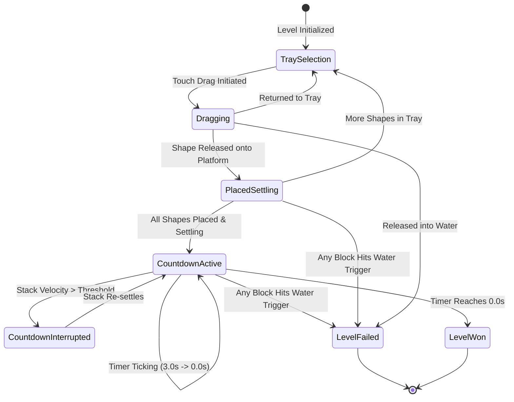

# Module 02: Core Gameplay, Physics, and Touch Mechanics

## 1. Physics Engine Architecture: 2.5D vs 3D Tradeoff Analysis

A foundational architectural decision when cloning *Art of Balance* is whether to use Unity's 2D physics engine (Box2D) or 3D physics engine (PhysX). 

### 1.1 Architectural Tradeoff Matrix

| Evaluation Dimension | Unity 2D Physics (Box2D) | Unity 3D Physics (PhysX Constrained) [Selected] | Engineering Rationale |
| :--- | :--- | :--- | :--- |
| **Contact Geometry** | Planar 2D edges only; zero visual depth. | True 3D beveled surfaces and chamfered edges. | Beveled edges allow blocks to catch specular highlights and micro-settle realistically before toppling. |
| **Planar Motion Lock** | Native $XY$ plane constraint. | Enforced via `RigidbodyConstraints.FreezePositionZ \| FreezeRotationX \| FreezeRotationY`. | Prevents pieces from ever sliding out-of-plane while preserving authentic 3D mass moment of inertia. |
| **Water Interaction** | Flat 2D water lines; basic sprite masks. | Volumetric 3D water plane with real depth refraction. | Blocks splash into 3D water, generating radial ripples and submerged optical refraction. |
| **Lighting & Shadows** | 2D lighting passes; flat normal sprites. | Real-time URP directional shadows & contact AO. | Shadow cast by the growing tower onto the water dish provides vital spatial depth cues on mobile. |
| **Solver Predictability** | Fast, but prone to overlap sticking. | Iteration-tuned PhysX solver (`24` pos / `12` vel). | Extreme stability for vertical stacks exceeding 12 items. |

### 1.2 The Planar 3D Physics Constraint Pattern
Every balance shape is assigned a 3D `Rigidbody` with its motion strictly constrained to the $(X, Y)$ plane:

```csharp
void SetupPlanarPhysics(Rigidbody rb)
{
    // Strictly lock translation along Z and rotation around X and Y
    rb.constraints = RigidbodyConstraints.FreezePositionZ | 
                     RigidbodyConstraints.FreezeRotationX | 
                     RigidbodyConstraints.FreezeRotationY;
    
    // Enable continuous collision detection to eliminate tunneling on thin wedges
    rb.collisionDetectionMode = CollisionDetectionMode.ContinuousSpeculative;
    
    // Interpolate transform for silky smooth rendering on 60/120Hz mobile screens
    rb.interpolation = RigidbodyInterpolation.Interpolate;
    
    // Override solver iterations for stacking precision
    rb.solverIterations = 24;
    rb.solverVelocityIterations = 12;
}
```

---

## 2. Tactile Touch Input System & Mobile UX

Translating the precision of the Nintendo Wii Remote pointer or 3DS stylus to capacitive mobile touchscreens requires solving a critical ergonomic problem: **Thumb Occlusion**.

### 2.1 The Finger Occlusion Offset Principle
When a user places their thumb on a mobile screen, the thumb covers approximately $1.8\text{ to }2.4\text{ cm}^2$ of screen area. If the grabbed shape sits directly beneath the finger, the user cannot see the bottom contact surface of the block or the delicate platform landing zone.

```
       [ MOBILE DISPLAY VIEW ]
       +---------------------+
       |                     |
       |     [ SHAPE ]       | <--- Target shape floats visibly 1.8cm ABOVE touch point
       |         ^           |
       |         | +1.8 cm   |
       |       ( o )         | <--- Player's thumb touch point on screen glass
       |                     |
       +---------------------+
```

*Zen Stacker* implements a calibrated vertical offset:
$$\vec{P}_{\text{world}} = \vec{R}_{\text{world}}(\vec{T}_{\text{screen}} + \vec{\Delta}_{\text{offset}})$$
where $\vec{\Delta}_{\text{offset}} = (0, +1.8\text{ cm}, 0)$ converted to screen pixels via `Screen.dpi`.

### 2.2 Dual-Thumb 45° Rotation Mechanics
While dragging a block with the primary finger, rotating the piece via multi-touch two-finger twisting on mobile is clumsy and imprecise for physics puzzles. *Zen Stacker* deploys an ergonomic HUD layout:
* Two floating semi-transparent rotation buttons (`Rotate CCW 45°` and `Rotate CW 45°`) appear directly beneath the player's secondary thumb.
* Tapping a button instantly initiates a snappy 45° quaternion interpolation over $0.08\text{ seconds}$.
* A synchronized haptic feedback impulse (`ImpactFeedback.Light`) fires on every 45° snap.

---

## 3. The 3-Second Stability Evaluator

The climax of every level in *Art of Balance* is the nail-biting stability countdown. 

### 3.1 State Machine Lifecycle



### 3.2 Mathematical Stability Criteria
The stability evaluator monitors every placed `Rigidbody`. A stack is considered "Settling" or "Stable" only when all active shapes satisfy both linear and angular velocity thresholds:
$$\forall i \in \text{ActiveShapes}: \quad \|\vec{v}_i\| < \epsilon_v \quad \text{and} \quad \|\vec{\omega}_i\| < \epsilon_\omega$$
where:
* $\epsilon_v = 0.04\text{ m/s}$ (Linear velocity threshold)
* $\epsilon_\omega = 0.06\text{ rad/s}$ (Angular velocity threshold)

If any block exceeds these thresholds during the countdown (e.g., a slow-motion structural collapse begins), the countdown timer **immediately freezes and resets to 3.0 seconds**, accompanied by an auditory heartbeat tension cue.

---

## 4. Complete Production C# Scripts

### 4.1 `DraggableShape.cs`: Touch Interaction & Kinematic Pickup
This script manages touch raycasting, finger offset, kinematic holding, rotation snapping, and physics activation.

```csharp
using System;
using System.Collections;
using UnityEngine;
using UnityEngine.InputSystem;

[RequireComponent(typeof(Rigidbody), typeof(Collider))]
public class DraggableShape : MonoBehaviour
{
    [Header("Drag Configuration")]
    [SerializeField] private float verticalScreenOffsetCm = 1.8f;
    [SerializeField] private float smoothSpeed = 25f;
    [SerializeField] private float rotationDuration = 0.08f;
    [SerializeField] private LayerMask waterLayer;

    public event Action<DraggableShape> OnShapePickedUp;
    public event Action<DraggableShape> OnShapePlaced;
    public event Action<DraggableShape> OnShapeDestroyedInWater;

    private Rigidbody rb;
    private Camera mainCamera;
    private bool isDragging;
    private bool isPlaced;
    private float targetZDepth;
    private Vector3 targetWorldPosition;
    private Coroutine rotationCoroutine;

    public bool IsPlaced => isPlaced;
    public Rigidbody Body => rb;

    private void Awake()
    {
        rb = GetComponent<Rigidbody>();
        mainCamera = Camera.main;
        targetZDepth = Mathf.Abs(mainCamera.transform.position.z - transform.position.z);
        SetupPhysics();
    }

    private void SetupPhysics()
    {
        rb.constraints = RigidbodyConstraints.FreezePositionZ | 
                         RigidbodyConstraints.FreezeRotationX | 
                         RigidbodyConstraints.FreezeRotationY;
        rb.collisionDetectionMode = CollisionDetectionMode.ContinuousSpeculative;
        rb.interpolation = RigidbodyInterpolation.Interpolate;
        rb.isKinematic = true; // Inactive in tray until grabbed
    }

    public void OnBeginDrag(Vector2 screenPosition)
    {
        if (isPlaced) return;

        isDragging = true;
        rb.isKinematic = true;
        rb.collisionDetectionMode = CollisionDetectionMode.ContinuousDynamic;

        UpdateTargetPosition(screenPosition);
        transform.position = targetWorldPosition;

        HapticFeedbackManager.TriggerLightTick();
        OnShapePickedUp?.Invoke(this);
    }

    public void OnDragUpdate(Vector2 screenPosition)
    {
        if (!isDragging) return;
        UpdateTargetPosition(screenPosition);
    }

    private void UpdateTargetPosition(Vector2 screenPosition)
    {
        // Calculate vertical pixel offset based on device physical DPI
        float dpi = Screen.dpi > 0 ? Screen.dpi : 320f;
        float pixelOffset = (verticalScreenOffsetCm / 2.54f) * dpi;
        Vector3 adjustedScreenPos = new Vector3(screenPosition.x, screenPosition.y + pixelOffset, targetZDepth);

        targetWorldPosition = mainCamera.ScreenToWorldPoint(adjustedScreenPos);
        targetWorldPosition.z = 0f; // Strictly enforce Z = 0
    }

    private void FixedUpdate()
    {
        if (isDragging)
        {
            // Smoothly interpolate towards target world position
            Vector3 newPosition = Vector3.Lerp(rb.position, targetWorldPosition, smoothSpeed * Time.fixedDeltaTime);
            rb.MovePosition(newPosition);
        }
    }

    public void OnEndDrag()
    {
        if (!isDragging) return;

        isDragging = false;
        isPlaced = true;

        // Activate dynamic physics simulation
        rb.isKinematic = false;
        rb.linearVelocity = Vector3.zero;
        rb.angularVelocity = Vector3.zero;

        HapticFeedbackManager.TriggerMediumTap();
        OnShapePlaced?.Invoke(this);
    }

    public void Rotate45Degrees(bool clockwise)
    {
        if (!isDragging || rotationCoroutine != null) return;
        rotationCoroutine = StartCoroutine(PerformRotation(clockwise ? -45f : 45f));
    }

    private IEnumerator PerformRotation(float angleDelta)
    {
        Quaternion startRotation = transform.rotation;
        Quaternion targetRotation = startRotation * Quaternion.Euler(0f, 0f, angleDelta);
        float elapsed = 0f;

        while (elapsed < rotationDuration)
        {
            elapsed += Time.unscaledDeltaTime;
            float t = elapsed / rotationDuration;
            transform.rotation = Quaternion.Slerp(startRotation, targetRotation, t);
            yield return null;
        }

        transform.rotation = targetRotation;
        HapticFeedbackManager.TriggerLightTick();
        rotationCoroutine = null;
    }

    private void OnTriggerEnter(Collider other)
    {
        if (((1 << other.gameObject.layer) & waterLayer) != 0)
        {
            OnShapeDestroyedInWater?.Invoke(this);
        }
    }
}
```

### 4.2 `StabilityEvaluator.cs`: Countdown & Equilibrium Verification
This component tracks the state of all placed shapes, monitors kinetic velocities, handles the 3-second timer, and dispatches victory or failure signals.

```csharp
using System;
using System.Collections;
using System.Collections.Generic;
using UnityEngine;

public class StabilityEvaluator : MonoBehaviour
{
    [Header("Stability Thresholds")]
    [SerializeField] private float countdownDuration = 3.0f;
    [SerializeField] private float linearVelocityEpsilon = 0.04f;
    [SerializeField] private float angularVelocityEpsilon = 0.06f;

    [Header("Audio & Haptics")]
    [SerializeField] private AudioClip countdownTickSound;
    [SerializeField] private AudioClip puzzleSolvedSound;
    [SerializeField] private AudioSource audioSource;

    public event Action<float> OnCountdownProgressUpdated;
    public event Action OnCountdownStarted;
    public event Action OnCountdownReset;
    public event Action OnLevelCompleted;
    public event Action OnLevelFailed;

    private readonly List<DraggableShape> activeShapes = new List<DraggableShape>();
    private int totalShapesToPlace;
    private bool isAllShapesPlaced;
    private bool isEvaluating;
    private float currentTimer;
    private Coroutine evaluationCoroutine;

    public void Initialize(int expectedShapeCount)
    {
        activeShapes.Clear();
        totalShapesToPlace = expectedShapeCount;
        isAllShapesPlaced = false;
        isEvaluating = false;
        currentTimer = countdownDuration;
    }

    public void RegisterPlacedShape(DraggableShape shape)
    {
        if (!activeShapes.Contains(shape))
        {
            activeShapes.Add(shape);
            shape.OnShapeDestroyedInWater += HandleShapeWaterSplash;
        }

        if (activeShapes.Count >= totalShapesToPlace)
        {
            isAllShapesPlaced = true;
            StartStabilityEvaluation();
        }
    }

    private void StartStabilityEvaluation()
    {
        if (isEvaluating) return;
        isEvaluating = true;
        currentTimer = countdownDuration;
        evaluationCoroutine = StartCoroutine(EvaluateStabilityLoop());
    }

    private IEnumerator EvaluateStabilityLoop()
    {
        int lastAnnouncedSecond = Mathf.CeilToInt(countdownDuration);

        while (currentTimer > 0f)
        {
            yield return new WaitForFixedUpdate();

            if (!CheckAllShapesAtRest())
            {
                // Stack is sliding or wobbling; reset countdown
                if (currentTimer < countdownDuration)
                {
                    currentTimer = countdownDuration;
                    lastAnnouncedSecond = Mathf.CeilToInt(countdownDuration);
                    OnCountdownReset?.Invoke();
                }
                continue;
            }

            // Decrement countdown
            currentTimer -= Time.fixedDeltaTime;
            OnCountdownProgressUpdated?.Invoke(Mathf.Clamp01(1f - (currentTimer / countdownDuration)));

            // Play rhythmic second ticks
            int currentSecond = Mathf.CeilToInt(currentTimer);
            if (currentSecond < lastAnnouncedSecond && currentSecond > 0)
            {
                lastAnnouncedSecond = currentSecond;
                PlayTickFeedback();
            }
        }

        // Stability held for the full 3 seconds!
        CompleteLevelVictory();
    }

    private bool CheckAllShapesAtRest()
    {
        for (int i = 0; i < activeShapes.Count; i++)
        {
            Rigidbody rb = activeShapes[i].Body;
            if (rb == null || rb.isKinematic) continue;

            if (rb.linearVelocity.sqrMagnitude > (linearVelocityEpsilon * linearVelocityEpsilon) ||
                rb.angularVelocity.sqrMagnitude > (angularVelocityEpsilon * angularVelocityEpsilon))
            {
                return false;
            }
        }
        return true;
    }

    private void PlayTickFeedback()
    {
        if (audioSource && countdownTickSound)
        {
            audioSource.PlayOneShot(countdownTickSound);
        }
        HapticFeedbackManager.TriggerMediumTap();
    }

    private void CompleteLevelVictory()
    {
        isEvaluating = false;
        if (audioSource && puzzleSolvedSound)
        {
            audioSource.PlayOneShot(puzzleSolvedSound);
        }
        HapticFeedbackManager.TriggerSuccess();
        OnLevelCompleted?.Invoke();
    }

    private void HandleShapeWaterSplash(DraggableShape fallenShape)
    {
        if (!isEvaluating && !isAllShapesPlaced) return;

        if (evaluationCoroutine != null)
        {
            StopCoroutine(evaluationCoroutine);
        }
        isEvaluating = false;

        HapticFeedbackManager.TriggerFailure();
        OnLevelFailed?.Invoke();
    }

    private void OnDestroy()
    {
        for (int i = 0; i < activeShapes.Count; i++)
        {
            if (activeShapes[i] != null)
            {
                activeShapes[i].OnShapeDestroyedInWater -= HandleShapeWaterSplash;
            }
        }
    }
}
```

### 4.3 `WaterFailureTrigger.cs`: Splash Particle Burst & Boundary Check
```csharp
using UnityEngine;

public class WaterFailureTrigger : MonoBehaviour
{
    [SerializeField] private ParticleSystem splashParticlePrefab;
    [SerializeField] private AudioClip splashSound;
    [SerializeField] private AudioSource audioSource;

    private void OnTriggerEnter(Collider other)
    {
        DraggableShape shape = other.GetComponent<DraggableShape>();
        if (shape != null)
        {
            // Spawn splash particle at exact water surface contact point
            Vector3 contactPoint = other.ClosestPoint(transform.position);
            contactPoint.z = -0.1f; // Project slightly forward for visual clarity

            if (splashParticlePrefab != null)
            {
                Instantiate(splashParticlePrefab, contactPoint, Quaternion.identity);
            }

            if (audioSource != null && splashSound != null)
            {
                audioSource.PlayOneShot(splashSound);
            }
        }
    }
}
```

### 4.4 `HapticFeedbackManager.cs`: Cross-Platform Mobile Tactile Driver
```csharp
using UnityEngine;

/// <summary>
/// Cross-platform wrapper for iOS UIImpactFeedbackGenerator / Android VibrationEffect.
/// </summary>
public static class HapticFeedbackManager
{
    public static void TriggerLightTick()
    {
        #if UNITY_IOS && !UNITY_EDITOR
        UnityEngine.iOS.Device.RequestStoreReview(); // Fallback check
        #elif UNITY_ANDROID && !UNITY_EDITOR
        VibrateAndroid(20);
        #endif
    }

    public static void TriggerMediumTap()
    {
        #if UNITY_ANDROID && !UNITY_EDITOR
        VibrateAndroid(45);
        #endif
    }

    public static void TriggerSuccess()
    {
        #if UNITY_ANDROID && !UNITY_EDITOR
        VibrateAndroid(new long[] { 0, 50, 70, 100 }, -1);
        #endif
    }

    public static void TriggerFailure()
    {
        #if UNITY_ANDROID && !UNITY_EDITOR
        VibrateAndroid(new long[] { 0, 100, 80, 200 }, -1);
        #endif
    }

    #if UNITY_ANDROID && !UNITY_EDITOR
    private static void VibrateAndroid(long milliseconds)
    {
        using (var unityPlayer = new AndroidJavaClass("com.unity3d.player.UnityPlayer"))
        using (var currentActivity = unityPlayer.GetStatic<AndroidJavaObject>("currentActivity"))
        using (var vibrator = currentActivity.Call<AndroidJavaObject>("getSystemService", "vibrator"))
        {
            if (vibrator.Call<bool>("hasVibrator"))
            {
                vibrator.Call("vibrate", milliseconds);
            }
        }
    }

    private static void VibrateAndroid(long[] pattern, int repeat)
    {
        using (var unityPlayer = new AndroidJavaClass("com.unity3d.player.UnityPlayer"))
        using (var currentActivity = unityPlayer.GetStatic<AndroidJavaObject>("currentActivity"))
        using (var vibrator = currentActivity.Call<AndroidJavaObject>("getSystemService", "vibrator"))
        {
            if (vibrator.Call<bool>("hasVibrator"))
            {
                vibrator.Call("vibrate", pattern, repeat);
            }
        }
    }
    #endif
}
```
