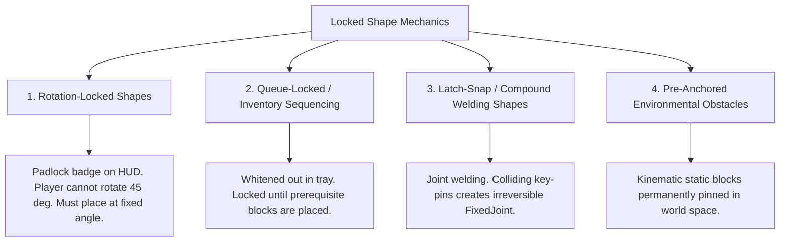

# Module 03: Shapes, Materials, and Special Mechanics Taxonomy

## 1. Playable Geometric Shapes Catalog

In *Art of Balance*, puzzle mastery stems from understanding how irregular geometric silhouettes interlock, balance, and distribute weight. *Zen Stacker* defines a standardized library of 14 playable shapes scaled to a baseline 1-meter physics grid.

### 1.1 Complete Geometric Taxonomy Matrix

| Shape ID | Shape Name | Dimensions ($W \times H \times D$ meters) | Volume ($m^3$) | Center of Mass Offset $(X, Y)$ | Primary Puzzle Utility & Risk Profile |
| :--- | :--- | :--- | :--- | :--- | :--- |
| **SH-01** | Standard Cube | $1.0 \times 1.0 \times 1.0$ | $1.00$ | $(0.00, 0.00)$ | Reliable foundational anchor; neutral stability. |
| **SH-02** | Long Horizontal Plank | $3.0 \times 0.6 \times 1.0$ | $1.80$ | $(0.00, 0.00)$ | Essential bridge; high lever-arm torque if placed off-center. |
| **SH-03** | Medium Block | $2.0 \times 1.0 \times 1.0$ | $2.00$ | $(0.00, 0.00)$ | Sturdy horizontal or vertical support block. |
| **SH-04** | Thin Vertical Pillar | $0.6 \times 3.0 \times 1.0$ | $1.80$ | $(0.00, 0.00)$ | High verticality builder; severe topple risk under eccentric loads. |
| **SH-05** | Equilateral Wedge | $2.0 \times 1.732 \times 1.0$ | $1.73$ | $(0.00, -0.29)$ | Slanted slide hazard; can serve as a dual-sided roof. |
| **SH-06** | Right-Angle Wedge | $2.0 \times 1.0 \times 1.0$ | $1.00$ | $(-0.33, -0.17)$ | Asymmetrical weight bias; creates lateral sliding force vectors. |
| **SH-07** | Semicircle / Half-Drum| Radius $1.5, H=1.5, D=1.0$ | $1.77$ | $(0.00, -0.21)$ | Dual-nature: Rock-solid flat base, or rocking seesaw when flipped curved-side down. |
| **SH-08** | Full Cylinder / Roller | Diameter $1.4, D=1.0$ | $1.54$ | $(0.00, 0.00)$ | Kinetic rolling hazard; must be cupped or wedged between blocks. |
| **SH-09** | Cross / Plus Shape | $3.0 \times 3.0$ (arm $1.0$), $D=1.0$ | $5.00$ | $(0.00, 0.00)$ | Complex interlocker; offers multiple internal nesting corners. |
| **SH-10** | T-Block | $3.0 \times 2.0$ (stem $1.0$), $D=1.0$| $4.00$ | $(0.00, +0.25)$ | High center of mass; easily capsizes if stem is unconstrained. |
| **SH-11** | L-Block | $2.0 \times 2.0$ (arm $1.0$), $D=1.0$ | $3.00$ | $(+0.17, -0.17)$ | Off-axis center of mass creates immediate rotational torque. |
| **SH-12** | Dumbbell / Dogbone | $3.0 \times 1.0$ (neck $0.4$), $D=1.0$| $2.40$ | $(0.00, 0.00)$ | Wide dual-end contact pads; ideal for spanning two separated pillars. |
| **SH-13** | Arched Bridge | $3.0 \times 1.5$ (arch $R=0.8$), $D=1.0$| $2.99$| $(0.00, +0.18)$ | Allows small blocks (cylinders, cubes) to nest securely underneath. |
| **SH-14** | Trapezoid Prism | Base $2.6$, Top $1.4$, $H=1.2$, $D=1.0$| $2.40$ | $(0.00, -0.10)$ | Tapered edges discourage stacking blocks on top slopes. |

### 1.2 Geometric Silhouettes & Centers of Mass
```
   [SH-01: Cube]       [SH-02: Long Plank]        [SH-05: Equilateral Wedge]
      +-----+          +-----------------+                   ^
      |     |          |                 |                  / \
      |  X  |          |        X        |                 /   \
      +-----+          +-----------------+                /  X  \
                                                         +-------+
  [SH-07: Semicircle]    [SH-09: Cross/Plus]        [SH-13: Arched Bridge]
         ___                   +---+                     +-------+
       /     \                 |   |                     |       |
      /   X   \            +---+   +---+                 |  /-\  |
     +---------+           |     X     |                 | /   \ |
                           +---+   +---+                 +       +
                               |   |
                               +---+
 (Note: 'X' indicates center of mass projection on the vertical XY plane)
```

---

## 2. Shape Material Types & Physical Attributes

Shapes are rendered not merely as inert wood, but across a spectrum of materials with distinct physical equations, durability thresholds, thermal interactions, and kinematic constraints.

### 2.1 Master Material Physics Comparison Matrix

| Material Type | Physical Density | Static Friction ($\mu_s$) | Dynamic Friction ($\mu_k$) | Restitution ($e$) | Failure / Reaction Threshold | Gameplay Characteristic & Role |
| :--- | :--- | :--- | :--- | :--- | :--- | :--- |
| **Kusunoki (Cedar Wood)** | $600\text{ kg/m}^3$ | `0.85` | `0.70` | `0.05` | Combustible by fire | The standard building block. High tactile grip, reliable load bearing, flammable. |
| **Tempered Zen Glass** | $2,500\text{ kg/m}^3$ | `0.35` | `0.25` | `0.10` | $F_n > 1,200\text{ N}$ or $> 3\text{ blocks atop}$ | **Fragile.** Slippery surface; shatters under excess weight or thermal shock. |
| **Kurogane (Heavy Iron / Lead)**| $7,800\text{ kg/m}^3$ | `0.95` | `0.85` | `0.02` | Indestructible | **Heavy Anchor.** 13x wood density. Sinks dishes, tilts seesaws, crushes glass. |
| **Eccentric Weighted Block** | Variable ($600 - 4,500$) | `0.85` | `0.70` | `0.05` | Indestructible | **Off-Center Mass.** Visible brass plug shifts CoM by $35\%$ off-axis. |
| **Blazing Flame / Fire Shape** | $500\text{ kg/m}^3$ | `0.70` | `0.60` | `0.05` | $3.5\text{s}$ combustion spread | **Thermal Hazard.** Ignites touching wood, shatters glass via thermal shock. |
| **Rotation-Locked Shape** | Standard Wood/Stone | Per base material | Per base material | Per base material | Unrotatable | **Fixed Orientation.** Padlock icon; cannot be rotated by player. |
| **Queue-Locked (Tray Dependency)**| Standard Wood/Stone | Per base material | Per base material | Per base material | Unlocks via sequence | **Sequential Lock.** Whitened out in dock until prior shapes are placed. |
| **Latch-Lock (Snap Shape)** | $1,200\text{ kg/m}^3$ | `0.80` | `0.65` | `0.02` | Locks upon contact | **Compound Welder.** Creates rigid `FixedJoint` when interlocking pins touch. |
| **Lacquered Rubber** | $1,100\text{ kg/m}^3$ | `0.90` | `0.80` | `0.75` | Indestructible | **Chaotic Spring.** Absorbs impacts and rebounds violently, rocking the structure. |
| **Spirit Rune (Ticking)** | $450\text{ kg/m}^3$ | `0.75` | `0.65` | `0.04` | $5.0\text{ second}$ time limit | **Dissolving.** Vanishes into cherry blossom petals 5s after first contact. |
| **Magnetic Polar (N/S)** | $4,200\text{ kg/m}^3$ | `0.80` | `0.70` | `0.05` | Indestructible | **Force Vector.** Emits attractive or repulsive forces on adjacent magnetic pieces. |
| **Tenchi (Gravity Inverter)** | $800\text{ kg/m}^3$ | `0.60` | `0.50` | `0.05` | Indestructible | **Inversion.** Inverts local gravity to $-9.81\text{ m/s}^2$ (upwards) upon placement. |
| **Slick Glacier Ice** | $920\text{ kg/m}^3$ | `0.05` | `0.02` | `0.08` | Melts near fire | **Frictionless Slide.** Blocks placed on ice slide continuously unless blocked. |

---

## 3. Special Shape Types Deep Dive

### 3.1 Weighted Shapes & Eccentric Mass Centers

In physics stacking, mass magnitude and center-of-mass (CoM) location dictate structural equilibrium:
$$\vec{\tau} = \sum_{i} (\vec{r}_i \times \vec{F}_i) = \sum_{i} (\vec{r}_i \times m_i \vec{g})$$

*Zen Stacker* features two distinct classes of weighted shapes:

#### Class A: Heavy Iron / Kurogane Anchors
* **Mass Multiplier**: $5.0\times \text{ to } 13.0\times$ the mass of standard cedar wood pieces.
* **Tactile Visuals**: Dark hammered iron finish with bronze corner brackets.
* **Physics Interactions**:
  * **On Buoyant Dishes**: Sinks the dish significantly deeper into the water line, raising water level hazards.
  * **On Seesaw Fulcrums**: A single heavy block placed at distance $L$ requires up to 6 wooden blocks on the opposite arm to counterbalance!
  * **On Fragile Glass**: Instantly exceeds the normal force limit ($F_n > 1,200\text{ N}$), shattering glass on impact.

#### Class B: Eccentric (Asymmetrical CoM) Shapes
* **Mechanic**: The physical center of mass does NOT align with the mesh's geometric centroid.
* **Visual Cue**: A circular brass counterweight plug embedded on one side of the block indicates the heavy side.
* **Implementation**: Overriding `Rigidbody.centerOfMass` in script. When placed flat on a platform, the eccentric block spontaneously tilts toward its heavy pole unless counter-weighted or clamped by other blocks!

```
      +---------------------+
      |   (Brass Core)      |
      |       [ * ]         | <--- Center of Mass shifted 0.35m to the left!
      |                     |
      +----------^----------+
               (Pivot)
     Result: Severe counter-clockwise rotational torque!
```

---

### 3.2 Locked Shapes: Operational Typology

The term "Locked Shape" spans three distinct puzzle mechanics in *Art of Balance*:



#### 1. Rotation-Locked Shapes
* **Mechanic**: Shapes stamped with an ornamental brass padlock badge in the dock tray.
* **Player Constraint**: The 45° CCW/CW rotation buttons on the mobile HUD are disabled while dragging this shape.
* **Design Purpose**: Forces the player to adapt to awkward orientations (e.g., an equilateral wedge presented with its razor point downward).

#### 2. Queue-Locked Shapes (Inventory Sequencing)
* **Mechanic**: Later pieces in the dock tray are "whitened out" or semi-transparent with a lock chain overlay.
* **Rule**: At any given time, only a maximum active pool of 2 to 3 shapes is unlocked. Placing an active shape on the platform automatically unlocks the next queued shape in the tray.
* **Design Purpose**: Eliminates brute-force stacking strategies; players cannot "save the easy flat base block for last" if it is locked behind tricky rollers or wedges.

#### 3. Latch-Snap Shapes (Compound Welded Blocks)
* **Mechanic**: Male and female mortise-and-tenon puzzle joints on opposite ends.
* **Physics Implementation**: When two compatible latch shapes collide with relative velocity $< 0.5\text{ m/s}$ and alignment within $\pm 10^\circ$, a Unity `FixedJoint` is instantiated programmatically. The two shapes merge into a single rigid compound body with a unified center of mass, allowing dramatic overhang cantilevers!

#### 4. Pre-Anchored Environmental Shapes
* **Mechanic**: Blocks already placed in the world upon level start, marked with iron rivets securing them to the platform or background wall.
* **Physics**: `Rigidbody.isKinematic = true`. They cannot be moved, acting as immovable fulcrums, shelves, or barriers around which the player must construct the tower.

---

### 3.3 Fire Shapes: Thermal & Combustion Dynamics

Fire blocks add high-tension time pressure and destructive transformations to late-game worlds.

```
       [ BLAZING FIRE SHAPE ]  (T = 0s)
               | (Contact placement)
               v
       [ CEDAR WOOD BLOCK ]    (T = 0.5s: Smoke particles, charred black normal map)
               |
               v
       (T = 3.5s: Wooden block disintegrates into ash!)
               |
               v
       [ UPPER TOWER DROPS INTO VOID ]
```

#### 1. Thermal Combustion Mechanics
* **Ignition Spread**: When a blazing fire shape makes contact with a combustible cedar wood block, it triggers an `OnCollisionEnter` thermal event.
* **Combustion Duration**: A $3.5\text{ second}$ combustion timer starts on the wooden block.
* **Visual & Audio Feedback**:
  * Flame tongues crawl from the fire block onto the wood surface.
  * The wood's albedo texture progressively darkens with a procedural burn mask (`_BurnProgress` $0.0 \to 1.0$).
  * Dynamic crackling ember SFX and continuous haptic micro-vibrations intensify.
* **Ash Disintegration**: At $T = 3.5\text{s}$, the wooden block's collider and rigidbody are destroyed, leaving a puff of black ash. Any structures resting atop the burnt block immediately plunge downward!

#### 2. Tactical Burn Sacrifices
* Advanced puzzle levels require intentional sacrifices: placing a temporary wooden block as scaffolding to hold up an upper wedge, placing a fire block atop it, and letting the wood burn away so the wedge drops perfectly into an otherwise inaccessible lower notch.

#### 3. Thermal Shock on Glass
* When a fire shape touches a fragile glass block, the extreme temperature differential induces instantaneous thermal shock. The glass cracks at twice the standard rate, halving its normal load capacity from $1,200\text{ N}$ to $600\text{ N}$.

#### 4. Water Quenching
* If a fire shape falls into the pond trigger, a massive steam cloud (`ParticleSystem`) bursts forth with a sizzling audio hiss.

---

## 4. Production C# Scripts for Advanced Shape Types

### 4.1 `WeightedShape.cs`: Variable Density & Eccentric CoM Controller
```csharp
using UnityEngine;

[RequireComponent(typeof(Rigidbody))]
public class WeightedShape : MonoBehaviour
{
    [Header("Mass & Center of Mass")]
    [SerializeField] private float massMultiplier = 5.0f;
    [SerializeField] private bool hasEccentricCoM = false;
    [SerializeField] private Vector3 eccentricOffset = new Vector3(-0.35f, 0f, 0f);

    [Header("Visual Indicators")]
    [SerializeField] private GameObject brassWeightCoreMesh;

    private Rigidbody rb;

    private void Awake()
    {
        rb = GetComponent<Rigidbody>();
        ApplyMassProperties();
    }

    public void ApplyMassProperties()
    {
        rb.mass *= massMultiplier;

        if (hasEccentricCoM)
        {
            // Override the PhysX center of mass relative to transform position
            rb.centerOfMass = eccentricOffset;
            if (brassWeightCoreMesh != null)
            {
                brassWeightCoreMesh.transform.localPosition = eccentricOffset;
                brassWeightCoreMesh.SetActive(true);
            }
        }
    }

    private void OnDrawGizmosSelected()
    {
        if (rb != null && hasEccentricCoM)
        {
            Gizmos.color = Color.yellow;
            Gizmos.DrawSphere(transform.TransformPoint(rb.centerOfMass), 0.08f);
        }
    }
}
```

### 4.2 `RotationLockedShape.cs`: Fixed Orientation Enforcement
```csharp
using UnityEngine;

[RequireComponent(typeof(DraggableShape))]
public class RotationLockedShape : MonoBehaviour
{
    [Header("Locked Orientation")]
    [SerializeField] private bool allowRotation = false;
    [SerializeField] private GameObject padlockBadgePrefab;

    private DraggableShape draggable;
    private GameObject padlockBadgeInstance;

    public bool AllowRotation => allowRotation;

    private void Awake()
    {
        draggable = GetComponent<DraggableShape>();
        draggable.OnShapePickedUp += HandlePickedUp;
        draggable.OnShapePlaced += HandlePlaced;

        if (padlockBadgePrefab != null)
        {
            padlockBadgeInstance = Instantiate(padlockBadgePrefab, transform);
            padlockBadgeInstance.transform.localPosition = new Vector3(0f, 0f, -0.6f);
        }
    }

    private void HandlePickedUp(DraggableShape shape)
    {
        // Notify HUD rotation buttons to disable themselves
        EventManager.TriggerRotationLockChanged(true);
    }

    private void HandlePlaced(DraggableShape shape)
    {
        // Re-enable HUD rotation controls for next shapes
        EventManager.TriggerRotationLockChanged(false);
        if (padlockBadgeInstance != null)
        {
            padlockBadgeInstance.SetActive(false);
        }
    }

    private void OnDestroy()
    {
        if (draggable != null)
        {
            draggable.OnShapePickedUp -= HandlePickedUp;
            draggable.OnShapePlaced -= HandlePlaced;
        }
    }
}
```

### 4.3 `FireCombustionShape.cs`: Thermal Spread & Incineration Controller
```csharp
using System.Collections;
using UnityEngine;

[RequireComponent(typeof(DraggableShape))]
public class FireCombustionShape : MonoBehaviour
{
    [Header("Thermal Settings")]
    [SerializeField] private float ignitionRadius = 0.8f;
    [SerializeField] private ParticleSystem flameVfx;
    [SerializeField] private AudioClip fireCrackleSound;
    [SerializeField] private AudioSource audioSource;

    private DraggableShape draggable;
    private bool isPlaced;

    private void Awake()
    {
        draggable = GetComponent<DraggableShape>();
        draggable.OnShapePlaced += HandlePlaced;
    }

    private void HandlePlaced(DraggableShape shape)
    {
        isPlaced = true;
        if (flameVfx != null && !flameVfx.isPlaying)
        {
            flameVfx.Play();
        }
        if (audioSource != null && fireCrackleSound != null)
        {
            audioSource.clip = fireCrackleSound;
            audioSource.loop = true;
            audioSource.Play();
        }
    }

    private void OnCollisionEnter(Collision collision)
    {
        if (!isPlaced) return;

        // Check if colliding object is combustible wood
        FlammableWoodBlock woodenBlock = collision.gameObject.GetComponent<FlammableWoodBlock>();
        if (woodenBlock != null && !woodenBlock.IsBurning)
        {
            woodenBlock.Ignite(collision.GetContact(0).point);
        }

        // Check if colliding object is fragile glass
        FragileGlassShape glass = collision.gameObject.GetComponent<FragileGlassShape>();
        if (glass != null)
        {
            // Apply thermal shock (instant double load)
            glass.IncrementBlocksAtop();
            glass.IncrementBlocksAtop();
        }
    }

    private void OnDestroy()
    {
        if (draggable != null)
        {
            draggable.OnShapePlaced -= HandlePlaced;
        }
    }
}
```

### 4.4 `FlammableWoodBlock.cs`: Wood Burning & Ash Disintegration
```csharp
using System.Collections;
using UnityEngine;

[RequireComponent(typeof(Rigidbody), typeof(MeshRenderer))]
public class FlammableWoodBlock : MonoBehaviour
{
    [Header("Combustion Parameters")]
    [SerializeField] private float burnDuration = 3.5f;
    [SerializeField] private ParticleSystem burnFlameParticlesPrefab;
    [SerializeField] private GameObject ashPuffVfxPrefab;

    private MeshRenderer meshRenderer;
    private Material instanceMaterial;
    private bool isBurning;

    public bool IsBurning => isBurning;

    private void Awake()
    {
        meshRenderer = GetComponent<MeshRenderer>();
        instanceMaterial = meshRenderer.material;
    }

    public void Ignite(Vector3 ignitionPoint)
    {
        if (isBurning) return;
        isBurning = true;

        if (burnFlameParticlesPrefab != null)
        {
            Instantiate(burnFlameParticlesPrefab, ignitionPoint, Quaternion.identity, transform);
        }

        StartCoroutine(BurnRoutine());
    }

    private IEnumerator BurnRoutine()
    {
        float elapsed = 0f;

        while (elapsed < burnDuration)
        {
            elapsed += Time.deltaTime;
            float progress = Mathf.Clamp01(elapsed / burnDuration);

            // Blend material to blackened char
            if (instanceMaterial != null)
            {
                instanceMaterial.SetFloat("_BurnProgress", progress);
            }

            yield return null;
        }

        // Disintegrate into ash
        if (ashPuffVfxPrefab != null)
        {
            Instantiate(ashPuffVfxPrefab, transform.position, Quaternion.identity);
        }

        HapticFeedbackManager.TriggerMediumTap();

        // Destroy gameobject to drop structures resting above
        Destroy(gameObject);
    }
}
```

### 4.5 `LatchSnapShape.cs`: Compound Welding Joint Controller
```csharp
using UnityEngine;

[RequireComponent(typeof(Rigidbody), typeof(DraggableShape))]
public class LatchSnapShape : MonoBehaviour
{
    [SerializeField] private string latchChannelId = "Joint_A";
    [SerializeField] private Transform latchPinAnchor;
    [SerializeField] private float maxSnapDistance = 0.25f;
    [SerializeField] private float maxSnapAngle = 15f;
    [SerializeField] private AudioClip snapSound;

    private Rigidbody rb;
    private bool isLatched;

    public string LatchChannelId => latchChannelId;
    public bool IsLatched => isLatched;

    private void Awake()
    {
        rb = GetComponent<Rigidbody>();
    }

    private void OnCollisionEnter(Collision collision)
    {
        if (isLatched) return;

        LatchSnapShape otherLatch = collision.gameObject.GetComponent<LatchSnapShape>();
        if (otherLatch != null && !otherLatch.IsLatched && otherLatch.LatchChannelId == latchChannelId)
        {
            TrySnapTogether(otherLatch);
        }
    }

    private void TrySnapTogether(LatchSnapShape other)
    {
        float distance = Vector3.Distance(latchPinAnchor.position, other.latchPinAnchor.position);
        float angle = Quaternion.Angle(transform.rotation, other.transform.rotation);

        if (distance <= maxSnapDistance && angle <= maxSnapAngle)
        {
            isLatched = true;

            // Instantiate a rigid PhysX FixedJoint
            FixedJoint joint = gameObject.AddComponent<FixedJoint>();
            joint.connectedBody = other.GetComponent<Rigidbody>();
            joint.enableCollision = false;

            if (snapSound != null)
            {
                AudioSource.PlayClipAtPoint(snapSound, transform.position);
            }

            HapticFeedbackManager.TriggerMediumTap();
            Debug.Log($"[LatchSnap] Successfully locked {name} to {other.name}");
        }
    }
}
```
