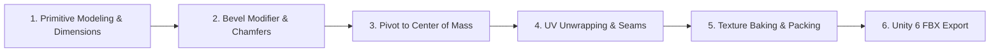

# Module 05: 3D Asset Pipeline in Blender and ProBuilder

## 1. Visual Target & Aesthetic Guidelines

*Zen Stacker: Art of Balance* relies on a contemplative, premium visual style rooted in traditional Japanese Zen minimalism:
* **Tactile Materials**: Silky hand-sanded Hinoki cedar wood, crystalline tempered glass with refractive caustics, and polished wet river stone.
* **Beveled Edge Highlights**: Razor-sharp computer-generated 90-degree edges shatter the illusion of physical reality. Every 3D block in *Zen Stacker* features soft, chamfered or beveled edges (radius $\approx 15 - 25\text{ mm}$) that catch directional sunlight specular highlights and roll naturally during physics interactions.
* **Palette Harmony**: Warm amber cedar (`#D4A373`), soft bamboo green (`#A3B18A`), deep slate stone (`#343A40`), and luminous turquoise pond water (`#48CAE4`).

---

## 2. Blender 4.x / 5.x Asset Creation Workflow

The following step-by-step workflow outlines creating production-ready physics assets in Blender for export to Unity 6.



### 2.1 Step 1: Unit Setup & Primitive Construction
1. Open Blender. In the **Scene Properties** tab, navigate to **Units**:
   * Unit System: `Metric`
   * Unit Scale: `1.0`
   * Length: `Meters`
2. Add a primitive mesh (`Shift + A > Mesh > Cube`).
3. Press `N` to open the Transform panel. Set dimensions to the exact target specifications (e.g., for the Long Plank **SH-02**: $X = 3.0\text{ m}, Y = 0.6\text{ m}, Z = 1.0\text{ m}$).
4. Press `Ctrl + A > Apply All Transforms`. *(Failure to apply transforms will distort bevel widths and physics inertia tensors).*

### 2.2 Step 2: Edge Beveling & Shading Topology
Sharp geometric edges cause harsh shading artifacts and jittery PhysX contact solving.
1. Add a **Bevel Modifier** (`Modifier Properties > Add Modifier > Generate > Bevel`):
   * Width: `0.02 m` ($2\text{ cm}$ chamfer)
   * Segments: `2` (or `3` for hero pieces)
   * Limit Method: `Angle` (Threshold: `30°`)
   * Profile: `0.50` (Round profile)
2. Add a **Weighted Normal Modifier** beneath the Bevel modifier:
   * Weight: `100`
   * Check **Keep Sharp**: `True`
3. In Object Mode, right-click the mesh and select **Shade Auto Smooth**. This produces gorgeous, soft specular light reflections across the beveled edges without ballooning polygon counts.

### 2.3 Step 3: Center of Mass & Origin Calibration
In Unity, a Rigidbody calculates its center of mass based on the geometry pivot. If the pivot is not centered, the object will wobble or tilt unnaturally.
1. In Blender Object Mode, select the mesh.
2. Navigate to **Object > Set Origin > To Center of Mass (Volume)**.
3. Verify that the 3D cursor and object origin dot sit at the geometric center of gravity. For symmetrical blocks, $(X, Y, Z) = (0, 0, 0)$.

### 2.4 Step 4: UV Unwrapping & Grain Alignment
Wood grain direction is critical for believability. Planks must have grain flowing along their longest axis.
1. Switch to Edit Mode (`Tab`). Select the perimeter back edges and press `Right-Click > Mark Seam`.
2. Select all faces (`A`) and press `U > Unwrap`.
3. In the **UV Editor**, inspect the UV islands.
4. Rotate plank islands by $90^\circ$ (`R > 90`) where necessary to ensure UV $U$-coordinates align parallel to the procedural wood grain.
5. Pack islands with an **Island Margin** of `0.015` to prevent mipmap texture bleeding on mobile GPUs.

### 2.5 Step 5: PBR Texture Packing for Mobile URP
To conserve memory bandwidth on mobile devices, texture channels are packed into efficient single-texture maps:

| Texture Map | Color Space | Resolution | Channel Layout / Packing | Mobile ASTC Format |
| :--- | :--- | :--- | :--- | :--- |
| **Albedo / BaseColor** | sRGB | $1024 \times 1024$ | RGB: Diffuse Color, A: Unused or Punch-through Alpha | `ASTC 6x6` |
| **Mask Map (Packed)** | Linear | $1024 \times 1024$ | **Red**: Metallic (`0.0`), **Green**: Ambient Occlusion, **Blue**: Detail Mask, **Alpha**: Smoothness/Roughness | `ASTC 6x6` |
| **Normal Map** | Linear | $1024 \times 1024$ | Tangent Space Normal (OpenGL $+Y$ Up) | `ASTC 6x6` |

### 2.6 Step 6: FBX Export Pipeline to Unity 6
1. Select the mesh. Choose **File > Export > FBX (.fbx)**.
2. In the export settings sidebar, configure:
   * **Include**: Check *Limit to Selected Objects*
   * **Scale**: `1.0`
   * **Apply Scalings**: `FBX All`
   * **Forward**: `-Z Forward`
   * **Up**: `Y Up`
   * **Geometry**: *Apply Modifiers* = `True`, *Smoothing* = `Face`
   * **Animation**: Uncheck *Bake Animation*
3. Save directly into `Assets/Art/Models/Shapes/`.

---

## 3. ProBuilder In-Engine Prototyping Pipeline

Unity 6's integrated **ProBuilder** package allows game designers to rapidly draft, modify, and test balance shapes directly in the Scene view without round-tripping to Blender.

```
       [ PROBUILDER SHAPE WORKFLOW ]
  +------------------+     +-------------------+     +------------------+
  |  New Shape Tool  | --> | Edge Bevel Tool   | --> | Set Pivot to CoM |
  |  (Cube/Arch/Cyl) |     | (0.02m Bevel)     |     | (Center Bounds)  |
  +------------------+     +-------------------+     +------------------+
                                                               |
  +------------------+     +-------------------+               v
  | Save as Prefab   | <-- | Assign Collider   | <-------------+
  | (Assets/.../)    |     | (Convex Mesh/Box) |
  +------------------+     +-------------------+
```

### 3.1 Step-by-Step ProBuilder Tutorial: Building the Arched Bridge (SH-13)
1. Open the ProBuilder window via **Tools > ProBuilder > ProBuilder Window**.
2. Click **New Shape Tool** (`Shift + K`).
3. In the Shape Tool dropdown, select **Arch**:
   * Number of Sides: `12`
   * Radius: `1.5 m`
   * Thickness: `0.5 m`
   * Arch Degrees: `180`
   * Depth: `1.0 m`
4. Click **Build Arch**.
5. Switch to **Edge Selection Mode** in the ProBuilder toolbar.
6. Select all perimeter outer edges.
7. Click the **Bevel** tool in the ProBuilder menu. Set Bevel Distance to `0.02` and click **Apply**.
8. Switch to Object Mode. In the ProBuilder panel, click **Set Pivot**. Choose **Center**.
9. In the Inspector, click **ProBuilderize > Export > Asset** to save the generated mesh into the project asset folder.

### 3.2 Collider Strategy: Primitive Compounds vs Convex Mesh Colliders
PhysX solver performance and stability depend heavily on collider selection:

| Collider Approach | CPU Solver Cost | Stacking Stability (1-10) | Best Use Case in Zen Stacker |
| :--- | :--- | :--- | :--- |
| **Compound Primitive Colliders** (Boxes + Capsules) | **Lowest** (Analytic math) | **10 / 10** (Rock-Solid) | Recommended for T-blocks, Crosses, Dumbbells, and Arched Bridges. |
| **Convex Mesh Collider** (`MeshCollider.convex = true`) | Low-Moderate | **8.5 / 10** (Very Stable) | Required for irregular wedges, trapezoids, and organic stones ($< 64\text{ vertices}$). |
| **Non-Convex Mesh Collider** | Forbidden on Rigidbodies | 0 / 10 (Invalid) | PhysX rejects non-convex dynamic rigidbodies. |

*Production Tip:* For the Arched Bridge (**SH-13**), construct the physical collider using three child Box Colliders (Left Leg, Right Leg, Top Beam) rather than a convex hull. A single convex hull will close the arch opening, preventing small blocks from sliding underneath!

---

## 4. Unity 6 Mobile Shader Graph Implementations

### 4.1 Stylized PBR Wood Shader Graph (`Shader Graphs/SG_ZenWood.shadergraph`)
* **Base Color**: Samples the diffuse cedar texture map, tinted by a customizable `_WoodTint` color parameter (`#D4A373`).
* **Curvature Edge Highlight**:
  * Samples the screen-space derivatives of the world-space normal:
    $$\text{Curvature} = \|\nabla \vec{N}\| = \|\text{ddx}(\vec{N})\| + \|\text{ddy}(\vec{N})\|$$
  * Adds a subtle $+15\%$ lightness highlight along beveled edges, simulating hand-polished wood edges where varnish wears thin.
* **Mask Map**: Unpacks Metallic (`R`), Occlusion (`G`), and Smoothness (`A`).

### 4.2 Refractive Zen Water Shader Graph (`Shader Graphs/SG_ZenWater.shadergraph`)
Water is the centerpiece of the Zen environment:
* **Shoreline Depth Fade**:
  * Compares the background depth texture with the water surface screen position:
    $$\Delta \text{Depth} = \text{SceneDepth} - \text{SurfaceDepth}$$
  * Lerps between Shallow Emerald Turquoise (`#48CAE4`) and Deep Indigo (`#0077B6`) over a $1.5\text{ meter}$ falloff.
* **Refraction Distortion**:
  * Generates scrolling dual normal maps ($U_1, V_1$ and $U_2, V_2$).
  * Offsets UV coordinates used to sample the URP `_CameraOpaqueTexture`, creating realistic optical ripples for submerged stones.
* **Dynamic Contact Foam Rim**:
  * Uses the depth difference ($\Delta 	ext{Depth} < 0.08	ext{ m}$) to project a soft white foam rim (`#FFFFFF`, opacity $0.85$) against the floating dishes and fallen wooden blocks.
* **Caustic Light Projection**:
  * Samples a directional Voronoi noise texture projected along world coordinates $(X, Z)$, projected additively onto the pond bed.

### 4.3 Fragile Glass Shader Graph with Procedural Stress Cracking (`Shader Graphs/SG_ZenGlass.shadergraph`)
* **Transparency & Refraction**:
  * Surface Type: `Transparent`, Blend Mode: `Alpha`.
  * Fresnel Effect node (Power: `3.5`) feeds specular highlight reflections and edge opacity.
* **Dynamic Stress Cracks**:
  * Exposed Float Parameter: `_StressFractureAmount` ($0.0\text{ to }1.0$).
  * Samples a high-resolution tileable glass fracture normal/alpha map.
  * Uses a `Step` node driven by `_StressFractureAmount` to dynamically spread white fracture veins across the block as weight increases.
