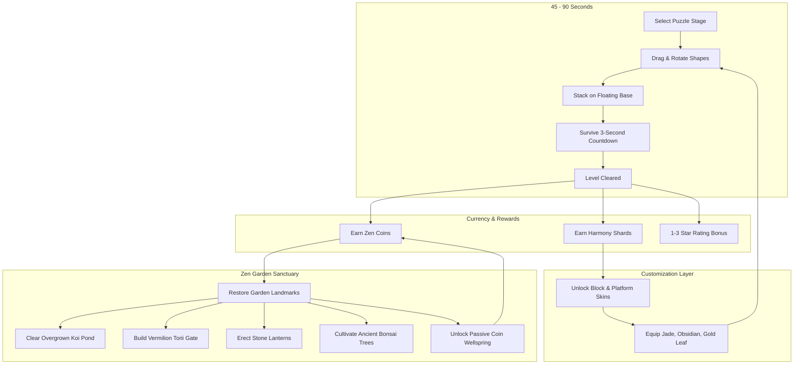

# Module 06: Hybrid-Casual Monetization, Meta-Progression, and LiveOps

## 1. The Hybrid-Casual Meta Loop

Traditional hyper-casual puzzle games suffer from high user churn because clearing a level offers no lasting sense of progression beyond advancing an arbitrary level number. *Zen Stacker* implements a mid-core **Zen Garden Sanctuary** restoration loop that transforms casual physics sessions into long-term retention.

### 1.1 Core vs Meta Loop Interaction



### 1.2 Zen Garden Restoration Milestones

| Sanctuary Landmark | Cost (Zen Coins) | Unlocks At | Player Benefit & Engagement Hook |
| :--- | :--- | :--- | :--- |
| **Koi Pond Basin** | `500` | Level 5 | Cleans pond water; unlocks 2 starter orange Kohaku koi fish swimming beneath the puzzle platform. |
| **Stone Lanterns (Tōrō)** | `1,200` | Level 12 | Illuminates the night garden; unlocks cozy twilight lighting presets. |
| **Bamboo Water Spout (Shishi-odoshi)**| `2,500` | Level 25 | Adds rhythmic wooden clack soundscapes; generates $+25\text{ passive coins/hour}$. |
| **Vermilion Torii Gate** | `5,000` | Level 45 | Monumental gateway; unlocks the "Cherry Blossom Resin" cosmetic block material. |
| **Ancient Bonsai Tree** | `10,000` | Level 75 | Pruning mini-game; awards weekly Harmony Shards. |
| **Grandmaster Pagoda** | `25,000` | Level 150 | Capstone sanctuary structure; unlocks exclusive "Kintsugi Gold" block material finish. |

---

## 2. Balanced Monetization Architecture

The monetization framework is designed around **high-utility rewarded video ads** and player-friendly cosmetic In-App Purchases (IAP), avoiding aggressive interstitial ad tactics that damage store ratings.

### 2.1 Rewarded Video Ad Placements

| Placement Identifier | Trigger Context & Player Offer | In-Game Reward | Projected Opt-In Rate |
| :--- | :--- | :--- | :--- |
| `rewarded_rewind_drop` | **Fatal Drop Revive**: A critical block falls into the water. Instead of restarting the stage, player watches a 30s ad to rewind physics state by 3 seconds. | Restores dropped piece to player's hand; cancels level failure. | **42.0%** (Highest converting placement) |
| `rewarded_zen_stabilizer` | **Precarious Stack Aid**: When a tall stack begins to list, player can activate the "Zen Stabilizer". | Freezes all resting blocks in place for $5.0\text{ seconds}$ to safely position a final wedge. | **24.5%** |
| `rewarded_double_coins` | **Post-Victory Multiplier**: Displayed on the level completion screen. | Doubles the earned Zen Coins from $+50\text{ to }+100$. | **36.0%** |
| `rewarded_level_skip` | **Frustration Reliever**: Offered exclusively after 3 consecutive failures on the same puzzle stage. | Clears the stage with 1 star, unlocking the next level. | **18.5%** |
| `rewarded_daily_fortune` | **Daily Bell Spin**: Accessible once every 24 hours in the Zen Garden menu. | Spins the Fortune Bell for a chance to win rare Harmony Shards or premium skins. | **58.0%** |

### 2.2 Interstitial Ad Pacing Matrix

Interstitials can quickly destroy session length if unmoderated. The following rules are enforced globally:

| Rule Dimension | Enforcement Constraint | Justification |
| :--- | :--- | :--- |
| **Active Play Safe Harbor** | **ZERO ads during gameplay** | An interstitial will NEVER trigger while a player is holding, dragging, or stabilizing a shape. |
| **FTUE Safe Harbor** | **Disabled for Levels 1 - 5** | First-Time User Experience is 100% ad-free to secure Day-1 retention. |
| **Minimum Cooldown Timer** | **90 seconds between ads** | Even if a player completes 3 levels in 60 seconds, an interstitial cannot trigger until 90s have elapsed. |
| **Failure Pacing** | Shown only on **every 3rd failure** | Prevents penalizing struggling players with immediate ads. |
| **Victory Pacing** | Shown on **every 4th completed level** | Balances ad impressions against player flow state. |
| **Paying User Immunity** | **Permanent Ad Removal** | Purchasing ANY In-App Purchase permanently disables all interstitial and banner ads forever. |

### 2.3 In-App Purchase (IAP) Catalog

| SKU Identifier | Product Title | Price Tier (USD) | Category | Included Entitlements |
| :--- | :--- | :--- | :--- | :--- |
| `iap_ad_free_forever` | **Zen Master (No Ads)** | $\$2.99$ | Non-Consumable | Permanently removes all interstitial and banner ads; grants $+500\text{ bonus Zen Coins}$. |
| `iap_season_zen_pass` | **Zen Pass (Seasonal)** | $\$4.99$ | Auto-Renewing / 30-Day | Unlocks Premium track for 30-day season (exclusive Jade block skin, Sakura koi fish, 2x coins). |
| `iap_pouch_coins` | Pouch of Coins | $\$0.99$ | Consumable | $1,500\text{ Zen Coins}$. |
| `iap_chest_coins` | Bamboo Chest of Coins | $\$4.99$ | Consumable | $9,000\text{ Zen Coins}$ ($+20\%\text{ bonus}$). |
| `iap_rewind_tokens_10` | Pack of 10 Rewinds | $\$1.99$ | Consumable | 10 Instant Revive Tokens (skips having to watch rewarded video on fatal drops). |

---

## 3. Retention Mechanics & Sensory Game Feel ("Juice")

### 3.1 First-Time User Experience (FTUE)
The onboarding is **100% textless and contextual**:
1. Level 1 loads immediately with a serene water pond and a flat stone pedestal.
2. A single wooden cube sits in the bottom dock tray.
3. An elegant animated hand icon gestures upward toward the pedestal.
4. When dragged, the piece snaps into dynamic physics; the 3-second countdown activates instantly with a gentle ringing gong.
5. The level victory screen displays a satisfying burst of golden dust and a "+50 Coins" animation, completing onboarding in under 15 seconds.

### 3.2 Haptic Feedback Matrix (iOS & Android)

| In-Game Interaction | Haptic Pattern / Waveform | Player Sensory Feedback |
| :--- | :--- | :--- |
| **45° Rotation Snap** | Light Impact (`20ms` micro-pulse) | Sharp, mechanical tactile feedback akin to a premium camera dial. |
| **Physical Block Placement** | Medium Impact (`45ms` impulse) | Heavy, solid contact feel confirming block has grounded. |
| **Glass Stress Creak** | Low-frequency rumble (`120ms` subtle vibration) | Tactile warning that the glass piece is approaching its load threshold. |
| **Glass Catastrophic Shatter**| Heavy sharp buzz (`200ms` sharp decay) | Dramatic physical shock matching the visual fracture. |
| **3-Second Countdown Tick** | Synchronized rhythmic tap (`30ms` per second) | Heartbeat cadence amplifying tension during the stability check. |
| **Level Cleared Victory** | Multi-pulse chord (`50ms - 70ms - 100ms` crescendo) | Satisfying physical reward feeling. |

### 3.3 Audio Engineering: The Zen Soundscape
* **Binaural Environmental Ambience**: Continuous background stream audio featuring distant bamboo water fountains, soft mountain breezes, and night crickets.
* **Mass-Modulated Wooden Clacks**: 16 recorded samples of Japanese Hinoki wood blocks colliding. Pitch is dynamically modulated by impact velocity and mass:
  $$\text{Pitch} = \text{BasePitch} \times \left(\frac{1.0}{\sqrt[3]{\text{Mass}}}\right)$$
  *(Heavy blocks produce deep, bass-rich clacks; small blocks produce crisp, high-pitched ticks).*
* **Victory Chime**: Resonant Tibetan singing bowl strike mixed with a 5-note pentatonic bamboo flute flourish.

---

## 4. LiveOps Telemetry & Remote Configuration

### 4.1 Telemetry Event Schema (GameAnalytics & Firebase)

```json
{
  "events": [
    {
      "name": "level_started",
      "parameters": {
        "world_id": 2,
        "level_index": 14,
        "attempt_number": 1,
        "active_skin": "cedar_classic"
      }
    },
    {
      "name": "level_completed",
      "parameters": {
        "world_id": 2,
        "level_index": 14,
        "duration_seconds": 38.4,
        "stars_earned": 3,
        "used_stabilizer": false,
        "used_rewind": false
      }
    },
    {
      "name": "level_failed",
      "parameters": {
        "world_id": 2,
        "level_index": 14,
        "failure_reason": "water_splash",
        "dropped_shape_id": "SH-08_roller",
        "shapes_placed_count": 6
      }
    },
    {
      "name": "ad_monetization_watched",
      "parameters": {
        "ad_format": "rewarded_video",
        "placement": "rewarded_rewind_drop",
        "ecpm_estimated": 24.50
      }
    }
  ]
}
```

### 4.2 Remote Configuration Tuning Variables
The following parameters are exposed to Firebase Remote Config / Unity Cloud Diagnostics to allow over-the-air difficulty and monetization balancing without client rebuilds:

| Remote Config Key | Default Value | Tuning Range | Operational Use Case |
| :--- | :--- | :--- | :--- |
| `stability_countdown_seconds` | `3.0` | `2.5 - 4.0` | Lower to 2.5s if early-game drop-off is high; raise for hard challenge events. |
| `interstitial_min_interval_sec` | `90` | `60 - 180` | Adjust based on eCPM seasonality (e.g., Q4 ad rate surge). |
| `interstitial_level_fail_step` | `3` | `2 - 5` | Pace failure interstitials to optimize LTV without hurting Day-7 retention. |
| `glass_load_limit_multiplier` | `1.0` | `0.8 - 1.5` | Tune global glass fragility if telemetry flags World 4 as a difficulty bottleneck. |
| `garden_coin_earn_multiplier` | `1.0` | `0.75 - 2.0` | Run weekend double-coin LiveOps events. |
