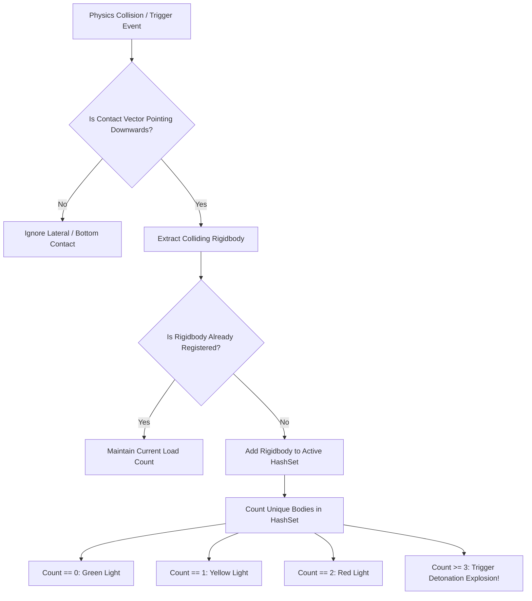

# Module 08: Traffic-Light Indicator Stress Block Implementation

## 1. Feature Analysis: The Colored Indicator Load Block

In *Art of Balance*, one of the most memorable and tactically tense puzzle elements is the **Traffic-Light Load Indicator Block** (also referred to as the *Stress Indicator Block* or *Pressure Core Block*). 

Unlike standard blocks where weight tolerances are implicit or invisible, this specialized piece features an illuminated gem or circular LED aperture in its center that acts as a real-time **visual load meter**:

```
        STATE 0: SAFE                    STATE 1: WARNING                STATE 2: CRITICAL DANGER
   +---------------------+             +---------------------+             +---------------------+
   |                     |             |     [ BLOCK 1 ]     |             |     [ BLOCK 2 ]     |
   |         ( )         |             |          v          |             |     [ BLOCK 1 ]     |
   |        GREEN        |             |         ( )         |             |          v          |
   |      (No Load)      |             |       YELLOW        |             |        ( * )        |
   |                     |             |    (1 Block Atop)   |             |      PULSING RED    |
   +---------------------+             +---------------------+             |    (2 Blocks Atop)  |
                                                                           +---------------------+
                                                                                      |
                                                                       +--------------+--------------+
                                                                       |  3RD BLOCK PLACED ATOP...   |
                                                                       +--------------+--------------+
                                                                                      |
                                                                                      v
                                                                           +---------------------+
                                                                           |     \ \  |  / /     |
                                                                           |   CATASTROPHIC      |
                                                                           |    DETONATION /     |
                                                                           |     EXPLOSION!      |
                                                                           |     / /  |  \ \     |
                                                                           +---------------------+
```

### 1.1 Four-State Load Progression

| State Index | Visual Indicator Color | Trigger Condition | Audio & Haptic Feedback | Physical Integrity |
| :--- | :--- | :--- | :--- | :--- |
| **State 0: Safe** | **Luminous Green** (`#00FF66`, Emissive $1.5$) | $0$ blocks resting atop the upper face. | Silent / Calm resting state. | $100\%$ Structural Integrity. Normal friction and bounce. |
| **State 1: Warning** | **Amber Yellow** (`#FFCC00`, Emissive $2.5$) | Exactly $1$ block resting atop the upper face. | Soft metallic chime; light $20\text{ms}$ haptic tick. | Stable load bearing. Normal physics behavior. |
| **State 2: Critical** | **Pulsing Crimson Red** (`#FF1100`, Emissive $4.0$) | Exactly $2$ blocks resting atop the upper face. | Rhythmic warning creak (`2\text{ Hz}`); warning rumble haptic. | **Maximum threshold reached.** Block is at terminal capacity. |
| **State 3: Detonation**| **Blinding White Flash** (`#FFFFFF` burst) | **3rd block touches** or cumulative force exceeds threshold. | Loud explosive crack; heavy screen-shake; $120\text{ms}$ haptic shock. | **Catastrophic Failure.** Collider disabled; radial blast wave throws neighboring pieces. |

---

## 2. Technical Design & Detection Architecture

A common technical pitfall in implementing this feature is relying solely on simple collision contact counts (`collision.contactCount`). A single block with an irregular base can register $4$ to $8$ individual contact points, causing the block to explode prematurely on the first placement!

### 2.1 The Two-Layer Detection Architecture
To guarantee robust, glitch-free detection, the system combines **geometric upward trigger containment** with **unique Rigidbody tracking**:



1. **Contact Normal Verification**: Only contacts where $\vec{N} \cdot \text{Vector3.down} > 0.45$ (meaning the colliding body is pressing downward from above) are considered.
2. **Unique Body Deduplication**: Colliding bodies are tracked using a `HashSet<Rigidbody>`. Even if a shape contacts the block at multiple vertices, it is counted as exactly **one** load unit.
3. **Exit Tracking**: When a block topples or is removed, `OnCollisionExit` removes the `Rigidbody` from the `HashSet`, restoring the indicator to its previous state (e.g., Red $\to$ Yellow $\to$ Green).

---

## 3. Unity 6 Complete C# Implementation

### 3.1 `TrafficLightStressBlock.cs`
This script manages the indicator state machine, emissive shader properties via `MaterialPropertyBlock` (zero garbage collection), audio cues, and explosive disintegration.

```csharp
using System;
using System.Collections;
using System.Collections.Generic;
using UnityEngine;

public enum IndicatorLoadState
{
    Safe_Green,
    Warning_Yellow,
    Critical_Red,
    Exploded
}

[RequireComponent(typeof(Rigidbody), typeof(DraggableShape))]
public class TrafficLightStressBlock : MonoBehaviour
{
    [Header("Load Thresholds")]
    [Tooltip("Maximum blocks that can safely rest atop before detonation (Default: 2).")]
    [SerializeField] private int maxSafeBlocks = 2;
    [SerializeField] private float explosionThresholdForce = 1500f;

    [Header("Explosion Tuning")]
    [SerializeField] private float explosionBlastRadius = 3.5f;
    [SerializeField] private float explosionBlastForce = 450f;
    [SerializeField] private float upwardModifier = 1.2f;
    [SerializeField] private GameObject explosionVfxPrefab;
    [SerializeField] private GameObject indicatorDebrisPrefab;

    [Header("Visual Indicator Elements")]
    [SerializeField] private MeshRenderer indicatorLedRenderer;
    [SerializeField] private Color colorSafe = new Color(0f, 1f, 0.4f);
    [SerializeField] private Color colorWarning = new Color(1f, 0.8f, 0f);
    [SerializeField] private Color colorCritical = new Color(1f, 0.1f, 0f);
    [SerializeField] private float pulseSpeed = 6f;

    [Header("Audio Elements")]
    [SerializeField] private AudioClip warningSound;
    [SerializeField] private AudioClip criticalCreakSound;
    [SerializeField] private AudioClip explosionSound;
    [SerializeField] private AudioSource audioSource;

    public event Action<TrafficLightStressBlock> OnBlockExploded;

    private readonly HashSet<Rigidbody> activeRestingBodies = new HashSet<Rigidbody>();
    private DraggableShape draggable;
    private Rigidbody rb;
    private MaterialPropertyBlock propBlock;
    private IndicatorLoadState currentState = IndicatorLoadState.Safe_Green;
    private static readonly int EmissionColorProperty = Shader.PropertyToID("_EmissionColor");
    private Coroutine pulseCoroutine;
    private bool isExploded;

    public IndicatorLoadState CurrentState => currentState;

    private void Awake()
    {
        draggable = GetComponent<DraggableShape>();
        rb = GetComponent<Rigidbody>();
        propBlock = new MaterialPropertyBlock();

        UpdateVisualIndicator(colorSafe, 1.5f);
    }

    private void OnCollisionEnter(Collision collision)
    {
        EvaluateCollision(collision, isEntering: true);
    }

    private void OnCollisionExit(Collision collision)
    {
        EvaluateCollision(collision, isEntering: false);
    }

    private void EvaluateCollision(Collision collision, bool isEntering)
    {
        if (isExploded || !draggable.IsPlaced) return;

        // Verify collision is on the top surface
        bool isTopContact = false;
        for (int i = 0; i < collision.contactCount; i++)
        {
            ContactPoint contact = collision.GetContact(i);
            if (Vector3.Dot(contact.normal, Vector3.down) > 0.45f)
            {
                isTopContact = true;
                break;
            }
        }

        Rigidbody otherBody = collision.rigidbody;
        if (otherBody == null || otherBody == rb) return;

        if (isEntering && isTopContact)
        {
            if (activeRestingBodies.Add(otherBody))
            {
                OnLoadCountChanged();
            }
        }
        else if (!isEntering)
        {
            if (activeRestingBodies.Remove(otherBody))
            {
                OnLoadCountChanged();
            }
        }
    }

    private void OnLoadCountChanged()
    {
        if (isExploded) return;

        int loadCount = activeRestingBodies.Count;

        if (loadCount == 0)
        {
            SetState(IndicatorLoadState.Safe_Green);
        }
        else if (loadCount == 1)
        {
            SetState(IndicatorLoadState.Warning_Yellow);
        }
        else if (loadCount == 2)
        {
            SetState(IndicatorLoadState.Critical_Red);
        }
        else if (loadCount > maxSafeBlocks)
        {
            // 3rd block placed atop: Trigger Detonation!
            TriggerDetonation();
        }
    }

    private void SetState(IndicatorLoadState newState)
    {
        if (currentState == newState) return;
        currentState = newState;

        if (pulseCoroutine != null)
        {
            StopCoroutine(pulseCoroutine);
            pulseCoroutine = null;
        }

        switch (currentState)
        {
            case IndicatorLoadState.Safe_Green:
                UpdateVisualIndicator(colorSafe, 1.5f);
                break;

            case IndicatorLoadState.Warning_Yellow:
                UpdateVisualIndicator(colorWarning, 2.5f);
                PlaySound(warningSound);
                HapticFeedbackManager.TriggerLightTick();
                break;

            case IndicatorLoadState.Critical_Red:
                pulseCoroutine = StartCoroutine(PulseCriticalRoutine());
                PlaySound(criticalCreakSound);
                HapticFeedbackManager.TriggerMediumTap();
                break;
        }
    }

    private IEnumerator PulseCriticalRoutine()
    {
        while (currentState == IndicatorLoadState.Critical_Red)
        {
            float intensity = Mathf.Lerp(2.0f, 6.0f, (Mathf.Sin(Time.time * pulseSpeed) + 1f) * 0.5f);
            UpdateVisualIndicator(colorCritical, intensity);
            yield return null;
        }
    }

    private void UpdateVisualIndicator(Color baseColor, float intensity)
    {
        if (indicatorLedRenderer == null) return;

        indicatorLedRenderer.GetPropertyBlock(propBlock);
        Color finalColor = baseColor * Mathf.LinearToGammaSpace(intensity);
        propBlock.SetColor(EmissionColorProperty, finalColor);
        indicatorLedRenderer.SetPropertyBlock(propBlock);
    }

    private void TriggerDetonation()
    {
        if (isExploded) return;
        isExploded = true;
        currentState = IndicatorLoadState.Exploded;

        Debug.LogWarning($"[TrafficLightBlock] DETONATION! {name} exploded from 3-block overload!");

        // 1. Play Explosive Sound & Haptics
        PlaySound(explosionSound);
        HapticFeedbackManager.TriggerFailure();

        // 2. Spawn Explosive Particle Blast
        if (explosionVfxPrefab != null)
        {
            Instantiate(explosionVfxPrefab, transform.position, Quaternion.identity);
        }

        // 3. Spawn Physical Debris Shards
        if (indicatorDebrisPrefab != null)
        {
            Instantiate(indicatorDebrisPrefab, transform.position, transform.rotation);
        }

        // 4. Apply 3D PhysX Radial Blast Wave to surrounding pieces
        Collider[] surroundingColliders = Physics.OverlapSphere(transform.position, explosionBlastRadius);
        foreach (Collider col in surroundingColliders)
        {
            Rigidbody nearbyRb = col.attachedRigidbody;
            if (nearbyRb != null && nearbyRb != rb && !nearbyRb.isKinematic)
            {
                nearbyRb.AddExplosionForce(explosionBlastForce, transform.position, explosionBlastRadius, upwardModifier, ForceMode.Impulse);
            }
        }

        OnBlockExploded?.Invoke(this);

        // 5. Disable physics and render components immediately
        GetComponent<Collider>().enabled = false;
        GetComponent<MeshRenderer>().enabled = false;
        if (indicatorLedRenderer != null) indicatorLedRenderer.enabled = false;
        rb.isKinematic = true;

        Destroy(gameObject, 0.2f);
    }

    private void PlaySound(AudioClip clip)
    {
        if (audioSource != null && clip != null)
        {
            audioSource.PlayOneShot(clip);
        }
    }
}
```

---

## 4. 3D Asset Creation in Blender: The LED Aperture Block

To make the indicator look physically integrated into the block rather than a flat texture overlay:

```
          [ FRONT ELEVATION ]                      [ TOP CROSS-SECTION ]
      +-------------------------+               +-------------------------+
      |                         |               |      (Solid Wood)       |
      |          .---.          |               |          |   |          |
      |         /     \         |               |          |   |          |
      |        | ( * ) |        | <--- Inset    |          +---+          |
      |         \     /         |      Emissive |         /     \         |
      |          `---'          |      Lens     |        | (LED) |        | <--- Recessed
      |                         |               |         \     /         |      Glass Core
      +-------------------------+               +-------------------------+
```

1. **Beveled Cylinder Inset**:
   * Create a standard cube ($1.0 	imes 1.0 	imes 1.0	ext{ m}$).
   * In Edit Mode, add a Boolean cylinder cutout through the center of the block along the $Z$ axis (Radius $0.2	ext{ m}$).
   * Bevel the perimeter lip ($0.02	ext{ m}$) so light catches the circular rim.
2. **Dual-Material Setup**:
   * **Material 0 (Body)**: `M_CedarWood_PBR` (Standard diffuse wood).
   * **Material 1 (Lens)**: `M_IndicatorLED_Emissive` (URP Lit material with Emission enabled, driven at runtime by `TrafficLightStressBlock.cs`).
3. **Collision Geometry**:
   * Use an outer Box Collider matching the $1.0	ext{m}$ exterior. The visual hole in the center does not alter the flat top contact plane, preventing micro-wobbles during stacking.

---

## 5. Strategic Puzzle Archetypes

The Traffic-Light Stress Block introduces specific tactical archetypes across the campaign:

### 5.1 Archetype A: "The Two-Piece Ceiling"
The player is given 5 blocks to place, but the foundation includes a Traffic-Light Block. Because the block can only hold 2 shapes, the player cannot build a single tall vertical tower. Instead, they must place a long horizontal plank across the block (Load Count = 1), and then balance a single secondary block atop that plank (Load Count = 2). The remaining 3 shapes must be balanced on separate cantilevered wings or auxiliary platforms.

### 5.2 Archetype B: "The Intentional Demolition Trigger"
In advanced puzzle stages (such as World 7), an awkward wedge is wedged underneath an immovable ceiling overhang. The only way to clear the level is to intentionally place a 3rd block on the Traffic-Light Block, triggering its detonation. The explosion obliterates the temporary support, dropping the upper wedge into the final stabilizing slot to clear the 3-second hold!
