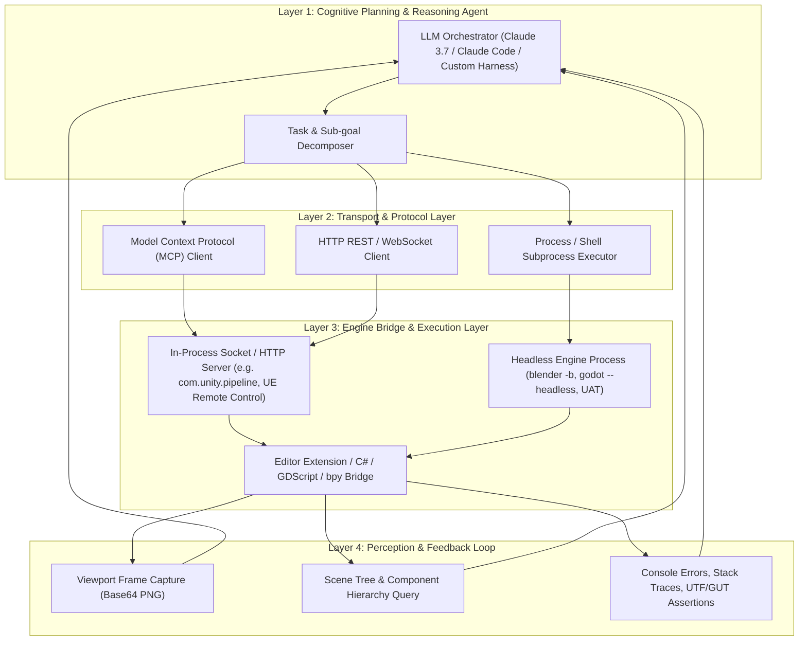

# Executive Summary & Industry Briefing: Game Development IDE Automation, Headless Tooling & Agentic Control (2025–2026)

*Research Scope: Comprehensive multi-engine roundup covering official ecosystem plugins, FOSS tools, and third-party standalone software designed to automate and programmatically control Unity 3D, Blender, Unreal Engine 5, Phaser 3/4, Construct 3, and Godot 4.*  
*As of: October 2026 — Recency sweep covering innovations across the past 12 months (2025–2026).*

---

## 1. Executive Summary

Over the past 12 months (late 2025 through late 2026), game development IDE automation underwent an architectural paradigm shift: **the transition from brittle, batch-mode CLI script execution to live, in-process, protocol-driven agentic control**. 

Historically, automating game IDEs required launching heavyweight GUI processes in headless batch mode (e.g., `-batchmode`, `--headless`, `UnrealEditor-Cmd.exe`), which incurred multi-minute cold-start delays, recompilation domain reloads, and rigid single-pass pipeline execution. In 2025–2026, the game development ecosystem converged on Anthropic's **Model Context Protocol (MCP)**, high-speed loopback IPC (WebSocket/JSON-RPC), and dynamic in-editor evaluation runtimes. 

Today, every major game engine—from AAA titans like Unreal Engine 5.8 and Unity 6 to lightweight open-source and web frameworks like Godot 4.4, Blender 4.2+, Phaser Editor v5, and Construct 3—features production-ready or native MCP bridges. Autonomous coding agents (such as Claude Code, Cursor, Windsurf, and custom autonomous LLM harnesses) can now maintain persistent bidirectional connections to live engine instances, inspect scene trees and ASTs, mutate materials and components, trigger sub-second code evaluations without domain reloads, capture viewport frames for visual verification, and orchestrate headless build and test suites.

Concurrently, 3D content creation pipelines have reached production maturity. Generative AI is no longer confined to producing chaotic untextured point clouds; modern foundation models (Tencent Hunyuan3D-2.1, Microsoft TRELLIS.2) and cloud APIs (Tripo3D V3, Meshy API, Rodin Gen-2.5) now output quad-dominant meshes, clean PBR material maps, automated skeleton rigging, and physics-ready colliders. When coupled with headless retopology scripts (Quad Remesher, Instant Meshes) and procedural texture compilers (Adobe Substance Automation Toolkit, MaterialX), a single autonomous agent can orchestrate full asset generation from natural-language concept to engine-ready prefab in under 90 seconds.

---

## 2. Key Industry Paradigm Shifts (2025–2026)

```
┌────────────────────────────────────────────────────────────────────────────────────────┐
│                        THE 2025-2026 PARADIGM SHIFT IN GAME DEV IDEs                  │
├─────────────────────────────────────────┬──────────────────────────────────────────────┤
│ Legacy Workflow (Pre-2025)              │ Modern Agentic Workflow (2025–2026)          │
├─────────────────────────────────────────┼──────────────────────────────────────────────┤
│ Heavy cold-start batchmode CLI runs     │ Persistent in-process loopback MCP servers   │
│ Multi-minute domain reloads per edit    │ Dynamic live evaluation (e.g. unity eval)    │
│ Manual GUI-based scene assembly         │ Programmatic AST & scene tree mutation       │
│ Untextured point-cloud generative meshes│ Clean quad-dominant PBR meshes + auto-rigs   │
│ Brittle pixel-matching UI tests         │ In-engine reflection testing (AltTester CLI) │
│ Isolated engine-specific build scripts  │ Standardized MCP & GameCI container runners  │
└─────────────────────────────────────────┴──────────────────────────────────────────────┘
```

### Shift 1: Model Context Protocol (MCP) as the Universal Engine Bus
In 2025, MCP emerged as the de facto standard connecting LLM agents to local developer environments. In 2026, this standard penetrated game engine architectures:
* **Unreal Engine 5.8** introduced the native, built-in `ModelContextProtocol` plugin, turning Unreal Editor into a first-party MCP host.
* **Unity 6** saw the rapid adoption of multi-layer MCP bridges (`CoplayDev/unity-mcp`, `AnkleBreaker-Studio/unity-mcp-plugin`) exposing over 200 granular editor tools across physics, Shader Graph, NavMesh, and UI Toolkit.
* **Godot 4.3/4.4** adopted both runtime scene controllers (`tugcantopaloglu/godot-mcp` with 157 tools, `IvanMurzak/Godot-MCP`) and offline XML documentation servers (`tkmct/godot-doc-mcp`) providing zero-latency API retrieval without hallucinations.
* **Phaser Editor v5** published the official first-party `@phaserjs/editor-mcp-server` alongside pre-configured Cursor/Claude project starter templates.
* **Construct 3** gained community-led AST-level JSON MCP servers (`liauw-media/construct3-mcp`, `construct-factory`) allowing AI models to manipulate `.c3proj` folder trees safely outside the browser GUI.
* **Blender 4.2+** saw the release of streamable HTTP and socket MCP servers (`ahujasid/mcp-for-blender`, `RFingAdam/mcp-blender`, `dcc-mcp-blender`), allowing external AI clients to execute `bpy` commands, manipulate Geometry Nodes, and query scene hierarchies.

### Shift 2: Zero-Reload Dynamic Evaluation Runtimes
Previously, modifying C# scripts in Unity or C++ code in Unreal triggered expensive compilation domain reloads, freezing editor interfaces for 15 to 90 seconds. 
* In Unity 6, the official **`com.unity.pipeline`** package and standalone **Unity CLI** introduced `unity command eval`, using the Roslyn compiler inside the running editor process to evaluate arbitrary C# statements on the fly with zero recompilation delay.
* In Unreal Engine 5, the built-in **Web Remote Control API** (REST and WebSockets) allows external agents to mutate Actor properties, invoke UFunctions, and adjust sequencer curves dynamically without touching C++ headers or waiting for live-coding links.

### Shift 3: Game-Ready 3D Generative Pipelines
The generative 3D landscape matured from novel prototypes to deterministic pipelines:
* Open-source architectures such as **Microsoft TRELLIS.2** (utilizing 4B parameter O-Voxel sparse representations) and **Tencent Hunyuan3D-2.1** (decoupling DiT geometry flow from PBR texture synthesis) allow studios to run local, zero-cost 3D asset generation pipelines.
* Enterprise APIs (**Tripo3D V3**, **Meshy API**, **Hyper3D Rodin Gen-2.5**) incorporate automatic quad retopology, bone skinning, and multi-view PBR texture baking (BaseColor, Normal, Roughness, Metallic) exportable directly to `.glb` and `.fbx` formats.

### Shift 4: Headless CI/CD & Automated Deterministic QA
Game testing transitioned from manual QA playtesting and brittle external pixel diffing to deep runtime reflection:
* **AltTester CLI** and its companion AI MCP Extension bridge test runners (in Python, C#, or Robot Framework) directly to running Unity and Unreal Engine executables, inspecting live scene hierarchies, triggering UI Toolkit interactions, and generating deterministic test scripts automatically.
* **GameCI CLI** and **Chickensoft Godot CI** containerized multi-platform build orchestration across GitHub Actions and GitLab CI, enabling automated PR verification, unit testing (via Unity UTF or Godot GUT), and multi-platform packaging.

---

## 3. Landscape Overview Across the Six Engines

| Engine / IDE | Primary Automation Interface | Headless CLI Mode | AI / Agent Integration | CI/CD Ecosystem |
| :--- | :--- | :--- | :--- | :--- |
| **Unity 3D (Unity 6 / 2023 LTS)** | Unity CLI, `com.unity.pipeline`, C# Editor API | `-batchmode -nographics -executeMethod` | Official: Unity Muse, Unity Sentis; FOSS: `unity-mcp` (200+ tools) | GameCI CLI (`unity-builder@v4`), Orchestrator, UTF CLI |
| **Blender (4.2 LTS / 4.3+)** | Native `bpy`, PyPI `bpy` package, Python API | `blender -b -P <script.py>`, `--python-expr` | FOSS: `mcp-for-blender`, `mcp-blender`, ComfyUI-Blender | Flamenco 3, Dockerized `bpy` runners, GitHub Actions |
| **Unreal Engine (UE 5.4–5.8)** | Native MCP Plugin (5.8), Web Remote Control, Python API | `UnrealEditor-Cmd.exe -run=pythonscript -nullrhi` | Official: UE 5.8 ModelContextProtocol, Claude Code Plugin; FOSS: `ue-mcp` | Unreal Automation Tool (`RunUAT.bat`), Gauntlet, UEC Rust CLI |
| **Godot (4.2–4.4+)** | Headless binary, GDScript `-s`, ClassDB XML | `godot --headless -s <script.gd> --export-release` | FOSS: `Godot-MCP` (IvanMurzak), `godot-mcp` (157 tools), Doc MCP | GUT Headless CLI, `Chickensoft.GodotEnv`, `godot-ci` Docker |
| **Phaser (3 / 4 Beta)** | Phaser Editor v5 API, TypeScript/JS, `Phaser.HEADLESS` | Node.js headless, Playwright / Puppeteer | Official: `@phaserjs/editor-mcp-server`, Cursor starter template | Vitest/Jest, Vite/Rollup/Webpack bundler CLI, GitHub Actions |
| **Construct 3 (r450+)** | JavaScript Scripting API, Addon SDK v2, Developer Mode | Headless `.c3proj` folder parsing, Playwright | FOSS: `construct3-mcp`, `construct-factory`, Claude Code plugin | Node.js build scripts, Capacitor/Cordova CLI, NW.js CLI |

---

## 4. Architectural Blueprint for an Autonomous Agent Controller

To build an autonomous agent that can write code, assemble levels, generate assets, and verify gameplay across any of these IDEs, teams must adopt a **4-Layer Decoupled Architecture**:



1. **Layer 1: Cognitive Planning & Reasoning:** The external LLM (Claude Code, Cursor, or autonomous Python harness) breaks down user prompts into discrete, executable engine actions.
2. **Layer 2: Transport & Protocol:** Standardized JSON-RPC via stdio/HTTP (MCP), WebSocket event streaming, or direct process spawning.
3. **Layer 3: Engine Bridge:** Inside the IDE, a persistent lightweight server (or headless runner) translates protocol payloads into native engine API calls (`bpy.ops`, `UnityEngine.GameObject`, `UWorld::SpawnActor`, `SceneTree.root`).
4. **Layer 4: Perception & Feedback:** Crucially, the bridge returns structured feedback—console errors, compiler diagnostics, scene tree AST diffs, and viewport screenshots—allowing the agent to self-correct failures autonomously.

---

## 5. Strategic Recommendations by Studio Profile

### For Indie / Solo Game Developers
* **Adopt Godot 4.4 or Unity 6 with MCP:** Install `tugcantopaloglu/godot-mcp` or `CoplayDev/unity-mcp` into your project and connect it to Claude Code or Cursor. This enables natural-language scene manipulation, rapid prefab placement, and automated script diagnostics.
* **Leverage Standalone `bpy` for Asset Preparation:** Use Python scripts powered by `pip install bpy` to batch-convert, center, and clean asset packs without opening the Blender GUI.
* **Integrate Tripo3D or Meshy API for Rapid Blockout:** Generate 3D props and graybox levels directly from text prompts, saving hours of manual modeling during prototyping.

### For Mid-Scale AA Studios
* **Standardize CI/CD on GameCI CLI / Chickensoft:** Replace bespoke on-prem build machines with containerized GitHub Actions or GitLab CI runners using `game-ci/cli` (Unity) or `chickensoft-games/setup-godot` (Godot), paired with automated unit tests (UTF / GUT).
* **Automate Testing via AltTester CLI:** Eliminate repetitive manual regression playtesting by writing deterministic functional tests in Python or C# that simulate touch/mouse input and verify UI states.
* **Deploy Substance 3D Automation Toolkit (SAT):** Automate high-poly to low-poly map baking (`sbsbaker`) and material variation cooking (`sbsrender`) as part of your asset ingestion pipeline.

### For AAA Enterprise & Virtual Production Studios
* **Embrace Unreal Engine 5.8 Native MCP & Web Remote Control:** Leverage the native `ModelContextProtocol` plugin to allow technical directors and external automation agents to query actor transforms, rewire Niagara effects, and trigger sequencer takes programmatically.
* **Implement Local Open-Source 3D Generation (TRELLIS.2 / Hunyuan3D):** Deploy local instances of Microsoft TRELLIS.2 or Tencent Hunyuan3D-2.1 on on-prem GPU clusters to generate PBR-textured assets with zero cloud API costs and zero IP leakage.
* **Automate BuildGraph & Gauntlet Testing:** Utilize Epic's BuildGraph to parallelize multi-platform cooks across distributed build farms, supervised by Gauntlet multi-client headless test scripts.

---

## 6. Deliverable Directory Structure

The research deliverables are organized into the following modular technical dossiers:

1. [`00-executive-summary-briefing.md`](file:///d:/stuff/ai-misc/_bsh2026/vscode_project01/46-wide_research_test_gemini/deliverables/2026-10-13-game-engine-ide-automation-agentic-roundup/00-executive-summary-briefing.md) — Strategic executive briefing, paradigm shift analysis, and high-level ecosystem overview.
2. [`01-unity-3d-automation-agentic-control.md`](file:///d:/stuff/ai-misc/_bsh2026/vscode_project01/46-wide_research_test_gemini/deliverables/2026-10-13-game-engine-ide-automation-agentic-roundup/01-unity-3d-automation-agentic-control.md) — Comprehensive guide to Unity 6 CLI, `com.unity.pipeline`, `unity command eval`, Unity Muse/Sentis, GameCI CLI, community MCP servers, and AltTester.
3. [`02-blender-headless-pipeline-orchestration.md`](file:///d:/stuff/ai-misc/_bsh2026/vscode_project01/46-wide_research_test_gemini/deliverables/2026-10-13-game-engine-ide-automation-agentic-roundup/02-blender-headless-pipeline-orchestration.md) — Exhaustive guide to Blender 4.2+ headless CLI, PyPI `bpy` package, Geometry Nodes scripting, Blender MCP servers, Quad Remesher scripting, and Flamenco 3.
4. [`03-unreal-engine-5-automation-agent-frameworks.md`](file:///d:/stuff/ai-misc/_bsh2026/vscode_project01/46-wide_research_test_gemini/deliverables/2026-10-13-game-engine-ide-automation-agentic-roundup/03-unreal-engine-5-automation-agent-frameworks.md) — Deep technical analysis of UE 5.8 native Model Context Protocol, Web Remote Control REST/WebSocket APIs, UAT (`RunUAT.bat`), `UnrealEditor-Cmd.exe`, UEC Rust CLI, and PCG automation.
5. [`04-godot-engine-automation-agentic-control.md`](file:///d:/stuff/ai-misc/_bsh2026/vscode_project01/46-wide_research_test_gemini/deliverables/2026-10-13-game-engine-ide-automation-agentic-roundup/04-godot-engine-automation-agentic-control.md) — Complete guide to Godot 4.3/4.4 headless CLI, warm-up import pattern, GUT unit testing CLI, Chickensoft GodotEnv/setup-godot, and community MCP servers (157 tools).
6. [`05-phaser-and-construct3-web-engine-automation.md`](file:///d:/stuff/ai-misc/_bsh2026/vscode_project01/46-wide_research_test_gemini/deliverables/2026-10-13-game-engine-ide-automation-agentic-roundup/05-phaser-and-construct3-web-engine-automation.md) — Deep dive into Phaser Editor v5 MCP server, `Phaser.HEADLESS`, Playwright canvas testing, and Construct 3 JavaScript Scripting API, Addon SDK v2, and `construct3-mcp`.
7. [`06-cross-engine-generative-3d-asset-pipelines.md`](file:///d:/stuff/ai-misc/_bsh2026/vscode_project01/46-wide_research_test_gemini/deliverables/2026-10-13-game-engine-ide-automation-agentic-roundup/06-cross-engine-generative-3d-asset-pipelines.md) — Comprehensive technical reference for 3D Gen APIs (Tripo3D V3, Meshy, Rodin Gen-2.5), open-source models (TRELLIS.2, Hunyuan3D-2.1), automated retopology (Quad Remesher, RizomUV CLI), and Substance Automation Toolkit (SAT).
8. [`07-master-uvp-taxonomy-and-comparative-matrix.md`](file:///d:/stuff/ai-misc/_bsh2026/vscode_project01/46-wide_research_test_gemini/deliverables/2026-10-13-game-engine-ide-automation-agentic-roundup/07-master-uvp-taxonomy-and-comparative-matrix.md) — Dedicated Special Section containing the formal UVP taxonomy, Master UVP Matrix cataloging 50+ tools, comparative engine benchmarks, and verified citation index.
