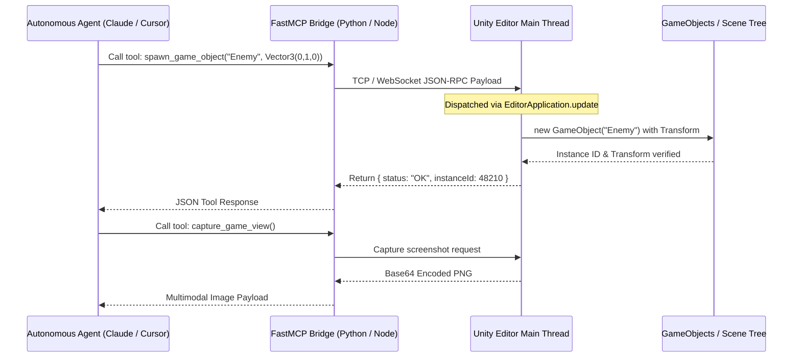

# Unity 3D Automation, Headless Tooling & Agentic Control (2025–2026)

*Target Engine: Unity 6 (6000.x) and Unity 2022/2023 LTS*  
*Scope: Official Ecosystem, FOSS / Community Open-Source, and 3rd-Party Standalone Automation Systems*

---

## 1. Architectural Overview & The Unity 6 Automation Renaissance

For over a decade, automating the Unity Editor relied on rigid command-line switches like `-batchmode` and `-executeMethod`. While effective for scheduled overnight builds, this legacy workflow presented severe obstacles for interactive CI/CD pipelines and real-time AI agents:
1. **Cold-Start Latency:** Launching a modern Unity project in batch mode requires 30 to 180 seconds to initialize engine subsystems, read GUID caches, and import package registries.
2. **Recompilation Domain Reloads:** Any external change to C# source files forces Unity to unload the Mono/CoreCLR AppDomain, recompile assemblies via Roslyn, and reload all managed memory, freezing editor execution for 10 to 60 seconds.
3. **One-Way Execution:** Standard batch commands terminate on completion (`-quit`), making persistent bidirectional communication with an autonomous agent impossible without custom network sockets.

In **Unity 6 (released 2024–2025 and refined through 2026)**, Unity addressed these pain points by releasing the **standalone Unity CLI** and the official **`com.unity.pipeline`** package. Concurrently, the open-source community created high-density **Model Context Protocol (MCP)** plugins and modern **GameCI CLI** orchestrators. Today, Unity can be operated as a headless daemon controlled interactively via sub-second JSON-RPC messages and terminal evaluations.

---

## 2. Official Ecosystem Tools

```
┌────────────────────────────────────────────────────────────────────────────────────────┐
│                               OFFICIAL UNITY AUTOMATION STACK                          │
├─────────────────────────┬──────────────────────────────────────────────────────────────┤
│ Component               │ Core Capability & Mechanism                                  │
├─────────────────────────┼──────────────────────────────────────────────────────────────┤
│ Standalone Unity CLI    │ Lightweight binary for versioning, auth, and pipeline setup  │
│ com.unity.pipeline      │ Embedded HTTP loopback server exposing dynamic live eval     │
│ unity command eval      │ Evaluates C# on-the-fly via Roslyn without domain reload     │
│ Unity Muse Suite        │ AI generation for Textures, Sprites, Animations, Behaviors   │
│ Unity Sentis            │ On-device ONNX runtime for local agent inference             │
│ Unity Test Framework    │ Headless unit and playmode testing with XML JUnit output     │
│ Scriptable Build Pipe   │ Granular, headless asset bundle compilation                  │
└─────────────────────────┴──────────────────────────────────────────────────────────────┘
```

### 2.1 The Standalone Unity CLI (`unity`)
Introduced to decouple automation from the graphical Unity Hub, the standalone **Unity CLI** is a native, dependency-free command-line executable distributed across Windows, macOS, and Linux.

* **Key Capabilities:**
  * **Headless Editor Version Management:** Automatically installs specific Unity editor versions and target build modules (e.g., Android, iOS, WebGL, Standalone) without requiring Unity Hub:
    ```bash
    unity install 6000.0.12f1 -m android ios
    ```
  * **Headless License Activation:** Handles personal, professional, and floating license authentication via terminal:
    ```bash
    unity auth login --username $UNITY_USER --password $UNITY_PASS --serial $SERIAL_KEY
    ```
  * **Project Bootstrapping & Launch:** Opens projects directly or attaches pipelines:
    ```bash
    unity open ./MyProject --editor 6000.0.12f1
    ```

### 2.2 The Production Pipeline Package (`com.unity.pipeline`) & Live Eval
The `com.unity.pipeline` package represents the biggest leap in Unity editor automation. When added to a Unity 6 project (via `unity pipeline install`), it spins up a high-performance local HTTP/JSON server inside the active editor process.

* **Mechanism:** The package listens on a local loopback port (default `localhost:8080` or dynamically assigned). External CLI processes communicate with the live editor over HTTP JSON-RPC payloads.
* **Custom Command Registration (`[CliCommand]`):** Technical artists and pipeline developers can expose custom C# methods directly to the CLI by decorating methods with the `[CliCommand]` attribute:
  ```csharp
  using Unity.Pipeline;
  using UnityEditor;
  using UnityEngine;

  public static class SceneAutomationCommands
  {
      [CliCommand("scene:spawn-prefab", "Spawns a prefab at given coordinates")]
      public static string SpawnPrefab(string prefabPath, float x, float y, float z)
      {
          GameObject prefab = AssetDatabase.LoadAssetAtPath<GameObject>(prefabPath);
          if (prefab == null) return "Error: Prefab not found.";
          GameObject instance = (GameObject)PrefabUtility.InstantiatePrefab(prefab);
          instance.transform.position = new Vector3(x, y, z);
          Undo.RegisterCreatedObjectUndo(instance, "Spawned via CLI");
          return $"Success: Created {instance.name} at ({x}, {y}, {z})";
      }
  }
  ```
* **Dynamic Live Evaluation (`unity command eval`):**
  The CLI can execute arbitrary C# code dynamically inside the running editor process without touching disk files or triggering a domain reload:
  ```bash
  unity command eval --code "UnityEngine.Debug.Log(\"Agent ping\"); return UnityEditor.SceneManagement.EditorSceneManager.GetActiveScene().name;"
  ```
  Under the hood, `unity command eval` utilizes the in-process Roslyn script engine to compile the snippet in memory and execute it on the Unity main thread, returning the output synchronously to the terminal in milliseconds.

### 2.3 Unity Muse Suite (AI-Driven Content Creation)
Unity Muse is Unity's official generative AI suite integrated directly into the Editor:
* **Muse Chat:** Context-aware AI assistant capable of generating functional C# code snippets, diagnosing compiler errors, and offering project-specific guidance.
* **Muse Texture & Sprite:** Generates 2D sprites and tileable Physically-Based Rendering (PBR) texture maps (Albedo, Normal, Height, Smoothness) directly into project asset folders.
* **Muse Animate:** Text-and-prompt-driven 3D animation generation, allowing technical animators to generate humanoid motion clips without motion capture hardware.
* **Muse Behavior:** Generates executable Behavior Trees for NPC artificial intelligence, visually editable within the Unity Behavior package.

### 2.4 Unity Sentis (In-Engine Neural Inference)
Unity Sentis is the production runtime engine for running open neural network exchange (ONNX) models locally on user hardware across all supported platforms (CPU, GPU via Compute Shaders, and Neural Processing Units / NPUs).
* **UVP for Agents:** Allows developers to deploy pre-trained transformer models, reinforcement learning policies (trained via Unity ML-Agents), or custom computer vision detectors directly inside the game runtime without external API latency or cloud hosting costs.

### 2.5 Unity Test Framework (UTF) & Scriptable Build Pipeline
* **Unity Test Framework (UTF):** Built-in NUnit-based test runner that executes PlayMode and EditMode tests. In CI pipelines, UTF can be invoked headlessly to produce standard NUnit or JUnit XML reports:
  ```bash
  Unity.exe -batchmode -nographics -projectPath . -runTests -testResults ./reports/results.xml -testPlatform StandaloneWindows64 -quit
  ```
* **ScriptableBuildPipeline (SBP):** Replaces legacy `BuildPipeline.BuildAssetBundles` with an open C# pipeline that can be customized, profiled, and executed headlessly in parallel.

---

## 3. FOSS & Community Open-Source Tooling

```
┌────────────────────────────────────────────────────────────────────────────────────────┐
│                              COMMUNITY OPEN-SOURCE TOOLING                             │
├─────────────────────────┬──────────────────────────────────────────────────────────────┤
│ Repository / Project    │ Ecosystem Classification & Capabilities                      │
├─────────────────────────┼──────────────────────────────────────────────────────────────┤
│ game-ci/cli             │ Unified CLI for containerized builds and test matrices       │
│ game-ci/unity-builder@v4│ GitHub Actions runner standard for multi-platform packaging  │
│ CoplayDev/unity-mcp     │ Multi-layer Python FastMCP + C# Editor WebSocket bridge      │
│ AnkleBreaker-Studio/mcp │ Heavyweight MCP plugin with 200+ exposed editor tools        │
│ CoderGamester/mcp-unity │ Node.js stdio MCP server for Cursor, Windsurf, and Claude    │
│ game4automation/mcp     │ Digital twins & robotics simulation with [McpTool] reflection│
│ u3d (Ruby gem)          │ Terminal automation wrapper for Unity installations & logs   │
└─────────────────────────┴──────────────────────────────────────────────────────────────┘
```

### 3.1 GameCI Ecosystem (`game-ci/cli` and `unity-builder@v4`)
GameCI is the undisputed open-source standard for continuous integration and automated deployment across GitHub Actions, GitLab CI, and CircleCI.
* **Unified GameCI CLI (`game-ci/cli`):** GameCI consolidated its cloud and local runners into a single, unified CLI binary.
* **Dockerized Build Matrices:** Provides pre-built Docker containers (`unityci/editor`) tagged for specific Unity versions (including Unity 6 LTS) containing all target platform build support tools (Android NDK, WebGL emscripten, Windows mono/IL2CPP).
* **GameCI GitHub Actions Workflow Example:**
  ```yaml
  name: Unity 6 Headless CI
  on: [push, pull_request]

  jobs:
    test:
      name: Automated Test Runner
      runs-on: ubuntu-latest
      steps:
        - uses: actions/checkout@v4
          with:
            lfs: true
        - uses: game-ci/unity-test-runner@v4
          env:
            UNITY_LICENSE: ${{ secrets.UNITY_LICENSE }}
            UNITY_EMAIL: ${{ secrets.UNITY_EMAIL }}
            UNITY_PASSWORD: ${{ secrets.UNITY_PASSWORD }}
          with:
            unityVersion: 6000.0.12f1
            testMode: PlayMode
            artifactsPath: ./reports

    build:
      name: Headless Multiplatform Build
      needs: test
      runs-on: ubuntu-latest
      steps:
        - uses: actions/checkout@v4
          with:
            lfs: true
        - uses: game-ci/unity-builder@v4
          env:
            UNITY_LICENSE: ${{ secrets.UNITY_LICENSE }}
          with:
            unityVersion: 6000.0.12f1
            targetPlatform: StandaloneWindows64
            buildName: GameRelease_Win64
  ```

### 3.2 Model Context Protocol (MCP) Community Bridges
The emergence of MCP revolutionized how AI coding assistants interface with Unity:

1. **`CoplayDev/unity-mcp` (MCP for Unity):**
   * **Architecture:** Uses a three-tier architecture: an MCP client talks over stdio to a Python server (powered by FastMCP), which bridges to Unity via a local WebSocket connection to an in-editor C# plugin.
   * **Features:** Allows agents to inspect the active scene, query GameObject components, create primitives, manipulate transforms, read console logs, and trigger domain reloads safely.
2. **`AnkleBreaker-Studio/unity-mcp-plugin`:**
   * **Scope:** Exposes over **200+ granular tools** to the AI client.
   * **Subsystems Covered:** Shader Graph node wiring, Amplify Shader Editor hooks, Terrain sculpting and tree painting, NavMesh baking, Rigidbody physics manipulation, and Multiplayer Play Mode (MPPM) configuration.
3. **`CoderGamester/mcp-unity`:**
   * **Architecture:** A lightweight Node.js stdio server designed specifically for IDEs like Cursor and Windsurf.
   * **Intelligence:** Parses Unity's local package cache and `.csproj` project files, ensuring the LLM understands installed Unity Package Manager (UPM) manifests without hallucinating obsolete APIs.
4. **`game4automation/io.realvirtual.mcp`:**
   * **Domain:** Tailored for industrial automation, robotics simulation, and digital twins.
   * **Mechanism:** Relies entirely on C# reflection inside Unity; developers simply add the `[McpTool]` attribute to any public C# method, and it automatically exposes itself as an available tool in the MCP manifest.

---

## 3. Third-Party Standalone Software

```
┌────────────────────────────────────────────────────────────────────────────────────────┐
│                              THIRD-PARTY STANDALONE SOFTWARE                           │
├─────────────────────────┬──────────────────────────────────────────────────────────────┤
│ Software / Solution     │ Unique Value Proposition & Integration Mechanism             │
├─────────────────────────┼──────────────────────────────────────────────────────────────┤
│ AltTester CLI & SDK     │ UI & GameObject reflection testing via Python/C#/Robot       │
│ AltTester AI Extension  │ MCP server for autonomous test script generation             │
│ Odin Project Validator  │ Headless static analysis of Unity serialized scenes/prefabs  │
│ JetBrains Rider CLI     │ Headless Roslyn analysis, inspection, and test runner        │
└─────────────────────────┴──────────────────────────────────────────────────────────────┘
```

### 3.1 AltTester CLI & AI MCP Extension
AltTester (formerly AltUnity Tester) solves the critical problem that game viewports cannot be inspected with web testing tools like Selenium or Cypress:
* **Mechanism:** AltTester embeds a lightweight TCP socket server directly into Unity development builds. This server exposes the entire internal GameObject hierarchy, UI Toolkit elements, RectTransforms, and custom component variables.
* **AltTester CLI:** Allows CI runners to execute test scripts written in Python, C#, Java, or Robot Framework that connect to the game running on PC, mobile devices (via ADB), or WebGL.
* **AltTester AI Extension & MCP Server:** In 2025–2026, AltTester introduced an official MCP server. This allows AI assistants (such as Claude Code) to connect to a running game instance, inspect active UI hierarchies, plan navigation paths, and auto-generate deterministic test scripts.
* **Example AltTester Python Test Script:**
  ```python
  from alttester import AltDriver

  def test_start_game_flow():
      driver = AltDriver(host="127.0.0.1", port=13000)
      # Find start button in UI hierarchy
      start_btn = driver.find_object(By.NAME, "Btn_StartGame")
      assert start_btn is not None
      # Programmatically tap/click the button
      start_btn.tap()
      # Wait for game scene to load
      score_label = driver.wait_for_object(By.NAME, "Txt_CurrentScore", timeout=10)
      assert score_label.get_text() == "0"
      driver.stop()
  ```

### 3.2 Odin Project Validator & Serializer (Sirenix)
* **Odin Inspector** is the industry-standard reflection framework for authoring custom Unity editors.
* **Odin Project Validator CLI:** Provides headless batch validation (`OdinValidator.exe` or batch method). It scans every `.unity` scene, `.prefab`, and `.asset` ScriptableObject across the project against custom validation rules (e.g., missing component references, broken enum values, illegal string formats), failing CI builds before corrupted assets reach staging branches.

---

## 4. Headless CLI Flags & Execution Modes

When running Unity headlessly, the following command-line flags are mandatory for pipeline stability:

| Flag | Category | Purpose & Description |
| :--- | :--- | :--- |
| `-batchmode` | Process Mode | Runs Unity without GUI windows; disables user interaction dialogs. |
| `-nographics` | GPU / Display | Initializes a dummy graphics device; does not open DirectX/Metal/Vulkan rendering contexts. Required on headless Linux runners. |
| `-projectPath <Path>`| Path | Specifies the root folder of the project containing `Assets/` and `ProjectSettings/`. |
| `-executeMethod <C.M>`| Execution | Invokes a static C# method immediately after project load (e.g. `BuildScripts.PerformBuild`). |
| `-quit` | Lifecycle | Terminates the Unity process as soon as `-executeMethod` completes or compilation finishes. |
| `-logFile <Path>` | Logging | Directs console output to a specific file. Using `-logFile -` redirects logs directly to standard out (`stdout`). |
| `-silent-crashes` | Stability | Suppresses the OS crash report dialog window so automation processes do not hang indefinitely. |
| `-buildTarget <Target>`| Platform | Switches the active editor build target (e.g. `Win64`, `Android`, `WebGL`, `iOS`). |

### Concrete Batch Build Script Example
Below is an enterprise-grade C# build script designed to be triggered via terminal:

```csharp
using UnityEditor;
using UnityEditor.Build.Reporting;
using UnityEngine;
using System;

public static class HeadlessBuildAutomation
{
    public static void BuildStandaloneWindows()
    {
        string[] scenes = { "Assets/Scenes/Boot.unity", "Assets/Scenes/MainLevel.unity" };
        string outputPath = "Builds/Win64/Game.exe";

        BuildPlayerOptions buildPlayerOptions = new BuildPlayerOptions
        {
            scenes = scenes,
            locationPathName = outputPath,
            target = BuildTarget.StandaloneWindows64,
            options = BuildOptions.None
        };

        Debug.Log("[CI/CD] Starting Headless Windows Build...");
        BuildReport report = BuildPipeline.BuildPlayer(buildPlayerOptions);
        BuildSummary summary = report.summary;

        if (summary.result == BuildResult.Succeeded)
        {
            Debug.Log($"[CI/CD] Build Succeeded: {summary.totalSize} bytes in {summary.totalTime.TotalSeconds:F1}s");
            EditorApplication.Exit(0);
        }
        else
        {
            Debug.LogError($"[CI/CD] Build Failed with {summary.totalErrors} errors.");
            EditorApplication.Exit(1);
        }
    }
}
```

Terminal execution command:
```bash
Unity.exe -batchmode -nographics -silent-crashes -projectPath "C:/Projects/MyGame" -executeMethod HeadlessBuildAutomation.BuildStandaloneWindows -logFile -
```

---

## 5. Custom Agent Integration Architecture

To establish an autonomous agent loop that controls Unity, developers must configure a multi-layered communication pipeline:



### Critical Implementation Rules for Custom Agent Bridges:
1. **Thread Safety & Main Thread Dispatching:** Unity API methods (such as `Instantiate`, `Destroy`, `AssetDatabase.LoadAssetAtPath`) can strictly only be called from Unity's main thread. In-editor socket listeners (TCP/WebSocket) running on background worker threads must queue incoming payloads into a thread-safe concurrent queue, which is drained inside `EditorApplication.update`.
2. **Handling Domain Reloads:** When an agent writes a new `.cs` file to the `Assets/` directory, Unity triggers an asset refresh and domain reload. This tears down all static managed memory and closes unmanaged network sockets. The agent bridge must implement an `[InitializeOnLoad]` bootstrap method that re-establishes socket listener threads immediately after domain reloads complete.
3. **Perception via Screen Capture:** To allow the LLM to inspect visual output, expose a tool that calls `ScreenCapture.CaptureScreenshotAsTexture()` or reads the GameView/SceneView render texture, encoding the resulting buffer to a Base64 string for multimodal agent input.
