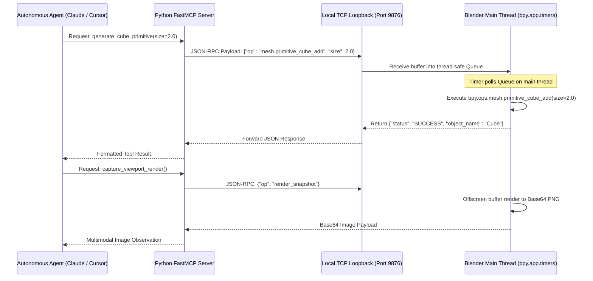

# Blender Headless Pipeline Orchestration & 3D Generative Automation (2025–2026)

*Target Engine / DCC: Blender 4.2 LTS and 4.3+*  
*Scope: Official Ecosystem, FOSS / Community Open-Source, and 3rd-Party Standalone Automation Systems*

---

## 1. Architectural Overview & The Modern Blender Automation Stack

Blender has long been regarded as the premier open-source digital content creation (DCC) tool for pipeline automation due to its native, deeply integrated Python API (`bpy`). However, in **Blender 4.2 LTS and 4.3+**, the foundation of Blender automation underwent major structural transformations:
1. **The PyPI Standalone `bpy` Package:** The Blender Foundation officially standardized the distribution of Blender as a standalone CPython wheel on PyPI (`pip install bpy`), allowing developers to import Blender directly into cloud microservices, Docker containers, and CI pipelines without requiring the desktop application binary.
2. **The Extensions Platform:** Blender 4.2 completely overhauled the addon management architecture, introducing a secure online extensions repository and a dedicated command-line interface (`blender --command extension`) for automated package management.
3. **EEVEE-Next & Compositor Refactoring:** The viewport rendering engine was completely rewritten as EEVEE-Next, featuring unified ray tracing, screen-space irradiance, and real-time compositor execution accessible directly from headless background rendering scripts.
4. **The Model Context Protocol (MCP) Wave:** Open-source developers launched comprehensive MCP servers that allow external AI coding assistants (Claude Desktop, Claude Code, Cursor) to directly manipulate Blender meshes, apply procedural materials, and assemble 3D scenes via natural language prompts.

---

## 2. Official Ecosystem Tools

```
┌────────────────────────────────────────────────────────────────────────────────────────┐
│                              OFFICIAL BLENDER AUTOMATION STACK                         │
├─────────────────────────┬──────────────────────────────────────────────────────────────┤
│ Component               │ Core Mechanism & Capability                                  │
├─────────────────────────┼──────────────────────────────────────────────────────────────┤
│ Native Headless CLI     │ blender -b -P <script.py> for server-side pipeline tasks     │
│ Standalone bpy (PyPI)   │ pip install bpy; imports Blender as a pure CPython module    │
│ Geometry Nodes Engine   │ Programmatic procedural node trees & attribute manipulation  │
│ EEVEE-Next Headless     │ Modern real-time GPU/vulkan rasterizer scriptable via Python │
│ CLI Extensions Tool     │ blender --command extension for headless addon management    │
└─────────────────────────┴──────────────────────────────────────────────────────────────┘
```

### 2.1 Native Headless CLI Execution (`--background`)
Blender's native binary features deep command-line options designed for headless operation across servers, render nodes, and automated asset ingestion workers.

* **Primary Headless Flags:**
  * `--background` (`-b`): Runs Blender without initializing a display window or desktop GUI.
  * `--python <path>` (`-P`): Executes a specified Python script upon launching.
  * `--python-expr "<code_string>"`: Evaluates a single-line Python expression directly from the shell.
  * `--enable-autoexec` (`-y`): Forces automatic execution of Python drivers and embedded scripts stored inside `.blend` files (critical for scripted rigs and animation trees).
  * `--` : Flag separator. Any arguments following `--` are ignored by Blender and passed directly to the Python script via `sys.argv`.

* **Batch CLI Invocation Pattern:**
  ```bash
  blender --background scene.blend --python pipeline_processor.py -- --target-polycount 5000 --export-format gltf
  ```

### 2.2 The Official Standalone PyPI Package (`pip install bpy`)
Instead of wrapping the multi-hundred-megabyte desktop application binary, developers can install Blender directly into standard Python virtual environments.
* **Compatibility Matrix:**
  * **Blender / `bpy` 4.2 & 4.3:** Requires **Python 3.11**.
  * **Blender / `bpy` 5.x:** Requires **Python 3.13**.
* **Installation:**
  ```bash
  pip install bpy
  ```
* **Headless Script using Standalone `bpy` (`headless_mesh_gen.py`):**
  ```python
  import bpy
  import math

  # Initialize clean headless environment
  bpy.ops.wm.new_file(use_empty=True)

  # Create procedural mesh
  bpy.ops.mesh.primitive_cylinder_add(
      vertices=32, 
      radius=1.5, 
      depth=3.0, 
      location=(0, 0, 1.5)
  )
  cylinder = bpy.context.active_object
  cylinder.name = "Procedural_Pillar"

  # Create and assign PBR material
  mat = bpy.data.materials.new(name="Pillar_PBR")
  mat.use_nodes = True
  bsdf = mat.node_tree.nodes.get("Principled BSDF")
  bsdf.inputs["Base Color"].default_value = (0.2, 0.4, 0.8, 1.0)
  bsdf.inputs["Roughness"].default_value = 0.35
  bsdf.inputs["Metallic"].default_value = 0.8
  cylinder.data.materials.append(mat)

  # Configure glTF Export Settings
  output_gltf = "output/procedural_pillar.glb"
  bpy.ops.export_scene.gltf(
      filepath=output_gltf,
      export_format='GLB',
      use_selection=True,
      export_apply=True
  )
  print(f"[Pipeline] Successfully generated and exported: {output_gltf}")
  ```

### 2.3 Geometry Nodes Programmatic Automation
Blender's node-based procedural modeling system (Geometry Nodes) can be created, wired, and modified programmatically through Python.
* **Procedural Assembly:** Developers can write Python scripts that construct complex node graphs (instancing foliage, scattering rocks, generating procedural terrain meshes, or auto-generating collision hulls) by creating `GeometryNodeTree` data blocks:
  ```python
  import bpy

  # Create a procedural Geometry Node Tree
  node_group = bpy.data.node_groups.new("AutoScatter", 'GeometryNodeTree')
  node_group.interface.new_socket("Geometry", in_out='INPUT', socket_type='NodeSocketGeometry')
  node_group.interface.new_socket("Geometry", in_out='OUTPUT', socket_type='NodeSocketGeometry')

  # Add nodes
  input_node = node_group.nodes.new("NodeGroupInput")
  output_node = node_group.nodes.new("NodeGroupOutput")
  subdiv_node = node_group.nodes.new("GeometryNodeSubdivideMesh")
  subdiv_node.inputs["Level"].default_value = 2

  # Wire connections
  node_group.links.new(input_node.outputs["Geometry"], subdiv_node.inputs["Mesh"])
  node_group.links.new(subdiv_node.outputs["Mesh"], output_node.inputs["Geometry"])
  ```

---

## 3. FOSS & Community Open-Source Tooling

```
┌────────────────────────────────────────────────────────────────────────────────────────┐
│                              COMMUNITY OPEN-SOURCE TOOLING                             │
├─────────────────────────┬──────────────────────────────────────────────────────────────┤
│ Tool / Repository       │ Architectural Description & Use Case                         │
├─────────────────────────┼──────────────────────────────────────────────────────────────┤
│ ahujasid/mcp-blender    │ Popular local TCP server + addon bridging LLMs to bpy        │
│ Gorav22/Blender-mcp     │ Claude/Cursor MCP integration with Poly Haven & Rodin asset  │
│ RFingAdam/mcp-blender   │ Comprehensive server exposing 200+ 3D modeling operators     │
│ djeada/blender-mcp      │ Structured namespaces (objects, materials, rendering, export)│
│ dcc-mcp-blender         │ Embedded Streamable HTTP MCP server within active viewport   │
│ fake-bpy-module         │ Stubs & type annotations enabling IDE linting outside Blender│
│ ComfyUI-Blender Bridges │ Inter-process node pipeline connecting Stable Diffusion/Flux │
│ Flamenco 3              │ Official open-source render farm manager and worker CLI      │
└─────────────────────────┴──────────────────────────────────────────────────────────────┘
```

### 3.1 Blender Model Context Protocol (MCP) Ecosystem
The community has established several powerful MCP implementations that bridge external AI clients directly into Blender:

1. **`ahujasid/mcp-for-blender`:**
   * **Mechanism:** An addon running inside Blender starts a local socket server on `localhost:9876`. A companion Python FastMCP server communicates with Claude Desktop or Cursor over stdio, translating natural-language commands into verified `bpy` operators.
2. **`Gorav22/Blender-mcp`:**
   * **Asset Pipeline Integration:** In addition to standard scene transformations, it includes specialized tools that fetch PBR materials and HDRIs directly from open databases (Poly Haven) and triggers external 3D generative APIs (Hyper3D Rodin).
3. **`RFingAdam/mcp-blender`:**
   * **Scale:** Exposes over **200+ tools** spanning mesh boolean operations, bevel modifiers, UV unwrapping, Armature bone creation, and keyframe animation tracks.
4. **`dcc-mcp-blender`:**
   * **Modern Transport:** Leverages the latest MCP Streamable HTTP transport specifications, embedding the server directly into Blender's event loop via `bpy.app.timers`.

### 3.2 `fake-bpy-module` (Static Analysis & IDE Auto-Completion)
Because `bpy` is a compiled C/C++ Python extension module embedded inside Blender, external IDEs (VS Code, Cursor, PyCharm) cannot inspect its symbols by default.
* **Solution:** `fake-bpy-module` provides complete static type stubs (`pip install fake-bpy-module-latest` or `fake-bpy-module-4.2`).
* **UVP for AI Agents:** When an autonomous coding agent writes custom Blender scripts, feeding `fake-bpy-module` into the agent's context prevents API hallucinations, wrong property lookups, and deprecated method invocations.

### 3.3 Flamenco 3 (Blender Render Farm Orchestration)
Maintained by the Blender Foundation, **Flamenco 3** is an open-source, production-grade render farm management ecosystem designed for simplicity and reliability.
* **Architecture:**
  * **Flamenco Manager:** Central service written in Go with an embedded web UI and REST API. Manages project tasks, frame distribution, and worker allocation.
  * **Flamenco Worker:** Lightweight cross-platform CLI binary that runs on rendering nodes. It detects local Blender installations, pulls jobs from the Manager, launches headless Blender instances (`blender -b`), and uploads rendered frames.
* **Pipeline Integration:** Highly scriptable via Python, allowing external studio schedulers to submit batch rendering and asset processing jobs programmatically.

---

## 4. Third-Party Standalone Software

```
┌────────────────────────────────────────────────────────────────────────────────────────┐
│                              THIRD-PARTY STANDALONE SOFTWARE                           │
├─────────────────────────┬──────────────────────────────────────────────────────────────┤
│ Software / Solution     │ Unique Value Proposition & Pipeline Automation Interface     │
├─────────────────────────┼──────────────────────────────────────────────────────────────┤
│ Quad Remesher (Exoside) │ Industry-leading quad retopology automated via headless bpy  │
│ RizomUV & RizomUVLink   │ Industrial UV unwrapping & packing driven via Lua / CLI      │
│ Instant Meshes CLI      │ Fast open-source field-aligned quad retopology CLI binary    │
│ Auto-Rig Pro            │ Modular automated character rigging and retargeting addon    │
└─────────────────────────┴──────────────────────────────────────────────────────────────┘
```

### 4.1 Quad Remesher Automation (Exoside)
Quad Remesher (by Maxime Rouca) is the gold standard for automated quad retopology, converting dense CAD or sculpted triangulated meshes into clean, animation-ready quad topologies.
* **Pipeline Integration Reality:** Quad Remesher does not distribute a standalone command-line binary. Instead, it is distributed as a DCC plugin.
* **Headless Scripting Solution:** Studios automate Quad Remesher by launching headless Blender instances and invoking its registered operator programmatically:
  ```python
  import bpy

  # Select target mesh
  obj = bpy.data.objects.get("Sculpted_HighPoly")
  bpy.context.view_layer.objects.active = obj
  obj.select_set(True)

  # Configure Quad Remesher Operator parameters
  bpy.ops.mesh.quad_remesher(
      target_count=4000,          # Target quad polygon count
      adaptive_size=50,           # Adaptive quad sizing (0-100)
      use_materials=False,        # Preserve material boundary loops
      use_symmetry=True,          # Enforce X-axis symmetry
      autodetect_hard_edges=True  # Preserve sharp mechanical features
  )

  print(f"[Pipeline] Retopology complete: {len(obj.data.polygons)} quads generated.")
  ```

### 4.2 RizomUV CLI & `RizomUVLink`
RizomUV (Rizom-Lab) is the industry standard for automated UV unfolding, relaxation, and packing.
* **Native Headless CLI:** Unlike Quad Remesher, RizomUV provides a native command-line interface with dedicated headless flags (`--headless`).
* **Lua Scripting Engine:** Every operation in RizomUV is an addressable Lua function. Scripts can define seam cutting algorithms, distortion relaxation iterations, and multi-tile UDIM packaging rules.
* **`RizomUVLink` Python Bridge:** A production Python library that launches RizomUV in background mode, streams geometry via temporary `.obj`/`.fbx` files, executes custom Lua command strings, and exports the unwrapped mesh back to disk with zero human intervention.

### 4.3 Instant Meshes CLI & QuadriFlow (FOSS Alternatives)
For environments where proprietary commercial licenses cannot be deployed:
* **Instant Meshes:** Available as a standalone CLI executable (`InstantMeshes.exe`). Accepts `.obj` input and outputs field-aligned quad meshes via command-line arguments:
  ```bash
  InstantMeshes.exe -d -r 5000 -o output_quads.obj input_dense.obj
  ```
* **QuadriFlow:** An open-source algorithm integrated directly into Blender's native `bpy.ops.mesh.quadriflow_remesh()` operator, providing accessible quad generation out of the box.

---

## 5. Concrete Production Pipeline Scripts

### Headless Asset Ingestion: FBX to glTF + Auto-LOD Generator
Below is a production-ready Python script executed via `blender -b -P process_asset.py`:

```python
import bpy
import sys
import argparse

def process_mesh(input_path, output_path, decimate_ratio=0.5):
    # Reset scene
    bpy.ops.wm.new_file(use_empty=True)

    # Import High-Poly FBX
    print(f"[Pipeline] Importing: {input_path}")
    bpy.ops.import_scene.fbx(filepath=input_path)

    # Merge or locate main mesh
    mesh_objects = [o for o in bpy.context.scene.objects if o.type == 'MESH']
    if not mesh_objects:
        print("[Pipeline Error] No mesh found in input asset.")
        sys.exit(1)

    # Apply transformations and center pivot
    for obj in mesh_objects:
        bpy.context.view_layer.objects.active = obj
        bpy.ops.object.transform_apply(location=True, rotation=True, scale=True)
        bpy.ops.object.origin_set(type='ORIGIN_GEOMETRY', center='BOUNDS')

    # Add Decimate Modifier for automated LOD generation
    primary_obj = mesh_objects[0]
    mod = primary_obj.modifiers.new(name="AutoLOD", type='DECIMATE')
    mod.ratio = decimate_ratio
    bpy.context.view_layer.objects.active = primary_obj
    bpy.ops.object.modifier_apply(modifier="AutoLOD")

    # Export production glTF/GLB
    print(f"[Pipeline] Exporting LOD asset to: {output_path}")
    bpy.ops.export_scene.gltf(
        filepath=output_path,
        export_format='GLB',
        export_apply=True,
        export_tangents=True
    )
    print("[Pipeline] Asset processing completed successfully.")

if __name__ == "__main__":
    # Extract arguments passed after '--'
    argv = sys.argv
    if "--" in argv:
        argv = argv[argv.index("--") + 1:]
    else:
        argv = []

    parser = argparse.ArgumentParser(description="Headless Blender Asset Processing")
    parser.add_argument("--input", required=True, help="Path to input FBX")
    parser.add_argument("--output", required=True, help="Path to output GLB")
    parser.add_argument("--ratio", type=float, default=0.5, help="Decimation ratio (0.0 to 1.0)")
    args = parser.parse_args(argv)

    process_mesh(args.input, args.output, args.ratio)
```

Terminal Execution Command:
```bash
blender --background --python process_asset.py -- --input "Assets/Raw/Character.fbx" --output "Assets/Cooked/Character_LOD1.glb" --ratio 0.4
```

---

## 6. Custom Agent Integration Architecture

To establish an autonomous agent loop that controls Blender, developers configure a multi-layered communication bridge:



### Critical Implementation Rules for Blender Agent Bridges:
1. **Thread-Safety & `bpy.app.timers`:** Direct access to `bpy.data` or `bpy.ops` from secondary threads causes immediate segmentation faults. Sockets listening for agent payloads must run in background threads and push tasks into a `queue.Queue`. A registered `bpy.app.timers.register` callback running on the main event loop drains the queue safely.
2. **Context Overrides in 4.2+:** Blender operators require an active context (active object, selected objects, 3D viewport window area). In Blender 4.2+, legacy dictionary-based context overrides (`bpy.ops.some_op({'selected_objects': ...})`) are deprecated. Use `with bpy.context.temp_override(...)` to ensure headless operator execution succeeds.
3. **Sandbox Security:** Because an LLM can issue arbitrary Python scripts via `exec()`, developer environments should enforce filesystem boundaries and restrict unmanaged system calls when running scripts generated by untrusted models.
