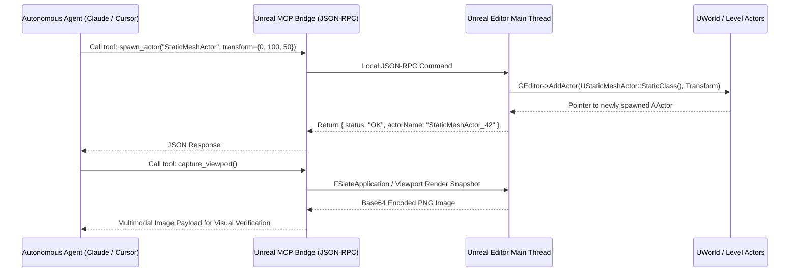

# Unreal Engine 5 Automation, Web Remote Control & Agent Frameworks (2025–2026)

*Target Engine: Unreal Engine 5.4, 5.5, and 5.8 Experimental*  
*Scope: Official Ecosystem, FOSS / Community Open-Source, and 3rd-Party Standalone Automation Systems*

---

## 1. Architectural Overview & The Era of Native Unreal MCP

Unreal Engine 5 represents the technological apex of real-time rendering, dynamic global illumination (Lumen), virtualized micro-polygon geometry (Nanite), and large-scale procedural world building (PCG). However, its sheer scale—hundreds of gigabytes of source code, multi-gigabyte editor binaries, and massive compilation graphs—traditionally made it one of the most intimidating engines to automate.

Over the past 12 months (late 2025 through late 2026), the Unreal automation landscape underwent a massive transformation driven by Epic Games and the AI community:
1. **Epic's Native Model Context Protocol (MCP) Integration:** In Unreal Engine 5.8, Epic Games officially embedded the **Model Context Protocol server** natively into the core engine (`ModelContextProtocol` plugin), allowing external AI agents (like Claude Code, Cursor, and Windsurf) to connect locally over standard JSON-RPC without third-party middleman binaries.
2. **First-Party Claude Code Plugin:** Epic released `EpicGames/unreal-engine-skills-for-claude-code-plugin` on GitHub, officially equipping terminal-based AI agents with native skills to query levels, compile Blueprints, and run tests.
3. **Web Remote Control API Maturation:** The built-in HTTP REST and WebSocket Remote Control system became the preferred runtime reflection bridge for modifying live actor properties, spawning assets, and adjusting Sequencer parameters without touching C++ headers or incurring recompilation delays.
4. **Rust-Based Modern CLI Tooling (`uec`):** The developer community embraced lightweight native wrappers written in Rust that bypass slow batch files, standardizing headless project builds, clean steps, and test execution.

---

## 2. Official Ecosystem Tools

```
┌────────────────────────────────────────────────────────────────────────────────────────┐
│                              OFFICIAL UNREAL AUTOMATION STACK                          │
├─────────────────────────┬──────────────────────────────────────────────────────────────┤
│ Component               │ Core Mechanism & Purpose                                     │
├─────────────────────────┼──────────────────────────────────────────────────────────────┤
│ Native MCP Plugin (5.8) │ Built-in JSON-RPC server allowing AI models to control UE    │
│ Claude Code Skill Plugin│ Epic's official skills bridge for terminal agent control     │
│ Unreal Automation Tool  │ RunUAT.bat host program for cooking, packaging, and builds   │
│ UnrealEditor-Cmd.exe    │ Headless commandlet runner (-run=pythonscript, -nullrhi)     │
│ Web Remote Control API  │ Built-in HTTP REST / WebSocket server for dynamic control    │
│ Gauntlet Automation     │ Automated multi-client gameplay & performance test harness   │
│ PCG Framework Python API│ Programmatic procedural content graph authoring & execution  │
│ MetaHuman DNA CLI       │ Automated character calibration and batch facial rigging     │
└─────────────────────────┴──────────────────────────────────────────────────────────────┘
```

### 2.1 Native Model Context Protocol (MCP) in UE 5.8+
The introduction of the `ModelContextProtocol` plugin marks the first time a major AAA game engine natively ships an embedded MCP server.

* **Architecture:** When enabled in **Edit > Plugins**, Unreal Editor spins up an internal MCP server listening over local transport (JSON-RPC). AI assistants connect directly via configuration files (e.g., `.mcp.json`):
  ```json
  {
    "mcpServers": {
      "unreal-engine": {
        "command": "node",
        "args": ["C:/Program Files/Epic Games/UE_5.8/Engine/Plugins/Experimental/ModelContextProtocol/Resources/bridge.js"],
        "env": {
          "UNREAL_PORT": "30010"
        }
      }
    }
  }
  ```
* **Exposed Engine Capabilities:**
  * **Level & Actor Manipulation:** Spawn StaticMeshActors, adjust transforms, assign materials, manipulate point/directional lights, and group hierarchies.
  * **Blueprint Graph Editing:** Create new Blueprint classes, insert execution and data pins, rewire node connections, and trigger graph compilation.
  * **Asset Registry Queries:** Search project assets by class, tag, or path without opening Content Browser tabs.
  * **Play-In-Editor (PIE) Control:** Start, pause, step, and stop simulation sessions, capturing runtime output and viewport buffers.

### 2.2 Epic Games Claude Code Integration (`unreal-engine-skills-for-claude-code-plugin`)
Epic Games published official Claude Code integration packages on GitHub to standardize terminal-driven agentic workflows:
* **Capabilities:** Provides Claude Code with tailored "skills" to invoke Unreal commandlets, parse compile logs for C++ errors, run automation specs, and query editor state directly from the shell.

### 2.3 Unreal Automation Tool (UAT) & `RunUAT.bat`
The **Unreal Automation Tool (UAT)** is the core C# host program used across all AAA game development for orchestrating multi-platform continuous integration pipelines.
* **BuildCookRun:** The primary UAT command used to compile, cook, stage, package, and archive games:
  ```bash
  Engine/Build/BatchFiles/RunUAT.bat BuildCookRun \
    -project="C:/Projects/ShooterGame/ShooterGame.uproject" \
    -noP4 -platform=Win64 -clientconfig=Development \
    -cook -build -stage -pak -archive -archivedirectory="C:/Builds/Win64"
  ```
* **BuildGraph:** Epic's XML-based script engine that allows technical directors to define distributed, multi-machine build and cooking graphs across massive render/build farms.

### 2.4 `UnrealEditor-Cmd.exe` (Headless Commandlets)
For automated tasks requiring access to the Unreal Engine object model (`UObject`, `UWorld`, `UAssetManager`) without rendering graphical viewports, `UnrealEditor-Cmd.exe` provides a headless execution environment.
* **Headless Python Script Execution:**
  ```bash
  UnrealEditor-Cmd.exe "C:/Projects/ShooterGame/ShooterGame.uproject" \
    -run=pythonscript -script="C:/Scripts/BatchOptimizeAssets.py" \
    -nullrhi -unattended -stdout -NoLoadingScreen
  ```
* **Key Commandlet Flags:**
  * `-run=pythonscript`: Invokes the embedded Unreal Python plugin to run a script file.
  * `-nullrhi`: Disables the graphics rendering hardware interface completely (saving GPU memory and enabling execution on non-GPU server racks).
  * `-unattended`: Suppresses all interactive modal dialogs and message boxes.
  * `-stdout`: Forces all log outputs directly into standard out.

### 2.5 Web Remote Control API (HTTP REST & WebSockets)
Built directly into the engine (`Remote Control API` and `Remote Control Web Interface` plugins), this framework enables bidirectional communication over web protocols.
* **HTTP Endpoints (`http://localhost:30010/remote/`):**
  * `PUT /remote/object/property`: Sets any `UPROPERTY` on an active actor or object dynamically.
  * `PUT /remote/object/call`: Calls any `UFUNCTION` exposed to the engine runtime.
  * `POST /remote/preset/<PresetName>/property`: Mutates properties exposed inside a custom **Remote Control Preset**.
* **WebSocket API (`ws://localhost:30020/remote/`):**
  * Provides real-time event subscriptions (e.g., listening for property value changes, sequencer frame scrubbing, or trigger events).
* **Live PIE Distinction:** When addressing actors during Play-In-Editor (PIE), target paths must reference the dynamic PIE world instance (e.g., `/Game/Maps/UEDPIE_0_MainLevel.MainLevel:PersistentLevel.PlayerCharacter_C_1`).

---

## 3. FOSS & Community Open-Source Tooling

```
┌────────────────────────────────────────────────────────────────────────────────────────┐
│                              COMMUNITY OPEN-SOURCE TOOLING                             │
├─────────────────────────┬──────────────────────────────────────────────────────────────┤
│ Repository / Project    │ Ecosystem Classification & Capabilities                      │
├─────────────────────────┼──────────────────────────────────────────────────────────────┤
│ ue-mcp (ue-mcp.com)     │ Comprehensive community MCP server with deep Blueprint tools │
│ ChiR24/Unreal_mcp       │ Python/JSON-RPC bridge connecting Cursor to Unreal Editor    │
│ chongdashu/unreal-mcp   │ Node.js MCP server exposing level layout & actor spawning    │
│ db-lyon/ue-mcp          │ Streamable MCP server exposing over 1,000 engine actions     │
│ uec (written in Rust)   │ Ultra-fast standalone CLI wrapper for UE build & clean steps │
│ AgenticLink / Autonomix │ High-performance CLI bridges for real-time Blueprint rewires │
│ Unreal Agent Harness    │ Async execution harness preventing long tasks from blocking  │
└─────────────────────────┴──────────────────────────────────────────────────────────────┘
```

### 3.1 Community Model Context Protocol (MCP) Implementations
Prior to and alongside Epic's native 5.8 integration, community-developed MCP servers established widespread adoption:
1. **`ue-mcp` (ue-mcp.com):**
   * **Scope:** A high-level toolkit providing Claude and Cursor with granular access to Blueprint node generation, Material graph pin connection, and Sequencer keyframe authoring.
2. **`chongdashu/unreal-mcp` & `ChiR24/Unreal_mcp`:**
   * **Simplicity:** Lightweight Python/Node bridges that connect external AI chat environments to Unreal via the Web Remote Control HTTP interface, abstracting complex raw JSON payloads into clean tool schemas.
3. **`db-lyon/ue-mcp`:**
   * **Scale:** A massive community implementation exposing over **1,000 distinct Unreal operations** into structured tool families, enabling end-to-end game authoring from prompt to packaged build.

### 3.2 `uec` (Rust Command-Line Utility for Unreal)
Created to eliminate the friction of dealing with cumbersome `.bat` scripts and nested directories, **`uec`** is a high-performance command-line utility written in Rust.
* **Capabilities:**
  * Detects engine installations from registry keys and `.uproject` files automatically.
  * Builds project editor targets with clean, colored terminal output:
    ```bash
    uec build --editor --target ShooterGame
    ```
  * Launches editor instances, handles clean builds, and executes automation tests with a single flag.

### 3.3 AgenticLink & Autonomix
Specialized editor plugins designed for high-throughput AI agent control:
* **Bidirectional Pipeline:** Maintains an in-memory memory-mapped file or high-speed local TCP socket between an external agent orchestrator and Unreal Editor.
* **Capabilities:** Enables an agent to inspect the active C++ class reflection hierarchy (`UClass`, `UStruct`), validate syntax before writing `.cpp` files, and trigger hot-reloading (Live Coding) programmatically.

---

## 4. Third-Party Standalone Software

```
┌────────────────────────────────────────────────────────────────────────────────────────┐
│                              THIRD-PARTY STANDALONE SOFTWARE                           │
├─────────────────────────┬──────────────────────────────────────────────────────────────┤
│ Software / Solution     │ Unique Value Proposition & Pipeline Automation Interface     │
├─────────────────────────┼──────────────────────────────────────────────────────────────┤
│ AltTester Unreal SDK    │ Actor / Component reflection testing for PC, Mobile, Switch  │
│ Houdini Engine for UE   │ Headless Procedural HDA instantiation & terrain generation   │
│ JetBrains Rider for UE  │ Headless C++ analysis, inspection, and Unreal reflection lint│
└─────────────────────────┴──────────────────────────────────────────────────────────────┘
```

### 4.1 AltTester Unreal SDK & AI Extension
AltTester expanded its game testing capabilities from Unity to Unreal Engine (supporting UE 5.3, 5.4, and 5.5+):
* **Mechanism:** Embeds an instrumented TCP server into Unreal game builds. 
* **Capabilities:** Enables external test scripts (written in Python, C#, or Robot Framework) to find actors (`FindObject`, `FindObjects`), read/write exposed component variables, simulate touch/mouse input, and trigger gameplay sequences across Windows, Mac, Android, iOS, and consoles.
* **AI Extension:** Integrates with Claude Code via MCP to inspect the live actor hierarchy and automatically synthesize deterministic end-to-end regression test scripts.

### 4.2 Houdini Engine for Unreal (SideFX)
The bridge between SideFX Houdini's procedural node network and Unreal Engine 5.
* **Headless HDA Processing:** Allows studios to instantiate Houdini Digital Assets (HDAs) inside Unreal levels headlessly. Using Python scripts, technical artists can feed curve data, terrain heights, and point clouds into HDAs, generating Nanite-ready procedural rock formations, road networks, and foliage placements automatically.

---

## 5. Concrete Production Pipeline Scripts

### Headless Python Asset Ingestion & Material Assignment
Below is a production Python script executed headlessly via `UnrealEditor-Cmd.exe`:

```python
import unreal
import sys

def import_and_setup_asset(fbx_path, destination_path, material_path):
    print(f"[UE Pipeline] Starting import: {fbx_path}")
    
    # Configure FBX Import Task
    task = unreal.AssetImportTask()
    task.filename = fbx_path
    task.destination_path = destination_path
    task.replace_existing = True
    task.automated = True
    task.save = True

    # Configure FBX Static Mesh Options
    options = unreal.FbxImportUI()
    options.import_mesh = True
    options.import_materials = False
    options.import_textures = False
    options.static_mesh_import_data.build_nanite = True  # Enable Nanite
    options.static_mesh_import_data.combine_meshes = True
    task.options = options

    # Execute Import
    unreal.AssetToolsHelpers.get_asset_tools().import_asset_tasks([task])
    
    # Load Imported Mesh
    mesh_name = fbx_path.split("/")[-1].split(".")[0]
    imported_mesh = unreal.EditorAssetLibrary.load_asset(f"{destination_path}/{mesh_name}")
    
    if not imported_mesh:
        print("[UE Pipeline Error] Failed to load imported mesh.")
        sys.exit(1)

    # Assign Master Material
    if material_path:
        material = unreal.EditorAssetLibrary.load_asset(material_path)
        if material:
            imported_mesh.set_material(0, material)
            unreal.EditorAssetLibrary.save_loaded_asset(imported_mesh)
            print(f"[UE Pipeline] Assigned material: {material_path}")

    print(f"[UE Pipeline] Asset setup completed successfully: {destination_path}/{mesh_name}")

if __name__ == "__main__":
    # In production, parse arguments from unreal.SystemLibrary.get_command_line()
    import_and_setup_asset(
        fbx_path="C:/Temp/Props/Chest_Hero.fbx",
        destination_path="/Game/Environment/Props",
        material_path="/Game/Materials/M_PBR_Master"
    )
```

Terminal Invocation Command:
```bash
UnrealEditor-Cmd.exe "C:/Projects/ShooterGame/ShooterGame.uproject" \
  -run=pythonscript \
  -script="C:/Scripts/ImportProps.py" \
  -nullrhi -unattended -stdout -NoLoadingScreen
```

---

## 6. Custom Agent Integration Architecture

To establish an autonomous agent loop that controls Unreal Engine 5, developers configure a multi-layered communication pipeline:



### Critical Implementation Rules for Unreal Agent Bridges:
1. **Addressing PIE vs. Editor World:** A persistent failure mode in Unreal automation is targeting the wrong `UWorld`. When testing in Play-In-Editor (PIE), spawned actors exist in a duplicate transient world prefixed with `UEDPIE_0_`. Commands targeting editor placement must use `GEditor->GetEditorWorldContext().World()`, while commands driving playtesting must resolve the active PIE world.
2. **Main Thread Safety:** Unreal's garbage collection (`FGCObject`) and `UObject` reflection system will assert or crash if accessed outside the game thread. Any socket or background HTTP listener must marshal calls to the game thread via `AsyncTask(ENamedThreads::GameThread, [...]() { ... });`.
3. **Async Cook / Packaging Loops:** Long-running operations like cooking content (`RunUAT BuildCookRun`) take minutes to hours. The agent bridge must implement an asynchronous job polling mechanism so that the agent's reasoning loop is not blocked waiting for a single monolithic tool response.
