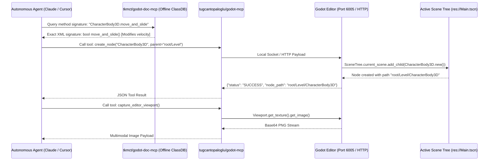

# Godot Engine Automation, Headless CLI & Agentic Control (2025–2026)

*Target Engine: Godot 4.2, 4.3, and 4.4+*  
*Scope: Official Ecosystem, FOSS / Community Open-Source, and 3rd-Party Standalone Automation Systems*

---

## 1. Architectural Overview & Why Godot Leads in Agentic Controllability

Among all general-purpose game engines, **Godot 4** offers the lowest friction for automated CLI orchestration and autonomous AI agent control. This architectural superiority stems from three fundamental design decisions:
1. **Zero-Installer Single Binary Architecture:** Godot is distributed as a single self-contained, statically linked executable (~100 MB). It has no background service daemons, no mandatory hub launchers, and no licensing activation servers.
2. **First-Class Native Headless Mode (`--headless`):** Unlike engines where headless execution is an afterthought bolted onto a GUI build, Godot natively decouples the display server, audio server, and physics servers. Running with `--headless` initializes the complete virtual scene tree and scripting environment without opening an X11, Wayland, or Win32 window context.
3. **Pure Human-Readable Text Formats:** Godot scenes (`.tscn`), resources (`.tres`), project manifests (`project.godot`), and scripts (`.gd`) are stored as clean, deterministic plaintext files. An AI agent can read, diff, and mutate Godot scene trees using standard string/AST parsers without requiring proprietary binary serialization libraries.

In **Godot 4.3 and 4.4 (2025–2026)**, the engine reinforced these strengths by introducing enhanced .NET 8 / C# integration, stable GDExtension C++ ABIs, and a vibrant community wave of **Model Context Protocol (MCP)** tools that expose over 150 granular editor operations to AI agents.

---

## 2. Official Ecosystem Tools

```
┌────────────────────────────────────────────────────────────────────────────────────────┐
│                              OFFICIAL GODOT AUTOMATION STACK                           │
├─────────────────────────┬──────────────────────────────────────────────────────────────┤
│ Component               │ Core Mechanism & Purpose                                     │
├─────────────────────────┼──────────────────────────────────────────────────────────────┤
│ Single-Binary CLI       │ godot executable with rich subcommands & headless flags      │
│ Standalone Script Mode  │ godot -s <script.gd> executes scripts without loading scenes │
│ Headless Project Export │ godot --headless --export-release for multi-platform CI      │
│ Warm-Up Import Engine   │ godot --headless --import --quit resolves caches for CI/CD   │
│ Headless GDScript LSP   │ TCP language server providing AST completion & diagnostics   │
└─────────────────────────┴──────────────────────────────────────────────────────────────┘
```

### 2.1 The Native Godot Command-Line Interface
The Godot executable serves as compiler, editor, test runner, and game runtime, toggled entirely via command-line flags.

* **Primary CLI Switches:**
  * `--headless`: Runs the engine without graphics windows, audio output, or user interaction prompts.
  * `-s <script_path>` / `--script <script_path>`: Runs a specific standalone GDScript file inheriting from `SceneTree` or `MainLoop`.
  * `--import`: Scans the project directory, processes unimported source assets (textures, models, audio), generates the `.godot/imported/` cache, and exits when combined with `--quit`.
  * `--export-release <Preset> <Path>`: Exports the project headlessly using a defined export preset in `export_presets.cfg`.
  * `--editor`: Launches the editor environment (can be combined with `--headless` for batch asset processing).

### 2.2 The "Warm-Up Import" Pattern for Clean CI/CD
In clean continuous integration runners (such as GitHub Actions or Docker containers), the `.godot/` cache directory does not exist. If a test runner or export command is invoked immediately, Godot may experience race conditions or fail to resolve `class_name` definitions because assets have not been indexed yet.

* **The Industry Standard Two-Step Pipeline:**
  ```bash
  # Step 1: Headless warm-up import to compile shaders and register resources
  godot --headless --import --quit

  # Step 2: Execute tests or exports
  godot --headless -s addons/gut/gut_cmdln.gd -gdir=res://tests/ -gexit
  ```

### 2.3 Headless GDScript Language Server (LSP)
The Godot editor includes an integrated Language Server Protocol (LSP) daemon listening on port `6005`.
* **Agent Integration:** An autonomous coding agent can connect directly to Godot's LSP over TCP to validate GDScript syntax, obtain auto-completion suggestions, resolve symbol definitions, and check compiler errors before saving code to disk.

---

## 3. FOSS & Community Open-Source Tooling

```
┌────────────────────────────────────────────────────────────────────────────────────────┐
│                              COMMUNITY OPEN-SOURCE TOOLING                             │
├─────────────────────────┬──────────────────────────────────────────────────────────────┤
│ Repository / Project    │ Ecosystem Classification & Capabilities                      │
├─────────────────────────┼──────────────────────────────────────────────────────────────┤
│ tugcantopaloglu/godot-mcp│ Massive MCP server exposing 157 tools for scene & script ops │
│ IvanMurzak/Godot-MCP    │ C# editor addon targeting Godot 4.3+ .NET with 42 tools      │
│ tkmct/godot-doc-mcp     │ Zero-latency offline stdio search of Godot ClassDB XML docs  │
│ Dokujaa/Godot-MCP       │ Editor plugin with Python backend & Meshy 3D API integration │
│ GUT (Godot Unit Test)   │ Standard xUnit test framework with rich headless CLI runner  │
│ Chickensoft.GodotEnv    │ .NET CLI version manager & addons.json dependency manager    │
│ chickensoft/setup-godot │ Cached GitHub Actions runner for rapid Godot CI/CD workflows │
│ barichello/godot-ci     │ Docker container images bundling Godot & export templates    │
└─────────────────────────┴──────────────────────────────────────────────────────────────┘
```

### 3.1 Model Context Protocol (MCP) Ecosystem for Godot
The Godot open-source ecosystem created some of the most comprehensive MCP servers available in game development:

1. **`tugcantopaloglu/godot-mcp` (Fork of Coding-Solo/godot-mcp):**
   * **Scale:** A powerhouse MCP server exposing over **157 distinct tools** to Claude Code, Cursor, and Windsurf.
   * **Core Capabilities:**
     * **Scene & Node Scaffolding:** Create, move, reparent, duplicate, and delete nodes; set transforms, properties, and metadata; instantiate sub-scenes.
     * **Script Diagnostics (`validate_script`):** Programmatically validates GDScript and C# syntax without triggering full project reloads.
     * **Input Map Merging:** Inspects and dynamically adds action mappings to `project.godot`.
     * **Resource Authoring:** Creates, modifies, and assigns Materials (`StandardMaterial3D`, `ShaderMaterial`), collision shapes (`BoxShape3D`, `CapsuleShape3D`), and physics properties.
2. **`IvanMurzak/Godot-MCP`:**
   * **Architecture:** Written natively in C# as an editor addon, targeting Godot 4.3+ .NET / Mono builds.
   * **Features:** Exposes 42+ tools across 12 families (nodes, scenes, resources, filesystem, scripts, viewport screenshots, reflection, and runtime errors). Supports visual verification by capturing editor viewport frames and streaming them back to multimodal LLMs.
3. **`tkmct/godot-doc-mcp` (Offline ClassDB Documentation Server):**
   * **The Problem:** LLMs frequently hallucinate obsolete Godot 3 methods (e.g., `set_translation()` instead of `position`, `move_and_slide(velocity)` instead of `velocity = ...; move_and_slide()`).
   * **The Solution:** An offline MCP server that directly indexes Godot 4.x ClassDB XML files locally. When Claude or Cursor needs to check a method signature, property type, or signal, it queries the local XML index over stdio in sub-milliseconds, completely eliminating documentation hallucinations.

### 3.2 GUT (Godot Unit Test) Headless CLI
GUT is the industry standard unit, integration, and functional testing framework for Godot.
* **CLI Runner Script (`gut_cmdln.gd`):** Allows automated test execution directly from terminal or CI runners.
* **Key Command-Line Flags:**
  * `-gdir=res://tests/`: Specifies the root directory of the test suite.
  * `-ginclude_subdirs`: Scans recursively for test scripts.
  * `-gexit`: Forces Godot to terminate immediately after test completion (preventing CI hangs).
  * `-gjunit_xml_file=results.xml`: Exports test results to standard JUnit XML format for CI/CD dashboard reporting.
* **Execution Command:**
  ```bash
  godot --headless -s addons/gut/gut_cmdln.gd -gdir=res://tests/ -ginclude_subdirs -gexit -gjunit_xml_file=reports/gut.xml
  ```
* **Exit Codes:** Returns code `0` on 100% pass, and non-zero (e.g. `1`) on any test failure, enabling instant build gating in GitHub Actions.

### 3.3 Chickensoft Ecosystem (`GodotEnv` & `setup-godot`)
Maintained by the Chickensoft Games open-source organization, this suite elevates Godot C#/.NET development to enterprise standards:
* **`Chickensoft.GodotEnv`:** A cross-platform .NET global CLI tool (`dotnet tool install --global Chickensoft.GodotEnv`). Acts like `nvm` or `asdf` for Godot, enabling developers to install, switch, and symlink Godot engine versions via command line, and manages project plugins via a clean `addons.json` manifest instead of messy Git submodules.
* **`chickensoft-games/setup-godot`:** The leading GitHub Action for Godot. Automatically downloads, configures, and caches Godot binaries and export templates on Ubuntu, macOS, and Windows runners, slashing CI setup times from minutes to seconds.

---

## 4. Headless CLI Flags & Execution Modes

| Command / Flag | Purpose & Technical Description |
| :--- | :--- |
| `godot --headless` | Disables display, windowing, and audio subsystems completely. |
| `godot -s <script.gd>` | Runs a standalone script; script should extend `SceneTree` or call `quit()`. |
| `godot --import --quit` | Scans assets, updates `.godot/imported/` cache, and terminates cleanly. |
| `godot --export-release <P> <O>`| Headlessly exports project using preset `P` to output path `O`. |
| `godot --editor --headless` | Launches headless editor process for automated plugin/script processing. |
| `godot --fixed-fps <FPS>` | Forces deterministic physics tick rate for automated simulation tests. |

### Concrete Production CI/CD Script Example (GitHub Actions)
```yaml
name: Godot 4.3 Headless CI/CD Pipeline
on: [push, pull_request]

jobs:
  test_and_build:
    name: Run GUT Tests and Export Linux Binary
    runs-on: ubuntu-latest
    steps:
      - name: Checkout Code
        uses: actions/checkout@v4
        with:
          lfs: true

      - name: Setup Godot Engine
        uses: chickensoft-games/setup-godot@v2
        with:
          version: "4.3.0"
          use-dotnet: false

      - name: Step 1 - Warm-Up Asset Import
        run: godot --headless --import --quit

      - name: Step 2 - Execute GUT Unit Tests
        run: |
          godot --headless -s addons/gut/gut_cmdln.gd \
            -gdir=res://tests/ \
            -ginclude_subdirs \
            -gexit \
            -gjunit_xml_file=reports/test_results.xml

      - name: Step 3 - Headless Export Release
        run: |
          mkdir -p build/linux
          godot --headless --export-release "Linux/X11" build/linux/Game.x86_64

      - name: Archive Build Artifacts
        uses: actions/upload-artifact@v4
        with:
          name: Linux-Build
          path: build/linux/
```

---

## 5. Custom Agent Integration Architecture

To establish an autonomous agent loop that controls Godot, developers configure a two-stage MCP architecture:



### Critical Implementation Rules for Godot Agent Bridges:
1. **The ClassDB Verification Step:** Autonomous agents should always run a two-stage loop: first verify the target Godot class API using `tkmct/godot-doc-mcp`, then issue structural changes via `godot-mcp`. This completely eliminates syntax errors caused by legacy Godot 3 vs. Godot 4 differences.
2. **Text-Based Scene Modification Safety:** While agents can write directly to `.tscn` plaintext files, doing so while the Godot editor GUI is open can cause reload conflicts. Always use an MCP plugin that mutates the active scene tree via editor APIs, or force an editor scene reload (`reload_current_scene()`) after writing files to disk.
3. **Viewport Screenshot Reflection:** Multimodal agents can inspect their own 3D scene placement by invoking viewport capture tools (`Viewport.get_texture().get_image().save_png_to_buffer()`), encoding the image as Base64 to confirm that lights, colliders, and meshes are aligned correctly.
