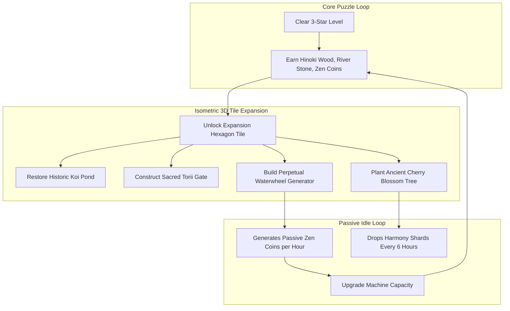

# Module 05: Hybrid-Casual Progression, Side Quests, and Idle Meta

## 1. The Zen Sanctuary Decorator (SayGames *My Little Universe* Meta)

To elevate *Zen Stacker* from a simple level-clearing puzzle into a high-retention hybrid-casual game, the player is crowned the **Master Architect of the Grandmaster's Zen Sanctuary**.

### 1.1 Sanctuary Landmark Progression Catalog

| Landmark Name | Building Tier | Resource Cost to Restore | In-Game Cosmetic Reward | Permanent Passive Gameplay Perk |
| :--- | :--- | :--- | :--- | :--- |
| **Koi Pond Basin** | Tier 1 (Level 5) | $500\text{ Coins} + 100\text{ Stone}$ | Unlocks swimming Kohaku koi fish in puzzle water. | $+5\%$ bonus coins on all campaign levels. |
| **Stone Lanterns (Tōrō)** | Tier 2 (Level 15) | $1,200\text{ Coins} + 250\text{ Stone}$ | Unlocks twilight candle lighting preset. | Stabilizer power-up duration increased by $+1.0\text{s}$. |
| **Perpetual Waterwheel** | Tier 3 (Level 30) | $3,500\text{ Coins} + 500\text{ Wood}$ | Visible animated waterwheel in background pool. | **Idle Bank**: Generates $+25\text{ coins/hr}$ (8h offline cap). |
| **Vermilion Torii Gate** | Tier 4 (Level 60) | $8,000\text{ Coins} + 1,000\text{ Wood}$ | Monumental gateway; unlocks Sakura block skin. | Checkpoint milestones award double mystery chest loot. |
| **Ancient Bonsai Garden**| Tier 5 (Level 100)| $15,000\text{ Coins} + 400\text{ Shards}$| Bonsai pruning mini-game; unlocks Jade block skin.| Offline coin cap expanded from $8\text{ hours} \to 24\text{ hours}$. |
| **Grandmaster Pagoda** | Tier 6 (Level 175)| $35,000\text{ Coins} + 1,000\text{ Shards}$| Imperial Golden Pagoda; unlocks Kintsugi Gold skin. | Win streak bonus multiplier increased by $+50\%$. |

---

## 2. Retention Architecture: LiveOps, Side Quests, and Daily Bounties

Borrowing from the playbooks of **Homa Games** and **Lion Studios**, short-term session loops are reinforced with daily quests and seasonal live events.

### 2.1 Daily Zen Bounties (Contract Quests)
Every 24 hours at 00:00 UTC, players receive three random Zen Contracts:
* **Contract 1 (Easy)**: "Score 3 Harmonic Snaps in any level." (Reward: $150\text{ Zen Coins}$)
* **Contract 2 (Medium)**: "Balance 4 Kurogane Iron blocks on a fulcrum seesaw." (Reward: $300\text{ Coins} + 15\text{ Shards}$)
* **Contract 3 (Hard)**: "Clear 3 stages with zero block rotations." (Reward: $1\text{ Precision Rewind Token}$)

### 2.2 The Seasonal "Zen Pass" (Battle Pass System)
A 30-day seasonal journey divided into 40 milestone tiers:
* **Free Track**: Available to all players; awards coins, basic stone skins, and booster consumables.
* **Master Track ($\$4.99$ IAP)**: Unlocks exclusive seasonal cosmetics (e.g., "Cherry Blossom Resin" blocks, "Bioluminescent Dragon Koi"), double offline idle speed, and a golden nameplate on global leaderboards.

---

## 3. King-Inspired Monetization: The "Zen Vault" & Win Streaks

### 3.1 The Zen Vault (Piggy Bank System)
* **Mechanic**: Every time a player earns a 3-star level victory, 50 bonus Harmony Shards are deposited into the **Zen Vault** (represented as an ornate ceramic daruma doll).
* **The Psychological Hook**: The vault displays a filling meter ($0/1,000\text{ Shards}$).
* **Conversion Offer**: Once the vault reaches capacity ($1,000\text{ Shards}$ = valued at $\$9.99$ standard price), the player is offered to "Break the Vault" for only **$\$2.99$**. This delivers an irresistible $70\%$ discount perceived value, driving industry-leading hybrid-casual IAP conversion.

### 3.2 Win Streak "Aura of Stillness"
* Winning 1 level in a row: $+10\%$ bonus coins.
* Winning 2 levels in a row: $+25\%$ bonus coins + free initial 45° rotation guide.
* Winning 3+ levels in a row: **Master's Aura**: The starting platform begins with a subtle magnetic dampening field, stabilizing the first two placed blocks for free!
