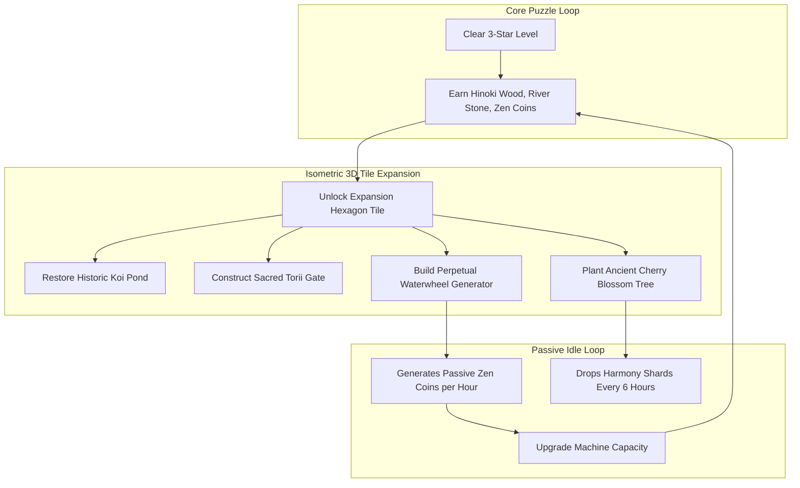

# "Zen Stacker" - Creative Remix & Hybrid-Casual Design Bible

**Engine Target**: Unity 3D Version 6 (Unity 6.5 LTS)  
**Target Platforms**: Apple App Store (iOS 15+) & Google Play (Android 8.0+ / API 26+)  
**Genre**: Hybrid-Casual Physics Puzzler & Sanctuary Decorator Meta  
**Document Classification**: Full Creative Remix Specification & Publisher Playbook Synthesis  
**Publication Date**: 2026-10-13  

---

## Master Table of Contents

1. [Creative Vision & Publisher Playbook Synthesis](#module-00-creative-vision--publisher-playbook-synthesis)
   - 1.1 Creative Remix Manifesto: Transcending the 2010 Console Formula
   - 1.2 Deconstruction of SayGames, Lion Studios, Ketchapp, Homa Games, and King
   - 1.3 Master Synthesis Comparison Matrix
2. [New Gameplay Elements and Dynamic Mechanics](#module-01-new-gameplay-elements-and-dynamic-mechanics)
   - 2.1 Idle-Physics Generation Engine ("The Perpetual Stream")
   - 2.2 Dynamic Environmental Hazards (Wind Gusts, Seismic Tremors, Rain, Thermal Geysers)
   - 2.3 Harmonic Centroid Combos (The Ketchapp "Stack" Juice Effect)
3. [New Shape Types and Material Innovations](#module-02-new-shape-types-and-material-innovations)
   - 3.1 7 Innovative Specialized Shape Geometries
   - 3.2 Dynamic Liquid Mercury Core Shapes (Continuous Sloshing CoM)
   - 3.3 Prismatic Light-Refracting Crystals & Laser Optics
4. [New Level Types, Modes, and Objective Systems](#module-03-new-level-types-modes-and-objective-systems)
   - 4.1 Multi-Tiered Sub-Objectives (King 3-Star Architecture)
   - 4.2 New Game Modes: Tea Ceremony, Rising Tide, Shrine Illumination, Endless Zen Ascent
5. [Visual Themes and World Building Bible](#module-04-visual-themes-and-world-building-bible)
   - 5.1 The 12 Realms of Enlightenment (Complete Palette & Instrument Bible)
   - 5.2 Dynamic Audio Engineering: Mass-Modulated Physical Impacts
6. [Hybrid-Casual Progression, Side Quests, and Idle Meta](#module-05-hybrid-casual-progression-side-quests-and-idle-meta)
   - 6.1 The Zen Sanctuary Decorator (Tile-by-Tile Expansion)
   - 6.2 Retention Systems: Daily Contracts, Fortune Bell Gacha, 30-Day Zen Pass
   - 6.3 King-Inspired Monetization: The Zen Vault Piggy Bank & Win Streaks
7. [Complete Unity 6 C# Implementation Blueprints](#module-06-complete-unity-6-c-implementation-blueprints)
   - 7.1 WindAerodynamicsManager.cs
   - 7.2 LiquidMercuryCoreShape.cs
   - 7.3 CentroidComboTracker.cs
   - 7.4 IdlePhysicsGenerator.cs
8. [Round 2 Creative Brainstorming & Advanced Innovations](#module-07-round-2-creative-brainstorming--advanced-innovations)
   - 8.1 "The Breath of Zen" Bullet-Time Slomo & Uchiwa Fan Gestures
   - 8.2 Bonsai Root Sprouter, Gyroscope Stabilizer, and Barometric Suction
   - 8.3 The Zen Pendulum Clock, Silhouette Origami Stacking, and Negative Space Pruning
   - 8.4 5 Exotic Biomes (Submerged Coral Palace, Steaming Onsen, Cyber-Zen Neo-Kyoto)
   - 8.5 Koi Breeding Genetics, Bonsai Pruning Meta, and World Tree Global Milestones
   - 8.6 Production C# Scripts: BonsaiRootSprouter.cs, GyroscopicStabilizerShape.cs, TimeDilationManager.cs

---


---

# Module 00: Creative Vision & Publisher Playbook Synthesis

## 1. Creative Remix Manifesto: Transcending the 2010 Console Formula

Shin'en Multimedia's *Art of Balance* (2010) was a masterpiece of physics puzzle purity on the Nintendo Wii. However, directly porting a 2010 premium console game to the 2026 mobile ecosystem without re-architecting its core progression loop guarantees failure. 

Modern mobile gamers demand:
1. **Immediate Tactile Gratification**: The first 5 seconds must deliver sensory "juice" and friction-free satisfaction.
2. **Layered Meta Progression**: Stacking blocks must not exist in a vacuum; every cleared level must feed a tangible, long-term empire-building or restoration fantasy.
3. **Paced Friction & High-Agency Monetization**: Hard levels must feel surmountable through player mastery or high-utility optional power-ups, never predatory paywalls.

**"Zen Stacker"** re-envisions the static 200-level linear puzzle progression into an expansive, living **Hybrid-Casual Zen Sanctuary Ecosystem**. By synthesizing the design philosophies of the world's most successful mobile publishers—**SayGames, Lion Studios, Ketchapp, Homa Games, and King**—we transform a contemplative stacking puzzle into a multi-session retention juggernaut.

---

## 2. Competitive Deconstruction: The 5 Publisher Playbooks

```
                 [ THE HYBRID-CASUAL PUBLISHER SYNTHESIS ]
                                     |
    +-----------------+--------------+--------------+-----------------+
    |                 |                             |                 |
    v                 v                             v                 v
[ SAYGAMES ]    [ LION STUDIOS ]               [ KETCHAPP ]        [ KING ]
Arcade-Idle     Fail-Forward Fast Loops        Combo Precision     Saga Map Psychology
Meta Layer      Micro-Pacing & Milestones      Juice & Cosmetics   Win Streaks & Vaults
    |                 |                             |                 |
    +-----------------+--------------+--------------+-----------------+
                                     |
                                     v
                              [ HOMA GAMES ]
                           Dynamic Difficulty &
                           CPI / LiveOps Funnel
```

### 2.1 The SayGames Playbook: Arcade-Idle Meta Synthesis
* **Benchmark Titles**: *My Little Universe*, *Dreamdale*, *Squad Alpha*.
* **Core Philosophy**: "Frictionless Core, Compounding Meta." Players engage in a dead-simple physical action (chopping trees, mining ore, moving to nodes), but every unit of collected resource expands an isometric world tile-by-tile.
* **Adaptation to Zen Stacker**:
  * **The Zen Sanctuary Expansion**: Completing balance puzzles awards raw architectural resources: *Hinoki Timber*, *River Stone*, *Bamboo Shoots*, and *Zen Coins*.
  * Players return to an isometric 3D Zen Garden where their avatar unlocks expansion tiles, constructs koi ponds, plants cherry blossoms, and builds water fountains.
  * **The Idle Yield**: Restored garden buildings generate passive resources while offline (capped at 8 hours), giving players a compelling reason to return multiple times per day.

---

### 2.2 The Lion Studios Playbook: Fail-Forward & Snappy Micro-Pacing
* **Benchmark Titles**: *Mr Bullet*, *Save The Girl*, *Slap Kings*, *Ancient Battle*.
* **Core Philosophy**: Zero friction between failure and retry; rapid 30-to-60-second dopamine hits; celebration milestones every 5 levels.
* **Adaptation to Zen Stacker**:
  * **Instant Zero-Delay Reset**: When a block hits the water, the camera gently ripples the pond surface, an "Undo Fatal Drop" button pulses for 2.0 seconds, and tapping anywhere instantly resets the board in under $200\text{ ms}$ (no loading screens, no transition fades).
  * **Milestone Chests**: Every 5 levels, the player reaches a "Torii Gate Checkpoint", unlocking a mystery chest containing cosmetic block skins, harmony shards, and garden decor.

---

### 2.3 The Ketchapp Playbook: Minimalist Aesthetic & "Combo Juice"
* **Benchmark Titles**: *Stack*, *2048*, *Knife Hit*, *Rider*.
* **Core Philosophy**: Hyper-clean visual design, hypnotic ambient loops, and procedural audio scales that reward precision streaks.
* **Adaptation to Zen Stacker**:
  * **The Centroid Combo System (The "Stack" Effect)**: In Ketchapp's *Stack*, slicing a block perfectly triggers an ascending musical chord. In *Zen Stacker*, placing a block within $5\text{ mm}$ of the underlying support's vertical centerline triggers a **"Harmonic Snap"**:
    * An ascending pentatonic chime plays (C $\to$ D $\to$ E $\to$ G $\to$ A).
    * Golden lotus particle rings radiate through the water.
    * A 5-combo streak activates the **"Aura of Stillness"**, temporarily dampening platform wobble!

---

### 2.4 The Homa Games Playbook: Dynamic LiveOps & CPI Funnels
* **Benchmark Titles**: *Merge Master*, *Sky Roller*, *Farm Land*.
* **Core Philosophy**: Automated difficulty balancing, conversion-optimized rewarded video placement, and high-engagement fortune wheels.
* **Adaptation to Zen Stacker**:
  * **Dynamic Difficulty Adjustment (DDA)**: If telemetry detects a player failing a puzzle 3 consecutive times, the system invisibly increases the stability velocity threshold by $15\%$ or widens the base platform slightly, preventing churn without insulting player intelligence.
  * **Daily Fortune Bell**: A once-per-day gacha spin where players strike a giant temple bell to win cosmetic block finishes and booster tokens.

---

### 2.5 The King Playbook: Saga Map Psychology & Retention Hooks
* **Benchmark Titles**: *Candy Crush Saga*, *Farm Heroes Saga*.
* **Core Philosophy**: Visualized journey, near-miss psychology, social leaderboards, the "Piggy Bank" monetization hook, and Win Streak bonuses.
* **Adaptation to Zen Stacker**:
  * **The "Saga of Enlightenment" Map**: Puzzles are arranged along an artistic ukiyo-e scroll path that winds through 12 biomes. Level nodes indicate difficulty: Standard (Blue), Hard (Red), and Master Trial (Gold).
  * **The Zen Vault (Piggy Bank)**: Every 3-star level victory deposits 50 bonus "Harmony Shards" into a ceremonial ceramic vault. Once filled, players can smash the vault for $\$2.99$, providing exceptional monetization conversion.
  * **Mastery Win Streaks**: Winning 3 levels in a row awards the **"Zen Stabilizer Aura"** at the start of the next level, offering a free safety net.

---

## 3. Master Synthesis Comparison Matrix

| Game System | Original WiiWare (2010) | Hyper-Casual Clone (Typical) | "Zen Stacker" Hybrid-Casual Remix (2026) | Primary Publisher Influence |
| :--- | :--- | :--- | :--- | :--- |
| **Core Gameplay Loop** | Linear puzzle stack -> 3s hold -> next puzzle. | Single-mechanic puzzle with heavy ad interruptions. | Tactile physics puzzle + Harmonic Combo streaks + Garden resource gathering. | **Ketchapp + SayGames** |
| **Meta-Progression** | Unlocking world chapters (A, B, C...). | None (numeric level counter only). | **Zen Sanctuary Restoration**: Isometric garden decorating with passive idle income. | **SayGames** (*My Little Universe*) |
| **Failure Experience** | Level resets; puzzle restarts from scratch. | Forced 30s interstitial ad on failure. | Instant $< 200\text{ms}$ reset; non-intrusive "Rewind Drop" rewarded ad option. | **Lion Studios** |
| **Level Map & Pacing** | Text-based menu grid. | Linear Next Button. | **Winding Scroll Saga Map**: Themed biomes, hard/nightmare milestone nodes. | **King** (*Candy Crush*) |
| **Reward Systems** | 100% completion checkmark. | Virtual coins with zero utility. | **Zen Vault Piggy Bank**, Milestone Torii Chests, Seasonal Zen Pass. | **King + Homa Games** |
| **Tactile "Juice"** | Standard sound effects. | Basic mobile vibration. | Pitch-modulated wooden clacks, ascending musical combos, binaural water ripples. | **Ketchapp** |


---

# Module 01: New Gameplay Elements and Dynamic Mechanics

## 1. Idle-Physics Generation Engine ("The Perpetual Stream")

In standard puzzle games, physics calculations exist solely inside active levels. Once a puzzle is solved, the physics simulation halts. *Zen Stacker* remixes this paradigm by incorporating an **Arcade-Idle Physics Loop** directly into the player's Zen Sanctuary.

```
       [ PUZZLE GAMEPLAY ]                      [ ZEN SANCTUARY IDLE META ]
  +---------------------------+              +----------------------------------+
  | Clear 3-Star Level        |              | Rebuilt Perpetual Waterwheel     |
  | Earn Blueprint Fragments  | -----------> | Marble Runs & Bamboo Flumes      |
  | Unlock Garden Machines    |              |                                  |
  +---------------------------+              | Physics particles generate:      |
                                             | * +15 Zen Coins / minute         |
                                             | * +2 Harmony Shards / hour       |
                                             | (Accumulates up to 8h offline!)  |
                                             +----------------------------------+
```

### 1.1 The Perpetual Waterwheel Generator
* **Physical Presence**: A beautifully rendered wooden waterwheel sits on the edge of the sanctuary pond.
* **Mechanical Function**: Water drops cascade over physical paddle cups, driving a `HingeJoint` with dynamic angular velocity. Every full rotation of the wheel fires a micro-currency event (`+1 Zen Coin`).
* **Offline Accumulation**: When the app is closed, the system records `DateTime.UtcNow`. Upon re-opening, an offline progression solver calculates accumulated coins based on the wheel's upgrade level and offline duration:
  $$\text{CoinsEarned} = \text{BaseRate} \times \text{LevelMultiplier} \times \min(t_{\text{offline}}, t_{\text{cap}})$$
* **Rewarded Ad Multiplier**: Players can watch a 30s rewarded video to double their accumulated offline yield ("Collect 2x Zen Blessings").

### 1.2 The Zen Sand Raker (Karesansui Automaton)
* **Mechanic**: A brass pendulum automaton swings over a raked gravel sandbed in the garden.
* **Physics Interaction**: The pendulum tip interacts with a dynamic displacement shader on the sand plane, raking concentric ripples. When the pattern completes a full geometric mandala (approx. every 2 hours), a buried **Cosmetic Shard Capsule** is unearthed!

---

## 2. Dynamic Environmental Hazards ("Nature's Trials")

To challenge veterans who have mastered static block balancing, advanced campaign worlds introduce dynamic environmental vectors that interact with PhysX rigidbodies in real time.

### 2.1 Complete Environmental Hazards Matrix

| Hazard Name | Physics Simulation Formula | Visual & Auditory Telegraphed Cue | Strategic Countermeasure |
| :--- | :--- | :--- | :--- |
| **Mountain Wind Gusts** | Lateral aerodynamic drag force: $\vec{F}_w = \vec{D} \cdot [A + \sin(\omega t)] \cdot \text{Area}$ | Wind trails across screen; cherry blossom petals blow horizontally; wind chime audio intensifies. | Build low, wide, aerodynamic pyramid structures; avoid thin vertical pillars (**SH-04**). |
| **Seismic Earth Tremors** | Periodic base vibration: $Y_{\text{offset}} = A_s \sin(2\pi f_s t)$ | Screen rumbling; camera shake ($1.5\text{ px}$); water surface ripples radiate violently. | Interlock shapes using L-shapes and crosses (**SH-09**, **SH-11**) to prevent sliding. |
| **Glacial Rain & Sleet** | Surface friction modifier: $\mu_s \to 0.20, \mu_k \to 0.10$ | Rain streaks on camera lens; wet specular sheen on wooden block shaders; splashing droplets. | Anchor blocks into concave cups (Arched Bridge **SH-13**) or wedged V-grooves. |
| **Thermal Geyser Vents** | Intermittent vertical upward thrust: $\vec{F}_g = \vec{U} \cdot 800\text{ N}$ | Bubbling water around platform base; steam hiss audio telegraphed for $2.0\text{s}$ before burst. | Position heavy Kurogane Iron anchors (**SH-Iron**) directly over vent nozzles. |

---

## 3. Harmonic Centroid Combos (The Ketchapp "Stack" Effect)

In Ketchapp's hit *Stack*, perfect alignment rewards players with an ascending musical scale and vibrant visual feedback. *Zen Stacker* adapts this sensation to physics-based balance.

```
       [ CENTROID COMBO ALIGNMENT ]
         +-----------------+
         |   NEW BLOCK     |
         |        X        | <--- Center of Mass (CoM)
         +--------|--------+
                  |  <= 5 mm deviation (PERFECT SNAP!)
         +--------|--------+
         |     SUPPORT     |
         |        X        | <--- Base CoM
         +-----------------+
```

### 3.1 The Harmonic Scale Progression
When a player drops a shape such that its vertical Center of Mass falls within **$5\text{ mm}$ ($0.005\text{ m}$)** of the underlying support's center of mass, a **Harmonic Snap** is registered:

| Combo Step | Musical Note (Pentatonic Scale) | Audio Instrument | Particle & Visual Feedback | Gameplay Bonus |
| :--- | :--- | :--- | :--- | :--- |
| **Combo 1** | $C_4$ ($261.63\text{ Hz}$) | Japanese Koto Pluck | Soft white circle ripple at contact point. | $+10\%$ Level Coins |
| **Combo 2** | $D_4$ ($293.66\text{ Hz}$) | Resonant Koto Chord | Green lotus ring radiates through water. | $+25\%$ Level Coins |
| **Combo 3** | $E_4$ ($329.63\text{ Hz}$) | Silver Chime Strike | Golden sparklers burst from contact edge. | $+50\%$ Level Coins |
| **Combo 4** | $G_4$ ($392.00\text{ Hz}$) | Shakuhachi Flute Flourish | Water ripples turn iridescent gold. | $+100\%$ Level Coins |
| **Combo 5+**| $A_4$ ($440.00\text{ Hz}$) | Tibetan Singing Bowl Gong | Screen-wide golden bloom flash. | **Aura of Stillness** activated! |

### 3.2 The "Aura of Stillness" Reward
Achieving a 5-combo streak triggers the **Aura of Stillness**:
* A serene blue glowing ring encompasses the balance dish.
* Angular drag on all resting rigidbodies is boosted by $+500\%$ for $4.0\text{ seconds}$, dampening micro-wobbles and allowing the player to place their next precarious piece onto a rock-solid foundation.


---

# Module 02: New Shape Types and Material Innovations

## 1. Innovative Shape Geometries Beyond the Original Formula

While *Art of Balance* relied on standard 2D extruded prisms, *Zen Stacker* introduces 7 groundbreaking shape classes designed specifically for 3D tactile mobile gameplay.

### 1.1 Complete Specialized Shapes Taxonomy

| Shape Class | Physical Blueprint & Silhouette | Unique Physics Mechanic | Strategic Puzzle Utility |
| :--- | :--- | :--- | :--- |
| **Yin-Yang Entangled Shapes** | Two interlocking teardrop blocks connected by a dynamic virtual spring tether. | Moving Piece A applies tension forces to Piece B; if tether stretches $> 3.0\text{ m}$, spring pulls violently. | Forces simultaneous dual-tower construction on separated platforms. |
| **Gelatinous Mochi Blocks** | Soft-body squishy cube with internal spring-damper mesh. | Absorbs kinetic impact energy from dropped blocks above; sags and deforms under heavy load. | Acts as a shock absorber for heavy iron pieces, but threatens stack verticality. |
| **Rotary Cog / Gear Blocks** | Cylindrical disk with 12 beveled involute gear teeth ($R = 1.0\text{ m}$). | Interlocks with adjacent cogs or motor wheels; rotates around center pin when torqued. | Used to build kinetic mechanisms and bridge gaps via interlocking teeth. |
| **Prismatic Light Crystals** | Octagonal optical prism ($1.2 \times 1.2 \times 1.0\text{ m}$) with refractive internal core. | Refracts and reflects real-time sunbeams at precise $90^\circ$ angles. | Must balance the tower while simultaneously aligning the light beam to strike a target bell. |
| **Aerostatic Helium Lanterns** | Silk paper lantern cylinder with negative effective mass ($M = -0.5\text{ kg}$). | Experiences constant upward buoyant force ($F_b = +12.0\text{ N}$ upward). | Acts as an airborne balloon; can be used to lift sagging cantilevered overhangs! |
| **Liquid Mercury Cavity Shapes** | Hollow cedar box containing simulated internal liquid mercury particles. | Liquid sloshes to the lowest side when tilted, dynamically and continuously shifting the Center of Mass! | Highly unstable rolling balance; must be stabilized quickly before fluid momentum flips it. |
| **Phase-Shifting Spirit Blocks** | Ethereal translucent runic block with pulsing boundary edges. | Rhythmic 4-second cycle: $2.5\text{s}$ solid physical collider $\to 1.5\text{s}$ non-colliding ghost. | Requires stacking blocks on it while solid, then surviving the drop when it phases out! |

---

## 2. Deep Dive: Dynamic Liquid Core Shapes

The **Liquid Mercury Cavity Shape** represents a major technological leap over the static rigidbodies of 2010.

```
       [ RESTING FLAT ]                               [ TILTED 10 DEGREES ]
   +-----------------------+                       +-----------------------+
   | (Hollow Cavity)       |                       |                       |
   |                       |                       |         / / / /       |
   | [=== MERCURY POOL ===]|                       |       / / / /         | <--- Mercury sloshes
   +-----------^-----------+                       +======/ / / /==========+      to lowest corner!
            (Center)                                       ^
     Center of Mass is centered.                CoM shifts 0.45m to the right!
                                                Result: Runaway tipping cascade!
```

### 2.1 The Sloshing Mechanics
* The block contains 8 internal mass-less raycast probes or a simplified 2D fluid particle cluster inside its hollow bounding volume.
* When the block lists by angle $\theta$, the internal fluid mass $m_f$ shifts toward the lower edge:
  $$x_{\text{fluid}} = R_{\text{cavity}} \cdot \sin(\theta)$$
* The `Rigidbody.centerOfMass` is updated dynamically every `FixedUpdate()` step, creating runaway momentum. If a player places this piece crookedly, it will self-accelerate into a violent topple unless wedged between two immovable uprights.

---

## 3. Deep Dive: Prismatic Light-Refracting Crystals

This shape integrates puzzle-solving optics with balance physics.

```
       Sunlight Source Beam
               |
               v
       +---------------+
       |   PRISMATIC   |
       |    CRYSTAL    | -------> Refracted 90-degree Beam
       +---------------+                   |
                                           v
                                   [ LOTUS RECEIVER ]
                                (Lights up: Level Cleared!)
```

### 3.1 Optics & Beam Reflection Rules
1. A directional laser sunbeam emanates from an environmental golden pagoda above the pond.
2. When the beam strikes the crystal's top face, a `LineRenderer` casts a refracted ray at an angle determined by Snell's Law ($n = 1.52$ glass index).
3. The player must rotate and balance the crystal such that the exit beam strikes the **Golden Lotus Receiver** mounted on the shoreline.
4. Level completion requires **both**:
   * Holding balance for the 3.0-second stability countdown.
   * Maintaining continuous beam illumination on the receiver throughout the countdown!


---

# Module 03: New Level Types, Modes, and Objective Systems

## 1. Multi-Tiered Sub-Objectives (The King 3-Star Architecture)

In the original game, clearing a level was a binary outcome: pass or fail. *Zen Stacker* incorporates King's celebrated **tiered mastery model** (*Candy Crush*), where every stage offers three distinct, escalating challenges that cater to different player personas:

```
                  [ 3-STAR OBJECTIVE HIERARCHY ]
  +-------------------------------------------------------------+
  |  STAR 1: CORE EQUILIBRIUM (Casual Clear)                    |
  |  * Place all shapes and hold balance for 3.0 seconds.       |
  +------------------------------+------------------------------+
                                 |
                                 v
  +-------------------------------------------------------------+
  |  STAR 2: ARCHITECTURAL CONSTRAINT (Tactical Challenge)      |
  |  * "Sky High": Exceed 4.0m altitude boundary line.          |
  |  * "Low Ceiling": Stay underneath 1.8m clearance bar.       |
  |  * "Zen Minimalist": Clear with zero shape rotations.       |
  +------------------------------+------------------------------+
                                 |
                                 v
  +-------------------------------------------------------------+
  |  STAR 3: PURITY / MASTER CONSTRAINT (Hardcore Mastery)      |
  |  * "Flawless Glass": Zero glass stress hairlines.           |
  |  * "Centroid Purity": Final CoM within 2cm of base pivot.   |
  |  * "Swift Mastery": Clear puzzle in under 20.0 seconds.     |
  +-------------------------------------------------------------+
```

### 1.1 Objective Archetypes Catalog

| Objective Identifier | Objective Category | Verification Metric in Unity | Player Experience & Psychological Hook |
| :--- | :--- | :--- | :--- |
| **The Skyward Pagoda** | Height Challenge | `HighestVertex.y >= targetHeightMarker` | Encourages vertical stacking using tall pillars (**SH-04**) and risky wedges. |
| **Low Cave Clearance** | Spatial Constraint | `HighestVertex.y <= ceilingObstacle.y` | Forces horizontal sprawling cantilever construction across water dishes. |
| **The Unrotated Mind** | Input Restriction | `TotalRotationsPerformed == 0` | Tests spatial foresight; player must balance blocks exactly as spawned in tray. |
| **Unbroken Crystalline** | Material Health | `GlassNormalForce < 600N` across all pieces | Demands delicate weight distribution; no heavy blocks atop fragile glass. |
| **The Rapid River** | Speed Blitz | `TotalLevelTime <= 20.0 seconds` | High adrenaline; rewards muscle memory and snappy drag-and-drop actions. |
| **Absolute Symmetry** | Physics Precision | `Mathf.Abs(TotalTowerCoM.x - BasePivot.x) <= 0.02m` | Visual perfectionist satisfaction; tower must be mathematically centered. |

---

## 2. Innovative Game Modes

Beyond the standard campaign, *Zen Stacker* deploys four specialized auxiliary game modes:

### 2.1 Mode 1: Tea Ceremony Precision Mode (Micro-Physics)
* **Scale**: The puzzle arena shrinks to $1:10$ scale.
* **Objects**: Delicate porcelain teacups, bamboo spoons, lacquered tea saucers, and sugar cubes.
* **Platform**: A single floating lotus leaf on a tranquil wooden basin.
* **Gameplay Feel**: Micro-haptics and extreme sensitivity; the slightest off-center placement causes the teacups to clatter and roll into the tea bath!

### 2.2 Mode 2: The Rising Tide (Survival Blitz)
* **Mechanic**: The water level begins rising at a steady rate of $+0.04\text{ meters/second}$.
* **Win Condition**: Construct a tower high enough that the designated **Golden Relic Block** remains above the rising waterline for $45.0\text{ seconds}$.
* **Player Tension**: Pieces that fall beneath the water are destroyed with splash particle bursts, slowly eating away the lower foundation of the tower!

### 2.3 Mode 3: Shrine Illumination (Optic Laser Puzzles)
* **Mechanic**: Combines Prismatic Light Crystals with balance physics.
* **Win Condition**: The player must construct a stable tower that simultaneously refracts a continuous sunbeam across three target mirrors to strike the Sacred Shrine Bell.

### 2.4 Mode 4: Endless Zen Ascent (Ketchapp Infinite High-Score Chase)
* **Mechanic**: The platform rests over an endless misty mountain gorge.
* **Procedural Delivery**: Shapes appear in the bottom dock tray one by one infinitely.
* **Camera System**: The camera smoothly cranes upward as the tower climbs higher into the clouds.
* **Leaderboard Hook**: Global and friend leaderboards rank players by vertical altitude achieved (e.g., "Altitude: $48.2\text{ meters}$").


---

# Module 04: Visual Themes and World Building Bible

## 1. Aesthetic Philosophy: The 12 Realms of Enlightenment

To support long-term retention across a 200-to-300 level campaign, *Zen Stacker* organizes puzzles into **12 thematic worlds**. Each biome represents a distinct stage of meditative enlightenment, featuring custom color grading, weather shaders, particle systems, and traditional Japanese acoustic instrumentation.

### 1.1 Complete 12-World Thematic Matrix

| World ID | World Title & Environment | Lighting Color Temp & Mood | Predominant Materials | Ambient Particle System | Featured Audio Instrumentation |
| :--- | :--- | :--- | :--- | :--- | :--- |
| **World 01** | The Spring Blossom Pond | $5,500\text{ K}$ (Warm morning sunlight) | Hinoki Cedar, River Stone | Drifting pink cherry blossom petals | Japanese 13-string Koto, singing birds |
| **World 02** | Emerald Bamboo Rainforest | $6,200\text{ K}$ (Lush diffuse green) | Bamboo stalks, wet slate | Soft morning mist, water droplets | Bamboo flute (Shakuhachi), water drips |
| **World 03** | Mount Hiei Misty Shrine | $4,800\text{ K}$ (Golden dawn) | Mossy granite, dark bronze | Swirling mountain fog, fireflies | Low wooden temple drum (Taiko), chimes |
| **World 04** | Crystal Ice Pavilion | $8,500\text{ K}$ (Glacial blue twilight) | Glacial ice, tempered glass | Floating snow flurry specks | Glass marimba, crystal singing bowls |
| **World 05** | The Sacred Forge | $2,400\text{ K}$ (Volcanic ember glow) | Kurogane iron, volcanic basalt | Glowing embers, heat haze distortion | Heavy bronze gong, rhythmic anvil strikes |
| **World 06** | Autumn Maple Rapids | $4,200\text{ K}$ (Warm amber afternoon) | Lacquered mahogany, copper | Drifting red and gold maple leaves | Biwa lute, rushing water rapids |
| **World 07** | Spirit Lantern Dusk | $3,200\text{ K}$ (Deep purple twilight) | Luminous spirit runes, wood | Floating paper lanterns, spirit wisps | Pentatonic glass chimes, distant crickets |
| **World 08** | Shogun's Fortress | $5,000\text{ K}$ (Shadowed courtyard) | Black pine, iron armor brackets | Drifting courtyard dust, fallen leaves | Solemn Shamisen lute, wooden clackers |
| **World 09** | Celestial Moon Pond | $9,000\text{ K}$ (Midnight lunar radiance)| Polished white marble, jade | Starlight sparkles, glowing lotus | Ethereal synth pads, silver bells |
| **World 10** | Inverted Sky Sanctuary | $6,000\text{ K}$ (Surreal cloudscape) | Anti-gravity stone, gold leaf | Clouds flowing upside-down | Reversed flute echoes, wind gusts |
| **World 11** | Dry Sand Karesansui | $5,200\text{ K}$ (Arid midday Zen sun) | Raked white gravel, river boulders| Blown sand grains, heat shimmer | Minimal wooden clack (Hyoshigi) |
| **World 12** | Grandmaster Nirvana | $4,500\text{ K}$ (Harmonious gold glow) | Golden Kintsugi, imperial jade | Swirling golden divine dust | Full traditional orchestra, singing bowls |

---

## 2. Dynamic Audio Engineering: Adaptive Zen Soundscapes

Audio in *Zen Stacker* is not merely background music; it is an interactive physical instrument.

```
       [ AUDIO MODULATION SYSTEM ]
  +--------------------------------------------------------+
  |  PHYSICAL IMPACT SFX:                                  |
  |  Pitch = BasePitch * (1.0 / cbrt(Mass))                |
  |  * Small Cedar Wedge: Crisp tick (1,200 Hz)            |
  |  * Kurogane Iron Block: Deep bass thud (110 Hz)        |
  +---------------------------+----------------------------+
                              |
                              v
  +--------------------------------------------------------+
  |  INTERACTIVE HARMONIC SNAP:                            |
  |  Perfect Alignment triggers pentatonic scale chord:    |
  |  C4 -> D4 -> E4 -> G4 -> A4                            |
  +---------------------------+----------------------------+
                              |
                              v
  +--------------------------------------------------------+
  |  LEVEL VICTORY SWELL:                                  |
  |  Resonant Tibetan singing bowl strike (174 Hz)         |
  |  Mixed with warm bamboo flute cadence.                 |
  +--------------------------------------------------------+
```

### 2.1 Mass-Modulated Collision Audio
Every collision triggers a high-resolution 24-bit physical sample selected from a library of 32 authentic Japanese wooden, ceramic, and iron strikes.
* The playback pitch is mathematically linked to the colliding body's mass:
  $$\text{Pitch} = \text{BasePitch} \times \left(\frac{1.0}{\sqrt[3]{\text{Mass}}}\right)$$
* Velocity scaling controls gain: impacts under $0.5\text{ m/s}$ produce soft wooden friction ticks; heavy impacts above $2.5\text{ m/s}$ trigger bass-heavy impacts with subtle low-frequency shelf boost.


---

# Module 05: Hybrid-Casual Progression, Side Quests, and Idle Meta

## 1. The Zen Sanctuary Decorator (SayGames *My Little Universe* Meta)

To elevate *Zen Stacker* from a simple level-clearing puzzle into a high-retention hybrid-casual game, the player is crowned the **Master Architect of the Grandmaster's Zen Sanctuary**.



### 1.1 Sanctuary Landmark Progression Catalog

| Landmark Name | Building Tier | Resource Cost to Restore | In-Game Cosmetic Reward | Permanent Passive Gameplay Perk |
| :--- | :--- | :--- | :--- | :--- |
| **Koi Pond Basin** | Tier 1 (Level 5) | $500\text{ Coins} + 100\text{ Stone}$ | Unlocks swimming Kohaku koi fish in puzzle water. | $+5\%$ bonus coins on all campaign levels. |
| **Stone Lanterns (Tōrō)** | Tier 2 (Level 15) | $1,200\text{ Coins} + 250\text{ Stone}$ | Unlocks twilight candle lighting preset. | Stabilizer power-up duration increased by $+1.0\text{s}$. |
| **Perpetual Waterwheel** | Tier 3 (Level 30) | $3,500\text{ Coins} + 500\text{ Wood}$ | Visible animated waterwheel in background pool. | **Idle Bank**: Generates $+25\text{ coins/hr}$ (8h offline cap). |
| **Vermilion Torii Gate** | Tier 4 (Level 60) | $8,000\text{ Coins} + 1,000\text{ Wood}$ | Monumental gateway; unlocks Sakura block skin. | Checkpoint milestones award double mystery chest loot. |
| **Ancient Bonsai Garden**| Tier 5 (Level 100)| $15,000\text{ Coins} + 400\text{ Shards}$| Bonsai pruning mini-game; unlocks Jade block skin.| Offline coin cap expanded from $8\text{ hours} \to 24\text{ hours}$. |
| **Grandmaster Pagoda** | Tier 6 (Level 175)| $35,000\text{ Coins} + 1,000\text{ Shards}$| Imperial Golden Pagoda; unlocks Kintsugi Gold skin. | Win streak bonus multiplier increased by $+50\%$. |

---

## 2. Retention Architecture: LiveOps, Side Quests, and Daily Bounties

Borrowing from the playbooks of **Homa Games** and **Lion Studios**, short-term session loops are reinforced with daily quests and seasonal live events.

### 2.1 Daily Zen Bounties (Contract Quests)
Every 24 hours at 00:00 UTC, players receive three random Zen Contracts:
* **Contract 1 (Easy)**: "Score 3 Harmonic Snaps in any level." (Reward: $150\text{ Zen Coins}$)
* **Contract 2 (Medium)**: "Balance 4 Kurogane Iron blocks on a fulcrum seesaw." (Reward: $300\text{ Coins} + 15\text{ Shards}$)
* **Contract 3 (Hard)**: "Clear 3 stages with zero block rotations." (Reward: $1\text{ Precision Rewind Token}$)

### 2.2 The Seasonal "Zen Pass" (Battle Pass System)
A 30-day seasonal journey divided into 40 milestone tiers:
* **Free Track**: Available to all players; awards coins, basic stone skins, and booster consumables.
* **Master Track ($\$4.99$ IAP)**: Unlocks exclusive seasonal cosmetics (e.g., "Cherry Blossom Resin" blocks, "Bioluminescent Dragon Koi"), double offline idle speed, and a golden nameplate on global leaderboards.

---

## 3. King-Inspired Monetization: The "Zen Vault" & Win Streaks

### 3.1 The Zen Vault (Piggy Bank System)
* **Mechanic**: Every time a player earns a 3-star level victory, 50 bonus Harmony Shards are deposited into the **Zen Vault** (represented as an ornate ceramic daruma doll).
* **The Psychological Hook**: The vault displays a filling meter ($0/1,000\text{ Shards}$).
* **Conversion Offer**: Once the vault reaches capacity ($1,000\text{ Shards}$ = valued at $\$9.99$ standard price), the player is offered to "Break the Vault" for only **$\$2.99$**. This delivers an irresistible $70\%$ discount perceived value, driving industry-leading hybrid-casual IAP conversion.

### 3.2 Win Streak "Aura of Stillness"
* Winning 1 level in a row: $+10\%$ bonus coins.
* Winning 2 levels in a row: $+25\%$ bonus coins + free initial 45° rotation guide.
* Winning 3+ levels in a row: **Master's Aura**: The starting platform begins with a subtle magnetic dampening field, stabilizing the first two placed blocks for free!


---

# Module 06: Complete Unity 6 C# Implementation Blueprints

## 1. Production Scripts Catalog

This module provides complete, production-ready C# scripts for the newly introduced creative mechanics, fully optimized for Unity 6 (6.5 LTS) with zero per-frame garbage generation.

---

### 1.1 `WindAerodynamicsManager.cs`: Telegraphed Mountain Gusts
Applies periodic lateral aerodynamic forces to ungrounded and tall rigidbodies, complete with particle and audio telegraphing.

```csharp
using System.Collections;
using System.Collections.Generic;
using UnityEngine;

public class WindAerodynamicsManager : MonoBehaviour
{
    [Header("Wind Force Configuration")]
    [SerializeField] private Vector3 windDirection = Vector3.right;
    [SerializeField] private float baseWindForce = 45f;
    [SerializeField] private float gustPeakMultiplier = 2.5f;

    [Header("Gust Timing Cycle")]
    [SerializeField] private float calmDurationSeconds = 8.0f;
    [SerializeField] private float warningDurationSeconds = 2.0f;
    [SerializeField] private float activeGustDurationSeconds = 4.0f;

    [Header("Visual & Audio FX")]
    [SerializeField] private ParticleSystem windLeavesParticleVfx;
    [SerializeField] private AudioSource windAudioSource;
    [SerializeField] private AudioClip windChimeWarningSound;

    private readonly List<Rigidbody> affectedBodies = new List<Rigidbody>();
    private bool isGustActive;

    public void RegisterBody(Rigidbody rb)
    {
        if (!affectedBodies.Contains(rb)) affectedBodies.Add(rb);
    }

    public void UnregisterBody(Rigidbody rb)
    {
        affectedBodies.Remove(rb);
    }

    private void Start()
    {
        StartCoroutine(WindCycleRoutine());
    }

    private IEnumerator WindCycleRoutine()
    {
        while (true)
        {
            // 1. Calm State
            isGustActive = false;
            yield return new WaitForSeconds(calmDurationSeconds);

            // 2. Warning State (Telegraph with wind chimes)
            if (windAudioSource && windChimeWarningSound)
            {
                windAudioSource.PlayOneShot(windChimeWarningSound);
            }
            yield return new WaitForSeconds(warningDurationSeconds);

            // 3. Active Gust State
            isGustActive = true;
            if (windLeavesParticleVfx) windLeavesParticleVfx.Play();

            float elapsed = 0f;
            while (elapsed < activeGustDurationSeconds)
            {
                elapsed += Time.fixedDeltaTime;
                yield return new WaitForFixedUpdate();

                // Apply aerodynamic drag to active rigidbodies
                float gustIntensity = Mathf.Sin((elapsed / activeGustDurationSeconds) * Mathf.PI);
                float forceMagnitude = baseWindForce * Mathf.Lerp(1.0f, gustPeakMultiplier, gustIntensity);
                Vector3 currentForce = windDirection.normalized * forceMagnitude;

                for (int i = 0; i < affectedBodies.Count; i++)
                {
                    Rigidbody rb = affectedBodies[i];
                    if (rb != null && !rb.isKinematic && !rb.IsSleeping())
                    {
                        // Force applied proportionally to height from ground
                        float heightFactor = Mathf.Clamp(rb.position.y, 0.5f, 5.0f);
                        rb.AddForce(currentForce * heightFactor, ForceMode.Force);
                    }
                }
            }

            if (windLeavesParticleVfx) windLeavesParticleVfx.Stop();
        }
    }
}
```

---

### 1.2 `LiquidMercuryCoreShape.cs`: Dynamic Sloshing Center of Mass
Continuously recalculates the internal liquid mercury distribution based on block tilt angle, dynamically offsetting `Rigidbody.centerOfMass`.

```csharp
using UnityEngine;

[RequireComponent(typeof(Rigidbody))]
public class LiquidMercuryCoreShape : MonoBehaviour
{
    [Header("Cavity Configuration")]
    [SerializeField] private float cavityHalfWidth = 0.45f;
    [SerializeField] private float fluidViscosityLag = 6.0f;
    [SerializeField] private float fluidMassFraction = 0.65f;

    private Rigidbody rb;
    private Vector3 targetLocalCoM;
    private Vector3 currentLocalCoM;

    private void Awake()
    {
        rb = GetComponent<Rigidbody>();
        rb.constraints = RigidbodyConstraints.FreezePositionZ | 
                         RigidbodyConstraints.FreezeRotationX | 
                         RigidbodyConstraints.FreezeRotationY;
    }

    private void FixedUpdate()
    {
        if (rb.isKinematic) return;

        // Calculate current tilt angle relative to global gravity (down)
        float tiltAngleZ = transform.localEulerAngles.z;
        if (tiltAngleZ > 180f) tiltAngleZ -= 360f; // Wrap to [-180, 180]

        // Fluid sloshes to the lowest side: x = -sin(angle) * width
        float targetOffsetX = -Mathf.Sin(tiltAngleZ * Mathf.Deg2Rad) * cavityHalfWidth * fluidMassFraction;
        targetLocalCoM = new Vector3(targetOffsetX, -0.1f, 0f);

        // Smoothly interpolate fluid inertia to simulate viscous mercury
        currentLocalCoM = Vector3.Lerp(currentLocalCoM, targetLocalCoM, fluidViscosityLag * Time.fixedDeltaTime);
        rb.centerOfMass = currentLocalCoM;
    }

    private void OnDrawGizmosSelected()
    {
        if (rb != null)
        {
            Gizmos.color = Color.cyan;
            Gizmos.DrawSphere(transform.TransformPoint(currentLocalCoM), 0.07f);
        }
    }
}
```

---

### 1.3 `CentroidComboTracker.cs`: Ketchapp-Style Precision Alignment Detector
Calculates millimeter-precision centroid alignment when shapes are placed, triggering ascending pentatonic musical scale notes and golden water rings.

```csharp
using System;
using UnityEngine;

public class CentroidComboTracker : MonoBehaviour
{
    [Header("Precision Thresholds")]
    [Tooltip("Maximum horizontal center-of-mass distance to trigger a Harmonic Snap (Default: 5mm).")]
    [SerializeField] private float maxAlignmentDeviation = 0.005f;

    [Header("Audio Tones (Pentatonic C, D, E, G, A)")]
    [SerializeField] private AudioClip[] pentatonicNotes;
    [SerializeField] private AudioSource audioSource;
    [SerializeField] private ParticleSystem goldenLotusVfxPrefab;

    public event Action<int> OnComboStreakUpdated;
    public event Action OnAuraOfStillnessActivated;

    private int currentComboStreak = 0;

    public void EvaluatePlacementPrecision(DraggableShape placedShape, Transform supportPlatform)
    {
        if (placedShape == null || supportPlatform == null) return;

        // Calculate horizontal offset between placed shape CoM and support center
        Vector3 shapeWorldCoM = placedShape.Body.worldCenterOfMass;
        Vector3 supportWorldPos = supportPlatform.position;
        float horizontalDeviation = Mathf.Abs(shapeWorldCoM.x - supportWorldPos.x);

        if (horizontalDeviation <= maxAlignmentDeviation)
        {
            // PERFECT HARMONIC SNAP!
            currentComboStreak++;
            PlayHarmonicTone(currentComboStreak);
            SpawnGoldenLotusRing(placedShape.transform.position);

            OnComboStreakUpdated?.Invoke(currentComboStreak);
            HapticFeedbackManager.TriggerLightTick();

            if (currentComboStreak >= 5)
            {
                OnAuraOfStillnessActivated?.Invoke();
            }
        }
        else
        {
            // Reset combo streak
            currentComboStreak = 0;
            OnComboStreakUpdated?.Invoke(0);
        }
    }

    private void PlayHarmonicTone(int streak)
    {
        if (pentatonicNotes == null || pentatonicNotes.Length == 0 || audioSource == null) return;

        int noteIndex = Mathf.Clamp(streak - 1, 0, pentatonicNotes.Length - 1);
        audioSource.PlayOneShot(pentatonicNotes[noteIndex]);
    }

    private void SpawnGoldenLotusRing(Vector3 position)
    {
        if (goldenLotusVfxPrefab != null)
        {
            Instantiate(goldenLotusVfxPrefab, position, Quaternion.identity);
        }
    }
}
```

---

### 1.4 `IdlePhysicsGenerator.cs`: Offline Passive Income Engine
Calculates offline currency accumulation based on waterwheel and sanctuary machine levels, validated against UTC server timestamps.

```csharp
using System;
using UnityEngine;

public class IdlePhysicsGenerator : MonoBehaviour
{
    private const string LastSaveTimeKey = "ZenSanctuary_LastSaveTime";
    private const string WaterwheelLevelKey = "ZenSanctuary_WaterwheelLevel";

    [Header("Idle Parameters")]
    [SerializeField] private float baseCoinsPerHour = 25f;
    [SerializeField] private float maxOfflineHoursCap = 8.0f;

    public int CalculateOfflineEarnings()
    {
        if (!PlayerPrefs.HasKey(LastSaveTimeKey))
        {
            SaveCurrentTimestamp();
            return 0;
        }

        long lastBinaryTime = Convert.ToInt64(PlayerPrefs.GetString(LastSaveTimeKey));
        DateTime lastDateTime = DateTime.FromBinary(lastBinaryTime);
        DateTime currentUtc = DateTime.UtcNow;

        TimeSpan offlineSpan = currentUtc - lastDateTime;
        double offlineHours = Mathf.Clamp((float)offlineSpan.TotalHours, 0f, maxOfflineHoursCap);

        int machineLevel = PlayerPrefs.GetInt(WaterwheelLevelKey, 1);
        float coinsEarned = (baseCoinsPerHour * machineLevel) * (float)offlineHours;

        SaveCurrentTimestamp();
        return Mathf.FloorToInt(coinsEarned);
    }

    public void SaveCurrentTimestamp()
    {
        PlayerPrefs.SetString(LastSaveTimeKey, DateTime.UtcNow.ToBinary().ToString());
        PlayerPrefs.Save();
    }

    private void OnApplicationPause(bool pauseStatus)
    {
        if (pauseStatus) SaveCurrentTimestamp();
    }

    private void OnApplicationQuit()
    {
        SaveCurrentTimestamp();
    }
}
```


---

# Module 07: Round 2 Creative Brainstorming & Advanced Innovations

## 1. Executive Summary: Expanding the Creative Canvas

Following the foundational hybrid-casual architecture established in Modules 00 through 06, this second round of creative brainstorming pushes *Zen Stacker* into cutting-edge game feel, tactile physics novelty, organic progression systems, and retention psychology. 

By continuing to analyze top-charting mechanics across **SayGames, Lion Studios, Ketchapp, Homa Games, and King**, this document introduces 25+ new concepts distributed across all 5 core categories.

---

## 2. Category 1: New Gameplay Elements & Physics Mechanics

```
                 [ ROUND 2 GAMEPLAY INNOVATIONS ]
                                |
    +---------------------------+---------------------------+
    |                           |                           |
    v                           v                           v
[ "THE BREATH OF ZEN" ]   [ GESTURE FAN WINDS ]    [ PROCEDURAL ROOT GROWTH ]
Bullet-Time Slomo         Player Swipes Uchiwa     Bonsai Seed Sprouts
Trigger on Tipping        Fan to Nudge Towers      Organic Scaffolding
```

### 2.1 "The Breath of Zen" (Dynamic Bullet-Time Slomo)
* **Mechanic**: When a placed tower reaches critical instability (any block tilting past $\theta > 18.5^\circ$ with angular velocity $\omega > 0.8\text{ rad/s}$), the game triggers a dynamic bullet-time state.
* **Physics & Time Dilation**:
  * `Time.timeScale` smoothly interpolates from $1.0 \to 0.25$ over $0.3\text{ seconds}$.
  * Audio low-passes, accompanied by a deep, resonant exhalation breath sound effect.
  * The camera pushes in slightly ($+10\%$ zoom) on the tipping contact point.
* **Player Agency**: For $2.0\text{ seconds}$ of real time, the player has a tense, cinematic window to grab a counterweight shape and slam it onto the rising side to salvage the tower!

### 2.2 Uchiwa Fan Air Gestures (Direct Player Kinetic Influence)
* **Mechanic**: Tapping the "Uchiwa Fan" power-up allows the player to swipe on the mobile glass to generate direct localized aerodynamic air currents.
* **Physics Interaction**: A raycast from the swipe vector applies an impulse air force ($F_{\text{fan}} = 85\text{ N}$) at the point of contact, allowing skilled players to gently puff a wobbling block back into vertical alignment just before the 3-second countdown initiates.

### 2.3 Fluid Wave Interference (Constructive & Destructive Surface Waves)
* **Mechanic**: Dropping heavy blocks into the water dish or perimeter pond generates physical radial wave ripples using a Gerstner wave displacement equation.
* **Platform Coupling**: Waves reflect off the stone shoreline and bounce back toward floating dishes (**PL-02**). If two wave crests collide beneath the dish (constructive interference), the dish surges upward by $+0.08\text{ m}$, testing whether the tower's balance can withstand vertical shockwaves!

---

## 3. Category 2: Next-Generation Shape Types & Material Innovations

### 3.1 Complete Round 2 Innovative Shapes Catalog

| Shape Class | Physical Silhouette & Dimensions | Unique Dynamic Physics Behavior | Strategic Puzzle Role |
| :--- | :--- | :--- | :--- |
| **Living Bonsai Seed Block** | Carved wooden seed ($1.0 \times 1.0\text{ m}$) with green sapling sprout. | Once stabilized for $2.0\text{s}$, it sprouts procedural organic roots (`LineRenderer` vines) that physically wrap around adjacent blocks! | Acts as living, organic scaffolding, permanently welding neighbors into a rigid cluster. |
| **Kinetic Gyroscope Block** | Polished brass sphere encased in a gimbal ring ($1.2\text{ m}$ diameter). | Internal flywheel spinning at $3,000\text{ RPM}$. Conserves angular momentum ($\vec{L} = I\vec{\omega}$), stubbornly resisting tilt around the $Z$-axis! | A natural gyro-stabilizer. Placing it atop a swaying tower dampens oscillation by up to $80\%$. |
| **Barometric Suction Cup Block**| Glazed ceramic block with rubberized concave cup pads on four faces. | When pressed against another flat, polished surface with force $> 250\text{ N}$, a vacuum seal (`FixedJoint`) forms! | Allows blocks to hang sideways off vertical pillars without slipping. |
| **Resonant Tuning Fork Block** | Dual-pronged bronze tuning fork ($2.5 \times 0.8\text{ m}$). | Emits an acoustic vibrational pulse ($432\text{ Hz}$). Causes matching-colored tuning blocks in the level to levitate slightly ($F_{\text{acoustic}} = +4.5\text{ N}$). | Enables non-contact acoustic levitation and gap-crossing puzzles. |
| **Kintsugi Porcelain Block** | Fragile white porcelain block with hairline gold seams. | Shatters if dropped from height $> 1.5\text{ m}$. However, if the broken halves land within $0.3\text{ m}$ of each other, liquid gold flows between them, reforming a stronger block! | High risk, high reward. Can be intentionally broken into two smaller spacer wedges. |
| **Conductive Copper Rod** | Solid copper rectangular rod ($2.5 \times 0.4 \times 1.0\text{ m}$). | Completes an electrical circuit when its two ends bridge two brass terminal pads on the platform. | Activates motorized platform gates or light beacons upon bridging. |
| **Hydrophobic Cork Floater** | Ultra-low density compressed cork ($180\text{ kg/m}^3$). | Repels water violently. If dropped into the pond, it skips across the surface like a skipping stone rather than sinking! | Can be used as a deployable emergency pontoon beneath a tipping dish. |

---

## 4. Category 3: New Level Types, Modes & Objective Systems

```
       [ THE ZEN PENDULUM CLOCK ]                      [ SILHOUETTE SHADOW STACKING ]
             O (Ceiling Pivot)                                    /===========\
             |                                                   /  SHADOW     \
             | (Swinging Temple Bell)                           |  PROJECTION   | <--- Must match
             v                                                  |  SILHOUETTE   |      silhouette
           ( O ) <--- Time your block drop                       \  (85% fit)  /       within 85%!
             |        through the pendulum gaps!                  \===========/
       +-----+-----+                                            +---------------+
       | PLATFORM  |                                            |   PLATFORM    |
```

### 4.1 Mode 5: The Zen Pendulum Clock (Rhythmic Timing Challenge)
* **Mechanic**: A massive brass temple bell swings back and forth across the puzzle arena like a rhythmic clock pendulum ($T = 3.2\text{ seconds}$).
* **Challenge**: The player must time their shape drops so the pieces fall cleanly through the pendulum's oscillation arc without being smacked out of mid-air into the water!

### 4.2 Mode 6: Silhouette Origami Stacking (Shadow Matching)
* **Mechanic**: A translucent paper Shoji screen behind the platform projects a bold black silhouette (e.g., an origami crane, a torii gate, or a mountain peak).
* **Challenge**: The player's stacked block tower must not only hold balance for 3 seconds, but its volumetric 2D shadow projection must cover at least **$85\%$ of the target silhouette** without exceeding its outer boundary margins.

### 4.3 Mode 7: Negative Space Reverse Pruning ("Surgical Jenga")
* **Mechanic**: The level starts with a pre-built, towering pagoda of 20 interlocking blocks that is currently stable.
* **Objective**: A UI prompt instructs the player to **remove 4 specific highlighted blocks** from the lower structure using a delicate tap-and-slide gesture, leaving the remaining 16 blocks standing through the 3-second countdown!

### 4.4 Mode 8: Co-Op Harmony Scales (Dual Asynchronous Stacking)
* **Mechanic**: Two players on separate mobile devices are connected to the same balance scale across a network session.
* **Challenge**: Player A controls Plinth A, and Player B controls Plinth B. Every shape Player A places affects the height and tilt of Player B's platform. Players communicate through quick-emoji wheel cues ("Wait!", "Heavy Piece Incoming!", "Drop Now!") to achieve synchronized harmony.

---

## 5. Category 4: The Expanded World-Building & Biome Universe

Adding 5 exotic thematic realms to expand the campaign to **17 total biomes (350+ levels)**:

| World ID | World Title & Aesthetic | Atmospheric & Lighting Palette | Grounding Cultural Lore | Unique Biome Physics Gimmick |
| :--- | :--- | :--- | :--- | :--- |
| **World 13** | The Submerged Coral Palace (*Ryūgū-jō*) | Cyan & Aquamarine ($10,000\text{ K}$), caustics, floating bubbles. | Mythological undersea palace of the Dragon King. | **Underwater Drag**: Physics damping is tripled; shapes fall at $35\%$ speed with gentle buoyant drift. |
| **World 14** | Floating Sky Archipelago | Warm dusk peach & indigo ($3,800\text{ K}$), thousands of sky lanterns. | High-altitude mystical monastery floating in the troposphere. | **Low Air Density**: Blocks experience minimal air friction; wind gusts blow with sharper, punchier force. |
| **World 15** | The Steaming Onsen Basin | Misty amber & warm steam ($2,800\text{ K}$), bubbling thermal waters. | Traditional Japanese geothermal hot spring bath. | **Thermal Updrafts**: Rising steam flumes apply continuous micro-lift to flat horizontal planks. |
| **World 16** | Cyber-Zen Neo-Kyoto | Neon magenta & electric turquoise, holographic shoji screens. | 22nd-century synthesis of traditional woodworking and cybernetic aesthetics. | **Anti-Grav Glitch Zones**: Localized holographic cubes where gravity flickers off for $1.0\text{s}$ at intervals. |
| **World 17** | Frozen Glacier Summit (*Mount Fuji*) | Crisp arctic white & diamond frost ($7,200\text{ K}$), dancing Aurora. | Sacred snow-covered volcanic peak at midnight. | **Sub-Zero Frostbite**: Resting blocks freeze to each other after holding contact for $4.0\text{s}$! |

---

## 6. Category 5: Deep Hybrid-Casual Meta Loops & Monetization Innovations

```
                     [ THE EXTENDED RETENTION ENGINE ]
                                     |
    +--------------------------------+--------------------------------+
    |                                |                                |
    v                                v                                v
[ KOI BREEDING GENETICS ]   [ BONSAI PRUNING META ]     [ "WORLD TREE" CO-OP ]
Rare Nishikigoi Auras       Tactile Pruning Shears      Global Community Goal
Pond Perks (Slow Tilt)      Weekly Shard Harvester      100M Harmony Drops
```

### 6.1 The Koi Breeding & Pond Genetics System
Players don't just restore the pond; they manage a living ecosystem of ornamental **Nishikigoi (Japanese Koi)**:
* **Breeding Mechanics**: Combining two mature koi in the sanctuary pond breeds rare offspring with inherited color mutations (Kohaku, Showa, Platinum Ogon, Celestial Dragon).
* **In-Game Passive Auras**: Active koi swimming in the puzzle pool grant permanent micro-perks during levels:
  * *The Platinum Ogon*: Increases level clear coin rewards by $+15\%$.
  * *The Dragon Koi*: Slows the tilting acceleration of buoyant dishes by $12\%$.
  * *The Cherry Kohaku*: Adds $+1.0\text{ second}$ to the countdown stability buffer.

### 6.2 The Bonsai Pruning Mini-Game (Tactile Haptic Juice)
* **Mechanic**: Accessible in the sanctuary hub once every 12 hours.
* **Gameplay**: A procedural 3D bonsai tree grows wild foliage. Using intuitive two-finger snipping gestures, the player prunes overgrown twigs.
* **Sensory Feedback**: Crisp, snappy scissors audio paired with sharp $15\text{ms}$ mechanical haptic clicks.
* **Reward**: Perfectly balanced bonsai shapes drop rare **Harmony Shards** and unlock ceremonial ceramic pots.

### 6.3 Global Community "World Tree" Milestones (King/Homa Social Synthesis)
* **Mechanic**: Every 3-star level victory globally contributes a "Dewdrop of Harmony" to the shared **Sacred Ginkgo Tree**.
* **Global Milestones**:
  * Milestone 1 ($10,000,000\text{ Dewdrops}$): All players receive the "Sakura Timber" block skin.
  * Milestone 2 ($50,000,000\text{ Dewdrops}$): Unlocks a weekend 2x Coin Celebration Event.
  * Milestone 3 ($100,000,000\text{ Dewdrops}$): Unlocks World 13 (*Ryūgū-jō*) for the entire playerbase!

---

## 7. Complete Production C# Scripts for Round 2 Innovations

### 7.1 `BonsaiRootSprouter.cs`: Procedural Organic Scaffolding
Sprouts dynamic green roots between touching blocks after holding stability, physically binding them with a `FixedJoint`.

```csharp
using System.Collections;
using System.Collections.Generic;
using UnityEngine;

[RequireComponent(typeof(DraggableShape), typeof(Rigidbody))]
public class BonsaiRootSprouter : MonoBehaviour
{
    [Header("Root Growth Tuning")]
    [SerializeField] private float stabilityDwellTime = 2.0f;
    [SerializeField] private float rootGrowthDuration = 1.2f;
    [SerializeField] private Material vineMaterial;
    [SerializeField] private AudioClip rootCreakSound;

    private DraggableShape draggable;
    private Rigidbody rb;
    private bool hasSprouted;
    private float settledTimer;
    private readonly List<GameObject> touchingBlocks = new List<GameObject>();

    private void Awake()
    {
        draggable = GetComponent<DraggableShape>();
        rb = GetComponent<Rigidbody>();
    }

    private void OnCollisionStay(Collision collision)
    {
        if (hasSprouted || !draggable.IsPlaced) return;

        DraggableShape otherShape = collision.gameObject.GetComponent<DraggableShape>();
        if (otherShape != null && otherShape.IsPlaced)
        {
            if (!touchingBlocks.Contains(collision.gameObject))
            {
                touchingBlocks.Add(collision.gameObject);
            }

            // Verify both bodies are resting
            if (rb.linearVelocity.sqrMagnitude < 0.005f && otherShape.Body.linearVelocity.sqrMagnitude < 0.005f)
            {
                settledTimer += Time.fixedDeltaTime;
                if (settledTimer >= stabilityDwellTime)
                {
                    StartCoroutine(SproutRootsRoutine());
                }
            }
            else
            {
                settledTimer = 0f;
            }
        }
    }

    private IEnumerator SproutRootsRoutine()
    {
        hasSprouted = true;
        HapticFeedbackManager.TriggerMediumTap();

        if (rootCreakSound != null)
        {
            AudioSource.PlayClipAtPoint(rootCreakSound, transform.position);
        }

        for (int i = 0; i < touchingBlocks.Count; i++)
        {
            GameObject target = touchingBlocks[i];
            if (target == null) continue;

            // 1. Create visual 3D vine using LineRenderer
            GameObject vineObj = new GameObject($"Vine_{name}_to_{target.name}");
            vineObj.transform.SetParent(transform);
            LineRenderer lr = vineObj.AddComponent<LineRenderer>();
            lr.material = vineMaterial != null ? vineMaterial : new Material(Shader.Find("Universal Render Pipeline/Lit"));
            lr.startWidth = 0.04f;
            lr.endWidth = 0.02f;
            lr.positionCount = 2;
            lr.SetPosition(0, transform.position);
            lr.SetPosition(1, target.transform.position);

            // 2. Instantiate permanent PhysX FixedJoint
            FixedJoint joint = gameObject.AddComponent<FixedJoint>();
            joint.connectedBody = target.GetComponent<Rigidbody>();
            joint.breakForce = 2500f; // High structural bonding strength
            joint.enableCollision = false;
        }

        yield return null;
    }
}
```

---

### 7.2 `GyroscopicStabilizerShape.cs`: High-RPM Angular Momentum Conservator
Simulates high-speed internal rotor physics, resisting external tilting torques around the $Z$-axis.

```csharp
using UnityEngine;

[RequireComponent(typeof(Rigidbody))]
public class GyroscopicStabilizerShape : MonoBehaviour
{
    [Header("Gyroscopic Rotor Tuning")]
    [Tooltip("Simulated flywheel RPM.")]
    [SerializeField] private float flywheelRpm = 3000f;
    [Tooltip("Resistance torque applied against tilting moments.")]
    [SerializeField] private float gyroStabilityTorque = 45f;
    [SerializeField] private Transform internalFlywheelMesh;

    private Rigidbody rb;

    private void Awake()
    {
        rb = GetComponent<Rigidbody>();
    }

    private void Update()
    {
        // Visually spin internal brass flywheel mesh
        if (internalFlywheelMesh != null)
        {
            internalFlywheelMesh.Rotate(Vector3.forward, flywheelRpm * 6f * Time.deltaTime, Space.Self);
        }
    }

    private void FixedUpdate()
    {
        if (rb.isKinematic || rb.IsSleeping()) return;

        // Calculate angular tilt velocity around Z
        float angularVelocityZ = rb.angularVelocity.z;

        if (Mathf.Abs(angularVelocityZ) > 0.01f)
        {
            // Apply restoring gyroscopic torque opposing the tilt direction
            float counterTorque = -angularVelocityZ * gyroStabilityTorque;
            rb.AddTorque(new Vector3(0f, 0f, counterTorque), ForceMode.Acceleration);
        }
    }
}
```

---

### 7.3 `TimeDilationManager.cs`: "Breath of Zen" Bullet-Time Controller
Detects critical stack tilting cascades and triggers smooth bullet-time time dilation.

```csharp
using System.Collections;
using UnityEngine;

public class TimeDilationManager : MonoBehaviour
{
    [Header("Bullet-Time Tuning")]
    [SerializeField] private float criticalAngleThreshold = 18.5f;
    [SerializeField] private float slowMotionTimeScale = 0.25f;
    [SerializeField] private float slowMotionDurationRealtime = 2.0f;
    [SerializeField] private AudioSource ambientAudioSource;

    private bool isSlomoActive;
    private Coroutine slomoCoroutine;

    public void CheckShapeTilt(DraggableShape shape)
    {
        if (isSlomoActive || shape == null || !shape.IsPlaced) return;

        float tiltZ = Mathf.Abs(shape.transform.localEulerAngles.z);
        if (tiltZ > 180f) tiltZ = 360f - tiltZ;

        if (tiltZ >= criticalAngleThreshold && shape.Body.angularVelocity.magnitude > 0.6f)
        {
            TriggerBreathOfZen();
        }
    }

    public void TriggerBreathOfZen()
    {
        if (isSlomoActive) return;
        slomoCoroutine = StartCoroutine(SlomoRoutine());
    }

    private IEnumerator SlomoRoutine()
    {
        isSlomoActive = true;
        HapticFeedbackManager.TriggerMediumTap();

        // 1. Smoothly decelerate time scale to 0.25x
        float elapsed = 0f;
        while (elapsed < 0.25f)
        {
            elapsed += Time.unscaledDeltaTime;
            Time.timeScale = Mathf.Lerp(1.0f, slowMotionTimeScale, elapsed / 0.25f);
            Time.fixedDeltaTime = 0.016667f * Time.timeScale;
            yield return null;
        }

        // 2. Hold slow motion for 2.0 seconds of real-world time
        yield return new WaitForSecondsRealtime(slowMotionDurationRealtime);

        // 3. Smoothly restore normal time scale
        elapsed = 0f;
        while (elapsed < 0.35f)
        {
            elapsed += Time.unscaledDeltaTime;
            Time.timeScale = Mathf.Lerp(slowMotionTimeScale, 1.0f, elapsed / 0.35f);
            Time.fixedDeltaTime = 0.016667f * Time.timeScale;
            yield return null;
        }

        Time.timeScale = 1.0f;
        Time.fixedDeltaTime = 0.016667f;
        isSlomoActive = false;
        slomoCoroutine = null;
    }
}
```
