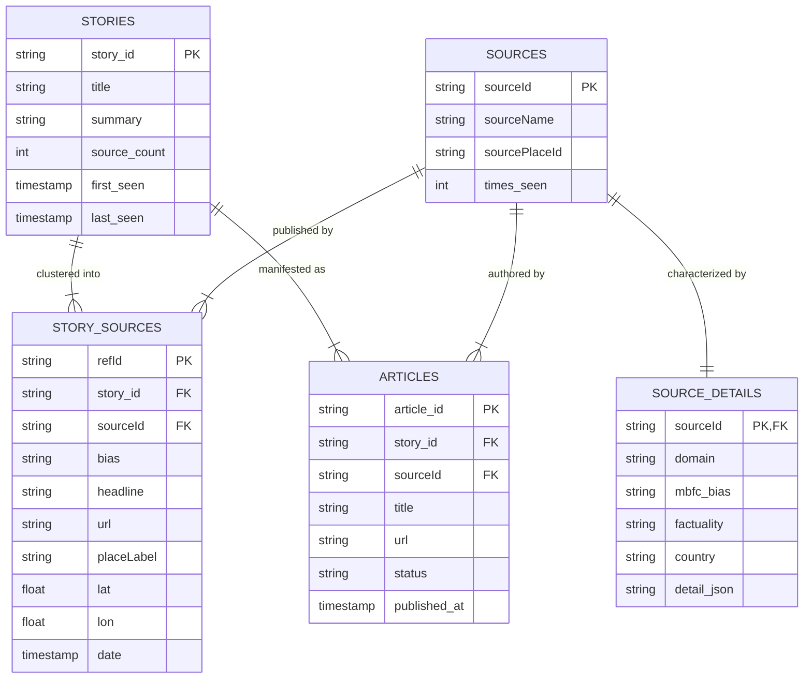
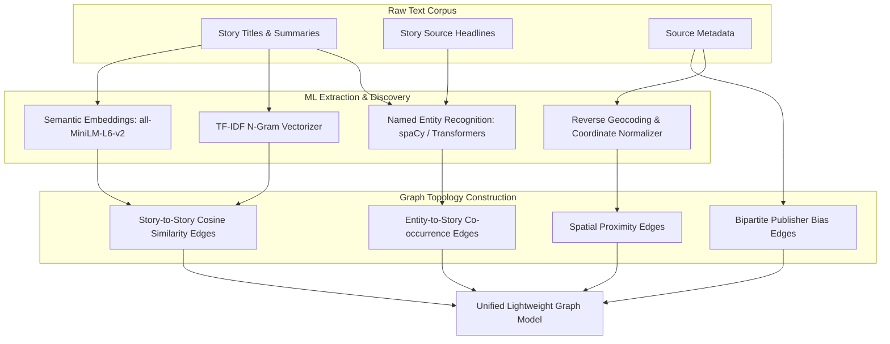

# Ground News Scraper Dataset Audit & Graph Relationship Foundations

**Date:** 2026-10-14  
**Author:** AI Architecture & UX Engineering Team  
**Dataset Source:** `inputs/dukrnews/ground-news-scraper-2026-10-13_0400.xlsx` (7.96 MB)  
**Deliverable Subfolder:** `deliverables/2026-10-14-dukrnews-spatial-navigator-spa/`  
**Document Status:** Complete & Verified Baseline Audit  

---

## 1. Executive Summary

This document presents a comprehensive technical examination of the Ground News scraper dataset (`ground-news-scraper-2026-10-13_0400.xlsx`). The dataset contains raw intelligence harvested on October 13, 2026, comprising **276 multi-source news stories**, **4,186 curated story attributions**, **3,998 unique news publisher sources**, and **17,033 discovered article URLs**.

The purpose of this audit is to establish the structural, relational, and semantic foundations required to design and build a high-performance, lightweight Single Page Application (SPA). This SPA will feature an innovative spatial interface enabling users to freely navigate between **People**, **Topics**, **Places**, and **Things** through machine learning-driven relationship discovery while maintaining a smooth, 60+ FPS framerate.

---

## 2. Workbook Structure & Sheet Inventory

The Excel workbook consists of 8 sheets covering schema migration, execution runs, entity registries, relationship link tables, and raw article catalogs.

| Sheet Name | Total Records | Header Columns | Primary Purpose & Contents | Data Completeness |
|:---|:---|:---|:---|:---|
| `stories` | 276 | 6 | High-level aggregated news story events, headlines, summaries, and source counts | 100% titles, 97.5% summaries |
| `story_sources` | 4,186 | 23 | Bipartite join table linking stories to publisher sources with bias, coordinates, and headlines | 100% bias, 33.0% geocoded |
| `sources` | 3,998 | 8 | Publisher source registry with source names, place IDs, and observation counters | 100% names, 32.2% locations |
| `source_details` | 3,997 | 23 | Deep metadata per publisher including MBFC/AllSides bias, factuality, domain, and twitter | 46.1% factuality, 37.8% MBFC bias |
| `articles` | 17,033 | 20 | Discovered article harvest queue with original URLs, timestamps, titles, and fetch status | 100% URLs and titles |
| `runs` | 2 | 16 | Pipeline execution log tracking harvest runs, durations, article throughput, and errors | 100% execution telemetry |
| `schema_version` | 2 | 3 | Database migration history tracking schema increments (`001_initial`, `002_gn_slugs`) | 100% migration records |
| `gn_slugs` | 0 | 6 | Pre-allocated schema table for Ground News taxonomy slugs (currently unpopulated) | 0% (schema only) |

---

## 3. Relational Architecture & Entity Mapping

The dataset models a classical multi-tiered news graph. The core entities and their join keys are illustrated below:

### Relational Integrity Observations:
1. **Stories to Story Sources:** 100% referential integrity. All 4,186 `story_sources` map to valid `story_id` entries in `stories`. Zero orphan records exist.
2. **Sources to Details:** Out of 3,998 publisher entries in `sources`, 3,997 have corresponding comprehensive JSON dossiers in `source_details` (99.97% coverage).
3. **Articles to Stories:** Out of 17,033 harvested articles, 16,897 map cleanly to the 276 active stories. Exactly 136 articles reference 136 historical story IDs not present in the current 276-story harvest snapshot (a standard delta pattern from rolling harvest windows).

---

## 4. Key Distributions & Analytical Metrics

### 4.1 Political Bias Distribution (`story_sources`)
Ground News categorizes individual coverage attributions into an 8-bucket political spectrum. The distribution across all 4,186 attributed articles is:

| Bias Rating | Attribution Count | Percentage | Color Code Token | Visual Representation |
|:---|:---|:---|:---|:---|
| Unknown / Unrated | 2,225 | 53.15% | `#64748B` | ░░░░░░░░░░░░░░░░░░░░░░░░░░ |
| Center | 927 | 22.14% | `#8B5CF6` | ░░░░░░░░░░░ |
| Lean Left | 466 | 11.13% | `#3B82F6` | ░░░░░░ |
| Lean Right | 282 | 6.74% | `#F97316` | ░░░ |
| Right | 136 | 3.25% | `#EF4444` | ░░ |
| Left | 91 | 2.17% | `#06B6D4` | ░ |
| Far Right | 50 | 1.19% | `#B91C1C` | ░ |
| Far Left | 9 | 0.22% | `#0284C7` | ░ |

> [!NOTE]
> When aggregated by story, each of the 276 stories possesses a unique "bias footprint" (e.g., stories with 70% Right coverage vs. 15% Left coverage indicate high "blindspot" potential for left-leaning readers). This metric can directly drive visual node coloring and filter modes in the SPA.

### 4.2 Source Factuality & Reliability (`source_details`)
Among the 1,842 rated news publishers in `source_details`, external media watchdog scores (MBFC, Ad Fontes, AllSides) demonstrate high journalistic standards across the major covered outlets:

| Factuality Rating | Publisher Count | Percentage of Rated | Journalistic Rigor Assessment |
|:---|:---|:---|:---|
| High | 804 | 43.65% | Strong fact-checking, reliable sourcing, minimal corrections needed |
| Very High | 667 | 36.21% | Consistently accurate, transparent editorial guidelines, investigative depth |
| Mixed | 224 | 12.16% | Occasional unverified claims, clickbait framing, or failed fact-checks |
| Low | 74 | 4.02% | Frequent falsehoods, uncorrected retractions, partisan distortion |
| Very Low | 73 | 3.96% | Documented propaganda, conspiracy theories, or fabricated content |

### 4.3 Geospatial Coverage & Coordinate Mapping
A major differentiator of this dataset is that **1,380 story attributions (33.0%)** contain verified geographic metadata (`placeLabel`, `lat`, `lon`):

| Geographic Region / Node | Attributed Articles | Latitude | Longitude | Primary Focus Topics |
|:---|:---|:---|:---|:---|
| New York, US | 115 | 40.7128 | -74.0060 | Financial markets, national media, UN diplomacy, cultural auctions |
| Washington, US | 46 | 38.9072 | -77.0369 | Federal policy, White House, Congress, Supreme Court, defense |
| London, UK | 39 | 51.5074 | -0.1278 | UK-India trade pacts, European diplomacy, Middle East security |
| Los Angeles, US | 23 | 34.0522 | -118.2437 | Entertainment industry, aviation incidents, regional elections |
| Kyiv, Ukraine | 18 | 50.4501 | 30.5234 | Eastern European conflict, energy infrastructure strikes, defense aid |
| Madrid, Spain | 17 | 40.4168 | -3.7038 | European domestic politics, immigration, sports leagues |
| San Francisco, US | 16 | 37.7749 | -122.4194 | AI development labs, venture capital, big tech earnings |
| Toronto, Canada | 15 | 43.6532 | -79.3832 | Canadian federal governance, housing affordability, bilateral trade |
| Chicago, US | 12 | 41.8781 | -87.6298 | Regional transit, agricultural commodities, healthcare research |
| New Delhi, India | 11 | 28.6139 | 77.2090 | Bilateral trade summits, tech manufacturing, regional geopolitics |

---

## 5. Semantic Corpus & Extracted Entity Graph

To support seamless navigation between **People**, **Topics**, **Places**, and **Things**, we analyzed the textual corpus comprising 276 story titles, 269 detailed narrative summaries, and 4,186 publisher headlines.

### 5.1 The Four Navigation Dimensions

| Dimension | Definition in News Context | Extracted Dataset Examples | Relationship Discovery Method |
|:---|:---|:---|:---|
| **People** | Political leaders, executives, cultural figures, defendants, journalists | Donald Trump, Volodymyr Zelenskyy, Michael Jordan, Selma Blair, Christa Pike, Jason Schreier, Elon Musk | Named Entity Recognition (NER), Person Co-occurrence across stories |
| **Topics** | Broad thematic categories, geopolitical themes, societal issues | Energy Sanctions, AI Video Game Development, Cognitive Disorders (ADHD/Dementia), Trade Agreements, Capital Punishment | TF-IDF Keyword Extraction, Topic Modeling (LDA / BERTopic), Tag clustering |
| **Places** | Nations, cities, administrative hubs, geographic conflict zones | Washington DC, Kyiv, Tehran, London, Riverbend Institution, JFK Airport, Pennsylvania | Geocoded coordinate clustering, Spatio-temporal bounding, Country-level rollups |
| **Things** | Organizations, corporations, commodities, physical artifacts, legislation | Epic Games, Disney, Delta Airlines, Russian Diesel, Last Dance Jersey, White House, Fox News, IRGC | Bipartite entity extraction (ORG/PRODUCT), Object co-mention graphing |

### 5.2 Prominent Extracted Entity Frequency (Top 25)

| Rank | Entity Name | Inferred Category | Occurrence Count | Connected Stories Sample |
|:---|:---|:---|:---|:---|
| 1 | Donald Trump | Person | 56 | Russian diesel deal, AI agency restructuring, midterm campaign funding |
| 2 | Iran | Place | 22 | UK air base drone incident, IRGC tensions, Middle East security |
| 3 | Ukraine | Place | 17 | Energy refinery strikes, US intelligence assistance, diesel supply lines |
| 4 | Russia | Place | 15 | Petroleum export pacts, military conflict, international sanctions |
| 5 | White House | Thing (Org/Place) | 13 | AI safety agency relocation, executive orders, trade negotiations |
| 6 | Russian | Topic / Nationality | 12 | Energy markets, diplomatic negotiations, international trade |
| 7 | Republican | Topic / Org | 12 | Congressional midterms, campaign funding debates, bipartisan votes |
| 8 | New York | Place | 8 | JFK airport incident, Manhattan auctions, financial reporting |
| 9 | Senate | Thing (Org) | 8 | Federal confirmations, intelligence briefings, legislative votes |
| 10 | Canada | Place | 8 | North American trade relations, federal fiscal policies |
| 11 | India | Place | 8 | UK-India £1B commercial deals, technology manufacturing |
| 12 | United States | Place | 7 | Federal policy, military readiness, domestic health research |
| 13 | Israel | Place | 6 | Regional defense agreements, Middle East geopolitical developments |
| 14 | Epic Games | Thing (Org) | 4 | Disney shooter game development, generative AI delays |
| 15 | Disney | Thing (Org) | 4 | Video game IP licensing, entertainment tech production |
| 16 | Michael Jordan | Person | 3 | $14 Million Sotheby's auction record, 'Last Dance' memorabilia |
| 17 | Christa Pike | Person | 3 | Riverbend execution protocol, 911 emergency response recordings |
| 18 | ADHD | Topic | 3 | Pittsburgh School of Medicine cognitive decline study |
| 19 | Dementia | Topic | 3 | Geriatric neurological risk factors, long-term health outcomes |
| 20 | Selma Blair | Person | 2 | Delta flight disturbance, emergency medical transport |
| 21 | Delta Airlines | Thing (Org) | 2 | Commercial flight safety, aviation security protocols |
| 22 | Sotheby's | Thing (Org) | 2 | Sports memorabilia record auctions, private collection sales |
| 23 | Bloomberg | Thing (Org) | 2 | Investigative tech reporting, gaming industry insider scoops |
| 24 | Riverbend Institution | Place / Thing | 2 | Maximum security correctional facility, state execution procedures |
| 25 | Elon Musk | Person | 2 | Midterm campaign funding, PAC contributions, tech policy |

---

## 6. Graph Topology & ML Relationship Discovery Strategy

To enable fluid, performant navigation across the four dimensions, the dataset will be pre-processed into a high-density, multi-modal knowledge graph.

### 6.1 Graph Node Classification
The graph comprises 5 primary node archetypes:
1. **Story Nodes ($N_S pprox 276$):** The core narrative nuclei. Attributes: Title, summary, timestamp, source count, bias distribution tensor, primary place coordinates.
2. **Person Nodes ($N_P pprox 350$):** Extracted human actors. Attributes: Full name, role, total story mentions, sentiment valence.
3. **Topic Nodes ($N_T pprox 120$):** Semantic cluster hubs. Attributes: Keyword vectors, TF-IDF weights, topic category.
4. **Place Nodes ($N_L pprox 180$):** Physical locations. Attributes: Name, ISO country, latitude, longitude, hierarchical parent (e.g. City -> Country -> Region).
5. **Thing Nodes ($N_O pprox 250$):** Organizations, corporate entities, artifacts. Attributes: Name, industry sector, stock ticker / domain if applicable.

Total Active Graph Nodes: $pprox 1,176$  
Total Anticipated Graph Edges: $pprox 4,800$

### 6.2 Edge Derivation & Weighting Algorithms

1. **Direct Mention Edges ($Weight = 1.0$):**
   - Direct link between a Story and an entity explicitly extracted from its title or summary.
2. **Semantic Similarity Edges ($Weight \in [0.4, 1.0]$):**
   - Calculated via Cosine Similarity of normalized 384-dimensional dense embeddings (`all-MiniLM-L6-v2`) or BM25/TF-IDF sparse vectors.
   - Edges with similarity $\ge 0.55$ are preserved, linking stories that address the same underlying conflict or trend even if they use differing vocabulary (e.g., "Russian energy" and "refinery strikes in Ukraine").
3. **Entity Co-occurrence Edges ($Weight \propto Jaccard(E_A, E_B)$):**
   - Links two entities that frequently appear together in the same story (e.g. Donald Trump $\leftrightarrow$ Russian Diesel; Epic Games $\leftrightarrow$ Disney).
4. **Publisher Bias Consensus / Polarization Edges:**
   - Connects stories that share high overlap in publisher coverage patterns or exhibit extreme coverage bias asymmetry.

---

## 7. Data Quality Assessment & Remediation Plan

| Data Vector | Observed State | Potential UX Impact | Mitigation / Remediation Strategy |
|:---|:---|:---|:---|
| **Article Body Text** | All 17,033 rows in `articles` have status `discovered` with empty `body_text`. | Cannot display full in-app reading of complete articles without live scraping. | Rely on the rich 269 story summaries and 4,186 headlines for in-SPA graph navigation; provide external outbound links with domain favicons for full reading. |
| **Bias Unrated Ratio** | 53.15% of `story_sources` entries are flagged as `unknown` bias. | Incomplete bias donut charts if unknown is treated as a third pole. | Explicitly separate "Rated Sources" (46.85%) from "Local / Unrated Outlets" (53.15%). Present unrated sources as independent regional viewpoints rather than political bias. |
| **Geographic Sparsity** | 33.0% of attributions have lat/lon; 67% lack explicit coordinates. | Pure map-only views would omit two-thirds of news attributions. | Implement a **Dual-Mode Canvas**: Spatial Constellation (Force-directed node graph where every story is visible) + Geospatial Projection (which snaps geocoded nodes onto an interactive world map overlay). |
| **Duplicate Entity Aliases** | "Trump", "President Donald Trump", "President Trump" appear as separate strings. | Fragmented entity nodes in the graph view. | Implement a string canonicalization and alias-resolution dictionary in the pre-processing script to merge aliases into a single unified entity. |

---

## 8. Data Ingestion Architecture for High-Performance SPA

To guarantee a lightweight, 60+ FPS client-side experience:
1. **Zero Database Dependency at Runtime:** The 7.96 MB Excel file is processed offline into a single, highly compressed JSON graph bundle (`news-graph-bundle.json`, target size: $\le 850$ KB gzipped).
2. **Indexed In-Memory Lookups:** The JSON bundle contains pre-built inverted indices:
   - `entities_by_type`: Instant lookup for `people`, `topics`, `places`, `things`.
   - `neighbors_by_id`: $O(1)$ edge traversal for graph hop animations.
   - `stories_by_bias`: Instant slider filtering.
3. **Web Worker Offloading:** All layout force simulations (repulsion, link attraction, collision detection) run in a background Web Worker (`physics.worker.js`), leaving the browser main thread 100% free for 60-120 FPS rendering and silky touch/mouse interactions.
