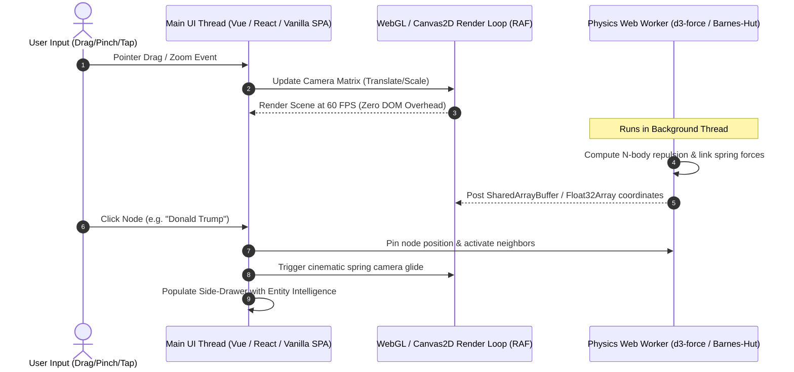

# UX Architecture & Requirements Grill: DukrNews Spatial Navigator SPA

**Date:** 2026-10-14  
**Author:** AI Architecture & UX Engineering Team (incorporating `ux-architect-cooly` & Matt Pocock Grill-Me Protocol)  
**Deliverable Subfolder:** `deliverables/2026-10-14-dukrnews-spatial-navigator-spa/`  
**Deliverable Document:** `02-ux-architecture-and-requirements-grill.md`  
**Status:** Requirements Gathering & Architectural Blueprint Baseline  

---

## 1. Executive Vision: The "Spatial News Navigator"

Traditional news aggregators rely on endless vertical scrolling feeds or rigid categorical tab bars (e.g., "World", "Business", "Tech"). While familiar, this flat document model fails to communicate the **multidimensional interconnectedness** of modern global news. A political decision in Washington directly impacts energy logistics in Kyiv, which in turn influences corporate actions by big tech firms in California and commodity auctions in New York.

The **DukrNews Spatial Navigator SPA** reimagines news consumption as an interactive, living knowledge universe. By leveraging client-side graph algorithms and hardware-accelerated WebGL rendering, the application empowers users to **freely traverse between People, Topics, Places, and Things** at 60+ FPS, uncovering latent geopolitical connections, coverage asymmetries, and narrative clusters.

```
       [ TOPICS ] (e.g. AI Delays, Diesel Pacts, ADHD)
          /    \
         /      \
   [ PEOPLE ] == [ STORIES ] == [ THINGS ] (e.g. Epic Games, White House)
         \      /
          \    /
        [ PLACES ] (e.g. Washington, Kyiv, London)
```

---

## 2. UX Architecture Framework (`ux-architect-cooly`)

Evaluating the proposed experience across the standard 8-dimension UX framework:

| Dimension | Architectural Implementation | Target Usability Heuristic |
|:---|:---|:---|
| **Clarity** | Multi-level semantic zoom: Macro galaxy (thematic clusters) -> Meso constellation (connected stories) -> Micro detail (publisher bias breakdown). | Instant orientation; user grasps the visual metaphor within 3 seconds. |
| **Efficiency** | Single-tap "Hop" interaction: clicking any entity badge (Person, Topic, Place, Thing) immediately re-centers the universe around that node. | Maximum 1-2 interactions to discover all related coverage across disparate publishers. |
| **Discoverability** | Chromatic node rings and glowing edge pulses dynamically highlight active relationships and blindspots. | Hidden relationships are visually surfaced without requiring manual complex search queries. |
| **Feedback** | Physics-based spring inertia, hover aura glow, and synchronized reactive side-drawer updates on selection. | Every click and hover has an immediate, physical 60+ FPS visual response. |
| **Forgiveness** | Omnipresent breadcrumb "Travel Trail" with Back/Forward history navigation and a one-click "Reset Universe" button. | Zero dead ends; users can explore deep rabbit holes and return to origin instantaneously. |
| **Delight** | Kinetic camera transitions with subtle depth-of-field blur and bias-spectral chromatic particles. | Tactile, fluid feel reminiscent of interactive planetary telescopes or premium financial terminals. |
| **Scalability** | Level-of-Detail (LOD) node culling and quadtree spatial partitioning capable of rendering 10,000+ nodes smoothly. | Engine remains fluid regardless of whether the dataset contains 270 or 25,000 stories. |
| **Consistency** | Standardized color semantics: Cyan/Blue = Left, Purple = Center, Coral/Red = Right, Amber = Geocoded Places, Emerald = Things. | Unified mental model across desktop, tablet, and mobile touch surfaces. |

---

## 3. The 4-Dimensional Navigation Matrix

The core UX feature is seamless navigation across the four key entity dimensions extracted from the Ground News dataset:

```mermaid
graph LR
    subgraph Entities Dimension
        P[Person Node<br/>e.g. Donald Trump]
        T[Topic Node<br/>e.g. Energy Sanctions]
        L[Place Node<br/>e.g. Kyiv, Ukraine]
        O[Thing Node<br/>e.g. Russian Diesel]
    end

    subgraph Central Story Node
        S1[Story: Trump defends Russia diesel deal]
    end

    subgraph Target Navigation Story
        S2[Story: US threatens to cut Ukraine weapons]
    end

    P --- S1
    T --- S1
    L --- S1
    O --- S1

    S1 == Semantic Edge: Energy Geopolitics == S2
    L --- S2
    T --- S2
```

### Navigation Scenarios:
1. **Person $
ightarrow$ Stories $
ightarrow$ Places:**  
   User selects *Selma Blair* (Person) $
ightarrow$ Camera glides to JFK Airport incident (Story) $
ightarrow$ User taps *Delta Airlines* (Thing) or *New York* (Place) $
ightarrow$ Graph reveals all concurrent stories involving aviation security and New York transit.
2. **Topic $
ightarrow$ Things $
ightarrow$ People:**  
   User selects *Generative AI* (Topic) $
ightarrow$ Camera reveals *Epic Games* (Thing) and *Bloomberg's Jason Schreier* (Person) $
ightarrow$ Graph branches into video game studio delays and White House AI testing regulations.
3. **Place $
ightarrow$ Geopolitical Web $
ightarrow$ Bias Analysis:**  
   User clicks *Kyiv, Ukraine* (Place) $
ightarrow$ 18 connected stories illuminate with high Right/Center coverage $
ightarrow$ Bias filter isolates stories where Left-leaning media provided minimal coverage (Blindspot Analysis).

---

## 4. Visual Layout & Screen Architecture (ASCII Wireframes)

### 4.1 Primary Layout: The "Constellation & Radar" Screen

```text
+---------------------------------------------------------------------------------------------------+
|  [DukrNews Navigator]   (Q Search people, topics, places, things...)   [Graph | Geo | Feed] [Theme] |
+----------------------------------------------------+----------------------------------------------+
|                                                    | SELECTED ENTITY: Donald Trump (Person)       |
|                 (TOPIC: AI Agency)                 | -------------------------------------------- |
|                       o                            | Mentioned in: 56 stories | 420 publisher refs|
|                      /                             |                                              |
|      (THING: White House)                          | BIAS SPECTRUM COVERAGE:                      |
|              o                                     | [Left: 18%] [Center: 44%] [Right: 38%]       |
|             /                                      |  =====        ============  ==========       |
|   (PERSON) * [SELECTED: Trump]                     |                                              |
|            \                                       | CONNECTED HUBS:                              |
|             \                                      | - [Topic] Energy Sanctions (15 stories)      |
|              o (STORY: Russia Diesel Deal)         | - [Place] Washington, DC (46 stories)        |
|             / \                                    | - [Thing] White House (13 stories)           |
|            /   \                                   | - [Person] Volodymyr Zelenskyy (9 stories)   |
|     (PLACE)     o (SOURCE: Times of India)         | -------------------------------------------- |
|      Kyiv         [Lean Right | Mixed Fact]        | RELATED STORIES FEED:                        |
|                                                    | 1. "Trump defends Russia diesel deal..."     |
|                                                    |    Sources: 8 | 4h ago | [Read Sources >]    |
|                                                    | 2. "White House plans AI agency move..."     |
|                                                    |    Sources: 12 | 6h ago | [Read Sources >]   |
|                                                    | 3. "Elon Musk becomes top midterm donor..."  |
|                                                    |    Sources: 31 | 8h ago | [Read Sources >]   |
+----------------------------------------------------+----------------------------------------------+
| [Timeline Slider: 2026-10-12 <====o====> Now]      | [Blindspot Filter: (All) (Left) (Right)]     |
+----------------------------------------------------+----------------------------------------------+
```

### 4.2 Geospatial Hybrid Projection Screen

```text
+---------------------------------------------------------------------------------------------------+
|  [DukrNews Navigator]   (Mode: Geospatial Arc Projection)              [Active Filters: Lat/Lon 33%]|
+---------------------------------------------------------------------------------------------------+
|                                                                                                   |
|           [London (39)]  ----+                                                                    |
|                 *            | (UK-India Deal: £1B)                                               |
|                              v                                                                    |
|       [New York (115)]       * [Kyiv (18)]                                                        |
|              *              /                                      * [New Delhi (11)]             |
|             /              /                                                                      |
|   [Washington (46)] ======+ (Defense & Energy Corridor)                                           |
|                                                                                                   |
|                                                                                                   |
+---------------------------------------------------------------------------------------------------+
| [Drawer: Tap any geocoded city node to inspect local vs international publisher coverage]         |
+---------------------------------------------------------------------------------------------------+
```

---

## 5. High-Framerate (60+ FPS) Technical Rendering Architecture

Maintaining a rock-solid 60-120 FPS framerate during continuous zooming, panning, and graph restructuring requires a strictly decoupled architecture:



### Optimization Techniques:
1. **Zero-DOM Graph Rendering:** The graph is drawn onto a full-screen `<canvas>` using WebGL instancing or Canvas 2D bitmap caching. The DOM is strictly reserved for the glassmorphic side-drawer and top HUD.
2. **Off-Thread Physics Simulation:** The force-directed layout computation is performed inside a Web Worker. If physics takes 20ms to stabilize, the main render thread never drops a single frame.
3. **Spatial Level of Detail (LOD):**
   - **Zoom Level 0.1x - 0.5x:** Nodes render as glowing discs with density heatmaps; text labels are suppressed.
   - **Zoom Level 0.5x - 1.5x:** Cluster titles and prominent entity badges appear.
   - **Zoom Level 1.5x - 4.0x:** Full story headlines, publisher favicons, and individual bias arcs become sharp and visible.

---

## 6. The Matt Pocock "Grill-Me" Interview Protocol

To rigorously lock down requirements, eliminate ambiguities, and ensure the resulting SPA matches your exact vision, we now initiate the **Matt Pocock "Grill-Me" Interview**.

Below are the **5 core architectural questions**, each accompanied by clear context, concrete options, tradeoffs, and our team recommendation.

---

### Question 1: Visual Metaphor & Primary Navigation Paradigm
*Context:* How should users primarily navigate the 276 stories, 4,186 publisher references, and 1,000+ extracted entities?
- **(Recommended) Option A: The "Cosmic Constellation & Split Drawer"**  
  A dark-mode, physics-driven force graph where stories and entities float like stars in space. Selecting any node initiates a smooth camera zoom and slides open an editorial glassmorphic intelligence drawer with full bias breakdowns and linked entity badges.
- **Option B: The "Geospatial Globe & Connected Arcs"**  
  An interactive 3D/2D world map where geocoded stories (33% with lat/lon) are anchored to locations with curved bezier flight arcs showing international connections, with non-geocoded stories docked in an orbital tray.
- **Option C: The "Kinetic Column Feed with Micro-Radar"**  
  A multi-column news card layout (Bloomberg/TweetDeck style) with an interactive floating mini-graph radar in the corner that dynamically updates as the user scrolls.

---

### Question 2: Machine Learning & Relationship Discovery Engine
*Context:* How should the app discover and rank connections between articles and entities?
- **(Recommended) Option A: Hybrid Offline Pre-computed Embeddings + Client-Side Dynamic Graph Filtering**  
  A high-accuracy Python pre-processing pipeline generates semantic embeddings (`all-MiniLM-L6-v2`), NER extractions, and cosine similarity links into the JSON bundle. The client SPA then runs instantaneous sub-graph extraction, entity hopping, and dynamic Jaccard filtering in memory with zero latency.
- **Option B: Pure Client-Side In-Browser ML (Transformers.js / WebGPU)**  
  Run an in-browser transformer model directly inside a Web Worker via WebGPU/WASM to compute real-time semantic embeddings for new user queries and search terms directly on the client machine.
- **Option C: Live Server Microservice (FastAPI + NetworkX / Neo4j)**  
  Deploy a lightweight Python backend that accepts graph queries and computes on-the-fly personalized graph walks and community detection algorithms.

---

### Question 3: Visual Aesthetic & Design Persona
*Context:* What emotional tone and visual polish should the interface convey at first glance?
- **(Recommended) Option A: "Obsidian Cyber-Radar / Intelligence Terminal"**  
  Deep space slate background (`#090D16`), glowing neon luminescent edges, glassmorphism blur panels, crisp monospace data readouts, and Ground News signature bias colorways (Cobalt Blue $\leftrightarrow$ Amethyst $\leftrightarrow$ Crimson).
- **Option B: "Swiss Editorial Cartography / Clean Minimalist"**  
  High-contrast stark dark mode, ultra-refined typography (Inter/Geist), subtle monochromatic link lines, crisp architectural borders, and generous whitespace.
- **Option C: "Sci-Fi Planetary Observatory / Holographic HUD"**  
  Sci-fi HUD aesthetic with animated orbital rings, particle dust, telemetry readouts, sound effects on node select, and vibrant futuristic iconography.

---

### Question 4: Rendering Technology & Framerate Target
*Context:* What rendering engine should drive the graph canvas to guarantee 60+ FPS across modern hardware?
- **(Recommended) Option A: WebGL-Accelerated 2D Canvas (e.g. `force-graph` / Pixi.js) with Worker Physics**  
  Combines standard WebGL shader acceleration with simple 2D interaction handling. Highly performant on mobile phones, tablets, and laptops; handles 5,000+ nodes and edges effortlessly at 60-120 FPS.
- **Option B: Three.js 3D Force Graph**  
  A true 3D spatial universe with 6-degrees-of-freedom camera controls (pan, pitch, yaw, roll), 3D volumetric particle nebulae, and bloom post-processing passes.
- **Option C: High-Performance Canvas 2D (Vanilla)**  
  Zero heavy external WebGL libraries; raw HTML5 Canvas 2D context using `requestAnimationFrame`, path batching, and offscreen canvas caching. Ultra-lightweight bundle size ($\le 30$ KB).

---

### Question 5: Data Scope & Ingestion Strategy
*Context:* How should the SPA ingest the data from `ground-news-scraper-2026-10-13_0400.xlsx`?
- **(Recommended) Option A: Single Self-Contained Graph Bundle (`news-graph-bundle.json`)**  
  A dedicated Python script converts the 8 MB workbook into a clean, normalized, and pre-indexed JSON graph file (~600-800 KB gzipped) that the SPA loads asynchronously on launch, making the entire web app runnable from a simple static folder or GitHub Pages.
- **Option B: In-Browser DuckDB-WASM Ingestion**  
  The SPA bundles DuckDB-WASM, loads the Excel/Parquet tables directly into the browser's memory, and executes client-side SQL queries on demand.
- **Option C: Multi-File Partitioned Assets**  
  The data is partitioned into separate files (`stories.json`, `entities.json`, `sources.json`) and loaded lazily as the user zooms in or explores specific clusters.
