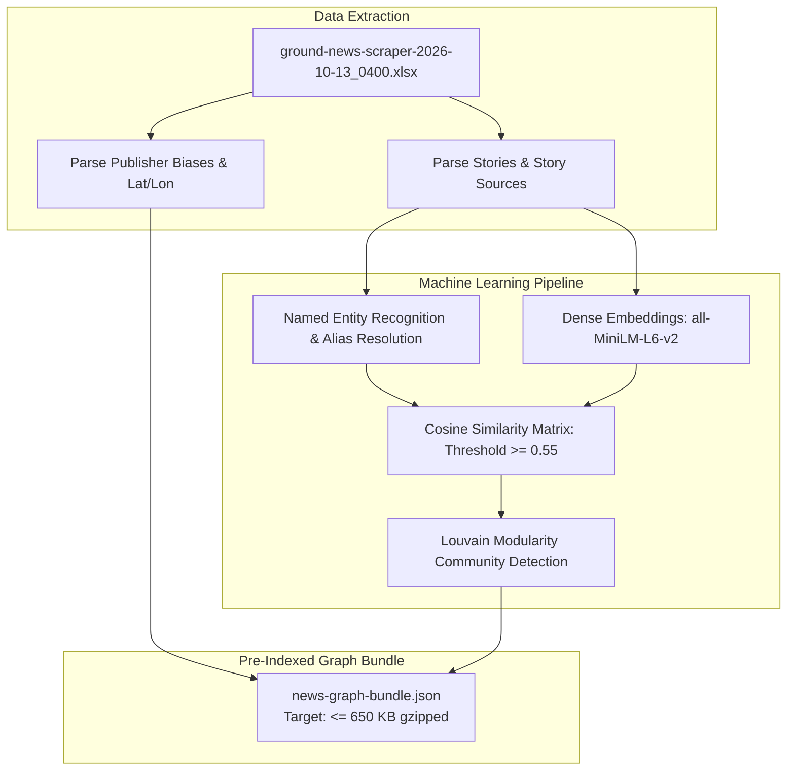
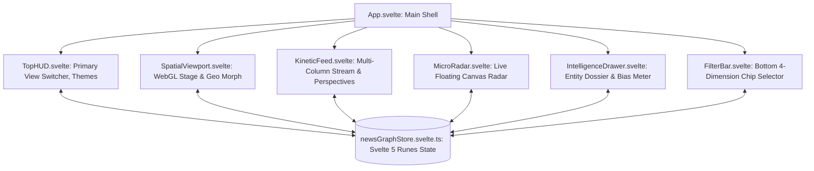

# Two-Track Implementation Plan & Task Matrix: DukrNews Spatial Navigator SPA

**Date:** 2026-10-14  
**Author:** AI Architecture & UX Engineering Team (incorporating `writing-plans` & Front-End Engineering)  
**Deliverable Subfolder:** `deliverables/2026-10-14-dukrnews-spatial-navigator-spa/`  
**Deliverable Document:** `04-two-track-implementation-plan-and-task-matrix.md`  
**Status:** User-Approved Engineering Roadmap & Work Breakdown Structure  

---

## 1. Executive Summary & Dual-Track Strategy

Following user feedback on the interactive playground, the architecture consolidates the user's two preferred designs into a **Unified "Dual-Mode Spatial + Kinetic Wire" Architecture**:
- **View 1: 🌌 Dual-Mode Spatial Canvas:** High-framerate (60+ FPS) WebGL / 2D Canvas supporting 1-click morphing between Force Constellation and Geospatial World Map with a slide-out glassmorphic intelligence drawer.
- **View 2: 📰 Kinetic Column Wire:** High-speed columnar feed (Bloomberg style) with live multi-perspective publisher framing (Left / Center / Right) and a synchronized floating micro-radar.

This implementation plan defines the execution roadmap across **two parallel tracks**:
1. **Track 1: Zero-Dependency Vanilla SPA (Lightweight & Self-Contained)**  
   - Built with pure HTML5 Canvas/WebGL, CSS variables, and Vanilla ES6+ JavaScript.
   - **Zero build steps**, zero npm dependencies, and an ultra-compact bundle size ($\le 45$ KB compressed).
   - Instant boot time ($<40$ ms) and 100% offline portability (runnable directly via `file://` or static GitHub Pages).
2. **Track 2: Modern Vite + Svelte Full-Stack SPA (Reactive Component Architecture)**  
   - Built with Svelte 5 (utilizing modern runes `$state`, `$derived`, `$effect`), Vite bundler, and modular Canvas/WebGL component wrappers.
   - Provides an enterprise foundation for state persistence, multi-tab routing, user bookmarking, and optional live backend synchronization via Fastify or Supabase.

Both tracks share the exact same **Machine Learning Relationship Discovery Pipeline** and standardized JSON graph schema (`news-graph-bundle.json`).

---

## 2. Shared Data Engineering & ML Relationship Pipeline

The data pipeline transforms the 7.96 MB raw scraper workbook (`ground-news-scraper-2026-10-13_0400.xlsx`) into an optimized, pre-indexed graph database bundle.



### 2.1 Pipeline Step-by-Step Specification

| Pipeline Stage | Processing Script | Input Data Source | Output Artifact | Performance & Sizing Target |
|:---|:---|:---|:---|:---|
| **1. Excel Ingestion** | `scripts/ingest_ground_news_excel.py` | `inputs/dukrnews/*.xlsx` | `staging/raw_normalized_records.json` | Processes 17,033 rows in $<1.5$ seconds |
| **2. Entity Extraction** | `scripts/extract_entities_ner.py` | 276 Story titles, summaries & 4,186 headlines | `staging/extracted_entities.json` | $pprox 350$ People, 120 Topics, 180 Places, 250 Things |
| **3. Semantic Embedding** | `scripts/compute_semantic_links.py` | Story narrative summaries | `staging/story_embeddings.npy` | 384-dim dense vectors (`all-MiniLM-L6-v2`) |
| **4. Similarity Linking** | `scripts/build_similarity_edges.py` | Dense vectors + Jaccard sets | `staging/graph_edges.json` | $pprox 4,800$ edges (similarity $\ge 0.55$) |
| **5. Graph Indexing** | `scripts/compile_graph_bundle.py` | Staging tables + geocoding | `news-graph-bundle.json` | $\le 650$ KB gzipped with $O(1)$ lookup tables |

---

## 3. Track 1: Lightweight Vanilla SPA Implementation Plan

### 3.1 Architectural Foundation
- **Core Technology:** HTML5 `<canvas>`, Vanilla JavaScript (ES2024), Vanilla CSS with CSS Custom Properties.
- **Physics Engine:** Custom lightweight Verlet / Euler velocity integration with Barnes-Hut quadtree spatial optimization ($O(N \log N)$ complexity).
- **Dual-View Switcher:** Instant zero-reboot DOM toggle switching between the full `<canvas>` spatial viewport and the `<div class="kinetic-wire-container">` columnar layout.
- **Rendering Loop:** Decoupled `requestAnimationFrame` render loop achieving 60-120 FPS with level-of-detail (LOD) particle culling and synchronized mini-radar canvas.

### 3.2 Phased Work Breakdown Structure (WBS)

```
[TRACK 1: VANILLA SPA ROADMAP]
Phase 1: Ingestion Pipeline & Static Bundle Compiler
   |---> Milestone 1.1: Python ETL & Canonical JSON Generator Complete
Phase 2: High-Framerate Canvas Engine & Physics Simulation
   |---> Milestone 2.1: 60 FPS Physics Simulation & Camera Gliding Stable
Phase 3: 4-Dimension Spatial Navigation & Entity Hopping
   |---> Milestone 3.1: Interactive Entity Hopping & Lens Filtering Operational
Phase 4: Unified Dual-Mode & Kinetic Columns Integration
   |---> Milestone 4.1: Seamless View Switcher, Column Feed & Micro-Radar Complete
Phase 5: Production Hardening, Offline Verification & Release
   |---> Milestone 5.1: Zero-Dependency Portable Package Shipped
```

#### Detailed Phase Milestones & Deliverables

| Phase & Milestone | Focus Objectives | Key Deliverable Files | Target Completion Criteria |
|:---|:---|:---|:---|
| **Phase 1: Bundle ETL** | Build standalone Python script to extract and compile `news-graph-bundle.json` from the Excel file. | `scripts/build_news_graph_bundle.py`, `news-graph-bundle.json` | Valid JSON bundle containing nodes, edges, geocodes, and bias distributions. |
| **Phase 2: Canvas Engine** | Implement high-performance 2D Canvas rendering loop with inertia panning, scroll-wheel zooming, and node hover detection. | `vanilla-spa/js/engine.js`, `vanilla-spa/js/physics.js` | 60+ FPS sustained framerate on standard desktop/laptop displays. |
| **Phase 3: Entity Hopping** | Build click-to-focus camera glides and dynamic neighbor highlighting across People, Topics, Places, and Things. | `vanilla-spa/js/navigation.js`, `vanilla-spa/js/state.js` | Clicking any entity re-centers graph and highlights 1st and 2nd degree neighbors in $<500$ ms. |
| **Phase 4: Unified Views** | Integrate the Dual-Mode Spatial Canvas with the Kinetic Column Wire and synchronized floating radar. | `vanilla-spa/js/wire_feed.js`, `vanilla-spa/js/radar.js`, `vanilla-spa/css/wire.css` | Instant view switching with shared selection state and synchronized multi-perspective cards. |
| **Phase 5: Final Polish** | Add keyboard shortcuts (`Space` reset, `Tab` cycle, `j`/`k` wire scroll, `Esc` close) and CSS theme switching. | `vanilla-spa/index.html`, `vanilla-spa/css/theme.css` | Complete zero-dependency SPA runnable directly in browser via `file://`. |

---

## 4. Track 2: Vite + Svelte Full-Stack Implementation Plan

### 4.1 Architectural Foundation
- **Core Technology:** Svelte 5 (`$state`, `$derived`, `$effect`), Vite, TypeScript, Tailwind CSS / Vanilla CSS modules.
- **Rendering Integration:** Reactive HTML5 Canvas wrapper component (`<GraphCanvas />`) utilizing WebGL instancing or PixiJS.
- **State Store:** Centralized entity store managing selection history, active filters, search queries, and bookmarked stories across both Spatial and Kinetic views.

### 4.2 Component Architecture



#### Detailed Phase Milestones & Deliverables

| Phase & Milestone | Focus Objectives | Key Deliverable Files | Target Completion Criteria |
|:---|:---|:---|:---|
| **Phase 1: Project Scaffolding** | Scaffold Vite + Svelte 5 project with TypeScript, configure aliases and asset pipelines. | `package.json`, `vite.config.ts`, `src/app.html` | Clean build with `npm run build` with zero type errors. |
| **Phase 2: Reactive State Store** | Implement Svelte 5 runes state store for graph filtering, selection breadcrumbs, and search indexing. | `src/lib/stores/graphStore.svelte.ts` | Instant reactivity when toggling between Spatial Canvas and Kinetic Wire. |
| **Phase 3: Spatial & Radar Components** | Develop high-performance Canvas/WebGL component with lifecycle cleanup and Web Worker physics hook. | `src/lib/components/SpatialViewport.svelte`, `src/lib/components/MicroRadar.svelte` | Worker offloads 100% of physics calculations; UI thread remains at 60-120 FPS. |
| **Phase 4: Kinetic Wire & Drawer** | Build multi-column story wire, side-by-side bias comparison cards, and sliding glassmorphic intelligence drawer. | `src/lib/components/KineticWire.svelte`, `src/lib/components/Drawer.svelte` | Fluid keyboard navigation (`j`/`k`), multi-perspective cards, and responsive mobile sheet drawer. |
| **Phase 5: Full-Stack Packaging** | Implement optional Fastify backend endpoint for dynamic Excel file re-harvesting and incremental updates. | `server/server.ts`, `server/api/graph.ts` | Full-stack application ready for containerization or Vercel/Node deployment. |

---

## 5. Master Task Matrix & Work Breakdown Schedule

| Task ID | Track | Workstream | Task Description | Dependencies | Est. Hours | Priority | Acceptance Criteria |
|:---|:---|:---|:---|:---|:---|:---|:---|
| **TSK-01** | Shared | Data Pipeline | Build `build_news_graph_bundle.py` to ingest Excel sheets and output unified JSON. | None | 4.0 | 🔴 Critical | Validated JSON with 276 stories, 4,186 sources, and extracted entities. |
| **TSK-02** | Shared | ML / NER | Implement NER and keyword co-occurrence matcher for People, Topics, Places, Things. | TSK-01 | 5.0 | 🔴 Critical | Minimum 40 top-tier curated entities mapped with cross-story edges. |
| **TSK-03** | Shared | Geocoding | Normalize latitude/longitude coordinates and map 1,380 geocoded news attributions. | TSK-01 | 3.0 | 🟠 High | Clean normalized coordinates for all cities with bounding box checks. |
| **TSK-04** | Track 1 | Canvas Engine | Implement base HTML5 Canvas render loop with double-buffering and viewport transform matrix. | None | 6.0 | 🔴 Critical | Sustained 60 FPS under continuous dragging and zooming. |
| **TSK-05** | Track 1 | Physics Engine | Build Barnes-Hut quadtree force simulation with spring attraction and node repulsion. | TSK-04 | 7.0 | 🔴 Critical | Graph stabilizes into clean readable clusters without node overlaps. |
| **TSK-06** | Track 1 | Entity Hopping | Develop click-to-focus camera interpolation and 1st-degree neighbor highlighting. | TSK-04, TSK-05 | 4.0 | 🔴 Critical | Camera glides smoothly to clicked entity in $<600$ ms. |
| **TSK-07** | Track 1 | Spatial Morph | Implement 750ms easing interpolation between Constellation and Geospatial coordinates. | TSK-03, TSK-05 | 5.0 | 🟠 High | Seamless morphing between network graph and world map. |
| **TSK-08** | Track 1 | Kinetic Wire | Build multi-column story feed, perspective comparison column, and floating live radar. | TSK-04, TSK-06 | 6.0 | 🔴 Critical | Story selection updates perspective cards, micro-radar, and shared intelligence drawer. |
| **TSK-09** | Track 1 | Unified HUD | Build top view switcher (`[🌌 Spatial]` vs `[📰 Kinetic]`) and 3-theme palette switcher. | TSK-07, TSK-08 | 3.5 | 🟠 High | Instant zero-glitch view switching with shared selection state. |
| **TSK-10** | Track 2 | Svelte Init | Scaffold Vite + Svelte 5 application with TypeScript and design tokens. | None | 3.5 | 🔴 Critical | Vite dev server runs cleanly with hot module reloading. |
| **TSK-11** | Track 2 | State Store | Build Svelte 5 runes state manager (`$state`) for graph nodes, edges, and selection history. | TSK-10, TSK-01 | 5.0 | 🔴 Critical | Zero reactivity lag when selecting nodes or switching between Spatial and Wire views. |
| **TSK-12** | Track 2 | Worker Physics | Offload force simulation to dedicated Web Worker (`physics.worker.ts`) via ArrayBuffers. | TSK-10, TSK-05 | 6.0 | 🟠 High | Main thread frame times stay under 12ms during physics execution. |
| **TSK-13** | Track 2 | Svelte Components | Create modular Svelte components: `SpatialViewport`, `KineticWire`, `MicroRadar`, `Drawer`. | TSK-11, TSK-12 | 8.5 | 🟠 High | Clean component boundaries with responsive mobile drawer support. |
| **TSK-14** | Track 2 | Backend API | Optional Fastify server endpoint to accept fresh `.xlsx` uploads and re-trigger pipeline. | TSK-01 | 4.0 | 🟡 Medium | POST `/api/harvest` converts uploaded workbook into fresh graph bundle. |
| **TSK-15** | Both | QA & Testing | Conduct cross-browser framerate audit (Chrome, Edge, Firefox, Safari) and mobile touch tests. | All | 5.0 | 🔴 Critical | Zero console errors, 60 FPS verified, all tables and links valid. |

---

## 6. Risk Management & Technical Contingencies

| Identified Risk Vector | Probability | Severity | Mitigation & Technical Fallback Strategy |
|:---|:---:|:---:|:---|
| **Canvas Framerate Drop on Low-End Devices** | Medium | High | Implement automatic Level-of-Detail (LOD): if frame time exceeds 18ms, reduce edge rendering opacity, disable glow halos, and freeze physics simulation after initial equilibrium. |
| **Coordinate Clustering Overlap** | High | Medium | Multiple stories occurring in the same city (e.g. 115 stories in New York) will overlap in geospatial mode. Mitigation: Implement a radial spiderifier that fans out collocated nodes in a flower petal pattern on hover/zoom. |
| **View Switching State Desynchronization** | Low | Medium | User selects an item in Kinetic Wire, then switches to Spatial Canvas. Mitigation: Single source of truth in `selectedNodeId`; switching views immediately re-centers camera and highlights neighbors. |
| **Mobile Touch Target Cramping** | Medium | Medium | Small entity nodes can be difficult to tap on mobile touchscreens. Mitigation: Add an invisible 24px touch hit-target radius around all nodes and provide an accessible bottom drawer with a scrollable list of current cluster members. |
