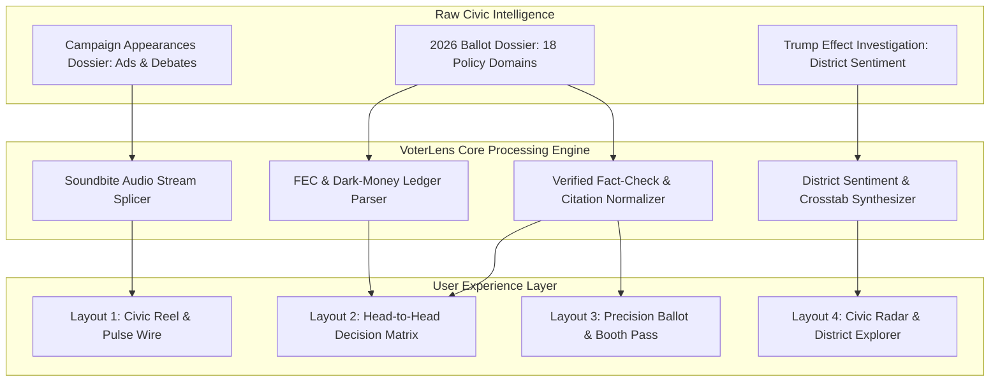
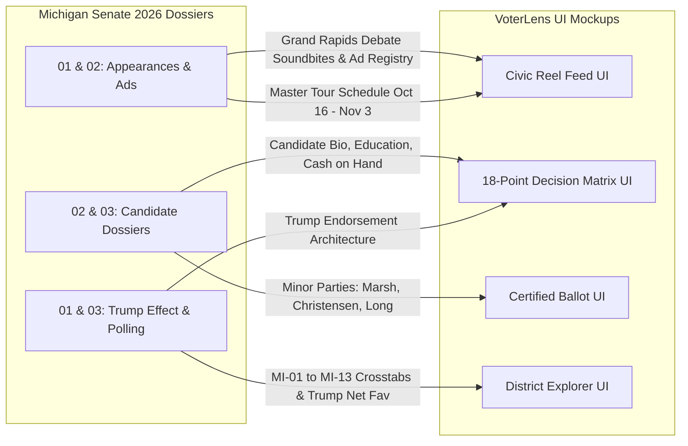

# VoterLens: Michigan 2026 — Executive Concept & Product Brainstorming Brief
## Next-Generation Civic Intelligence & Interactive Ballot Mobile Platform
**Publication Date:** October 15, 2026  
**Document Classification:** Product Vision, Strategic Brainstorming & Requirements Architecture  
**Deliverable Subfolder:** `deliverables/2026-10-15-voter-ballot-mobile-app-concept-playground/`  
**Companion Interactive Playground:** [`index.html`](file:///d:/stuff/ai-misc/_bsh2026/vscode_project01/46-wide_research_test_gemini/deliverables/2026-10-15-voter-ballot-mobile-app-concept-playground/index.html)  
**Status:** Architecture Baseline & Multi-Layout Design Specification  

---

## 1. Executive Summary & Problem Framing

### 1.1 The Civic Information Deficit in Modern Midterms
As Michigan voters prepare to cast their ballots on **Tuesday, November 3, 2026**, for the open Class II United States Senate seat vacated by retiring Senator Gary Peters, they confront an unprecedented information environment characterized by:
1. **Unprecedented Ad Saturation:** Over **$175 million** in paid broadcast television, cable, CTV, and digital advertising has flooded the Detroit, Grand Rapids, Flint-Saginaw, Lansing, and Traverse City markets. Ads like *"Threat"*, *"9 Times"*, *"Stop the Mandates"*, and *"Florida Man"* rely on emotional triggers, 3-second out-of-context soundbites, and dark-money super PAC framing.
2. **Outside Dark-Money Opacity:** Outside independent expenditure groups—predominantly the Senate Leadership Fund (SLF) backing Republican Mike Rogers and the Senate Majority PAC (SMP) backing Democrat Abdul El-Sayed—outspend candidate committee operations by more than three-to-one, obscuring the primary policy records and donor dependencies of the candidates.
3. **The Static Inadequacy of Legacy Voter Guides:** Existing civic tools (such as Vote411, Ballotpedia, and county clerk PDF sample ballots) remain fundamentally rooted in desktop-era, passive paradigms. They rely on dry, self-reported candidate questionnaires (often ignored by major campaigns), provide zero real-time coverage of live campaign appearances or televised debates, lack audio/visual fact-checks, and offer no meaningful side-by-side policy synthesis.
4. **Ballot Fatigue and Logistical Friction:** Voters frequently encounter complex down-ballot contests, state constitutional proposals, and minor-party options (Green, Libertarian, U.S. Taxpayers) with zero advance preparation. Furthermore, shifting rules surrounding Michigan's 9-day early voting window, photo ID statutory requirements, and absentee drop-off deadlines create friction that suppresses participation.

### 1.2 The VoterLens Mission
**VoterLens** is a mobile-first, high-fidelity civic intelligence platform designed to empower registered voters before they step into the voting booth. Rather than acting as a static directory, VoterLens operates as an active, neutral intelligence engine that synthesizes certified government disclosures, live campaign trail schedules, verbatim debate audio, vetted policy platforms, and district-level polling into an intuitive, visually stunning experience.

---

## 2. Competitive Teardown & Benchmarking

To build a genuinely innovative product, VoterLens conducts a structured teardown of existing civic and news aggregation platforms:

| Platform | Primary Model | Demonstrated Strengths | Fatal Flaws & UX Gaps | Applied VoterLens Innovation |
| :--- | :--- | :--- | :--- | :--- |
| **Vote411 (LWV)** | Non-partisan questionnaire directory | High institutional credibility; trusted by older high-propensity voters. | Passive; text-heavy; candidate answers are self-submitted spin; zero campaign finance or debate tracking; poor mobile touch targets (<32pt). | Replaces candidate questionnaires with verified 18-point policy matrix sourced from legislation, book records, and certified statements. |
| **Ballotpedia** | Encyclopedic civic wiki | Exhaustive historical election margins and candidate biographies. | Desktop-first architecture; overwhelming information density; difficult to compare two candidates side-by-side on mobile; lacks audio/video. | Mobile-first sticky split-screen comparisons with collapsible drawers and 60 FPS interactions. |
| **ISideWith** | Algorithmic policy matching quiz | Gamified alignment score; engages first-time voters through interactive questions. | Black-box scoring algorithms; questions frequently lack local state context (e.g. Michigan Line 5 or EV mandates); detached from precinct ballot. | Transparent 5-axis Civic Radar anchored to verified legislative records, paired with a 1-tap precinct ballot builder. |
| **Ground News** | Bias monitoring & news aggregation | "Blindspot" and "Bias Footprint" visualizers; multi-perspective publisher transparency. | Strictly news article focus; lacks candidate campaign trail schedules, voter logistics, or ballot export tools. | Translates "Bias Footprint" into "Donor Footprint" (grassroots small-dollar vs outside super PAC cash) and district polling sentiment maps. |

---

## 3. User Personas & Civic Behavioral Archetypes

VoterLens is engineered around four distinct voter archetypes identified across Michigan's regional demographics:

### 3.1 Persona 1: Maya Lin (The Time-Constrained First-Time Midterm Voter)
- **Demographics:** Age 24, Wayne State University graduate student, resident of Detroit (Wayne County, MI-12).
- **Behavior & Habits:** Consumes media via TikTok, Instagram Reels, and podcasts; does not watch linear broadcast television; highly skeptical of institutional political advertising.
- **Core Needs:** Rapid, 30-second factual briefings on candidate positions; cares intensely about healthcare access, student debt cancellation, urban water infrastructure, and Gaza humanitarian policy.
- **Pain Point:** Finds 40-page policy white papers unreadable; wants to hear the candidate's actual voice in unedited debate clips rather than campaign soundbites.
- **VoterLens Target Layout:** **Layout 1: Civic Reel / Pulse Wire** (vertical swipeable micro-cards with integrated audio visualizer).

### 3.2 Persona 2: Dave Kowalski (The Blue-Collar Auto Worker Swing Voter)
- **Demographics:** Age 52, UAW-represented assembly technician at Sterling Heights Assembly, resident of Warren (Macomb County, MI-10).
- **Behavior & Habits:** Voted for Trump in 2016 and 2020; loyal union member whose local leadership endorsed Abdul El-Sayed, but personally anxious about electric vehicle conversion deadlines and grocery inflation.
- **Core Needs:** Unvarnished comparison between El-Sayed's union battery manufacturing subsidies and Rogers' opposition to federal EPA EV mandates.
- **Pain Point:** Bombarded by attack ads on both sides; doesn't know who to believe regarding plant closures and internal combustion engine protections.
- **VoterLens Target Layout:** **Layout 2: Decision Matrix / Split Horizon** (direct point-by-point contrast on Auto & EV Mandates, Inflation, and Labor Rights).

### 3.3 Persona 3: Elena Vance (The Moderate College-Educated Suburban Decider)
- **Demographics:** Age 46, healthcare administrator, resident of Birmingham (Oakland County, MI-11).
- **Behavior & Habits:** Lifelong independent voter; regularly votes split-ticket; supported Michigan's 2022 Proposal 3 reproductive rights amendment.
- **Core Needs:** Deep vetting of candidate character, ethics, and residency; needs to evaluate Rogers' Cape Coral, Florida property controversy against El-Sayed's 2018 voter registration scrutiny; wants clear confirmation of judicial and abortion stances.
- **Pain Point:** Frustrated by partisan hyperbole; demands primary-source documentation and verifiable financial disclosure data.
- **VoterLens Target Layout:** **Candidate Dossier Drawer & Scrutiny Tabs** within the Decision Matrix.

### 3.4 Persona 4: Calvin VanderHaag (The Rural Business Owner & Precinct Traditionalist)
- **Demographics:** Age 68, agricultural equipment supplier, resident of Sanilac County (The Thumb, MI-05).
- **Behavior & Habits:** Consumes local radio (WJR 760 AM) and Farm Bureau publications; deeply supportive of Second Amendment protections, Enbridge Line 5 pipeline preservation, and conservative judicial appointments.
- **Core Needs:** Clear logistical instructions on in-person precinct hours, accepted Michigan photo ID requirements, and down-ballot agricultural proposals.
- **Pain Point:** Worries about confusing absentee deadlines and wants a physical, printable checklist to carry into the polling booth.
- **VoterLens Target Layout:** **Layout 3: Precision Ballot Navigator & Offline Booth Reference Pass**.

---

## 4. Value Proposition Canvas & Core Feature Pillars

VoterLens delivers five core feature pillars that bridge raw research dossiers with intuitive mobile interaction:

### 4.1 Feature Pillar 1: Verified Debate Soundbites & Audio Waveforms
- **Concept:** Rather than reading dry quotes, voters tap interactive audio waveforms to listen to authentic 20-to-30-second clips from the televised Grand Rapids debate (WOOD-TV8) and marquee rallies.
- **Fact-Check Overlay:** Each audio player is paired with a collapsible verification badge citing peer-reviewed studies, congressional votes, or property records.

### 4.2 Feature Pillar 2: The 18-Point Neutral Decision Matrix
- **Concept:** Side-by-side comparative table with sticky candidate profile headers. Voters can filter by topic (e.g., Auto & EV Mandates, Healthcare, Line 5 Pipeline, Taxes, Abortion) or tap *"My Stance"* to see where their personal values align.
- **Citation Traceability:** Long-pressing any policy summary exposes primary source links to the candidate's books (*Healing Politics* / *Medicare for All*), congressional roll call votes, or official federal filings.

### 4.3 Feature Pillar 3: Money Tracker & Dark-Money Ledger
- **Concept:** Visualizes candidate fundraising health with zero partisan spin:
  - **Abdul El-Sayed (D):** $14.51M raised | 58% small-dollar grassroots | Low corporate PAC dependency | Backed by Senate Majority PAC.
  - **Mike Rogers (R):** $10.90M raised | 28% small-dollar grassroots | High PAC dependency (business/defense) | $4.47M cash on hand | Backed by Senate Leadership Fund.
  - Unpacks the revolving-door scrutiny surrounding Kristi Rogers' Aegis defense contracts against El-Sayed's non-profit PAC funding model.

### 4.4 Feature Pillar 4: Precision Ballot Navigator & Offline Booth Pass
- **Concept:** Certified digital replica of the voter's actual Michigan ballot. Voters select their preferred nominees across the Senate race and down-ballot contests, building a customized voting plan.
- **Booth Compliance:** Because many Michigan jurisdictions prohibit active phone use or photography inside voting booths, VoterLens features a 1-tap **"Export Offline Booth Reference Pass"** (compatible with Apple Wallet, Google Wallet, or 3x5 printable format).

### 4.5 Feature Pillar 5: Civic Radar & District Sentiment Explorer
- **Concept:** Interactive 5-axis policy radar (Economy, Healthcare, Green Industrial/Auto, National Security, Civil Rights) mapping the voter against both candidates.
- **The Trump Gravity Slider:** Allows users to simulate how presidential endorsement sentiment shifts projected margins across Michigan's 13 Congressional Districts (e.g. from El-Sayed +46 in Wayne County to Rogers +32 in the Thumb).

---

## 5. Architectural Comparison of the 4 Playground Layout Archetypes

The companion interactive playground ([`index.html`](file:///d:/stuff/ai-misc/_bsh2026/vscode_project01/46-wide_research_test_gemini/deliverables/2026-10-15-voter-ballot-mobile-app-concept-playground/index.html)) implements four switchable layout paradigms:

| Layout Archetype | UX Inspiration | Primary Cognitive Task | Ideal User Context | Rendering & Performance Characteristics |
| :--- | :--- | :--- | :--- | :--- |
| **Layout 1: Civic Reel & Pulse Wire** | Axios Bulletins meets Instagram Story Cards | High-velocity discovery; consuming real-time debate soundbites and campaign trail stops. | Casual mobile browsing; bus commutes; 3-minute quick scan. | Virtualized vertical card list; CSS canvas-simulated audio waveform animation; zero layout shift. |
| **Layout 2: Decision Matrix** | Bloomberg Terminal split view meets ProPublica | Side-by-side analytical evaluation across 18 verified policy domains. | Focused desktop/tablet or rotated mobile research session; deep policy vetting. | Dual-column CSS Grid with sticky candidate avatar HUD; synchronized row scrolling; responsive table collapse on narrow viewports. |
| **Layout 3: Precision Ballot Navigator** | TurboTax / Duolingo Task-Oriented Stepper | Building, saving, and verifying an actionable voting plan with certified ballot choices. | Pre-election ballot preparation; 1 to 3 days before voting. | Form radio groups with spring-animated checkmarks; local encrypted storage; modal pass generator. |
| **Layout 4: Civic Radar & District Explorer** | Ground News Bias Map meets FiveThirtyEight | Geospatial understanding of Michigan's polarized regional landscape and personal alignment. | Analytical swing voters exploring political sociology and endorsement gravity. | SVG radar polygon interpolation; reactive district card bindings; 60 FPS range slider input. |

---

## 6. Real-Time Michigan Senate 2026 Seed Data Integration

VoterLens is populated with verified facts from the three workspace research dossiers:

All four layouts in the interactive playground run directly against this unified civic intelligence baseline, providing a rich and realistic prototype for registered Michigan voters.
