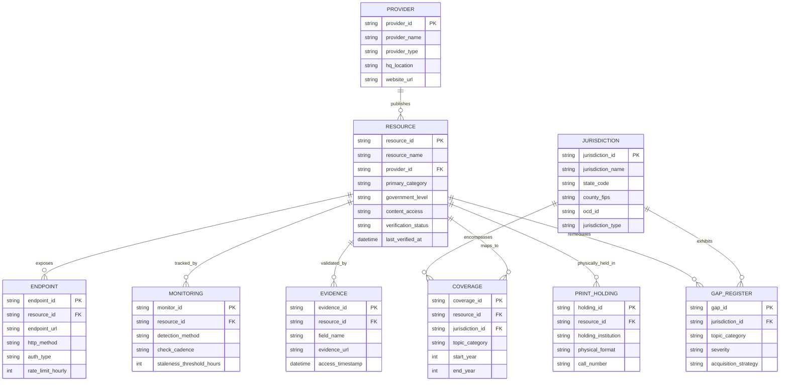

# Deliverable G: Data Dictionary, Entity Model, and Technical Schema
## Canonical Data Models for Application Ingestion and Entity Resolution

**Document Identifier:** `CIVIC-DOC-06-DATA-DICTIONARY`  
**Research Execution Date:** October 17, 2026  
**Specification Standard:** Canonical 36-Field Resource Schema and 8 Supporting Relational Tables  

---

## 1. Master Resource Schema Dictionary (36 Core Fields)

The canonical resource schema specifies the technical metadata required to ingest, monitor, and lawfully utilize civic data sources. The table below documents data types, allowed enumerations, null conventions, and validation rules for all 36 fields:

| Field Name | Data Type | Null / Empty Convention | Allowed Enumerations / Format | Definition and Required Content |
|---|---|---|---|---|
| `resource_id` | String | NOT NULL | Regex: `^[A-Z]{3}-[A-Z0-9_\-]+$` | Unique, immutable internal identifier (e.g., `FED-LEG-CONGRESS-API`). |
| `resource_name` | String | NOT NULL | Text string (max 150 chars) | Canonical official product, service, or collection title. |
| `provider_name` | String | NOT NULL | Text string (max 150 chars) | Legal name of publishing agency, corporation, or non-profit institution. |
| `provider_type` | Enum | NOT NULL | `Government`, `Nonprofit`, `Academic`, `Commercial`, `Media`, `Library/Archive`, `Community`, `Other` | Institutional classification of the operating entity. |
| `primary_category` | Enum | NOT NULL | Must match 1 of 6 core taxonomy categories (A–F) | Primary functional domain of the data asset. |
| `secondary_categories` | Array[String]| `[]` if none | Array of subtopic titles | Granular subtopics covered within the primary or adjacent domains. |
| `government_level` | Enum | NOT NULL | `Federal`, `State`, `Local`, `Tribal`, `Multilevel`, `Nongovernmental` | Constitutional or administrative tier of the publishing authority. |
| `jurisdiction_ids` | Array[String]| NOT NULL | Standard ISO/FIPS/OCD codes (e.g., `US`, `US-AZ`, `US-MI-WAY`) | Array of standardized jurisdiction identifiers covered by this resource. |
| `geographic_coverage` | String | NOT NULL | Text description | Explicit geographic scope (national, specific states, counties, or metro areas). |
| `product_url` | URL | NOT NULL | Valid `https://` URI | Canonical informational homepage for the product or service. |
| `search_or_portal_url` | URL | `null` if none | Valid `https://` URI or `null` | Direct interactive search, docket portal, or catalog interface. |
| `executive_summary` | Text | NOT NULL | 2–4 sentences | Concise operational summary of content, target users, and distinctive value. |
| `content_types` | Array[String]| NOT NULL | Array of standardized nouns | Concrete data objects (e.g., `Bills`, `Dockets`, `Ballots`, `Filings`, `GIS`). |
| `entity_types` | Array[String]| NOT NULL | Array of standardized entities | Core entities modeled (e.g., `People`, `Offices`, `Elections`, `Courts`). |
| `historical_coverage` | String | NOT NULL | Date range or text | Earliest archive start year to current date, noting completeness. |
| `update_frequency` | String | NOT NULL | Text description | Operational cadence (e.g., `Continuous`, `Hourly`, `Daily`, `Event-driven`). |
| `content_formats` | Array[String]| NOT NULL | Standard MIME / format types | Formats delivered (e.g., `JSON`, `XML`, `CSV`, `PDF`, `TIFF`, `Print`). |
| `languages` | Array[String]| NOT NULL | ISO 639-1 language codes/names | Languages actively supported (e.g., `English`, `Spanish`, `Navajo`). |
| `content_access` | Enum | NOT NULL | `Free`, `Registration required`, `Freemium`, `Subscription`, `Metered`, `Per-document fee`, `Institutional`, `On-site only`, `Mixed`, `Unknown` | End-user web access model and barrier profile. |
| `pricing_summary` | Text | NOT NULL | Explicit dollar figures or terms | Documented costs, subscription fee bands, or verified `Free public service`. |
| `developer_access` | Array[Enum] | NOT NULL | `API`, `Bulk download`, `Feed`, `Export`, `File endpoint`, `Manual only`, `None found` | Programmatic ingestion interfaces verified as operational. |
| `developer_docs_url` | URL | `null` if none | Valid `https://` URI or `null` | Official technical documentation, Swagger UI, or GitHub repository. |
| `api_or_feed_urls` | Array[URL] | `[]` if none | Array of valid `https://` URIs | Verified operational endpoint root URLs, RSS feeds, or download links. |
| `authentication` | String | NOT NULL | Text description | Credential requirements (`None`, `API key`, `OAuth 2.0`, `Contract`). |
| `developer_constraints`| Text | NOT NULL | Text description | Enforced rate limits, concurrency caps, daily quotas, and paging restrictions. |
| `license_and_reuse` | Text | NOT NULL | Text description | Legal reuse terms (Public domain, Creative Commons, attribution, commercial ban). |
| `terms_and_license_urls`| Array[URL] | `[]` if none | Array of valid `https://` URIs | Official terms of service, developer agreements, and legal policy links. |
| `recommended_integration`| Text | NOT NULL | Architecture guidance | Optimal ingestion strategy (REST polling, webhooks, bulk database restore). |
| `monitoring_support` | Text | NOT NULL | Technical capability | Mechanisms for change detection (ETag, RSS, updated timestamps, webhooks). |
| `coverage_limitations` | Text | NOT NULL | Explicit caveats | Documented coverage blindspots, geographic gaps, and operational delays. |
| `accessibility_and_offline`| Text | NOT NULL | Physical access details | Physical holding institutions, microfilm master reels, and ADA compliance. |
| `verification_status` | Enum | NOT NULL | `Verified live`, `Documentation verified only`, `Catalog verified only`, `Restricted`, `Unavailable`, `Discontinued`, `Unverified` | Quality assurance state verified during research execution. |
| `last_verified_at` | Datetime | NOT NULL | ISO 8601 UTC timestamp | Exact timestamp of live inspection (e.g., `2026-10-17T03:58:24Z`). |
| `evidence_urls` | Array[URL] | NOT NULL | Array of valid `https://` URIs | Sourced web links verifying documentation, rate limits, and live status. |
| `confidence` | Enum | NOT NULL | `High`, `Medium`, `Low` | Evaluator certainty based on primary source documentation versus secondary claims. |
| `notes` | Text | `null` if none | Free text or `null` | Critical implementation gotchas, statutory citations, or architectural warnings. |

---

## 2. Canonical Entity-Relational Architecture

The relational diagram below models the relationships among the core resource catalog and its eight supporting relational tables:



---

## 3. Specifications for the Eight Supporting Relational Tables

### Table 1: `PROVIDER` (Publishing Organizations)
* **Purpose:** Eliminates organizational redundancy across multi-product publishers.
* **Primary Key:** `provider_id` (String, e.g., `PROV-LOC`, `PROV-FEC`, `PROV-FREE-LAW`).
* **Fields:** `provider_id` (PK), `provider_name` (Text), `provider_type` (Enum), `parent_organization` (Text/null), `hq_location` (Text), `website_url` (URL), `contact_email` (Text/null), `operating_status` (Enum: `Active`, `Merged`, `Defunct`).

### Table 2: `JURISDICTION` (Constitutional & Administrative Geographies)
* **Purpose:** Standardizes geographic crosswalks across municipal, county, state, and court districts.
* **Primary Key:** `jurisdiction_id` (String, e.g., `US-AZ-MAR`, `US-MI-WAY-DET`).
* **Fields:** `jurisdiction_id` (PK), `jurisdiction_name` (Text), `state_code` (String, 2-char), `county_fips` (String, 5-digit/null), `ocd_id` (String, Open Civic Data format), `jurisdiction_type` (Enum: `Federal`, `State`, `County`, `Municipality`, `JudicialCircuit`, `ProsecutorialDistrict`), `chief_election_authority` (Text), `parent_jurisdiction_id` (FK).

### Table 3: `ENDPOINT` (Granular Programmatic Interfaces)
* **Purpose:** Tracks endpoint-specific rate limits, HTTP methods, and schemas.
* **Primary Key:** `endpoint_id` (String, e.g., `EP-CONGRESS-BILLS`, `EP-OPENFEC-CANDIDATES`).
* **Fields:** `endpoint_id` (PK), `resource_id` (FK), `endpoint_url` (URL), `http_method` (Enum: `GET`, `POST`), `request_format` (Enum: `QueryParam`, `JSONBody`, `FormData`), `response_format` (Enum: `JSON`, `XML`, `CSV`), `auth_type` (Enum: `None`, `APIKey_Header`, `APIKey_Query`, `BearerToken`), `rate_limit_hourly` (Integer), `sample_curl` (Text), `verification_status` (Enum).

### Table 4: `COVERAGE` (Resource × Jurisdiction × Topic Crosswalk)
* **Purpose:** Maps multi-jurisdictional products without row duplication in the master table.
* **Primary Key:** `coverage_id` (String, e.g., `COV-LEGISCAN-MI-BILLS`).
* **Fields:** `coverage_id` (PK), `resource_id` (FK), `jurisdiction_id` (FK), `topic_category` (Enum), `start_year` (Integer), `end_year` (Integer/null), `coverage_depth` (Enum: `Full`, `Partial`, `MetadataOnly`), `caveat_notes` (Text/null).

### Table 5: `PRINT_HOLDING` (Physical, Microfilm, and Library Collections)
* **Purpose:** Tracks physical preservation locations for records lacking digital APIs.
* **Primary Key:** `holding_id` (String, e.g., `PRT-MI-BURTON-DETROIT-MINUTES`).
* **Fields:** `holding_id` (PK), `resource_id` (FK), `publication_title` (Text), `identifier_type` (Enum: `LCCN`, `OCLC`, `ISSN`, `ISBN`, `LocalCallNumber`), `identifier_value` (String), `holding_institution` (Text), `branch_or_department` (Text), `call_number` (Text), `physical_format` (Enum: `BoundVolume`, `Microfilm35mm`, `Microfiche`, `ManuscriptBox`), `date_range` (Text), `public_access_policy` (Text).

### Table 6: `EVIDENCE` (Field-Level Audit Trail)
* **Purpose:** Provides immutable evidentiary provenance for all technical catalog claims.
* **Primary Key:** `evidence_id` (String, e.g., `EVD-OPENFEC-RATELIMIT`).
* **Fields:** `evidence_id` (PK), `resource_id` (FK), `field_name` (String), `claim_text` (Text), `evidence_url` (URL), `access_timestamp` (Datetime), `verification_method` (Enum: `HTTP_Inspection`, `Documentation_Review`, `API_Test_Execution`), `auditor_notes` (Text).

### Table 7: `MONITORING` (Automated Ingestion & Change Detection)
* **Purpose:** Governs scheduled worker tasks, health checks, and failure alerts.
* **Primary Key:** `monitor_id` (String, e.g., `MON-CONGRESS-BILLS-HOURLY`).
* **Fields:** `monitor_id` (PK), `resource_id` (FK), `detection_method` (Enum: `HTTP_ETag`, `RSS_Polling`, `Webhook`, `Hash_Comparison`), `check_cadence` (Enum: `Realtime`, `Hourly`, `Daily`, `Weekly`), `retry_backoff_strategy` (Enum: `Exponential`, `Linear`, `Immediate3x`), `duplicate_suppression_key` (String), `alert_severity` (Enum: `P1_Critical`, `P2_High`, `P3_Medium`, `P4_Low`), `staleness_threshold_hours` (Integer), `fallback_resource_id` (FK/null).

### Table 8: `GAP_REGISTER` (Identified Blindspots & Acquisition Pipeline)
* **Purpose:** Systematic tracking of missing datasets, paywalled records, and FOIA queues.
* **Primary Key:** `gap_id` (String, e.g., `GAP-GA-PEACHCOURT-PAYWALL`).
* **Fields:** `gap_id` (PK), `jurisdiction_id` (FK), `topic_category` (Enum), `missing_element_description` (Text), `attempted_search_routes` (Text), `operational_impact` (Enum: `High`, `Medium`, `Low`), `acquisition_strategy` (Enum: `FOIA_Request`, `Commercial_Contract`, `Web_Scraper_Development`, `Library_Digitization`), `priority` (Enum: `Urgent`, `Routine`, `Backlog`).

---

## 4. Concrete Verified Example Records

### Concrete Example 1: Federal Official API (`JSON` Representation)
```json
{
  "resource_id": "FED-LEG-CONGRESS-API",
  "resource_name": "Congress.gov REST API",
  "provider_name": "Library of Congress",
  "provider_type": "Government",
  "primary_category": "Legislation and government action",
  "secondary_categories": ["Federal bills", "Roll-call votes", "Committee activity"],
  "government_level": "Federal",
  "jurisdiction_ids": ["US"],
  "geographic_coverage": "United States nationwide (Federal Congress)",
  "product_url": "https://www.congress.gov/",
  "search_or_portal_url": "https://api.congress.gov/",
  "executive_summary": "Authoritative legislative API providing structured JSON/XML endpoints for bills, amendments, member profiles, committee reports, and roll-call floor votes.",
  "content_types": ["Bills", "Resolutions", "Amendments", "Committee Reports", "Floor Votes"],
  "entity_types": ["Bills", "People", "Committees", "Votes"],
  "historical_coverage": "1973 (93rd Congress) to present",
  "update_frequency": "Continuous during legislative session; hourly synchronization",
  "content_formats": ["JSON", "XML"],
  "languages": ["English"],
  "content_access": "Free",
  "pricing_summary": "Free public service; no fees",
  "developer_access": ["API", "Bulk download"],
  "developer_docs_url": "https://github.com/LibraryOfCongress/api.congress.gov",
  "api_or_feed_urls": ["https://api.congress.gov/v3/bill"],
  "authentication": "API key passed via X-Api-Key header",
  "developer_constraints": "5,000 requests per hour; rate limit tracked in X-RateLimit headers",
  "license_and_reuse": "Public domain (17 U.S.C. § 105). Unrestricted redistribution.",
  "terms_and_license_urls": ["https://www.congress.gov/help/using-data-offsite"],
  "recommended_integration": "Poll /v3/bill endpoint using updateDate parameters",
  "monitoring_support": "HTTP ETag, update timestamps on records, GitHub changelog",
  "coverage_limitations": "Hearing transcripts occasionally lag live testimony by several weeks",
  "accessibility_and_offline": "Digital API; bound volumes in Federal Depository Libraries",
  "verification_status": "Verified live",
  "last_verified_at": "2026-10-17T03:58:24Z",
  "evidence_urls": ["https://api.congress.gov/"],
  "confidence": "High",
  "notes": "Primary system of record for all federal legislative applications."
}
```

### Concrete Example 2: Non-Profit Legal Ingestion (`CSV` Serialization Format)
```csv
resource_id,resource_name,provider_name,provider_type,primary_category,content_access,pricing_summary,developer_access,license_and_reuse,verification_status
NAT-CRT-COURTLISTENER,"CourtListener REST API v4","Free Law Project",Nonprofit,"Courts, judges, and legal proceedings",Freemium,"Free tier 125 req/day; paid tiers from $10/mo","API; Bulk download; Database replication","Public domain court records; permissive API terms","Verified live"
```

---

## 5. Serialization and Application Storage Guidance

When importing this schema into production relational or document databases:
1. **Array Serialization in Relational Stores (PostgreSQL / SQLite):**
   * Multi-valued fields (`secondary_categories`, `content_types`, `entity_types`, `languages`, `developer_access`) should be stored as native `JSONB` arrays in PostgreSQL or decomposed into 1-to-many child junction tables in strict third-normal-form (3NF) relational architectures.
   * For flat CSV exports, array items are joined using a semicolon-space delimiter (`; `).
2. **Temporal Consistency:**
   * All timestamps (`last_verified_at`, `access_timestamp`) must strictly enforce ISO 8601 formatting in Coordinated Universal Time (UTC) with trailing `Z` designator (`YYYY-MM-DDTHH:MM:SSZ`).
3. **Open Civic Data (OCD) Identification Standard:**
   * Jurisdictions should be cross-indexed against the Open Civic Data Identifier standard (`ocd-jurisdiction/country:us/state:mi/place:detroit/government`) to enable seamless interoperability across Google Civic, Open States, and Ballotpedia APIs.
