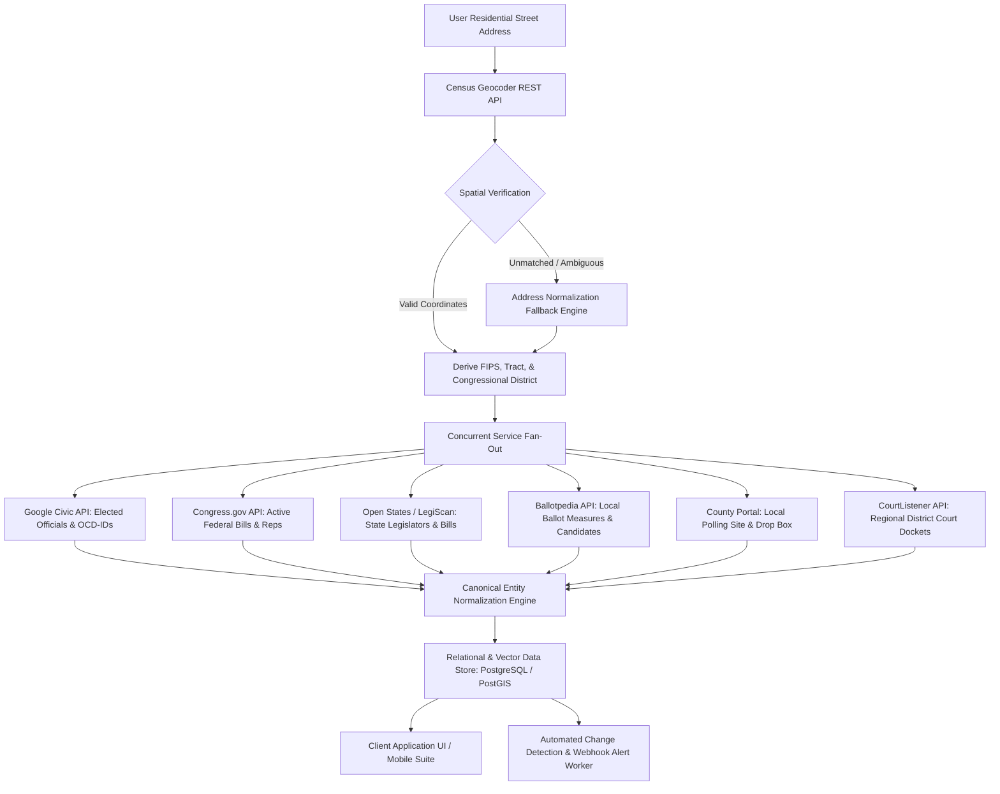

# Deliverable H: Integration Recommendations and Systems Architecture
## Deployment Tiers, Data Ingestion Pipelines, and Entity Resolution Framework

**Document Identifier:** `CIVIC-DOC-07-INTEGRATION-ARCH`  
**Research Execution Date:** October 17, 2026  
**Cycle Scope:** 2026 Midterm Cycle and Scalable Multi-Tier System Design  

---

## 1. Multi-Tier Source Stack Recommendations

Civic applications possess vastly different operational constraints depending on their capitalization, user concurrency, and legal risk tolerance. Below are three production-tested architectural stacks designed for distinct deployment profiles:

### Tier 1: Free-First Prototype Stack ($0 Budget / Open Source)
* **Target Profile:** Hackathons, academic research, non-profit civic experiments, and minimum viable products (MVPs).
* **Cost Structure:** $0.00 software licensing and zero data acquisition fees.
* **Component Selection:**
  * *Spatial Resolution & Boundaries:* **U.S. Census Bureau Geocoder API** (Unlimited free batch and single-address queries; decennial benchmark mapping).
  * *Federal Legislation:* **Congress.gov API** (5,000 req/hr free tier via `api.data.gov`) and **GPO GovInfo API** (36,000 req/hr).
  * *Federal Campaign Finance:* **OpenFEC API** (1,000 req/hr standard self-signed key).
  * *State Legislation & Legislators:* **Open States REST API v3** (Free community tier; `/people.geo` coordinate lookup).
  * *Active Ballots & Officials:* **Google Civic Information API** (Free 25,000 queries per day).
  * *Judicial Dockets & Case Law:* **CourtListener REST API v4** (Free standard tier: 125 req/day rolling limit; Harvard CAP archive).
  * *Historical Context & Public Notices:* **Library of Congress JSON API** (Chronicling America historical newspapers).
* **What the Free Prototype Stack CANNOT Cover:**
  1. *Hyper-Local Ordinances:* Towns and small cities lacking digital codified charters cannot be ingested without custom scrapers.
  2. *Real-Time State Trial Court Dockets:* Paywalled county portals (PeachCourt, Odyssey) cannot be queried without commercial fees.
  3. *Unrestricted Court Document PDFs:* Direct PACER downloads will trigger fees once the $30 quarterly threshold is exceeded.
  4. *Exhaustive School Board & Local Candidate Surveys:* High-granularity candidate bios outside major metros are largely absent without commercial Ballotpedia feeds.
  5. *Real-Time Push Alerting:* The prototype relies on polling cadences bounded by API rate limits.

---

### Tier 2: Production Application Prioritizing Official Sources
* **Target Profile:** Government agencies, established journalistic newsrooms, university policy centers, and enterprise civic platforms prioritizing unmediated public records.
* **Cost Structure:** Low-to-moderate infrastructure costs ($500–$3,000/month for cloud compute, PACER usage, and state bulk data fees).
* **Component Selection:**
  * *Election Administration & Voting Sites:* Direct ingestion of official **Voting Information Project (VIP XML v5.2/v6.0)** feeds retrieved directly from state election bureaus.
  * *Official Legislation:* State Legislative Information Systems (LIS) bulk feeds, FTP archives, and official slip law PDFs, normalized via custom ETL pipelines.
  * *Federal Court Oversight:* Direct **PACER Case Locator API** integration with automated quarterly billing management and local document caching, supplemented by the RECAP archive.
  * *State Judicial Tracking:* Direct integrations with state-managed open court portals (e.g., Pennsylvania Unified Judicial System, Wisconsin Circuit Court Access, Michigan MiCOURT).
  * *State Campaign Finance:* Direct ingestion of official state campaign finance bulk CSV dumps (e.g., Arizona SeeTheMoney, Michigan MERTS, Georgia Ethics Commission).
  * *Spatial Mapping:* Local county GIS shapefiles combined with Census TIGER/Line geographic master layers.
* **What the Production Official Stack CANNOT Cover:**
  1. *Turnkey Schema Harmonization:* Every state publishes data in fundamentally incompatible formats; requires continuous in-house ETL maintenance.
  2. *Candidate Policy Questionnaires:* Official election boards publish candidate filings and ballot access certifications, but never candidate policy views, issue stances, or debate recordings.

---

### Tier 3: Commercial & Enterprise Implementation
* **Target Profile:** Scaled commercial media platforms, enterprise government affairs software, national advocacy organizations, and corporate compliance engines.
* **Cost Structure:** $25,000–$150,000+ annual data licensing and SLA infrastructure commitments.
* **Component Selection:**
  * *Multi-State Legislative Intelligence:* **LegiScan Push API** (Enterprise automated webhooks delivering bill text diffs and roll calls every 15 minutes) and **Plural Policy Enterprise**.
  * *Candidates, Ballots & Measures:* **Ballotpedia Data Client API** (Commercial package: 200,000 daily queries; coordinates to `/elections_by_point`, `/officeholders`, and `/ballot_measures`).
  * *Judicial Intelligence:* **CourtListener Enterprise Database Replication** (PostgreSQL dedicated logical replica) supplemented by commercial feeds (vLex, LexisNexis, or Thomson Reuters Westlaw).
  * *Federal & State Campaign Finance:* **OpenSecrets Commercial Data License** (Cleaned, entity-resolved donor and lobbying networks) coupled with real-time OpenFEC stream processing.
  * *Voter File & Address Hygiene:* Commercial USPS CASS-certified address normalization and licensed nonpartisan voter file access (where permitted by state statute).
* **What the Commercial Enterprise Stack CANNOT Cover:**
  1. *Statutory Solicitation Prohibitions:* Commercial enterprise status does NOT exempt an organization from **52 U.S.C. § 30111(a)(4)** banning commercial exploitation of FEC donor data.
  2. *Sealed, Expunged, and Juvenile Records:* Legally restricted judicial filings remain strictly unavailable under law.
  3. *Unpublished Administrative Discretion:* Local prosecutor charging guidelines and internal declination memos are rarely formalized as machine-readable data.

---

## 2. Comparative Architectural Capabilities Matrix

The following matrix contrasts the capabilities, operational limits, and engineering maintenance burdens across the three deployment tiers:

| Architectural Dimension | Tier 1: Free Prototype | Tier 2: Production Official | Tier 3: Commercial Enterprise |
|---|---|---|---|
| **Capital & License Cost** | $0.00 | $500–$3,000 / month | $25,000–$150,000+ / year |
| **Ingestion Latency** | Polling-based (1–24 hours) | Scheduled ETL (15 min–4 hours) | Real-time webhooks (Sub-minute to 15 min) |
| **Federal Coverage** | 100% (Congress, FEC, GovInfo) | 100% (Direct Agency) | 100% (Enriched & Entity-Resolved) |
| **50-State Legislation** | Open States Community (Moderate)| Custom State LIS Scrapers (High) | LegiScan Push API (Guaranteed SLA) |
| **Local Ballots & Races** | Google Civic (Active cycles only)| State VIP Feeds (Participating only)| Ballotpedia Commercial (Comprehensive) |
| **Court Dockets & Orders**| CourtListener Free (125/day) | PACER Metered + State Portals | PostgreSQL Replica + Lexis/vLex Feeds |
| **Engineering Maintenance**| Low (Standard REST endpoints) | Very High (Custom state/county ETL)| Low (Managed vendor APIs and schemas) |
| **Commercial Monetization**| Permissive (Public domain only) | Permissive (Public records) | Whitebox licensed (Full commercial rights) |

---

## 3. End-to-End Ingestion and Normalization Pipeline Architecture

The workflow diagram below illustrates the end-to-end data pipeline from raw user address input through spatial resolution, multi-source fan-out, entity normalization, and caching:

---

## 4. Entity Resolution and Boundary Mapping Framework

### 1. Eliminating Entity Conflation
A critical failure mode in civic applications is treating distinct legal entities as interchangeable. The data architecture must enforce strict separation across four distinct classes:
1. **The Person (Natural Individual):** Represented by an immutable UUID. A single individual possesses biographical attributes, professional history, and educational background.
2. **The Office (Constitutional / Statutory Seat):** An enduring institutional office (e.g., `U.S. Representative, MI-07`, `Wayne County Prosecutor`, `Detroit City Clerk`) that exists independently of its occupant.
3. **The Candidacy (Election Contest Instance):** The specific legal manifestation of a person running for an office in a specific election cycle under a specific party banner.
4. **The Campaign Committee (Legal Financial Entity):** The registered political committee filed with the FEC or state campaign finance board (e.g., `Friends of John Doe`, FEC ID `C00812345`).

### 2. Geographic Boundary Disambiguation
Administrative boundaries do not share identical borders. Civic tech platforms must resolve five intersecting spatial layers without conflation:
* **Municipal Boundary (City/Town):** Governs municipal ordinances, zoning, and city council representation.
* **County Boundary:** Governs property taxation, county sheriff jurisdiction, and in most states, election administration.
* **Voting Precinct / Ward:** The smallest unit of election administration; determines exact ballot style and polling location.
* **State & Federal Legislative Districts:** State House, State Senate, and Congressional boundaries drawn during decennial redistricting.
* **Judicial & Prosecutorial Circuits:** State judicial circuits and District Attorney jurisdictions, which frequently span multiple rural counties or divide large metropolitan centers.
